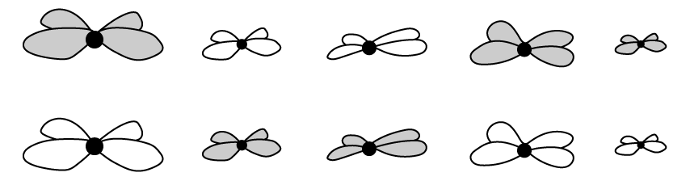
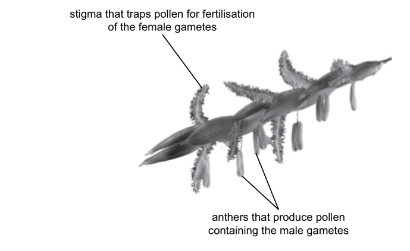
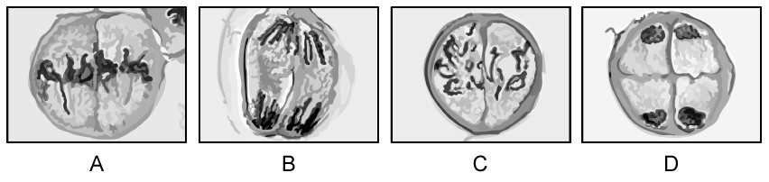
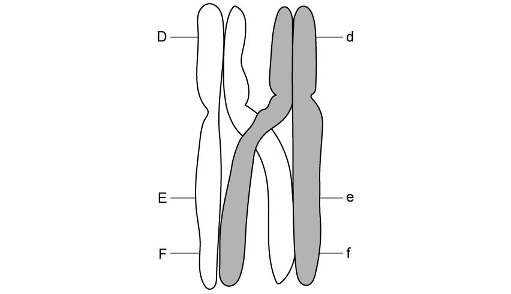
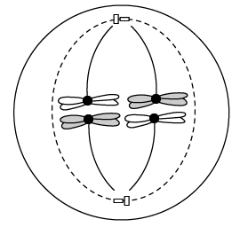
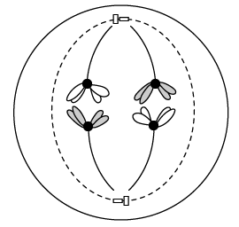
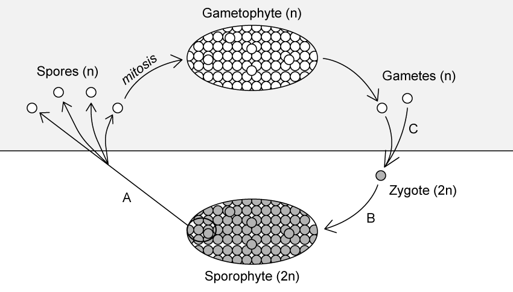
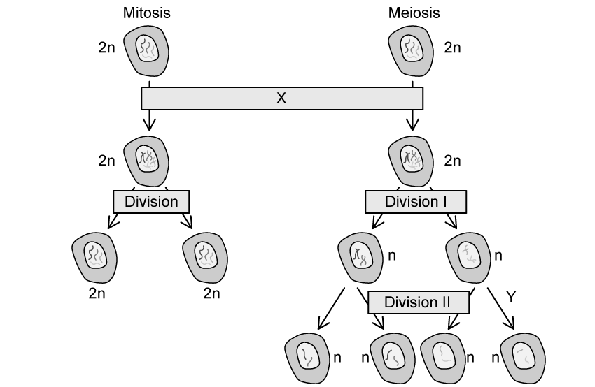
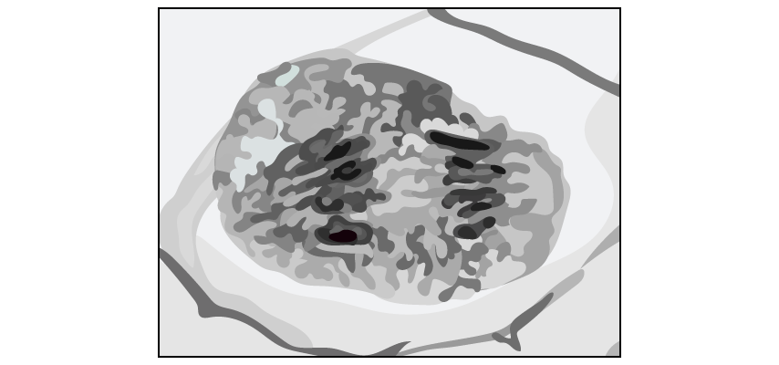
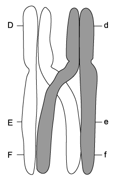

# Exam Questions — Passage of Information from Parents to Offspring
**16. Inheritance** · Cambridge (CIE) A-LEVEL biology (9700)
> Source: [https://www.savemyexams.com/a-level/biology/cie/25/topic-questions/](https://www.savemyexams.com/a-level/biology/cie/25/topic-questions/) · 10 questions across 1 sets

## Structured Questions (10 questions)

### Q1 — hard — 8 marks

**Q1** [2 marks]

Fig. 1 shows a defective form of meiosis that occurs in some species of flowering plants.

**Fig. 1**

Complete Fig. 2 to show the chromosomes resulting from a normal meiotic division of the diploid parent cell from Fig. 1.

**Fig. 2**

**Q1** [2 marks]

**Extract:**

Fig. 1 shows a defective form of meiosis that occurs in some species of flowering plants.

Explain the consequence of the defective form of meiosis shown in Fig. 1.

**Q1** [1 mark]

During normal meiotic division the flowering plant contains 9 chromosomes in one of its pollen nuclei.

State the number of **chromatids **present in the parent cell at the start of meiosis.

**Q1** [3 marks]

In a lab, 400 different cells undergoing meiosis were observed. All the cells were in the same phase of meiosis during the first meiotic division, this is shown in Fig. 3.

Use your knowledge of independent assortment of chromosomes to calculate the number of cells that would be expected to have an identical arrangement of chromosomes to those shown in Fig. 3. Assume there is no crossing over.

**Fig. 3**

### Q2 — hard — 11 marks

**Q2** [2 marks]

Edwards syndrome is a rare but serious condition that influences birth weight and growth rate. Fig. 1 shows the chromosomes of an individual with Edwards syndrome.

**Fig. 1**

The numbered sets of chromosomes in Fig.1 are known as homologous pairs.

Explain what is meant by the term **homologous pair**.

**Q2** [4 marks]

**Extract:**

Edwards syndrome is a rare but serious condition that influences birth weight and growth rate. Fig. 1 shows the chromosomes of an individual with Edwards syndrome.

The numbered sets of chromosomes in Fig.1 are known as homologous pairs.

Edwards syndrome is caused by what is known as a chromosome mutation.

(i) Define the term **mutation**.

[1]

(ii) Use Fig.1 to suggest the chromosome mutation that causes Edwards syndrome.

[1]

(iii) Suggest the cause of the chromosome mutation suggested in part ii).

[2]

**Q2** [2 marks]

**Extract:**

Edwards syndrome is caused by what is known as a chromosome mutation.

The term mutation refers to a change in the sequence of (DNA) bases/base pairs.

The chromosome mutation that causes Edwards syndrome is: Pair 18 has three chromosomes.

This could have happened because a (homologous) pair of chromosomes has not separated (properly/completely) during (anaphase I of) meiosis.

Suggest why Edwards syndrome affects every cell in the body.

**Q2** [3 marks]

Mutation is one source of variation among living organisms.

Identify **three** other sources of variation among living organisms.

### Q3 — hard — 12 marks

**Q3** [2 marks]

Hybridisation can be used by plant breeders to develop new varieties of crop plants.

A student investigated the ability of one species of grass, species **A**, to hybridise with two other species of grass, species **B** and species **C**, by studying the chromosomes of the hybrids.

The diploid number of chromosomes for each species was:

- species **A**    12
- species **B**    20
- species **C **   14

Fig. 1 shows part of a grass flower stalk with several flowers.

**Fig. 1**

These are the main steps in the procedure used by the student:

- The anthers were removed from 40 flower stalks of species **A**.
- Separate plastic bags were placed around each of the flower stalks, still attached to the plant.
- Pollen from species **B** was transferred onto the stigmas of 20 of the flower stalks of species **A**.
- Pollen from species** C** was transferred onto the stigmas of the other 20 flower stalks of species **A**.
- The grains formed by fertilisation of species **A**, each containing a single seed, were collected.
- Hybrid embryo plants were removed from the grains and the number of chromosomes in the cells of each of the hybrid embryo plants was counted.

(i) Identify the** dependent** variable in this investigation.

[1]

(ii) Identify the variable that was controlled by the use of plastic bags on the flower stalks of species **A**.

[1]

*Source: Specimen 2022 9700/05 Q2AI, AII*

**Q3** [3 marks]

**Extract:**

A student investigated the ability of one species of grass, species A, to hybridise with two other species of grass, species B and species C, by studying the chromosomes of the hybrids.

The diploid number of chromosomes for each species was:
- species A    12
- species B    20
- species C    14

These are the main steps in the procedure used by the student:
- The anthers were removed from 40 flower stalks of species A.
- Separate plastic bags were placed around each of the flower stalks, still attached to the plant.
- Pollen from species B was transferred onto the stigmas of 20 of the flower stalks of species A.
- Pollen from species C was transferred onto the stigmas of the other 20 flower stalks of species A.
- The grains formed by fertilisation of species A, each containing a single seed, were collected.
- Hybrid embryo plants were removed from the grains and the number of chromosomes in the cells of each of the hybrid embryo plants was counted.

Table 1 shows the results that the student obtained from counting the number of chromosomes in the cells of each of the hybrid embryo plants.

**Table 1**

| **hybrid embryo from cross** | **number of chromosomes** |
|---|---|
| **A** ×** B** | 16 |
| **A** × **C** | 26 |

Explain the results of the student’s investigation, as shown in Table 1.

*Source: Specimen 2022 9700/05 Q2B*

**Q3** [2 marks]

**Extract:**

A student investigated the ability of one species of grass, species A, to hybridise with two other species of grass, species B and species C, by studying the chromosomes of the hybrids.

The diploid number of chromosomes for each species was:
- species A    12
- species B    20
- species C    14

These are the main steps in the procedure used by the student:
- The anthers were removed from 40 flower stalks of species A.
- Separate plastic bags were placed around each of the flower stalks, still attached to the plant.
- Pollen from species B was transferred onto the stigmas of 20 of the flower stalks of species A.
- Pollen from species C was transferred onto the stigmas of the other 20 flower stalks of species A.
- The grains formed by fertilisation of species A, each containing a single seed, were collected.
- Hybrid embryo plants were removed from the grains and the number of chromosomes in the cells of each of the hybrid embryo plants was counted.

Table 1 shows the results that the student obtained from counting the number of chromosomes in the cells of each of the hybrid embryo plants.

Table 1
| hybrid embryo from cross | number of chromosomes |
| A × B | 16 |
| A × C | 26 |

In a second investigation, the student repeated the procedure to hybridise the grasses.

- After hybridising the grasses, 50 grains containing hybrid embryo plants were collected from each of the two crosses,** A** × **B** and** A** × **C**.
- Hybrid grass plants were grown from the grains collected.
- When the hybrid grass plants flowered, pollen containing the male gametes was collected.
- For each of the two crosses, the number of chromosomes in a random sample of 30 male gametes obtained from the pollen of the hybrid grass plants was counted.

Table 2 shows the results of this investigation.

**Table 2**

| **number of chromosomes in 30 male gametes from the** **hybrid grass plants produced from:** |   |   |   |   |   |   |   |   |   |
|---|---|---|---|---|---|---|---|---|---|
| **cross A **×** B** | **cross A** ×** C** |   |   |   |   |   |   |   |   |
| 6 | 6 | 8 | 7 | 10 | 13 | 13 | 13 | 13 | 13 |
| 16 | 8 | 16 | 9 | 0 | 13 | 13 | 13 | 13 | 13 |
| 8 | 8 | 16 | 6 | 6 | 13 | 13 | 13 | 13 | 13 |
| 6 | 10 | 8 | 16 | 9 | 13 | 13 | 13 | 13 | 13 |
| 13 | 12 | 16 | 8 | 6 | 13 | 13 | 13 | 13 | 13 |
| 8 | 8 | 16 | 6 | 10 | 13 | 13 | 13 | 13 | 13 |

(i) The student also counted the number of chromosomes in the female gametes of each hybrid grass plant.

Predict the number of chromosomes you would expect the student to find in the female gametes of the hybrid grass plants.

[1]

(ii) The student concluded that hybrids from cross **A **×** B** could not be bred successfully.

State **one** piece of evidence in Table 2.2 that supports this conclusion.

[1]

*Source: Specimen 2022 9700/05 Q2C*

**Q3** [5 marks]

The student carried out a third investigation to find out if the difference in the number of hybrid grains germinating from the two crosses was significant. The student counted the number of grains that germinated from 11 samples of 50 grains from each cross.

Table 3 shows the results of the investigation.

**Table 3**

| **sample** **number** | **number of grains that germinated** |   |
|---|---|---|
| **cross A **×** B** | **cross A **×** C** |   |
| 1 | 30 | 41 |
| 2 | 31 | 43 |
| 3 | 32 | 45 |
| 4 | 32 | 45 |
| 5 | 34 | 46 |
| 6 | 34 | 46 |
| 7 | 34 | 47 |
| 8 | 36 | 48 |
| 9 | 36 | 48 |
| 10 | 38 | 49 |
| 11 | 37 | 48 |
| **mean** | 34 |   |
| **mode** | 34 |   |
| **median** | 34 |   |

The student calculated the mean, mode and median for the data from the cross of** A **×** B **and recorded these in Table 3.

(i) Complete Table 3 by writing in the values of the mean, mode and median for the results from cross **A **×** C.**

[2]

(ii) The student used the *t*-test to compare the means.

State **one** feature of the data that allows use of the* t*-test.

[1]

(iii) State a null hypothesis for this *t*-test.

[1]

(iv) State why the number of degrees of freedom for this *t*-test is 20.

[1]

*Source: Specimen 2022 9700/05 Q2D(I, II, III, IV)*

### Q4 — medium — 11 marks

**Q4** [4 marks]

Fig. 1 shows microscope images of cells undergoing meiosis.

**Fig. 1**

Identify the stages of meiosis shown in Fig. 1

**Q4** [2 marks]

Fig. 2 shows a pair of chromosomes during meiosis in a* Drosophila melanogaster* (fruit fly) testis cell. The position of the alleles of some genes is indicated.

**Fig. 2**

Describe the process shown in Fig. 2

**Q4** [3 marks]

**Extract:**

Fig. 2 shows a pair of chromosomes during meiosis in a Drosophila melanogaster (fruit fly) testis cell. The position of the alleles of some genes is indicated.

Fig. 3 shows the *D. melanogaster* gametes containing the chromosomes shown in Fig. 2 at the end of meiosis.

**Fig. 3**

Complete diagrams **II**-**IV** to show the allele combinations for the remaining chromosomes.

**Q4** [2 marks]

**Extract:**

Fig. 2 shows a pair of chromosomes during meiosis in a Drosophila melanogaster (fruit fly) testis cell. The position of the alleles of some genes is indicated.

The process (crossing over) shown in Fig. 2 involves:
- Homologous chromosomes pair up / are very close together
- Sections of the chromosomes/non-sister chromatids overlap/cross over/become entangled
- Stress is placed on the DNA at the crossing points/chiasmata
- The DNA breaks and rejoins / sections of DNA are exchanged / the positions of the alleles are switched

The process shown in Fig. 2 contributes to genetic variation in *D. melanogaster*.

Explain why genetic variation is important for the survival of *D. melanogaster* as a species.

### Q5 — medium — 8 marks

**Q5** [8 marks]

Describe the behaviour of chromosomes during meiosis.

*Source: May/June 2019 9700/41 Q9B*

### Q6 — medium — 10 marks

**Q6** [3 marks]

Fig.1 shows a cell undergoing cell division.

**Fig. 1**

(i) Identify the type of cell division taking place in Fig. 1.

[1]

(ii) Describe the events taking place in Fig. 1.

[2]

**Q6** [2 marks]

**Extract:**

Fig.1 shows a cell undergoing cell division.

The type of cell division shown in Fig.1 is meiosis.

The events taking place include:
- The homologous pairs / bivalents line up along the middle/equator of the cell
- Spindle fibres/microtubules attach to centromeres

Fig. 1 shows metaphase (I), so shows the lining up of homologous pairs and their attachment to the spindle in preparation for anaphase.

Explain how the process shown in Fig. 1 contributes to genetic variation.

**Q6** [2 marks]

**Extract:**

Fig.1 shows a cell undergoing cell division.

**Fig. 1**

The number of possible chromosome combinations that can be generated during the stage of cell division shown in Fig.1 can be calculated using the equation:

2n

Where n is the number of pairs of chromosomes present in the cell.

Calculate the number of possible chromosome combinations that could be generated by the cell shown in Fig.1.

**Q6** [3 marks]

Fig. 2 shows a cell from the same organism in a different stage of cell division.

**Fig. 2**

(i) Identify the precise stage of cell division shown in Fig. 2.

[1]

(ii) Give reasons for your answer to part i).

[2]

### Q7 — medium — 8 marks

**Q7** [2 marks]

Fig. 1 shows the life cycle of a fern plant.

**Fig. 1**

Explain what is indicated by the term *n* in Fig.1

**Q7** [2 marks]

**Extract:**

Fig. 1 shows the life cycle of a fern plant.

Name the processes taking place at the stages marked **A** and **B** in Fig. 1

**Q7** [1 mark]

**Extract:**

Fig. 1 shows the life cycle of a fern plant.

Describe the events at stage **C** in Fig. 1

**Q7** [3 marks]

**Extract:**

Fig. 1 shows the life cycle of a fern plant.

**Fig. 1**

The processes taking place at the stages marked **A** and **B** are:
- **A** = meiosis

Explain the importance of the process taking place at the point marked **A** in Fig. 1

### Q8 — easy — 6 marks

**Q8** [1 mark]

Fig. 1 below shows a summary of the events during mitosis and meiosis.

**Fig.1 **

Identify the process taking place at the stage marked **X**.

**Q8** [2 marks]

**Extract:**

Fig. 1 below shows a summary of the events during mitosis and meiosis.

The stage marked **Y** on Fig. 1 in part **(a)** shows a change in the amount of genetic material in the cells.

Describe the events that take place in order for this change to occur.

**Q8** [2 marks]

**Extract:**

Fig. 1 below shows a summary of the events during mitosis and meiosis.

During division I shown in Fig. 1 in part **(a)** a process known as crossing over takes place.

Outline the events that take place during crossing over.

**Q8** [1 mark]

Crossing over generates genetic variation.

**Other than** crossing over, identify **one** other process that generates genetic variation during sexual reproduction.

### Q9 — easy — 8 marks

**Q9** [2 marks]

Fig. 1 below shows some chromosomes during meiosis.

**Fig. 1**

(i) Identify the stage of meiosis shown.

[1]

(ii) Describe the behaviour of the chromosomes during this stage of meiosis.

[1]

**Q9** [3 marks]

Fig. 2 shows two chromosomes.

**Fig. 2**

(i) Identify the structures labelled **X** and **Y**.

[2]

(ii) Structures **Y** and **Z **are identical.

State why this is the case.

[1]

**Q9** [2 marks]

The two chromosomes shown in part **(b) **can be described as homologous chromosomes.

Define the term *homologous chromosome*.

**Q9** [1 mark]

**Extract:**

Fig. 2 shows two chromosomes.

(i) Identify the structures labelled X and Y.

Structures X and Y are:
- X = centromere
- Y = (sister) chromatid

The two chromosomes shown in part (b) can be described as homologous chromosomes.

During meiosis the homologous chromosomes shown in part **(b)** are separated.

Identify the stage of meiosis during which the homologous chromosomes are separated.

### Q10 — easy — 9 marks

**Q10** [2 marks]

Fig. 1 below shows a pair of chromosomes during meiosis. The letters represent the alleles at different loci on each chromosome.

**Fig. 1**

(i) Identify the process taking place in the image.

[1]

(ii) Label the image with an **X** to show the location of the chiasmata.

[1]

**Q10** [2 marks]

**Extract:**

Fig. 1 below shows a pair of chromosomes during meiosis. The letters represent the alleles at different loci on each chromosome.

Fig. 1

State the alleles that will be present on each of the **grey** shaded chromatids at the end of the process shown in part **(a)**.

**Q10** [2 marks]

There are many different possible combinations of chromosomes that can be found in the daughter cells produced during meiosis.

Use the formula 2n to calculate the number of possible chromosome combinations that can be generated in domestic cat gametes. Note that the adult cells of domestic cats contain 38 chromosomes.

**Q10** [3 marks]

Chromosomes behave in specific ways during the different stages of meiosis.

Sketch an annotated diagram of a cell in telophase, The chromosomes should be clearly visible in your diagram.
