# Mark Schemes — The Roles of Genes in Determining the Phenotype
**16. Inheritance** · Cambridge (CIE) A-LEVEL biology (9700)

## Structured Questions (13 questions)

### Q1
The name of the statistical test used is...

- Chi-squared / χ2 (test); **[1 mark]**

The expected phenotypic ratio for the F2 generation is...

- 9 : 3 : 3 : 1; **[1 mark]**

**[Total: 2 marks]**

> *The chi-squared test is used because we are testing for a significant difference between **observed** and **expected** values.*

> *The expected ratio is 9:3:3:1; this is a ratio that you should recognise, and is the expected result of a dihybrid cross with **two parents who are heterozygous** for** both traits**:*

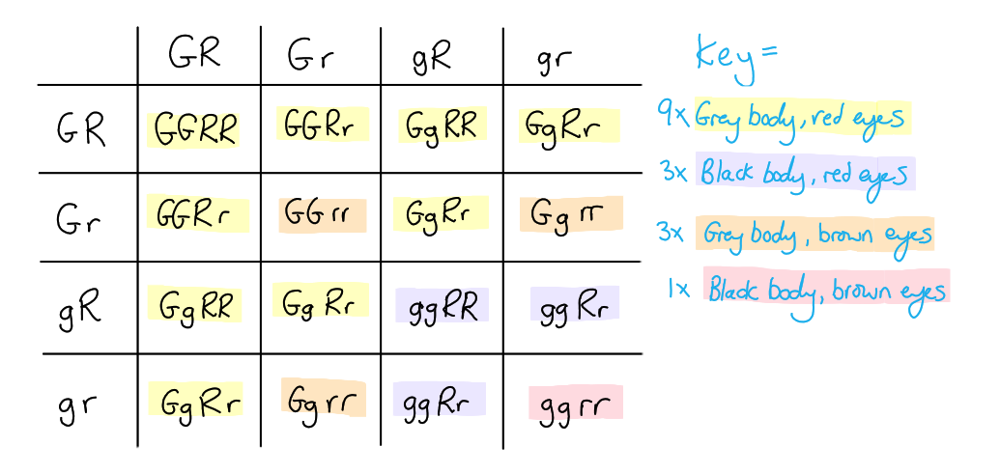
The genetic diagram should contain the following information...

- Parent genotypes = GgRr **AND** ggrr; **[1 mark]**
- Gametes = GR Gr gR gr **AND** gr; **[1 mark]**
- Offspring genotypes = GgRr **AND **Ggrr **AND **ggRr **AND **ggrr; **[1 mark]**
- Offspring phenotypes = Grey body red eyes **AND** grey body brown eyes **AND** black body red eyes **AND** black body brown eyes; **[1 mark]**

**[Total: 4 marks]**

> *Avoid wasting time drawing enormous Punnett squares when you only need a small one; this avoids repeating yourself when drawing Punnett squares containing parents that can only produce one or two types of gametes.*

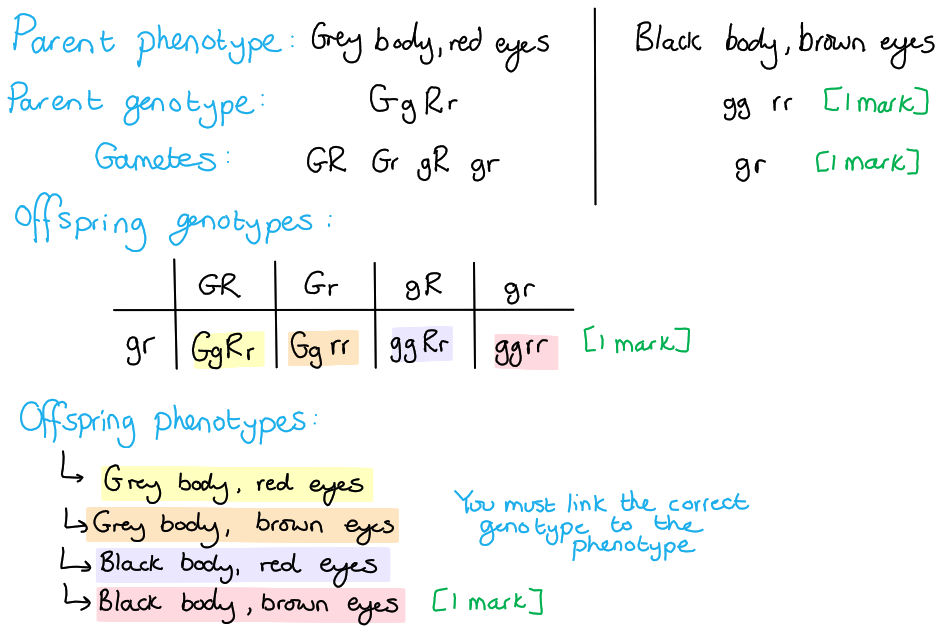
These results are different from the expected results because...

**Final answer:** **Any ****five ****of the following:**

- The expected ratio was 1:1:1:1 / the ratio is not 1:1:1:1; **[1 mark]**
- The flies are mostly grey(body)-red(eye) and black(body)-brown(eye); **[1 mark]**
- The majority resemble (original) parents / have parental phenotypes; **[1 mark]**
- There is a 1:1 ratio of two parental types **AND** a 1:1 ratio of recombinant types; **[1 mark]**
- Genes (for eye colour and body colour) are linked / on same chromosome; **[1 mark]**
- (alleles) G+R linked and g+r linked (in F1 / heterozygotes); **[1 mark]**
- No random/independent assortment (because the alleles are linked they are always inherited together); **[1 mark]**
- Crossing over (produces recombinants / minority phenotypes); **[1 mark]**
- Low numbers of recombinants shows that genes/loci are close together; **[1 mark]**

**[Total: 5 marks]**

> *It is worth bearing in mind that when offspring ratios do not match the expected ratios it is often due to the effects of **linkage**.*

> *When genes are linked they are found at **different loci on the same chromosome**. This means that when chromosomes are separated during meiosis I the alleles at these loci are much more likely to be **inherited together**. This leads to offspring that have the same traits as their parents.*

> *Any offspring that have a combination of traits that should not theoretically be possible (given the linkage of the genes) must have come about as a result of **crossing over**; alleles are exchanged, producing new allele combinations. The closer together the linked genes are the less likely they are to be recombined during crossing over, so a small number of recombinant individuals indicates close proximity of genes on a chromosome.*

### Q2
The number of offspring that would have a grey body colour and vestigial wings would be as follows:

- None / 0; **[1 mark]**

Explanation:

- Each offspring would receive at least one allele for long wings (**L**) from the parent that is homozygous for long wings (**LL**); **[1 mark]**
- The presence of the dominant / **L** / allele for long wings would mask the presence of the recessive / **l**  / allele for vestigial wings (in the phenotype); **[1 mark]**

**[Total: 3 marks]**

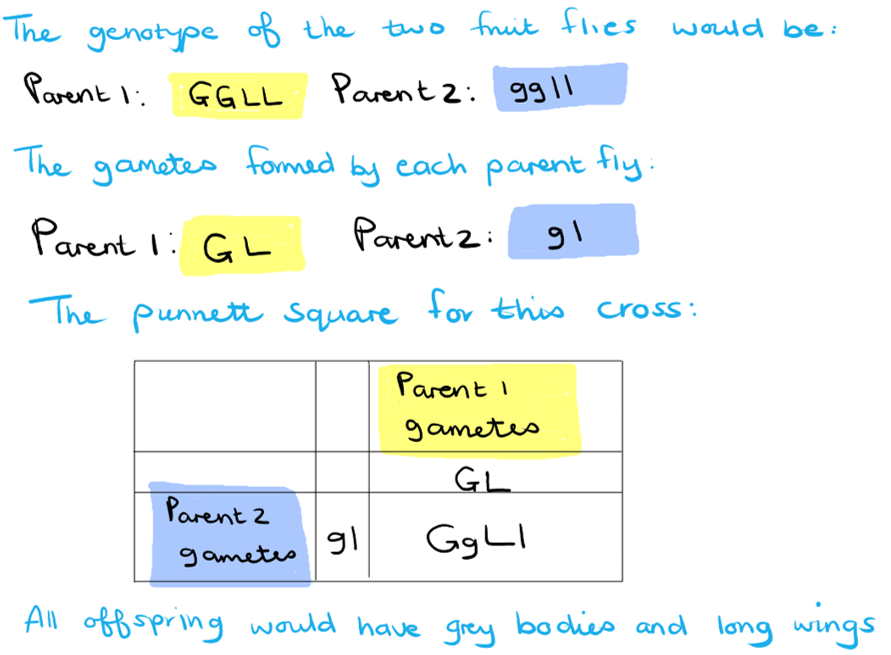
The expected number of offspring showing the following phenotypes would be....

Calculations:

- Grey body, long wings: (4 800 ÷ 16) x 9 **AND** Grey body, vestigial wings: (4 800 ÷ 16) x 3 **AND** Ebony body, long wings: (4 800 ÷ 16) x 3 **AND** Ebony body, vestigial wings: (4 800 ÷ 16 ) x 1; **[1 mark]**

Answers:

- Grey body, long wings: 2 700 **AND** Grey body, vestigial wings: 900 **AND** Ebony body, long wings: 900 **AND** Ebony body, vestigial wings: 300; **[1 mark]**

*Full marks awarded for the correct answers only.*

**[Total: 2 marks]**

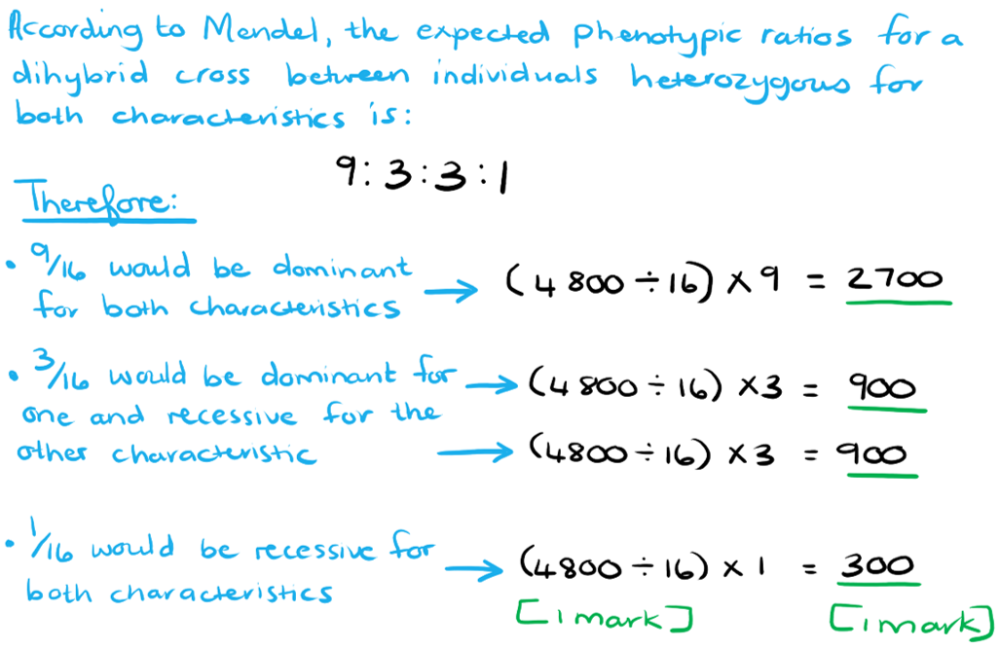
The completed χ2 table:

**Final answer:** **Two**** marks awarded for the correct answer and ****one**** mark allocated if all **$\frac{(O-E)^{2}}{E}$** values were correctly calculated.**

| Phenotype of offspring | Observed (*O*) | Expected (*E*) | (*O - E*) | (*O - E*)2 | $\frac{(O-E)^{2}}{E}$ |
|---|---|---|---|---|---|
| Grey body, long wings | 2 580 | **Final answer:** **2 700** | **Final answer:** **(2 580 - 2 700) = ****-120** | **Final answer:** **(120)****2**** = ****14 400** | **Final answer:** **(14 400 ÷ 2 700) = ****5.33** |
| Grey body, vestigial wings | 900 | **Final answer:** **900** | **Final answer:** **(900 - 900) = ****0** | **Final answer:** **(0)****2**** = ****0** | **Final answer:** **(0 ÷ 900) = ****0** |
| Ebony body, long wings | 1 010 | **Final answer:** **900** | **Final answer:** **(1 010 - 900) = ****110** | **Final answer:** **(110)****2**** = ****12 100** | **Final answer:** **(12 100 ÷ 900) = ****13.4** |
| Ebony body, vestigial wings | 310 | **Final answer:** **300** | **Final answer:** **(310 - 300) = ****10** | **Final answer:** **(10)****2**** = ****100** | **Final answer:** **(100 ÷ 300) = ****0.333** |

- χ2 = 5.33 + 0 + 13.4 + 0.333; **[1 mark]**
- = 19.1;; **[2 marks]**

*Error carried forward would apply for calculations of expected number of offspring from part b).*

*Full marks awarded for the correct answer only.*

**[Total: 3 marks]**

> *For these calculations, you would need to copy over the expected number of offspring that would display the different phenotypes from the previous question. From there you can calculate the necessary values to determine the value of χ**2**.*
The conclusions that can be drawn from these results are:

**Final answer:** **Accept the reverse argument based on the students' calculations from part c)**

- The probability (that the difference is due to chance) is less than 0.05 (for 3 degrees of freedom) **OR** the value for chi-squared is greater than 7.82; **[1 mark]**
- There is a significant difference between the observed and expected results; **[1 mark]**
- This difference is therefore not due to chance; **[1 mark]**

**[Total: 3 marks]**

> *When writing your conclusion do not forget to state the probability (generally always 0.05) and the degrees of freedom (v), this is one less than the number of classes / phenotypes (which was 4 - 1 = 3 in this case). You will be awarded the marks if you correctly explain the meaning of the χ**2** value you calculated, even if the value itself was incorrect.*

- *The difference is due to the chance if χ**2** is less than the critical value (at p = 0.05)*
- *The difference is not due to chance if χ**2** is more than the critical value (at p = 0.05)*

### Q3
A genetic diagram of a cross between two individuals who are heterozygous at the *PINK1* gene locus should contain the following...

- Symbols = normal (allele) = E **AND** EOPD (allele) = e; **[1 mark]**
- Parent genotypes and gametes = Ee x Ee **AND** E e E e; **[1 mark]**
- Offspring genotypes = EE Ee (x2) ee; **[1 mark]**
- Ratio = 3 normal : 1 EOPD; **[1 mark]**

*Gametes and offspring genotypes can be shown within a Punnett square.*

*Accept alternative symbol choices, e.g. Pp for the PINK1 gene, provided that upper and lower case letters are clearly distinguishable and the key is clearly labelled.*

**[Total: 4 marks]**

> *It is likely that symbols other than Ee would be accepted here provided that the upper case letter represents the dominant allele and the matching lower case letter represents the recessive allele. It's a good idea to choose letters where the upper case letter is distinctly different to the lower case letter to prevent misinterpretation, eg. choosing P and p here might mean that it is difficult for the examiner to tell the difference between a large P and a small p.*

> *Be careful not to confuse genotype and phenotype here; the genotype is the combination of alleles that an individual has while the phenotype is the observable characteristics. The genotype ratio would be 1 EE : 2 Ee : 1 ee, but the phenotype ratio is 3 normal : 1 EOPD. *

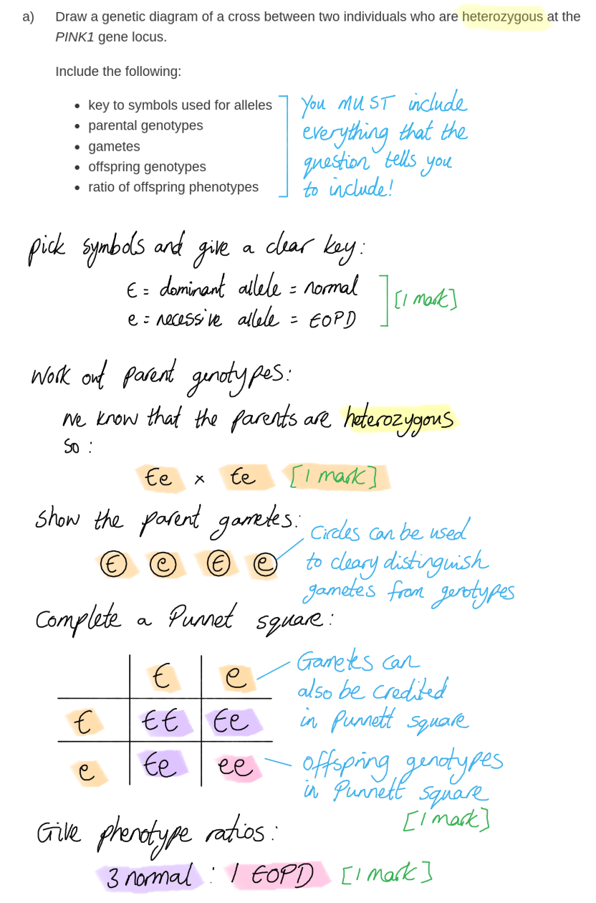
A base substitution mutation can lead to the production of a non-functioning protein kinase as follows...

**Final answer:** **Any ****five**** of the following:**

- A <u>missense</u> mutation could occur; **[1 mark]**
- (This is when) the mRNA produced contains a different codon/triplet; **[1 mark]**
- A different tRNA binds (to the altered mRNA codon); **[1 mark]**
- A different amino acid is inserted / the primary structure (of the protein) is altered; **[1 mark]**
- The tertiary/3D structure (of the protein) is altered; **[1 mark]**
- (The change) may affect the active site (of the enzyme); **[1 mark]**
- (**OR**) a <u>nonsense</u> mutation could occur; **[1 mark]**
- (This results in a) stop codon; **[1 mark]**
- There is no matching tRNA / amino acid (for the stop codon); **[1 mark]**
- The protein is shortened / incomplete; **[1 mark]**

**[Total: 5 marks]**

> *Make sure that everything included in your answer is relevant to the question. For example no credit will be given here for points relating to silent mutations (which would still result in a functioning protein kinase) or to points relating to frame shift mutations (which do not occur as a result of base substitutions).*
This mutation causes EOPD in a heterozygote as follows...

**Final answer:** **Any ****two**** of the following:**

- Only one (copy of the) allele is needed to produce the inhibitor; **[1 mark]**
- Other proteins cannot be phosphorylated/activated (by protein kinase A); **[1 mark]**
- Less aerobic respiration / ATP produced in (mitochondria of) neurones; **[1 mark]**
- (Lack of ATP leads to) inability to recycle dopamine / non-functioning sodium-potatssium pumps / inability to reach resting potential/repolarise neurone; **[1 mark]**
- Neurones die; **[1 mark]**

**[Total: 2 marks]**

> *The points in the mark scheme here are taken from several parts of the specification:*

- *You should understand the significance of the mutation being **dominant*
- *You need to know the role of **active protein kinase A** in cell signalling; you will have come across this when learning about the role of glucagon in controlling blood glucose*
- *Consider the **role of mitochondria** (see part b) in the normal functioning of neurones*

> *Only** one copy** of the dominant mutated allele needs to be present in order for it to affect the phenotype by producing an inhibitor protein. The inhibition of protein kinase A means that it can **no longer phosphorylate** another protein, and the enzyme cascade that it is part of will no longer occur. We know from part b) that this affects mitochondrial function; if mitochondria are not functioning then **ATP will not be produced** by aerobic respiration, and ATP is needed for several **processes inside nerve cells**, e.g. sodium potassium pumps to establish and re-establish resting potential, and the recycling of neurotransmitters.*

### Q4
A sex-linked gene:

- Is found on a region of a sex chromosome that is not present on the other sex chromosome; **[1 mark]**
- The inheritance of these genes is dependent on the sex of the individual **OR** the sex of the individual will affect which alleles are passed on to their offspring; **[1 mark]**

**[Total: 2 marks]**

> *Make sure that you familiarise yourself with the term sex linkage. If a gene is sex-linked, the inheritance of these alleles will be affected by whether an individual is male or female.*
The ***F8*** gene can affect the phenotype of a person in the following way:

- A copy of the gene/***F8*** (on the DNA) is <u>transcribed</u> to produce (m)RNA; **[1 mark]**
- This is <u>translated</u> into a polypeptide/protein/Factor VIII (by ribosomes); **[1 mark]**
- The protein/Factor VIII will affect the phenotype / blood clotting abilities of the person; **[1 mark]**

**[Total: 3 marks]**

> *The blood clotting abilities of the individual will be determined by the allele(s) that's inherited. Inheriting the abnormal allele{s) of the **F8** gene will lead to haemophilia, which results in the inability of blood to clot normally. Even minor injuries can be potentially life threatening due to the lack of clotting factor.*
The genetic cross would look as follows:

- *parental genotypes* = XHXh  **AND**  XhY; **[1 mark]**
- *gametes* = XH **AND** Xh **AND** Xh **AND** Y; **[1 mark]**
- *offspring genotypes* = XHXh **AND** XhXh **AND** XHY **AND** XhY; **[1 mark]**

**[Total: 3 marks]**

> *The fact that the female is a carrier of haemophilia, means that she is heterozygous and therefore has one normal allele and one allele for haemophilia. The male has only one X-chromosome, which contains the allele for haemophilia.*

> *The Punnett square for this cross would be as follows:*

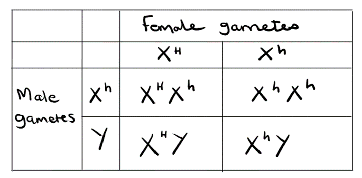
Male offspring cannot inherit haemophilia from their father because....

- They only inherit a Y-chromosome from their father **OR** they do not inherit an X-chromosome from their father; **[1 mark]**
- The allele for haemophilia is only located on the X-chromosome **OR** the allele for haemophilia is not located on the Y-chromosome; **[1 mark]**

**[Total: 2 marks]**

> *Other sex-linked conditions, such as colour blindness, will also be passed down to male offspring by their mothers. If the mother is a carrier of these alleles, there is a 50% chance that her sons will inherit the abnormal allele and show the condition in their phenotype.*

### Q5
(i) The diploid chromosome number of the hybrid offspring of a sheep and a goat is...

- 57; **[1 mark]**

> *You need to add together the haploid chromosome number of the two species, not the diploid chromosome number. *

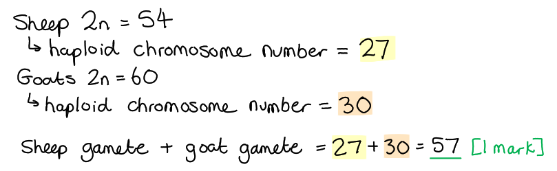

(ii) The classification of sheep and goats suggests that hybridisation between them should **not** be likely to occur because...

- Parents are from a different species/genus; **[1 mark]**

**[Total: 2 marks]**
A genetic diagram to show the genotypes of the two parents, their gametes and the offspring, and the phenotypes of the offspring is as follows...

- *Parents:* AaHh x aahh; **[1 mark]**
- *Gametes:* AH Ah aH ah, ah; **[1 mark]**
- *Offspring genotype:* AaHh Aahh aaHh aahh; **[1 mark]**
- *Offspring phenotype linked to genotype:* white hornless, white horned, bezoar hornless, bezoar horned; **[1 mark]**

**[Total: 4 marks]**

> *It is really important that you remember to link the correct genotype to the phenotype. *

> *If the white hornless goat was double homozygous recessive (AAHH) then that would not result in four different phenotypes in the offspring. Instead all the offspring would be white and hornless because they would always inherit the dominant alleles, which would be expressed. *

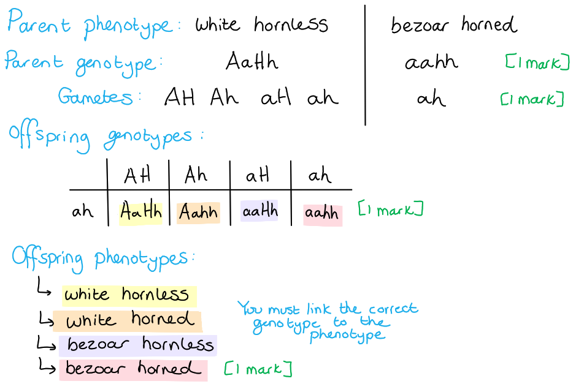
(i) An ethical advantage of this example of genetic modification is...

- Less painful/stressful/harmful for animal; **[1 mark]**

(ii) Genetic modification that causes a deletion in the horned allele, in established breeds of dairy cattle, is preferable to selective breeding for hornless animals because...

**Final answer:** **Any ****one ****of the following:**

- Does not change other genes / only changes one gene; **[1 mark]**
- Less time consuming / higher success rate; **[1 mark]**

**[Total: 2 marks]**

### Q6
The corresponding genotype and phenotype for the offspring are:

**Final answer:** **One**** mark for each correct column:**

| **Phenotype of offspring** | **Genotype of offspring** |
|---|---|
| Non-prickly stem, linear fruit | **Final answer:** **PPrr ****OR**** Pprr** |
| **Final answer:** **Non-prickly stem, round fruit** | PpRR |
| **Final answer:** **Prickly stem, round fruit** | ppRr |
| Prickly stem, linear fruit | **Final answer:** **pprr** |
| ; **[1 mark]** | ; **[1 mark]** |

**[Total: 2 marks]**
The expected ratio for each phenotype is:

**Final answer:** **One ****mark for each correct ****row****:**

| **Phenotype of offspring** | **Ratio of offspring** | ** ** |
|---|---|---|
| **Final answer:** **Non-prickly stem, round fruit** | **Final answer:** **9** | ; **[1 mark]** |
| **Final answer:** **Prickly stem, round fruit** | **Final answer:** **3** | ; **[1 mark]** |
| **Final answer:** **Non-prickly stem, linear fruit** | **Final answer:** **3** | ; **[1 mark]** |
| **Final answer:** **Prickly stem, linear fruit** | **Final answer:** **1** | ; **[1 mark]** |

**[Total: 4 marks]**

> *In a dihybrid cross between two heterozygous parents, where the genes are located on different chromosomes it is common to see a ratio of 9:3:3:1.*

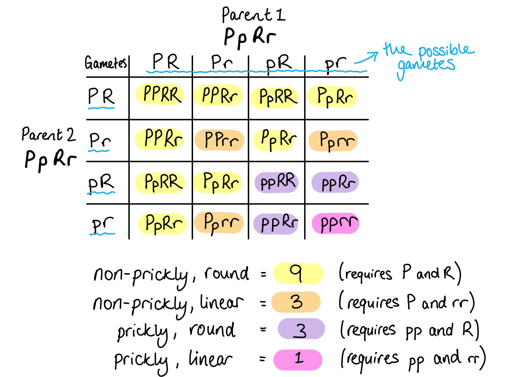
The observed ratios did not reflect the expected ratio of 9:3:3:1 because:

**Final answer:** **Any ****two**** of the following:**

- The genes are linked **OR** crossing over may have occurred **OR** due to sex linkage; **[1 mark]**
- Random fusion/fertilisation of gametes occurred; **[1 mark]**
- Epistasis may be involved; **[1 mark]**

**[Total: 2 marks]**

> *If genes are located on the same chromosome (they are linked in other words) then this limits the possible gametes that can form. Crossing over results in the exchange of genetic material between homologous chromosomes so this can alter ratios. The outcome of fertilisation is unpredictable due to the process of meiosis and the random fusion of gametes, resulting in a different genetic combination every time. When epistasis is involved, the expression of one gene may be influenced by the presence of another. All of these factors can lead to phenotypic ratios that do not correspond with expected values.*
The reason that allele ***le*** leads to short plants is:

- It produces an enzyme with a different primary structure at the <u>active site</u>; **[1 mark]**
- This enzyme will be non-functional (as a result); **[1 mark]**
- No active gibberellin is formed (to cause stem elongation); **[1 mark]**

**[Total: 3 marks]**

### Q7
Gibberellin is involved in activating genes for stem elongation by...

**Final answer:** **Any ****two ****of the following:**

- DELLA proteins prevent the activation of genes (for stem elongation); **[1 mark]**
- Gibberellin binds to receptors (on cell surface membrane); **[1 mark]**
- Causes breakdown of DELLA proteins; **[1 mark]**
- (So) transcription / gene expression / gene activation / mRNA synthesis can occur; **[1 mark]**

**[Total: 2 marks]**

> *Gibberellin does not directly influence DELLA proteins, instead the DELLA proteins are influenced by an enzyme, which is produced as a result of gibberellin binding to a receptor.*
The role played by gibberellin in the germination of wheat seeds is...

**Final answer:** **Any ****four ****of the following:**

- Seed absorbs water; **[1 mark]**
- Embryo produces gibberellin; **[1 mark]**
- Gibberellin moves to/acts on aleurone layer; **[1 mark]**
- (Where) production of amylase occurs; **[1 mark]**
- Amylase hydrolyses/breaks down starch <u>in endosperm</u>; **[1 mark]**
- To maltose/glucose; **[1 mark]**
- Embryo uses sugars for respiration/growth; **[1 mark]**
- Gibberellins affect gene/synthesis of mRNA coding for amylase; **[1 mark]**

**[Total: 4 marks]**

> *There is not a direct involvement of starch breakdown products in the embryo in terms of respiration or growth.*
The growth of **P** and **Q** can be described as follows...

**Final answer:** **Any ****four ****of the following:**

- Both **P** and **Q** same until day 2/paste applied; **[1 mark]**
- **P** greater height/taller than** Q** (after day 2/paste applied); **[1 mark]**
- **P** 35 cm and **Q** 15cm / **P** 20cm longer than **Q** at end (of investigation)/day 20; **[1 mark]**
- **P** greater rate than **Q**; **[1 mark]**
- Comparative calculated growth rates for **P** and **Q** e.g. 1.75 (cm day–1) and 0.75 (cm day–1) or 1.89 (cm day–1) and 0.78 (cm day–1); **[1 mark]**

**[Total: 4 marks]**

> *When quoting data in an answer you must always remember to include the units. *
The role of the gene controlling stem length in pea plants is...

**Final answer:** **Any ****three ****of the following:**

- Tall pea plants have dominant allele/*Le*; **[1 mark]**
- (Which codes for) enzyme that produces active gibberellin; **[1 mark]**
- Dwarf pea plants (only) have recessive alleles/*le*; **[1 mark]**
- (So) no (active) gibberellin formed; **[1 mark]**
- GA1 is the active form of gibberellin; **[1 mark]**

**[Total: 3 marks]**

### Q8
The phenotypes that is represented by the genotypes in Table 1 is....

- AaBB = purple (flowers); **[1 mark]**
- AAbb = pink (flowers); **[1 mark]**
- aaBb = white (flowers); **[1 mark]**

**[Total: 3 marks]**
The interaction between gene loci responsible for the phenotypes identified in part a) is:

- The presence / absence of allele **A** affects the expression of allele **B**/**b OR** one gene locus masks / suppresses the expression of another; **[1 mark]**
- This is known as epistasis; **[1 mark]**

**[Total: 2 marks]**

> *When epistasis is involved, it is important to consider the whole combination of alleles from the different genes in order to determine the possible phenotype.*
Mark allocation for the genetic cross between the two *Salvia* plants would be as follows:

- Gametes of homozygous pink Salvia: Ab; **[1 mark]**
- Gametes of homozygous white Salvia: aB; **[1 mark]**
- Genotype of the offspring: AaBb; **[1 mark]**

**[Total: 3 marks]**

> *For the homozygous pink-flowered **Salvia**, the genotype would be AAbb. As there are purple-flowered offspring produced at least one of the homozygous parents had to be BB, meaning the homozygous white-flowered **Salvia** would have a genotype of aaBB.*

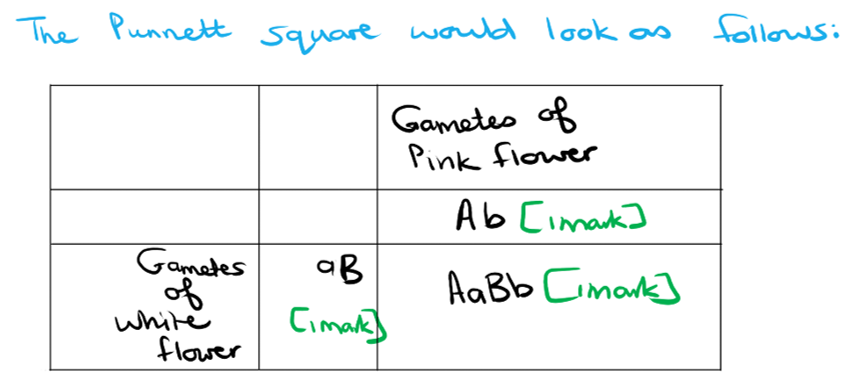
The phenotypic ratios of the F2 generation would be....

- 9 : 3 : 4; **[1 mark]**
- purple (flowers) : pink (flowers) : white (flowers); **[1 mark]**

*Flower colour must match the correct part of the ratio to receive a mark.*

**[Total: 2 marks]**

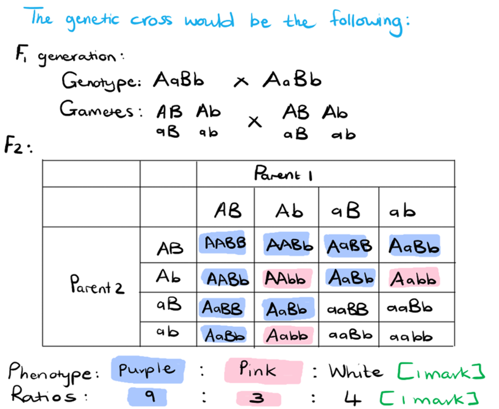

### Q9
The starfish extract could affect the activity of tyrosinase as follows...

**Final answer:** **Any ****three**** of the following:**

- The greater the concentration of extract the lower the tyrosinase activity / extract concentration is inversely proportional to tyrosinase activity; **[1 mark]**
- The extract acts as an inhibitor; **[1 mark]**
- (The extract) binds to the active/allosteric site (of tyrosinase); **[1 mark]**
- The extract could alter pH; **[1 mark]**
- The active site is changed (due to inhibition) / the enzymes denatures (due to change in pH); **[1 mark]**

**[Total: 3 marks]**

> *This is another **suggest** question. You need to use your knowledge of factors that affect enzyme action to come up with reasons why the addition of a particular substance might cause activity levels to decrease.*
(i) The terms recessive and allele refer to...

*Recessive:*

- Only expressed when a dominant allele is not present / in a homozygote **OR** not expressed in a heterozygote; **[1 mark]**

*Allele:*

- A form/version of a gene; **[1 mark]**

(ii) A genetic diagram to show how a man and a woman, who both produce melanin, could have a child with albinism would be as follows...

- Use of symbols clearly explained, eg. A = <u>allele</u> for melanin production **AND** a = <u>allele</u> for no melanin/albinism; **[1 mark]**
- Parental genotypes **AND** gametes shown, e.g. genotypes = Aa and Aa **AND** gametes = A and a (for both parents); **[1 mark]**
- Offspring genotypes shown **AND** child with albinism clearly identified as homozygous recessive/aa, e.g. (AA **AND** Aa** AND **Aa) **AND **aa; **[1 mark]**

*Allow letters other than Aa to be used as symbols (e.g. Pp for pigment), but upper and lower case must clearly represent dominant and recessive respectively.*

*Relevant marks for gametes, offspring genotypes, and the child with albinism can all be awarded for answers written within the Punnett square.*

**[Total: 5 marks]**

> *ii) A Punnett square with clearly explained symbols could have the following appearance.*

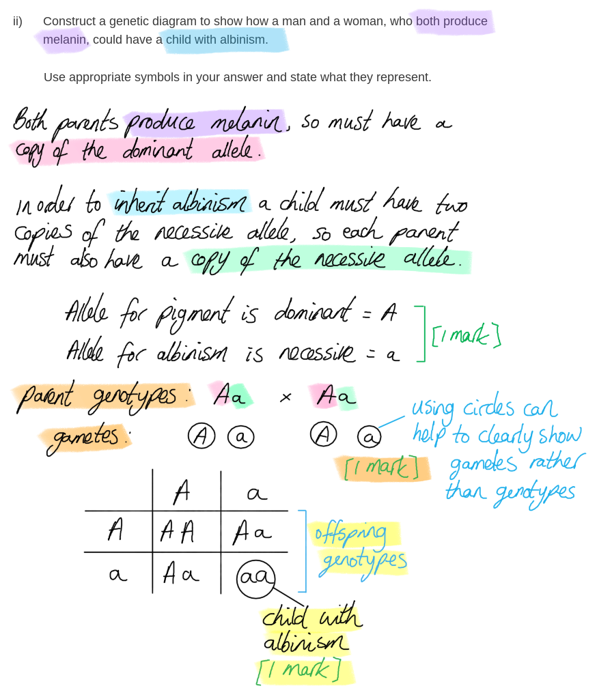

### Q10
Mark allocation for the genetic cross would be as follows:

- *parental genotypes*:  Tt **AND** Tt; **[1 mark]**
- *gametes*: T  t  **AND** T  t; **[1 mark]**
- *offspring genotypes*: TT **AND** Tt **AND** tt; **[1 mark]**
- *offspring phenotypes*: triangular (fruit shape) **AND** top (fruit shape); **[1 mark]**

**[Total: 4 marks]**

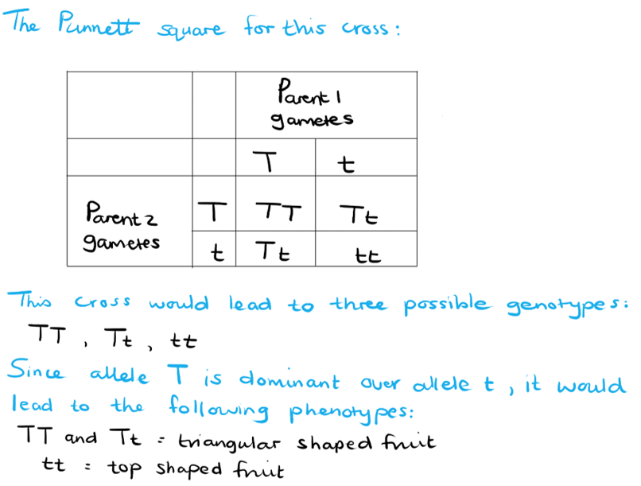
The parental phenotype was triangular shaped fruit because....

- Both parents carried a dominant allele for triangular shaped fruit; **[1 mark]**
- The dominant allele will always be expressed in the phenotype **OR** the dominant allele will mask the presence of a recessive allele **OR** the recessive allele will only be expressed in the phenotype in the absence of a dominant allele; **[1 mark]**

**[Total: 2 marks]**
The results from this cross could be interpreted as follow:

- There cannot be a certainty that the genotype of the parent plant is **TT**; **[1 mark]**

Reason:

- Several test crosses should be done in order to determine whether the recessive allele is present in the parent plant **OR** the number of offspring is not high enough to say with certainty that the recessive allele is not present in the parent plant; **[1 mark]**

**[Total: 2 marks]**

> *For a test cross to be successful it must be repeated several times in order to produce enough offspring to represent all possible allele combinations in the parents. The fact that all the offspring of this test cross showed only triangular shaped fruit does not necessarily mean that the parent plant is homozygous for this fruit shape.*
The possible phenotype of heterozygous individuals if the alleles for fruit shape were codominant:

- Individuals would carry both triangular and top shaped fruit; **[1 mark]**

**[Total: 1 mark]**

> *In examples of codominance, both alleles are expressed in the phenotype. This means that if the alleles for fruit shape in **C. bursa** was codominant, then both types of fruit shape would be visible in the phenotype of heterozygous individuals.*

### Q11
The genotypes of the two double homozygous guinea pigs is as follows...

- BBLL (long black hair); **[1 mark]**
- bbLL (long white hair); **[1 mark]**

**[Total: 2 marks]**

> *The term 'double homozygous' is used when an individual is homozygous for both of the traits being discussed.*
The genetic cross that results from crossing the individuals in part (a) is as follows:

|   | **BL** |
|---|---|
| **bL** | BbLL |

- Correct gametes for each parent = BL **and** bL; **[1 mark]**
- Correct offspring genotypes = BbLL; **[1 mark]**
- The phenotype of all/100% of the offspring will be black **and **long haired; **[1 mark]**

**[Total: 3 marks]**

> *When drawing a Punnett square for a dihybrid cross it might be tempting to draw a full 5x5 grid every time, but it's also important to remember that you only have a limited amount of time in your exams and so saving time by drawing a smaller diagram in a case like this is a wise move. Only draw a new column or row for each unique parental gamete, not for repeats.*

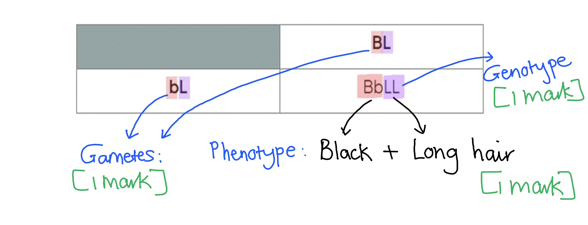
The actual ratios may not have matched up to the expected ratios because...

**Final answer:** **Any ****two**** of the following:**

- The sample size was too small; **[1 mark]**
- Fertilisation/fusion of gametes is random; **[1 mark]**
- The genes may be linked / this may be an example of autosomal/sex linked genes; **[1 mark]**

**[Total: 2 marks]**
The scientists should carry out the following statistical test...

- Chi-squared / χ2; **[1 mark]**

**[Total: 1 mark]**

> *A chi-squared test is used to determine the significance of differences in categorical data which is observed compared to the actual results collected. If there is a significant difference between the two sets of data, then it suggests that there is another influencing factor that hasn't been accounted for e.g. linkage between genes.*

### Q12
The alleles in this example are...

- Codominant (alleles); **[1 mark]**
- (This is because) both alleles are expressed in the phenotype; **[1 mark]**

**[Total: 2 marks]**
It is usually not possible for a male cat to have tortoiseshell fur because...

- Males will only possess one of the alleles at a time / either **G** or **B** **OR** it is not possible for a male to be heterozygous for the gene (as the gene is found on the X chromosome); **[1 mark]**

**[Total: 1 mark]**

> *This is an example of a sex-linked gene, since it is only found on the X chromosome. The inheritance of such genes is dependent on the sex of the individual. Tortoiseshell fur is only possible in female cats because they have two copies of the X chromosome and can therefore carry both the **G **and **B** allele for fur colour.*
A Punnett square of this cross would be as follows...

|   | **X****G** | **X****B** |
|---|---|---|
| **X****B** | XGXB | XBXB |
| **Y** | XGY | XBY |

- Correct gametes for each parent = XGXB **and** XBY; **[1 mark]**
- Correct offspring genotypes = XGXB, XBXB, XGY and XBY; **[1 mark]**
- 25% black male cats; **[1 mark]**

**[Total: 3 marks]**

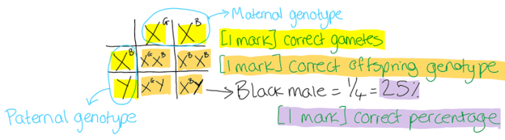
This type of allele interaction is an example of...

- Epistasis; **[1 mark]**

**[Total: 1 mark]**

> *When epistasis is involved it is important to consider the entire combination of alleles from the different genes in order to determine the phenotype of an organism.*

### Q13
The phenotype of a plant that is heterozygous for the *Le* gene would be...

- Tall; **[1 mark]**

**[Total: 1 mark]**

> *In a heterozygous individual, the dominant allele (in this case **Le**, producing tall plants) will mask the presence of the recessive allele (**le**, producing short plants) so the plants will grow tall.*
The reason why plants that are homozygous for the recessive allele *le* are dwarves includes...

**Final answer:** **Any ****two**** of the following:**

- (It causes a) change in the primary structure / active site of the enzyme; **[1 mark]**
- (This change) makes the enzymes non-functional; **[1 mark]**
- (Without this enzyme) no active gibberellin is formed (and plants are unable to grow tall); **[1 mark]**

**[Total: 2 marks]**

> *By applying active gibberellin to these dwarf plants, they can be stimulated to grow tall despite their genetic makeup.*
A gene, such as *HTT*, can affect the phenotype of an individual in the following ways...

**Final answer:** **Any ****two**** of the following:**

- (Genes/*HTT*) code for mRNA / are transcribed into mRNA; **[1 mark]**
- (The mRNA) is translated into a polypeptide/protein/huntingtin; **[1 mark]**
- The protein affects the phenotype through a particular mechanism **OR** huntingtin protein is involved with neuronal development (which determines whether the individual develops Huntington's disease or not); **[1 mark]**

**[Total: 2 marks]**

> *You may have noticed that there are many examples of how genes affect the phenotype of an individual through the synthesis of certain proteins. Many of these proteins are enzymes which are involved in pathways that may lead to the production of other important molecules that affect the phenotype of an organism.*
A person that is heterozygous for the abnormal *HTT* allele will most likely develop Huntington's disease because...

- The abnormal (*HTT*) allele is dominant; **[1 mark]**
- (This means that) only one copy of the abnormal allele needs to be inherited to develop the disease **OR** the presence of the abnormal allele will mask the presence of the (recessive) normal allele; **[1 mark]**

**[Total: 2 marks]**
