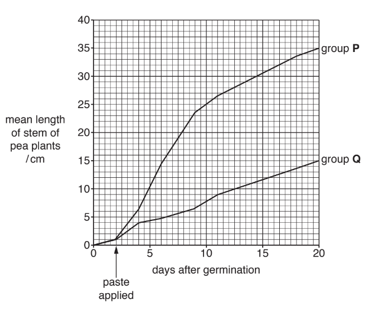

# Exam Questions — The Roles of Genes in Determining the Phenotype
**16. Inheritance** · Cambridge (CIE) A-LEVEL biology (9700)
> Source: [https://www.savemyexams.com/a-level/biology/cie/25/topic-questions/](https://www.savemyexams.com/a-level/biology/cie/25/topic-questions/) · 13 questions across 1 sets

## Structured Questions (13 questions)

### Q1 — hard — 11 marks

**Q1** [2 marks]

In the fruit fly,* Drosophila melanogaster*, two different genes control body colour and eye colour.

- **G/g** are alleles of the body colour gene.
- **G** results in grey body, **g** results in black body.
- **R/r** are alleles of the eye colour gene.
- **R** results in red eyes, **r** results in brown eyes.

Each gene is autosomal.

A dihybrid cross was carried out using a fly with a grey body and red eyes crossed with a fly with a black body and brown eyes. Both parents were homozygous for both genes. The offspring from the F1 generation were crossed to obtain the F2 offspring.

A statistical test showed that the results of the cross were significantly different from those expected.

State the name of the statistical test used **and** state the expected phenotypic ratio for the F2 generation

*Source: Oct/Nov 2018 9700/41 Q2A*

**Q1** [4 marks]

**Extract:**

In the fruit fly, Drosophila melanogaster, two different genes control body colour and eye colour.

- G/g are alleles of the body colour gene.
- G results in grey body, g results in black body.
- R/r are alleles of the eye colour gene.
- R results in red eyes, r results in brown eyes.

Each gene is autosomal.

A test cross can be carried out in order to identify flies from an F2 generation that are heterozygous for both genes.

Draw a genetic diagram to show how a test cross between a heterozygous grey‐bodied, red‐eyed F2 fly and a fly with a black body and brown eyes can produce four different offspring phenotypes.

Use the symbols **G/g** and **R/r**.

*Source: Oct/Nov 2018 9700/41 Q2B*

**Q1** [5 marks]

**Extract:**

In the fruit fly, Drosophila melanogaster, two different genes control body colour and eye colour.

- G/g are alleles of the body colour gene.
- G results in grey body, g results in black body.
- R/r are alleles of the eye colour gene.
- R results in red eyes, r results in brown eyes.

A test cross can be carried out in order to identify flies from an F2 generation that are heterozygous for both genes.

Draw a genetic diagram to show how a test cross between a heterozygous grey‐bodied, red‐eyed F2 fly and a fly with a black body and brown eyes can produce four different offspring phenotypes.

Use the symbols G/g and R/r.

The genetic diagram should contain the following information...

- Parent genotypes = GgRr AND ggrr
- Gametes = GR Gr gR gr AND gr
- Offspring genotypes = GgRr AND Ggrr AND ggRr AND ggrr
- Offspring phenotypes = Grey body red eyes AND grey body brown eyes AND black body red eyes AND black body brown eyes

The results of the test cross in **(b)** are shown in Table 1. These results are significantly different from the expected results.

**Table 1**

| **phenotypes of offspring of** **test cross** | **number of** **individuals** |
|---|---|
| grey body, red eyes | 123 |
| grey body, brown eyes | 7 |
| black body, red eyes | 6 |
| black body, brown eyes | 132 |

Describe how these results are different from the expected results **and** explain why they are different.

*Source: Oct/Nov 2018 9700/41 Q2C*

### Q2 — hard — 11 marks

**Q2** [3 marks]

In fruit flies (*Drosophila melanogaster*) wing length and body colour are each controlled by a single gene with two alleles. Allele **L** for long wings is dominant over allele **l** for vestigial wings, while allele **G** for grey body colour is dominant over allele **g** coding for ebony body colour.

Two homozygous fruit flies were crossed, one had a grey body colour and long wings while the other had an ebony body colour and vestigial wings.

State the number of offspring that would display a grey body colour and vestigial wings if 400 offspring were produced from this cross **and** explain your answer.

**Q2** [2 marks]

**Extract:**

In fruit flies (Drosophila melanogaster) wing length and body colour are each controlled by a single gene with two alleles. Allele L for long wings is dominant over allele l for vestigial wings, while allele G for grey body colour is dominant over allele g coding for ebony body colour.

Two homozygous fruit flies were crossed, one had a grey body colour and long wings while the other had an ebony body colour and vestigial wings.

Two fruit flies from the cross in part a) were crossed and 4 800 offspring were produced.

Calculate the expected number of offspring that would display the phenotypes listed in Table 1. Assume that the genes for the body colour and wing length are not linked and show your working.

**Table 1**

| **Phenotype** | **Expected number of offspring** |
|---|---|
| Grey body, long wings |   |
| Grey body, vestigial wings |   |
| Ebony body, long wings |   |
| Ebony body, vestigial wings |   |

**Q2** [3 marks]

**Extract:**

Two fruit flies from the cross in part a) were crossed and 4 800 offspring were produced.

Calculate the expected number of offspring that would display the phenotypes listed in Table 1. Assume that the genes for the body colour and wing length are not linked and show your working.

Table 1

| **Phenotype** | **Expected number of offspring** |
| Grey body, long wings |   |
| Grey body, vestigial wings |   |
| Ebony body, long wings |   |
| Ebony body, vestigial wings |   |

The expected number of offspring showing the following phenotypes would be....

Calculations:

- Grey body, long wings: (4 800 ÷ 16) x 9 **AND** Grey body, vestigial wings: (4 800 ÷ 16) x 3 **AND** Ebony body, long wings: (4 800 ÷ 16) x 3 **AND** Ebony body, vestigial wings: (4 800 ÷ 16 ) x 1;

Answers:

- Grey body, long wings: 2 700 **AND** Grey body, vestigial wings: 900 **AND** Ebony body, long wings: 900 **AND** Ebony body, vestigial wings: 300;

The results for the cross from part b) were different from what was expected. Scientists decided to perform a chi-squared (χ2) test to determine if the difference is significant.

The formulae to calculate χ2 are as follows:

$Ϫ^{2}=Σ\frac{(O-E)^{2}}{E}$

<u>Key</u>:

Σ = sum of O = observed value E = expected value

Complete Table 2 and use this to calculate the value of χ2 .

**Table 2**

| Phenotype of offspring | Observed (*O*) | Expected (*E*) | (*O - E*) | (*O - E*)2 | $\frac{(O-E)^{2}}{E}$ |
|---|---|---|---|---|---|
| Grey body, long wings | 2 580 |   |   |   |   |
| Grey body, vestigial wings | 900 |   |   |   |   |
| Ebony body, long wings | 1 010 |   |   |   |   |
| Ebony body, vestigial wings | 310 |   |   |   |   |

χ2 = .....................................

**Q2** [3 marks]

**Extract:**

The results for the cross from part b) were different from what was expected. Scientists decided to perform a chi-squared (χ²) test to determine if the difference is significant.

The formulae to calculate χ² are as follows:

Ϊ squared equals capital sigma left parenthesis O space minus space E right parenthesis squared over E

Key:

Σ = sum of O = observed value E = expected value

Complete Table 2 and use this to calculate the value of χ².

Table 2

| Phenotype of offspring | Observed (O) | Expected (E) | (O - E) | (O - E)² | left parenthesis O space minus space E right parenthesis squared over E |
| Grey body, long wings | 2 580 |   |   |   |   |
| Grey body, vestigial wings | 900 |   |   |   |   |
| Ebony body, long wings | 1 010 |   |   |   |   |
| Ebony body, vestigial wings | 310 |   |   |   |   |
χ² = .....................................

The scientists calculated the degrees of freedom (*v*) by using the following formula:

*v* = n - 1

The symbol "n" refers to the number of classes in the data set.

Table 3 shows the values for χ2 at different levels of probability and for different degrees of freedom.

**Table 3**

| **Degrees of freedom** | **Probability, p** |   |   |   |   |
|---|---|---|---|---|---|
| **0.2** | **0.1** | **0.05** | **0.02** | **0.01** |   |
| 1 | 1.64 | 2.71 | 3.84 | 5.41 | 6.64 |
| 2 | 3.22 | 4.61 | 5.99 | 7.82 | 9.21 |
| 3 | 4.64 | 6.25 | 7.82 | 9.84 | 11.35 |
| 4 | 5.99 | 7.78 | 9.49 | 11.67 | 13.28 |
| 5 | 7.29 | 9.24 | 11.07 | 13.39 | 15.09 |

State the conclusion the scientists can make about the significance of their results **and** explain your answer.

### Q3 — hard — 11 marks

**Q3** [4 marks]

Some neurones in the brain produce a neurotransmitter known as dopamine. Parkinson’s disease occurs when the neurones that produce dopamine die. A person with the disease may experience difficulty in coordinating movement, often seen as tremors (shaking) in different parts of the body.

Parkinson’s disease typically occurs in people older than 55 years. Younger people with these symptoms are said to have early onset Parkinson’s disease (EOPD).

Recessive mutations in a gene known as *PINK1*, located on chromosome 1, an autosome, are believed to be one cause of EOPD. A person with this form of EOPD has a homozygous recessive genotype.

Draw a genetic diagram of a cross between two individuals who are heterozygous at the *PINK1* gene locus.

Include the following:

- key to symbols used for alleles
- parental genotypes
- gametes
- offspring genotypes
- ratio of offspring phenotypes

*Source: May/June 2019 9700/41 Q3A*

**Q3** [5 marks]

*PINK1* codes for a protein kinase enzyme that is important in the functioning of mitochondria in neurones.

Most recessive *PINK1* mutations are base substitutions which lead to the production of a non-functioning protein kinase enzyme.

Explain how a base substitution mutation can lead to the production of a non-functioning protein kinase.

*Source: May/June 2019 9700/41 Q3B*

**Q3** [2 marks]

**Extract:**

Some neurones in the brain produce a neurotransmitter known as dopamine. Parkinson's disease occurs when the neurones that produce dopamine die. A person with the disease may experience difficulty in coordinating movement, often seen as tremors (shaking) in different parts of the body.

Parkinson's disease typically occurs in people older than 55 years. Younger people with these symptoms are said to have early onset Parkinson's disease (EOPD).

Recessive mutations in a gene known as *PINK1*, located on chromosome 1, an autosome, are believed to be one cause of EOPD.

*PINK1* codes for a protein kinase enzyme that is important in the functioning of mitochondria in neurones.

One rare, dominant mutation of the *PINK1* gene codes for a product that inhibits the normal protein kinase.

Explain how this mutation causes EOPD in a heterozygote.

*Source: May/June 2019 9700/41 Q3C*

### Q4 — medium — 10 marks

**Q4** [2 marks]

Factor VIII is a coagulating agent that plays an important role in blood clotting and is coded for by the ***F8*** gene. There are abnormal alleles of this gene that lead to blood clotting abnormalities. A person that inherits these abnormal alleles will suffer from haemophilia. The ***F8*** gene is an example of a sex-linked gene.

Define the term 'sex-linked gene'.

**Q4** [3 marks]

**Extract:**

Factor VIII is a coagulating agent that plays an important role in blood clotting and is coded for by the F8 gene. There are abnormal alleles of this gene that lead to blood clotting abnormalities. A person that inherits these abnormal alleles will suffer from haemophilia.

A gene, such as ***F8,*** can affect the phenotype of an organism.

Describe the mechanism by which the ***F8*** gene can affect the phenotype of a person.

**Q4** [3 marks]

A woman that is a carrier of haemophilia and a haemophiliac male decide to have a child together.

Use the following symbols and complete the genetic diagram (Fig.1) showing the cross between them.

XH = normal allele

Xh = allele for haemophilia

**Fig. 1**

**Q4** [2 marks]

**Extract:**

Factor VIII is a coagulating agent that plays an important role in blood clotting and is coded for by the F8 gene. There are abnormal alleles of this gene that lead to blood clotting abnormalities. A person that inherits these abnormal alleles will suffer from haemophilia. The F8 gene is an example of a sex-linked gene.

X^H^ = normal allele

X^h^ = allele for haemophilia

Haemophilia in male offspring will always be inherited from their mother.

Explain why it is impossible for male offspring to inherit haemophilia from their father.

### Q5 — medium — 8 marks

**Q5** [2 marks]

Mammals such as sheep, *Ovis aries*, and goats, *Capra hircus*, are important agricultural animals that are sometimes kept together in mixed flocks. Very occasionally, live offspring are born from a mating between a male sheep and a female goat.

In sheep 2n = 54 and in goats 2n = 60.

(i) Calculate the diploid chromosome number of the hybrid offspring of a sheep and a goat.

[1]

(ii) Outline why the classification of sheep and goats suggests that hybridisation between them should **not** be likely to occur.

[1]

*Source: Oct/Nov 2018  9700/42 Q3A*

**Q5** [4 marks]

Normal (wild-type) goats have a gold and black coat colour pattern, known as bezoar, and are also horned (have horns). Domestic goats may have a white coat and may be hornless (do not have horns).

These variations are coded for by two unlinked genes:

- white coat colour, coded for by the dominant allele of the gene **A/a.**
- hornless, coded by the dominant allele of the gene **H/h**.

A cross between a white hornless goat and a bezoar horned goat produced offspring of four different phenotypes.

Draw a genetic diagram to show the genotypes of the two parents, their gametes and the offspring, and the phenotypes of the offspring.

*Source: Oct/Nov 2018  9700/42 Q3B*

**Q5** [2 marks]

Horns on agricultural animals such as goats and cattle can be dangerous to the farmer and to other animals. Horns are often prevented from growing in 5-day-old animals by a stressful procedure called disbudding.

Genetic modification can cause a deletion in the allele **h** coding for horns in cattle embryos, so that the allele no longer codes for a functional protein and the embryos grow into cattle that are hornless.

(i) State an **ethical** advantage of this example of genetic modification.

[1]

(ii) Suggest why genetic modification that causes a deletion in the horned allele, in established breeds of dairy cattle, is preferable to selective breeding for hornless animals.

[1]

*Source: Oct/Nov 2018  9700/42 Q3C*

### Q6 — medium — 11 marks

**Q6** [2 marks]

Aubergine (*Solanum melongena*) belongs to the same family as potatoes and tomatoes. They are a widely grown vegetable crop across Southeast Asia, Africa and the Mediterranean. Due to their importance as a food crop, scientists have been studying the inheritance of two genes (stem prickliness and fruit shape) that can have an influence on the profitability of the crop.

The allele **P**, for a non-prickly stem, is dominant over the allele **p**, for a prickly stem. The allele **R**, for round fruit, is dominant over the allele **r**, for linear fruit. The scientists examined 4000 offspring produced from the crosses between parent plants heterozygous for both genes.

Identify the missing phenotypes and genotypes of the offspring in Table 1

**Table 1**

| **Phenotype of the offspring** | **Genotype of the offspring** |
|---|---|
| Non-prickly stem, linear fruit |   |
|   | PpRR |
|   | ppRr |
| Prickly stem, linear fruit |   |

**Q6** [4 marks]

**Extract:**

Aubergine (*Solanum melongena*) belongs to the same family as potatoes and tomatoes. They are a widely grown vegetable crop across Southeast Asia, Africa and the Mediterranean. Due to their importance as a food crop, scientists have been studying the inheritance of two genes (stem prickliness and fruit shape) that can have an influence on the profitability of the crop.

The allele **P**, for a non-prickly stem, is dominant over the allele **p**, for a prickly stem. The allele **R**, for round fruit, is dominant over the allele **r**, for linear fruit. The scientists examined 4000 offspring produced from the crosses between parent plants heterozygous for both genes.

State the expected phenotypic ratio for the genetic cross from part a) by completing Table 2, assuming that the genes were located on different chromosomes.

**Table 2**

| **Phenotype of offspring** | **Ratio of offspring** |
|---|---|
|   |   |
|   |   |
|   |   |
|   |   |

**Q6** [2 marks]

**Extract:**

Aubergine (*Solanum melongena*) belongs to the same family as potatoes and tomatoes. They are a widely grown vegetable crop across Southeast Asia, Africa and the Mediterranean. Due to their importance as a food crop, scientists have been studying the inheritance of two genes (stem prickliness and fruit shape) that can have an influence on the profitability of the crop.

The allele **P**, for a non-prickly stem, is dominant over the allele **p**, for a prickly stem. The allele **R**, for round fruit, is dominant over the allele **r**, for linear fruit. The scientists examined 4000 offspring produced from the crosses between parent plants heterozygous for both genes.

State the expected phenotypic ratio for the genetic cross from part a) by completing Table 2, assuming that the genes were located on different chromosomes.

**Table 2**

| **Phenotype of offspring** | **Ratio of offspring** |
| Non-prickly stem, round fruit | 9 |
| Prickly stem, round fruit | 3 |
| Non-prickly stem, linear fruit | 3 |
| Prickly stem, linear fruit | 1 |

The scientists found that the phenotypic ratios observed in the offspring did not correspond with the expected ratios listed in part b).

Suggest **two** possible reasons why the observed ratios do not reflect the scientists expected ratios.

**Q6** [3 marks]

In some plant species, height is partially controlled by the ***Le*** gene. The allele ***Le*** produces tall plants and is dominant over allele ***le***, which produces short plants.

Explain the reason why the recessive allele ***le*** will result in short plants.

### Q7 — medium — 13 marks

**Q7** [2 marks]

Gibberellin is a plant growth hormone that has a role in germination and in stem elongation.

Outline how gibberellin is involved in activating genes for stem elongation.

*Source: Oct/Nov 2018  9700/42 Q8A*

**Q7** [4 marks]

Outline the role played by gibberellin in the germination of wheat seeds.

*Source: Oct/Nov 2018  9700/42 Q8B*

**Q7** [4 marks]

The length of stem in pea plants is controlled by a single gene. Pea plants can be either tall or short. A study was carried out to investigate the effect of applying gibberellin to short pea plants. Two groups of short pea seedlings were used, group **P **and group **Q**.

- Group **P **consisted of 20 seedlings to which a paste containing gibberellin had been applied two days after germination.
- Group **Q **consisted of 20 seedlings to which a paste **without** gibberellin had been applied two days after germination.
- The length of stem of the pea plants was recorded at intervals over 20 days.

The results are shown in Fig. 1.

**Fig.1**

With reference to Fig. 1, describe the results of the investigation **and** compare the growth rate of plants in group **P **and group **Q**.

*Source: Oct/Nov 2018  9700/42 Q8C*

**Q7** [3 marks]

**Extract:**

The length of stem in pea plants is controlled by a single gene. Pea plants can be either tall or short.

Explain the role of the gene controlling stem length in pea plants.

*Source: Oct/Nov 2018  9700/42 Q8D*

### Q8 — medium — 10 marks

**Q8** [3 marks]

*Salvia* is a plant that forms part of the sage family and contains almost 1 000 different species. Flower colour in *Salvia* is controlled by two genes, **A/a** and **B/b**, located on different chromosomes. Allele **B** gives rise to purple flowers and is dominant over the allele for pink flowers **b**. In order for these colours to be expressed in the phenotype allele **A** must be present as well, otherwise, the result is white flowers.

Table 1 lists some of the genotypes that are possible in *Salvia* plants.

**Table 1**

| **Genotype** | **Phenotype** |
|---|---|
| AaBB |   |
| AAbb |   |
| aaBb |   |

Identify the phenotypes of the plants listed in Table 1.

**Q8** [2 marks]

**Extract:**

*Salvia* is a plant that forms part of the sage family and contains almost 1 000 different species. Flower colour in *Salvia* is controlled by two genes, **A/a** and **B/b**, located on different chromosomes. Allele **B** gives rise to purple flowers and is dominant over the allele for pink flowers **b**. In order for these colours to be expressed in the phenotype allele **A** must be present as well, otherwise, the result is white flowers.

Table 1 lists some of the genotypes that are possible in *Salvia* plants.

**Table 1**

| **Genotype** | **Phenotype** |
| AaBB |   |
| AAbb |   |
| aaBb |   |

The phenotypes that is represented by the genotypes in Table 1 is....

- AaBB = purple (flowers);
- AAbb = pink (flowers);
- aaBb = white (flowers);

Explain the interaction between gene loci that is responsible for the phenotypes identified in part a).

**Q8** [3 marks]

**Extract:**

*Salvia* is a plant that forms part of the sage family and contains almost 1 000 different species. Flower colour in *Salvia* is controlled by two genes, **A/a** and **B/b**, located on different chromosomes. Allele **B** gives rise to purple flowers and is dominant over the allele for pink flowers **b**. In order for these colours to be expressed in the phenotype allele **A** must be present as well, otherwise, the result is white flowers.

Table 1 lists some of the genotypes that are possible in *Salvia* plants.

**Table 1**

| **Genotype** | **Phenotype** |
| AaBB |   |
| AAbb |   |
| aaBb |   |

The phenotypes that is represented by the genotypes in Table 1 is....

- AaBB = purple (flowers);
- AAbb = pink (flowers);
- aaBb = white (flowers);

A homozygous pink-flowered *Salvia* is crossed with a homozygous white-flowered *Salvia *and all the offspring had purple flowers. Construct a Punnett square to show this cross.

**Q8** [2 marks]

**Extract:**

*Salvia* is a plant that forms part of the sage family and contains almost 1 000 different species. Flower colour in *Salvia* is controlled by two genes, **A/a** and **B/b**, located on different chromosomes. Allele **B** gives rise to purple flowers and is dominant over the allele for pink flowers **b**. In order for these colours to be expressed in the phenotype allele **A** must be present as well, otherwise, the result is white flowers.

A homozygous pink-flowered *Salvia* is crossed with a homozygous white-flowered *Salvia *and all the offspring had purple flowers.

For the homozygous pink-flowered *Salvia*, the genotype would be AAbb. As there are purple-flowered offspring produced at least one of the homozygous parents had to be BB, meaning the homozygous white-flowered *Salvia* would have a genotype of aaBB.

Genotype of the offspring: AaBb

Two purple *Salvia* plants from the genetic cross from part c) were crossed.

State the phenotypic ratios of the F2 generation.

### Q9 — medium — 8 marks

**Q9** [3 marks]

The black pigment melanin contributes to hair, skin and eye colour. Melanin is produced by cells known as melanocytes.

Tyrosinase is an enzyme involved in the production of melanin.

A study was carried out to investigate the effect of an extract of the starfish, *Patiria pectinifera*, on the activity of tyrosinase.

Table 1 shows the results of this study.

**Table 1**

| **Concentration of** **starfish extract / µg cm****–3** | **Percentage activity** **of tyrosinase** |
|---|---|
| 0 | 100 |
| 4 | 90 |
| 8 | 77 |
| 16 | 68 |
| 32 | 56 |
| 64 | 46 |
| 128 | 32 |

Suggest how the starfish extract affects the activity of tyrosinase.

*Source: Specimen 2022 9700/04 Q6A*

**Q9** [5 marks]

The dominant allele of the *TYR* gene codes for the enzyme tyrosinase.

In people with albinism, the melanocytes do not produce melanin. This is caused by a recessive allele of the *TYR* gene.

(i) Explain what is meant by the terms recessive and allele.

[2]

(ii) Construct a genetic diagram to show how a man and a woman, who both produce melanin, could have a child with albinism.

Use appropriate symbols in your answer and state what they represent.

[3]

*Source: Specimen 2022 9700/04 Q6BI, BII*

### Q10 — medium — 9 marks

**Q10** [4 marks]

Shepherd's purse (*Capsella bursa-pastoris*) is a flowering plant that belongs to the mustard family. Fruit shape in this plant is determined by two alleles, namely allele **T** for a triangular fruit shape, which is dominant over allele **t** for top-shaped fruit. Two plants, both heterozygous for fruit shape, were crossed.

Complete the genetic diagram below (Fig.1) to show the results of this genetic cross.

**Fig. 1**

**Q10** [2 marks]

**Extract:**

Shepherd's purse (Capsella bursa-pastoris) is a flowering plant that belongs to the mustard family. Fruit shape in this plant is determined by two alleles, namely allele T for a triangular fruit shape, which is dominant over allele t for top-shaped fruit. Two plants, both heterozygous for fruit shape, were crossed.

Explain why the parental phenotype was triangular shaped fruit with reference to their genotype.

**Q10** [2 marks]

**Extract:**

Shepherd's purse (Capsella bursa-pastoris) is a flowering plant that belongs to the mustard family. Fruit shape in this plant is determined by two alleles, namely allele T for a triangular fruit shape, which is dominant over allele t for top-shaped fruit.

A plant with triangular shaped fruit was crossed with a plant that has top-shaped fruit. All 35 offspring of this cross had triangular shaped fruit.

State whether there can be a certainty that the original parent plant with triangular shaped fruit had a genotype of **TT** and provide a reason for your answer.

**Q10** [1 mark]

**Extract:**

Shepherd's purse (*Capsella bursa-pastoris*) is a flowering plant that belongs to the mustard family. Fruit shape in this plant is determined by two alleles, namely allele **T** for a triangular fruit shape, which is dominant over allele **t** for top-shaped fruit.

The alleles for fruit shape in *C. bursa-pastoris* is an example of complete dominance.

Suggest the possible phenotype of heterozygous individuals if these alleles were codominant.

### Q11 — easy — 8 marks

**Q11** [2 marks]

In guinea pigs, the allele for black hair (**B**) is dominant to the allele for white hair (**b**) and the allele for long hair (**L**) is dominant to the allele for short hair (**l**). A double homozygous guinea pig with long, black hair was bred with another double homozygous guinea pig with long white hair.

State the genotypes of the **two **parent guinea pigs.

**Q11** [3 marks]

**Extract:**

In guinea pigs, the allele for black hair (**B**) is dominant to the allele for white hair (**b**) and the allele for long hair (**L**) is dominant to the allele for short hair (**l**). A double homozygous guinea pig with long, black hair was bred with another double homozygous guinea pig with long white hair.

The genotypes of the two double homozygous guinea pigs is as follows...

- BBLL (long black hair); [1 mark]
- bbLL (long white hair); [1 mark]

Use a genetic diagram to determine the ratio of different phenotypes which could result from the cross discussed in part (a).

**Q11** [2 marks]

Fur colour in mice is controlled by two genes. One gene (**B**/**b**) controls the expression of a specific fur colour, while production of hair pigment is controlled by another gene (**C**/**c**). The allele for black fur (**B**) is dominant to the allele for brown fur (**b**). Mice that possess the homozygous recessive genotype (**cc**) will lack hair pigment making them albino. This is an example of epistasis.

Scientists completed an investigation on a group of 20 mice into the incidence of albinism but found that their results did not achieve the same ratios as expected.

Suggest **two** reasons why their ratios may not have matched up to the expected ratios.

**Q11** [1 mark]

**Extract:**

Fur colour in mice is controlled by two genes. One gene (B/b) controls the expression of a specific fur colour, while production of hair pigment is controlled by another gene (C/c). The allele for black fur (B) is dominant to the allele for brown fur (b). Mice that possess the homozygous recessive genotype (cc) will lack hair pigment making them albino. This is an example of epistasis.

Scientists completed an investigation on a group of 20 mice into the incidence of albinism but found that their results did not achieve the same ratios as expected.

In order to establish whether there was a significant difference between the actual results and the expected results, a statistical test is required.

Identify which statistical test the scientists should use.

### Q12 — easy — 7 marks

**Q12** [2 marks]

In cats, a gene found on the X chromosome determines fur colour. One allele **G** codes for ginger fur and the other allele **B** codes for black fur. Heterozygous female cats will have both ginger and black fur, a phenotype known as tortoiseshell.

Identify and explain the type of allele interaction in this example.

**Q12** [1 mark]

**Extract:**

In cats, a gene found on the X chromosome determines fur colour. One allele G codes for ginger fur and the other allele B codes for black fur. Heterozygous female cats will have both ginger and black fur, a phenotype known as tortoiseshell.

Using the information given in part (a), state why it is not usually possible for a male cat to have tortoiseshell fur.

**Q12** [3 marks]

**Extract:**

In cats, a gene found on the X chromosome determines fur colour. One allele G codes for ginger fur and the other allele B codes for black fur. Heterozygous female cats will have both ginger and black fur, a phenotype known as tortoiseshell.

A female tortoiseshell cat was crossed with a black male cat.

Use a genetic diagram to determine the percentage of their offspring that are likely to be black male cats.

**Q12** [1 mark]

**Extract:**

In cats, a gene found on the X chromosome determines fur colour. One allele G codes for ginger fur and the other allele B codes for black fur. Heterozygous female cats will have both ginger and black fur, a phenotype known as tortoiseshell.

The presence of another gene at a locus on a different chromosome results in cats with completely black fur.

Identify the term used to describe this type of allele interaction.

### Q13 — easy — 7 marks

**Q13** [1 mark]

In some plant species height is partially controlled by the *Le* gene. The gene codes for an enzyme that is involved in a pathway that forms active gibberellin, the hormone which helps plants grow. The allele for tall plants (*Le*)  is dominant to the allele for short plants (*le*).

State the phenotype of a plant that is heterozygous for the *Le* gene.

**Q13** [2 marks]

**Extract:**

In some plant species height is partially controlled by the *Le* gene. The gene codes for an enzyme that is involved in a pathway that forms active gibberellin, the hormone which helps plants grow. The allele for tall plants (*Le*) is dominant to the allele for short plants (*le*).

Plants that are homozygous for the recessive allele *le* are dwarves.

Explain the reason for this.

**Q13** [2 marks]

Huntington's disease is a genetic condition that is characterised by neurological degeneration. Individuals with Huntington's disease have abnormal alleles of the *HTT* gene.

Describe how a gene, such as *HTT*, can affect the phenotype of an individual.

**Q13** [2 marks]

**Extract:**

Huntington's disease is a genetic condition that is characterised by neurological degeneration. Individuals with Huntington's disease have abnormal alleles of the *HTT* gene.

A person that is heterozygous for the abnormal *HTT* allele will most likely develop Huntington's disease.

Explain the reason for this.
