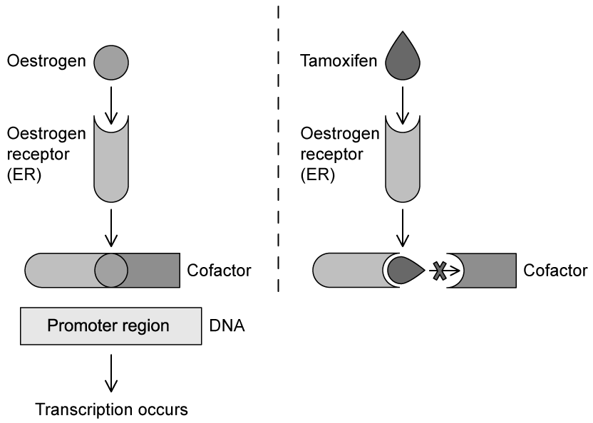
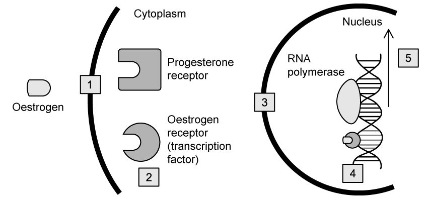
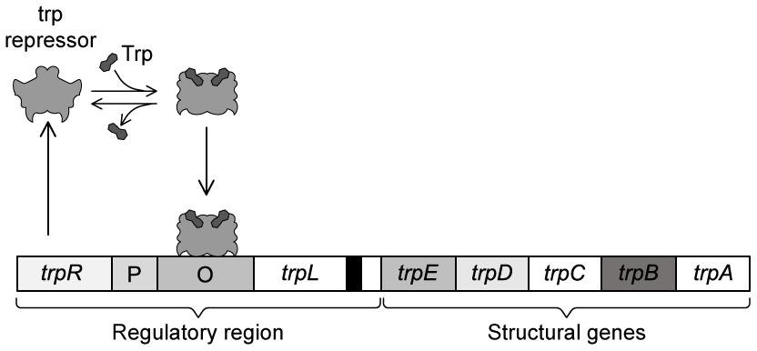
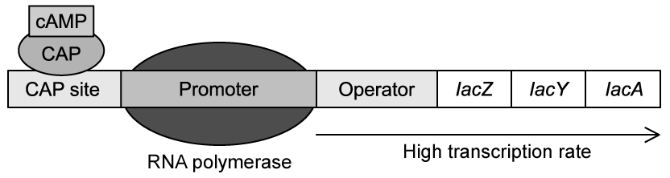
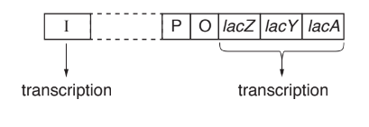
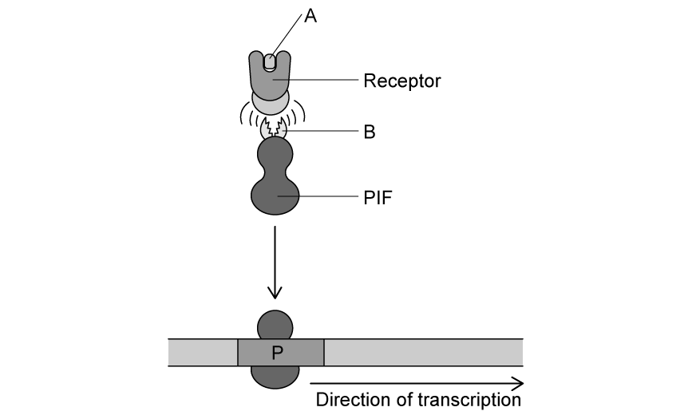
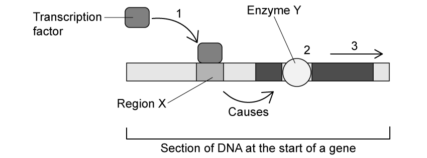

# Exam Questions — Gene Control
**16. Inheritance** · Cambridge (CIE) A-LEVEL biology (9700)
> Source: [https://www.savemyexams.com/a-level/biology/cie/25/topic-questions/](https://www.savemyexams.com/a-level/biology/cie/25/topic-questions/) · 10 questions across 1 sets

## Structured Questions (10 questions)

### Q1 — hard — 8 marks

**Q1** [2 marks]

The hormone oestrogen can diffuse into human body cells. Once inside a cell, oestrogen diffuses through the nuclear pores into the nucleus where it attaches to a transcription factor called oestrogen receptor (ER). This allows ER to combine with a cofactor, which in turn allows the cofactor to bind to the promoter region of a gene. This enables RNA polymerase to bind to the promoter region.

In certain types of breast cancer ER is no longer regulated by control mechanisms and may lead to the development of oestrogen induced tumours. Tamoxifen was one of the first effective treatments for these types of cancers and is still used with great success.

Fig. 1 compares the action of oestrogen and tamoxifen.

**Fig. 1**

Explain what is meant by the term **transcription**.

**Q1** [3 marks]

**Extract:**

The hormone oestrogen can diffuse into human body cells. Once inside a cell, oestrogen diffuses through the nuclear pores into the nucleus where it attaches to a transcription factor called oestrogen receptor (ER). This allows ER to combine with a cofactor, which in turn allows the cofactor to bind to the promoter region of a gene. This enables RNA polymerase to bind to the promoter region.

In certain types of breast cancer ER is no longer regulated by control mechanisms and may lead to the development of oestrogen induced tumours. Tamoxifen was one of the first effective treatments for these types of cancers and is still used with great success.

Fig. 1 compares the action of oestrogen and tamoxifen.

With reference to Fig. 1, suggest how tamoxifen is an effective treatment for breast cancer.

**Q1** [2 marks]

**Extract:**

The hormone oestrogen can diffuse into human body cells. Once inside a cell, oestrogen diffuses through the nuclear pores into the nucleus where it attaches to a transcription factor called oestrogen receptor (ER). This allows ER to combine with a cofactor, which in turn allows the cofactor to bind to the promoter region of a gene. This enables RNA polymerase to bind to the promoter region.

While ER enables RNA polymerase to bind to the promoter region, some transcription factors can prevent transcription from taking place.

Suggest **two** ways in which transcription factors might prevent transcription.

**Q1** [1 mark]

Transcription factors control the transcription of genes by binding to specific regions of DNA.

State the importance of controlling gene transcription for an organism.

### Q2 — hard — 11 marks

**Q2** [3 marks]

Explain how transcription factors stimulate the expression of a gene.

**Q2** [3 marks]

Fig. 1 below shows the mechanism by which oestrogen initiates gene expression.

**Fig. 1**

Compare and contrast the mechanism of action shown in the diagram with the process of non-competitive enzyme inhibition.

**Q2** [1 mark]

**Extract:**

Fig. 1 below shows the mechanism by which oestrogen initiates gene expression.

**Fig. 1**

Explain why oestrogen is unable to bind to the progesterone receptor in Fig. 1.

**Q2** [4 marks]

Totipotent cells from one organism are genetically identical, however, not all of these genes are ultimately expressed. This is known as differential gene expression.

Explain how differential gene expression forms an organism with specialised cells.

### Q3 — hard — 10 marks

**Q3** [2 marks]

The tryptophan (trp) operon controls the synthesis of the amino acid tryptophan in many species of bacteria.

The synthesis of tryptophan occurs in five different steps, each requiring a different enzyme coded for by structural genes *trpA,* *trpB*, *trpC*, *trpD*, and* trpE*. The regulatory region of the trp operon includes the promoter (P), the operator (O), and a regulatory gene, *trpR*, which codes for a trp repressor protein.

The activation or repression of the trp operon is determined by the tryptophan levels in the environment of the bacteria.

Fig. 1 shows the structure of the trp operon in the presence of high tryptophan levels.

**Fig. 1**

State the difference between a structural and a regulatory gene.

**Q3** [4 marks]

**Extract:**

The tryptophan (trp) operon controls the synthesis of the amino acid tryptophan in many species of bacteria.

The synthesis of tryptophan occurs in five different steps, each requiring a different enzyme coded for by structural genes trpA, trpB, trpC, trpD, and trpE. The regulatory region of the trp operon includes the promoter (P), the operator (O), and a regulatory gene, trpR, which codes for a trp repressor protein.

The activation or repression of the trp operon is determined by the tryptophan levels in the environment of the bacteria.

Fig. 1 shows the structure of the trp operon in the presence of high tryptophan levels.

Using the information in Fig. 1, explain the effect of high tryptophan levels on the trp operon.

**Q3** [2 marks]

**Extract:**

The tryptophan (trp) operon controls the synthesis of the amino acid tryptophan in many species of bacteria.

The synthesis of tryptophan occurs in five different steps, each requiring a different enzyme coded for by structural genes trpA, trpB, trpC, trpD, and trpE. The regulatory region of the trp operon includes the promoter (P), the operator (O), and a regulatory gene, trpR, which codes for a trp repressor protein.

The activation or repression of the trp operon is determined by the tryptophan levels in the environment of the bacteria.

Fig. 1 shows the structure of the trp operon in the presence of high tryptophan levels.

High tryptophan levels will have the following effect on the trp operon:
- Tryptophan/Trp binds to the trp repressor protein;
- This causes a change in the (trp repressor) protein shape/conformation SO allowing it to bind to the operator;
- RNA polymerase cannot bind to the operator/DNA (due to the presence of the repressor protein);
- This (binding) prevents the transcription of the structural genes OR the enzymes needed for the production of tryptophan cannot be synthesised;
- Tryptophan will not be produced (due to the absence of the enzymes needed for its synthesis);

The enzymes produced by some structural genes can be classified as either inducible or repressible.

(i) State whether the enzymes produced by the structural genes of the trp operon are inducible or repressible.

[1]

(ii) Give a reason for your answer to part (i).

[1]

**Q3** [2 marks]

**Extract:**

The tryptophan (trp) operon controls the synthesis of the amino acid tryptophan in many species of bacteria.

The synthesis of tryptophan occurs in five different steps, each requiring a different enzyme coded for by structural genes trpA, trpB, trpC, trpD, and trpE. The regulatory region of the trp operon includes the promoter (P), the operator (O), and a regulatory gene, trpR, which codes for a trp repressor protein.

The trp operon can be regulated by another mechanism called attenuation; this involves a leader transcript, *trpL*. When tryptophan levels are high attenuation causes RNA polymerase to end the transcription of the structural genes prematurely.

Suggest how attenuation contributes to the regulation of tryptophan in bacteria.

### Q4 — medium — 9 marks

**Q4** [2 marks]

The enzyme lactase is an example of an inducible enzyme.

(i) State why lactase can be described as an inducible enzyme.

[1]

(ii) Explain the importance of inducible enzymes.

[1]

**Q4** [6 marks]

In certain species of bacteria, such as *Escherichia coli*, transcription of the structural genes of the lac operon enables the production of lactase. This process only occurs in the presence of lactose, and is also affected by the presence or absence of glucose.

In the absence of glucose, *E.coli* cells produce the molecule cAMP. cAMP binds to a catabolite activator protein (CAP), activating it and allowing it to bind to a region of the lac operon known as the CAP site. The presence of the CAP protein makes it easier for RNA polymerase to bind and greatly increases the transcription rate of the structural genes. RNA polymerase does not bind well to the promoter in the absence of CAP.

Fig. 1 illustrates the effect of CAP on the transcription rate of the structural genes.

**Fig. 1**

(i) Explain why the structural genes are transcribed in the presence of lactose.

[3]

(ii) Suggest how the transcription of the structural genes would be affected if *E.coli* was grown in a medium that contained both glucose **and** lactose.

[3]

**Q4** [1 mark]

**Extract:**

In certain species of bacteria, such as *Escherichia coli*, transcription of the structural genes of the lac operon enables the production of lactase. This process only occurs in the presence of lactose, and is also affected by the presence or absence of glucose.

In the absence of glucose, *E.coli* cells produce the molecule cAMP. cAMP binds to a catabolite activator protein (CAP), activating it and allowing it to bind to a region of the lac operon known as the CAP site. The presence of the CAP protein makes it easier for RNA polymerase to bind and greatly increases the transcription rate of the structural genes. RNA polymerase does not bind well to the promoter in the absence of CAP.

From part b(i) mark scheme: The repressor protein cannot bind to the operator (meaning that RNA polymerase can bind to the promoter)

In the absence of lactose *E. coli *will not produce lactase.

State the role of the operator region in preventing the production of lactase.

### Q5 — medium — 8 marks

**Q5** [5 marks]

The *lac* operon is a section of DNA present in the genome of *Escherichia coli*. The structural genes of the *lac* operon are only fully expressed when the bacteria are exposed to high lactose concentrations.

Fig.1 is a diagram showing the lac operon and a nearby region of the *E. coli* genome.

**Fig. 1**

(i) Fig. 1 shows how the *lac* operon consists of structural genes and regulatory sequences.

Use Fig. 1 to identify two structural genes.

Complete Table 1 to name each structural gene and its product.

**Table 1**

**Table 1**

| **structural gene** | **name of gene product** |
|---|---|
|   |   |
|   |   |

[2]

(ii) Gene I is transcribed all the time to produce its protein. This is constitutive expression.

Explain why some genes show constitutive expression.

[1]

(iii) Describe the effect of the product of gene I on the functioning of the *lac* operon.

[2]

*Source: Oct/Nov 2018  9700/42 Q6A*

**Q5** [3 marks]

**Extract:**

The lac operon is a section of DNA present in the genome of Escherichia coli. The structural genes of the lac operon are only fully expressed when the bacteria are exposed to high lactose concentrations.

If *E. coli* is put into a nutrient medium containing lactose, some new enzymes are synthesised. These are described as inducible enzymes.

(i) Explain what is meant by an *inducible enzyme*.

[2]

(ii) The structural genes of the *lac* operon are **not** expressed when lactose is absent.

Suggest **one** reason why this is beneficial to* E. coli*.

[1]

*Source: Oct/Nov 2018  9700/42 Q6B*

### Q6 — medium — 7 marks

**Q6** [7 marks]

Explain genetic control of protein production in a prokaryote using the lac operon.

*Source: Specimen 2022 9700/04 Q10*

### Q7 — medium — 9 marks

**Q7** [5 marks]

Gibberellin is a plant hormone that plays an important role in controlling seed germination.

Describe how gibberellin influences gene expression in a germinating seed.

**Q7** [2 marks]

Scientists will often analyse the RNA that is produced when studying gene expression in cells.

Explain the importance of RNA analysis in the study of gene expression in an organism.

**Q7** [2 marks]

Suggest why it is important for gibberellin to control the germination of seeds.

### Q8 — easy — 8 marks

**Q8** [2 marks]

The *lac* operon is a cluster of genes found in some bacterial cells that controls the production of the enzyme lactase.

(i) Identify the genes of the *lac* operon as structural or functional.

[1]

(ii) Give a reason for your answer at part (i).

[1]

**Q8** [1 mark]

The enzyme lactase is an example of an inducible enzyme.

Define the term *inducible enzyme*.

**Q8** [2 marks]

**Extract:**

The *lac* operon is a cluster of genes found in some bacterial cells that controls the production of the enzyme lactase.

State the purpose of lactase in some bacterial cells.

**Q8** [3 marks]

**Extract:**

The *lac* operon is a cluster of genes found in some bacterial cells that controls the production of the enzyme lactase.

Upstream of the *lac* operon on the bacterial DNA is the regulatory gene *lacl*.

(i) State the name of the protein that *lacl* codes for.

[1]

(ii) Describe the role of this protein identified at part (i).

[2]

### Q9 — easy — 7 marks

**Q9** [2 marks]

Fig. 1 shows a gene control mechanism that occurs within germinating seeds.

**Fig. 1**

Identify molecules **A** and **B** in Fig. 1.

**Q9** [1 mark]

**Extract:**

Fig. 1 shows a gene control mechanism that occurs within germinating seeds.

Molecule **A** binds to its receptor, as shown in Fig. 1.

Describe the effect of this on molecule **B**.

**Q9** [2 marks]

**PIF** in Fig. 1 is a transcription factor.

Define the term *transcription factor*.

**Q9** [2 marks]

**Extract:**

Fig. 1 shows a gene control mechanism that occurs within germinating seeds.

Explain the importance of **PIF** binding to the promoter region (**P**) as shown in Fig. 1.

### Q10 — easy — 8 marks

**Q10** [2 marks]

Transcription factors are proteins that influence the process of transcription.

Fig. 1 shows one mechanism of action.

**Fig. 1**

Identify region **X** and enzyme **Y**.

**Q10** [2 marks]

**Extract:**

Transcription factors are proteins that influence the process of transcription. 

Fig. 1 shows one mechanism of action.

Stage **1** in Fig. 1 shows the transcription factor binding to region **X** which then results in stages **2** and **3** occurring.

Describe the events that take place during stages **2** and **3** of Fig. 1.

**Q10** [2 marks]

**Extract:**

Transcription factors are proteins that influence the process of transcription. 

Fig. 1 shows one mechanism of action.

Region X = Promoter (region)
Enzyme Y = RNA polymerase

The transcription factor shown in Fig. 1 is a protein.

Suggest and explain how a mutation in the gene that codes for the transcription factor might affect the expression of the gene shown in Fig. 1.

**Q10** [2 marks]

**Extract:**

Transcription factors are proteins that influence the process of transcription. Fig. 1 shows one mechanism of action.

Region X = Promoter (region)
Enzyme Y = RNA polymerase

Stage 1 in Fig. 1 shows the transcription factor binding to region X which then results in stages 2 and 3 occurring.

Stage 2 = RNA polymerase binds to the start of the gene
Stage 3 = Transcription is initiated / the RNA polymerase begins to transcribe the DNA

The transcription factor shown in Fig. 1 is an example of an activator, which means that it initiates transcription or increases the rate of transcription.

Explain how a transcription factor might have the opposite effect and function as a repressor.
