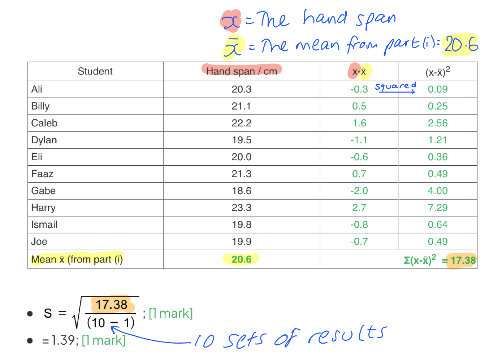
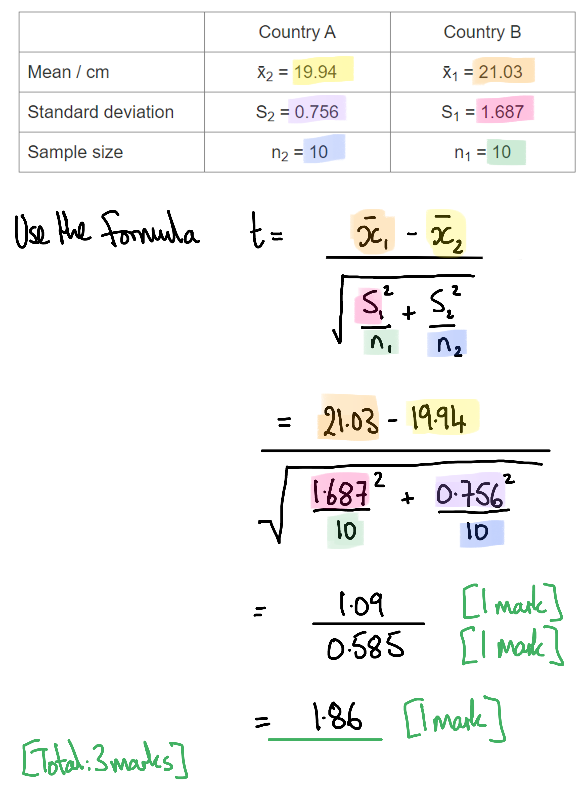
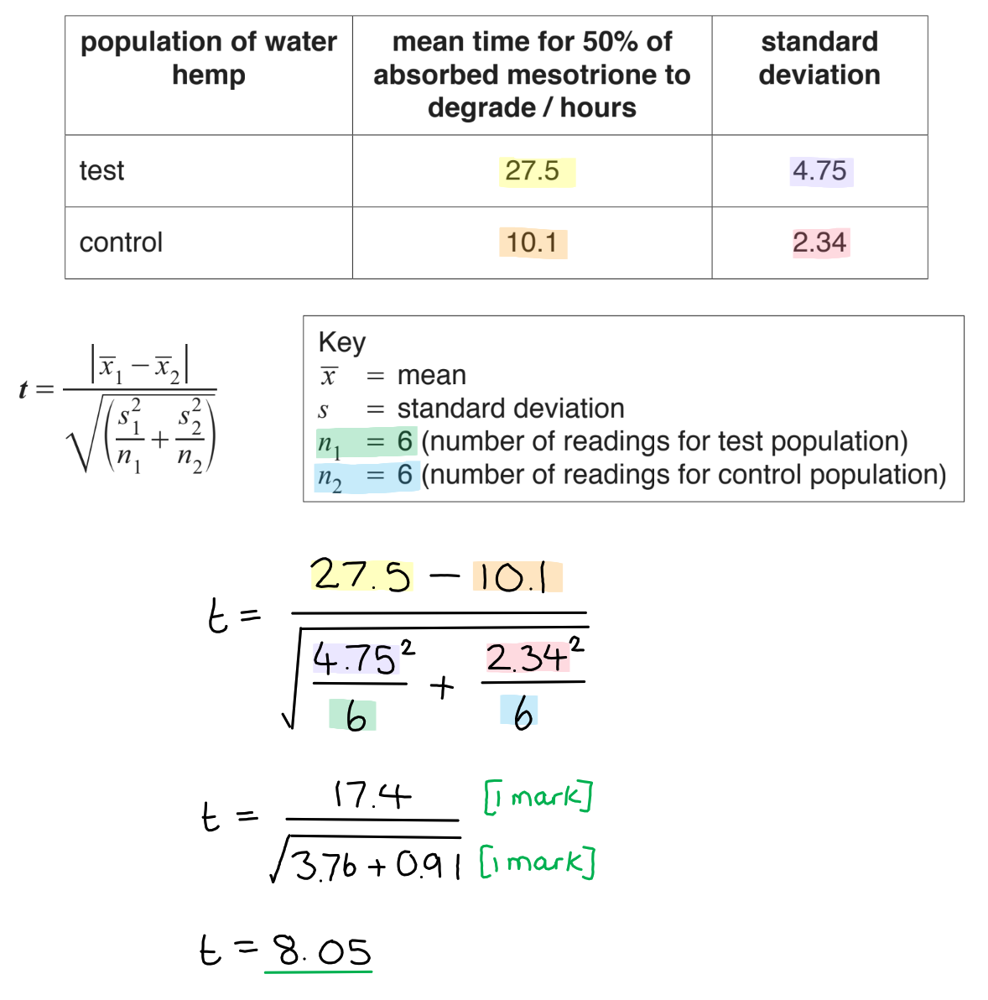
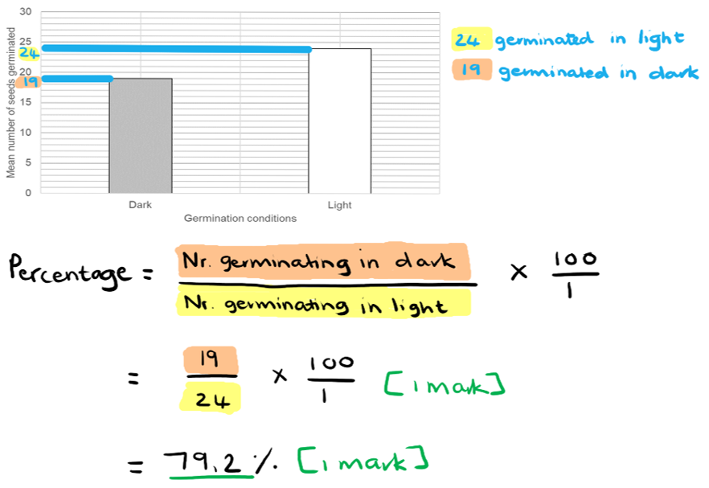
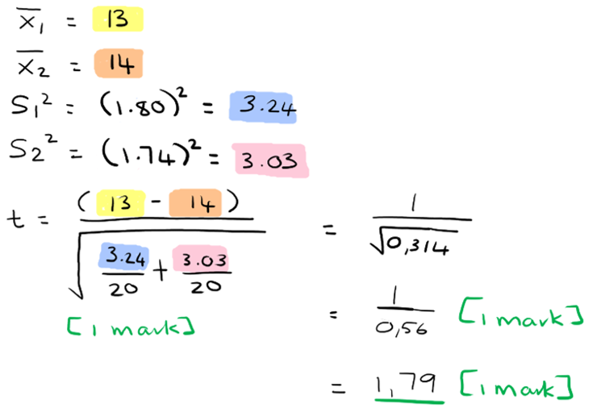
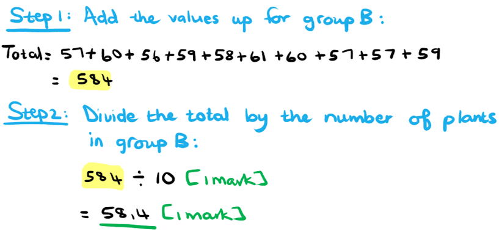
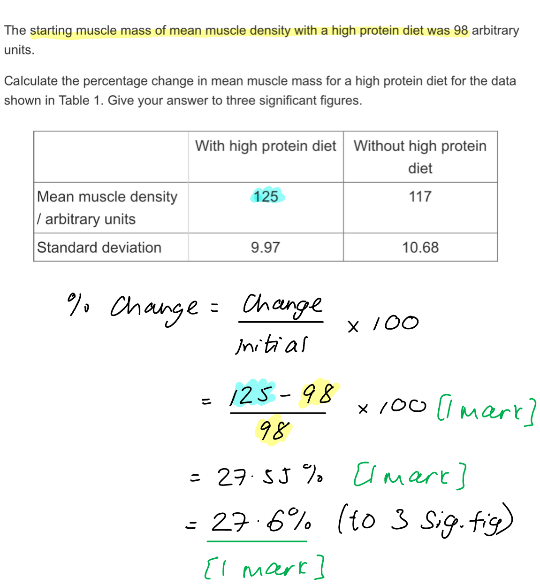
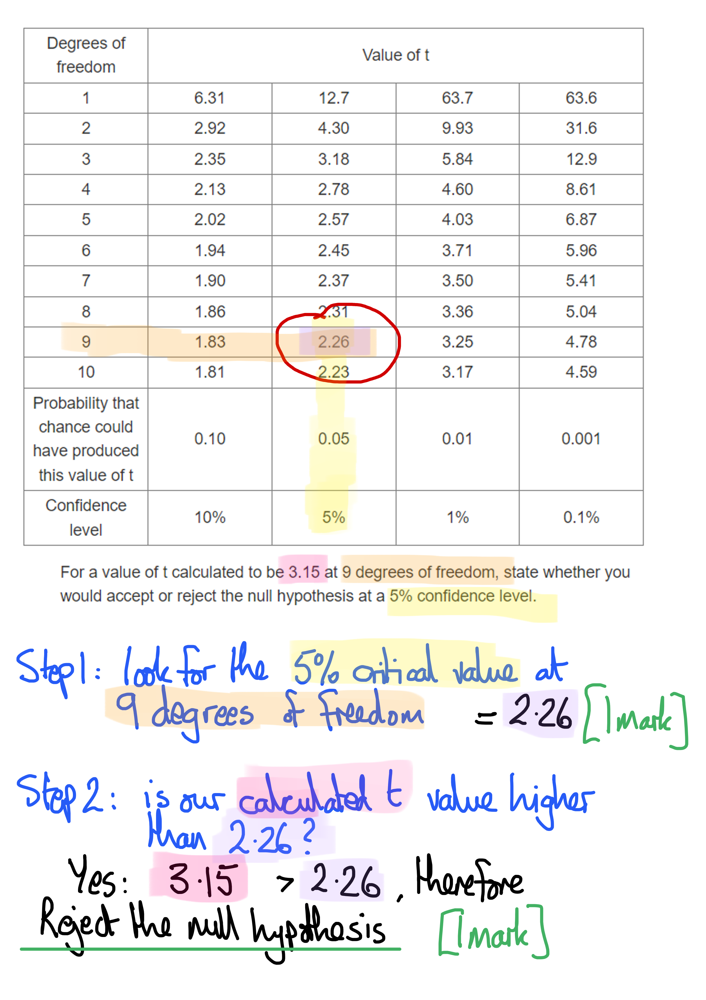
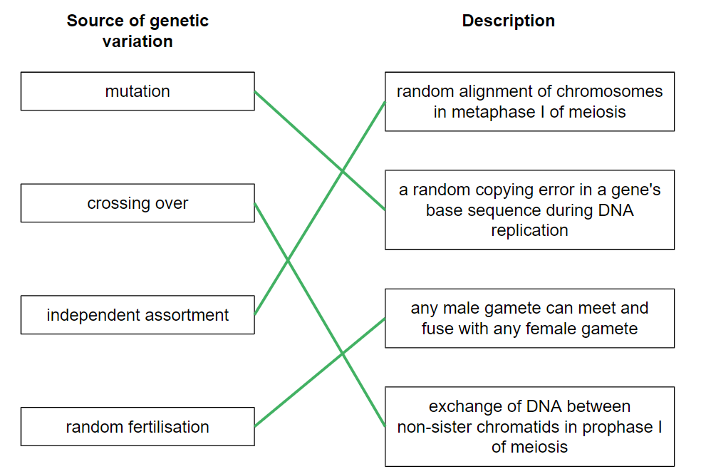
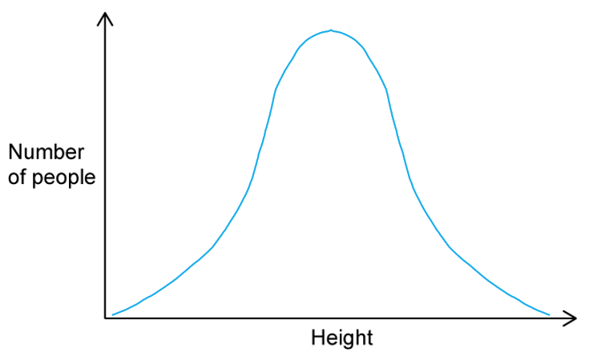

# Mark Schemes — Variation
**17. Selection & Evolution** · Cambridge (CIE) A-LEVEL biology (9700)

## Structured Questions (11 questions)

### Q1
(i) The type of cell division represented in Fig. 1 is...

- Meiosis; **[1 mark]**

(ii) The ways in which meiosis contributes to phenotypic variation:

**Final answer:** **Any ****four ****of the following:**

- (Meiosis) leads to genetic variation (which produces phenotypic variation);** [1 mark]**
- (Through) independent assortment of homologous chromosomes (during metaphase I); **[1 mark]**
- The random alignment of chromosomes results in different chromosome/allele combinations (in each gamete); **[1 mark]**
- Crossing over of non-sister chromatids (during prophase I); **[1 mark]**
- The exchange of genetic material (between non-sister chromatids) leads to new allele combinations on chromosomes **OR** it can break linkages between genes; **[1 mark]**

**[Total: 5 marks]**

> *One factor that can produce phenotypic variation between organisms of the same species is genetic variation. Meiosis can contribute to this by reshuffling existing genes in the genotype of an organism through independent assortment and crossing over. This ensures that each gamete (and therefore potential offspring) receives a different combination of alleles that results in differences in the phenotype.*
The variation in height between the tomato plants was due to.....

**Final answer:** **Any ****two**** of the following:**

- The height of the tomato plants were affected by environmental factors / nutrient composition of the soil; **[1 mark]**
- Plants growing in nutrient poor soil were not able to grow to their full potential size (determined by their genotype) **OR** plants growing in nutrient rich soil were able to reach their full potential size; **[1 mark]**
- Mutations of the gene coding for height; **[1 mark]**

**[Total: 2 marks]**
This observation can be explained as follows:

- The (short) height of the parent plants were affected by environmental factors / nutrient composition of soil (type **B**); **[1 mark]**
- This cannot be inherited, as it did not affect/change the DNA/genes/(T-)alleles; **[1 mark]**
- The offspring was able to reach their full (genetic) potential size due to the presence of sufficient nutrients; **[1 mark]**

**[Total: 3 marks]**

### Q2
The purpose of the statistical test called the *t*-test is:

- To compare the <u>means</u> (of two sets of data); **[1 mark]**
- To determine if they are <u>significantly different</u> or not / to determine a <u>significant difference</u>;** [1 mark]**

**[Total: 2 marks]**

> *When discussing in the context of statistical tests you need to use the term 'statistically different' and not just 'the data is significant'. *
(i) The mean of the students' handspans is

- No anomalies / outliers, so can divide by 10
- 20.3 + 21.1 + 22.2 + 19.5 + 20.0 + 21.3 + 18.6 + 23.3 + 19.8 + 19.9 = 206.0; **[1 mark]**
- 206 ÷ 10 students = 20.6 cm; **[1 mark]**

(ii) The completed table looks like:

| Student | Hand span / cm | x-x̄ | (x-x̄)2 |
|---|---|---|---|
| Ali | 20.3 | **Final answer:** **-0.3** | **Final answer:** **0.09** |
| Billy | 21.1 | **Final answer:** **0.5** | **Final answer:** **0.25** |
| Caleb | 22.2 | **Final answer:** **1.6** | **Final answer:** **2.56** |
| Dylan | 19.5 | **Final answer:** **-1.1** | **Final answer:** **1.21** |
| Eli | 20.0 | **Final answer:** **-0.6** | **Final answer:** **0.36** |
| Faaz | 21.3 | **Final answer:** **0.7** | **Final answer:** **0.49** |
| Gabe | 18.6 | **Final answer:** **-2.0** | **Final answer:** **4.00** |
| Harry | 23.3 | **Final answer:** **2.7** | **Final answer:** **7.29** |
| Ismail | 19.8 | **Final answer:** **-0.8** | **Final answer:** **0.64** |
| Joe | 19.9 | **Final answer:** **-0.7** | **Final answer:** **0.49** |
| Mean x̄ (from part (i) | **Final answer:** **20.6** | **Final answer:** **Σ(x-x̄)****2****  = 17.38       ** |   |

**[1 mark] **for the the third column **[1 mark] **for the final column] **[1 mark] **for the correct value of (x-x̄)2

(iii) The standard deviation is calculated as follows:

- $\mathrm{S} = \sqrt{ \frac{17.38}{( 10 - 1 )} }$ ; **[1 mark]**
- = 1.39;** [1 mark]**

**[Total: 7 marks]**

The null hypothesis for this investigation would be:

- There is <u>no significant difference</u> between two means of countries A and B; **[1 mark]**
- (And that) any differences seen are due to <u>chance</u>; **[1 mark]**

**[Total: 2 marks]**
The calculation of t is as follows:

- Numerator:  difference in means = 21.03 - 19.94 = 1.09; **[1 mark]**
- Denominator: squares of SDs divided by sample sizes = $\sqrt{\frac{1.687^{2}}{10}+\frac{0.756^{2}}{10}}=0.585$ ; **[1 mark]**
- Value of* t* = 1.09 ÷ 0.585 = 1.86; **[1 mark]**

**[Total: 3 marks]**

The null hypothesis can be:

- Accepted; **[1 mark]**
- 1.86 < 2.10 for 18 degrees of freedom at 5 % confidence level; **[1 mark]**
- There is more than a 95 % probability that the difference between the results is due to chance / that the differences between the means is not significant; **[1 mark]**

*Allow error carried forward from part (d)'s numerical value*

**[Total: 3 marks]**

> *Degrees of freedom for a t-test with two sets of data can be calculated as follows:*

> *df = n**1** + n**2** – 2*

- *where **n**1** and **n**2** are the total observations from each sample*

> *df = 10 + 10 - 2 = 18*

> *In biological studies, unless you are told otherwise, the critical value is taken at the 5 % confidence level, which means there is only a 5 % risk of concluding that a difference is significant when it was actually due to chance.*

### Q3
(i) The stage of meiosis where single chromosomes line up on the equator is...

- Metaphase <u>II/2</u>; **[1 mark]**

(ii) The events taking place during anaphase I of meiosis are...

**Final answer:** **Any ****two ****of the following:**

- Spindle (fibres)/microtubules contract/shorten; **[1 mark]**
- <u>Chromosome</u>(s) are pulled to poles/centrioles; **[1 mark]**
- <u>Centromeres</u> are pulled first; **[1 mark]**
- Homologous chromosomes/pair (of chromosomes)/bivalent is separated/pulled apart; **[1 mark]**

(iii) Crossing over during meiosis leads to genetic variation because...

**Final answer:** **Any ****two ****of the following:**

- <u>Non-sister chromatids</u>...; **[1 mark]**
- ...Exchange alleles/sections of DNA; **[1 mark]**
- <u>Chiasmata</u> form; **[1 mark]**
- (Giving) new/different <u>allele</u> combinations **OR** leading to recombination; **[1 mark]**

**[Total: 5 marks]**

> *ii) Remember that spindle fibres **shorten** in order to have the **effect** of pulling the chromosomes. It is therefore important to say that they 'contract/shorten' in marking point 1 before going on to describe the effect of this in marking point 2*

> *For parts (ii) and (iii) you need to be really careful with your use of scientific language. Look out for the underlined words because these are the words that are essential in order to gain marks. Avoid being too vague with your language as this is a very common way to drop marks in an exam. *
(i) The results in Table 1 show that the two populations differ in their resistance to mesotrione because...

**Final answer:** **Any ****two ****of the following:**

- Test group takes long<u>er</u> **OR** test group degrades mesotrione <u>more</u> slowly; **[1 mark]**
- So test group is <u>less</u> resistant / few<u>er</u> have resistance; **[1 mark]**
- Test group standard deviation is larg<u>er</u> **SO** (population) is more variable; **[1 mark]**

(ii) This example of genetic variation is important for natural selection in water hemp populations because...

**Final answer:** **Any ****two ****of the following:**

- The hemp can adapt/evolve / survive over the long term; **[1 mark]**
- Resistant/mutant plants have a selective advantage...; **[1 mark]**
- ...In areas where mesotrione is used; **[1 mark]**
- Resistant/mutant plants survive and reproduce; **[1 mark]**

(iii) The benefit of this to a farmer is that...

**Final answer:** **Any ****one ****of the following:**

- This lets the farmer choose a different / the most effective herbicide; **[1 mark]**
- Less money is wasted due to choosing the wrong herbicide / a reduced crop yield; **[1 mark]**

**[Total: 5 marks]**

> *i) You need to make sure that your points for this question are comparative; you shouldn't refer to either population in isolation. You can indicate to an examiner that you are making comparisons by using terms such as 'longer', 'more', less', and 'fewer.*

> *Remember that with an 'explain' question you can't just quote the data from the table, you need to say **why** the data is the way it is. *

> *iii) Remember that water hemp is the weed, not the crop. *
(i) The value of *t* can be calculated as follows...

- Numerator working = 17.4; **[1 mark]**
- Denominator working = √3.76 + 0.91 **OR **√4.67 **OR** 2.16; **[1 mark]**

*Marks are awarded for the working and not for the final answer.*

(ii) The null hypothesis should be...

**Final answer:** **Any ****two ****of the following:**

- <u>Rejected</u> because ***t***/calculated value is greater than 2.23/critical value; **[1 mark]**
- The probability of the result occurring by chance** **is <u>less than</u> 0.05/5 % **OR** p < 0.05; **[1 mark]**
- There is a significant difference between the means/test and control populations; **[1 mark]**

**[Total: 4 marks]**

> *Remember to **show your working** (as instructed in the question!). Both of the marks here are given for correctly calculating the numerator and denominator within the working rather than for the value of **t** itself, so just writing down the final answer will not gain any marks.*

### Q4
The mean number of seeds germinating in dark conditions as a percentage of the mean number of seeds germinating in light conditions can be calculated as follow:

- (19 ÷ 24) x 100; **[1 mark]**
- =79.2; **[1 mark]**

*Full marks awarded for the correct answer only.*

**[Total: 2 marks]**

The* t*-test would not be suitable to use on the data in Fig.1 because....

- The data is not continuous **OR** data forms two discontinuous categories; **[1 mark]**
- The data does not have a normal distribution; **[1 mark]**

**[Total: 2 marks]**
The *t*-value can be calculated as follows:

- $t=\frac{13-14}{\sqrt{\frac{(1.80)^{2}}{20}+\frac{(1.74)^{2}}{20}}}$ ; **[1 mark]**
- $\frac{1}{0.56}$ ; **[1 mark]**
- $=1.79$; **[1 mark]**

*Full marks awarded for the correct answer only.*

**[Total: 3 marks]**

> *The key to this calculation is to substitute the values correctly for each population and double-check that you calculated correctly.*

The conclusion that can be made is as follows:

- Null hypothesis/H0 can be accepted; **[1 mark]**
- The difference in beak size between the populations is due to chance **OR** there is no significant difference in beak size between the populations; **[1 mark]**

**[Total: 2 marks]**

> *The t-value calculated in part c) was less than the critical value at a probability of 0.05. This means that any difference observed between the population is not significant and is most likely due to chance.*

### Q5
The type of variation represented by Fig. 1 is....

- Continuous (variation); **[1 mark]**

Reasons:

- The values / quantitative differences do not fall into discrete categories **OR **there is a lack of discrete categories; **[1 mark]**
- There is a range of values between the two extremes within which the phenotype will fall; **[1 mark]**

**[Total: 3 marks]**
The role of environmental factors on the number of spines can be explained as follows:

- The more frequent the cacti are grazed (by herbivores) the greater the number of spines that would be present **OR** the less frequent the cacti is grazed the smaller the number of spines that would be present; **[1 mark]**
- Those that are grazed more frequently will require more protection (from herbivores) than those that are not frequently grazed **OR** those that are grazed less frequently will not require as much protection as those that are exposed to frequent grazing; **[1 mark]**

**[Total: 2 marks]**
Contrasting continuous and discontinuous variation with one another:

- Different alleles at a single locus have a small effect on the phenotype in continuous variation **WHILE** it will have a large effect on the phenotype in discontinuous variation; **[1 mark]**
- Different genes can have the same or additive effect on the phenotype in continuous variation **WHILE** different genes will have different effects on the phenotype in discontinuous variation; **[1 mark]**
- A large number of genes / polygenes may have a combined effect on the phenotype in continuous variation **WHILE** a smaller number of genes may have an effect on the phenotype in discontinuous variation; **[1 mark]**

**[Total: 3 marks]**

> *Remember when a question asks you to contrast two concepts, you must focus on the main differences between them. In this case, you must make mention of both continuous and discontinuous variation in your answer to receive the marks.*

### Q6
Calculating the mean leaf length for group **B** would be as follows:

- 584 ÷ 10; **[1 mark]**
- = 58.4; **[1 mark]**

*Full marks awarded for the correct answer only.*

**[Total: 2 marks]**

The data must have the following characteristics:

- It must have a normal distribution; **[1 mark]**
- The data must be continuous; **[1 mark]**

**[Total: 2 marks]**
The null hypothesis for this investigation is as follows:

- There is no significant difference between the leaf length of group **A** and **B** **OR** there is no significant difference between the leaf length of plants grown under high and low light intensity; **[1 mark]**

**[Total: 1 mark]**

> *The null hypothesis will always state that there is no significant difference between the groups of data that you are comparing. The outcome of the statistical test that is performed will determine whether the null hypothesis is accepted or rejected.*
The students can draw the following conclusion from their results:

- The probability that the difference in leaf length between the two groups is due to chance is very small **OR** p-value/significance level is less than (critical value of) 0.05 (at 18 degrees of freedom);** [1 mark]**
- The null hypothesis/H0 can be rejected; **[1 mark]**
- (Therefore) there is a (statistically) significant difference between the leaf length of the two groups; **[1 mark]**

**[Total: 3 marks]**

> *Scientists consider a probability of 0.05 as the critical value for accepting that chance is responsible for the difference observed between two data sets. The greater the **t**-value, the smaller the probability that the difference is due to chance. In the case of leaf length, the **t**-value of 29.7 at 18 degrees of freedom is much greater than 2.101, which is the **t**-value if the probability was 0.05. This means that the differences observed in leaf length between group A and B is not due to chance and was most probably influenced by the levels of light intensity.*

### Q7
The independent variable in the investigation is...

- Diet / high/low protein diet;** [1 mark]**

**[Total: 1 mark]**
The mean and standard deviation values suggest the rats' muscle density with and without a high protein diet:

- Higher muscle density with a high protein diet* */ mean muscle density greater with a high protein diet than with a protein deficiency diet/low protein diet; **[1 mark]**
- Muscle density is more consistent with a high protein diet compared to a low protein diet / standard deviation is smaller with a high protein diet compared to a low protein diet / less variation (in muscle density) with a high protein diet than with a low protein diet; **[1 mark]**
- There is no significant difference in the mean muscle density in rats with and without a high protein diet **OR **a high protein diet does not significantly increase muscle density in rats; **[1 mark]**

***Accept ****the converse for each marking point*

**[Total: 3 marks]**

> *The standard deviations lead to an overlap in the mean data indicating that there is no significant difference in the two means.*
The percentage change in mean muscle mass for a high protein diet is...

- 125 - 98 = 27;** [1 mark]**
- (27 / 98) x 100 = 27.55 %;** [1 mark]**
- 27.6 % (to 3 sig. fig.);** [1 mark]**

**[Total: 3 marks]**

A t-test would be an appropriate statistical test for this data set because...

- Normal distribution would be followed; **[1 mark]**
- The data is continuous; **[1 mark]**
- Standard deviations are approximately/almost equal; **[1 mark]**

**[Total: 3 marks]**

### Q8
A null hypothesis is a statement...

- That the expected result will show no <u>significant</u> difference between two means; **[1 mark]**
- That any differences seen are due to chance; **[1 mark]**

**[Total: 2 marks]**
Before calculating the t-value between two sets of data, the two statistical calculations that must be performed on each set of raw data are:

- Mean / x̄ ; **[1 mark]**
- Standard deviation / S / s.d.; **[1 mark]**

**[Total: 2 marks]**
The relationship between the size of the calculated t-value and the probability of a difference between two data sets having occurred by chance is:

- The <u>greater</u>** **the t-value calculated (for any degree of freedom)...; **[1 mark]**
- ...the <u>lower</u> the probability of chance (causing any significant difference between the two sample means); **[1 mark]**

*Allow converse argument, inverse relationship/correlation*

**[Total: 2 marks]**
The null hypothesis would be:

- <u>Rejected;</u> **[1 mark]**
- Because the t value is **greater/higher** than the 5% confidence level critical value (of 2.26); **[1 mark]**

**[Total: 2 marks]**

### Q9
The correctly completed Table 1 is as follows...

| **Organism** | **Characteristic** | **Phenotypic characteristic? (✓**/✘**)** |
|---|---|---|
| human | brown eyes | **✓**;** ****[1 mark]** |
| human | expresses the CFTR protein* | **✓**;** ****[1 mark]** |
| plant | contains gene for two-tone leaves | ✘; **[1 mark]** |
| fungi | red and white spotted fruiting cap (mushrooms) | **✓**;** ****[1 mark]** |

**[Total: 4 marks]**

> *Brown eyes and the spotted mushroom cap are obvious examples of an organism's outward appearance, so they are phenotypic traits. *

> *The possession of a gene though, is an organism's genotype. A plant may possess a gene for two-tone leaves but the leaves will only be two-tone if the gene is expressed. Possession of a gene does not make that trait part of the phenotype.*

> *Expression of a gene, like the CFTR gene, is not necessarily visible to a casual observer. However, this still counts as phenotype because the gene is expressed for the CFTR protein to be present in a person's airways. *

> *A common misconception is that phenotypes are always visible from the outside of an organism; they are not always!*
Environmental factors that can affect an organism's phenotype are:

**Animal examples**

**Final answer:** **One**** from:**

- Sunburn / sun tan; **[1 mark]**
- Artificial hair / eye colour/contact lenses; **[1 mark]**
- Diet / water intake; **[1 mark]**
- Temperature; **[1 mark]**
- Effect of chemicals / drugs; **[1 mark]**
- Sports / bodybuilding etc; **[1 mark]**

*Allow any plausible environmental factor and its effect on animals*

**Plant examples:**

**Final answer:** **One**** from:**

- Temperature; **[1 mark]**
- pH / mineral content (of soil); **[1 mark]**
- Light intensity; **[1 mark]**
- Wind direction / speed; **[1 mark]**
- Availability of water; **[1 mark]**

*Allow any plausible environmental factor and its effect on plants*

**[Total: 2 marks]**
The correct linking of the boxes is shown below:

**[1 mark]** for each correct line

**[Total: 4 marks]**

> *This is a synoptic question which links to Topic 16.1.4 Meiosis in Animal & Plant Cells.*
A mutation may not necessarily bring about a change in an organism's phenotype because:

**Final answer:** **Any ****one**** of the following:**

- The mutation is not expressed / occurs in a region of non-coding DNA / an intron; **[1 mark]**
- The mutation does not code for a different amino acid / so the same protein is synthesised; **[1 mark]**
- The mutation causes an unimportant/insignificant change to the protein's structure (and does not affect its function); **[1 mark]**
- The organism may possess an unmutated, dominant allele that is still expressed in the phenotype / the organism may become heterozygous dominant; **[1 mark]**

**[Total: 1 mark]**

### Q10
The sketch should appear as follows:

- A line graph (not a bar chart); **[1 mark]**
- A normal distribution / bell-shaped curve; **[1 mark]**

**[Total: 2 marks]**

> *Most people in the population are 'average height' with a smaller minority existing at the extremes of being tall and short. *

The type of variation shown is...

- <u>Continuous</u> variation; **[1 mark]**

**[Total: 1 mark]**

> *Continuous variation can exist in a range of many values and can be plotted on a graph with a normal distribution curve. *
The factors that cause variation in hair colour are:

- (Hair colour) can be determined genetically / inherited / coded by DNA/alleles; **[1 mark]**
- (Hair colour) can be influenced by the environment e.g. sunlight exposure / hair dye; **[1 mark]**

**[Total: 2 marks]**
The scientific term for when a characteristic is coded for by more than one gene is:

- <u>Polygenic</u> characteristic; **[1 mark]**

**[Total: 1 mark]**

### Q11
Phenotypic variation means...

- Variation (in the phenotype) caused by genetic factors or environmental factors or a combination of both;** [1 mark]**

**[Total: 1 mark]**
Variation shown by the pea plants is...

- Pea plants can either be tall or short; **[1 mark]**
- There is variation (in height) within each category of pea plant; **[1 mark]**
- Pea plant height is an example of continuous variation; **[1 mark]**

**[Total: 3 marks]**
The cause of the variation shown by the pea plants in Fig. 1 is...

**Final answer:** **Any ****two ****of the following:**

- An interaction between genetics **and **the environment; **[1 mark]**
- A large number of genes (may) have a combined effect on the phenotype/height / polygenic variation/inheritance; **[1 mark]**
- Genes for height (may) have an additive effect; **[1 mark]**

**[Total: 2 marks]**
The statistical test that should be carried out to determine if there is a significant difference in the heights of the pea plants is...

- T-test; **[1 mark]**
- Reason: To** **<u>compare</u> the mean heights of two sets of pea plants/data; **[1 mark]**

**[Total: 2 marks]**
