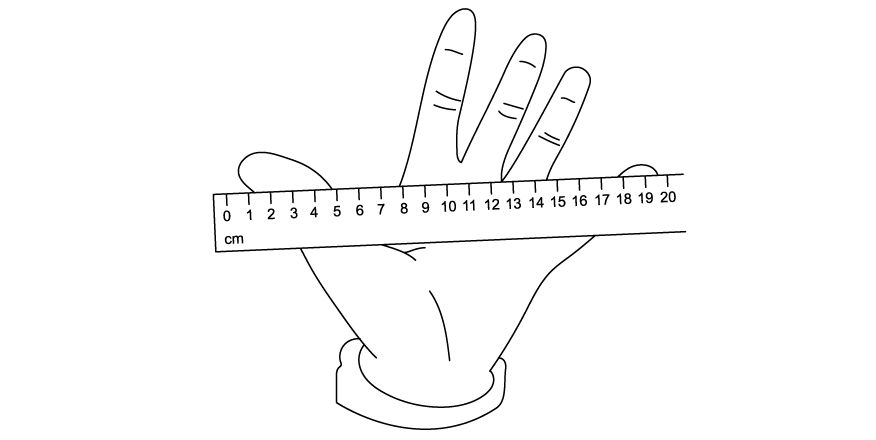
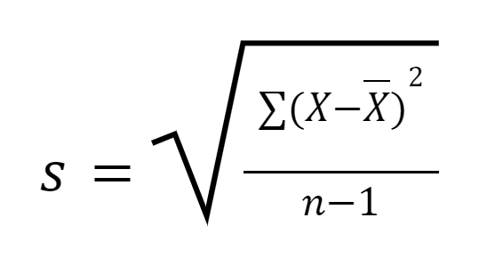
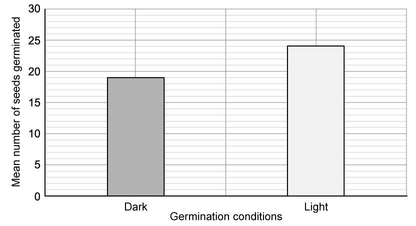

# Exam Questions — Variation
**17. Selection & Evolution** · Cambridge (CIE) A-LEVEL biology (9700)
> Source: [https://www.savemyexams.com/a-level/biology/cie/25/topic-questions/](https://www.savemyexams.com/a-level/biology/cie/25/topic-questions/) · 11 questions across 1 sets

## Structured Questions (11 questions)

### Q1 — hard — 10 marks

**Q1** [5 marks]

Fig. 1 shows a type of cell division occurring in the reproductive organs of humans.

**Fig. 1**

(i) Identify the type of cell division illustrated in Fig. 1.

[1]

(ii) Explain how the type of cell division identified in part (i) contributes to variation in the phenotype of the resulting offspring.

[4]

**Q1** [2 marks]

Tall tomato plants are produced by the presence of a dominant allele **T**. Two homozygous tall plants were crossed and seeds from this cross were planted in soils with different nutrient compositions. The mean height of each group of tomato plants was calculated and the results are shown in Table 1.

**Table 1**

| **Soil type** | **Mean height / cm** |
|---|---|
| **A** | 35 |
| **B** | 12 |
| **C** | 26 |
| **D** | 40 |

Suggest reasons for the variation in height that was observed in the tomato plants.

**Q1** [3 marks]

**Extract:**

Tall tomato plants are produced by the presence of a dominant allele T. Two homozygous tall plants were crossed and seeds from this cross were planted in soils with different nutrient compositions. The mean height of each group of tomato plants was calculated and the results are shown in Table 1.

Table 1

Soil type | Mean height / cm
A | 35
B | 12
C | 26
D | 40

Seeds from the tomato plants grown in soil type **B** were taken and planted in soil type **D **where they reached an average height of 42 cm.

Explain this observation.

### Q2 — hard — 17 marks

**Q2** [2 marks]

The ***t*****-test **is a statistical test used to compare two sets of biological data.

State the purpose of* t*-test.

**Q2** [7 marks]

A number of boy students in a school measured their maximum handspan using a ruler as shown in Fig. 1.

**Fig. 1**

Table 1 shows their class data:

**Table 1**

| Student | Hand span / cm |
|---|---|
| Ali | 20.3 |
| Billy | 21.1 |
| Caleb | 22.2 |
| Dylan | 19.5 |
| Eli | 20.0 |
| Faaz | 21.3 |
| Gabe | 18.6 |
| Harry | 23.3 |
| Ismail | 19.8 |
| Joe | 19.9 |

(i) Calculate the mean value x̄ of the students' handspans.

[2]

(ii) Use Table 2 below to calculate and sum the values of (x-x̄)2

| Student | Hand span / cm | x-x̄ | (x-x̄)2 |
|---|---|---|---|
| Ali | 20.3 |   |   |
| Billy | 21.1 |   |   |
| Caleb | 22.2 |   |   |
| Dylan | 19.5 |   |   |
| Eli | 20.0 |   |   |
| Faaz | 21.3 |   |   |
| Gabe | 18.6 |   |   |
| Harry | 23.3 |   |   |
| Ismail | 19.8 |   |   |
| Joe | 19.9 |   |   |
| Mean x̄ (from part (i) |   |   |   |

[3]

(iii) From the values you have found in Table 2, calculate the standard deviation S using the formula below.

[2]

**Q2** [2 marks]

In a linked experiment, groups of 10 male students from two different countries (Countries A and B) also took part in this experiment.

All the boys taking part were of the same age group as the boys in Table 1 and also measured their maximum hand spans.

Their data calculated out as follows:

**Table 2**

|   | Country A | Country B |
|---|---|---|
| Mean / cm | x̄2 = 19.94 | x̄1 = 21.03 |
| Standard deviation | S2 = 0.756 | S1 = 1.687 |
| Sample size | n2 = 10 | n1 = 10 |

State a null hypothesis for this investigation.

**Q2** [3 marks]

**Extract:**

In a linked experiment, groups of 10 male students from two different countries (Countries A and B) also took part in this experiment. 

All the boys taking part were of the same age group as the boys in Table 1 and also measured their maximum hand spans. 

Their data calculated out as follows:

Table 2

|   | Country A | Country B |
| Mean / cm | x̄~2~ = 19.94 | x̄~1~ = 21.03 |
| Standard deviation | S~2~ = 0.756 | S~1~ = 1.687 |
| Sample size | n~2~ = 10 | n~1~ = 10 |

From the data described in part (c), calculate the t value between the data from Country A and Country B.

The formula for calculating *t* is as follows:

$t = \frac{\left| \bar{x}_{1} - \bar{x}_{2} \right|}{\sqrt{( \frac{s_{1}^{2} }{n_{1} } + \frac{s_{2}^{2} }{n_{2} } )}}$

**Q2** [3 marks]

**Extract:**

In a linked experiment, groups of 10 male students from two different countries (Countries A and B) also took part in this experiment. 

All the boys taking part were of the same age group as the boys in Table 1 and also measured their maximum hand spans. 

Their data calculated out as follows:

**Table 2**

|   | Country A | Country B |
| Mean / cm | x̄~2~ = 19.94 | x̄~1~ = 21.03 |
| Standard deviation | S~2~ = 0.756 | S~1~ = 1.687 |
| Sample size | n~2~ = 10 | n~1~ = 10 |

State a null hypothesis for this investigation.

From the data described in part (c), calculate the t value between the data from Country A and Country B.

The calculated t-value is 1.86.

Table 3 shows a table of critical values for the *t*-test carried out in parts (c) and (d).

**Table 3**

| **Degrees of freedom** | **Value of *****t *****at confidence level** |   |   |   |
|---|---|---|---|---|
| **10 %** | **5 %** | **1 %** | **0.1 %** |   |
| 1 | 6.31 | 12.7 | 63.7 | 63.6 |
| 2 | 2.92 | 4.30 | 9.93 | 31.6 |
| 3 | 2.35 | 3.18 | 5.84 | 12.9 |
| 4 | 2.13 | 2.78 | 4.60 | 8.61 |
| 5 | 2.02 | 2.57 | 4.03 | 6.87 |
| 6 | 1.94 | 2.45 | 3.71 | 5.96 |
| 7 | 1.90 | 2.37 | 3.50 | 5.41 |
| 8 | 1.86 | 2.31 | 3.36 | 5.04 |
| 9 | 1.83 | 2.26 | 3.25 | 4.78 |
| 10 | 1.81 | 2.23 | 3.17 | 4.59 |
| 18 | 1.73 | 2.10 | 2.88 | 3.92 |
| 19 | 1.73 | 2.09 | 2.86 | 3.88 |
| 20 | 1.73 | 2.08 | 2.85 | 3.85 |

Use the value of *t* that you calculated in part (d) to either reject or accept your null hypothesis from part (c).

Give a reason for your decision.

### Q3 — hard — 14 marks

**Q3** [5 marks]

Meiosis is one process that contributes to genetic variation.

(i) State precisely the stage of meiosis where single chromosomes line up on the equator.

[1]

(ii) Outline the events taking place during anaphase I of meiosis.

[2]

(iii) Describe how crossing over during meiosis leads to genetic variation.

[2]

*Source: Oct/Nov 2018 9700/41 Q3A*

**Q3** [5 marks]

Mutation also causes genetic variation. Some populations of water hemp, *Amaranthus tuberculatus*, have evolved herbicide resistance as a result of a mutation. This is a problem for farmers as water hemp grows in crop fields, lowering productivity.

Two populations of water hemp were tested for resistance to the herbicide mesotrione. One was a population known to be resistant (control) and the other was a test population, whose resistance was unknown.

- Leaves were removed and immersed in a radioactively labelled solution of mesotrione.
- The leaves absorbed some mesotrione and became radioactive.
- Resistant leaves are able to degrade mesotrione by metabolism.
- The time for 50 % of absorbed mesotrione to degrade was calculated by measuring the radioactivity of the leaves.

The results are shown in Table 1.

**Table 1**

| **population of water** **hemp** | **mean time for 50 % of** **absorbed mesotrione to** **degrade / hours** | **standard** **deviation** |
|---|---|---|
| test | 27.5 | 4.75 |
| control | 10.1 | 2.34 |

(i) Explain how the results in Table 1 show that the two populations differ in their resistance to mesotrione.

[2]

(ii) Explain why this example of genetic variation is important for natural selection in water hemp populations.

[2]

(iii) Farmers can send in a sample of leaves of water hemp from their fields to a laboratory to be tested for resistance to mesotrione or other herbicides.

Suggest the benefit of this to a farmer.

[1]

*Source: Oct/Nov 2018 9700/41 Q3B*

**Q3** [4 marks]

**Extract:**

Two populations of water hemp were tested for resistance to the herbicide mesotrione. One was a population known to be resistant (control) and the other was a test population, whose resistance was unknown.

- Leaves were removed and immersed in a radioactively labelled solution of mesotrione.
- The leaves absorbed some mesotrione and became radioactive.
- Resistant leaves are able to degrade mesotrione by metabolism.
- The time for 50 % of absorbed mesotrione to degrade was calculated by measuring the radioactivity of the leaves.

The results are shown in Table 1.

Table 1

| population of water hemp | mean time for 50 % of absorbed mesotrione to degrade / hours | standard deviation |
| test | 27.5 | 4.75 |
| control | 10.1 | 2.34 |

The null hypothesis states there is no significant difference between the mean times for 50 % of absorbed mesotrione to degrade in the two populations.

A *t*‐test can be carried out to compare these two means. The critical value for ***t*** at the *p* = 0.05 significance level is 2.23.

(i) Use the formula in Fig. 1 to calculate the value of ***t***.

Show your working.

$t = \frac{\left| \bar{x}_{1} - \bar{x}_{2} \right|}{\sqrt{( \frac{s_{1}^{2} }{n_{1} } + \frac{s_{2}^{2} }{n_{2} } )}}$

| Key $\overline{x}$ = mean *s* = standard deviation *n*1 = 6 (number of readings for test population) *n*2 = 6 (number of readings for control population) |
|---|

**Fig. 1**

[2]

(ii) Use your calculated value of ***t*** to explain whether the null hypothesis should be accepted or rejected.

[2]

*Source: Oct/Nov 2018 9700/41 Q3C*

### Q4 — medium — 9 marks

**Q4** [2 marks]

Scientists investigated the effect of light on the germination of begonia seeds. They had three groups consisting of 30 seeds each, for both light and dark conditions. The seeds were exposed to light or darkness for 72 hours before scientists calculated the mean number of seeds that germinated out of 30 seeds for each light condition. All other conditions were kept constant between the seeds.

Fig. 1 shows the results of this investigation.

**Fig. 1**

Calculate the mean number of seeds germinating in dark conditions as a percentage of the mean number of seeds that germinated in light conditions.

Show your working and give your answer to one decimal place.

**Q4** [2 marks]

**Extract:**

Scientists investigated the effect of light on the germination of begonia seeds. They had three groups consisting of 30 seeds each, for both light and dark conditions. The seeds were exposed to light or darkness for 72 hours before scientists calculated the mean number of seeds that germinated out of 30 seeds for each light condition. All other conditions were kept constant between the seeds.

Fig. 1 shows the results of this investigation.

Explain why the* t*-test would not be a suitable statistical test to use on the data represented in Fig.1.

**Q4** [3 marks]

The house sparrow (*Passer domesticus*) is a small bird commonly found in most parts of the world. They feed mainly on seeds and they show variation in beak size. Two small populations of sparrows, consisting of 20 birds each, were studied to investigate the difference in beak size displayed by each population.

The biologists conducting the study calculated the mean beak size for each population, as well as the standard deviation for each. The results of these calculations are represented in Table 1

**Table 1**

|   | **Population 1** | **Population 2** |
|---|---|---|
| **Mean** | 13 | 14 |
| **Standard deviation (S)** | 1.80 | 1.74 |

Fig. 2 represents the formula for calculating the *t*-value.

**Fig. 2**

Using the information in Table 1 and Fig. 2, calculate the *t*-value for this data set.

Show your working and give your answer to two decimal places.

**Q4** [2 marks]

**Extract:**

The house sparrow (*Passer domesticus*) is a small bird commonly found in most parts of the world. They feed mainly on seeds and they show variation in beak size. Two small populations of sparrows, consisting of 20 birds each, were studied to investigate the difference in beak size displayed by each population. 

The biologists conducting the study calculated the mean beak size for each population, as well as the standard deviation for each. The results of these calculations are represented in Table 1

**Table 1**

|   | **Population 1** | **Population 2** |
| **Mean** | 13 | 14 |
| **Standard deviation (S)** | 1.80 | 1.74 |

Fig. 2 represents the formula for calculating the *t*-value.

Using the information in Table 1 and Fig. 2, calculate the *t*-value for this data set.

The *t*-value can be calculated as follows: = 1.79

The null hypothesis for this investigation states that there is no significant difference between the beak sizes of the two populations. The *t*-value at a probability of 0.05 is 1.96 at 38 degrees of freedom.

With reference to the *t*-value calculated in part c), state the conclusion that can be made regarding the difference in beak size between the two populations.

### Q5 — medium — 8 marks

**Q5** [3 marks]

Cacti are plants that are adapted to live in arid conditions. They store water in thick stems which are protected from grazing by herbivores through the presence of multiple spines. The number of spines that are present on cacti may vary greatly, depending on the frequency of grazing that they experience.

Fig. 1 shows the number of spines present in a species of cacti.

**Fig. 1**

State the type of variation that is represented by Fig. 1 **and** provide **two** reasons for your answer.

**Q5** [2 marks]

**Extract:**

Cacti are plants that are adapted to live in arid conditions. They store water in thick stems which are protected from grazing by herbivores through the presence of multiple spines. The number of spines that are present on cacti may vary greatly, depending on the frequency of grazing that they experience.

Fig. 1 shows the number of spines present in a species of cacti.

Suggest the possible impact of environmental factors on the variation observed in Fig. 1, with regards to the number of spines on cacti.

**Q5** [3 marks]

Contrast the genetic basis of continuous and discontinuous variation with each other.

### Q6 — medium — 8 marks

**Q6** [2 marks]

Students investigated the effect of light intensity on leaf length in the Mexican sword plant (*Echinodorus palaefolius*). They had two groups (**A** and **B**) consisting of ten plants each, with group **A **grown in a laboratory where the lights were kept on, while group **B** was grown under similar conditions to group **A** but kept under low light conditions. The plants were grown at these different light intensities for 14 days, and the average leaf length of each plant was calculated for each group.

The results of the investigation is shown in Table 1.

**Table 1**

| **Plant number** | **Leaf length of group A** | **Leaf length of group B** |
|---|---|---|
| **1** | 38 | 57 |
| **2** | 39 | 60 |
| **3** | 40 | 56 |
| **4** | 40 | 59 |
| **5** | 37 | 58 |
| **6** | 36 | 61 |
| **7** | 37 | 60 |
| **8** | 37 | 57 |
| **9** | 39 | 57 |
| **10** | 39 | 59 |
| **Mean** | **38.2** |   |

Calculate the mean leaf length for group **B**.

Show your working.

**Q6** [2 marks]

The students used the *t*-test to compare the means of groups **A** and **B**.

State **two** features of the data that allow for the use of the *t*-test.

**Q6** [1 mark]

**Extract:**

Students investigated the effect of light intensity on leaf length in the Mexican sword plant (*Echinodorus palaefolius*). They had two groups (**A** and **B**) consisting of ten plants each, with group **A** grown in a laboratory where the lights were kept on, while group **B** was grown under similar conditions to group **A** but kept under low light conditions. The plants were grown at these different light intensities for 14 days, and the average leaf length of each plant was calculated for each group.

State a null hypothesis for this investigation.

**Q6** [3 marks]

**Extract:**

Students investigated the effect of light intensity on leaf length in the Mexican sword plant (Echinodorus palaefolius). They had two groups (A and B) consisting of ten plants each, with group A grown in a laboratory where the lights were kept on, while group B was grown under similar conditions to group A but kept under low light conditions. The plants were grown at these different light intensities for 14 days, and the average leaf length of each plant was calculated for each group.

The results of the investigation is shown in Table 1.

Table 1

| Plant number | Leaf length of group A | Leaf length of group B |
| 1 | 38 | 57 |
| 2 | 39 | 60 |
| 3 | 40 | 56 |
| 4 | 40 | 59 |
| 5 | 37 | 58 |
| 6 | 36 | 61 |
| 7 | 37 | 60 |
| 8 | 37 | 57 |
| 9 | 39 | 57 |
| 10 | 39 | 59 |
| Mean | 38.2 | |

The null hypothesis for this investigation is: There is no significant difference between the leaf length of group A and B OR there is no significant difference between the leaf length of plants grown under high and low light intensity.

After performing the *t*-test, the students calculated a *t*-value of 29.7. Table 2 shows different *t*-values and the probability that the differences between the data sets are due to chance.

**Table 2**

Using the information in Table 2, discuss the conclusions that the students can draw from their results.

### Q7 — medium — 10 marks

**Q7** [1 mark]

A scientist investigated whether a high-protein diet improves muscle density in rats. Rats were given either a diet high in protein or a diet deficient in protein, and their muscle density was measured weekly over 10 weeks.

Identify the independent variable in this investigation.

**Q7** [3 marks]

**Extract:**

A scientist investigated whether a high-protein diet improves muscle density in rats. Rats were given either a diet high in protein or a diet deficient in protein, and their muscle density was measured weekly over 10 weeks.

The results of the investigation are shown in Table 1.

**Table 1**

|   | With high protein diet | Without high protein diet |
|---|---|---|
| Mean muscle density / arbitrary units | 125 | 117 |
| Standard deviation | 9.97 | 10.68 |

Describe what the mean and standard deviation values in Table 1 suggest about the rats' muscle density with and without a high protein diet.

**Q7** [3 marks]

**Extract:**

The results of the investigation are shown in Table 1.

**Table 1**

|   | With high protein diet | Without high protein diet |
| Mean muscle density / arbitrary units | 125 | 117 |
| Standard deviation | 9.97 | 10.68 |

The starting muscle mass of mean muscle density with a high protein diet was 98 arbitrary units.

Calculate the percentage change in mean muscle mass for a high protein diet for the data shown in Table 1. Give your answer to three significant figures.

**Q7** [3 marks]

**Extract:**

The results of the investigation are shown in Table 1.

Table 1

|   | With high protein diet | Without high protein diet |
| Mean muscle density / arbitrary units | 125 | 117 |
| Standard deviation | 9.97 | 10.68 |

Explain why a *t*-test would be an appropriate statistical test for this data set.

### Q8 — easy — 8 marks

**Q8** [2 marks]

Before performing a statistical test such as the t-test, a null hypothesis must be formed.

State what is meant by a null hypothesis.

**Q8** [2 marks]

State the **two** statistical calculations that must be performed on each set of raw data before calculating the t-value between two sets of data.

**Q8** [2 marks]

State the relationship between the size of the calculated t-value and the probability of a difference between two data sets having occurred by chance.

**Q8** [2 marks]

Table 1 shows a table of critical values for the t-test which compared the number of leaves of shrubs of the same species growing in different habitats.

The null hypothesis states that the habitat has no significant effect on the number of leaves per shrub.

**Table 1**

| Degrees of freedom | Value of t |   |   |   |
|---|---|---|---|---|
| 1 | 6.31 | 12.7 | 63.7 | 63.6 |
| 2 | 2.92 | 4.30 | 9.93 | 31.6 |
| 3 | 2.35 | 3.18 | 5.84 | 12.9 |
| 4 | 2.13 | 2.78 | 4.60 | 8.61 |
| 5 | 2.02 | 2.57 | 4.03 | 6.87 |
| 6 | 1.94 | 2.45 | 3.71 | 5.96 |
| 7 | 1.90 | 2.37 | 3.50 | 5.41 |
| 8 | 1.86 | 2.31 | 3.36 | 5.04 |
| 9 | 1.83 | 2.26 | 3.25 | 4.78 |
| 10 | 1.81 | 2.23 | 3.17 | 4.59 |
| Probability that chance could have produced this value of t | 0.10 | 0.05 | 0.01 | 0.001 |
| Confidence level | 10% | 5% | 1% | 0.1% |

For a value of t calculated to be 3.15 at 9 degrees of freedom, state whether you would accept or reject the null hypothesis at a 5% confidence level.

Give a reason for your answer.

### Q9 — easy — 11 marks

**Q9** [4 marks]

Table 1 shows four characteristics displayed by various organisms.

**Table 1**

| **Organism** | **Characteristic** | **Phenotypic characteristic? (✓/**✘**)** |
|---|---|---|
| human | brown eyes |   |
| human | expresses the CFTR protein* |   |
| plant | contains gene for two-tone leaves |   |
| fungi | red and white spotted fruiting bodies (mushrooms) |   |

* the CFTR protein is an important ion channel protein associated with clearing mucus in the airways; cystic fibrosis sufferers produce a faulty copy of this protein

Place a tick (**✓**) in the box(es) in the final column that describe **phenotypic** characteristics and a cross (✘) in the other characteristic(s).

**Q9** [2 marks]

State **two** environmental factors that can affect an organism's phenotype.

Give **one** example from the animal kingdom and **one** from the plant kingdom.

**Q9** [4 marks]

Fig. 1 lists the four main sources of genetic variation within a population.

**Fig. 1**

Link each source of genetic variation to its description with a straight line.

**Q9** [1 mark]

Explain how a mutation may not necessarily bring about a change in an organism's phenotype.

### Q10 — easy — 6 marks

**Q10** [2 marks]

A group of 1000 people were chosen at random and surveyed as part of a population study. The participants were asked about their characteristics.

One characteristic that was surveyed was the participant's height measurements.

Sketch a graph in the space below to predict the distribution of individuals' height values.

**Q10** [1 mark]

**Extract:**

A group of 1000 people were chosen at random and surveyed as part of a population study. The participants were asked about their characteristics. One characteristic that was surveyed was the participant's height measurements. Sketch a graph in the space below to predict the distribution of individuals' height values.

Name the type of variation shown in the example in part (a).

**Q10** [2 marks]

Another characteristic that was surveyed was hair colour.

It was found that most individuals had black, brown, blonde or ginger hair, but a small number of individuals had hair colours like pink, blue and green.

Describe the factors that can cause variation in hair colour.

**Q10** [1 mark]

Some characteristics that are more likely to be examples of continuous variation are those that are coded for by several genes that work in combination to produce the phenotype.

State the scientific term used for this type of characteristic.

### Q11 — easy — 8 marks

**Q11** [1 mark]

Explain what is meant by the term phenotypic variation.

**Q11** [3 marks]

Gregor Mendel famously carried out experiments on pea plants. Fig. 1 shows the range in height of some pea plants.

**Fig. 1**

Describe the variation in height shown by pea plants in Fig. 1

**Q11** [2 marks]

**Extract:**

Gregor Mendel famously carried out experiments on pea plants. Fig. 1 shows the range in height of some pea plants.

Fig. 1

Describe the cause of the variation shown by the pea plants in Fig. 1.

**Q11** [2 marks]

A student investigated the height of pea plants in the classroom. They grew 10 pea plants in red light and 10 pea plants in blue light. The plants were left to grow for 3 weeks and height was measured for each plant and a mean height for each condition was calculated.

State, with a reason, which statistical test should be carried out to determine if there is a significant difference in the heights of the pea plants from each condition.
