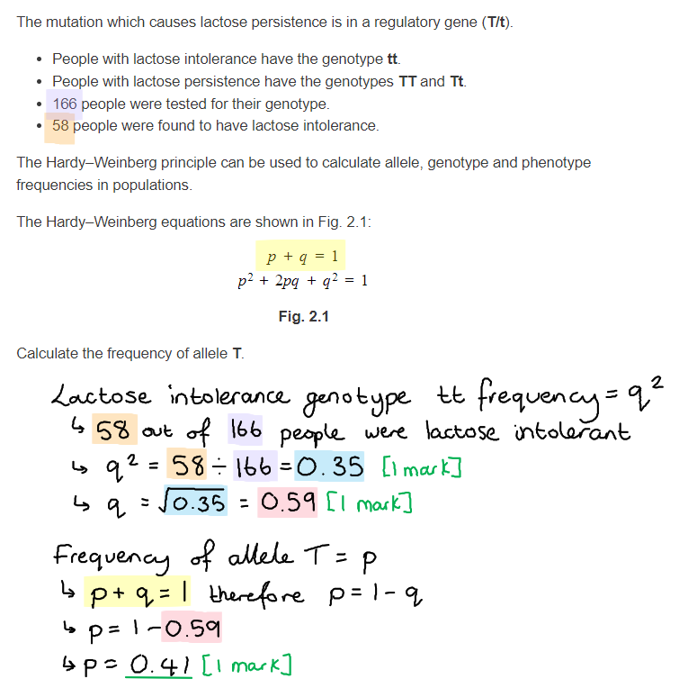
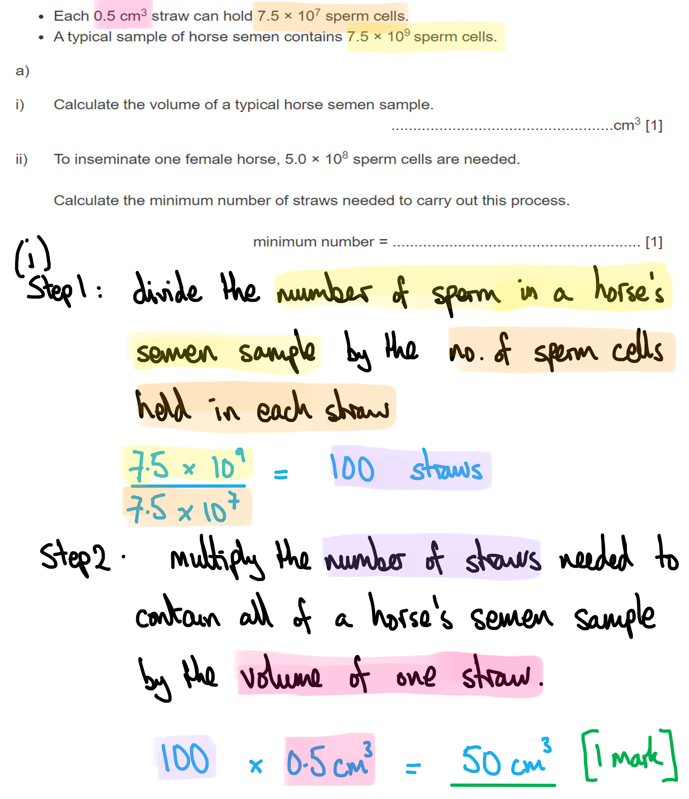
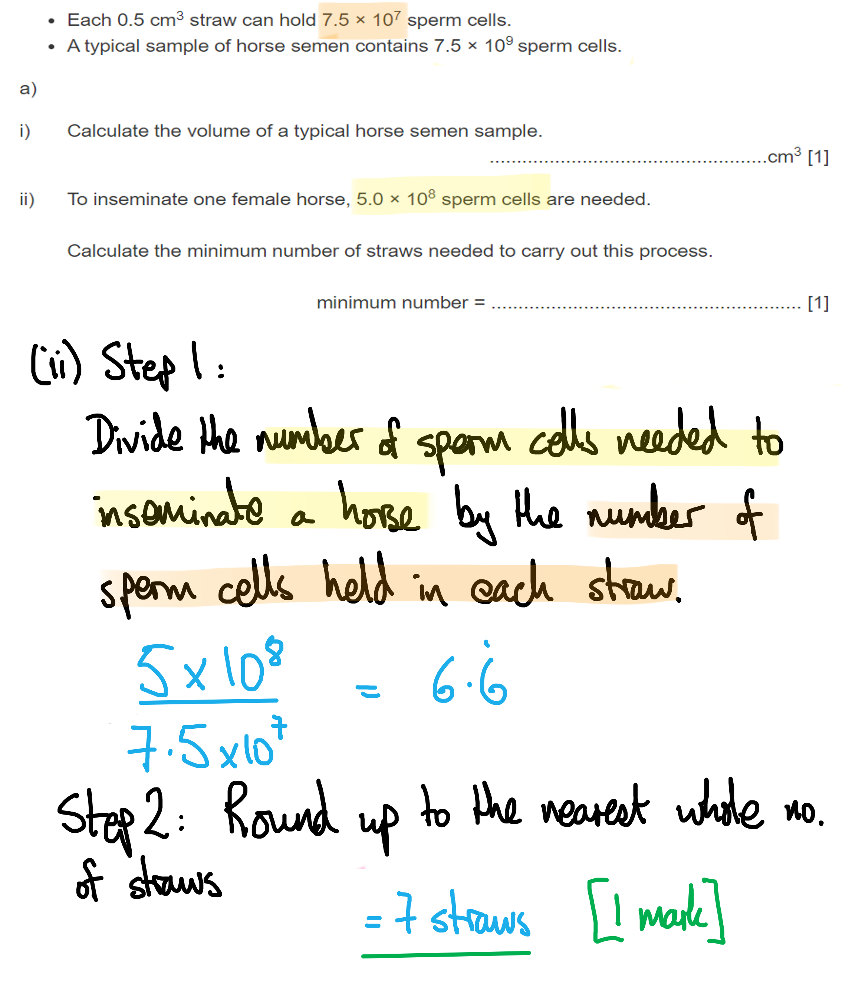
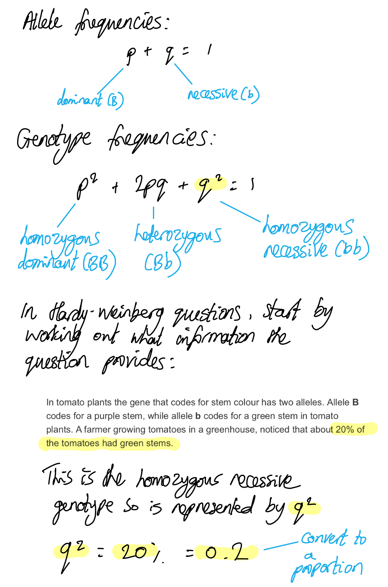
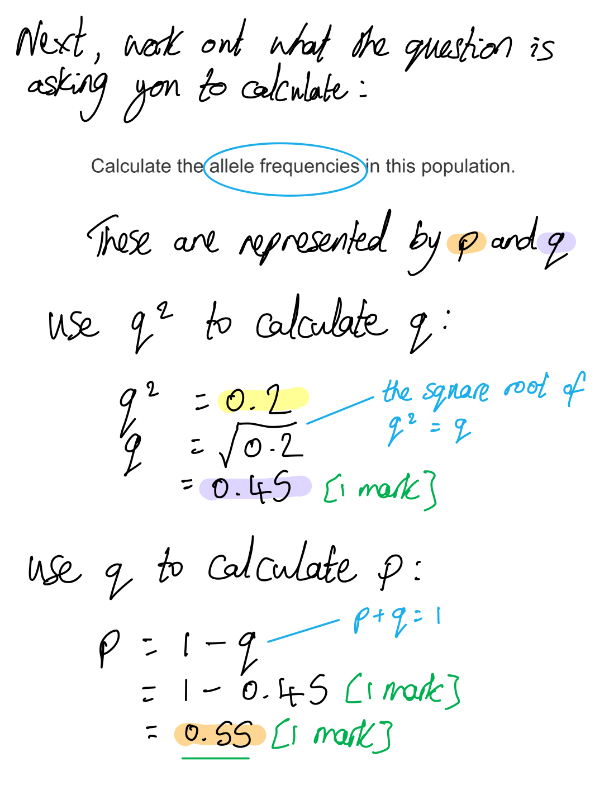
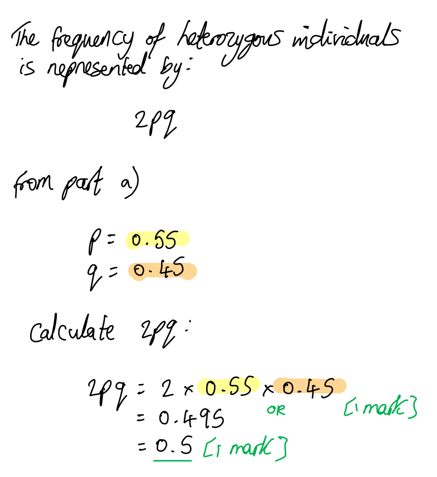
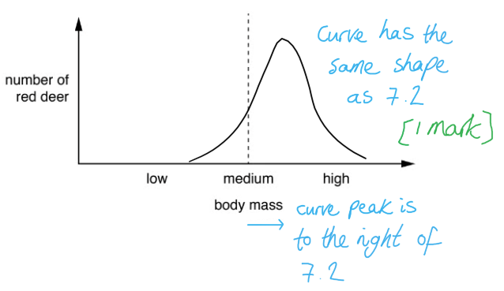
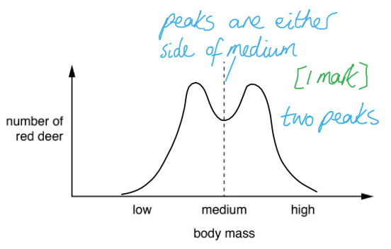
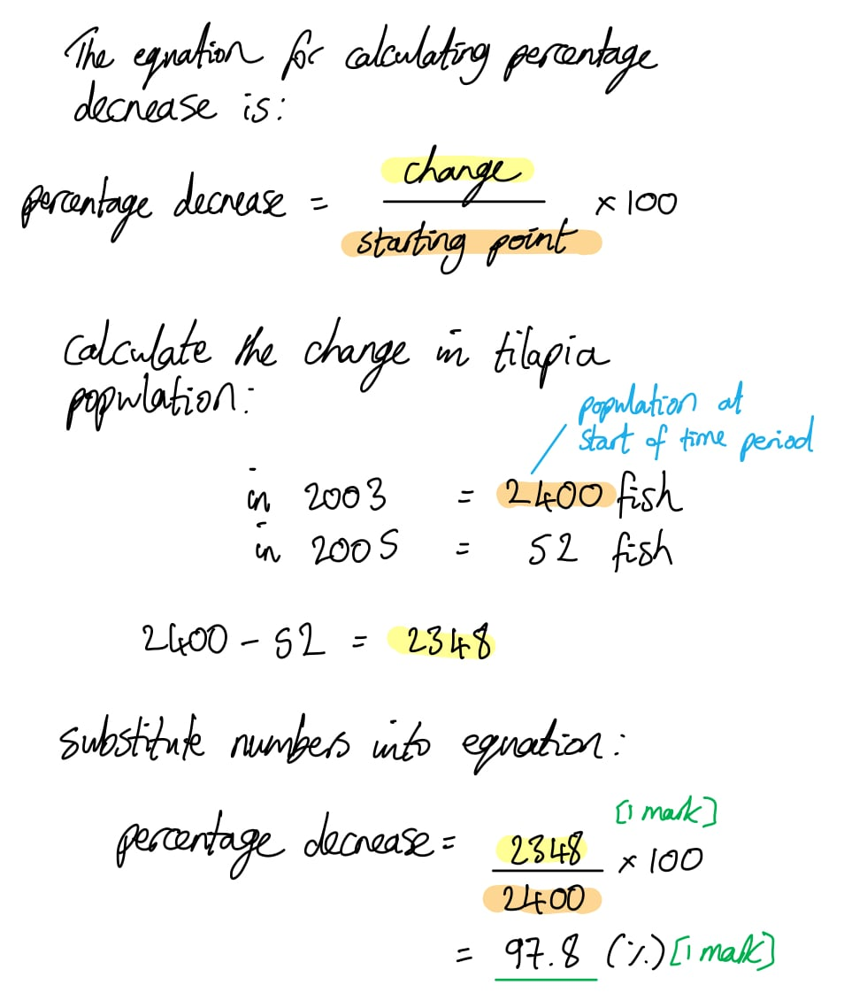
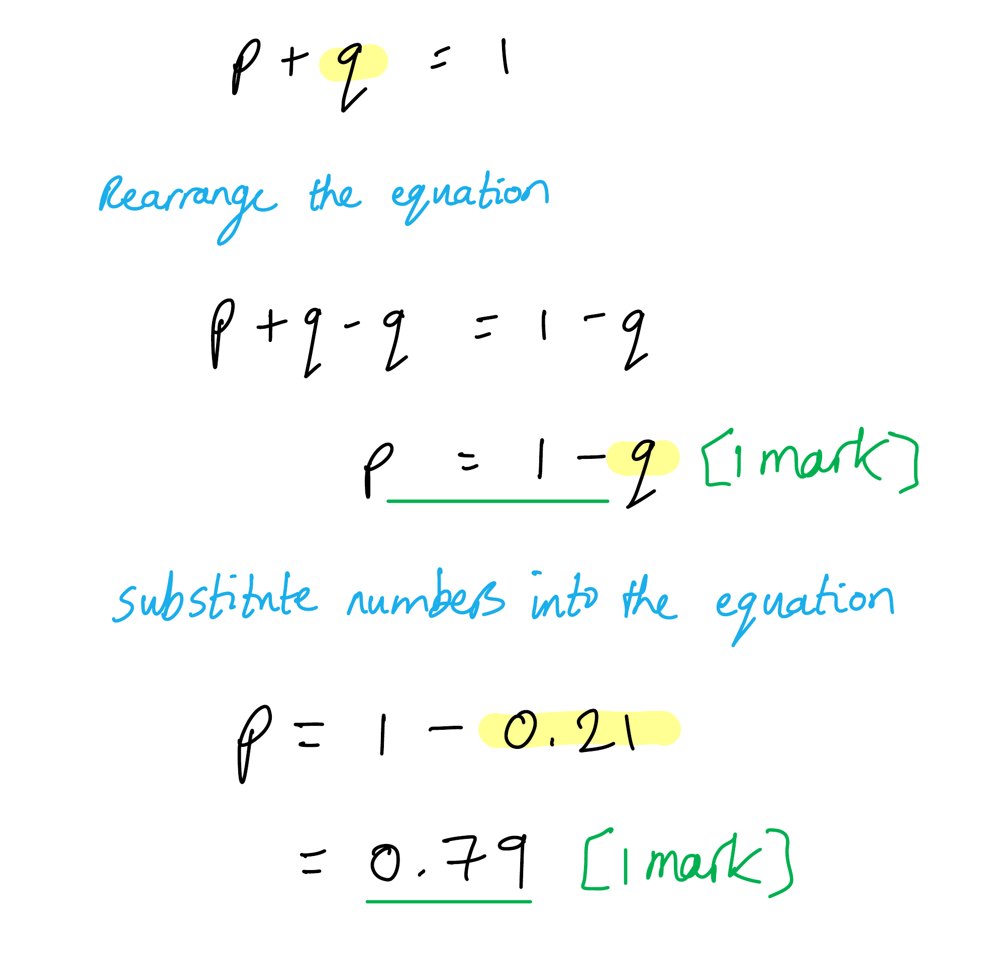

# Mark Schemes — Natural & Artificial Selection
**17. Selection & Evolution** · Cambridge (CIE) A-LEVEL biology (9700)

## Structured Questions (12 questions)

### Q1
(i) The type of selection that has caused this increase is...

- <u>Directional</u>; **[1 mark]**

(ii) There was selection for lactose persistence in humans several thousand years ago because...

**Final answer:** **Any ****three ****of the following:**

- Lactose/milk (products) acts as a selection pressure **OR** people have reliance on milk (products); **[1 mark]**
- (Selective) <u>advantage</u> to digest lactose/milk (products) **OR** individuals with lactose persistence have a (selective) <u>advantage</u>; **[1 mark]**
- (Those individuals) more likely to survive/reproduce; **[1 mark]**
- They will pass on the (mutated) allele (to their offspring); **[1 mark]**
- Over many generations the allele frequency is increased; **[1 mark]**

**[Total: 4 marks]**

> *When answering questions about natural selection your answer should always follow the same template of key words and phrases, with the information from the example given in the question being different for each question. Make sure you don't confuse key words such as gene and allele, which are not interchangeable. *
(i) The frequency of allele **T** is...

- q2 = 58÷166 **OR** 0.35; **[1 mark]**
- q = √0.349 **OR** 0.59; **[1 mark]**
- p = 0.409 **OR** 0.41; **[1 mark]**

(ii) Two reasons why the percentage of people with lactose intolerance was much higher in the test population than in the general population are...

**Final answer:** **Any ****two ****of the following:**

- Test population is (too) small; **[1 mark]**
- Test population not representative of general population / not random / is biased; **[1 mark]**
- Migration / ethnic origin; **[1 mark]**

**[Total: 5 marks]**

> *It is incorrect to say that lactose consumption was low, because you are not taking into account the fact that the selection would have already happened a very long time ago.*
(i) Transcription factors carry out their role by...

**Final answer:** **Any ****two ****of the following:**

- Proteins that bind to DNA; **[1 mark]**
- Binds to the promoter/enhancers; **[1 mark]**
- Control gene expression / transcription / mRNA synthesis; **[1 mark]**
- Allow attachment of RNA polymerase to DNA; **[1 mark]**

(ii) One type of control sequence found in human DNA is...

- Promoter / enhancer / silencer / insulator; **[1 mark]**

(iii) Most changes in human phenotype are due to mutations in regulatory genes because...

- Most genes are regulatory genes (in the genome); **[1 mark]**
- Mutations in regulatory genes less likely to be harmful/selected against/affect survival; **[1 mark]**

**[Total: 5 marks]**

> *Remember that most genes are regulatory, with structural genes only making up 2%. *

### Q2
(i) The volume of a typical horse semen sample is ...

- 50 cm3; **[1 mark]**

> *Calculation as follows:*

(ii) The minimum number of straws needed to carry out the process of inseminating one horse is...

- 7; **[1 mark]**

**[Total: 2 marks]**

> *Calculation as follows:*

> *Always reality-check your numerical answers by applying a common sense test. If your answer to a (i) works out in thousands of litres, then clearly that's a volume that is not credible when the question is asking you how much semen an animal produces, even a large animal! Similarly if you work out that a semen sample is impossibly small (say 1mm**3**) then that should make you question your maths and look for where you have made the calculation error. *
This question can be answered as follows.

**Final answer:** **Any ****four**** from the following:**

How this apparatus could be used to estimate the number of sperm cells per cm3 of semen is...

- To calculate the volume of the sample; **[1 mark]**

  - (for mm3) 0.25 × 0.25 × 0.1 / 0.00625 / 6.25 × 10–3 mm3
  - (for cm3) 0.025 × 0.025 × 0.01 / 0.00000625 / 6.25 × 10–6 cm3
- Divide the number of sperm by the volume **and** method of converting to cm3; **[1 mark]**

A description of how the technician decided which sperm cells to include in the count is...

- Count those sperm where the cells are fully inside the square / 0.0625 (mm2) / all (small) squares / haemocytometer / quadrant / grid; **[1 mark]**
- To include those cells touching the (line) top and left / up and right **OR** exclude those touching bottom and right / down and left; **[1 mark]**

Detail of the method is...

- Dilution of the sample / stirring of the sample / evenly spreading the cells around  / immobilising the sperm / use of a coverslip / use a screenshot for counting; **[1 mark]**

**[Total: 4 marks]**
(c) It is necessary for the solution to contain these three substances because...

- *Sugar:* provides or gives energy / is an energy source / (is used) in respiration / (is used) to produce ATP / maintains water potential of the sample; **[1 mark]**
- *Buffer:* (a change in pH may) denature enzymes/proteins; **[1 mark]**
- *Antibiotics:* killing / stopping reproduction of bacteria (**NOT** viruses); **[1 mark]**

**[Total: 3 marks]**

> *Remember to avoid the frequently-held misconception that energy is made, or just to state that the sugar is for energy or for nutrition, which is not enough to earn the mark.*

> *The fact that the buffer was added to maintain the pH was stated in the question, so repeating that will not earn you a mark. But if you do, you should then go on to explain that the buffer was to prevent the denaturing of the enzymes/proteins in the sperm.*

> *Other misconceptions to avoid are ‘killing the enzymes’ or ‘denaturing the sperm’ and ‘protecting the sperm from acids’ as these are imprecise and factually incorrect. Also, that antibiotics kill viruses. ‘Fighting bacteria’ or ‘protecting against bacteria’ are other vague ways to fall short of the detail required to gain the marks here. *

### Q3
(i) The effect of natural selection on mean hind limb length of *A. sagrei* on the seven experimental founder islands would be...

- (Mean hind limb length) will decrease / get shorter; **[1 mark]**

(ii) Collecting individuals at random for the seven founding pairs would affect the mean hind limb length of *A. sagrei* on the different islands as follows...

- (Mean hind limb length) will vary (between the different islands); **[1 mark]**

**[Total: 2 marks]**

> *Both of these question parts specifically ask about the **limb length** of the lizards. Answers that describe the process of natural selection or the importance of randomness in scientific investigations will not be credited.*
The data in Fig. 3 can be described and explained as follows...

**Final answer:** **Any ****five**** of the following:**

*Description*

- Limb length decreases on all of the experimental islands; **[1 mark]**
- Limb length remains the same on the source island; **[1 mark]**

*Explanation in context of experimental islands*

- Limb length decreases due to <u>directional selection</u> (on experimental islands; **[1 mark]**
- The (reduced) branch diameter is a <u>selection pressure</u>; **[1 mark]**
- Short hind limbs give a <u>selective</u> advantage / are <u>selected</u> for; **[1 mark]**
- Short hind limbs increase survival; **[1 mark]**
- Survivors are more likely to reproduce / pass on the alleles for short (hind) limbs; **[1 mark]**
- The <u>allele</u> for short (hind) limbs increases in frequency; **[1 mark]**

*Explanation in context of source island*

- Limb length remains the same due to <u>stabilising selection</u>; **[1 mark]**

**[Total: 5 marks]**

> *Make sure that you spend time both describing **and** explaining the results here; answers that only contain description can gain a maximum of two marks.*

> *When explaining the process of natural selection in any context there are several points that should always be included, so make sure that you learn these and can apply them in any example presented:*

- *Genetic **variation** exists in a population (e.g. due to mutation)*
- *Selection pressures** in the environment mean that individuals with certain alleles are** more likely to survive*
- *Surviving individuals are more likely to **reproduce** and **pass on** their advantageous alleles*
- *The advantageous **alleles increase in frequency** in the population*
Speciation may occur on the seven experimental founder islands as follows...

**Final answer:** **Any ****three**** of the following:**

- <u>Allopatric</u> (speciation would occur); **[1 mark]**
- The lizard populations would be geographically isolated; **[1 mark]**
- Different selection pressures / environmental conditions would act on the populations; **[1 mark]**
- Different (random) mutations would occur (in the different populations); **[1 mark]**
- Genetic drift (would occur); **[1 mark]**
- There would be no gene flow / exchange of genes between the different populations; **[1 mark]**
- Genetic differences would accumulate; **[1 mark]**

***Reject ****any references to selection pressures causing mutation in marking point 4.*

**[Total: 3 marks]**

> *It is essential to note that mutations occur **randomly** in populations, and then any selection pressures that are present will determine whether or not a new mutation is passed on to the next generation. Selection pressures **NEVER** cause mutations to occur.*

> *Genetic drift is also a **random** process; alleles can be lost or passed on in a population purely **by chance** due to fact that only half an individual's genes are passed on to their offspring via their gametes. Be careful not to confuse the random process of genetic drift with the process of natural selection.*
The experimental founder populations are at high risk of extinction because...

**Final answer:** **Any ****three**** of the following:**

- (Each island has a) small population; **[1 mark]**
- (Within small populations) there is low genetic diversity / a small gene pool; **[1 mark]**
- Inbreeding depression can occur **OR** there is low heterozygosity / high homozygosity; **[1 mark]**
- Environmental change / a natural disaster could kill/wipe out the entire population; **[1 mark]**

**[Total: 3 marks]**

> *Small populations have **low genetic diversity** due to the low total number of alleles of each gene present in the population. This increases the risk of any offspring inheriting two identical alleles from their parents (this is **homozygosity**), which can then further reduce the genetic diversity in the next generation. Inheriting two identical copies of a gene also increases the risk of inheriting **two** **harmful recessive alleles**, leading to the problem of **inbreeding depression**. *

> *Populations with low genetic diversity are less likely to be able to adapt (by natural selection) to a changing environment, and are therefore more likely to be wiped out by such change, and small populations are also at greater risk of being entirely wiped out by a natural disaster.*

### Q4
The allele frequencies for the tomato population can be calculated as follows...

- q = 0.45; **[1 mark]**
- p = 1 - 0.45; **[1 mark]**
- p = 0.55; **[1 mark]**

*Full marks can be awarded for the correct answers for p and q in the absence of other calculations.*

**[Total: 3 marks]**

The Hardy-Weinberg principle would not apply to the tomato population because....

- There is a selection pressure against the purple-stemmed tomato plants / (artificial) selection is acting on the population (by the farmer); **[1 mark]**
- Non-random mating is occurring / only green stemmed tomato plants are allowed to reproduce; **[1 mark]**

**[Total: 2 marks]**

> *Hardy-Weinberg assumptions about selection and non-random mating are not being met here and there will be a change in the allele frequencies in this population. This means that the Hardy-Weinberg principle, and therefore equations, will not apply to this population.*
The homozygous recessive individuals can be recognised in the tomato population because...

- The tomato plants with genotypes BB/homozygous dominant and Bb/heterozygous will have the same phenotype **OR** purple stemmed tomatoes can be homozygous dominant or heterozygous; **[1 mark]**
- This is because the dominant allele (B) will mask the presence of the recessive allele (b) in (the phenotype of) heterozygous individuals **OR** the recessive allele (b) will not be expressed (in the phenotype of) heterozygous individuals; **[1 mark]**

**[Total: 2 marks]**
The proportion of heterozygous individuals can be calculated as follows:

- 2 x 0.55 x 0.45 **OR** 0.495; **[1 mark]**
- 0.5; **[1 mark]**

*Full marks awarded for the correct answer in absence of other calculations.*

**[Total: 2 marks]**

### Q5
Artificial selection resulted in the development of Dorper sheep as follows...

**Final answer:** **Any ****four**** of the following:**

- Humans selected (individuals showing) desired characteristics of high fertility in Dorset Horn sheep **AND** (fast growth and) heat/aridity tolerance in Blackhead Persian sheep; **[1 mark]**
- (They) bred Dorset Horn and Blackhead Persian / the two breeds of sheep together; **[1 mark]**
- The offspring that displayed the desired characteristics (of fast growth rate, high fertility, and tolerance to heat/arid conditions) were bred together; **[1 mark]**
- This process was repeated over many generations; **[1 mark]**
- The desired <u>alleles</u> increase in <u>frequency</u> in the population; **[1 mark]**

**[Total: 4 marks]**

> *In artificial selection humans act as the selective agent instead of selection pressures in nature. By selecting and crossbreeding individuals with the desired characteristics over many generations a new breed is established. Most individuals in that population will display the favourable characteristics that were chosen due to the high frequency of the desired alleles.*
Other characteristics that may be selected for in sheep include...

**Final answer:** **Any ****two**** of the following:**

- Docility / good natured personality; **[1 mark]**
- High quality wool / fast wool growth; **[1 mark]**
- High quality / fast meat production; **[1 mark]**
- Disease resistance; **[1 mark]**

**[Total: 2 marks]**
The negative impacts of inbreeding include the following...

**Final answer:** **Any ****two**** of the following:**

- (It may lead to) inbreeding depression **OR** a lack of hybrid vigour; **[1 mark]**
- There is a greater chance that harmful recessive alleles will be inherited together / expressed; **[1 mark]**
- There will be less genetic variation **OR** no new alleles will be introduced into the population; **[1 mark]**

**[Total: 2 marks]**

### Q6
Environmental factors that may prevent further increases in the size of red deer populations include......

**Final answer:** **Any ****three**** of the following:**

- Predation; **[1 mark]**
- Competition for food / decrease in food availability; **[1 mark]**
- Disease; **[1 mark]**
- Habitat loss/reduction / lack of breeding sites; **[1 mark]**
- Pesticide/herbicide use; **[1 mark]**
- Climate change; **[1 mark]**

**[Total: 3 marks]**
(i) A curve drawn on Fig. 3 to show the pattern of variation of body mass in this red deer population after many years of a selection pressure acting against red deer of low body mass would have the following appearance...

- A curve that has the same shape as that shown in Fig. 2 **AND** that is further to the right; **[1 mark]**

(ii) The type of force of natural selection that is acting on this population is...

- <u>Directional</u> (selection); **[1 mark]**

**[Total: 2 marks]**

> *i) The curve should be drawn as follows...*

> *ii) Selection acting against deer of low body mass (e.g. a predator that picks off smaller, weaker individuals) would mean that larger individuals are more likely to survive, reproduce, and pass on their alleles for large body mass. Over time these large-body alleles would become more frequent in the population and the average body size in the population would increase; this is an example of directional selection.*
(i) A curve drawn on Fig. 4 to show the pattern of variation of body mass in this red deer population after many years of a selection pressure acting against red deer of medium body mass would have the following appearance...

- A curve that has two peaks **AND** the peaks are either side of the medium value; **[1 mark]**

(ii) The type of force of natural selection that is acting on this population is...

- <u>Disruptive</u> (selection); **[1 mark]**

**[Total: 2 marks]**

> *i) The curve should be drawn as follows...*

> *ii) Selection acting against deer of medium body mass (e.g. human hunters might decide to avoid killing the smallest deer due to their lack of meat, and to leave the alleles of the largest, most impressive deer in the gene pool) would mean that deer that are either smaller than average or larger than average are more likely to survive, reproduce, and pass on their small-body or large-body alleles. Small-body and large-body alleles will increase in frequency in the population and there will be an increase in the number of individuals with these extremes of body size in the population.*

### Q7
The purpose of the islands without snakes was...

- (To serve) as a control; **[1 mark]**
- To demonstrate that the claw length (of the mice) remained unchanged in the absence of snakes **OR** to demonstrate that the presence of snakes (and not any other variable) led to an increase in claw length; **[1 mark]**

**[Total: 2 marks]**

> *In scientific investigations, the control is the test group that does not receive treatment. Without the control group there would be nothing to compare the treatment group to, and therefore no way of being sure that the change observed in the dependent variable (in this case the claw length of the mice) is due to the experimental treatment (the presence of snakes).*
A mutation could lead to a change in claw length by...

- (A mutation) changes the base sequence / triplet code (of DNA); **[1 mark]**
- (A mutation) may result in a new <u>allele</u>; **[1 mark]**
- The new allele codes for a different protein / a protein with an altered structure (which affects the growth/length of the claws); **[1 mark]**

**[Total: 3 marks]**
(i) The type of selection that occurred on the snake infested islands was...

- Directional (selection); **[1 mark]**

(ii) The reason for this is that...

- The allele frequency for long claws increased over time / there was selection pressure for long claws **OR** allele frequency for short claws decreased over time / there was selection against short claws; **[1 mark]**

**[Total: 2 marks]**

> *With directional selection, there is a gradual change in the allele frequency of a population over time that causes the phenotype to shift in a single direction. This typically occurs when there is a change in the environment (e.g. introduction of snakes) or when a new advantageous allele appears in the population.*
The effect of the introduction of snakes on an island without trees would be...

**Final answer:** **Any ****three**** of the following:**

- Claw length would decrease / claws would become shorter (over time); **[1 mark]**
- Mice with short claws have a (selective) advantage as they can run faster (than snakes) **OR** mice with long claws have a (selective) disadvantage as they would be too slow to escape (from snakes); **[1 mark]**
- Mice with short claws are more likely to survive and reproduce **SO** passing on the <u>allele</u> for short claws **OR** mice with long claws are less likely to survive and reproduce **SO** will not pass on the <u>allele</u> for long claws; **[1 mark]**
- The short claw allele will increase in <u>frequency</u> **OR** the long claw allele will decrease in <u>frequency</u>; **[1 mark]**

**[Total: 3 marks]**

> *This question requires you to describe the process of natural selection while applying it to the example that is given. Mice with short claws will have an advantage over those with long claws that cannot run as fast. Short claw mice will have a greater chance of surviving and reproducing. The **allele** for short claws will be passed down to their offspring leading to a change in allele **frequency** in favour of short claws over time.*

### Q8
The trend in antibiotic resistance that can be observed in Fig. 1 shows...

**Final answer:** **Any ****four**** of the following:**

- There was an overall increase in antibiotic resistance observed in both Greece and Italy; **[1 mark]**
- Resistance levels are high<u>er</u> in Greece than in Italy; **[1 mark]**
- Greece had a decrease in antibiotic resistance between 2007 and 2008 **AND** 2011 and 2012; **[1 mark]**
- Antibiotic resistance was low in Italy until 2009, after which there was a (steep) increase **OR** antibiotic resistance in Italy did not start to increase until 2009; **[1 mark]**
- Data points correctly quoted to support any of the above statements (e.g. mark points 1 or 2 could be supported by  'resistance in Greece increases from 31% in 2006 to 59% in 2013 and resistance in Italy increases from 1% in 2006 to 32% in 2013'); **[1 mark]**

**[Total: 4 marks]**

> *When asked to describe trends in data, remember to discuss whether there was an overall increase or decrease observed. Mention anything that stands out, such increases or decreases that do not fit the overall trend. or a levelling off in the data. Quoting data points from the graph to support your descriptions will always be worth at least one mark.*
The widespread use of antibiotics can lead to the development of antibiotic resistance in bacteria in the following ways:

**Final answer:** **Any ****three**** of the following:**

- Alleles that give resistance to antibiotics are present (at random) / (random) mutation gives rise to antibiotic resistance alleles (in bacterial populations; **[1 mark]**
- Antibiotics act as a selection pressure for resistant bacteria / select bacteria with resistance (alleles); **[1 mark]**
- These bacteria are more likely to survive and reproduce **SO** passes the resistant <u>alleles</u> on to their offspring **OR** non-resistant bacteria are killed and do not reproduce **SO** does not pass on their alleles; **[1 mark]**
- The resistance alleles become more frequent / increase in frequency in the population;** [1 mark]**

***Reject**** any answer point that suggests that antibiotic use causes antibiotic resistance*

**[Total: 3 marks]**
Antibiotic resistance can be transferred between different species of bacteria in the following way...

**Final answer:** **Any ****two**** of the following:**

- Alleles for antibiotic resistance can be found on <u>plasmids</u>; **[1 mark]**
- Plasmids can be transferred between bacteria (of different species); **[1 mark]**
- (This mechanism is known as) horizontal gene transfer; **[1 mark]**

**[Total: 2 marks]**

### Q9
The process that is affecting the allele frequency of the mango tilapia population is:

- (The) bottleneck effect / population bottleneck; **[1 mark]**

**[Total: 1 mark]**
The effect of the bottleneck effect would be...

**Final answer:** **Any ****two**** of the following:**

- It reduces the genetic diversity in the population **OR** alleles are lost from the population (due to the reduction in population size) **OR** the gene pool within a population shrinks/gets smaller; **[1 mark]**
- This makes the species less able to respond to environmental changes **OR** increases the risk of (local) extinction of the population; **[1 mark]**
- Inbreeding will occur; **[1 mark]**

**[Total: 2 marks]**

> *Genetic diversity is important as it increases the resilience of a population to environmental changes. The lack of genetic diversity that results from the bottleneck effect makes populations more susceptible to extinction if there is a change in their environment.*
The percentage decrease in tilapia numbers can be calculated as follows...

- 2348 ÷ 2400; **[1 mark]**
- 97.8 (%); **[1 mark]**

*Full marks awarded for the correct answer in the absence of other calculations.*

**[Total: 2 marks]**

The introduction of predatory fish that mainly prey on mango tilapia of medium body size would have the following effect...

**Final answer:** **Any ****four**** of the following:**

- There would be an increase in small **and** large sized tilapia **OR** there would be a decrease in medium sized tilapia; **[1 mark]**
- Due to <u>disruptive selection</u>; **[1 mark]**
- Small **and** large sized tilapia would have a higher probability of surviving and reproducing / they would have increased fitness **OR** medium sized tilapia would have a lower probability of surviving and reproducing / they would have decreased fitness; **[1 mark]**
- The <u>alleles</u> for small and large body size would be passed on (to their offspring) **OR **the <u>alleles</u> for medium body size would not be passed on (to offspring); **[1 mark]**
- the allele <u>frequency</u> of small and large alleles would increase / the small and large alleles would increase in <u>frequenc</u>y (in the population) **OR **the allele <u>frequency</u> of medium alleles would decrease / the medium alleles would decrease in <u>frequency</u> (in the population); **[1 mark]**

**[Total: 4 marks]**

> *Since there is a selection pressure against tilapia with an intermediate body size this would be an example of disruptive selection. Those with small or large body sizes would have a selective advantage and would have a higher chance of surviving long enough to reproduce and pass their small or large alleles on to their offspring. Over time there would be an increase in small and large allele frequencies and in the proportion of tilapia that fall into the two extreme categories for body size.*

### Q10
The type of selection represented by **A** and **B** are...

- A = disruptive (selection); **[1 mark]**
- B = directional (selection); **[1 mark]**

**[Total: 2 marks]**
A description of disruptive selection would include...

**Final answer:** **Any ****two**** of the following:**

- Individuals with extreme phenotypes are selected for **OR** individuals with intermediate/average phenotypes are selected against; **[1 mark]**
- Alleles that code for extreme phenotypes increase in frequency (in the population) **OR** high frequencies of two/multiple different sets of alleles are maintained (in the population); **[1 mark]**
- Polymorphism/two/multiple different phenotypes are maintained; **[1 mark]**

**[Total: 2 marks]**

> *This type of selection may occur in an environment that shows variation. Many different environmental conditions could favour more than one set of alleles, leading to the occurrence of more than one prominent phenotype within that species.*
The *fitness* of an organism can be defined as...

- The ability/capacity of the organism to survive (in its habitat); **[1 mark]**
- And pass on its <u>alleles</u> to its offspring / the next generation; **[1 mark]**

**[Total: 2 marks]**

> *Do not confuse this with physical fitness which refers to the ability to perform exercise. **Biological** fitness refers to the ability of an organism to **survive and reproduce**.*
(i) The graph from Fig. 1 that would best represent the type of selection that would occur in the population in part (c) would be...

- **B**; **[1 mark]**

(ii) The reason for this is that...

- There will be an increase in the <u>frequency</u> of the new <u>allele</u> over time (as the new allele will increase the fitness of the organism that carries it and therefore be selected for); **[1 mark]**

**[Total: 2 marks]**

> *Individuals with the new allele described in (c) are more likely to survive and pass on the allele due to their increased fitness, so the allele will increase in frequency in the population.*

### Q11
The Hardy Weinberg equation is used to...

- Calculate/work out allele frequency/frequencies **OR** genotype frequency/frequencies (in a population); **[1 mark]**

**[Total: 1 mark]**
Assumptions made by the Hardy Weinberg principle include...

**Final answer:** **Any ****three**** of the following:**

- Mating is random; **[1 mark]**
- No natural selection is taking place; **[1 mark]**
- No gene flow with other populations / migration / immigration / new individuals entering the population / emigration / individuals leaving the population; **[1 mark]**
- No mutation is occurring; **[1 mark]**
- The population is large / no genetic drift is taking place; **[1 mark]**
- Organisms are diploid; **[1 mark]**
- Only sexual reproduction is taking place / no asexual reproduction is taking place; **[1 mark]**
- Generations do not overlap; **[1 mark]**
- Allele frequencies are the same between males and females; **[1 mark]**

**[Total: 3 marks]**

> *There are many marks up for grabs here so focus on the assumptions that you will find the easiest to remember.*
In this equation ***p*** represents...

- The <u>frequency</u> of the <u>dominant</u> allele; **[1 mark]**

**[Total: 1 mark]**

> *The frequency of all of the alleles in a population is 1, or 100 %, so the frequencies of the dominant and recessive alleles must add up to this total, hence **p + q = 1**.*
(d) The frequency of the dominant allele is...

- p = 1 - q **OR** 1 - 0.21; **[1 mark]**
- 0.79; **[1 mark]**

*Full marks awarded for the correct answer in the absence of other calculations*

**[Total: 2 marks]**

### Q12
The event that led to the change in allele frequency in the northern elephant seal population is...

- The bottleneck effect / population bottleneck; **[1 mark]**

**[Total: 1 mark]**

> *The bottleneck effect occurs when there is a dramatic decrease in numbers within a population followed by a steady increase over time. All the members of the new population will descend from the few survivors.*
The disadvantage of a population bottleneck for the northern elephant seal population would be...

**Final answer:** **Any ****two**** of the following:**

- Alleles are lost (from the population) / there is a decrease in/reduced genetic diversity;** [1 mark]**
- The survivors breed/reproduce with close relatives / inbreeding occurs / harmful (recessive) alleles are more likely to be inherited together; **[1 mark]**
- There is a reduced ability to adapt to change in the environment; **[1 mark]**

**[Total: 2 marks]**

> *A population with a reduced gene pool will be less resilient to environmental changes so they therefore have an increased risk of going extinct when these changes occur.*
Other processes that may change the allele frequency in a population over time include...

**Final answer:** **Any ****two**** of the following:**

- Natural selection; **[1 mark]**
- Genetic drift; **[1 mark]**
- The founder effect; **[1 mark]**

**[Total: 2 marks]**
Genetic diversity is...

- The number of different <u>alleles</u> present in a population/species; **[1 mark]**

**[Total: 1 mark]**
