# Exam Questions — Natural & Artificial Selection
**17. Selection & Evolution** · Cambridge (CIE) A-LEVEL biology (9700)
> Source: [https://www.savemyexams.com/a-level/biology/cie/25/topic-questions/](https://www.savemyexams.com/a-level/biology/cie/25/topic-questions/) · 12 questions across 1 sets

## Structured Questions (12 questions)

### Q1 — hard — 14 marks

**Q1** [4 marks]

Researchers have found evidence of natural selection in humans.

- Originally, in human populations it was only babies and children that needed to digest the milk sugar, lactose. The gene coding for the enzyme lactase (*LCT gene*) was switched off before adulthood.
- Today, in many populations, some adult individuals have lactose intolerance, which means they cannot digest lactose. Lactose intolerance leads to side-effects such as abdominal pain after eating food containing lactose.
- A mutation has been identified that keeps the *LCT gene* switched on. An adult who has this mutation is able to digest lactose. This is called lactose persistence.
- Lactose persistence increased in populations in Europe several thousand years ago.
- The increase in lactose persistence in Europe coincided with an increase in farming of cows for milk.

(i) Natural selection has caused this increase in lactose persistence.

State the type of selection that has caused this increase.

[1]

(ii) Explain why there was selection for lactose persistence in humans several thousand years ago.

[3]

*Source: Oct/Nov 2018  9700/42 Q2A*

**Q1** [5 marks]

Lactose intolerance and lactose persistence were investigated in a test population in Europe.

The mutation which causes lactose persistence is in a regulatory gene (**T/t**).

- People with lactose intolerance have the genotype **tt**.
- People with lactose persistence have the genotypes **TT **and **Tt**.
- 166 people were tested for their genotype.
- 58 people were found to have lactose intolerance.

(i) The Hardy–Weinberg principle can be used to calculate allele, genotype and phenotype frequencies in populations.

The Hardy–Weinberg equations are shown in Fig.1:

$p+q=1\,p^{2}+2pq+q^{2}=1$

**Fig. 1**

Calculate the frequency of allele **T**.

Show your working.

[3]

(ii) When the calculated phenotype frequencies were compared to those in the general population in Europe, it was found that the percentage of people with lactose intolerance in this test population was much higher than in the general population.

Suggest **two **reasons why the percentage of people with lactose intolerance was much higher in the test population than in the general population.

*Source: Oct/Nov 2018  9700/42 Q2B*

**Q1** [5 marks]

In eukaryotes, gene expression is controlled by transcription factors, coded for by regulatory genes.

(i) Outline ways in which transcription factors carry out their role.

[2]

(ii) It is estimated that 2% of human DNA consists of genes coding for proteins (structural genes). Of the remaining 98%, some of the DNA consists of regulatory genes and control sequences that together control gene expression.

State **one** type of control sequence found in human DNA.

[1]

(iii) A study of human evolution identified the location of mutations that result in a change in human phenotype. The study found most examples of mutations had occurred in regulatory genes, not structural genes.

Suggest **and** explain why most changes in human phenotype are due to mutations in regulatory genes.

[2]

*Source: Oct/Nov 2018  9700/42 Q2C*

### Q2 — hard — 9 marks

**Q2** [2 marks]

Artificial insemination (AI) is one method used in assisted reproduction programmes for large mammals.

For many years, horse breeders have collected semen samples from male horses and used these to inseminate female horses. Success rates have been good. However, due to the sample containing live sperm cells, the process needed to be carried out quickly.

New technologies exist to allow horse semen to be frozen in small plastic straws. Semen samples can now be stored for many years and transported all over the world.

- Each 0.5 cm3 straw can hold 7.5 × 107 sperm cells.
- A typical sample of horse semen contains 7.5 × 109 sperm cells.

(i) Calculate the volume of a typical horse semen sample.

[1]

(ii) To inseminate one female horse, 5.0 × 108 sperm cells are needed.

Calculate the minimum number of straws needed to carry out this process.

[1]

*Source: May/June 2019 9700/51 Q2A*

**Q2** [4 marks]

The semen from a horse is analysed by technicians to determine its quality before the horse is accepted onto the assisted reproduction programme.

Technicians use microscopy to look at the appearance and motility of the sperm cells and to estimate the sperm count.

Fig.1 shows the surface view of a haemocytometer used to estimate the number of sperm cells in a sample.

Each number represents a sperm cell which was counted in the sample.

Each star (*) represents a sperm cell **not** counted in the sample.

The depth of the haemocytometer is 0.1mm.

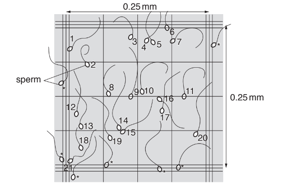

**Fig. 1**

Suggest how this apparatus could be used to estimate the number of sperm cells per cm3 of semen **and** describe how the technician decided which sperm cells to include in the count.

*Source: May/June 2019 9700/51 Q2B*

**Q2** [3 marks]

**Extract:**

Artificial insemination (AI) is one method used in assisted reproduction programmes for large mammals.

For many years, horse breeders have collected semen samples from male horses and used these to inseminate female horses. Success rates have been good. However, due to the sample containing live sperm cells, the process needed to be carried out quickly.

New technologies exist to allow horse semen to be frozen in small plastic straws. Semen samples can now be stored for many years and transported all over the world.

To ensure that the sperm cells remain viable after they have been frozen, a solution is added to the sample **before** freezing the semen in the straws.

The solution contains:

- a sugar
- a buffer to maintain pH
- antibiotics.

Explain why it is necessary for the solution to contain these three substances.

*Source: May/June 2019 9700/51 Q2C*

### Q3 — hard — 13 marks

**Q3** [2 marks]

Researchers investigated the extent to which the founder effect and natural selection affect evolutionary change.

Fig. 1 shows the brown anole lizard, *Anolis sagrei*. These lizards live on a number of Caribbean islands and feed on a variety of invertebrates and other small animals.

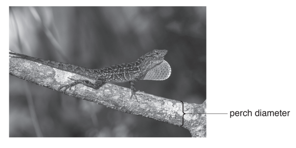

**Fig. 1**

*A. sagrei* spends a lot of time perching (resting) on, or moving along, branches of shrubs and trees. The width of the branch that *A. sagrei* perches on is known as the perch diameter, as labelled in Fig. 1.

There is a positive correlation between perch diameter and hind limb length of *A. sagrei.*

- Longer hind limbs allow* A. sagrei *to run faster on vegetation with a larger diameter
- Shorter hind limbs are needed to provide stability on vegetation of a smaller diameter

In 2004, a hurricane caused the death of all the* A. sagrei *lizards on seven islands.

In 2005, the researchers randomly collected seven male and seven female lizards from a source population on a nearby island. For each of the seven islands affected by the hurricane, a male and female lizard were mated and placed on each island. These islands formed the experimental founder islands where new populations of *A. sagrei* were successfully established from each founding pair.

Fig. 2 shows the difference in vegetation between the source island and the seven experimental founder islands.

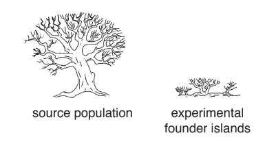

**Fig. 2**

(i) Predict the effect of natural selection on mean hind limb length of *A. sagrei *on the seven experimental founder islands.

[1]

(ii) Predict how collecting individuals at random for the seven founding pairs affects the mean hind limb length of *A. sagrei* on the different islands.

[1]

*Source: May/June 2019 9700/41 Q5A*

**Q3** [5 marks]

**Extract:**

Researchers investigated the extent to which the founder effect and natural selection affect evolutionary change.

Fig. 1 shows the brown anole lizard, Anolis sagrei. These lizards live on a number of Caribbean islands and feed on a variety of invertebrates and other small animals.

A. sagrei spends a lot of time perching (resting) on, or moving along, branches of shrubs and trees. The width of the branch that A. sagrei perches on is known as the perch diameter, as labelled in Fig. 1.

There is a positive correlation between perch diameter and hind limb length of A. sagrei.

- Longer hind limbs allow A. sagrei to run faster on vegetation with a larger diameter
- Shorter hind limbs are needed to provide stability on vegetation of a smaller diameter

In 2004, a hurricane caused the death of all the A. sagrei lizards on seven islands.

In 2005, the researchers randomly collected seven male and seven female lizards from a source population on a nearby island. For each of the seven islands affected by the hurricane, a male and female lizard were mated and placed on each island. These islands formed the experimental founder islands where new populations of A. sagrei were successfully established from each founding pair.

Fig. 2 shows the difference in vegetation between the source island and the seven experimental founder islands.

Many generations of *A. sagrei* were produced over the four years after the introduction of the founding pairs.

Fig. 3 shows how the mean hind limb length of *A. sagrei* changed on the seven experimental islands and on the source island.

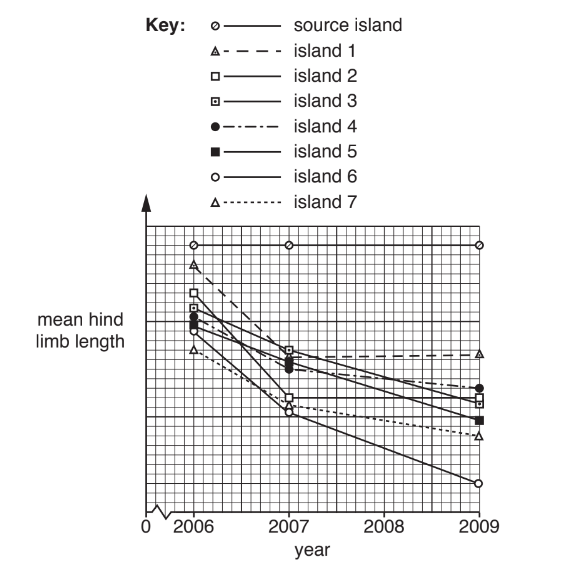

**Fig. 3**

With reference to Fig. 2 and Fig. 3, describe **and **suggest explanations for the results for the islands.

*Source: May/June 2019 9700/41 Q5B*

**Q3** [3 marks]

**Extract:**

In 2004, a hurricane caused the death of all the A. sagrei lizards on seven islands.

In 2005, the researchers randomly collected seven male and seven female lizards from a source population on a nearby island. For each of the seven islands affected by the hurricane, a male and female lizard were mated and placed on each island. These islands formed the experimental founder islands where new populations of A. sagrei were successfully established from each founding pair.

Fig. 2 shows the difference in vegetation between the source island and the seven experimental founder islands.

In the investigation, one population of* A. sagrei* was established on each experimental founder island.

Outline how speciation may occur on the seven experimental founder islands.

*Source: May/June 2019 9700/41 Q5C*

**Q3** [3 marks]

**Extract:**

In 2004, a hurricane caused the death of all the A. sagrei lizards on seven islands.

In 2005, the researchers randomly collected seven male and seven female lizards from a source population on a nearby island. For each of the seven islands affected by the hurricane, a male and female lizard were mated and placed on each island. These islands formed the experimental founder islands where new populations of A. sagrei were successfully established from each founding pair.

Speciation is one possible outcome for the experimental founder populations, but there is also a high risk that they may become extinct.

Explain why the experimental founder populations are at high risk of extinction.

*Source: May/June 2019 9700/41 Q5D*

### Q4 — medium — 9 marks

**Q4** [3 marks]

In tomato plants, the gene that codes for stem colour has two alleles. Allele **B** codes for a purple stem, while allele **b** codes for a green stem. A farmer growing tomatoes in a greenhouse noticed that about 20 % of the tomatoes had green stems.

The Hardy-Weinberg equation can be used to determine the allele frequency in a population

***p***** + *****q***** = 1**

In this equation,** *****p*** represents the frequency of the dominant allele and ***q*** represents the frequency of the recessive allele.

Calculate the allele frequencies in this population.

**Q4** [2 marks]

**Extract:**

In tomato plants, the gene that codes for stem colour has two alleles. Allele B codes for a purple stem, while allele b codes for a green stem. A farmer growing tomatoes in a greenhouse noticed that about 20 % of the tomatoes had green stems.

The Hardy-Weinberg equation can be used to determine the allele frequency in a population

p + q = 1

In this equation, p represents the frequency of the dominant allele and q represents the frequency of the recessive allele.

The farmer decided to only allow the green stemmed tomato plants to reproduce with one another.

Explain why the Hardy-Weinberg principle would not apply to the population that results from the farmer's intervention.

**Q4** [2 marks]

**Extract:**

In tomato plants, the gene that codes for stem colour has two alleles. Allele B codes for a purple stem, while allele b codes for a green stem.

Explain why the homozygous recessive individuals in the tomato population are the only individuals for whom genotype can be accurately identified from observation alone.

**Q4** [2 marks]

**Extract:**

In tomato plants, the gene that codes for stem colour has two alleles. Allele B codes for a purple stem, while allele b codes for a green stem. A farmer growing tomatoes in a greenhouse noticed that about 20 % of the tomatoes had green stems.

The Hardy-Weinberg equation can be used to determine the allele frequency in a population

p + q = 1

In this equation, p represents the frequency of the dominant allele and q represents the frequency of the recessive allele.

Calculate the allele frequencies in this population.

Mark scheme: q = 0.45; p = 1 - 0.45; p = 0.55

Use the following Hardy-Weinberg equation to calculate the proportion of heterozygous tomato plants that were present in the original population in part a).

**p****2**** + 2pq + q****2**** = 1**

Show your working and give your answer to one decimal place.

### Q5 — medium — 8 marks

**Q5** [4 marks]

Artificial selection has been carried out for thousands of years. An example of this is the Dorper breed of sheep; a fast-growing sheep with a high fertility rate that is well adapted to survive in the arid regions of South Africa.  The Dorper was developed from the following two breeds:

- Dorset Horn sheep; a British breed with up to two lambing seasons per year, but not very tolerant of heat or arid conditions
- Blackhead Persian sheep; a Somalian breed with a fast growth rate and high tolerance to heat

Explain how artificial selection resulted in the development of Dorper sheep.

**Q5** [2 marks]

**Extract:**

Artificial selection has been carried out for thousands of years. An example of this is the Dorper breed of sheep; a fast-growing sheep with a high fertility rate that is well adapted to survive in the arid regions of South Africa. The Dorper was developed from the following two breeds:

- Dorset Horn sheep; a British breed with up to two lambing seasons per year, but not very tolerant of heat or arid conditions
- Blackhead Persian sheep; a Somalian breed with a fast growth rate and high tolerance to heat

Suggest **two other** characteristics that breeders may select for when carrying out an artificial selection in sheep.

**Q5** [2 marks]

Artificial selection can result in inbreeding which can have a negative impact on a species.

Describe the negative impact that inbreeding can have on a species.

### Q6 — medium — 7 marks

**Q6** [3 marks]

Fig. 1 shows a red deer, *Cervus elaphus*. Red deer feed on a wide range of plants.

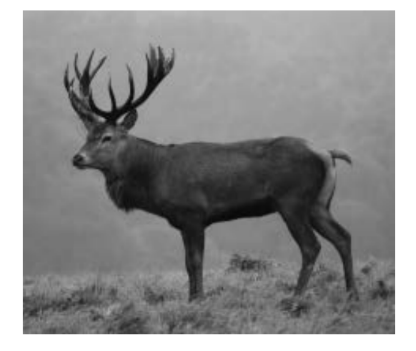

**Fig. 1**

The number of red deer in the UK increased from 135 000 in 1960 to 360 000 in 2010.

Environmental factors affect the population size of red deer so that numbers do not continue to increase.

Suggest environmental factors that may prevent further increases in the size of red deer populations.

*Source: Specimen 2022 9700/04 Q7A*

**Q6** [2 marks]

The body mass of red deer shows wide variation within a population. This is shown in Fig. 2.

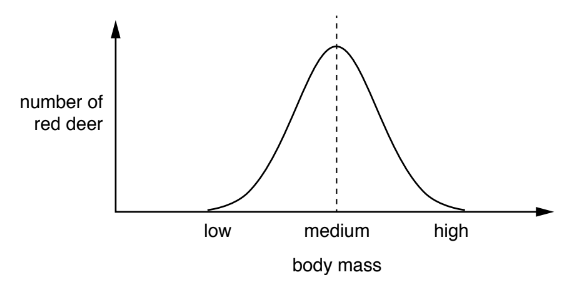

**Fig. 2**

A selection pressure acted consistently over many years against red deer of **low** body mass in a population.

(i) Sketch a curve on Fig. 3 to show the pattern of variation of body mass in this red deer population after this time.

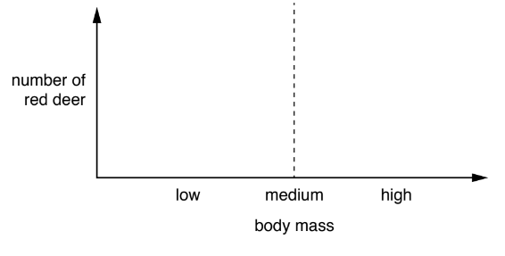

**Fig. 3**

[1]

(ii) Name the type of force of natural selection that is acting on this population.

[1]

*Source: Specimen 2022 9700/04 Q7BI, BII*

**Q6** [2 marks]

**Extract:**

The body mass of red deer shows wide variation within a population. This is shown in Fig. 2.

**Fig. 2**

A selection pressure acted consistently over many years against red deer of **medium** body mass in a population.

(i) Sketch a curve on Fig. 7.4 to show the pattern of variation of body mass in this red deer population after this time.

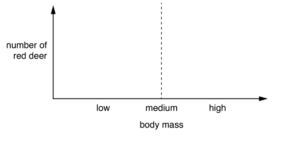

**Fig. 4**

[1]

(ii) Name the type of force of natural selection that is acting on this population.

[1]

*Source: Specimen 2022 9700/04 Q7CI, CII*

### Q7 — medium — 10 marks

**Q7** [2 marks]

A group of biologists conducted an investigation on a remote archipelago (a collection of islands) in the Atlantic Ocean. They measured the claw length of a large number of mice of a single species living on the islands. The mouse species had no natural predators.

After the biologists' visit to the islands, a species of snake that preyed on the mice was accidentally introduced on half of the islands. These snakes were not able to climb trees but they could move very fast over open ground. Several years after the snakes were introduced the biologists returned and found that the claw length of the mice on the snake infested islands had increased while the claw length of the mice on the islands without snakes remained unchanged. The longer claws enabled the mice to climb trees, while shorter claws enabled them to run faster.

State the purpose of including the islands where no snakes were present in the biologists' investigation.

**Q7** [3 marks]

A mutation in the gene controlling claw length in mice was responsible for the development of longer claws in the mice in part a).

Explain how a mutation could lead to a change in claw length in mice.

**Q7** [2 marks]

**Extract:**

A group of biologists conducted an investigation on a remote archipelago (a collection of islands) in the Atlantic Ocean. They measured the claw length of a large number of mice of a single species living on the islands. The mouse species had no natural predators.

After the biologists' visit to the islands, a species of snake that preyed on the mice was accidentally introduced on half of the islands. These snakes were not able to climb trees but they could move very fast over open ground. Several years after the snakes were introduced the biologists returned and found that the claw length of the mice on the snake infested islands had increased while the claw length of the mice on the islands without snakes remained unchanged. The longer claws enabled the mice to climb trees, while shorter claws enabled them to run faster.

(i) Identify the type of selection that occurred on the snake infested islands.

[1]

(ii) Give a reason for your answer to part i).

[1]

**Q7** [3 marks]

**Extract:**

A group of biologists conducted an investigation on a remote archipelago (a collection of islands) in the Atlantic Ocean. They measured the claw length of a large number of mice of a single species living on the islands. The mouse species had no natural predators.

After the biologists' visit to the islands, a species of snake that preyed on the mice was accidentally introduced on half of the islands. These snakes were not able to climb trees but they could move very fast over open ground. Several years after the snakes were introduced the biologists returned and found that the claw length of the mice on the snake infested islands had increased while the claw length of the mice on the islands without snakes remained unchanged. The longer claws enabled the mice to climb trees, while shorter claws enabled them to run faster.

The species of snake that was introduced onto some of the islands made its way onto one of the islands that had no trees growing on it.

Explain the effect this may have on the claw length of the mice living on this island over time.

### Q8 — medium — 9 marks

**Q8** [4 marks]

*Klebsiella pneumonia* are bacteria that commonly occur in the intestines of humans. In the intestines, *K. pneumonia* cause no harm but once they spread to other parts of the body, such as the lungs and brain, they can cause serious bacterial infections.

Carbapenems are a class of powerful antibiotic that are often prescribed to treat serious bacterial infections, such as those caused by *K. pneumonia*. In recent years there have been an increase in cases of *K. pneumonia* infections where the bacteria are resistant to carbapenems.

Fig. 1 shows the increase in antibiotic resistance shown by *K. pneumonia* in two European countries.

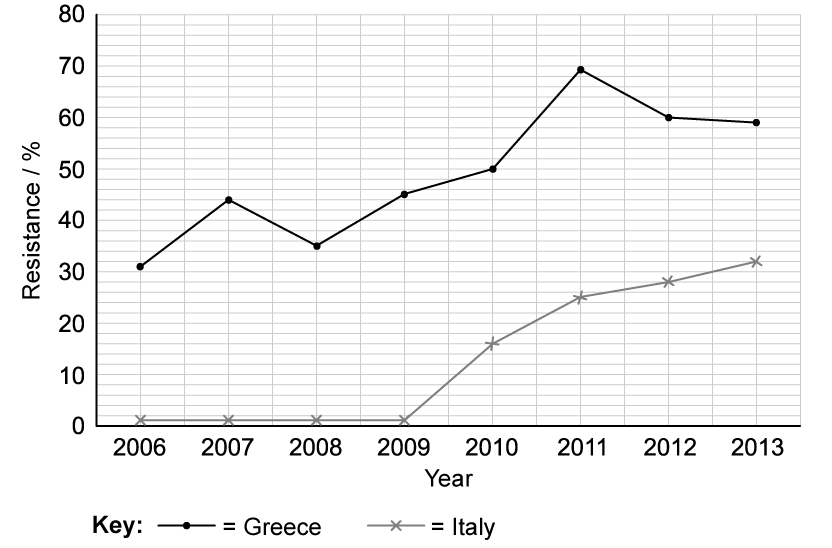

**Fig. 1**

Describe the trend in antibiotic resistance observed in Fig. 1 for both countries.

**Q8** [3 marks]

Greece has one of the highest uses of antibiotics outside of hospitals in Europe.

Explain how such widespread use of antibiotics can lead to the development of antibiotic resistance in bacteria such as *K. pneumonia*.

**Q8** [2 marks]

*K. pneumonia* are resistant to several different types of antibiotics and they are able to pass this resistance on to other species of bacteria.

Outline the mechanism by which *K. pneumonia* would be able to transfer antibiotic resistance to other species of bacteria.

### Q9 — medium — 9 marks

**Q9** [1 mark]

The mango tilapia (*Sarotherodon galilaeus*) is a species of fish found in rivers and lakes across Africa and Eurasia. Scientists monitored the numbers of mango tilapia in a lake over a period of 10 years. Fig. 1 shows the results of this study.

**Fig. 1**

The number of different alleles present in the mango tilapia population shown in Fig. 1 changed between 2000 and 2004.

Name the precise biological process or event that has affected the number of alleles in the population of mango tilapia represented in Fig. 1

**Q9** [2 marks]

**Extract:**

The mango tilapia (Sarotherodon galilaeus) is a species of fish found in rivers and lakes across Africa and Eurasia. Scientists monitored the numbers of mango tilapia in a lake over a period of 10 years. Fig. 1 shows the results of this study.

The number of different alleles present in the mango tilapia population shown in Fig. 1 changed between 2000 and 2004.

Name the precise biological process or event that has affected the number of alleles in the population of mango tilapia represented in Fig. 1

The process that is affecting the allele frequency of the mango tilapia population is:
- (The) bottleneck effect / population bottleneck;

Explain the effect that the process identified in part a) would have on the tilapia population.

**Q9** [2 marks]

The population of tilapia decreased from 2400 individuals in 2003 to 52 individuals in 2005.

Calculate the percentage decrease in the tilapia population over this time period.

**Q9** [4 marks]

A new species of predatory fish is introduced into the lake which preys on mango tilapia. The biologists monitoring the tilapia population noticed that the predatory fish mainly catches tilapia of medium body size.

Explain the effect that this would have on the body size of mango tilapia over time.

### Q10 — easy — 8 marks

**Q10** [2 marks]

Fig. 1 shows the effects of different types of selection, **A** and **B**, that can act on a population.

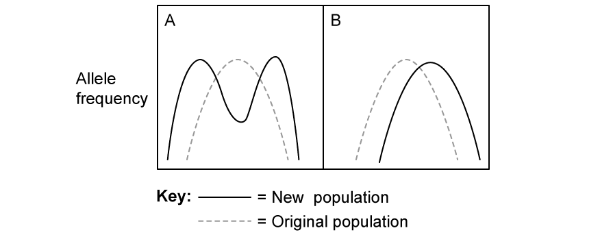

**Fig. 1**

Identify the type of selection represented by **A** and **B** in Fig. 1.

**Q10** [2 marks]

**Extract:**

Fig. 1 shows the effects of different types of selection, A and B, that can act on a population.

Fig. 1

Describe the type of selection represented by graph **A **in Fig. 1.

**Q10** [2 marks]

A mutation occurs within a population that results in a new allele. Organisms with this allele have increased fitness compared to organisms that do not have the allele.

Define the term **fitness**.

**Q10** [2 marks]

**Extract:**

Fig. 1 shows the effects of different types of selection, A and B, that can act on a population.

Fig. 1

A mutation occurs within a population that results in a new allele. Organisms with this allele have increased fitness compared to organisms that do not have the allele.

(i) State which, from **A** or **B **in Fig. 1, would best represent the type of selection that may occur in the population described in part (c).

[1]

(ii) Give a reason for your answer in part (i).

[1]

### Q11 — easy — 7 marks

**Q11** [1 mark]

State the purpose of the Hardy Weinberg equation.

**Q11** [3 marks]

The Hardy Weinberg principle states that the genetics of a population will remain constant from one generation to the next provided that certain conditions, or assumptions, are met.

State **three** of the assumptions made by the Hardy Weinberg principle.

**Q11** [1 mark]

One of the Hardy Weinberg equations is given below.

*p + q = 1*

State what is represented by ***p*** in this equation.

**Q11** [2 marks]

**Extract:**

One of the Hardy Weinberg equations is given below.

p + q = 1

State what is represented by p in this equation.

In this equation p represents the frequency of the dominant allele.

In a population, the frequency of the recessive allele is 0.21.

Use the equation provided in part (c) to calculate the frequency of the dominant allele in this population.

### Q12 — easy — 6 marks

**Q12** [1 mark]

Fig. 1 shows a male northern elephant seal.

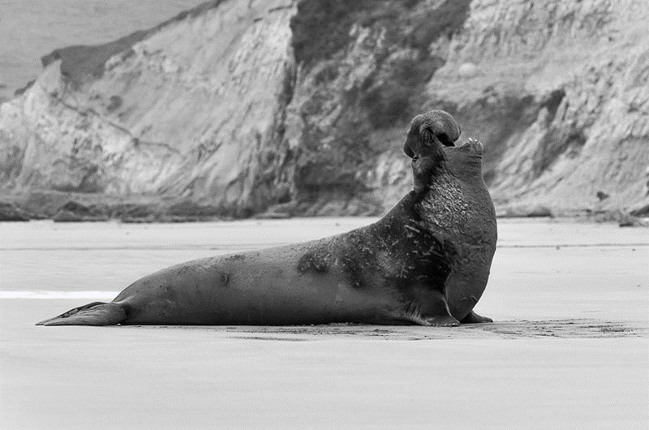

Frank Schulenburg, CC BY-SA 3.0 <https://creativecommons.org/licenses/by-sa/3.0>, via Wikimedia Commons

**Fig. 1**

Northern elephant seals (*Mirounga angustirostris*) are found along the west coast of the U.S. and Mexico. They were hunted to near extinction at the end of the 19th century and only a small population of about 100 seals survived.

Fortunately their population numbers have since recovered and it is currently estimated that around 150 000 northern elephant seals occur across their native range.

This event changed the allele frequency in the northern elephant seal population.

State the name of the event that has caused this change in allele frequency.

**Q12** [2 marks]

**Extract:**

Northern elephant seals (Mirounga angustirostris) are found along the west coast of the U.S. and Mexico. They were hunted to near extinction at the end of the 19th century and only a small population of about 100 seals survived.

Fortunately their population numbers have since recovered and it is currently estimated that around 150 000 northern elephant seals occur across their native range.

This event changed the allele frequency in the northern elephant seal population.

Explain the disadvantage of the event described in part (a) for the population of northern elephant seals.

**Q12** [2 marks]

**Extract:**

Northern elephant seals (Mirounga angustirostris) are found along the west coast of the U.S. and Mexico. They were hunted to near extinction at the end of the 19th century and only a small population of about 100 seals survived.

Fortunately their population numbers have since recovered and it is currently estimated that around 150 000 northern elephant seals occur across their native range.

This event changed the allele frequency in the northern elephant seal population.

State the name of the event that has caused this change in allele frequency.

The event described in part (a) may lead to a change in the allele frequency of a population over time.

Give **two other** processes that may change the allele frequency in a population over time.

**Q12** [1 mark]

A change in the allele frequency may impact the genetic diversity of a population.

Define the term **genetic diversity**.
