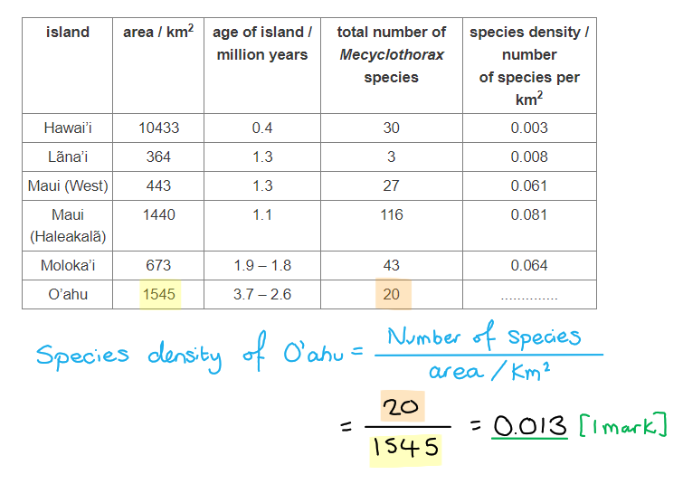
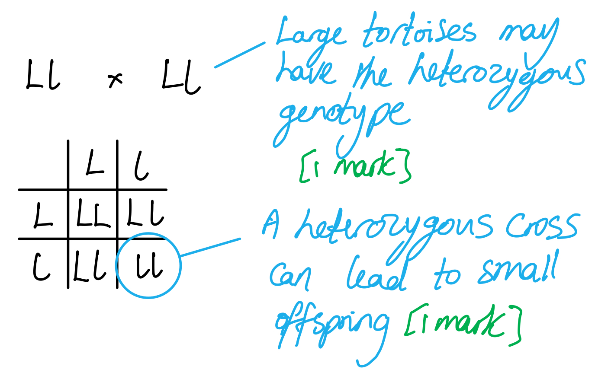

# Mark Schemes — Evolution
**17. Selection & Evolution** · Cambridge (CIE) A-LEVEL biology (9700)

## Structured Questions (9 questions)

### Q1
Wisdom teeth became vestigial structures in *Homo sapiens* because:

**Final answer:** **Any**** two ****from the following:**

- There was a change in diet for *Homo sapiens* **OR** a described example of change e.g. *Homo sapiens* eat less (raw) plant material / use fire/heat to cook food/plant material / *Homo sapiens* eat more processed food; **[1 mark]**
- (This diet) requires less chewing so the size of the jaw decreased / smaller jaw size were selected for **OR** less / smaller molars were selected for; **[1 mark]**

**[Total: 2 marks]**

> *The raw plant based diet of early humans required a robust jaw and large teeth, especially molars, in order to chew the plant roughage. Since humans are unable to digest cellulose, they would have had to consume large amounts of plant material to gain enough energy and nutrients for survival. **Homo habilis** did not discover fire, so they were unable to cook food in order to make plant material easier to chew. A third pair of molars came in very handy to do this!*
Humans still have wisdom teeth because....

**Final answer:** **Any ****one**** of the following:**

- This suggests that humans share a common ancestor with organisms that still use the third molars (from which it was inherited); **[1 mark]**
- The presence of wisdom teeth does not significantly harm humans so they are not selected against (and therefore persists); **[1 mark]**

**[Total: 1 mark]**
(i) The possible fate of wisdom teeth in future human populations could be....

- Wisdom teeth may reduce in size / disappear from future populations; **[1 mark]**

(ii) A reason for this would be....

- There is no selective advantage to having wisdom teeth / they will not be selected for **OR** they could be selected against in future generations (due to their negative impact on oral health); **[1 mark]**

**[Total: 2 marks]**

> *If it was advantageous for modern humans to have wisdom teeth, then the alleles for these teeth would have a greater chance of being passed down to future generations. Since wisdom teeth serve no purpose in modern humans and in some cases may even have a negative impact on health, there is no selection pressure for them and we would expect to see them becoming less common in future populations.*
Allopatric and sympatric speciation have the following characteristics...

- Both lead to the formation of new species from pre-existing ones over time **OR** both lead to changes to gene pools from generation to generation; **[1 mark]**
- Genetic isolation / no genetic exchange/flow (between new population and pre-existing population) must occur for both types of speciation to occur; **[1 mark]**
- Allopatric speciation involves a geographical barrier/isolation between two populations **WHILE** sympatric speciation takes place with no geographical barrier/isolation between two populations **OR** populations experience ecological/behavioural separation; **[1 mark]**

**[Total: 3 marks]**

> *Make sure that you cover both similarities **and **differences between the two types of speciation in order to gain full marks for this question.*

### Q2
Scientists could distinguish if the lizards are members of the same species by...

- Breeding individuals together / cross breeding individuals;** [1 mark]**
- Members of the same species can produce <u>fertile</u> offspring; **[1 mark]**

**[Total: 2 marks]**

> *If fertile offspring is produced it means that the individuals still belong to the same species. Note that it would not be enough to simply state that offspring is produced; the offspring must be able to reproduce themselves.*
Speciation may have occurred because:

**Final answer:** **Any ****four ****of the following:**

- There is isolation of two populations/allopatric speciation due to segmentation of the forest patches; **[1 mark]**
- Variation within the dwarf gecko species is already present due to mutations (in the DNA); **[1 mark]**
- Different environmental conditions/selection pressures exist for each separated group **OR** selection of different features takes place in each population; **[1 mark]**
- Favourable alleles are passed onto offspring; **[1 mark]**
- Gene pools are separated **OR** no interbreeding; **[1 mark]**

**[Total: 4 marks]**

> *Populations can become separated either by a physical barrier, allopatric speciation, as is the case here or if members decide on different habits (food sources, mating locations, etc) otherwise known as sympatric speciation. The groups that form will face different selection pressures because the environment within which they live will differ in food sources, nesting sites, predators, etc which results in different traits being more suitable for the environment. *
Colour patterns displayed by lizard species help to maintain them as separate species as...

- (It) allows selection of a mate / mating partners can be identified; **[1 mark]**
- Keeps the gene pool separate / prevents interbreeding/gene flow; **[1 mark]**

**[Total: 2 marks]**

> *For successful mating, animal species must be able to identify one another but also members of the opposite gender. If the species are similar in most other respects, as the question states, then we can assume that the colour patterns help the lizard species identify each other.*
Two species of maggots arose by sympatric speciation because...

**Final answer:** **Any ****four**** of the following:**

- (Sympatric speciation) occurs when the population is in the same environment/population/habitat; **[1 mark]**
- Mutations in the DNA can result in alleles whose phenotype results in different egg-laying preferences; **[1 mark]**
- (Resulting in) reproductive isolation **OR** no gene flow **OR** gene pools remain separate; **[1 mark]**
- (Leading to) different alleles selected **OR** changes in allele frequency; **[1 mark]**
- (Over time the maggots from different groups) cannot interbreed and produce fertile offspring; **[1 mark]**

**[Total: 4 marks]**

> *There isn’t a physical barrier separating the species of maggot flies, they simply have different preferences on where to lay their eggs, sufficiently creating a separate gene pool, as members who consistently lay their eggs on the hawthorn fruit will generally be more likely to find mates in that same area. Over time, this can lead to accumulation of different mutations which are only passed on within the localised population and can lead to speciation as the question states. *

### Q3
(i) The density of *Mecyclothorax* beetle species on the island of O’ahu is...

- 0.013; **[1 mark]**

(ii) The island of Hawai’i has the lowest density of *Mecyclothorax* beetle species because...

**Final answer:** **Any ****two ****of the following:**

- Hawai’i is youngest island / formed only 0.4 million years ago; **[1 mark]**
- Less time for *Mecyclothorax* to colonise / undergo speciation; **[1 mark]**
- Hawai’i has large area so density/number of species per km2 is low; **[1 mark]**
- Hawai'i has a low habitat diversity; **[1 mark]**

***Accept**** answers relating to Hawai'i being at an early stage of succession for marking point 4.*

(iii) O’ahu has a lower number of *Mecyclothorax* beetle species than Moloka’i because...

**Final answer:** **Any ****two ****of the following:**

- O’ahu is further away from Maui (than Moloka’i); **[1 mark]**
- Fewer *Mecyclothorax* (individuals/species) reached O’ahu; **[1 mark]**
- O’ahu was colonised later; **[1 mark]**
- There has been less time for speciation (on O'ahu); **[1 mark]**

**[Total: 5 marks]**

> *(i) You need to make sure your answer is rounded to the same number of decimal places as the figures for the other islands.*

> *(ii) The question tells us that the beetles in this archipelago all descend from an ancestral species that originally colonised Maui from Australia. The beetles would have gradually colonised the islands surrounding Maui and would have **colonised the older islands longer ago **than the younger islands. The older islands have therefore had **more time to be colonised** by more species of beetle, as well as having **more time for the process of speciation** to occur and give rise to more new species.*

> *(iii) This question contains similar ideas to part ii) but relates to distance rather than age of the islands. Having read the question stem you will be aware that** Maui **was the island **originally colonised** by the beetles from Australia. This means that within the archipelago the beetles all came from Maui, so the islands **closer **to Maui would have been **colonised first**. Just as in part ii) this means that there has been **more time for different species to colonise **Molokai'i than O'ahu, as well as **more time for speciation** to give rise to new species on Molokai'i.*
The large number of *Mecyclothorax* beetle species on Haleakalã developed by...

**Final answer:** **Any ****four ****of the following:**

- <u>Allopatric speciation</u>; **[1 mark]**
- Geographical isolation / population became divided; **[1 mark]**
- Different mutations/alleles in different <u>populations</u>; **[1 mark]**
- Different selection pressures (act on different populations); **[1 mark]**
- No gene flow/interbreeding between populations; **[1 mark]**
- Genetic differences accumulated; **[1 mark]**
- <u>Natural selection</u> occurred; **[1 mark]**
- <u>Genetic drift</u> / <u>founder effect</u>; **[1 mark]**

**[Total: 4 marks]**

> *Make sure that you are confident applying the principles of speciation to different real-life scenarios that an exam could present you with.*

> *Note that genetic drift is a **random process** that occurs when allele frequencies change purely due to chance, and is not the result of natural selection.*

### Q4
(i) The species of baleen whale that are genetically most similar are...

- Humpback and fin (whales); **[1 mark]**

(ii) We can tell that these whales are most genetically similar because...

- They share the most recent common ancestor **OR** they separated into different species most recently (therefore their DNA will be most similar); **[1 mark]**

**[Total: 2 marks]**

> *Fig. 1 shows that humpback and Fin whales diverged from a common ancestor around 5 million years ago. This is more recent than the divergence of blue and sei whales which occurred almost 6 million years ago.*

> *Species that share a more recent common ancestor will have DNA that is more similar. This is because it takes time for genetic changes to accumulate; the more recent the split into different species, the fewer changes will have occurred in their DNA.*
The process of natural selection leads to evolution as follows...

**Final answer:** **Any ****five**** of the following:**

- There is <u>genetic</u> variation between individuals of a population; **[1 mark]**
- Environmental factors / selection pressures / named example of selection pressure will favour / provide a (selective) advantage to individuals with advantageous/favourable alleles; **[1 mark]**
- Those individuals will have a greater chance of surviving and reproducing **OR** those without the advantageous alleles will have a smaller chance of surviving and reproducing; **[1 mark]**
- Advantageous/favourable <u>alleles</u> will be passed to offspring **OR** disadvantageous/unfavourable <u>alleles</u> will not be passed to offspring; **[1 mark]**
- There will be a change in allele frequency in the population over time **OR** favourable/advantageous alleles will increase in frequency over time **OR** unfavourable/disadvantageous alleles will decrease in frequency over time; **[1 mark]**
- A large enough change in allele frequency / the gene pool can lead to reproductive/genetic isolation / the development/evolution of new species / speciation; **[1 mark]**

**[Total: 5 marks]**

> *This question requires to combine your knowledge of natural selection with that of evolution. The process of natural selection acting over long periods of time can lead to the development of new species.*
The benefit of analysing mitochondrial DNA is as follows...

**Final answer:** **Any ****two**** of the following:**

- Mitochondrial DNA is circular **SO** there is no/limited crossing over / recombination of genes/DNA; **[1 mark]**
- Mutation is the only cause of change (in mitochondrial DNA) **SO** a molecular clock / the passage of time can be estimated/calculated/calibrated (from fossils and carbon dating); **[1 mark]**
- Mutation rates (in mitochondrial DNA) are faster (than nuclear DNA) **SO** more precise time/clock estimates can be made; **[1 mark]**
- Mitochondrial DNA passes from mother to daughter **SO** is useful for tracing (maternal) ancestry; **[1 mark]**
- Genes in the mitochondria code for proteins found in respiration **SO** are present in most living organisms (this is useful for comparison of different species); **[1 mark]**

**[Total: 2 marks]**
A process other than natural selection leading to evolution is...

- Genetic drift; **[1 mark]**

**[Total: 1 mark]**

> *Evolution is the formation of new species when the allele frequencies of a population change sufficiently over time. While natural selection favours individuals with advantageous alleles, increasing the likelihood of their being passed on, sometimes alleles are passed on or not passed on simply due to chance. This is known as genetic drift, and has a much larger impact on allele frequencies in small populations than in large populations.*

### Q5
Natural selection could produce a population of earleaf acacias that is tolerant to low soil pH in the following way...

- One/some individuals in the original population have an allele**/**mutation that gives tolerance to low soil pH; **[1 mark]**
- Individuals that are tolerant to low soil pH are more likely to survive and reproduce in the new habitat; **[1 mark]**
- These individuals pass on the favourable <u>allele</u>(s) to their offspring / the next generation; **[1 mark]**
- There is an increase in the <u>frequency</u> of the <u>allele</u>(s) (that gives tolerance to low soil pH); **[1 mark]**

**[Total: 4 marks]**

> *The process of natural selection always occurs in a similar way; those with advantageous alleles for the particular environment will survive and reproduce to pass them on to the next generation, and the advantageous alleles increase in frequency in the population. Remember to adapt your answer to the specific example that is given.*
The month when each population had the highest flower density is:

**Final answer:** **Any ****two**** of the following:**

- Normal acacias have their peak flowering time 60/65 days (after the beginning of the study) **WHILE** acid tolerant acacias have peak flowering at (around) 160/165/170 days (after the beginning of the study); **[1 mark]**
- Normal acacia begin flowering at day 0 and finish flowering by (around) day 100 **WHILE** acid tolerant acacias begin flowering at (around) day 95 and finish flowering by (around) day 185; **[1 mark]**
- There is a (very short) overlap in flowering times at (around) 95-100 days (after the start of the study); **[1 mark]**

*Accept correctly identified months/dates in place of numbered days for any marking point.*

**[Total: 2 marks]**
The results in Fig.1 can lead to the formation of a new species of acacia because....

- The populations have different flowering times / only have a very short overlap in flowering time **SO** cannot interbreed / exchange genes / have gene flow; **[1 mark]**
- Each population experience different selection pressures / genetic drift; **[1 mark]**
- The populations become reproductively isolated from each other over time **OR** <u>sympatric</u> speciation occurs; **[1 mark]**

**[Total: 3 marks]**

> *Remember that sympatric speciation takes place with no geographical barrier. The difference in soil pH provided different ecological conditions for each population, which affected the flowering time of the population growing in low pH soils. This difference in flowering time prevented this population from exchanging genes with the surrounding acacia populations and prevented gene flow between them. As different selection pressures and genetic drift events act on each population they become genetically different, which will ultimately lead to reproductive isolation and a new species forming.*

> *Note that it would also be technically correct to say that ecological separation prevents gene flow between the two populations, but as this information does not come from the data in Fig. 1 it cannot be credited as an answer here.*
The definition of a species is as follows...

- A group of organisms with similar morphological/physiological/biochemical/behavioural features; **[1 mark]**
- That are able to produce <u>fertile</u> offspring (when they breed) / are <u>reproductively isolated</u> from each other; **[1 mark]**

**[Total: 2 marks]**

> *The definition of the term species causes much debate amongst biologists and there are actually several different definitions used in different situations. The definition stated above is widely accepted and is the one that you will be expected to know.*

### Q6
Crop cultivation could result in speciation within the tortoise population in the following way...

**Final answer:** **Any ****five**** of the following:**

- The original tortoise population will be separated / geographically isolated by crop/wheat fields (which act as a geographical barrier); **[1 mark]**
- The environmental conditions experienced in these separate habitats could differ / different selection pressures could be present in the separate habitats; **[1 mark]**
- Different alleles are selected for / increase the chance of survival (and reproduction) in the separate habitats **OR **genetic drift could act differently on the two separate populations over time; **[1 mark]**
- Genetic differences between the populations will accumulate over time; **[1 mark]**
- The populations become <u>reproductively isolated</u> from each other; **[1 mark]**
- This is known as <u>allopatric speciation</u>; **[1 mark]**

**[Total: 5 marks]**

> *When a physical barrier is involved in separating a population of individuals it is known as allopatric speciation. Different selection pressures or genetic drift events on both sides of the barrier will drive changes in allele frequencies until the two populations are genetically too different to reproduce successfully (they are unable to produce fertile offspring).*
(i) The type of selection that is present in this population is...

- Disruptive (selection); **[1 mark]**

(ii) The reason for this is that...

- There is selection against the average/middle sized tortoises in this population **OR** both extremes of tortoise body size / very large and very small tortoise body size are selected for; **[1 mark]**

**[Total: 2 marks]**

> *There would be an increase in the proportion of individuals with alleles for either very large or very small body size since they would have a selective advantage above tortoises with a medium body size. Over time this type of selection can lead to the formation of entirely new species within this population.*
This event would affect the new nature reserve tortoise in the following way...

**Final answer:** **Any ****three**** of the following:**

- The new population has / is restarted with a reduced/small gene pool; **[1 mark]**
- The gene pool contains only/mostly alleles for the large phenotype **OR** gene pool does not contain (many) alleles for small phenotype; **[1 mark]**
- Most/all of the offspring from these individuals would inherit large body alleles **SO** would have the large phenotype; **[1 mark]**
- The population is small **SO** (any) small body alleles are likely to be lost by genetic drift;** [1 mark]**
- This is due to the bottleneck effect; **[1 mark]**

**[Total: 3 marks]**

> *The bottleneck effect can lead to sudden, large changes within the gene pool of a population and is usually driven by a dramatic event, such as the fire in this instance. The allele for the very small phenotype may have been eliminated from the population due to factors that were not related to natural selection.*
Small tortoises might appear in future generations of the rescued nature reserve population because...

- Some of the large tortoises may be heterozygous / may have the genotype Ll / may carry the recessive allele; **[1 mark]**
- A cross between two heterozygous individuals could lead to small offspring **OR** offspring of two heterozygous individuals may be homozygous recessive / have a genotype of ll; **[1 mark]**

**[Total: 2 marks]**

> *The presence of the recessive allele for small body size in the tortoises will be masked by the presence of the dominant allele for large body size in heterozygous individuals. When two heterozygous tortoises breed there will be a 25% change that a small sized tortoise will result from that cross.*

### Q7
The term *evolution* can be defined as...

- Changes in the heritable characteristics/phenotype of organisms; **[1 mark]**
- Due to changes to gene pools / allele frequencies from generation to generation; **[1 mark]**

**[Total: 2 marks]**

> *Life on Earth is constantly changing due to different selection pressures that favour the genetic makeup of certain organisms in that environment.*
Examples of ecological barriers between populations include...

**Final answer:** **Any ****two**** of the following:**

- Differences in the soil pH/water/type (within an ecosystem); **[1 mark]**
- Differences in rainfall/temperature; **[1 mark]**
- Availability of food within different parts of the ecosystem; **[1 mark]**

*Accept any other sensible example of ecological barriers between populations*

**[Total: 2 marks]**
The difference between allopatric and sympatric speciation is as follows...

- Allopatric speciation occurs when populations are geographically/physically separated **WHEREAS** sympatric speciation occurs where populations occupy the same geographical area / there are no geographical barriers; **[1 mark]**

**[Total: 1 mark]**
A behavioural barrier which results in reproductive isolation could include...

**Final answer:** **Any ****pair**** of the following:**

- Different mating rituals / courtship behaviours; **[1 mark]**
- (This results in them) no longer attracting individuals of the opposite sex for mating **OR** their methods of attracting a mate are no longer effective; **[1 mark]**

**OR**

- Seasonal changes / changes in fertility cycle; **[1 mark]**
- (Leading to) some individuals in a population becoming sexually active at different times; **[1 mark]**

**OR**

- Different feeding preferences; **[1 mark]**
- (Meaning) that they no longer interact with each other; **[1 mark]**

**[Total: 2 marks]**

### Q8
The advantage to a beetle if their elytra was brown or green in colour would be...

**Final answer:** **Any ****two**** of the following:**

- They would be well camouflaged / less visible to predators/birds in their environment; **[1 mark]**
- (They would therefore) have a greater chance of surviving / not being caught/eaten by predators; **[1 mark]**
- (This would enable them) to reproduce and pass their alleles down to their offspring; **[1 mark]**

*Accept mention of 'increased fitness' for ***[1 mark]**

**[Total: 2 marks]**

> *Having an elytra that is brown or green in colour would increase the fitness of the beetle and ensure that their genetic information will be present in their offspring.*
The term *gene pool* can be defined as...

- The collection of genes within an interbreeding population **OR** all the alleles within the genes of a population of a single species;** [1 mark]**

**[Total: 1 mark]**
The type of speciation that could occur in this instance is...

- Allopatric (speciation); **[1 mark]**

**[Total: 1 mark]**

> *The road would act as a physical/geographical barrier between the two beetle populations which is why this could be an example of the conditions that can lead to allopatric speciation.*
The speciation would occur as follows...

**Final answer:** **Any ****three**** of the following:**

- Populations are geographically/reproductively isolated; **[1 mark]**
- Mutations could randomly occur in the two populations; **[1 mark]**
- Different selection pressures in the two areas drives natural selection in different ways; **[1 mark]**
- Eventually, the two populations could become so genetically different that they are different species / could not be able to reproduce to produce fertile offspring; **[1 mark]**

**[Total: 3 marks]**

### Q9
Organelles which contain DNA include...

**Final answer:** **Any ****two**** of the following:**

- Nucleus; **[1 mark]**
- Mitochondria; **[1 mark]**
- Chloroplast(s); **[1 mark]**

**[Total: 2 marks]**

> *For this answer you would have to go back to Topic 1 and refresh your memory on cell structure.*
DNA can be used to provide information about the evolutionary relationship between species in the following ways...

**Final answer:** **Any ****two**** of the following:**

- Comparing similarities/differences in the nucleotide/base sequences (of different species); **[1 mark]**
- May indicate how closely related these species are; **[1 mark]**
- It could be used as a molecular clock / determine when species branched from a common ancestor / when speciation events occurred; **[1 mark]**
- This information could be used to construct a cladogram / evolutionary family tree; **[1 mark]**

**[Total: 2 marks]**
A mass extinction event can be defined as...

- An event where a very large number of species went extinct / died out at one time; **[1 mark]**

**[Total: 1 mark]**
Reasons for the current mass extinction event include...

**Final answer:** **Any ****two**** of the following:**

- Climate change (due to burning of fossil fuels); **[1 mark]**
- Competition (for a limited supply of resources); **[1 mark]**
- Introduction of (non-native) species; **[1 mark]**
- Hunting / exploitation by humans; **[1 mark]**
- Degradation and loss of habitats; **[1 mark]**

**[Total: 2 marks]**

> *Human activities, such as burning fossil fuels and deforestation, have put many species under strain. Our activities are changing their environment so quickly that it is becoming increasing difficult for these species to survive. The current rate of extinction will have devastating effects on many food webs and ecological interactions if it is allowed to continue.*
