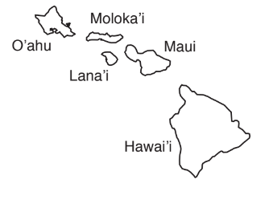
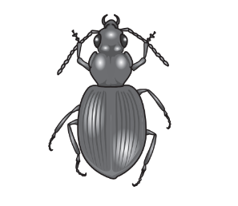
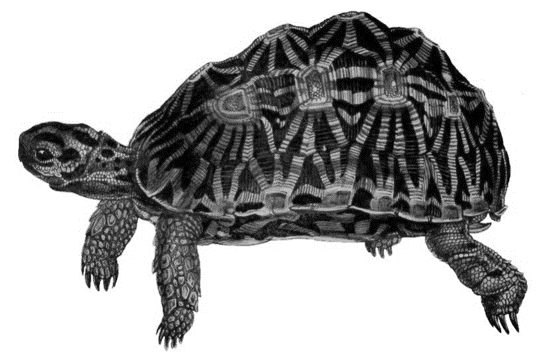

# Exam Questions — Evolution
**17. Selection & Evolution** · Cambridge (CIE) A-LEVEL biology (9700)
> Source: [https://www.savemyexams.com/a-level/biology/cie/25/topic-questions/](https://www.savemyexams.com/a-level/biology/cie/25/topic-questions/) · 9 questions across 1 sets

## Structured Questions (9 questions)

### Q1 — hard — 8 marks

**Q1** [2 marks]

Wisdom teeth are considered to be an example of vestigial structures in modern humans (*Homo sapiens*), since they serve very little purpose. They are third molars that human ancestors (such as *Homo habilis*) used to grind down large amounts of raw plant material. These early humans had larger jaws that could accommodate a third pair of molars but in modern humans, they may cause complications that require them to be surgically removed.

Fig. 1 below compares the lower jaw of *Homo habilis* and *Homo sapiens* according to scale.

**Fig. 1**

Based on the information above, suggest a reason why wisdom teeth became vestigial structures in *Homo sapiens*.

**Q1** [1 mark]

**Extract:**

Wisdom teeth are considered to be an example of vestigial structures in modern humans (Homo sapiens), since they serve very little purpose. They are third molars that human ancestors (such as Homo habilis) used to grind down large amounts of raw plant material. These early humans had larger jaws that could accommodate a third pair of molars but in modern humans, they may cause complications that require them to be surgically removed.

Explain why humans still have wisdom teeth, even though it serves no purpose for them.

**Q1** [2 marks]

Wisdom teeth can cause a range of oral health problems in certain people, including gum infections, damage to other teeth and problems with eating due to teeth being pushed out of position by the presence of wisdom teeth. Some scientists believe that this may affect their persistence in future generations.

(i) Predict the possible fate of wisdom teeth in future human populations, based on this information and your knowledge of natural selection.

[1]

(ii) Explain your answer at part (i).

[1]

**Q1** [3 marks]

Compare and contrast allopatric and sympatric speciation.

### Q2 — hard — 12 marks

**Q2** [2 marks]

There are 72 known species of the genus *Lygodactylus*, many of them found on the continent of Africa where they inhabit the same area.

One of these species is the lizard *Lygodactylus williamsi* which is more commonly known as a dwarf gecko. Scientists were investigating the number of different *Lygodactylus* species in one part of East Africa.

Describe **one** way in which scientists could distinguish if the different types of lizards belong to the same species.

**Q2** [4 marks]

The dwarf gecko lives in the leaf crown of screw pine trees, several metres above ground, feeding off insects and drinking water from leaves. These trees are located in forest patches in parts of Africa, especially Tanzania. Demand for timber for firewood and charcoal production in Tanzania is exceptionally high.

Suggest and explain how speciation may occur as a result of deforestation.

**Q2** [2 marks]

Many species of lizards are similar in size and have few differences in their appearance, apart from their colour.

Suggest how the variety of colour patterns displayed by lizards may help to maintain the lizards as separate species.

**Q2** [4 marks]

*Rhagoletis pomonella *is otherwise known as the apple maggot fly. Initially, these maggots would lay their eggs on hawthorn fruit. In the 19th century a distinct group of maggots emerged that lay their eggs on apples only. Apples and hawthorn fruit are closely related.

Use this information to suggest how these two species of maggots arose by sympatric speciation.

### Q3 — hard — 9 marks

**Q3** [5 marks]

The Hawaiian archipelago is a group of volcanic islands in the Pacific ocean.

Fig. 1 shows the relative locations of five of these islands.

**Fig. 1**

Table 1 shows the size and age of these five islands and the total number of *Mecyclothorax *ground beetle species and their species density, on each island.

Data for the island of Maui is shown as two distinct regions, West and Haleakalã. This is because they formed at different times from two separate volcanoes.

**Table 1**

| **island** | **area / km****2** | **age of island /** **million years** | **total number of** ***Mecyclothorax***** species** | **species density / number** **of species per km****2** |
|---|---|---|---|---|
| Hawai’i | 10433 | 0.4 | 30 | 0.003 |
| Lãna’i | 364 | 1.3 | 3 | 0.008 |
| Maui (West) | 443 | 1.3 | 27 | 0.061 |
| Maui (Haleakalã) | 1440 | 1.1 | 116 | 0.081 |
| Moloka’i | 673 | 1.9 – 1.8 | 43 | 0.064 |
| O’ahu | 1545 | 3.7 – 2.6 | 20 | .............. |

Fig. 2 shows a ground beetle of the genus *Mecyclothorax*. All the beetle species of this genus on the Hawaiian archipelago form a monophyletic group, descended from one original colonising species that reached Maui from Australia.

**Fig. 2**

(i) Complete Table 1 by calculating the density of *Mecyclothorax* beetle species on the island of O’ahu.

[1]

(ii) Use Table 1 to explain why the island of Hawai’i has the lowest density of *Mecyclothorax* beetle species.

[2]

(iii) Use Fig. 1 and Table 1 to suggest why O’ahu has a lower number of *Mecyclothorax* beetle species than Moloka’i.

[2]

*Source: Oct/Nov 2018 9700/41 Q4A*

**Q3** [4 marks]

The rate of speciation of *Mecyclothorax* beetles on the slopes of the volcano Haleakalã, on Maui, is the highest recorded for any genus or location on earth.

The volcano last erupted 400 years ago. This produced lava flows which cut through ancient forest and vegetation, dividing it into many separate microhabitats.

Explain how the large number of *Mecyclothorax* beetle species on Haleakalã developed.

*Source: Oct/Nov 2018 9700/41 Q4B*

### Q4 — medium — 10 marks

**Q4** [2 marks]

Baleen whales have baleen plates in their mouths made of keratin, with which they filter plankton out of the water. The DNA of several species of baleen whale were analysed and used to compile a phylogenetic tree to show the evolutionary relationship between them.

Fig. 1 shows the phylogenetic tree compiled from the DNA analysis of baleen whales.

**Fig. 1**

(i) State the species of baleen whale that are genetically most similar.

[1]

(ii) Give a reason for your answer to part i)

[1]

**Q4** [5 marks]

All species of baleen whale evolved from a common ancestor that had teeth.

Outline how the process of natural selection leads to evolution.

**Q4** [2 marks]

When compiling phylogenetic trees, such as the one in Fig. 1, scientists will often analyse the mitochondrial DNA of organisms.

Explain the benefit of analysing mitochondrial DNA.

**Q4** [1 mark]

State **one** process, **other than** natural selection, that can lead to evolution.

### Q5 — medium — 10 marks

**Q5** [4 marks]

Mining for gold produces waste material which contains sulfur-bearing minerals. When surface water and shallow groundwater come into contact with these minerals a chemical reaction occurs which produces sulfuric acid. This process is known as acid mine drainage and it can lower the soil pH to a level where very few plants can survive.

Environmentalists studied the area around an abandoned gold mine and discovered a few earleaf acacia, *Acacia auriculiformis, *individuals surviving in the acidic soil. *A. auriculiformis* typically occurs in more neutral or alkaline soils.

Explain how natural selection could produce a population of *A. auriculiformis* that would be tolerant to the acidic soil found around the mine shaft.

**Q5** [1 mark]

*A. auriculiformis* typically flowers from April to July in its native habitat. Ecologists studied the flowering time of the population of *A. auriculiformis* that are tolerant to low soil pH and compared it to the flowering time of a population growing in the surrounding habitat which was not tolerant to low soil pH. They measured the density of flowers found on the trees over a period of 180 days from 20 April.

Fig. 1 shows the results of this study.

**Fig. 1**

Describe the flowering times of normal and acid-tolerant *A. auriculiformes*.

**Q5** [3 marks]

**Extract:**

Mining for gold produces waste material which contains sulfur-bearing minerals. When surface water and shallow groundwater come into contact with these minerals a chemical reaction occurs which produces sulfuric acid. This process is known as acid mine drainage and it can lower the soil pH to a level where very few plants can survive.

Environmentalists studied the area around an abandoned gold mine and discovered a few earleaf acacia, Acacia auriculiformis, individuals surviving in the acidic soil. A. auriculiformis typically occurs in more neutral or alkaline soils.

A. auriculiformis typically flowers from April to July in its native habitat. Ecologists studied the flowering time of the population of A. auriculiformis that are tolerant to low soil pH and compared it to the flowering time of a population growing in the surrounding habitat which was not tolerant to low soil pH. They measured the density of flowers found on the trees over a period of 180 days from 20 April.

Fig. 1 shows the results of this study.

The flowering times show that:
- Normal acacias have their peak flowering time 60/65 days (after the beginning of the study) WHILE acid tolerant acacias have peak flowering at (around) 160/165/170 days (after the beginning of the study)
- Normal acacia begin flowering at day 0 and finish flowering by (around) day 100 WHILE acid tolerant acacias begin flowering at (around) day 95 and finish flowering by (around) day 185
- There is a (very short) overlap in flowering times at (around) 95-100 days (after the start of the study)

Describe how the results shown in Fig. 1 could lead to the development of a new species of acacia.

**Q5** [2 marks]

The change in soil pH can lead to the formation of a new species over time.

Define the term 'species'.

### Q6 — medium — 12 marks

**Q6** [5 marks]

Renosterveld is a type of vegetation found within South Africa's Cape Floristic Region. Renosterveld is characterised by a variety of species of shrubs and grasses that grow in relatively fertile soil and which make the areas where they grow popular for cultivating crops such as wheat. Renosterveld is home to the endangered geometric tortoise, *Psammobates geometricus*, which survives in remaining pockets of natural vegetation.

Fig. 1 shows an example of a geometric tortoise.

Image courtesy of the Biodiversity Heritage Library. Licensed under Creative Commons Attribution 2.0 Generic License. Reused and distributed under conditions found at https//creativecommons.org/licenses/by/2.0/deed.en

**Fig. 1**

Explain how the cultivation of crops could result in speciation within a population of geometric tortoises over time.

**Q6** [2 marks]

Scientists investigated one of these tortoise populations and discovered that most individuals were either very large or very small. Very small individuals were able to hide under shrubs from aerial predators such as peregrine falcons, *Falco peregrinus*, while large individuals had large shells, making it difficult for aerial predators to get a secure grip on them.

(i) Identify the type of selection that is taking place in this population.

[1]

(ii) Give a reason for your answer.

[1]

**Q6** [3 marks]

**Extract:**

Scientists investigated one of these tortoise populations and discovered that most individuals were either very large or very small. Very small individuals were able to hide under shrubs from aerial predators such as peregrine falcons, *Falco peregrinus*, while large individuals had large shells, making it difficult for aerial predators to get a secure grip on them.

A large fire swept through the habitat of the tortoise population, destroying all the vegetation. Only fifteen tortoises of the original population survived the fire. They were rescued by volunteers at a reptile sanctuary and released into a small nature reserve where no other geometric tortoises were present. All fifteen tortoises displayed a large phenotype.

Explain the effect that this event would have on the new nature reserve tortoise population.

**Q6** [2 marks]

**Extract:**

A large fire swept through the habitat of the tortoise population, destroying all the vegetation. Only fifteen tortoises of the original population survived the fire. They were rescued by volunteers at a reptile sanctuary and released into a small nature reserve where no other geometric tortoises were present. All fifteen tortoises displayed a large phenotype.

The allele for large body size (L) is dominant over the allele for small body size (l) in the geometric tortoise.

Explain why there may still be tortoises with small body size appearing in future generations of the nature reserve population that was rescued from the fire.

### Q7 — easy — 7 marks

**Q7** [2 marks]

Evolution results in the formation of new species from pre-existing species over time.

Define the term *evolution*.

**Q7** [2 marks]

In order for speciation to occur, the different populations must be reproductively isolated from each other.

One way in which populations may become reproductively isolated is by ecological separation.

Give **two** examples of ecological barriers that may exist between populations.

**Q7** [1 mark]

Allopatric and sympatric speciation both result in the formation of new species.

State the key difference between them.

**Q7** [2 marks]

Sympatric speciation can occur when certain behavioural barriers result in the reproductive isolation of populations.

Suggest **one** behavioural barrier and explain how it may result in reproductive isolation.

### Q8 — easy — 7 marks

**Q8** [2 marks]

A population of beetles exists in an area of forest. The beetle's outer shell that protects their wings is called an elytra. These can appear in different colours and patterns. The beetles in the forest live mostly in leaf litter that is brown and green in colour. They are hunted by predators such as birds.

Describe the advantage to a beetle if their elytra was brown or green in colour.

**Q8** [1 mark]

The different phenotypes of the beetles are mainly determined by their gene pool.

Define the term *gene pool*.

**Q8** [1 mark]

**Extract:**

A population of beetles exists in an area of forest. The beetle's outer shell that protects their wings is called an elytra. These can appear in different colours and patterns. The beetles in the forest live mostly in leaf litter that is brown and green in colour. They are hunted by predators such as birds.

The humans that live near the forest build a road through the beetles' habitat. The road is too wide for the beetles to cross, causing the two populations to become isolated from each other. On one side of the road, the leaf litter is cleared and a population of plants with red berries starts to colonise the area.

State the type of speciation that could occur in this instance.

**Q8** [3 marks]

**Extract:**

The humans that live near the forest build a road through the beetles' habitat. The road is too wide for the beetles to cross, causing the two populations to become isolated from each other. On one side of the road, the leaf litter is cleared and a population of plants with red berries starts to colonise the area.

Describe how the speciation mentioned at part (c) would occur in the beetle populations.

### Q9 — easy — 7 marks

**Q9** [2 marks]

DNA of organisms can be sequenced an used to show evolutionary relationships between species.

State the name of **two** organelles from which DNA can be extracted.

**Q9** [2 marks]

Describe how DNA can be used to provide information about the evolutionary relationship between species.

**Q9** [1 mark]

The fossil record provides evidence of mass extinction events that occurred throughout the history of life on Earth.

Define the term *mass extinction event*.

**Q9** [2 marks]

Scientists believe that the Earth is currently undergoing another mass extinction event.

State **two** possible reasons that could cause this mass extinction event.
