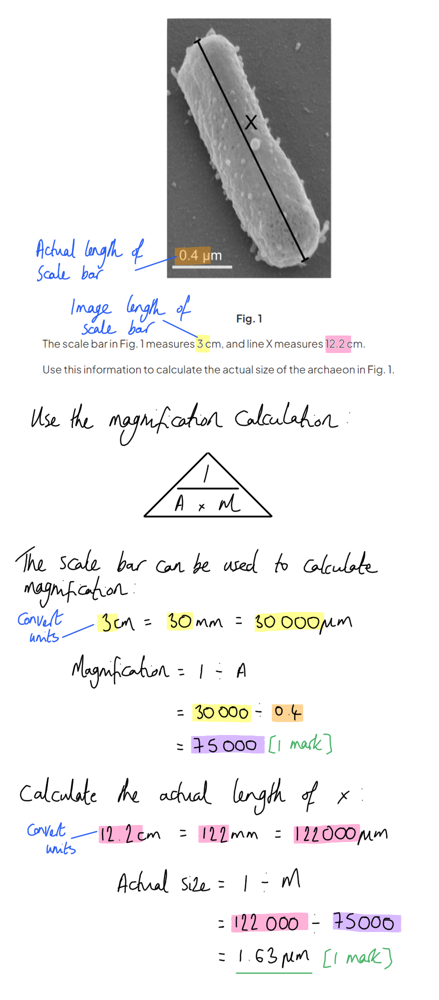
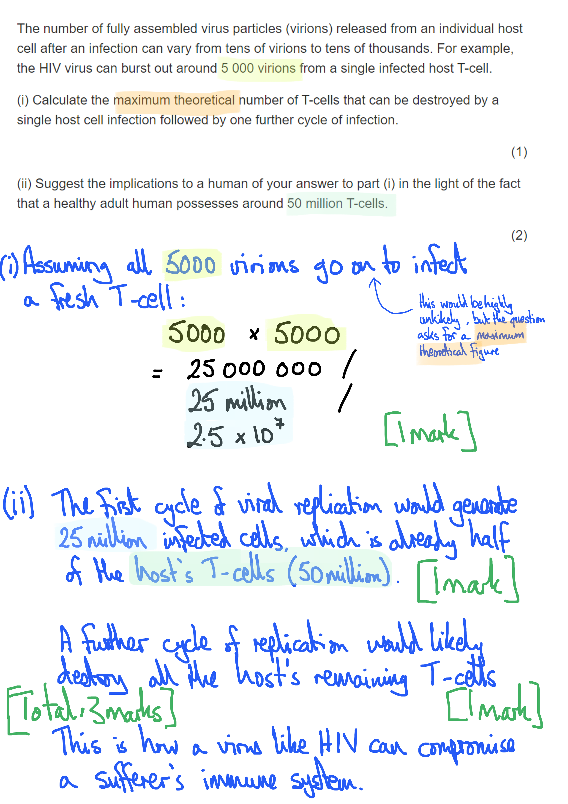
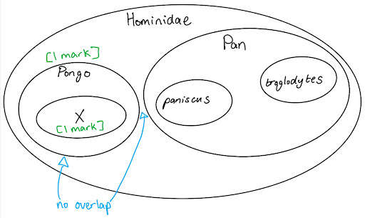

# Mark Schemes — Classification
**18. Classification, Biodiversity & Conservation** · Cambridge (CIE) A-LEVEL biology (9700)

## Structured Questions (15 questions)

### Q1
The conclusion that the giant panda and the red panda are closely related species can be evaluated as follows:

*Points in support of the conclusion*

**Final answer:** **A maximum of ****three**** of the following:**

- They have evolved in the same region / part of the world; **[1 mark]**
- They both have digestive systems / enzymes that enable them to digest bamboo; **[1 mark]**
- They could have inherited pseudo-thumb/sixth digit from a common ancestor; **[1 mark]**
- Most / 11 out of 15  of the bases in the DNA sequence are the same; **[1 mark]**

*Arguments against the conclusion*

**Final answer:** **A maximum of ****three**** of the following:**

- They do not belong to the same genus / giant pandas are in the genus *Ailuropoda *and red pandas are in the genus *Ailurus*; **[1 mark]**
- They are morphologically very different;
- The DNA sequence being compared is very short **SO** may not be representative / there may be larger differences elsewhere in the DNA;
- We would expect mtDNA to be very similar **SO** any differences are a strong indication that the species are not close relatives; **[1 mark]**

**[Total: 5 marks]**

> *The command word 'discuss' requires you to write about an issue in a logical and structured way. A good way to do this is to present arguments for and against a statement; it is important to always give a roughly equal balance of arguments for and against.*
(i) Examples of mitochondrial proteins include:

**Final answer:** **Any ****two**** of the following:**

- ATP synthase; **[1 mark]**
- Proteins of the electron transport chain / proton pumps; **[1 mark]**
- Pyruvate transport proteins; **[1 mark]**
- Decarboxylase / dehydrogenase enzymes; **[1 mark]**

*Accept other correctly identified mitochondrial proteins*

(ii) Scientists researching evolutionary relationships may choose to analyse mitochondrial DNA rather than DNA that codes for other characteristics because:

- Respiration occurs in all/most cells / is a highly conserved process **SO** mtDNA / the DNA that codes for mitochondrial proteins is likely to be comparable / to be present in many species / allows comparison of many different species; **[1 mark]**
- Other traits (e.g. fur colour) may show variation even within a species SO may not be useful for determining relationship **OR** DNA that codes for other traits may only be found in some groups of organisms (e.g. fur is only present in mammals) SO they may limit the species comparisons that are possible; **[1 mark]**

> *This question requires you to work through some steps of reasoning to reach the answer, but the examples presented in the question stem provide a significant clue as to the direction that your reasoning should take. The question compares DNA sequences that code for mitochondrial proteins with sequences that code for fur colour, so you need to ask yourself why the former is likely to be more useful in this type of research.*

> *You should be well aware that mitochondria are the site of aerobic respiration, a process that occurs in a very similar way across most living organisms; this means that the proteins involved in the process are likely to have similar base sequences, and so to be directly comparable across a wide range of species, and even across different domains.*

> *Fur colour, on the other hand, shows significant variation, even within a single species, and many groups of organisms don't have fur at all, so comparing DNA that codes for traits like this will provide very limited information.*

**[Total: 4 marks]**
(i) The order to which all four species belong is:

- Carnivora; **[1 mark]**

(ii) The closest relative of the red panda shown within Table 2 is:

- *Parailurus anglicus */ *P. anglicus*; **[1 mark]**
- They are in the same family / are both in the family Ailuridae; **[1 mark]**

(iii) Scientists may have classified the now extinct *Parailurus anglicus *as follows:

- Comparing fossils to the skeletons of living species; **[1 mark]**
- Extracting (ancient) DNA samples from fossils **AND** comparing with existing species; **[1 mark]**

**[Total: 5 marks]**
A common ancestor of red pandas and common raccoons may have diverged to give rise to new species as follows:

**Final answer:** **Any ****four**** of the following:**

- Two (or more) populations are geographically isolated **AND** do not interbreed / there is no exchange/transfer of genes between them; **[1 mark]**
- Different selection pressures act on the two populations **SO** different characteristics become favourable / aid survival; **[1 mark]**
- E.g. an allele that coded for enzymes that break down bamboo / a pseudo-thumb may have arisen in the ancestor of the red panda; **[1 mark]**
- Differences in alleles / allele frequencies accumulate between the different populations; **[1 mark]**
- Eventually the two populations become so different that they can no longer interbreed to produce fertile offspring / become reproductively isolated from each other; **[1 mark]**

***Accept**** other examples of new favourable alleles that relate to red pandas or common raccoons for marking point 3.*

**[Total: 4 marks]**

> *This question covers content from topic 17.3, but the ideas here are very closely related to ideas around classification and identifying species.*

> *It is very common for exam questions to take a concept like speciation and put it into a specific context; it is always a good idea to link your answer in to the specifics of the context provided, such as here in marking point 3.*

### Q2
(i) The actual length of the archaeon can be calculated as follows:

- magnification = x75 000; **[1 mark]**
- Actual length of X = 1.63 / 1.6 μm; **[1 mark]**

> *Remember that you can use the actual length of a scale bar as A, and the given length of a scale bar as I to calculate the magnification of an image. Here you need to do this before moving on the calculating the actual length of X.*

> *Don't forget that in an exam you would be expected to use a ruler to measure the image length for yourself.*

(ii) *Halobacterium salinarum* can be compared with a bacterial cell as follows:

*Comparative features*

**Final answer:** **A ****maximum of three**** from the following:**

- Both cells are prokaryotic / have a described prokaryote feature, e.g. neither has a nucleus / neither has internal membrane-bound structures / both have circular chromosomes / both can have plasmids; **[1 mark]**
- Both cell types are similar in size / fall within the same size range; **[1 mark]**
- Both cell types divide by binary fission; **[1 mark]**
- Both have 70S ribosomes; **[1 mark]**
- Both are unicellular; **[1 mark]**

*Contrasting features*

**Final answer:** **A ****maximum of three**** from the following:**

- Their membranes contain different types of lipids; **[1 mark]**
- *H. salinarum*/archaea do not have peptidoglycan in their cell walls **WHILE** bacteria do; **[1 mark]**
- *H. salinarum*/archaea have ribosomes that are more similar to eukaryotic ribosomes than to bacterial ribosomes; **[1 mark]**
- The process of transcription in *H. salinarum*/archaea shares more features with eukaryotic transcription than the process in bacteria does; **[1 mark]**

*Accept other correctly described similarities or differences.*

> *Remember that the command word 'compare' means to give similarities and/or differences. In this case both similarities and differences exist, so you should give a balance of both.*

**[Total: 6 marks]**
(i) Bacteriorhodopsin allows *H. salinarum* to produce ATP as follows:

- Bacteriorhodopsin/it uses light energy to pump protons/H+ ions out of the cell; **[1 mark]**
- There is a proton/H+ ion gradient between the outside and the inside of the cell; **[1 mark]**
- Protons/H+ ions diffuse back into the cell via ATP synthase; **[1 mark]**

> *This process is very similar to processes that you will have come across in the photosynthesis and respiration topics, so you should be able to use this knowledge, together with information in the image, to answer the question.*

(ii) Bacteriorhodopsin might work together with other membrane proteins, such as K+ and Cl- transporters, to aid *H. salinarum *survival in extreme environments as follows:

- ATP is used to actively transport/pump ions (e.g. K+ / Cl-) into the cell; **[1 mark]**
- This lowers the water potential inside the cell to a level that is closer to the level of the surrounding environment / reduces the water potential gradient between the inside and the outside of the cell; **[1 mark]**
- *H.* salinarum/the cell loses less/no water by osmosis; **[1 mark]**

> *Here you need to consider the challenges faced by a single-celled organism in an extremely salty environment; it would be at risk of losing water to its surroundings by osmosis. The ATP produced by the process in part (i) can be used to power ion pumps in the membrane, pumping ions into the cell; this reduces the water potential gradient between the inside and the outside of the cell and less water will be lost to the surroundings by osmosus.*

**[Total: 6 marks]**
(i) The infectious action of a viroid might differ from that of a virus as follows:

**Final answer:** **Any ****two**** of the following: **

- Viroids cannot bind to and enter host cells / need to rely on endocytosis by host cells **AS **they have no attachment proteins; **[1 mark]**
- Viroids rely on DNA/RNA replication rather than transcription / are replicated by the enzyme RNA polymerase  **AS** they do not code for any proteins; **[1 mark]**
- Viroids might interfere with the transcription/translation of host cell proteins **AS** they are made of RNA; **[1 mark]**
- Viroids are better able to evade the immune system **AS** they do not display antigens; **[1 mark]**

(ii) Possible mechanisms for the classification of viroids could be:

**Final answer:** **Any ****two**** of the following: **

- Single vs double-stranded RNA; **[1 mark]**
- Circular vs linear RNA; **[1 mark]**
- The number of folded regions within the circular RNA; **[1 mark]**
- The shape formed by the folded regions within the circular RNA; **[1 mark]**
- The type of RNA polymerase that is used to replicate the RNA; **[1 mark]**

*Accept other reasonable suggestions*

**[Total: 4 marks]**

> *Note that, as ever with questions of this nature, you are not expected to know anything about viroids to answer this question, but you should be able to draw on your knowledge of viruses, nucleic acids, and the immune system, to come up with reasonable answers here.*

### Q3
One advantage to the virus of producing the enzyme reverse transcriptase is...

**Final answer:** **Any ****one**** of the following:**

- It prevents the virus's RNA genome being destroyed by the host cell's own enzymes; **[1 mark]**
- It allows the virus to produce stable DNA that can then be replicated by the cell in large amounts (within the host's genome); **[1 mark]**

**[Total: 1 mark]**
Viruses are not classified within the traditional three-domain system of Archaea, Prokaryotes and Eukaryotes because:

- They are not considered to be living organisms; **[1 mark]**
- They do not carry out cellular processes / e.g. do not respire / photosynthesise / carry out cell division / grow; **[1 mark]**
- The have no (named) cellular structures (e.g. no membrane) / are acellular; **[1 mark]**
- They need a host cell in order to reproduce; **[1 mark]**

*Accept other named cellular processes or structures*

**[Total: 4 marks]**
The maximum theoretical number of T-cells that can be destroyed by a single viral infection followed by one further cycle of infection is calculated as follows:

(i) Maximum number of cells destroyed:

- 5 0002 = 25 000 000 / 25 million / 2.5 ×107; **[1 mark]**

(ii) Implications

- Only 2 full cycles of infection would destroy half of the host's T-cells; **[1 mark]**
- So a further round (or two) could wipe out T-cells altogether (and compromise the whole immune system); **[1 mark]**

**[Total: 3 marks]**

### Q4
The kingdom to which this organism most likely belongs is...

- Fungi; **[1 mark]**

We can identify the kingdom as fungi because...

- The cell wall is composed of chitin; **[1 mark]**
- Asexual reproduction occurs by budding; **[1 mark]**

**[Total: 3 marks]**

> *Here you need to pick out the characteristics that are **unique to fungi**; while having a nucleus and using heterotrophic nutrition are features **common** to all fungi, they are also features found in other kingdoms so cannot be used to determine the kingdom of this new species.*
Three other characteristics that would support the classification are...

**Final answer:** **Any ****three**** of the following:**

- The presence of hyphae / mycelium **AND** these are strands of cells that extend under the soil / that absorb nutrients from the soil; **[1 mark]**
- Saprotrophic/saprophytic nutrition / a lack of chlorophyll / do not photosynthesis **AND** fungi gain nutrients from the breakdown of dead / waste organic material; **[1 mark]**
- Reproduction involves spores **AND **this can be part of sexual or asexual reproduction / spores are dispersed by the parent organism / spores develop into new individuals; **[1 mark]**
- Extracellular digestion **AND **this involves the secretion of digestive enzymes into the surroundings and the absorption of the products of digestion; **[1 mark]**

**[Total: 3 marks]**

> *Note that this question doesn't only ask you to state three more characteristics of fungi, but asks you to **describe** them, so you need to include some extra information that describes each of the characteristics identified.*
The limitations of using only a few characteristics to classify organisms include...

**Final answer:** **Any ****two**** ****pairs of points**** from the following:**

- There is variation within each (taxonomic) group of organisms / classifying organisms based on a few characteristics may not account for the diversity and variation within a particular group; **[1 mark]**
- E.g. some fungi are multicellular and some are unicellular **OR** some plants do not contain chlorophyll **OR** some protoctists are more like animals and some are more like plants / some animals (e.g. sponges) may not be motile; **[1 mark]**

**AND/OR**

- Unrelated organisms that live in similar environments may evolve to have similar characteristics (by convergent evolution) **OR **it can be difficult for scientists to decide which characteristics are relevant to classification / inherited from ancestors vs which have evolved separately/recently; **[1 mark]**
- E.g. birds and bats both have wings but should not be classified together on this basis / their wings evolved separately **OR **plants and algae both photosynthesise but they are considered to be separate kingdoms / are classified on the basis of other features; **[1 mark]**

**AND/OR**

- Genetic material can be transferred between organisms **SO **can introduce characteristics from one group into another;**[1 mark]**
- E.g. bacteria can carry out (horizontal) gene transfer between species; **[1 mark]**

*Accept other correct associated examples*

**[Total: 4 marks]**

> *This question is slightly outside the immediate scope of the specification, but you should be able to use your knowledge of evolution and classification to consider what the risks of classifying organisms on the basis of just a few characteristics might be. Note that a good knowledge of the characteristics of the kingdoms is invaluable here for coming up with suitable examples.*
The organism can survive because...

**Final answer:** **Any ****three ****of the following:**

- It has a large (enough) surface area : volume ratio; **[1 mark]**
- Its cells are small / it contains only a single layer/a few layers of cells **SO** there is a short diffusion pathway / diffusion is fast enough to supply nutrients/oxygen to the whole organism; **[1 mark]**
- It maintains a steep diffusion gradient between its internal and external environment **SO** ensuring that diffusion is rapid; **[1 mark]**
- It has a low metabolic rate / low metabolic requirements; **[1 mark]**
- It lives in a relationship with another organism / is symbiotic / is parasitic / gains its nutrients from another organism; **[1 mark]**

**[Total: 3 marks]**

> *Here you need to apply apply knowledge and understanding of effective exchange and transport of substances to the example given.*

> *For example, where exchange of substances with the environment is concerned you should be aware that an **effective exchange surface** has the following features:*

- *A large surface area*
- *A short diffusion distance*
- *A steep diffusion gradient*

> *An organism that has these features at the cellular level will not require a specialised exchange system.*

> *The lack of a specialised vascular system means that the organism will need to have a small internal volume, and be made up of a single layer, or a few layers, of cells; this means that** transport can occur by diffusion alone**, and it will still be fast enough to supply the organism's needs. This is especially true for an organism that has low metabolic requirements.*

### Q5
Standard deviation can help with the interpretation of this data as follows...

- Standard deviation shows the spread of the data around the mean **OR** shows how data varies from the mean; **[1 mark]**
- If there is an overlap of standard deviations then it can be said there is no (significant) difference between data / that the difference between data is due to chance; **[1 mark]**

**[Total: 2 marks]**
Discussion points on the hypothesis that the two specimens were different forms of the same invertebrate species include...

*In support of the hypothesis*

**Final answer:** **Any ****two**** of the following:**

- The standard deviations (SDs) of mean body mass overlap / there is no significant difference between the mean body mass for each specimen; **[1 mark]**
- *The idea that: *this supports the morphological species concept **OR** this suggests the specimens have a similar morphology; **[1 mark]**
- Both specimens live/were found in the same habitat (at the same time); **[1 mark]**
- *The idea that: *this supports the ecological species concept **OR** this suggests the specimens have a similar ecology; **[1 mark]**

*Against the hypothesis*

**Final answer:** **Any ****two**** of the following:**

- The standard deviations (SDs) of mean body length do not overlap / there is a (significant) difference between the mean body length of each specimen; **[1 mark]**
- *The idea that: *this does not support the morphological species concept **OR** this suggests the specimens do not have a similar morphology; **[1 mark]**
- There is insufficient evidence to support the hypothesis **OR** only evidence regarding morphological/physical features has been provided; **[1 mark]**
- No evidence regarding interbreeding success (to produce fertile offspring) **OR** no evidence regarding biochemical differences (e.g. DNA base sequences) has been provided; **[1 mark]**
- *The idea that: *there is insufficient evidence to support the biological species concept; **[1 mark]**

**[Total: 4 marks]**

> *Standard deviations are a good indication of whether a **difference** between values is **significant**; overlapping SDs indicate that two data sets are not significantly different from each other, while non-overlapping SDs show that two data sets are significantly different from each other.*

> *When answering **evaluate** questions, be sure to give answers that both support and refute the argument presented (where possible).*
The number of different orders present in the image above is...

- 1 (Artiodactyla); **[1 mark]**

**[Total: 1 mark]**

> *Work your way back/down from the species level to find where the orders are (species, genus, family, order).*
Fig. 2 should be sketched out to include the following...

- 1 circle/oval within Hominidae labelled Pongo; **[1 mark]**
- 1 circle/oval within Pongo labelled X; **[1 mark]**

**[Total: 2 marks]**

> *Make sure that your circles/ovals don’t overlap!*

### Q6
The characteristic features of organisms in the domain Bacteria are...

**Final answer:** **Any ****eight ****of the following:**

- No nucleus / nuclear envelope; **[1 mark]**
- Circular DNA; **[1 mark]**
- Histone-like / (named) proteins associated with DNA; **[1 mark]**
- No <u>membrane-bound organelles</u>; **[1 mark]**
- Named example of absent organelle, e.g. vacuole, mitochondria, vacuole; **[1 mark]**
- 70S / 18 nm ribosomes; **[1 mark]**
- Cell wall made of <u>peptidoglycan</u>/<u>murein</u>; **[1 mark]**
- Reproduce by binary fission; **[1 mark]**
- Unicellular; **[1 mark]**
- Spherical / rod / spiral / comma / corkscrew shape **OR** may form pairs / tetrads / filaments / clusters; **[1 mark]**
- Size detail, e.g. maximum size of 2 μm / always smaller in size than eukaryotic cells; **[1 mark]**
- Gram-negative cells have an extra/second/outer membrane; **[1 mark]**

**[Total: 8 marks]**** **

> *Be careful not to confuse **circular DNA, **which is the DNA arrangement that all bacteria have, with plasmids, which are tiny loops of additional DNA found in some bacteria.*

### Q7
(i) The phylum to which all three species belong is:

- Chordata; **[1 mark]**

> *The top taxon in the table is Animalia, and you should recognise this as a kingdom. Phylum is the taxon that follows kingdom, which here is phylum Chordata.*

(ii) The binomial Latin name for the common minke whale is:

- *Balaenoptera acutorostrata*; **[1 mark]**

> *You should always write the genus name with a capital letter and the species name with a lower case letter.*

(iii) Many would consider the name 'killer whale' to be inappropriate for orca because:

- Orca and dolphins are in the same family / family Delphinidae **WHILE** minke whales are in a different family to both / the family Balaenopteridae; **[1 mark]**
- Orca are more closely related to / share a more recent common ancestor with dolphins than whales; **[1 mark]**

(iv) The taxonomic rank that is missing from Table 1 is:

- Domain; **[1 mark]**

**[Total: 5 marks]**
It might be difficult to determine whether orca ecotypes are the same species or several separate species because:

**Final answer:** **Any ****two**** of the following:**

- It will be difficult to apply the biological species concept; **[1 mark]**
- Some ecotypes have ranges that are far apart from each other / do not overlap / are found in different parts of the world **SO** they will not breed together / interbreed; **[1 mark]**
- Some orca ecotypes live close together / have overlapping ranges **SO** it could be difficult to tell where one species ends and another begins / there may be a gradual change in orca characteristics across a range / orca that live close together may be able to interbreed while orca at opposite ends of the range may not; **[1 mark]**

**[Total: 2 marks]**

> *The biological species concept sounds neat and convenient, but it can be difficult to apply in real-life situations:*

- *Sometimes populations don't encounter each other, so cannot interbreed, making it impossible to assess the fertility of their offspring.*
- *Populations may show small differences that accumulate across their range, meaning that neighbouring individuals (e.g. offshore and transient orca) may be able to successfully interbreed, while individuals at either end of a range (e.g. offshore and resident orca) may not.*
Scientists could use DNA data to determine whether or not orca ecotypes are different species as follows:

- Determine the <u>base sequence</u> of (a section of) DNA; **[1 mark]**
- Compare the DNA of different orca ecotypes; **[1 mark]**
- Ecotypes with very similar / more closely matched DNA are more likely to be the <u>same species</u> **OR** ecotypes with more differences in their DNA are more likely to be <u>separate</u>/<u>different species</u>; **[1 mark]**

**[Total: 3 marks]**

> *The idea of DNA base sequence analysis is covered in topic 17.3 in the context of determining evolutionary relationship. The process here is the same, but for full marks you need to put the process into the context of determining whether or not two populations are **the same species**, rather than just stating that it shows whether they are more or less closely related to each other.*
The individual in Fig. 2 is not considered to be a new species because:

**Final answer:** **Any ****one**** of the following:**

- Hybridisation events are rare **SO** will not result in a new/viable population; **[1 mark]**
- The hybrid has bred with a dolphin **SO** the offspring will not be the same (type of hybrid) as the parent; **[1 mark]**

**[Total: 1 mark]**

> *While hybrid speciation events are thought to be possible, the probability of such a process occurring is extremely rare, as it relies on hybridisation occurring at a high enough frequency, the production of **fertile** hybrid offspring, and on the fertile hybrids having a mating preference for each other.*

> *Note that the false killer whale is a species of dolphin, so the animal in Fig. 2, while popularly known as a 'wholphin' is not technically a cross between a whale and dolphin!*

### Q8
Contrasting structural features between Archaea and Eukarya include...

**Final answer:** **Any ****three ****of the following:**

- Archaea (are prokaryotic and) lack a membrane-bound nucleus /** **DNA is located in a nucleoid **WHILE **Eukarya have (DNA contained in) a membrane-bound nucleus; **[1 mark]**
- Archaea have circular DNA **WHILE** Eukarya have linear DNA; **[1 mark]**
- Archaea do not have membrane-bound organelles **WHILE **Eukarya do; **[1 mark]**
- Archaea do not have chitin/cellulose in their cell walls **WHILE **Eukarya have chitin/cellulose in their cell walls; **[1 mark]**
- Archaea have 70S ribosomes **WHILE **Eukarya have 80S ribosomes; **[1 mark]**

*For marking point 3 accept named examples of membrane-bound organelles. e.g. mitochondria.*

**[Total: 3 marks]**
The species that are the closest evolutionary relatives are...

- A and B; **[1 mark]**
- They show the highest level of similarity between their base sequences **SO** they share the most recent common ancestor / the shortest time period has passed since they diverged from their common ancestor; **[1 mark]**

**[Total: 2 marks]**
Three features that led to the classification of archaea in their own domain are...

**Final answer:** **Any ****three**** of the following:**

- Unique membrane lipids; **[1 mark]**
- Cell walls lacking peptidoglycan; **[1 mark]**
- Ribosome structure / composition of their ribosomal RNA ; **[1 mark]**
- DNA transcription and translation more similar to eukaryotes; **[1 mark]**
- Lack of thymine in tRNA; **[1 mark]**
- May have introns in their DNA;**[1 mark]**

*Accept other correctly described features*

**[Total: 3 marks]**

> *Although archaea can survive in environments that bacteria tend to avoid, such as extremely salty, acidic, hot, dry environments, this would not gain you a mark as the question specifically asked you to describe **features **that separates them from bacteria. *

### Q9
(i) The following eukaryotic kingdoms contain autotrophic organisms...

- Protoctista **AND** Plantae; **[1 mark]**

(ii) The following eukaryotic kingdoms contain heterotrophic organisms...

- Protoctista **AND **Fungi **AND** Animalia; **[1 mark]**

**[Total: 2 marks]**

> *It is important that you notice that the question asks for **eukaryotic** kingdoms only!*
Table should be completed as shown below...

| Feature | Protoctista | Fungi | Plantae | Animalia |
|---|---|---|---|---|
| Cell walls | Present in some species | **✓** | **✓** | X |
| Cell vacuoles | **✓** | ✓ | **✓** | **✓** |
| Cilia/flagella | Present in some species | **X** | X | **✓** |
| Motility (ability to move themselves) | Present in some species | **X** | X | **✓** |
| Nervous coordination | **X** | X | **X** | ✓ |

|   | ; **[1 mark]** | ;** [1 mark]** | ; **[1 mark]** | ; **[1 mark]** |
|---|---|---|---|---|

**[Total: 4 marks]**

> *Vacuoles are sac-like structures surrounded by a single membrane. Unlike animal cells, mature plant cells often contain a **large**, **permanent**, **central** vacuole. However, animal cells can still contain **small**, **temporary** vacuoles, such as phagocytic vacuoles or food vacuoles.*
The names suggest the following evolutionary relationships between the fruit fly species:

- *D. dorsalis* and *D. oleae* are more closely related to each other than either is to *C. capitata*; **[1 mark]**
- *D. dorsalis* and *D. oleae* are in the same genus **WHILE ***C. capitata *is in a different genus; **[1 mark]**
- *D. dorsalis* and *D. oleae *share a more recent common ancestor with each other than they do with *C. capitata*; **[1 mark]**

**[Total: 3 marks]**

### Q10
Viruses are not included in the three-domain classification system because...

- They are acellular **OR** they do not have a cellular structure **OR** they are classified as non-living; **[1 mark]**

**[Total: 1 mark]**
The arguments against viruses being classed as living organisms include...

**Final answer:** **Up to ****three**** of the following:**

- (Viruses) have no metabolism / do not metabolise; **[1 mark]**
- (Viruses) have no respiration / do not respire; **[1 mark]**
- (Viruses) cannot produce biological molecules/biochemicals on their own **OR** viruses cannot make / have no mechanism for making their own proteins; **[1 mark]**
- (Viruses) cannot make/replicate their nucleic acids on their own **OR** (viruses) rely on host cells to make their nucleic acids; **[1 mark]**
- (Viruses) cannot reproduce on their own **OR** (viruses) rely on host cells to reproduce; **[1 mark]**

The arguments for viruses being classed as living organisms include...

**Final answer:** **Up to ****three**** of the following:**

- *The idea that:* all organisms are interdependent / many organism rely on host organisms (for certain aspects of their life history / for certain biological functions) **SO** relying on a host for reproduction may not mean viruses are non-living; **[1 mark]**
- Viruses have genes (as in living organisms) **OR** viral nucleic acids/genes that code for the production of proteins (as in living organisms); **[1 mark]**
- *The idea that: *(like other living organisms) viruses have niches / are highly specialised e.g. require specific host cells for reproduction; **[1 mark]**
- Viruses evolve **OR** viral genomes change over time/respond to changes in environment/host; **[1 mark]**

**[Total: 5 marks]**
The two main features that are used to classify viruses are...

- The type of nucleic acid **OR** whether the virus contains DNA or RNA; **[1 mark]**
- The number of strands in their nucleic acids **OR **whether the nucleic acids / DNA or RNA of the virus is single-stranded or double-stranded / one or two strands; **[1 mark]**

**[Total: 2 marks]**

### Q11
Conclusions about the taxonomic classification of the American black bear and the Asiatic black bear include:

**Final answer:** **Any ****two**** of the following:**

- They are both in the same genus / they are both in the genus *Ursus*; **[1 mark]**
- They are members of different species / American black bears are in the species *americanus* **WHILE** Asiatic black bears are in the species *thibetanus*; **[1 mark]**
- They are both in the eukaryote domain **OR** they are both in the animal kingdom **OR **they are in the same kingdom / phylum / class / order / family; **[1 mark]**

**[Total: 2 marks]**

> *The two-part latin name of a species tells us its genus, and its species; the bears in Fig. 1 have the same genus name, so they are in the same taxonomic group for genus, but they have different species names so are classified as two different species.*

> *The image shows that the two bears are clearly animals, meaning that they are in the animal kingdom and must also be eukaryotes.*

> *Remember that the taxonomic ranks are hierarchical, so being in the same genus means that the bears will also be in the same family, order, class, phylum and kingdom as well.*
The bears might be classified as separate species under the morphological species concept because:

**Final answer:** **Any ****two**** of the following:**

- The bears have differently shaped ears / the American black bear has long<u>er</u> ears / the Asiatic black bear has short<u>er</u>/<u>more</u> rounded/<u>more</u> circle-shaped ears; **[1 mark]**
- The bears have differently coloured fur on their noses / the American black bear has dark<u>er</u> fur on its nose / the Asiatic black bear has light<u>er</u> fur on its nose; **[1 mark]**
- The bears have fur of a different length/texture / the American black bear has short<u>er</u>/smooth<u>er</u> fur / the Asiatic black bear has long<u>er</u>/rough<u>er</u> fur; **[1 mark]**

**[Total: 2 marks]**

> *This question needs a good understanding of the morphological species concept, i.e. the classification of species on the basis of having similar **physical features**, as well as the ability to apply** observation skills** to the images in Fig. 1. To gain marks you need to spot the morphological differences between the two bears that are **visible in the images**; note that you will not get credit for any feature that is not visible, as the question instructs you to **use information in Fig. 1**.*

> *Note the need for comparative language such as '**more**', 'short**er**' and 'long**er**' when describing differences, e.g. just saying that the Asiatic black bear has rounded ears is not a statement of difference.*
The classification of the two bear species could be tested using the biological species concept as follows:

- Test whether or not the bears can interbreed / breed together; **[1 mark]**
- Find out whether the offspring from the two bears is fertile / can produce offspring; **[1 mark]**

**[Total: 2 marks]**
Advantages of the binomial system of naming species include:

**Final answer:** **Any ****two**** of the following:**

- It made names simpler / shorter / easier to remember; **[1 mark]**
- It replaced multiple names for the same organism **OR** it means that scientists around the world / speaking different languages can communicate clearly /  can be sure that they are all discussing the same organism; **[1 mark]**
- The names can (still) be descriptive / aid identification (e.g. *Coccinella* = red and *septempunctata *= seven points); **[1 mark]**

**[Total: 2 marks]**

> *'Suggest' questions can be quite challenging, but the information in Table 1 hopefully demonstrates some clear reasons why the binomial system of naming species is advantageous. Some of the pre-Linnaean names are long and complicated, and some species had/have multiple names, or at least have common names that are different in different languages. The binomial system therefore simplifies naming to produce names that are shorter and easier to remember, and also means that each species has a single name that can be used by scientists around the world.*

### Q12
The structures can be identified as follows:

- P = viral protein / attachment protein / glycoprotein; **[1 mark]**
- Q = capsid; **[1 mark]**
- R = genetic material / DNA <u>or</u> RNA / nucleic acid; **[1 mark]**

**[Total: 3 marks]**

> *Note that the question stem tells us that structures **P, Q and R are present in **all** viruses**, so there are a few pitfalls that you need to be sure to avoid here:*

- *Don't confuse the **attachment proteins** on the outer surface of a virus with **membrane proteins**; while some viruses do have a phospholipid envelope with some membrane proteins, this is not the case with all viruses, so you would not be credited for 'membrane protein' here.*
- *Don't confuse the **capsid **with either the term **capsule** (found in some bacteria) or with the **phospholipid envelope** that is present in some, but not all, viruses.*
- *All viruses contain **genetic material **inside their capsid, so you will be credited for identifying this, or for naming the type of molecule as a **nucleic acid**. Be careful here not to say **just** DNA, or **just** RNA, as neither of these would be correct for **all** viruses.; you would need to state that it could be either **DNA or RNA **for this mark.*
Viruses are not classified under the taxonomic system because:

- They are not made of cells / have no cellular structure / are acellular; **[1 mark]**
- They do not have any of the characteristics / a named characteristic (e.g. reproduction, nutrition) used to classify organisms; **[1 mark]**
- They are not considered to be living organisms; **[1 mark]**

**[Total: 2 marks]**

> *While this idea is not covered by the specification, the knowledge that you should have around virus structure and the ways in which viruses are classified should allow you to answer this question.*

> *The structure shown in Fig. 1 is clearly **not a cellular structure**, and the virus has **no means of carrying out any of the life processes**, such as movement, reproduction, or the gaining of organic molecules, that aid in the classification of living organisms. Most biologists would argue that viruses are **non-living **particles, meaning that it would not make sense to classify them alongside living organisms.*
Viruses can be classified as follows:

- Type of nucleic acid / whether they contain DNA or RNA; **[1 mark]**
- Whether their nucleic acid is single- or double-stranded; **[1 mark]**

**OR**

**Final answer:** **Award two marks for the following statement:**

- Viruses can have double- <u>or</u> single stranded DNA, <u>or</u> they can have double- <u>or</u> single- stranded RNA; **[2 marks]**

**[Total: 2 marks]**
Viral infections cannot be treated with antibiotics because:

- Viruses do not carry out cellular process that are affected/targeted by antibiotics; **[1 mark]**
- A named example of a cellular process that can be targeted by antibiotics, e.g. cell division / production of new cell wall / protein synthesis / production of enzymes; **[1 mark]**

***Accept**** other correctly named examples of cellular processes targeted by antibiotics.*

**[Total: 2 marks]**

### Q13
The other two domains of life on Earth are...

- Bacteria; **[1 mark]**
- Eukarya **OR** Eukaryota; **[1 mark]**

**[Total: 2 marks]**

> *Be careful - the technical name for the domain that contains all eukaryotes (organisms that are eukaryotic, i.e. their cells have a clearly defined nucleus enclosed within a nuclear envelope) is the '**Eukarya**' or '**Eukaryota**'. Ideally, you should also capitalise these domain names, although you would still gain the marks here if you have not.*
The features of *Archaea *that means they are classified as a distinct domain in the three domains system of classification include...

**Final answer:** **Any ****four**** of the following:**

- RNA analysis shows that there were two distinct groups of prokaryote; **[1 mark]**
- The small subunit of Archaeal ribosomes is more similar to eukaryotic ribosomes than to those of the rest of the prokaryotes; **[1 mark]**
- (Archaea have) unique/different ribosomal RNA / rRNA / proteins **OR** the sequences of bases / amino caids in their rRNA / ribosomal proteins are unique/different; **[1 mark]**
- The cell walls (of the Archaea) are distinct from those of the rest of the prokaryotes **OR** their cells walls do not contain peptidoglycans; **[1 mark]**
- The lipids of the cell membranes (of the Archaea) are different from those of the other cell types; **[1 mark]**
- They have histone proteins in their DNA, unlike the rest of the prokaryotes; **[1 mark]**
- They have (some) introns in their DNA, a rare/absent feature in the rest of the prokaryotes; **[1 mark]**

**[Total: 4 marks]**
Other ways in which bacterial cells differ from animal cells include...

**Final answer:** **Any ****three**** of the following:**

- Bacterial cells do not contain membrane-bound organelles / *named example e.g. mitochondria ***WHEREAS** animal cells do; **[1 mark]**
- Bacterial cells have a cell wall **WHEREAS** animal cells do not; **[1 mark]**
- Bacterial cells are (much) small<u>er</u> (than animal cells) **OR** bacterial cells are (relatively) small **WHEREAS** animal cells are (relatively) large; **[1 mark]**
- Bacterial cells have a circular chromosome **WHEREAS** animal cells have linear chromosomes; **[1 mark]**
- Bacterial cells contain plasmids **WHEREAS** animal cells do not; **[1 mark]**
- Bacterial cells contain 70S ribosomes (only) **WHEREAS** animal cells contain (both) 80S ribosomes (in the cytosol) <u>and</u> 70S (in mitochondria and chloroplasts); **[1 mark]**

**[Total: 3 marks]**

> *As the question asks for contrasts, **paired statements** are required in order to gain the marks. Always look for clues in the question itself - you are given an example of a paired statement so you should follow this example!*

### Q14
(i) The kingdom to which the organism belongs is:

- Fungi; **[1 mark]**

(ii) The structures labelled A and B are:

- A = mycelium; **[1 mark]**
- B = hyphae/hypha; **[1 mark]**

> *Individual strands of fungal cells are known as hyphae (B), which collectively form a structure known as a mycelium (A).*

**[Total: 3 marks]**
Characteristic features of the kingdom identified in (a) (i) that are not visible in Fig. 1 include:

**Final answer:** **Any ****two**** of the following:**

- Cell walls made of chitin; **[1 mark]**
- Fungi are heterotrophs/heterotrophic / gain their nutrition from the breakdown of dead/waste material / are saprotophic/saprophytic **OR** fungi carry out external digestion; **[1 mark]**
- Flagella / cilia are absent; **[1 mark]**
- Fungi reproduce using spores; **[1 mark]**

**[Total: 2 marks]**

> *You will not be credited here for identifying the eukaryotic nature of the fungi kingdom, as this information has been provided in the question stem.*

> *Note that the **characteristic features **of a kingdom are **features that are typically present** in all examples of organisms within that kingdom; this means that you will not be credited for features such as 'cell cross-walls are sometimes present', as this describes a feature that is **different** between different examples of fungi.*

> *Characteristic features are not the same as **distinctive** features, e.g. fungi are not the only eukaryotic kingdom, and are not the only organisms to have heterotrophic nutrition.*
Other examples of eukaryotic kingdoms include:

**Final answer:** **Any ****two**** of the following:**

- Animalia; **[1 mark]**
- Plantae; **[1 mark]**
- Protoctista; **[1 mark]**

**[Total: 2 marks]**

> *Note that while it is technically correct to refer to the 'Animal' kingdom or the 'Protoctist' kingdom, the specification uses the terms 'Animalia' and 'Protoctista', so it is wise to stick to this terminology where possible.*
The levels of taxonomic classification immediately above and below that of kingdom are:

- (Above =) domain; **[1 mark]**
- (Below =) phylum; **[1 mark]**

**[Total: 2 marks]**

### Q15
Table 1 should be completed as shown below...

| Kingdom | Animalia |
|---|---|
| **Phylum** | Chordata |
| Class | **Mammalia/mammal** |
| **Order** | Carnivora |
| Family | Canidae |
| **Genus** | *Canis* |
| **Species** | <u>***f***</u>***amiliaris*** |
| **[1 mark]** | **[1 mark]** |

**[Total: 2 marks]**

> *Here is an example of a useful memory aid for the different classification groups:*

> *K**ings **P**lay **C**hess **O**n **F**ancy **G**old **S**quares*

> *K**ingdom **P**hylum **C**lass **O**rder **F**amily **G**enus **S**pecies*
Another species concept that biologists may use to help determine if two animals are different species is...

- The <u>morphological</u> (species concept); **[1 mark]**
- (Which involves) comparing/looking at (similarities in) the anatomy / outward appearance / physical features / homologous features / *named feature *e.g. skull shape; **[1 mark]**

**OR**

- The <u>ecological</u> (species concept); **[1 mark]**
- (Which involves) comparing/looking at populations with the same features that live in the <u>same habitat</u> at the <u>same time </u>**OR** comparing/looking at the <u>ecological niches</u> filled by different organisms; **[1 mark]**

**[Total: 2 marks]**

> *The biological species concept (whether two individuals can interbreed to produce fertile offspring) is one way of distinguishing species, but as seen above there are two other species concepts that are also used. Combinations of these three concepts can be used to try and determine between different species. For example, it may be difficult to test out the biological species concept as it may be tricky to actually observe whether two organisms from wild populations have bred successfully together or not (genetic testing can also be very expensive or not a practical option). In this case, using the morphological and ecological species concepts may be a more practical and realistic option!*
A hierarchical system is one in which...

- Larger groups contain smaller groups; **[1 mark]**
- With no overlap (between groups); **[1 mark]**

**[Total: 2 marks]**
