# Exam Questions — Classification
**18. Classification, Biodiversity & Conservation** · Cambridge (CIE) A-LEVEL biology (9700)
> Source: [https://www.savemyexams.com/a-level/biology/cie/25/topic-questions/](https://www.savemyexams.com/a-level/biology/cie/25/topic-questions/) · 15 questions across 1 sets

## Structured Questions (15 questions)

### Q1 — hard — 18 marks

**Q1** [5 marks]

Fig. 1 shows* Ailuropoda melanoleuca*, the giant panda (left), and *Ailurus fulgens*, the red panda (right), both mammals native to China.

|  | 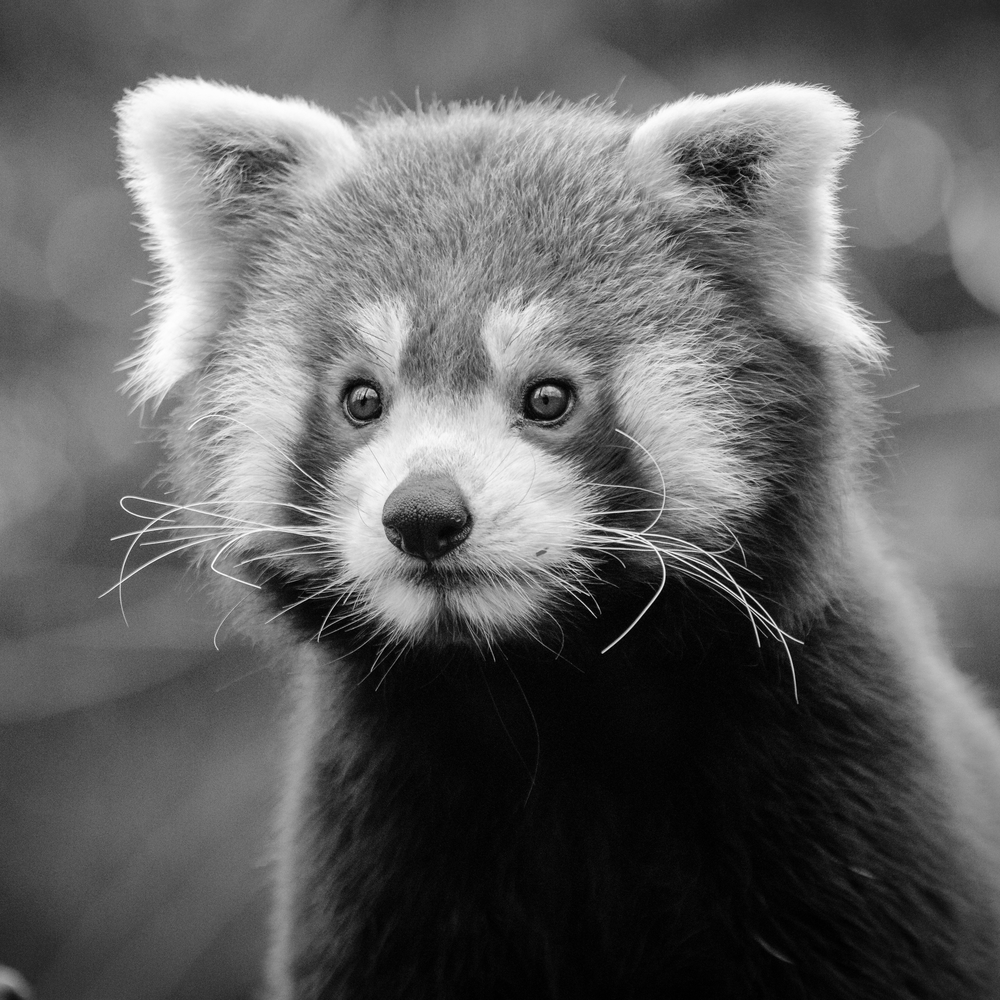 |
|---|---|
| *Public domain, via **[pxhere](https://pxhere.com/en/photo/1541365)* | *Mathias Appel, public domain, via **[Flickr](https://www.flickr.com/photos/mathiasappel/31625024560)* |

**Fig. 1**

Giant pandas and red pandas have the following characteristics:

- They live in similar environments
- They digest bamboo as a primary source of food
- They have a pseudo-thumb (a sixth digit) used to grip and shred food

Table 1 shows the differences between a comparable sequence of mitochondrial DNA from the giant panda and the red panda.

**Table 1**

|   | **DNA sequence** |
|---|---|
| Giant panda | ATT GGA GCA GAC TTA |
| Red panda | ATT GGC ACT GAC CTA |

A group of students concluded that the giant panda and the red panda are closely related species.

Use the information provided to discuss the students' conclusion.

**Q1** [4 marks]

The DNA analysed in Table 1 was extracted from mitochondria and codes for mitochondrial proteins.

(i) Identify **two** examples of mitochondrial proteins. Precise names of proteins are not required.

[2]

(ii) Suggest why scientists researching evolutionary relationships may choose to analyse mitochondrial DNA rather than DNA that codes for other characteristics, e.g. fur colour.

[2]

**Q1** [5 marks]

Table 2 contains the taxonomic classification of giant pandas, red pandas, and two other species considered to be relatives of the red panda.

**Table 2**

| **Giant panda** | **Red panda** | **Common raccoon** | ***Parailurus anglicus**** |
|---|---|---|---|
| Eukaryota | Eukaryota | Eukaryota | Eukaryota |
| Animalia | Animalia | Animalia | Animalia |
| Chordata | Chordata | Chordata | Chordata |
| Mammalia | Mammalia | Mammalia | Mammalia |
| Carnivora | Carnivora | Carnivora | Carnivora |
| Ursidae | Ailuridae | Procyonidae | Ailuridae |
| *Ailuropoda* | *Ailurus* | *Procyon* | *Parailurus* |
| *melanoleuca* | *fulgens* | *iotor* | *anglicus* |

*Now extinct

(i) Identify the order to which all four species belong.

[1]

(ii) Identify the closest relative of the red panda shown within Table 2. Justify your answer.

[2]

(iii) Suggest how scientists may have gone about classifying the now extinct *Parailurus anglicus*.

[2]

**Q1** [4 marks]

Current evidence shows that the closest living relative of the red panda shown in Table 2 is the common raccoon, though the common ancestor of the two species is thought to have lived between 30-40 million years ago, so the two groups of animals are now highly diverged from each other.

Explain how a common ancestor of red pandas and common raccoons may have diverged to give rise to new species.

### Q2 — hard — 13 marks

**Q2** [6 marks]

The Fig. 1 below shows an image of *Halobacterium salinarum*, a member of the domain Archaea.

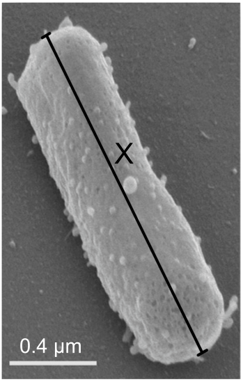

*CC BY-SA 4.0, via **[Wikimedia Commons](https://commons.wikimedia.org/wiki/File:Rod_and_sphere_forms_of_Halobacterium_salinarum_NRC-1.webp)*

**Fig. 1**

(i) The scale bar in Fig. 1 measures 3 cm, and line X measures 12.2 cm.

Use this information to calculate the actual length of the archaeon, marked **X** in in Fig. 1.

[2]

(ii) Compare *Halobacterium salinarum* with a bacterial cell.

[4]

**Q2** [6 marks]

*Halobacterium salinarum *have a protein in their cell surface membranes known as bacteriorhodopsin. The role of bacteriorhodopsin is shown in Fig. 2 below.

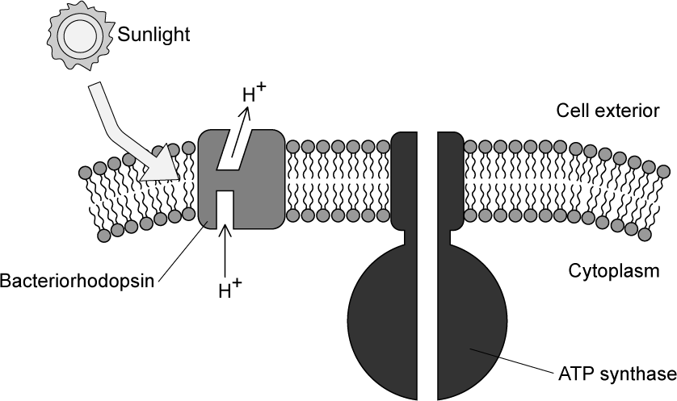

**Fig. 2**

(i) *H. salinarum* is a photoheterotroph, meaning that it can consume organic molecules, but it can also use light energy to produce ATP.

Suggest how bacteriorhodopsin allows *H. salinarum* to produce ATP.

[3]

(ii) *H. salinarum* is found in environments with extremely high salt concentration.

Suggest how bacteriorhodopsin might work together with other membrane proteins, such as K+ and Cl- pumps, to aid survival in such extreme environments.

[3]

**Q2** [1 mark]

One study found that H. salinarum can exist in extreme environments alongside structures known as viroids. Fig. 3 below shows an example of a viroid structure. Note that viroid RNA does not code for proteins.

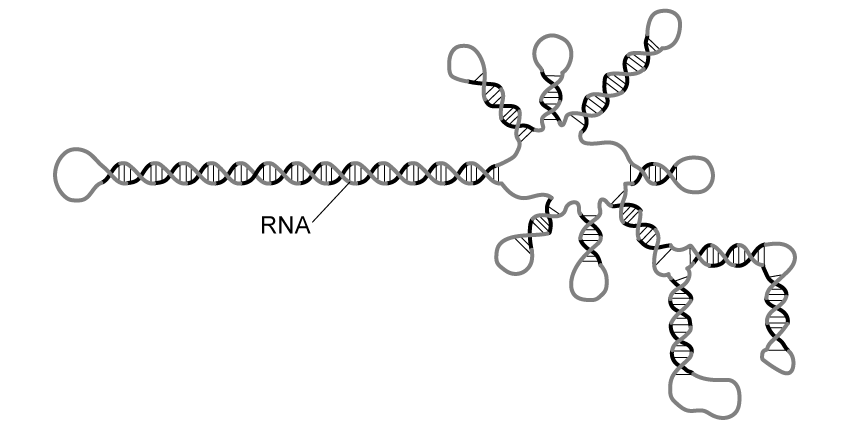

**Fig. 3**

(i) Viroids can infect plant cells.

Explain how the infectious action of a viroid might differ from that of a virus.

[2]

(ii) Suggest **two** possible mechanisms for the classification of viroids.

[2]

### Q3 — hard — 8 marks

**Q3** [1 mark]

Part of the genome of many viruses is a gene for the enzyme reverse transcriptase. As its name suggests, this enzyme can synthesise DNA from an RNA template, which is the reverse reaction to transcription within most other organisms' cells.

Suggest **one** advantage to the virus of producing the enzyme reverse transcriptase.

**Q3** [4 marks]

Explain why viruses are not classified within the traditional three-domain system of Archaea, Prokaryotes and Eukaryotes.

**Q3** [3 marks]

The number of fully assembled virus particles (virions) released from an individual host cell after an infection can vary from tens of virions to tens of thousands. For example, the HIV virus can burst out around 5 000 virions from a single infected host T-cell.

(i) Calculate the maximum theoretical number of T-cells that can be destroyed by a single host cell infection followed by one further cycle of infection.

(1)

(ii) Suggest the implications to a human of your answer to part (i) in the light of the fact that a healthy adult human possesses around 50 million T-cells.

(2)

### Q4 — hard — 13 marks

**Q4** [3 marks]

A team of biologists discovered a new organism inside a previously unexplored cave. They conducted several investigations in order to classify it.

They observed the following:

- The organism is multicellular and possesses a well-defined nucleus within its cells
- It has a cell wall composed of chitin
- It reproduces asexually by budding
- It exhibits heterotrophic nutrition

Identify the kingdom to which this organism most likely belong. Justify your answer.

**Q4** [3 marks]

**Extract:**

A team of biologists discovered a new organism inside a previously unexplored cave. They conducted several investigations in order to classify it.

They observed the following:

- The organism is multicellular and possesses a well-defined nucleus within its cells
- It has a cell wall composed of chitin
- It reproduces asexually by budding
- It exhibits heterotrophic nutrition

Identify the kingdom to which this organism most likely belong.

Describe **three** other characteristics that would further support your classification of this organism within the identified kingdom.

**Q4** [4 marks]

Discuss the limitations of using only a few characteristics to classify organisms. Include examples to illustrate your points.

**Q4** [3 marks]

**Extract:**

A team of biologists discovered a new organism inside a previously unexplored cave. They conducted several investigations in order to classify it.

They observed the following:

- The organism is multicellular and possesses a well-defined nucleus within its cells
- It has a cell wall composed of chitin
- It reproduces asexually by budding
- It exhibits heterotrophic nutrition

The organism found does not have either a gas exchange system or a vascular system.

Suggest how the organism can survive without these structures.

### Q5 — hard — 9 marks

**Q5** [2 marks]

Specimen **A** and specimen **B** are similar species of invertebrates that live in the same habitat.

Scientists wanted to determine whether specimen **A** and specimen **B** are different species of invertebrate, or different forms of the same species.

In order to do this, they caught large numbers of each specimen type and measured the body mass and length of each individual before calculating the means and standard deviations (SD). Their results are shown in Table 1 below.

**Table 1**

| **Body measurement** | **Specimen A** | **Specimen B** |
|---|---|---|
| Mean body mass / g (± SD) | 0.68 (± 0.02) | 0.67 (± 0.01) |
| Mean body length / mm (± SD) | 21.4 (± 0.9) | 19.2 (± 0.7) |

Explain how the standard deviation can help with the interpretation of this data.

**Q5** [4 marks]

**Extract:**

Specimen A and specimen B are similar species of invertebrates that live in the same habitat.

Scientists wanted to determine whether specimen A and specimen B are different species of invertebrate, or different forms of the same species.

In order to do this, they caught large numbers of each specimen type and measured the body mass and length of each individual before calculating the means and standard deviations (SD). Their results are shown in Table 1 below.

Table 1

| Body measurement | Specimen A | Specimen B |
| Mean body mass / g (± SD) | 0.68 (± 0.02) | 0.67 (± 0.01) |
| Mean body length / mm (± SD) | 21.4 (± 0.9) | 19.2 (± 0.7) |

The scientists hypothesised that the two specimens were different forms of the same invertebrate species.

Discuss this hypothesis using the information provided in part (a).

**Q5** [1 mark]

Fig. 1 below shows the classification of some animals with antlers and horns.

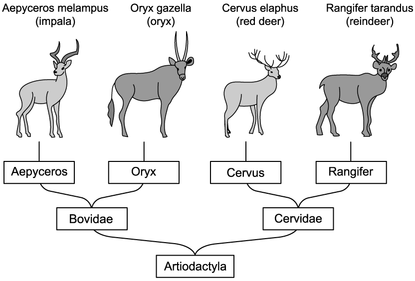

**Fig. 1**

State the number of different orders that are present in Fig.1 above.

**Q5** [2 marks]

The scientific names of three great apes are shown in Table 2 below.

**Table 2**

| **Common Name** | **Scientific Name** |
|---|---|
| *Orangutan* | *Pongo pygmaeus* |
| Chimpanzee | *Pan troglodytes* |
| Bonobo | *Pan paniscus* |

Fig. 2 represents the hierarchical classification of these apes in the form of a diagram.** **

**Fig. 2**

The orangutan also belongs to the Hominidae family.

Use information provided in Table 2 to add the orangutan to Fig. 2. The orangutan should be represented by the letter **X**.

### Q6 — medium — 8 marks

**Q6** [8 marks]

Outline the characteristic features of organisms in the domain *Bacteria*.

*Source: Oct/Nov 2018 9700/41 Q9A*

### Q7 — medium — 11 marks

**Q7** [5 marks]

Table 1 below contains the taxonomic classification of orca, minke whales, and bottlenose dolphins.

**Table 1**

| **Orca** | **Common minke whale** | **Common bottlenose dolphin** |
|---|---|---|
| Animalia | Animalia | Animalia |
| Chordata | Chordata | Chordata |
| Mammalia | Mammalia | Mammalia |
| Artiodactyla | Artiodactyla | Artiodactyla |
| Delphinidae | Balaenopteridae | Delphinidae |
| *Orcinus* | *Balaenoptera* | *Tursiops* |
| *orca* | *acutorostrata* | *truncatus* |

(i) Identify the phylum to which all three species belong.

[1]

(ii) Give the binomial Latin name for the common minke whale.

[1]

(iii) Orca are also known as killer whales.

Suggest why many would consider the name 'killer whale' to be inappropriate for this species.

[2]

(iv) Identify the taxonomic rank that is missing from Table 1.

[1]

**Q7** [2 marks]

Orca show wide variation in appearance and behaviour, and have been divided by marine scientists into groups known as 'ecotypes'. Fig. 1 below shows the distribution of some of the known orca ecotypes.

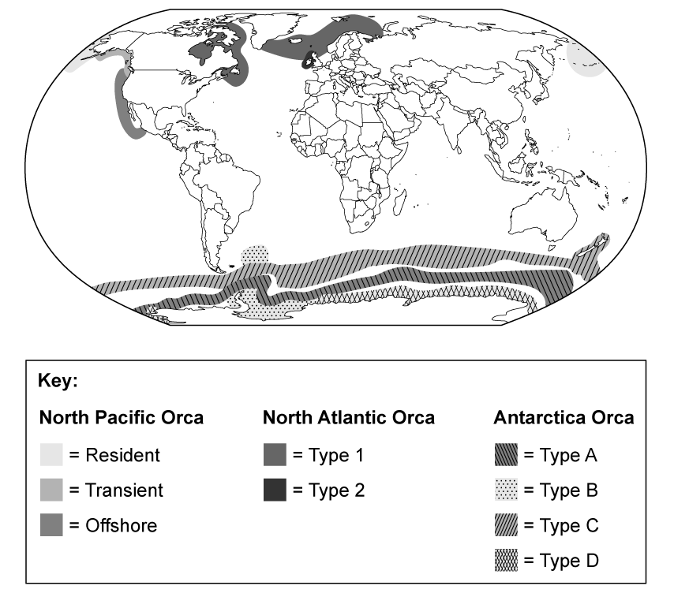

**Fig. 1**

There is some debate among scientists over whether orca ecotypes should be classified as separate species.

Use Fig. 1 to suggest why it might be difficult to determine whether orca ecotypes are the same species or several separate species.

**Q7** [3 marks]

**Extract:**

Orca show wide variation in appearance and behaviour, and have been divided by marine scientists into groups known as 'ecotypes'. Fig. 1 below shows the distribution of some of the known orca ecotypes.

There is some debate among scientists over whether orca ecotypes should be classified as separate species.

Use Fig. 1 to suggest why it might be difficult to determine whether orca ecotypes are the same species or several separate species.

To avoid the classification difficulties discussed in part (b), scientists often use DNA data.

Explain how the scientists could use DNA data to determine whether or not orca ecotypes are different species.

**Q7** [1 mark]

There have been rare instances of hybridisation events between closely related species that result in fertile offspring, for example Fig. 2 below shows the offspring of a cross between a female bottlenose dolphin and a male false killer whale. The individual in the photograph is known to have bred with another bottlenose dolphin and to have given birth to healthy offspring.

*Mark Interrante, CC BY-SA 2.0, via **[Flickr](https://www.flickr.com/photos/pinhole/44480268)*

**Fig. 2**

Scientists do not believe that the hybrid shown in Fig. 2 is an example of a new species.

Suggest why the individual in Fig. 2 is not considered to be a new species.

### Q8 — medium — 8 marks

**Q8** [3 marks]

Archaea and Eukarya are two domains of life that exhibit distinct characteristics and evolutionary relationships.

Contrast the cellular structures of Archaea and Eukarya.

**Q8** [2 marks]

Scientists compared four species from the kingdom Achaea. They compared the base sequence of their DNA to determine the evolutionary relationships between the species.

Their results are shown in Table 1.

**Table 1**

| **Species** | **The percentage similarity between non-coding multiple repeat base sequences** |   |   |   |
|---|---|---|---|---|
| **A** | **B** | **C** | **D** |   |
| **A** |   |   |   |   |
| **B** | 51.2 |   |   |   |
| **C** | 48.3 | 48.3 |   |   |
| **D** | 42.9 | 42.9 | 40.7 |   |

Use the information in Table 1 to explain which two species are the closest evolutionary relatives.

**Q8** [3 marks]

Archaea were previously classified as bacteria due to similarities in their features.

Describe **three** features of archaea that led to their classification as a separate domain.

### Q9 — medium — 9 marks

**Q9** [2 marks]

Identify all the eukaryotic kingdoms that contain...

(i) Autotrophic organisms

[1]

(ii) Heterotrophic organisms

[1]

**Q9** [4 marks]

Table 1 contains information about the eukaryotic kingdoms.

Use your knowledge of the characteristics of these kingdoms to complete Table 1 using either a ✓ or an X in each box. Some sections have been completed for you.

**Table 1**

| **Feature** | **Protoctista** | **Fungi** | **Plantae** | **Animalia** |
|---|---|---|---|---|
| **Cell wall** | Present in some species |   |   | X |
| **Cell vacuole** |   | ✓ |   |   |
| **Cilia/flagella** | Present in some species |   | X |   |
| **Motility** | Present in some species |   | X |   |
| **Nervous coordination** |   | X |   | ✓ |

**Q9** [3 marks]

Fruit flies are a group of organisms within the kingdom Animalia. A student collected three different types of fruit fly to study. The three species of fruit fly were *Ceratitis capitata*, *Dacus dorsalis* and *Dacus oleae*.

What do these names suggest about the evolutionary relationships between these fruit fly species? Explain your answer.

### Q10 — medium — 8 marks

**Q10** [1 mark]

Viruses are not included in the three-domain classification system.

Explain why.

**Q10** [5 marks]

Discuss whether viruses should or should not be classed as living organisms.

**Q10** [2 marks]

State the two main features that are used to classify viruses.

### Q11 — easy — 8 marks

**Q11** [2 marks]

Fig. 1 below shows an American black bear, *Ursus americanus* (left) and an Asiatic black bear, *Ursus thibetanus* (right).

| 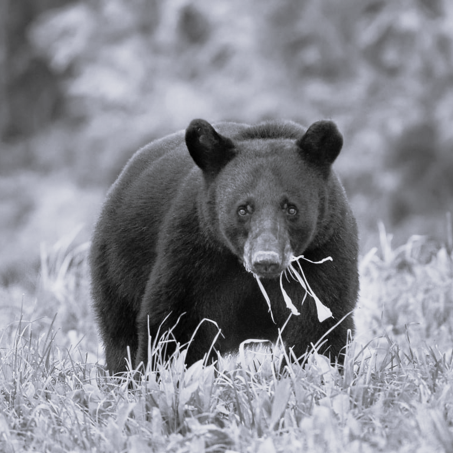 | 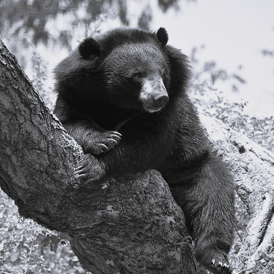 |
|---|---|
| *Public domain, via *[*pixnio*](https://pixnio.com/fauna-animals/bears/louisiana-black-bear-2) | *CC BY-SA 4.0 , via *[*Wikimedia Commons*](https://commons.wikimedia.org/wiki/File:The_Himalayan_black_bear_%28Ursus_thibetanus%29_is_a_rare_subspecies_of_the_Asiatic_black_bear._12.jpg) |

**Fig. 1**

State what can be concluded about the taxonomic classification of the American black bear and the Asiatic black bear from the information provided.

**Q11** [2 marks]

**Extract:**

Fig. 1 below shows an American black bear, *Ursus americanus* (left) and an Asiatic black bear, *Ursus thibetanus* (right).

Use Fig. 1 to explain why the American black bear and the Asiatic black bear might be classified as separate species under the morphological species concept.

**Q11** [2 marks]

**Extract:**

Fig. 1 below shows an American black bear, *Ursus americanus* (left) and an Asiatic black bear, *Ursus thibetanus* (right).

Explain how the classification of the two bear species could be tested using the biological species concept.

**Q11** [2 marks]

The two-part Latin naming system used to identify the bears in Fig. 1 is known as the binomial naming system, and was invented by the taxonomist Carl Linnaeus.

After the introduction of the binomial naming system species were given new binomial names. Some examples are given in Table 1

**Table 1**

| **Common name in English** | **Pre-Linnaean name(s) / additional common name(s)** | **Name under binomial naming system** |
|---|---|---|
| Plantain | *Plantago foliis ovato-lanceolatus pubescentibus, spica cylindrica, scapo tereti* | *Plantago media* |
| Briar rose | *Rosa sylvestris inodora seu canina*  *Rosa sylvestris alba cum rubore, folio glabr* | *Rosa canina* |
| 7-spot ladybird | Ladybird  Ladybug  La Poussinière  Mariquita | *Coccinella septempunctata* |

Use information in Table 1 to suggest the advantages of the binomial system of naming species.

### Q12 — easy — 9 marks

**Q12** [3 marks]

Fig. 1 below represents the structure of a particular type of virus.

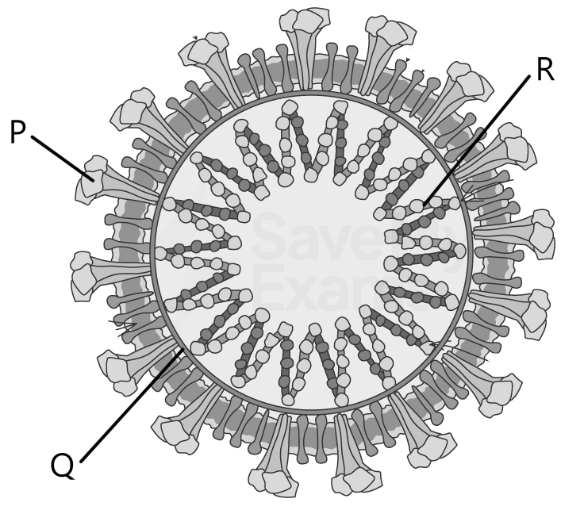

**Fig. 1**

Structures **P**, **Q**, and **R** are present in **all viruses**.

Identify the structures labelled **P**, **Q**, and **R**.

**Q12** [2 marks]

**Extract:**

Fig. 1 below represents the structure of a particular type of virus.

Structures P, Q, and R are present in all viruses.

P = viral protein / attachment protein / glycoprotein
Q = capsid
R = genetic material / DNA or RNA / nucleic acid

Viruses are not classified under the taxonomic system.

Use Fig. 1 and your own knowledge to suggest why this is the case.

**Q12** [2 marks]

Describe the method that is used to classify viruses.

**Q12** [2 marks]

**Extract:**

Viruses are not classified under the taxonomic system because:
- They are not made of cells / have no cellular structure / are acellular;
- They do not have any of the characteristics / a named characteristic (e.g. reproduction, nutrition) used to classify organisms;
- They are not considered to be living organisms;

Viral infections cannot be treated with antibiotics.

Explain why this is the case.

### Q13 — easy — 9 marks

**Q13** [2 marks]

The Archaea represent one of the domains of life on Earth.

Identify the other two domains.

**Q13** [4 marks]

Describe the features of *Archaea *that mean they are classified as a distinct domain in the three domains system of classification.

**Q13** [3 marks]

Fig. 2 below shows a bacterial cell and an animal cell as seen in a student's Biology textbook.

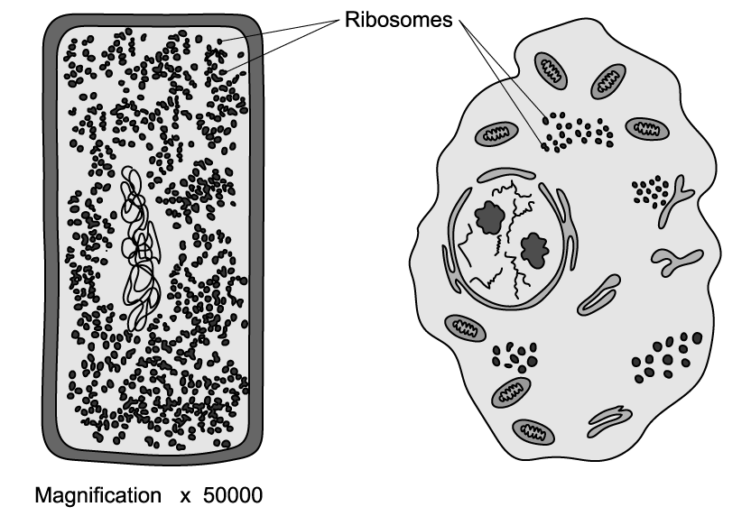

**Fig. 2**

Animal cells store their genetic material in a nucleus, whereas bacterial cells do not.

Give **three** other contrasts between bacterial cells and animal cells.

### Q14 — easy — 9 marks

**Q14** [3 marks]

Fig. 1 below shows part of a eukaryotic organism.

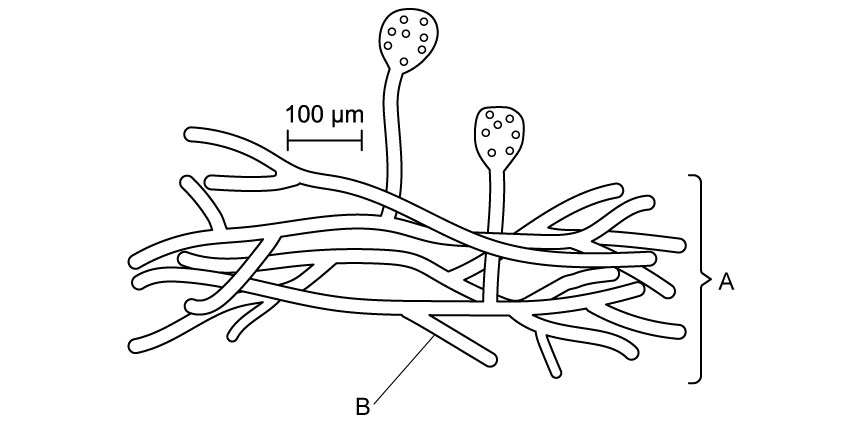

**Fig. 1**

(i) Identify the kingdom to which the organism in Fig. 1 belongs.

[1]

(ii) Identify the structures labelled **A** and **B** in Fig. 1.

[2]

**Q14** [2 marks]

**Extract:**

Fig. 1 below shows part of a eukaryotic organism.

(i) Identify the kingdom to which the organism in Fig. 1 belongs.

The kingdom to which the organism belongs is: Fungi

(ii) Identify the structures labelled A and B in Fig. 1.

A = mycelium
B = hyphae/hypha

Give **two** characteristic features of the eukaryotic kingdom identified in (a) (i) that are not visible in Fig. 1.

**Q14** [2 marks]

**Extract:**

(i) Identify the kingdom to which the organism in Fig. 1 belongs.

The kingdom to which the organism belongs is:
- Fungi;

Identify **two other** examples of eukaryotic kingdoms.

**Q14** [2 marks]

Identify the levels of taxonomic classification immediately above and below that of kingdom.

### Q15 — easy — 6 marks

**Q15** [2 marks]

Domestic dogs, *Canis familiaris*, and wolves belong to the family Canidae.

Complete **Table 1** below to show the classification of the domestic dog.

**Table 1**

| **Kingdom** | Animalia |
|---|---|
|   | Chordata |
| **Class** |   |
|   | Carnivora |
| **Family** | Canidae |
|   | *Canis* |
|   |   |

**Q15** [2 marks]

It is still debated as to whether dogs and wolves are entirely different species or subspecies. It has been suggested that some wolves have bred with domestic dogs to produce fertile offspring, which would make them the same species according to the biological species concept.

Name and briefly describe another species concept that biologists may use to help determine if two animals are different species.

**Q15** [2 marks]

**Extract:**

Domestic dogs, *Canis familiaris*, and wolves belong to the family Canidae.

Complete **Table 1** below to show the classification of the domestic dog.

**Table 1**

| **Kingdom** | Animalia |
|   | Chordata |
| **Class** |   |
|   | Carnivora |
| **Family** | Canidae |
|   | *Canis* |
|   |   |

The classification seen in Table 1 is described as a hierarchical system.

Explain what is meant by this.
