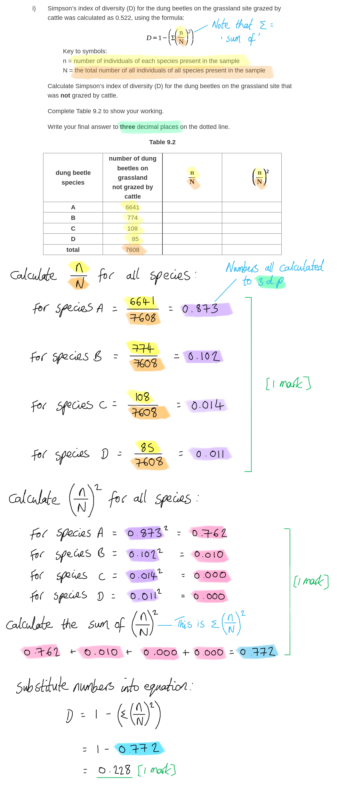
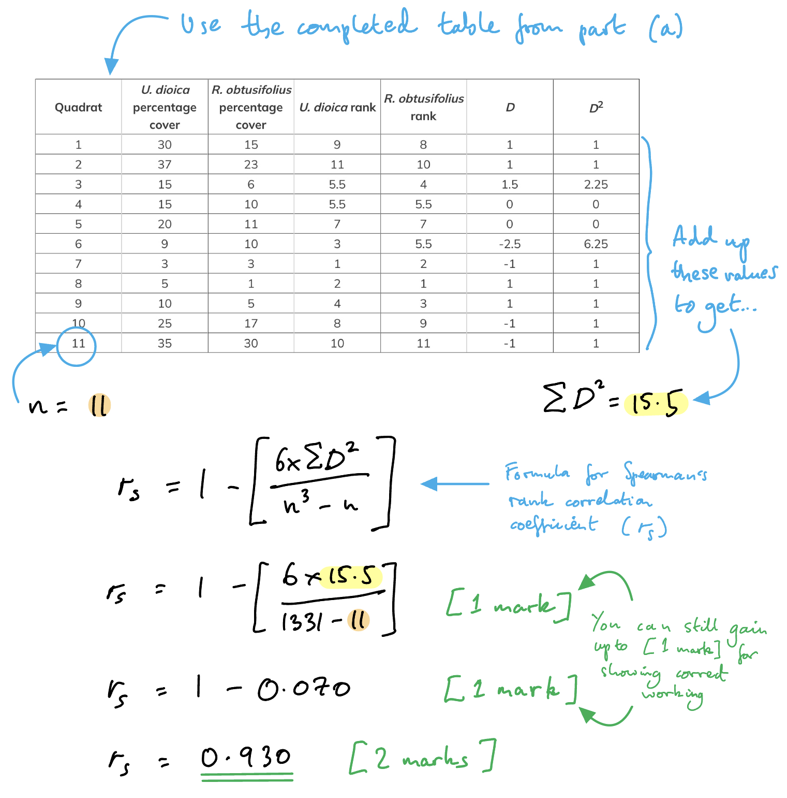
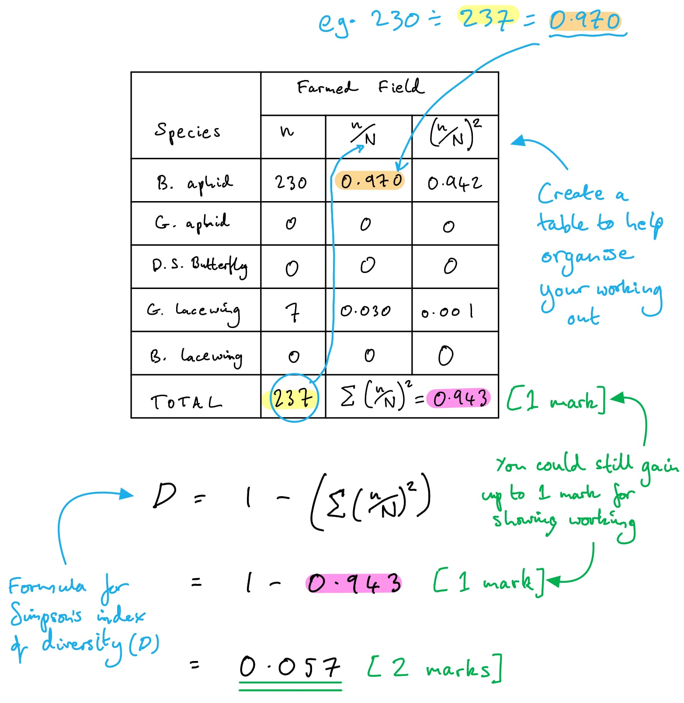
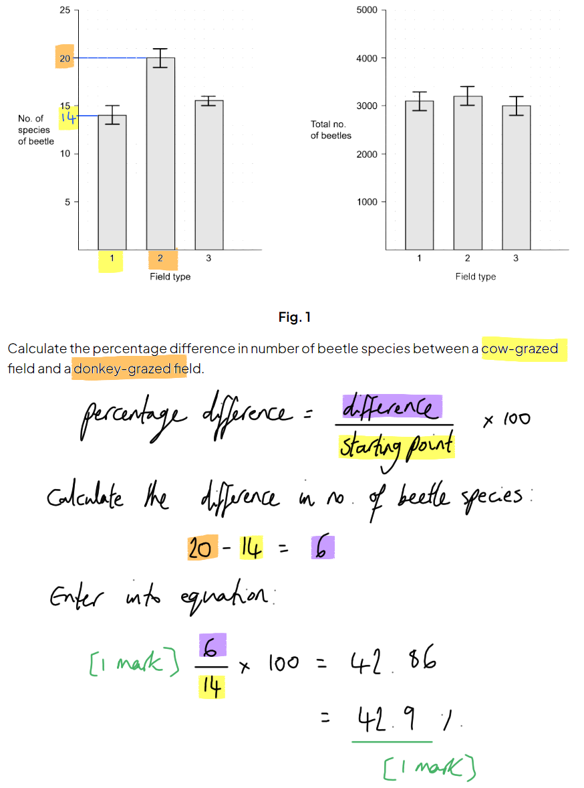
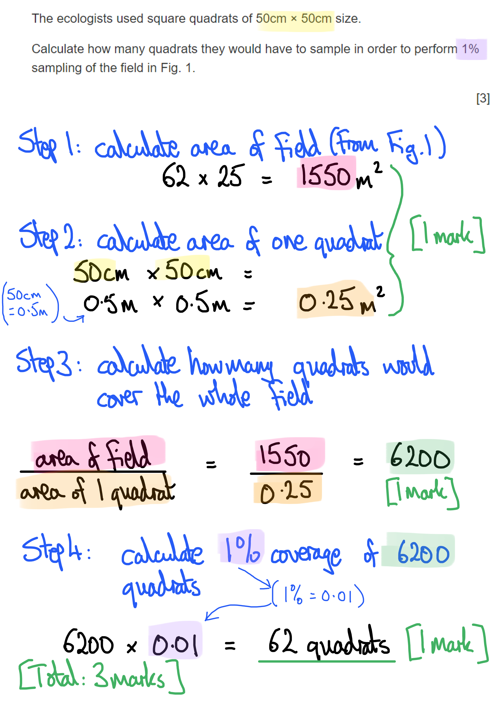
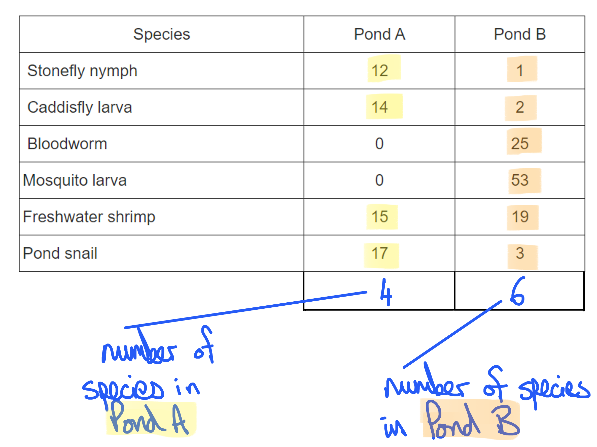
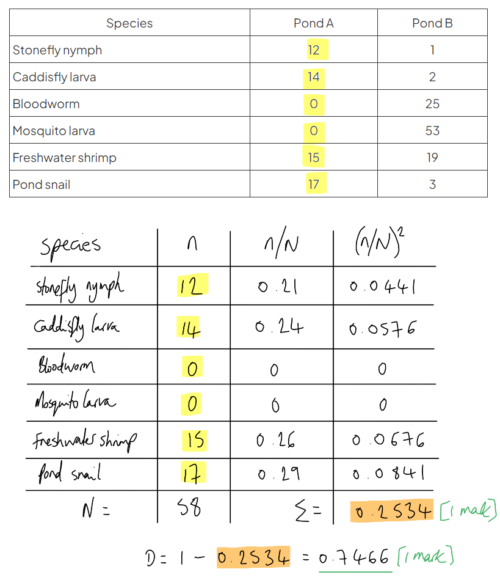

# Mark Schemes — Biodiversity
**18. Classification, Biodiversity & Conservation** · Cambridge (CIE) A-LEVEL biology (9700)

## Structured Questions (12 questions)

### Q1
(i) Simpson’s index of diversity (D) for the dung beetles on the grassland site that was not grazed by cattle is...

- $\frac{n}{N}$ figures correctly calculated in table 2; **[1 mark]**
- `begin mathsize 14px style open parentheses n over N close parentheses squared end style`figures calculated **AND** total calculated in tabled 2; **[1 mark]**
- (*D* =) 0.228; **[1 mark]**

*Calculated figures should be as follows:*

| **dung beetle** **species** | **number of dung** **beetles on grassland** **not grazed by cattle** | $\frac{n}{N}$ | $(\frac{n}{N})^{2}$ |
|---|---|---|---|
| **A** | 6641 | 0.873 | 0.762 |
| **B** | 774 | 0.102 | 0.010 |
| **C** | 108 | 0.014 | 0.000 |
| **D** | 85 | 0.011 | 0.000 |
| **total** | 7608 |   | 0.772 |

(ii) The results in Table 1 and both figures for Simpson’s index of diversity show that the effect of grazing by cattle on the diversity of dung beetles is as follows...

- There is greater species evenness on grazed grassland / beetles on not-grazed grassland are mostly of one species/species A; **[1 mark]**
- Grazing increases (dung beetle species) diversity; **[1 mark]**

***Accept**** reverse arguments for both marking points, e.g. "there is lower species evenness on not-grazed grassland" (mp1) and "Having no grazing decreases beetle diversity" (mp2). *

**[Total: 5 marks]**

> *i) Diversity index can be calculated as follows...*

> *ii) Biodiversity is measured using two factors; the number of different species present (species richness) and the number of individuals of each species present (species evenness). Table 9.1 shows that both grassland sites have the same species richness, but that the **species evenness** of the not-grazed site is lower; most of the beetles on this site are species A and the numbers of other species are low. *

> *Both species richness and species evenness are taken into account when the index of diversity is calculated, so this results in the not-grazed site having a lower index of diversity than the grazed site. This suggests that grazing is good for beetle diversity in a grassland habitat.*
The population size of a species of beetle that does **not** feed on dung in each of the two areas of grassland could be estimated by...

- Mark-release-recapture; **[1 mark]**

**AND**

**Final answer:** **Any ****three**** of the following:**

- Trap (beetles) using, eg. a pitfall trap; **[1 mark]**
- Mark (the beetles) using, e.g. a felt-tip pen/nail varnish **OR** mark (the beetles) in a harm-free way; **[1 mark]**
- Release the marked beetles; **[1 mark]**
- Carry out a second round of trapping after allowing time for beetles to mix / not giving enough time for beetles to leave/migrate; **[1 mark]**
- (Calculate estimated population size using) N = (n1 x n2) ÷ m2; **[1 mark]**

*Marking points 1 and 2 must contain an example or a described method where 'e.g.' is stated.*

**[Total: 4 marks]**

> *When estimating the abundance of a mobile species quadrats are of no use; instead the mark-release-recapture method combined with use of the Lincoln index can be used.*

### Q2
Table 2 should be completed as follows:

| **Quadrat** | ***U. dioica***** percentage cover** | ***R. obtusifolius***** percentage cover** | ***U. dioica***** rank** | ***R. obtusifolius***** rank** | ***D*** | ***D*****2** |
|---|---|---|---|---|---|---|
| 1 | 30 | 15 | 9 | 8 | 1 | 1 |
| 2 | 37 | 23 | 11 | 10 | 1 | 1 |
| 3 | 15 | 6 | 5.5 | 4 | 1.5 | 2.25 |
| 4 | 15 | 10 | 5.5 | 5.5 | 0 | 0 |
| 5 | 20 | 11 | 7 | 7 | 0 | 0 |
| 6 | 9 | 10 | 3 | 5.5 | -2.5 | 6.25 |
| 7 | 3 | 3 | 1 | 2 | -1 | 1 |
| 8 | 5 | 1 | 2 | 1 | 1 | 1 |
| 9 | 10 | 5 | 4 | 3 | 1 | 1 |
| 10 | 25 | 17 | 8 | 9 | -1 | 1 |
| 11 | 35 | 30 | 10 | 11 | -1 | 1 |

- **BOTH **ranking columns correct; **[1 mark]**
- *D* **AND** *D*2 columns correct; **[1 mark]**

**[Total: 2 marks]**

> *Remember - to rank the data, the **lowest value** (here the lowest percentage cover) should be ranked as **1**, the next is ranked as 2, and so on. If there are two data values that are equal, they are given an **equal rank**. For this data set, there are two quadrats for each species where this applies.*
The Spearman's rank correlation coefficient (*r**s*) for the data from part (a) is...

- 1 - 0.070; **[1 mark]**
- (*r**s* =) 0.930;** [1 mark]**

*Full marks awarded for the correct answer only.*

**[Total: 2 marks]**

> *Even if your final answer is incorrect, you can still gain one mark if you have shown your working and it is similar to that seen below.*

(i) The null hypothesis would be...

- There is <u>no correlation</u> between the percentage cover of the two species; **[1 mark]**

(ii) The ecologist...

- Was able to reject the null hypothesis; **[1 mark]**
- (As) the *r**s** *value / Spearman's rank correlation coefficient is <u>greater than the critical value</u> (for 11 pairs of data); **[1 mark]**

**[Total: 3 marks]**

> *The critical value for 11 pairs of data (at **p** = 0.05) is 0.62, as shown in Table 3. As the **r**s** value / Spearman's rank correlation coefficient is 0.930, the **null hypothesis** can be **rejected** and the** alternative hypothesis **can be **accepted**.*
The ecologist can conclude that...

- There is a <u>significant</u> (positive) correlation between the abundance/percentage cover of the two species (on the field);** [1 mark]**
- There is a probability of <u>less than</u> 0.05 / <u>less than</u> 5 in a hundred / <u>less than</u> 5%;** [1 mark]**
- That this correlation is due to <u>chance</u>; **[1 mark]**

**[Total: 3 marks]**

> *For the second two marking points, the **converse statement **would also be accepted. For example, “there is a probability of **more than 95%** that the correlation is **not** due to chance”.*

### Q3
An estimate of the population density of thistle plants in the ‘number of thistle plants per hectare’ could be gained by following the steps outlined below...

**Final answer:** **Any ****five**** of the following:**

- Mark out an area **OR** create a grid (of grassland)* e.g. 10 m x 10m or 20 m x 20 m or 50 m x 50 m*; **[1 mark]**
- Use a <u>random</u> number generator to randomly select/locate sampling sites / generate (a set of random) coordinates; **[1 mark]**
- Place <u>quadrats</u> at random generated sampling sites/coordinates (within a larger grid); **[1 mark]**
- Count the number of individual thistle plants in each quadrat; **[1 mark]**
- Calculate the mean/average number of thistles per quadrat; **[1 mark]**
- Set up a new area/grid to sample (in a different area of the grassland) *e.g. if a small initial grid is set up and more quadrats are needed*;** [1 mark]**
- Multiply the mean number of thistles found per quadrat by the total area of all the quadrats to get an estimate; **[1 mark]**

**[Total: 5 marks]**
The term “*differed significantly (p < 0.05)*” means...

- There was a <u>probability</u> of <u>less than</u> 0.05 / <u>less than</u> 5 in a hundred / <u>less than</u> 5%; **[1 mark]**
- That the difference (in mean number of insect species between farms) was due to <u>chance</u>; **[1 mark]**

**[Total: 2 marks]**

> *The **converse statement** would also be accepted. For example, “there was a probability of **more than 95%** that the difference (in mean number of insect species between farms) was **not** due to chance”.*
5 would not be an appropriate number of fields to sample because...

- The number of species is still increasing / has not reached peak/maximum (so the number of species would not be reliable); **[1 mark]**

25 would not be an appropriate number of fields to sample because...

- The curve has flattened so there would be no benefit / no point / takes unnecessary time / takes unnecessary effort / can get same results with sampling fewer fields: **[1 mark]** **OR** No more species found so there would be no benefit / no point / takes unnecessary time / takes unnecessary effort / can get the same results with sampling fewer fields; **[1 mark]**

**[Total: 2 marks]**

### Q4
The PhD student could use the mark-release-recapture method to estimate the number of Frégate beetles on the island by...

**Final answer:** **Any ****three**** of the following:**

- <u>Capture/collect</u> a sample (of beetles), <u>mark</u> them and <u>release</u>; **[1 mark]**
- Method of marking does not harm the beetles **OR** make the beetles more visible to predators; **[1 mark]**
- (Release and) leave sufficient time for the (marked) beetles to (randomly) distribute (on island) before collecting a second sample; **[1 mark]**
- Use the Lincoln Index to calculate the estimated number of beetles (in the population)  **OR** $Population=\frac{numberofbeetlescaughtinfirstsample\timesnumberofbeetlescaughtinsecondsample}{numberofbeetlesmarkedinsecondsample}$; **[1 mark]**

**[Total: 3 marks]**

> *Mark-release-recapture** is a standard biological/ecological method used to measure the **abundance** of more **motile** species (i.e. species that move too fast for quadrat or transect sampling). It is also a common question in exams - so make sure you learn the steps above and **how to use the formula**!*
The number of beetles on the island is estimated to be...

- Population = (176 × 198) ÷ 22; **[1 mark]**
- Population = 1 584 (beetles); **[1 mark]**

*Full marks awarded for the correct answer only.*

**[Total: 2 marks]**

> *When the question asks you to **show your working**, it is important that you do this as you can gain **valuable marks**, even if your final answer is incorrect.*

The conditions required for the results from a mark-release-recapture to be valid include...

**Final answer:** **Any ****three**** of the following:**

- Marking (of organisms/beetles) is not removed/worn/rubbed off; **[1 mark]**
- Marking (of organisms/beetles) does not affect survival/predation **OR** marking does not make (organisms/beetles) more visible to predators;** [1 mark]**
- Sufficient time given for (marked) individuals to mix (within the population) **OR **sufficient time given for mixing to occur between samples; **[1 mark]**
- Sampling method is the same **OR** organisms/beetles caught in the same way each time; **[1 mark]**
- Limited/no immigration/emigration/migration (into or out of population) between first and second capture; **[1 mark]**
- Limited/no births **OR** limited/no deaths **OR** limited/no breeding between first and second capture; **[1 mark]**

**[Total: 3 marks]**

> *Be careful - you must be **specific** in order to gain either of the last two marking points. You cannot simply say that there should be no increase or decrease in the population - this would not be enough to gain a mark. You need to provide a **reason** as to **why** the population might be increasing or decreasing. Use the words above (**immigration**, **emigration,** **births**, **deaths** etc.) to gain full marks on questions about the conditions of mark-release-recapture.*
*Populations* and *communities* differ in the following way...

- A population is a group of organisms of the <u>same species</u> (living together in the same area at the same time) **WHEREAS** a community is (a group of) multiple <u>different</u> populations (living and interacting in the same area at the same time) **OR** populations of <u>different species</u> (living and interacting in the same area at the same time); **[1 mark]**

**[Total: 1 mark]**

### Q5
The biological term *niche* describes...

- The (specific) <u>role/function</u> of an organism/species in an ecosystem/habitat: **[1 mark]** **OR  ***An adequately detailed description of a niche e.g. where the organism/species is in the ecosystem ****AND**** how it obtains energy ****AND**** its interactions with the physical environment and with other species (in the ecosystem/habitat)*; **[1 mark]**

The biological term *ecosystem* describes...

- A (relatively) self-contained interacting community of organisms **AND** the environment/abiotic conditions in which they live and interact with; **[1 mark]**

**[Total: 2 marks]**

> *A niche is relatively easy to describe for an exam once you learn that it is the specific role or function of an organism in the habitat or ecosystem in which it lives. In reality, an organism's niche can be very complex and therefore difficult to fully define, as the niche is a combination of many different factors to do with that organism, including many aspects of its life history such as where it feeds, what it feeds on, how much it eats, where it nests, what feeds/preys on it...the list is almost endless!*

> *An ecosystem can be a bit tricky to define for an exam, so you can either learn a set definition from a textbook (such as the one above) or explain it in your own words, as long as you remember that your description must include: the community of organisms in a given area, the abiotic conditions (e.g. weather) in that area, how those different species interact with each other and lastly, how they interact with the abiotic factors mentioned above.*
Simpson's index of diversity (*D*) is...

- 1 - 0.943; **[1 mark]**
- 0.057; **[1 mark]**

*Full marks awarded for the correct answer only.*

**[Total: 2 marks]**

> *It is good practice to always show your working because even if your final answer is incorrect, you can still gain one mark if your working is similar to that seen below in this case.*

The diversity index will be higher (no mark) because…

- <u>More insect species</u> are present **OR** insect species <u>richness</u> is higher; **[1 mark]**
- (Due to the fact that) there are more plant species **OR** a greater diversity of plants; **[1 mark]**
- (Which) provides more/greater variety of insect habitats **OR** provides more/greater variety of food sources (for insects) **OR** provides more niches for insects to occupy; **[1 mark]**

**[Total: 3 marks]**

> *Make sure your answer refers to the number of species and not the total number of organisms at the site. It would be wrong to assume that fewer organisms in total, means lower biodiversity.*
The statement should be evaluated by giving...

**Final answer:** **Points or arguments in support of the statement:**

- The data/evidence (from Table 2.1) supports the statement **AS** insect species diversity is/appears to be lower in the farmed field; **[1 mark]**

**Final answer:** **Points or arguments against the statement:**

- There are limitations to the data **AS** only one type of habitat has been compared with the farmed field / a greater variety of habitats should be sampled **OR** only insect species have been surveyed / the species diversity for other taxa/groups of organisms (e.g. birds) may be higher in the farmed field; **[1 mark]**

**[Total: 2 marks]**

> *The command word evaluate means you need to acknowledge both sides of the argument.*

### Q6
A simple comparison between species diversity and species richness should include the following points...

- Both species richness and species diversity measure the number of different species (in a community); **[1 mark]**
- Species diversity takes into account the evenness of the abundance of species / relative abundance distribution, whereas species richness does not; **[1 mark]**

**[Total: 2 marks]**

> *Species diversity** is more commonly used as it takes into account not only the number of different species but also the **number of individuals of each species**. Species richness doesn’t always reveal the full picture. For example, a forest could have only two or three species of trees and so would have a low species richness value. However, there could be hundreds of individuals for each tree species!*
Fertiliser contaminating the stream could result in a high density of specific organisms but a low index of diversity as...

**Final answer:** **Two**** marks awarded per suggestion/explanation pair:**

*Suggestion 1: *The presence of fertiliser causes eutrophication / oxygen depletion / toxicity / death; **[1 mark]**

*Explanation 1***: **Which prevents several/many <u>species</u> from colonising/reproducing/surviving **OR** only a few species survive as a result; **[1 mark]**

**OR**

*Suggestion 2: *Fertiliser acts as a source of minerals/nutrients for some (aquatic) <u>plant species </u>/ <u>species of algae</u>; **[1 mark]**

*Explanation 2:*** **Only those species increase in number; **[1 mark]**

**[Total: 2 marks]**

> *Fertiliser can have major negative impacts on streams and rivers as they cause algal blooms and oxygen depletion. This makes the living conditions very harsh and only a few species can survive in them.*
As the conservationist moves further away from the farm, the index of diversity will...

- Increase; **[1 mark]**
- As the fertiliser will be (more) diluted further from the farm; **[1 mark]**

**[Total: 2 marks]**

> *As the fertiliser becomes more diluted, the conditions will become less harsh / more favourable for a wider range of species to survive.*
Taking a large number of samples is important because...

- (It) produces a more reliable mean/average **OR **makes sure that the samples are representative (of the species richness) **OR** reduces the effect of extreme values / anomalies; **[1 mark]**

Random sampling (taking samples at random sites) is important because...

- (It) removes bias; **[1 mark]**

**[Total: 2 marks]**

> *Make sure you have addressed both marking points here. The question asks you to explain the importance of large sample sizes **and** random sampling.*

### Q7
The term ecosystem can be defined as follows:

- All of the living organisms in a habitat / the community of living organisms; **[1 mark]**
- The interactions between the living/biotic and non-living/abiotic components / the interactions that the living organisms have with each other and with their environment; **[1 mark]**

**[Total: 2 marks]**

> *Make sure that you know the definition for the term **ecosystem**; an ecosystem contains all of the living organisms in an area, also known as a community, and also takes into account their interactions with each other, and the non-living environment.*

> *We might not think of agricultural land as an ecosystem, but a large percentage of land is taken up by farming, so agricultural ecosystems are an essential part of the world's biodiversity!*
The percentage difference in number of beetle species between a cow-grazed field and a donkey-grazed field is:

- (6 ÷ 14) x 100; **[1 mark]**
- 42.9 (%); **[1 mark]**

**[Total: 2 marks]**

The farmer's conclusion that the type of grazing had little effect on beetles, and therefore on the stability of the agricultural ecosystem can be discussed as follows:

*Points in support of the conclusion*

**Final answer:** **A maximum of ****two**** of the following:**

- There is no significant difference between the total number of beetles in the different fields / type of grazing does not significantly affect total number of beetles; **[1 mark]**
- There is no significant difference between the number of beetle species in a cow grazed field and a sheep grazed field; **[1 mark]**
- Biodiversity is about species evenness as well as species richness **SO** an increase in the number of species doesn't guarantee that biodiversity / ecosystem stability will be higher; **[1 mark]**

*Points that oppose the conclusion*

**Final answer:** **A maximum of ****two**** of the following:**

- There are significantly more beetles species in a donkey grazed field than in a cow/sheep grazed field; **[1 mark]**
- An increase in the number of beetle species will contribute to an increase in overall (bio)diversity / species diversity; **[1 mark]**
- Increased biodiversity will increase the stability of the (agricultural) ecosystem / will make the ecosystem more resistant to change; **[1 mark]**

*Accept field numbers (1/2/3) instead of a description of grazing type throughout.*

**[Total: 3 marks]**

> *The command word 'discuss' means that you need to write about the presented issue in a structured way. Here a sensible structure is to give arguments for and against the presented conclusion, so be sure to give a balance of arguments.*

> *Remember that when a graph shows you statistical analysis, such as the standard deviation bars presented here, it is always a good idea to refer to this when evaluating the data. Overlapping standard deviations tells us that there is no statistically significant difference between two data sets, while S.D. bars that do not overlap indicate a significant difference.*
Considerations that the farmer should have taken into account when planning the investigation to ensure valid results include:

**Final answer:** **Any ****three**** of the following:**

- Carry out repeated measurements / have multiple fields for each grazing type; **[1 mark]**
- Random sampling **OR** traps to collect the beetles placed at randomly chosen sample sites; **[1 mark]**
- Collect samples from fields of the same size/area / with the same soil type / the same vegetation type **OR** ensure that each field type is grazed by the same number of animals / at the same density **OR** collect data from each field at the same time of day / year;  **[1 mark]**
- Description of method that ensures that mark-release-recapture is carried out in a valid way, e.g. beetles are given enough time to mix back into the population before repeat samples / beetles are marked in a way that doesn't cause harm; **[1 mark]**
- Repeat the investigation over several years; **[1 mark]**

**[Total: 3 marks]**

### Q8
The area with the highest biodiversity is...

- **C**; **[1 mark]**

This is because...

- It has the greatest number of (plant and insect) species / highest species richness; **[1 mark]**
- It has the greatest number of habitats; **[1 mark]**

**[Total: 3 marks]**
The area that is likely to be affected the most if the environment changes is...

- Area A **BECAUSE** if one species increases/decreases (in abundance) this may affect the whole community / food web / ecosystem; **[1 mark]**

*Both the area and the reason are required for the mark here.*

**[Total: 1 mark]**

> *The small number of species present in area A means that any change that affects one species is more likely to impact the other species present.*

> *In a more complex ecosystem there will be more different species interactions, so a change in one species will have less impact on the others, e.g. if a prey species declines then the predators will be able to consume another species instead, or if a predator species increases there will be more different prey species for them to consume so no single species will bear the brunt of the predation.*
It is important to conserve biodiversity in **all **three areas because...

**Final answer:** **Any ****one**** of the following:**

- Species may have medicinal / economic / aesthetic benefits; **[1 mark]**
- To maintain genetic diversity; **[1 mark]**
- Ethical / moral reasons; **[1 mark]**

**[Total: 1 mark]**

> *Be careful here not to just repeat the idea that it is important to conserve biodiversity; you must state **why** this is the case.*

### Q9
Random sampling when investigating biodiversity is important because:

*Random =*

- To avoid bias;** [1 mark]**

*Sampling  =*

- To provide data that represents the entire population **OR** because measuring all of the organisms in a habitat would be too time consuming;** [1 mark]**

**[Total: 2 marks]**
(i) Abundance is:

- The number of individuals of a certain species / how many individuals of a species there are; **[1 mark]**

(ii) Distribution is:

- The spread of the species throughout an ecosystem / where species live within an ecosystem; **[1 mark]**

**[Total: 2 marks]**
The number of quadrats the ecologists would have to sample is calculated as follows:

- Field area = 62m × 25m = 1 550m2 **AND** area of one quadrat = 0.5m × 0.5m = 0.25m2; **[1 mark]**
- No. of quadrats to sample field area = 1 550m2 ÷ 0.25m2 = 6 200 quadrats; **[1 mark]**
- 1 % sampling = 0.01 × 6 200 = 62 quadrats; **[1 mark]**

**[Total: 3 marks]**

A likely numerical value for the correlation coefficient is:

- Any value between 0-0.5; **[1 mark]**

**[Total: 1 mark]**

> *Firstly, the correlation coefficient has to be a positive value, because as distance increases, so does biodiversity; this is a positive correlation.*

> *Secondly, the question states that the correlation is **weak;** on a scale of 0 (no correlation) to 1 (full correlation), a weak correlation would fall into the range of 0 to 0.5.*

### Q10
(i) Measures that would need to be taken in an assessment of species diversity include:

- Species richness / the number of different species present; **[1 mark]**
- Species evenness / the number of individuals of each species present; **[1 mark]**

(ii) Other measures of biodiversity include:

- Ecosystem / habitat diversity **OR** the number of different habitats / ecosystems; **[1 mark]**
- Genetic diversity/variation; **[1 mark]**

**[Total: 4 marks]**
A method that the students could use to assess plant species diversity on their school field could be:

**Final answer:** **Any ****four**** of the following:**

- Sampling; **[1 mark]**
- Set up a grid and select <u>random</u> coordinates; **[1 mark]**
- Place (frame) <u>quadrats</u> at the sample locations; **[1 mark]**
- Record the <u>abundance</u> of species within each quadrat; **[1 mark]**
- (Abundance can be measured by) counting the number of individuals / assessing percentage cover of a species within the quadrat; **[1 mark]**
- Complete enough samples/quadrats/repeats to ensure that the data are representative of the whole field; **[1 mark]**

**[Total: 4 marks]**

> *Note that this question requires a **method**, so just stating 'place quadrats at random' would not be enough for marking point 2; you need to state how you would select random sample sites.*

> *As with any question about practical methods, you should be sure to include information on:*

- *How you will collect measurements, e.g. here by measuring **percentage cover** in order to assess **abundance*
- *How you will ensure that your results are valid, e.g. by ensuring that samples are taken at random*
- *How you will ensure that your results are reliable, e.g. by carrying out enough repeats and checking for anomalies*
The biodiversity of the school field, from this value of Simpson's index, can be said to be:

**Final answer:** **Any ****two**** of the following:**

- Diversity/biodiversity is low / the field is not very (bio)diverse; **[1 mark]**
- There might not be very many different species; **[1 mark]**
- There might be one or two dominant species / be many individuals of some species and very few of others; **[1 mark]**

**[Total: 2 marks]**

> *This covers some of the same ideas as part (a)(ii), so you need to be careful to avoid repeating the same phrases that appear in the mark scheme above; answers such as 'low species richness' will not be credited; you need to give conclusions about what this means for the diversity of the school field, i.e. it would tell us that the field does not contain very many different species.*

> *If you ever do come across a question where it feels as though you are being asked the same question twice, or you find yourself repeating information provided in the question, you should always ask yourself what more you could be doing to add something new into your answer; an exam mark scheme will not give multiple marks for displaying the same knowledge.*
One way in which the school might intervene to improve the biodiversity of the school field is:

**Final answer:** **Any ****one**** of the following:**

- Introduce/plant new/different plant species **OR** scatter wildflower seeds; **[1 mark]**
- Reduce the number of times that the field is mowed / leave areas of the field unmowed / allow the grass to grow long; **[1 mark]**
- Reduce the number of students that / length of time during which students use the field **OR** set aside areas of the field where students are not allowed to go; **[1 mark]**
- Control any dominant species (e.g. introduce biological control / dig up dominant plant species); **[1 mark]**

***Accept**** other suitable methods, e.g. build a pond*

**[Total: 1 mark]**

> *While ideas around conservation of biodiversity aren't covered until the next section, ideas around increasing biodiversity like this are not really covered in the spec. However, provided that you know the factors that contribute to biodiversity, it should be possible to make simple suggestions as to how a school field might be managed to increase diversity; suggestions could be as simple as 'add in some more species', or could be slightly less direct, such as thinking of ways of encouraging more different species to grow.*

> *It can be really easy to make small changes like this to improve biodiversity!*

### Q11
Three features of the niche of meadow brown butterflies include:

**Final answer:** **Any ****three**** of the following:**

- It flies between June-September; **[1 mark]**
- It flies in dull weather conditions; **[1 mark]**
- It feeds on nectar / knapweeds / scabious; **[1 mark]**
- It is a pollinator; **[1 mark]**
- It lays its eggs on / its caterpillars feed on grasses / fescues / meadowgrasses; **[1 mark]**
- It is predated on by / provides food for small birds / blackbirds / thrushes / starlings; **[1 mark]**

**[Total: 3 marks]**

> *Remember that the niche of a species is **its role within its ecosystem**; this includes any factors that affect **how it interacts with other species**, such as when and where it is found, what it feeds on, what feeds on it, and any other impacts that it has on other species, such as through competition or a symbiotic relationship.*

> *In this question the challenge is to ignore factors such as size and colour (there will be situations where these are relevant to niche, e.g. where a species is camouflaged to avoid predation, but that is not a major factor here), and focus in on those factors that **define the meadow brown's relationship with its surrounding environment**.*
The difference in spot patterns between meadow brown butterflies in different regions of the UK suggests the following about the genetic diversity of the UK population:

**Final answer:** **Any ****two**** of the following:**

- There is high genetic diversity / the population is genetically diverse; **[1 mark]**
- There is more than one allele / are multiple alleles for spot patterns; **[1 mark]**
- Allele frequencies vary between populations living in different regions; **[1 mark]**
- The UK population is likely to be resilient / resistant to change **OR** is likely to be able to adapt to changes in the environment; **[1 mark]**

**[Total: 2 marks]**

> *The information in part (a) tells us that butterflies living in different regions of the UK show different patterns of orange patches and black eye-spots. This tells us that there must be **different alleles** for these features present in the UK population as a whole, and that the alleles are present at **different frequencies** between regional populations. This genetic diversity increases the stability of the population, as it is more likely to be able to adapt to environmental change.*

> *Be careful not to confuse alleles and genes in questions like this; all of the butterflies will have the gene for colour, but it will be the different version of the gene, i.e. the alleles, that will give rise to differences in appearance.*
(i) Quadrat sampling would** not** be suitable in this instance because:

**Final answer:** **Any ****two**** of the following:**

- Quadrats are only suitable for non-motile/immobile/stationary species; **[1 mark]**
- Butterflies will move in and out of quadrats / will only land in quadrats for a short time; **[1 mark]**
- Butterflies may be counted more than once in different quadrats; **[1 mark]**

(ii) The technique that the students should use to estimate meadow brown butterfly abundance is:

- Mark-release-recapture; **[1 mark]**

**[Total: 3 marks]**
(i) The type of sampling used by the students here is:

- Systematic sampling; **[1 mark]**

***Accept**** transect.*

> *It is worth noting here that combining a motile organism population estimate method such as mark-release-recapture with a distance sampling technique like a line transect is quite complicated, and is not something that you are likely to be doing as an A level student!*

(ii) The type of statistical test that the students would use to assess whether or not there is a correlation between distance from the trees and number of meadow brown butterflies is:

- Pearson's (linear) correlation coefficient; **[1 mark]**

> *The question stem states that the students recorded the number of butterflies estimated at each location; this is a **quantitative** measure, so the Pearson's correlation coefficient should be used.*

> *The alternative test for correlation would be the Spearman's rank correlation coefficient, but this would be used with **non-numerical** data.*

**[Total: 2 marks]**

### Q12
The species richness for each pond is...

- Pond A = 4 **AND** pond B = 6; **[1 mark]**

**[Total: 1 mark]**

> *Species richness is simply the number of different species in an area. It can be calculated by counting each species present as 1 and adding them up.*

The index of diversity for pond **A** is calculated as follows...

- 0.2534; **[1 mark]**
- = 0.7466/0.747; **[1 mark] **

*Full marks can be awarded for the correct answer of 0.7466 in the absence of other calculations.*

**[Total: 2 marks]**

Pond **B** has a lower index of diversity than pond **A** because...

- Pond** **B has a lower species evenness / has many of some species but very few of others;** [1 mark]**

**[Total: 1 mark]**

> *An index of diversity is a more powerful measure of species diversity than the number of species present, because it takes into account the **evenness** of species as well as the number of species. It is possible to have a higher species richness but a lower overall index of diversity if the species evenness is low. Here pond B has many mosquito larvae but very few mayfly larvae, making for a low evenness despite the higher species richness.*
There is a difference in the diversity index between pond **A** and pond **B** because...

- Pond B is more polluted (than pond A); **[1 mark]**

We can see this because…

- Pond A** **contains species with a low tolerance for pollution **WHILE** pond B contains very few of these species; **[1 mark]**

**[Total: 2 marks]**

> *The question asks for an explanation for the difference between pond A and pond B, so you must be sure that your answers contain comparative statements. Use words such as more/less, or use sentences that directly compare one with another.*
