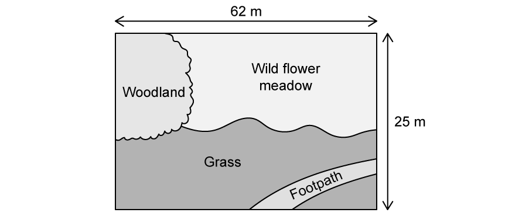
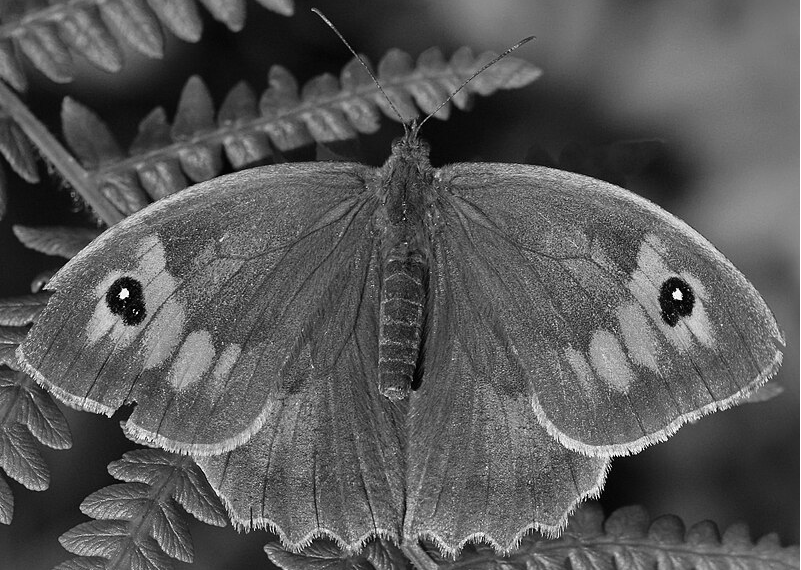

# Exam Questions — Biodiversity
**18. Classification, Biodiversity & Conservation** · Cambridge (CIE) A-LEVEL biology (9700)
> Source: [https://www.savemyexams.com/a-level/biology/cie/25/topic-questions/](https://www.savemyexams.com/a-level/biology/cie/25/topic-questions/) · 12 questions across 1 sets

## Structured Questions (12 questions)

### Q1 — hard — 9 marks

**Q1** [5 marks]

The diversity of dung beetle species was investigated at two grassland sites in North America.

Dung beetles feed on animal faeces (dung).

The first grassland site was grazed by cattle and the second grassland site was **not** grazed by cattle. The areas of the two grassland sites were the same.

At each grassland site, dung beetles were collected, identified and counted.

The results are shown in Table 1.

**Table 1**

| **dung beetle** **species** | **number of dung** **beetles on grassland** **grazed by cattle** | **number of dung** **beetles on grassland** **not grazed by cattle** |
|---|---|---|
| A | 4267 | 6641 |
| B | 2005 | 774 |
| C | 353 | 108 |
| D | 218 | 85 |
| total | 6843 | 7608 |

(i) Simpson’s index of diversity (D) for the dung beetles on the grassland site grazed by cattle was calculated as 0.522, using the formula:

`D = 1 - ( capital sigma ( n / N ) ^2 )`

Key to symbols: n = number of individuals of each species present in the sample N = the total number of all individuals of all species present in the sample

Calculate Simpson’s index of diversity (D) for the dung beetles on the grassland site that was **not** grazed by cattle.

Complete Table 2 to show your working.

Write your final answer to **three** decimal places.

**Table 2**

| **dung beetle** **species** | **number of dung** **beetles on grassland** **not grazed by cattle** | $\frac{n}{N}$ | $(\frac{n}{N})^{2}$ |
|---|---|---|---|
| **A** | 6641 |   |   |
| **B** | 774 |   |   |
| **C** | 108 |   |   |
| **D** | 85 |   |   |
| **total** | 7608 |   |   |

[3]

(ii) Describe what the results in Table 1 and both figures for Simpson’s index of diversity show about the effect of grazing by cattle on the diversity of dung beetles.

[2]

*Source: Specimen 2022 9700/04 Q9AI, AII*

**Q1** [4 marks]

**Extract:**

The diversity of dung beetle species was investigated at two grassland sites in North America.

Dung beetles feed on animal faeces (dung).

The first grassland site was grazed by cattle and the second grassland site was not grazed by cattle. The areas of the two grassland sites were the same.

Other species of beetle that do not feed on animal dung are found on the grassland sites.

Name **and** describe **one** method for estimating the population size of a species of beetle that does **not** feed on dung in each of the two areas of grassland.

*Source: Specimen 2022 9700/04 Q9B*

### Q2 — hard — 10 marks

**Q2** [2 marks]

An ecologist had heard people say that stinging nettles (*Urtica dioica*) and the dock leaf plant (*Rumex obtusifolius*) often grow together. The ecologist decided to assess the abundance of these two species in a field. To do this, they recorded the percentage cover of each species in 11 randomly placed quadrats. Their results are shown in Table 1 below.

**Table 1**

| **Quadrat** | ***U. dioica***** percentage cover** | ***R. obtusifolius***** percentage cover** |
|---|---|---|
| 1 | 30 | 15 |
| 2 | 37 | 23 |
| 3 | 15 | 6 |
| 4 | 15 | 10 |
| 5 | 20 | 11 |
| 6 | 9 | 10 |
| 7 | 3 | 3 |
| 8 | 5 | 1 |
| 9 | 10 | 5 |
| 10 | 25 | 17 |
| 11 | 35 | 30 |

To determine the relationship between the percentage cover of these two species, the ecologist decided to calculate Spearman's rank correlation coefficient. They created a new table, which is represented in Table 2 below.

**Table 2**

| **Quadrat** | ***U. dioica***** percentage cover** | ***R. obtusifolius***** percentage cover** | ***U. dioica***** rank** | ***R. obtusifolius***** rank** | ***D*** | ***D*****2** |
|---|---|---|---|---|---|---|
| 1 | 30 | 15 |   |   |   |   |
| 2 | 37 | 23 |   |   |   |   |
| 3 | 15 | 6 |   |   |   |   |
| 4 | 15 | 10 |   |   |   |   |
| 5 | 20 | 11 |   |   |   |   |
| 6 | 9 | 10 |   |   |   |   |
| 7 | 3 | 3 |   |   |   |   |
| 8 | 5 | 1 |   |   |   |   |
| 9 | 10 | 5 |   |   |   |   |
| 10 | 25 | 17 |   |   |   |   |
| 11 | 35 | 30 |   |   |   |   |

Complete Table 2.

**Q2** [2 marks]

**Extract:**

An ecologist had heard people say that stinging nettles (*Urtica dioica*) and the dock leaf plant (*Rumex obtusifolius*) often grow together. The ecologist decided to assess the abundance of these two species in a field. To do this, they recorded the percentage cover of each species in 11 randomly placed quadrats. Their results are shown in Table 1 below.

**Table 1**

| **Quadrat** | ***U. dioica***** percentage cover** | ***R. obtusifolius***** percentage cover** |
| 1 | 30 | 15 |
| 2 | 37 | 23 |
| 3 | 15 | 6 |
| 4 | 15 | 10 |
| 5 | 20 | 11 |
| 6 | 9 | 10 |
| 7 | 3 | 3 |
| 8 | 5 | 1 |
| 9 | 10 | 5 |
| 10 | 25 | 17 |
| 11 | 35 | 30 |

To determine the relationship between the percentage cover of these two species, the ecologist decided to calculate Spearman's rank correlation coefficient. They created a new table, which is represented in Table 2 below.

**Table 2**

| **Quadrat** | ***U. dioica***** percentage cover** | ***R. obtusifolius***** percentage cover** | ***U. dioica***** rank** | ***R. obtusifolius***** rank** | ***D*** | ***D***^**2**^ |
| 1 | 30 | 15 | 9 | 8 | 1 | 1 |
| 2 | 37 | 23 | 11 | 10 | 1 | 1 |
| 3 | 15 | 6 | 5.5 | 4 | 1.5 | 2.25 |
| 4 | 15 | 10 | 5.5 | 5.5 | 0 | 0 |
| 5 | 20 | 11 | 7 | 7 | 0 | 0 |
| 6 | 9 | 10 | 3 | 5.5 | -2.5 | 6.25 |
| 7 | 3 | 3 | 1 | 2 | -1 | 1 |
| 8 | 5 | 1 | 2 | 1 | 1 | 1 |
| 9 | 10 | 5 | 4 | 3 | 1 | 1 |
| 10 | 25 | 17 | 8 | 9 | -1 | 1 |
| 11 | 35 | 30 | 10 | 11 | -1 | 1 |

Using the formula provided below, calculate Spearman's rank correlation coefficient (*r**s*) for the data from part (a).

Show your working.

**Q2** [3 marks]

**Extract:**

An ecologist decided to assess the abundance of stinging nettles (Urtica dioica) and the dock leaf plant (Rumex obtusifolius) in a field. To do this, they recorded the percentage cover of each species in 11 randomly placed quadrats.

The Spearman's rank correlation coefficient (r_s) for the data is 0.930.

Before they started collecting data for the investigation described in part (a), the ecologist made a null hypothesis.

(i) State the null hypothesis of this investigation. [1]

(ii) Using Table 5.3 below, state whether or not the ecologist was able to reject the null hypothesis and explain why. [2]

**Table 3**

| **Number of pairs of data** | **Critical value at *****p *****= 0.05 (5%)** |
|---|---|
| 5 | 1.00 |
| 6 | 0.89 |
| 7 | 0.79 |
| 8 | 0.74 |
| 9 | 0.70 |
| 10 | 0.65 |
| 11 | 0.62 |
| 12 | 0.59 |
| 13 | 0.56 |
| 14 | 0.54 |
| 15 | 0.52 |

**Q2** [3 marks]

**Extract:**

An ecologist assessed the abundance of stinging nettles (Urtica dioica) and the dock leaf plant (Rumex obtusifolius) in a field by recording the percentage cover of each species in 11 randomly placed quadrats.

The Spearman's rank correlation coefficient (r_s) for the data is 0.930.

The null hypothesis: There is no correlation between the percentage cover of the two species.

The ecologist was able to reject the null hypothesis as the r_s value / Spearman's rank correlation coefficient (0.930) is greater than the critical value (0.62) for 11 pairs of data at p = 0.05 (5%).

Give a full conclusion that the ecologist can make from this investigation.

### Q3 — hard — 9 marks

**Q3** [5 marks]

A piece of UK grassland that was traditionally grazed by sheep has been left ungrazed for the past ten years.

Outline the steps to be followed in an investigation to estimate the population density of thistle plants that have colonised the area since grazing has been discontinued.

**Q3** [2 marks]

A biologist wanted to investigate the biodiversity of insects living in farmed fields in Somerset. The biologist used sweep-netting along transects through the middle of fields on four different farms and counted the number of different insect species present in the sweep-net samples from each farm. Table 1 below shows the results of this study.

**Table 1**

The biologist used the data in Table 1 to report that the difference between the mean number of insect species present on Farm **B** and the number present on the other three farms differed significantly (p < 0.05).

Explain what the biologist meant by the term “*differed significantly (p < 0.05)*”. Use the words *probability* and *chance* in your answer.

**Q3** [2 marks]

**Extract:**

A biologist wanted to investigate the biodiversity of insects living in farmed fields in Somerset. The biologist used sweep-netting along transects through the middle of fields on four different farms and counted the number of different insect species present in the sweep-net samples from each farm.

The biologist in part (b) wanted to know many fields they should sample at each farm. They carried out a preliminary investigation and recorded the total number of different insect species present in an increasing number of fields. Fig. 1 shows the results.

**Fig. 1**

Use the results in Fig.1 to explain why sampling 5 fields would not be an appropriate number **and** why 25 would also not be an appropriate number of fields to sample.

### Q4 — medium — 9 marks

**Q4** [3 marks]

The Frégate Island giant tenebrionid beetle or Frégate beetle (*Polposipus herculeanus*), is a flightless species of beetle of the family Tenebrionidae. It is endemic to Frégate Island in the Seychelles. A PhD student wanted to estimate the number of Frégate beetles on the island.

Explain how they could use the mark-release-recapture method to do this.

**Q4** [2 marks]

**Extract:**

The Frégate Island giant tenebrionid beetle or Frégate beetle (*Polposipus herculeanus*), is a flightless species of beetle of the family Tenebrionidae. It is endemic to Frégate Island in the Seychelles. A PhD student wanted to estimate the number of Frégate beetles on the island.

The PhD student in part (a) used the mark-release-recapture technique to estimate the size of the population of Frégate beetles on the island. They collected 176 beetles and marked them before releasing them back into the same area. Later, they collected 198 beetles, 22 of which were marked.

Calculate an estimate of the number of beetles on the island. Use the formula below and show your working.

**Q4** [3 marks]

**Extract:**

The Frégate Island giant tenebrionid beetle or Frégate beetle (*Polposipus herculeanus*), is a flightless species of beetle of the family Tenebrionidae. It is endemic to Frégate Island in the Seychelles. A PhD student wanted to estimate the number of Frégate beetles on the island.

Explain how they could use the mark-release-recapture method to do this.

The PhD student made sure that their study met the conditions required for the results from the mark-release-recapture method to be valid.

State **three** of these conditions.

**Q4** [1 mark]

Explain the difference between the biological terms *population* and *community*.

### Q5 — medium — 9 marks

**Q5** [2 marks]

Distinguish between the biological terms *niche* and *ecosystem*.

**Q5** [2 marks]

A Biology teacher investigated the different species of insects found in a grassy meadow and in a nearby farmed field. The insects were collected using traps at randomly chosen sites both in the grassy meadow and in the farmed field. Table 2.1 below shows the data collected.

**Table 1**

| **Insect species** | **Total number of individuals collected from farmed field** | **Total number of individuals collected from grassy meadow** |
|---|---|---|
| Black aphid | 230 | 0 |
| Green aphid | 0 | 569 |
| Dingy Skipper butterfly | 0 | 21 |
| Green lacewing | 7 | 9 |
| Brown lacewing | 0 | 37 |
| **Total number of individuals of all species** | 237 | 646 |

Use the formula below to calculate Simpson's index of diversity (*D*) for the insects collected in the farmed field.

Show your working.

**Q5** [3 marks]

**Extract:**

A Biology teacher investigated the different species of insects found in a grassy meadow and in a nearby farmed field. The insects were collected using traps at randomly chosen sites both in the grassy meadow and in the farmed field. Table 2.1 below shows the data collected.

Table 1

| Insect species | Total number of individuals collected from farmed field | Total number of individuals collected from grassy meadow |
| Black aphid | 230 | 0 |
| Green aphid | 0 | 569 |
| Dingy Skipper butterfly | 0 | 21 |
| Green lacewing | 7 | 9 |
| Brown lacewing | 0 | 37 |
| Total number of individuals of all species | 237 | 646 |

Without doing any further calculations and using the data in Table 2.1, predict whether the index of diversity for insects from the grassy meadow will be higher or lower than the index of diversity for insects from the farmed field.

Explain your answer.

**Q5** [2 marks]

**Extract:**

A Biology teacher investigated the different species of insects found in a grassy meadow and in a nearby farmed field. The insects were collected using traps at randomly chosen sites both in the grassy meadow and in the farmed field. Table 2.1 below shows the data collected.

Table 1

| Insect species | Total number of individuals collected from farmed field | Total number of individuals collected from grassy meadow |
| Black aphid | 230 | 0 |
| Green aphid | 0 | 569 |
| Dingy Skipper butterfly | 0 | 21 |
| Green lacewing | 7 | 9 |
| Brown lacewing | 0 | 37 |
| Total number of individuals of all species | 237 | 646 |

A student stated that the results of this investigation suggested that farming caused a reduction in species diversity.

Evaluate this by providing arguments in support of and against this statement.

### Q6 — medium — 8 marks

**Q6** [2 marks]

Compare species diversity with species richness.

**Q6** [2 marks]

Fertilisers are commonly used today by most farmers as they help to increase crop yield and profit. If it rains shortly after fertilisers are applied to a field then some of the fertiliser can enter nearby water sources as runoff. A conservationist investigated the effect that fertiliser runoff from a nearby farm had on the distribution of organisms living in a stream. At the point where fertiliser had entered the stream, she found a high density of specific organisms but a low index of diversity. Suggest how fertiliser contaminating the stream could result in these findings and provide an explanation for your answer.

**Q6** [2 marks]

**Extract:**

Fertilisers are commonly used today by most farmers as they help to increase crop yield and profit. If it rains shortly after fertilisers are applied to a field then some of the fertiliser can enter nearby water sources as runoff. A conservationist investigated the effect that fertiliser runoff from a nearby farm had on the distribution of organisms living in a stream. At the point where fertiliser had entered the stream, she found a high density of specific organisms but a low index of diversity.

Predict how the index of diversity will change as the conservationist moves further away from the farm to take her sample.

Justify your answer.

**Q6** [2 marks]

**Extract:**

Fertilisers are commonly used today by most farmers as they help to increase crop yield and profit. If it rains shortly after fertilisers are applied to a field then some of the fertiliser can enter nearby water sources as runoff. A conservationist investigated the effect that fertiliser runoff from a nearby farm had on the distribution of organisms living in a stream. At the point where fertiliser had entered the stream, she found a high density of specific organisms but a low index of diversity.

The conservationist wanted to use their findings to take action against the local farm. However, the farmer’s lawyer argued that the scientific methods of the conservationist were not rigorous enough to conclude that fertilizer runoff was affecting species richness in the nearby stream. The lawyer demanded that more samples at random locations are to be taken.Explain the importance of taking a large number of samples at random sites.

### Q7 — medium — 10 marks

**Q7** [2 marks]

A farmer was interested in improving the stability of their agricultural ecosystem.

State the meaning of the term ecosystem.

**Q7** [2 marks]

The farmer investigated the effect of different types of animal grazing on beetles in their fields. They measured the number of different beetle species and the total number of beetles in cow grazed (**1**), donkey grazed (**2**) and sheep grazed (**3**) fields.

Their results are shown in** Fig. 1** below. Note that the error bars represent standard deviation.

**Fig. 1**

Calculate the percentage difference in number of species of beetle between a cow-grazed field and a donkey-grazed field. Give your answer to one decimal place.

**Q7** [3 marks]

**Extract:**

The farmer investigated the effect of different types of animal grazing on beetles in their fields. They measured the number of different beetle species and the total number of beetles in cow grazed (1), donkey grazed (2) and sheep grazed (3) fields.

Their results are shown in Fig. 1 below. Note that the error bars represent standard deviation.

The farmer considered the results in Fig. 1 and concluded that the type of grazing had little effect on beetles, and therefore on the stability of the agricultural ecosystem.

Discuss the farmer's conclusion.

**Q7** [3 marks]

**Extract:**

The farmer investigated the effect of different types of animal grazing on beetles in their fields. They measured the number of different beetle species and the total number of beetles in cow grazed (1), donkey grazed (2) and sheep grazed (3) fields.

Suggest **three** considerations that the farmer should have taken into account when planning the investigation to ensure valid results.

### Q8 — easy — 5 marks

**Q8** [3 marks]

Table 1 shows the total number of plant species, the total number of insect species and the number of habitats in three areas, **A**, **B **and **C**.

**Table 1**

| Area | Total number of plant species | Total number of insect species | Number of habitats |
|---|---|---|---|
| **A** | 6 | 5 | 1 |
| **B** | 15 | 23 | 4 |
| **C** | 362 | 70 | 12 |

Identify the area with the highest biodiversity.

Give reasons for your choice of area.

*Source: May/June 2019 9700/41 Q8A*

**Q8** [1 mark]

**Extract:**

Table 1 shows the total number of plant species, the total number of insect species and the number of habitats in three areas, A, B and C.

Table 1

| Area | Total number of plant species | Total number of insect species | Number of habitats |
| A | 6 | 5 | 1 |
| B | 15 | 23 | 4 |
| C | 362 | 70 | 12 |

Identify the area that is likely to be affected the most if the environment changes.

Give a reason for your choice of area.

*Source: May/June 2019 9700/41 Q7B*

**Q8** [1 mark]

**Extract:**

Table 1 shows the total number of plant species, the total number of insect species and the number of habitats in three areas, A, B and C.

Table 1

| Area | Total number of plant species | Total number of insect species | Number of habitats |
| A | 6 | 5 | 1 |
| B | 15 | 23 | 4 |
| C | 362 | 70 | 12 |

State **one **reason why it is important to conserve biodiversity in **all **three areas.

*Source: May/June 2019 9700/41 Q8C*

### Q9 — easy — 8 marks

**Q9** [2 marks]

Explain the importance of random sampling when investigating biodiversity.

**Q9** [2 marks]

(i) Define the ecological term *abundance*.

[1]

(ii) Define the ecological term *distribution*.

[1]

**Q9** [3 marks]

Some ecologists plan to carry out quadrat sampling in a piece of parkland shown in Fig. 1.

**Fig. 1**

The ecologists used square quadrats of 50 cm × 50 cm.

Calculate the number of quadrat samples they would have to carry out in order to sample 1 % of the field in Fig. 1.

**Q9** [1 mark]

In the piece of parkland shown in Fig. 1, the ecologists noted that there was a weak degree of correlation between distance from the footpath and biodiversity; as distance from the footpath increased, so did the recorded levels of biodiversity.

Suggest a likely numerical value for the correlation coefficient that they calculated.

### Q10 — easy — 11 marks

**Q10** [4 marks]

Biodiversity is a measure of variation present in living systems.

(i) Species diversity is one measure of biodiversity.

State the measures that would need to be taken in an assessment of species diversity.

[2]

(ii) Identify** two** other measures of biodiversity.

[2]

**Q10** [4 marks]

**Extract:**

Biodiversity is a measure of variation present in living systems.

(i) Species diversity is one measure of biodiversity.

State the measures that would need to be taken in an assessment of species diversity.

Measures that would need to be taken in an assessment of species diversity include:
- Species richness / the number of different species present
- Species evenness / the number of individuals of each species present

Some A level students wanted to assess plant species diversity on their school field.

Describe a method that the students could use to achieve their aim.

**Q10** [2 marks]

The students used their results to calculate Simpson's index of diversity for their school field. Their value for Simpson's index was 0.23.

State what can be concluded about the biodiversity of the school field from this value of Simpson's index.

**Q10** [1 mark]

**Extract:**

The students used their results to calculate Simpson's index of diversity for their school field. Their value for Simpson's index was 0.23.

The biodiversity of the school field, from this value of Simpson's index, can be said to be:
- Diversity/biodiversity is low / the field is not very (bio)diverse
- There might not be very many different species
- There might be one or two dominant species / be many individuals of some species and very few of others

Suggest **one** way in which the school might intervene to improve the biodiversity of the school field.

### Q11 — easy — 9 marks

**Q11** [3 marks]

Fig. 1 below shows a meadow brown butterfly, a species that is native to the UK.

*CC BY-SA 4.0, via **[Wikimedia Commons](https://commons.wikimedia.org/wiki/File:Meadow_brown_butterfly_%28Maniola_jurtina%29_female_%28cropped%29.jpg)*

**Fig. 1**

The meadow brown is medium-sized with brown wings and patterns of orange patches and black eye-spots that can vary between UK regions. The meadow brown flies between June-September, and is unusual in that it often flies when weather conditions are dull. Adults feed on nectar from a wide variety of meadow flowers, such as knapweeds and scabious, where it acts as a pollinator as it flies between flowers, while caterpillars rely on grasses such as fescues and meadow-grasses. Predators of the meadow brown include blackbirds, thrushes and starlings.

Identify **three** features of the meadow brown butterfly's niche.

**Q11** [2 marks]

**Extract:**

The meadow brown is medium-sized with brown wings and patterns of orange patches and black eye-spots that can vary between UK regions.

State what the difference in spot patterns between meadow brown butterflies in different regions of the UK suggests about the genetic diversity of the UK population.

**Q11** [3 marks]

**Extract:**

Fig. 1 below shows a meadow brown butterfly, a species that is native to the UK.

The meadow brown is medium-sized with brown wings and patterns of orange patches and black eye-spots that can vary between UK regions. The meadow brown flies between June-September, and is unusual in that it often flies when weather conditions are dull. Adults feed on nectar from a wide variety of meadow flowers, such as knapweeds and scabious, where it acts as a pollinator as it flies between flowers, while caterpillars rely on grasses such as fescues and meadow-grasses.

A group of undergraduate students wanted to assess the abundance of meadow brown butterflies in a local wildflower meadow.

(i) Explain why quadrat sampling would** not** be suitable in this instance.

2]

(ii) Identify the technique that the students should use to estimate meadow brown butterfly abundance.

[1]

**Q11** [1 mark]

The students decided to assess whether or not the distribution of meadow brown butterflies was affected by the presence of trees at the edge of the meadow, so they carried out several population estimates along a line at different distances from the trees.

(i) Name the type of sampling used by the students here.

[1]

(ii) The students recorded the number of butterflies estimated at each location along their line.

State the type of statistical test that the students would use to assess whether or not there is a correlation between distance from the trees and number of meadow brown butterflies.

[1]

### Q12 — easy — 6 marks

**Q12** [1 mark]

**Table 1** shows the results of pond sampling from two different ponds.

**Table 1**

| Species | Pond A | Pond B |
|---|---|---|
| Stonefly nymph | 12 | 1 |
| Caddisfly larva | 14 | 2 |
| Bloodworm | 0 | 25 |
| Mosquito larva | 0 | 53 |
| Freshwater shrimp | 15 | 19 |
| Pond snail | 17 | 3 |

Calculate the species richness for pond **A** and pond **B** in Table 1.

**Q12** [2 marks]

**Extract:**

**Table 1** shows the results of pond sampling from two different ponds.

**Table 1**

| Species | Pond A | Pond B |
| Stonefly nymph | 12 | 1 |
| Caddisfly larva | 14 | 2 |
| Bloodworm | 0 | 25 |
| Mosquito larva | 0 | 53 |
| Freshwater shrimp | 15 | 19 |
| Pond snail | 17 | 3 |

The index of diversity for pond **B **is 0.6485.

Using the formula below, calculate the index of diversity for pond **A**.

`d = 1 - ( SUM_ _ to _ of ( n / N ) ^2 )`

**Q12** [1 mark]

**Extract:**

Table 1

| Species | Pond A | Pond B |
| Stonefly nymph | 12 | 1 |
| Caddisfly larva | 14 | 2 |
| Bloodworm | 0 | 25 |
| Mosquito larva | 0 | 53 |
| Freshwater shrimp | 15 | 19 |
| Pond snail | 17 | 3 |

The index of diversity for pond B is 0.6485.

The index of diversity for pond A is 0.7466/0.747.

Explain the difference in index of diversity between ponds **A **and pond **B**.

**Q12** [2 marks]

**Extract:**

**Table 1** shows the results of pond sampling from two different ponds.

**Table 1**

| Species | Pond A | Pond B |
| Stonefly nymph | 12 | 1 |
| Caddisfly larva | 14 | 2 |
| Bloodworm | 0 | 25 |
| Mosquito larva | 0 | 53 |
| Freshwater shrimp | 15 | 19 |
| Pond snail | 17 | 3 |

The index of diversity for pond **B **is 0.6485.

The index of diversity for pond **A** is 0.7466/0.747.

The species measured in Table 1 can all be used as ‘indicator species’. This means that their presence or absence can provide information about the quality of the water in which they live:

- Mosquito larvae and bloodworms are known for having a high tolerance for pollution
- Mayfly and caddis fly larvae have a very low tolerance for pollution.

Use the information provided and the results in Table 1 to suggest why there is a difference in diversity index between pond **A** and pond **B**.

Explain how you reached your conclusion.
