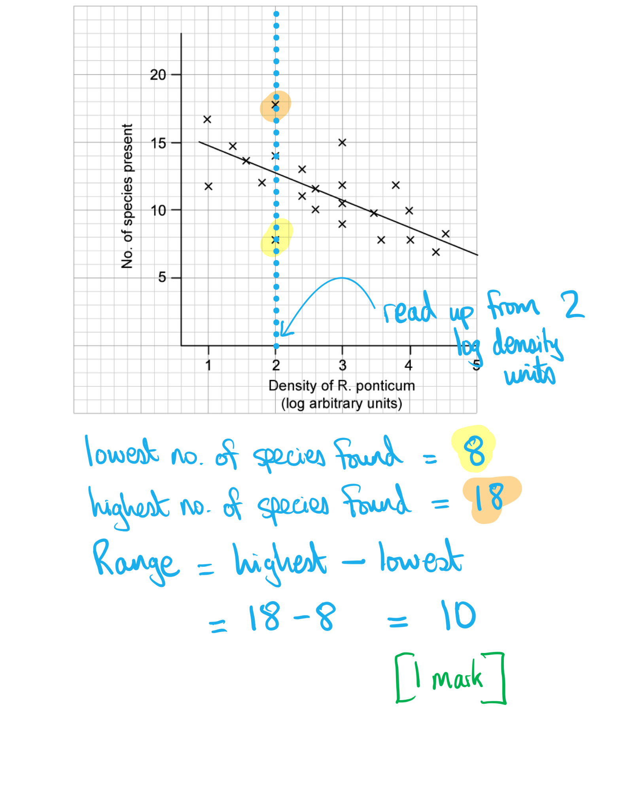
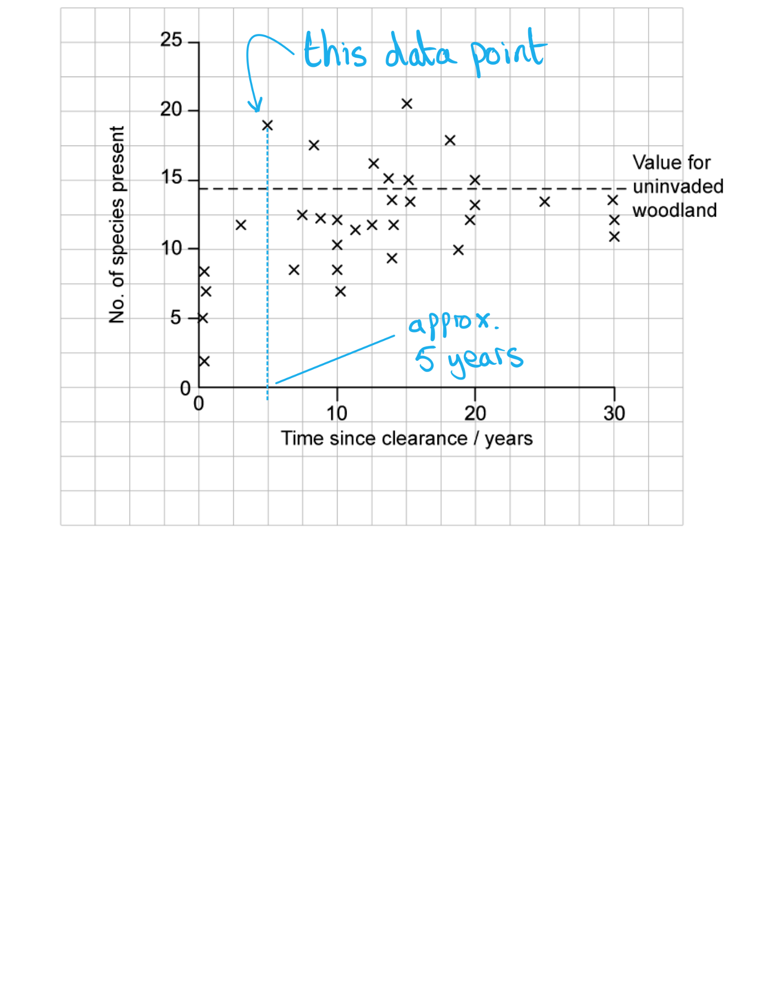
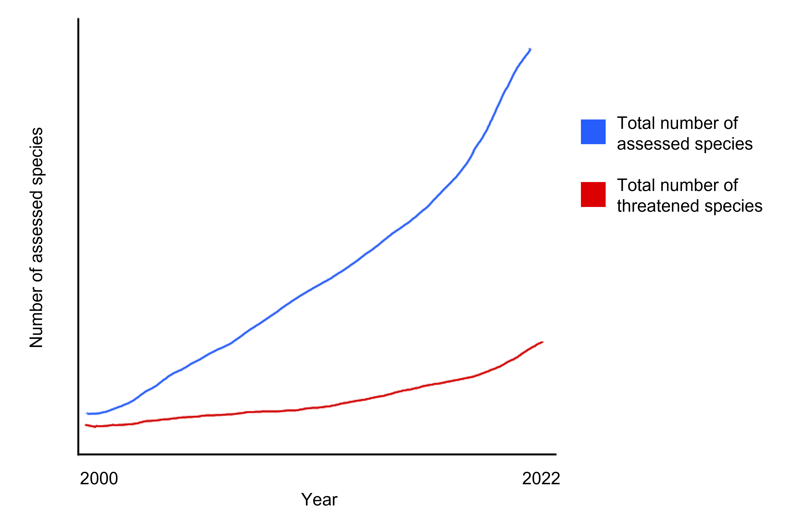
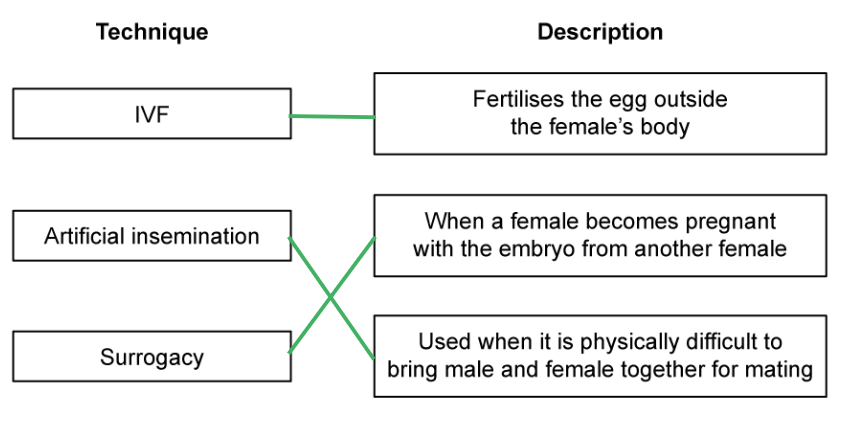

# Mark Schemes — Conservation
**18. Classification, Biodiversity & Conservation** · Cambridge (CIE) A-LEVEL biology (9700)

## Structured Questions (12 questions)

### Q1
(i) The range of species found at an *R. ponticum* density of 2 log arbitrary units is...

- (18 - 8) = 10; **[1 mark]**

(ii) The decline in the number of species found as the density of *R. ponticum *increases can be explained as follows...

**Final answer:** **Any ****one**** of the following:**

- *R. ponticum* outcompetes other plants, reducing plant biodiversity; **[1 mark]**
- Prevalence of *R. ponticum* creates lower variety of habitats for animals eg. insects, invertebrates, birds; **[1 mark]**

**[Total: 2 marks]**
Ways in which *R. ponticum* could affect competition include…

**Final answer:** **Any ****two**** of the following:**

- *R. ponticum* releases toxins into the soil that poison other plants; **[1 mark]**
- *R. ponticum* acts as a host for / provides a habitat for plant pathogens; **[1 mark]**
- *R. ponticum *overshadows other plants / takes available light;** [1 mark]**
- *R. ponticum* is better adapted to absorb soil minerals/nutrients/water; **[1 mark]**

**[Total: 2 marks]**

> *R. ponticum** is known to be a fast-growing plant and its presence in dense thickets suggests that it is well adapted to competing for light, space and nutrients. Animal species that rely on native plant species for food and habitat are pushed out as their hosts are outcompeted. Other means of competing with other plants could be to release toxins that make the soil uninhabitable to native species, and the harbouring of plant pathogens (like ash dieback) that can increase the competitive advantage of **R. ponticum**.*
The number of years before the number of species found on cleared land first exceeded the number of species found in uninvaded woodland was…

- 5 (years); **[1 mark]**

*Allow 3 - 5 years inclusive*

**[Total: 1 mark]**

> *The data point in question is the first point (reading left-to-right) that lies above the horizontal line. Read down from that point to the x-axis = 5 years.*

(i) The clearance of *R.ponticum* can affect the recovery of the woodland as the data collected showed that the...

- Number of species present recovers (to levels comparable with uninvaded sites) after around 20 years; **[1 mark]**
- Percentage cover (generally) did not recover to levels of uninvaded sites; **[1 mark]**

(ii) Reasons for the impact observed could include...

**Final answer:** **One**** of the following:**

- *R. ponticum* releases toxins into the soil that can poison other plants; **[1 mark]**
- Certain species of plant are affected more than others by the legacy of *R. ponticum*;** [1 mark]**

**[Total: 3 marks]**

> *The two curves show differing patterns, in that the percentage cover did not recover to levels that would have been seen prior to the invasion of **R. ponticum**. This is likely because there were not multiple overlapping layers of vegetation, despite the numbers of species having recovered to pre-invasion levels. One theory is that **R. ponticum** leaves a toxin in the soil that resists the growth of certain other species. Some species of native plants will be more susceptible to such toxins than others.*

### Q2
Australia has a large number of endemic species because...

- It is an island and therefore species are geographically/reproductively isolated; **[1 mark]**
- Species in Australia develop new mutations in their DNA that do not spread to other areas; **[1 mark]**
- This can lead to allopatric speciation; **[1 mark]**

**[Total: 3 marks]**

> *This is a synoptic question so you need to apply your knowledge from a different topic in order to answer this. *
(i) Scientists must be careful when carrying out captive breeding programmes for small populations because...

**Final answer:** **Any ****two ****from the following:**

- (There is a) high likelihood of relatives being bred together; **[1 mark]**
- Which could lead to inbreeding depression; **[1 mark]**
- (There may be) increased homozygosity in the population; **[1 mark]**
- Potentially increases the frequency of harmful genes/alleles; **[1 mark]**

(ii) Other conservation strategies could be...

**Final answer:** **Any ****three ****from the following:**

- *In-situ* conservation; **[1 mark]**
- Removal of invasive species; **[1 mark]**
- Fire-prevention strategies; **[1 mark]**
- Planting of plant species that benefit the central rock rat e.g. as a food source; **[1 mark]**
- Providing protection from natural predators; **[1 mark]**
- Any other valid answer; **[1 mark]**

**[Total: 5 marks]**

> *Remember that not every species has a native habitat of the forest so vague answers like reforestation or planting trees would not gain credit here. *
(i) Some possible causes of habitat fragmentation are...

**Final answer:** **Any ****three ****from the following:**

- Human-made structures such as houses, roads, mines, factories; **[1 mark]**
- Deforestation; **[1 mark]**
- Fire; **[1 mark]**
- Geographical barrier e.g. rivers / mountain ranges; **[1 mark]**

> *There are many reasons why populations can be split up by fragmentation because they can only exist in their specific habitat and cannot pass through other areas in order to move between patches of suitable habitat. Fragmentation can be very harmful to populations, which is why many people are being encouraged to build "wildlife corridors" such as hedgerows to allow animals and insects to pass through. *

(ii) An evaluation of habitat fragmentation is...

**Final answer:** **Any ****four ****from the following:**

*Benefits of fragmentation*

- Increases the chance of allopatric speciation; **[1 mark]**
- Increased number of species which leads to increased biodiversity; **[1 mark]**

*Disadvantages of fragmentation*

- Splitting up of populations can lead to genetic drift; **[1 mark]**
- Small populations increase the chance of inbreeding depression / increasing homozygosity; **[1 mark]**
- Small populations decrease variation / size of gene pool; **[1 mark]**
- Increased risk of localised extinction; **[1 mark]**

**[Total: 7 marks]**

> *Make sure you have points covering both the benefits and disadvantages to gain full marks on this question. *
The student is incorrect because...

**Final answer:** **Any ****three ****from the following:**

- In the year 2000 (significantly) fewer species were assessed by the IUCN / in the year 2022 (significantly) more species were assessed; **[1 mark]**
- (The data in the question) only compares the number of assessed species with the number of threatened species (it does not give any information about the number of threatened species); **[1 mark]**
- More data/information is needed to know more about the number of threatened species; **[1 mark]**
- Just because the percentage of threatened species is lower it does not necessarily have any reflection on conservation efforts; **[1 mark]**

**[Total: 3 marks]**

> *A graph of the data is shown below. You can see that the total number of threatened species increases between the year 2000 and 2022, however the percentage of threatened species reduces when compared to the total number of assessed species, which increases significantly over the years. *

> *This is a useful reminder that data taken out of context can be misleading!*

### Q3
(i) The domain to which the aye-aye belongs is...

- Eukarya / eukaryote; **[1 mark]**

(ii) One reason why aye-ayes may have become endangered is...

**Final answer:** **Any ****one**** of the following:**

- Habitat destruction/loss / habitat fragmentation / deforestation/logging; **[1 mark]**
- Disease; **[1 mark]**
- Hunting; **[1 mark]**
- Low genetic diversity **OR** large range AND low population density; **[1 mark]**
- Climate change; **[1 mark]**
- Introduction of (non-native) species **OR** competition <u>with other species</u>; **[1 mark]**

(iii) Ways in which zoos may be able to protect this species from extinction include...

**Final answer:** **Any ****three**** of the following:**

- Captive breeding; **[1 mark]**
- Releasing (aye-ayes) into the wild; **[1 mark]**
- Education / raise awareness; **[1 mark]**
- Research (into genetics, habitat, and behaviour); **[1 mark]**
- Vet/veterinary care; **[1 mark]**
- Raising funds; **[1 mark]**

**[Total: 5 marks]**

> *i) The photograph shows that aye-ayes are animals, as well as telling us that they are mammals (a class within the animal kingdom). Animals are a kingdom within the eukarya domain.*

> *ii) Most of the common reasons could be at play here, but it is unlikely to be competition with other aye-ayes (due to their small population size), so if you were writing about competition you would need to state clearly that this would be competition with other species.*

> *iii) Note that the question specifically asks about the role of **zoos** in conservation, so methods of conservation that do not relate to zoos will not be credited.*
(i) Possible reasons for the large genetic difference between the two populations could be...

**Final answer:** **Any ****five**** of the following:**

- Geographical isolation/barrier; **[1 mark]**
- (Due to) named barrier, e.g. rivers / mountains; **[1 mark]**
- (Populations) unable to interbreed / there is no gene flow/exchange (between populations); **[1 mark]**
- Different mutations occur (in the separate populations); **[1 mark]**
- Different selection pressures / environmental conditions (affect the separate populations); **[1 mark]**
- Different alleles are selected / passed to next generation/offspring; **[1 mark]**
- Genetic drift occurs; **[1 mark]**
- (Populations are) separated for a long time / many years/generations; **[1 mark]**
- The gene pools change (over time); **[1 mark]**

(ii) The type of speciation that is most likely to occur is...

- Allopatric (speciation); **[1 mark]**

**[Total: 6 marks]**

> *Part i) here is about the process of speciation, but it focuses on a particular aspect of the process; you must concentrate here on the reasons for **genetic differences** rather than just describing the process.*

> *Genetic differences can accumulate between populations that are isolated from each other by a barrier of some kind, eg. a mountain range. Genetic differences may arise between the separated populations due to random mutation and differences in which mutations are selected and passed on, as well as the effects of genetic drift, and because there is no exchange of genes between the two populations the number of differences between the populations increases over time as mutations accumulate.*

### Q4
(i) A reason for the very low numbers of Bali starlings in the wild could be...

**Final answer:** **Any ****three ****of the following:**

- Habitat destruction; **[1 mark]**
- <u>Competition</u> for food / food shortage; **[1 mark]**
- Predation; **[1 mark]**
- Disease; **[1 mark]**
- Pollution / pesticide use **OR **removed from wild (to zoos) to conserve species **OR **problems finding a mate; **[1 mark]**

(ii) The roles zoos can take in the protection of the Bali starling are...

**Final answer:** **Any ****two ****of the following:**

- (Captive) breeding; **[1 mark]**
- Release into wild; **[1 mark]**
- Education / increase awareness (of illegal bird trade); **[1 mark]**
- Research diet / habitat / breeding/behaviour / genetic diversity; **[1 mark]**
- Raise money / work with (Bali) government to set up reserves; **[1 mark]**
- Veterinary/health care; **[1 mark]**

**[Total: 5 marks]**

> *It is important in part ii) to make sure you don't list methods of captive breeding that are only applicable to mammals and not to birds, such as** in vitro** fertilisation and embryo transfer to surrogate mothers.*
The consequences on genetic biodiversity of having a wild population of just six birds would be

**Final answer:** **Any ****four ****of the following:**

- Low/decreased (genetic) diversity/variation; **[1 mark]**
- Low/decreased heterozygosity; **[1 mark]**
- Harmful recessive alleles may come together; **[1 mark]**
- <u>Inbreeding depression</u>; **[1 mark]**
- No/decreased <u>hybrid vigour</u>; **[1 mark]**
- Not/less able to adapt to changed selection pressure/environment; **[1 mark]**

**[Total: 4 marks]**

> *Small populations have low **genetic diversity** due to the low total number of alleles of each gene present in the population. This increases the risk of any offspring inheriting** two identical alleles** from their parents (this reduces **heterozygosity**), which can then further reduce the genetic diversity in the next generation. Inheriting two identical copies of a gene also increases the risk of inheriting **two harmful recessive alleles**, leading to the problem of **inbreeding depression**.*

> *Populations with low genetic diversity are less likely to be able to adapt (by natural selection) to a changing environment, and are therefore more likely to be wiped out by such change.*

### Q5
The meerkat is less likely than the elephant to become endangered because...

**Final answer:** **Any ****three**** of the following:**

- Meerkats reproduce fast<u>er</u> / have large<u>r</u> number of offspring / short<u>er</u> life cycle / short<u>er</u> gestation period (than** **elephants); **[1 mark]**
- Meerkats are of no use to humans / are not hunted/poached **WHEREAS** elephants are hunted/poached/exploited (for ivory); **[1 mark]**
- Meerkats are protected in burrows **WHEREAS** elephants are exposed / out in the open; **[1 mark]**
- Meerkats are small/camouflaged **WHEREAS** elephants are large/obvious / easy to locate/hunt/poach; **[1 mark]**
- Meerkats have a (wide) variety of food (sources) **WHEREAS** elephants have limited food sources / one main food source; **[1 mark]**
- Meerkats require less food/water **WHEREAS** elephants require large amount of food/water; **[1 mark]**

**[Total: 3 marks]**
The three main components of biodiversity are...

- Habitat/ecosystem diversity **AND** species diversity **AND **genetic diversity; **[1 mark]**

**[Total: 1 mark]**
The Red List has many more vertebrates than invertebrates because...

**Final answer:** **Any ****two**** of the following:**

- People/scientists/biologists are more interested in vertebrates (than invertebrates); **[1 mark]**
- Vertebrates are more widely researched/surveyed (than invertebrates); **[1 mark]**
- Vertebrates are larger / more visible so are easier to survey / it is easier to estimate their numbers (than invertebrates); **[1 mark]**
- Vertebrates may be under more pressure / more endangered / at greater extinction risk (than invertebrates); **[1 mark]**
- We may not be aware of many invertebrates that are endangered as they harder to survey / are more cryptic / hidden; **[1 mark]**

**[Total: 2 marks]**
Ecological, ethical and economic arguments for maintaining biodiversity include...

**Final answer:** **One**** mark for ecological argument:**

- Vital for nutrient recycling; **[1 mark]**
- Makes populations more stable / robust (to changes in the environment); **[1 mark]**
- To prevent soil erosion; **[1 mark]**
- More biodiverse communities are more productive; **[1 mark]**

**Final answer:** **One**** mark for ethical argument:**

- To prevent extinction; **[1 mark]**
- To prevent the loss/reduction of populations/habitats; **[1 mark]**
- To save organisms for future generations; **[1 mark]**

**Final answer:** **One**** mark for economical argument:**

- Tourism; **[1 mark]**
- Agriculture; **[1 mark]**
- Commercial products (suitable example accepted); **[1 mark]**
- Pharmaceutical/medical needs; **[1 mark]**

**[Total: 3 marks]**

> *Ensure that you have included at least one of each type of argument as this is what the question has asked for.*

### Q6
(i) Two reasons why the Visayan warty pig is critically endangered are...

**Final answer:** **Any ****two ****of the following:**

- Deforestation **OR** habitat destruction/fragmentation; **[1 mark]**
- Killed/hunted; **[1 mark]**
- Disease; **[1 mark]**
- Reduction in food supply; **[1 mark]**

(ii) The role of zoos in the protection of the Visayan warty pig is...

**Final answer:** **Any ****three ****of the following:**

- Captive breeding / AI / IVF / surrogacy; **[1 mark]**
- Release into the wild / insurance populations; **[1 mark]**
- Education / awareness; **[1 mark]**
- (Work with Philippine government to) set up reserves; **[1 mark]**
- Research diet / habitat / breeding / behaviour / genetic diversity; **[1 mark]**
- Veterinary care / monitor health; **[1 mark]**

**[Total: 5 marks]**
The consequences of this interspecific breeding are...

**Final answer:** **Any ****three ****of the following:**

- Hybrids formed / fewer warty pigs produced; **[1 mark]**
- (Offspring) may be sterile; **[1 mark]**
- Genetically different (from warty pigs); **[1 mark]**
- (Hybrids are) less adapted for natural environment; **[1 mark]**
- (Hybrids are) susceptible to diseases/parasites; **[1 mark]**

**[Total: 3 marks]**
The completed table is as follows...

| **taxonomic group** | **name** |
|---|---|
| domain | Eukarya; **[1 mark]** |
| kingdom | animalia |
| phylum | chordata |
| Class; **[1 mark]** | mammalia |
| order | artiodactyla |
| family | suidae |

**[Total: 2 marks]**

> *You need to spell Eukarya correctly, and it can't be substituted for words like Eukaryote. Use a mnemonic to help you remember the order of taxonomic ranks, such as Keep Ponds Clean Or Frogs Get Sick. *

### Q7
An invasive species is...

- A species that has moved into an ecosystem where it was previously unknown **OR** a species that has moved into a new ecosystem in which it did not previously exist; **[1 mark]**

**[Total: 1 mark]**
The negative effects that alien species can have on an ecosystem include...

**Final answer:** **Any ****three**** of the following:**

- Alien species may be carnivorous/predators so will prey on (many) native/existing species **OR** native/existing species may not have adaptations/defences/ability to avoid new predators; **[1 mark]**
- Alien species will compete with native/existing predators (in the ecosystem) for <u>food</u> **OR **herbivorous alien species will compete with native/existing herbivores (in the ecosystem) for <u>food</u>; **[1 mark]**
- Alien species will compete with native species for other named resource(s) e.g. space/territory, breeding/nesting sites, etc.; **[1 mark]**
- Alien plant species will compete with existing species for named resource(s) e.g. light, minerals, water, space, etc.; **[1 mark]**
- Alien species may introduce disease that native/existing species have no immunity against; **[1 mark]**
- Alien species may change the environment so that native/existing species cannot survive **OR **destroy habitats that native/existing depend on (for survival); **[1 mark]**

**[Total: 3 marks]**
The main forms/stages of assisted reproduction are...

**Final answer:** **Any ****two**** of the following sets of names/descriptions:**

- Artificial insemination / AI; **[1 mark]**
- Semen/sperm is collected from the male and injected/inserted into the (vagina/uterus of the) female (near the time of ovulation); **[1 mark]**

**OR**

- In vitro fertilisation / IVF; **[1 mark]**
- Semen/sperm collected from the male / eggs are collected from the ovary **AND** semen/sperm and eggs are mixed together in a (petri) dish or (test) tube to fertilise; **[1 mark]**

**OR**

- Embryo transfer; **[1 mark]**
- Embryo(s) (formed during IVF) are inserted into uterus (of female/mother) for implantation to take place **OR** embryo(s) are taken from uterus of female/mother and transferred to a surrogate female/mother (of non-vulnerable species); **[1 mark]**

**OR**

- Surrogacy **OR **surrogate female/mother; **[1 mark]**
- A female that becomes pregnant with the embryo(s) from another female and carries the embryo to full term / gives birth **OR **embryo(s) are placed into the uterus of a female who did not provide the female gamete; **[1 mark]**

**[Total: 4 marks]**

### Q8
This plant has become an endangered species because...

**Final answer:** **Any ****three**** of the following:**

- It is large/colourful **SO** it is easy to detect; **[1 mark]**
- It may be taken by collectors; **[1 mark]**
- It may be sold / (illegally) traded / used in traditional medicine; **[1 mark]**
- It may be destroyed due to the (bad) smell; **[1 mark]**
- It's habitat is being destroyed  / named reason for habitat destruction* e.g. effect of grazing / building / agriculture / deforestation*; **[1 mark]**
- Other possible reasons *e.g not easily pollinated / flowers infrequently / flowers for a (very) short time*; **[1 mark]**

**[Total: 3 marks]**
It is sometimes necessary to conserve a plant species outside its natural habitat (*ex-situ*) because...

**Final answer:** **Any ****three**** of the following:**

- Their natural habitat may be decreased/degraded/damaged/lost due to climate change/human activity; **[1 mark]**
- The population is very low; **[1 mark]**
- In the wild / *in-situ*, sexual reproduction is difficult if numbers are low; **[1 mark]**
- Assisted reproduction can be easier to carry out *ex-situ; ***[1 mark]**
- Breeding *ex-situ* can maintain the gene pool; **[1 mark]**
- *Ex-situ* conservation allows protection from grazers/competing species/humans/collectors/(illegal) traders; **[1 mark]**
- *Ex-situ* conservation allows protection from disease; **[1 mark]**

**[Total: 3 marks]**
Advantages of using seed banks, rather than adult plants, for conserving an endangered plant species include...

**Final answer:** **Any ****four**** of the following:**

- Seeds can be collected with minimal damage to wild population(s); **[1 mark]**
- Most plants produce an excess of seeds so availability is high; **[1 mark]**
- Seeds take up <u>less</u> space **SO** larg<u>er</u> numbers / more species can be stored; **[1 mark]**
- Therefore can also store greater genetic diversity; **[1 mark]**
- Seeds are easi<u>er</u>/cheap<u>er/</u>low<u>er</u> maintenance to store/transport (than adult plants); **[1 mark]**
- Seeds remain viable for long periods of time; **[1 mark]**
- Seeds are less vulnerable/susceptible to disease/environmental change; **[1 mark]**
- Storing seeds (instead of adult plants) prevents fertilisation by undesired pollen; **[1 mark]**

**[Total: 4 marks]**

> *Whole adult plants may need different conditions when they are stored depending on the species, whereas storing seeds simply requires them all to be stored in dry and cold conditions. Cold temperatures reduce enzyme activity and the lack of water prevents hydrolysis of the food reserves.*

### Q9
The role of botanic gardens in the protection of endangered species is...

**Final answer:** **Any ****seven ****of the following:**

- To collect plants/seeds from the wild; **[1 mark]**
- (From) many countries / internationally; **[1 mark]**
- (Especially from) areas at risk from climate change; **[1 mark]**
- Plant the seeds/plants (in botanic gardens); **[1 mark]**
- (Planting the seeds/plants allows scientists to) increase plant/seed number; **[1 mark]**
- Tissue culture / cloning; **[1 mark]**
- (Store seeds in) seed bank; **[1 mark]**
- Maintain / measure genetic diversity **OR **enter information into a** **gene bank; **[1 mark]**
- Cooperate with governments / charities / universities...; **[1 mark]**
- ...For research; **[1 mark]**
- To <u>conserve</u> habitats; **[1 mark]**
- To <u>restore</u> habitats; **[1 mark]**
- To reintroduce species (to wild); **[1 mark]**
- To educate (public) / raise awareness; **[1 mark]**
- To raise funds; **[1 mark]**
- Prepare suitable habitats / growing conditions; **[1 mark]**

**[Total: 7 marks]**

> *This question asks about **botanic gardens**, so any references to zoos specifically cannot gain marks. *

> *Note that genetic diversity within an endangered species (marking point 8) cannot be maintained by selective breeding and cross breeding. Selective breeding will reduce genetic diversity while cross breeding will create hybrids rather than conserving the gene pool of an existing species.*

### Q10
The boxes should be joined as follows:

**[1 mark]** for each correct line

**[Total: 3 marks]**
**Advantages **of using seed banks for conservation:

**Final answer:** **One ****from the following:**

- More cost-effective / better use of space than storing fully-grown plants; **[1 mark]**
- Less labour intensive (than looking after plants); **[1 mark]**
- Just need cool, dry conditions for storage; **[1 mark]**
- Seeds are less vulnerable to disease, natural disaster or human damage; **[1 mark]**

**Disadvantages **of using seed banks for conservation:

**Final answer:** **One ****from the following:**

- Seeds may not be viable and need to be tested to see if they can germinate; **[1 mark]**
- Costly to store all species' seeds and test their viability; **[1 mark]**
- Collection of seeds is difficult especially from plants in remote habitats; **[1 mark]**

**[Total: 2 marks]**
(i) An invasive species is:

**Final answer:** **Two ****from the following:**

- A species that has moved into an ecosystem where it was previously unknown; **[1 mark]**
- A new species that causes harm in its new habitat; **[1 mark]**
- By outcompeting native species; **[1 mark]**

(ii) An example of an invasive species caused by human activity is:

**Final answer:** **One**** from the following:**

- Knowingly collected and traded species between countries via ships; **[1 mark]**
- Unknowingly provided transport for invasive species to a new ecosystem e.g. grey squirrel; **[1 mark]**
- Introduced alien species deliberately as biological control for pests e.g. cane toads in Australia; **[1 mark]**
- Species brought in for garden design e.g. rhododendrons, Japanese knotweed; **[1 mark]**

*Accept any well-documented example of invasive species: giant cane, Asian long-horned beetle, malaria mosquito, Giant African land snail, Australian blackwood etc.*

**[Total: 3 marks]**

### Q11
Reasons why the Slippery elm species should be conserved include:

**Final answer:** **Two**** from the following:**

- To maintain the supply of (traditional) medicine; **[1 mark]**
- To allow access to potential medicines / useful compounds (that might not yet have been discovered); **[1 mark]**
- To preserve habitats for animals / other plants / microorganisms; **[1 mark]**
- To maintain biodiversity / not to upset the ecological balance; **[1 mark]**
- To prevent large-scale slaughter / exploitation of trees; **[1 mark]**

**[Total: 2 marks]**
**Agricultural advantage example:**

**Final answer:** **One**** from the following:**

- To maintain genetic diversity of crop plants e.g. to protect against disease susceptibility; **[1 mark]**
- To allow different breeds of crop plant that are well suited to different growing conditions/climates; **[1 mark]**

*Any other plausible agricultural example quoted*

**Economic advantage example:**

**Final answer:** **One ****from the following:**

- Medicinal products; **[1 mark]**
- Crop pollination; **[1 mark]**
- Waste treatment e.g. sewage; **[1 mark]**
- Eco-tourism; **[1 mark]**
- General impact on economies of human population decline from famine / loss of human habitats;** [1 mark]**

*Any other plausible economic example quoted*

**[Total: 2 marks]**
Zoos can play a role in conserving endangered species by:

**Final answer:** **Two**** of the following:**

- Carrying out captive breeding programmes; **[1 mark]**
- Reintroducing (captively-reared) animals back into the wild; **[1 mark]**
- Education programmes e.g. school visits with emphasis on conservation; **[1 mark]**
- Research; **[1 mark]**

**[Total: 2 marks]**
The giant panda captivity programme has been unsuccessful in returning giant pandas to their natural habitat because:

**Final answer:** **One**** from the following:**

- Unsuitable artificial conditions in zoos compared to natural habitat; **[1 mark]**
- Unsuitable amount / range of food for optimal upkeep of pandas; **[1 mark]**
- No suitable mate for captive pandas at the time; **[1 mark]**
- Pandas have a low reproductive rate / short fertility window anyway; **[1 mark]**

**[Total: 1 mark]**

### Q12
Captive breeding programmes in zoos may help in the protection of endangered species, such as the western lowland gorilla, in the following ways...

**Final answer:** **Any ****three**** of the following:**

- Fewer (wild) animals need to be caught (for zoos); **[1 mark]**
- Animals have a greater chance of becoming pregnant (than in the wild) e.g. through IVF / easier to find a mate; **[1 mark]**
- Reintroduction into the wild (of animals bred in captivity); **[1 mark]**
- (Scientific) research is easier with captive animals **OR** scientists/researchers can study the species up close/in detail for greater understanding of how to protect it (in the wild); **[1 mark]**
- (Overall) increase in numbers (of the species); **[1 mark]**
- Antenatal/postnatal care provided **OR** care provided for animals during/after pregnancy; **[1 mark]**

**[Total: 3 marks]**
Disadvantages of captive breeding programmes include...

**Final answer:** **Any ****three**** of the following:**

- Inbreeding; **[1 mark]**
- Gene pool too small **OR **low genetic diversity may mean species unable to adapt / leave species vulnerable to changing environment e.g climate change / disease; **[1 mark]**
- No fear of humans (once reintroduced to the wild); **[1 mark]**
- Difficulty in socialising with other individuals of the same species (once reintroduced to the wild) **OR **difficulty in reproducing (in the wild); **[1 mark]**
- Difficulty in finding food; **[1 mark]**
- (Possible) transfer of pathogens (to wild individuals/populations); **[1 mark]**
- Other named negative effect of captivity eg. stress; **[1 mark]**

**[Total: 3 marks]**
(i) The full name of the CITES treaty is...

- (The) <u>Convention</u> on <u>International</u> <u>Trade</u> in/of <u>Endangered</u> <u>Species</u> (of Wild Fauna and Flora); **[1 mark]**

(ii) The main aim of CITES is...

- To protect/conserve species which are endangered by trading activities **OR **to prevent the trade of species endangered **OR** to regulate trade at cross border controls; **[1 mark]**

**[Total: 2 marks]**
