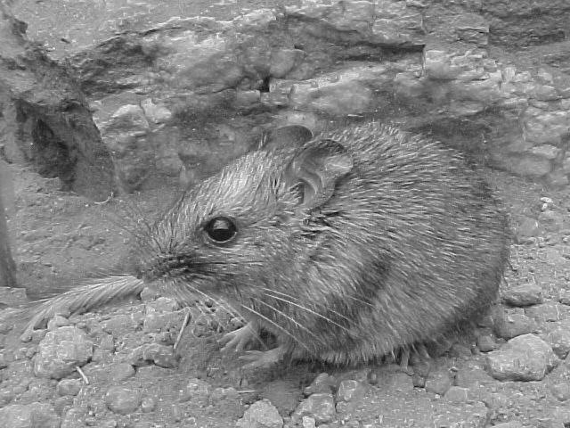
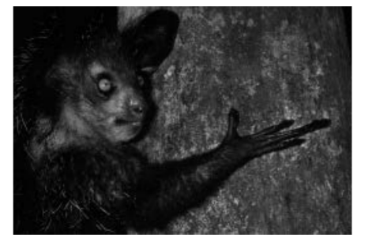
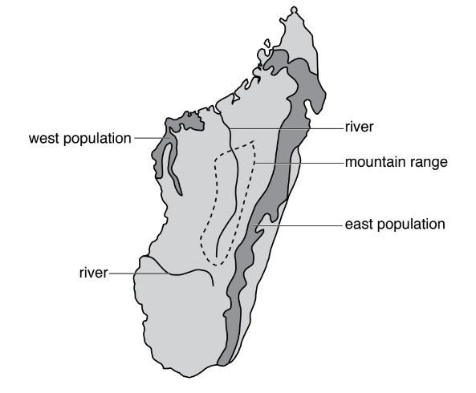
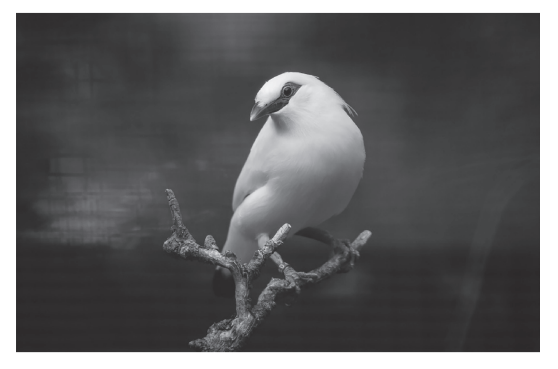
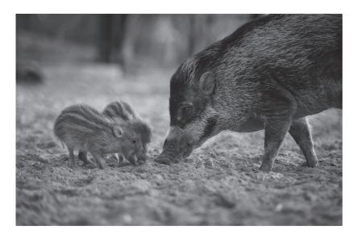
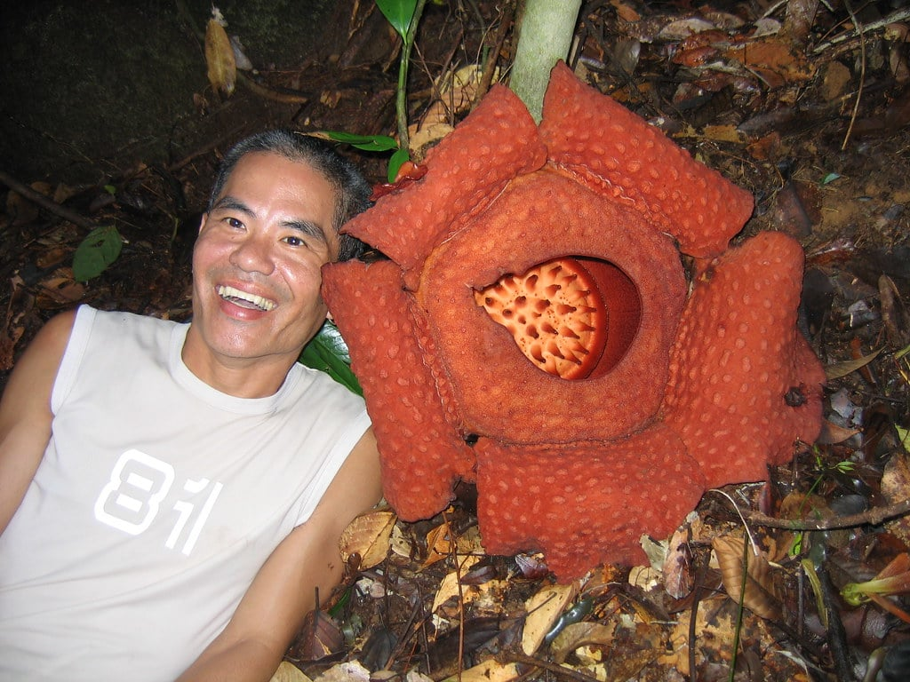

# Exam Questions — Conservation
**18. Classification, Biodiversity & Conservation** · Cambridge (CIE) A-LEVEL biology (9700)
> Source: [https://www.savemyexams.com/a-level/biology/cie/25/topic-questions/](https://www.savemyexams.com/a-level/biology/cie/25/topic-questions/) · 12 questions across 1 sets

## Structured Questions (12 questions)

### Q1 — hard — 8 marks

**Q1** [2 marks]

*Rhododendron ponticum* (pictured in Fig.1 below) is a fast-growing, non-native, invasive species currently threatening biodiversity in the UK.

***R. ponticum***

**Fig. 1**

Originally introduced from Spain as a decorative plant for gardens, *R. ponticum* forms large thickets and outcompetes native plants such as bryophytes, other woody plants and wildflowers. Particularly severely affected are Atlantic oak woodland areas of coastal land in the western United Kingdom. Clearance programmes to remove *R. ponticum* have been in place for approximately 30 years in that region. Data was gathered on how the removal of *R. ponitcum* allows for affected sites to recover and for native species to be restored.

A quadrat study was carried out at three sites:

- An area of dense *R. ponticum* thickets
- An area of intermediate *R. ponticum* coverage
- An area of uninvaded land as a control

In each study, the number of species in each area's understorey was counted, as well as the % vegetation cover. This data is shown in the graphs in Fig. 5.2 and Fig. 5.3 below, which have been plotted with a line of best fit.

**Fig. 2**

**Fig. 3**

(i) Calculate the range of species found at an *R. ponticum* density of 2 log arbitrary units.

[1]

(ii) Explain the decline in the number of species found as the density of *R. ponticum* increases, as found in this study.

[1]

**Q1** [2 marks]

**Extract:**

*Rhododendron ponticum* is a fast-growing, non-native, invasive species currently threatening biodiversity in the UK.

Originally introduced from Spain as a decorative plant for gardens, *R. ponticum* forms large thickets and outcompetes native plants such as bryophytes, other woody plants and wildflowers. Particularly severely affected are Atlantic oak woodland areas of coastal land in the western United Kingdom.

Suggest **two** ways in which *R. ponticum* could affect competition for resources with other plant species.

**Q1** [1 mark]

In an extension of this study, the spread of epiphytes (non-parasitic plants that grow on other plants) was examined as a function of the time elapsed since the human clearance of *R. ponticum* from an area of ancient woodland. Typical taxa of epiphytes include mosses and liverworts. This was done to estimate how well a woodland habitat could recover from an invasion by *R. ponticum*. One theory is that *R. ponticum* can affect successive species long after all its biomass has been cleared away from a site. The results are shown in Fig. 4 and Fig. 5 below.

**Fig. 4**

**Fig. 5**

Estimate the number of years before the number of species found on cleared land first exceeded the number of species found in uninvaded woodland.

**Q1** [3 marks]

**Extract:**

*R. ponticum* releases toxins into the soil that poison other plants

In an extension of this study, the spread of epiphytes (non-parasitic plants that grow on other plants) was examined as a function of the time elapsed since the human clearance of *R. ponticum* from an area of ancient woodland. Typical taxa of epiphytes include mosses and liverworts. This was done to estimate how well a woodland habitat could recover from an invasion by *R. ponticum*. One theory is that *R. ponticum* can affect successive species long after all its biomass has been cleared away from a site. The results are shown in Fig. 4 and Fig. 5 below.

Fig. 4

Fig. 5

(i) Discuss whether the clearance of the *R. ponticum* invasion had an impact on the recovery of the woodland habitat. [2]

(ii) Suggest a reason for any impact observed. [1]

### Q2 — hard — 18 marks

**Q2** [3 marks]

Australia is home to a large number of species that only exist there. Species that only exist in one location globally are called *endemic* species.

Suggest why Australia has a large number of endemic species.

**Q2** [5 marks]

One such endemic species is the central rock rat (*Zyzomys pedunculatus*).

Michael Barritt & Karen May, CC BY-SA 2.0 <https://creativecommons.org/licenses/by-sa/2.0>, via Wikimedia Commons

This species is classified as critically endangered by the IUCN because when they were last assessed there were only 800 mature individuals in total within 10 fragmented subpopulations in central Australia.

In the past, captive breeding programmes have been attempted for this species, but are not currently taking place.

(i) Scientists must be very careful when carrying out captive breeding programmes for very small populations such as this one.

State **two** reasons why this is the case.

[2]

(ii) One of the reasons the programme ended was because scientists were concerned about the safety of the individuals released back into the wild. Suggest **three **other conservation strategies that could be used to conserve this species, other than captive breeding.

[3]

**Q2** [7 marks]

Habitat fragmentation involves breaking up large populations into smaller ones due to physical barriers in the landscape.

(i) State **three** possible causes of habitat fragmentation.

[3]

(ii) Evaluate the benefits and disadvantages of habitat fragmentation on populations.

[4]

**Q2** [3 marks]

Data from the IUCN states that in the year 2000 over 50% of the assessed species were threatened with extinction, whereas in the year 2022 just over 25% were threatened.

A student concluded that it must be the case that conservation efforts are improving so fewer species are threatened.

Explain why the student is incorrect.

### Q3 — hard — 11 marks

**Q3** [5 marks]

The aye-aye, *Daubentonia madagascariensis*, is a mammal, native to Madagascar.

Aye-ayes are active at night and make their nests high up in trees. They feed on insect larvae in the trunks of trees.

Fig. 1 shows an aye-aye.

**Fig. 1**

The International Union for Conservation of Nature (IUCN) categorises the aye-aye as endangered. This means that the aye-aye has a very high risk of becoming extinct in the wild.

(i) Name the domain to which the aye-aye belongs.

[1]

(ii) State one reason why aye-ayes may have become endangered.

[1]

(iii) Suggest ways in which zoos may be able to protect this species from extinction.

[3]

*Source: Specimen 2022 9700/04 Q1AI, AII, AIII*

**Q3** [6 marks]

There are two main aye-aye populations on the island of Madagascar, one in the west and one in the east.

Fig. 2 is a map of Madagascar showing the location of the two main populations.

**Fig. 2**

A study into the variation in the DNA nucleotide sequence of aye-ayes showed that there is a large genetic difference between the west population and east population. The two populations of aye-ayes may be evolving into separate species.

(i) With reference to Fig. 2, suggest why there is a large genetic difference between the two populations.

[5]

(ii) Name the type of speciation that is most likely to occur.

[1]

*Source: Specimen 2022 9700/04 Q1BI, BII*

### Q4 — medium — 9 marks

**Q4** [5 marks]

The Bali starling, *Leucopsar rothschildi*, is found on the island of Bali, Indonesia.

Fig. 1 shows a Bali starling.

**Fig. 1**

The International Union for Conservation of Nature (IUCN) is the world’s largest global environmental organisation. The IUCN Red List of Threatened Species™ evaluates the conservation status of plant and animal species.

The Bali starling is categorised as critically endangered on the IUCN Red List, which means that it is nearly extinct in the wild.

The Bali starling is protected by Indonesian law and trapping of the birds for sale as pets is illegal. In 2001 there were only six Bali starlings in the wild and about 1000 in captivity.

(i) Suggest reasons, other than the trapping of the birds for sale as pets, for the very low numbers of Bali starlings in the wild.

[3]

(ii) Describe the roles zoos can take in the protection of the Bali starling.

[2]

*Source: Oct/Nov 2018 9700/41 Q1A*

**Q4** [4 marks]

**Extract:**

The Bali starling, Leucopsar rothschildi, is found on the island of Bali, Indonesia.

The International Union for Conservation of Nature (IUCN) is the world's largest global environmental organisation. The IUCN Red List of Threatened Species™ evaluates the conservation status of plant and animal species.

The Bali starling is categorised as critically endangered on the IUCN Red List, which means that it is nearly extinct in the wild.

The Bali starling is protected by Indonesian law and trapping of the birds for sale as pets is illegal. In 2001 there were only six Bali starlings in the wild and about 1000 in captivity.

Explain the consequences on genetic biodiversity of having a wild population of just six birds.

*Source: Oct/Nov 2018 9700/41 Q1B*

### Q5 — medium — 9 marks

**Q5** [3 marks]

The African elephant, *Loxodonta africana*, is a large herbivorous mammal that mainly feeds on tree leaves. It has the longest gestation period of any land mammal and usually produces one offspring at a time. Its habitat is mainly savannah.

The meerkat, *Suricata suricatta*, also lives in the savannah of southern Africa. It is a carnivorous mammal and feeds on insects, worms, snails and other invertebrates. It grows up to 30 cm in length and lives in large family groups in burrows.

By contrasting these two species, suggest why the meerkat is less likely than the elephant to become endangered. Use your own knowledge and the information provided above.

**Q5** [1 mark]

Identify the three main components of biodiversity.

**Q5** [2 marks]

Every year, the International Union for the Conservation of Nature and Natural Resources (IUCN) publishes a list of endangered species known as the Red List. The Red List has a very high proportion of vertebrates compared to invertebrates.

Suggest **two** reasons why the Red List has many more vertebrates than invertebrates.

**Q5** [3 marks]

There are ecological, ethical and economic arguments to be made for maintaining biodiversity.

Suggest **one** of each.

### Q6 — medium — 10 marks

**Q6** [5 marks]

The Visayan warty pig, *Sus cebifrons*, is found on two islands in the Philippines.

Fig. 1 shows a female Visayan warty pig with her young.

**Fig. 1**

The International Union for Conservation of Nature (IUCN) is the world’s largest global environmental organisation. The IUCN Red List of Threatened Species™ evaluates the conservation status of plant and animal species.

The Visayan warty pig is categorised as critically endangered on the IUCN Red List, which means that it is nearly extinct in the wild.

There are now only approximately 200 Visayan warty pigs in the Philippines.

Visayan warty pigs live in areas of dense forest that may be close to human habitation.

(i) Suggest **two** reasons why the Visayan warty pig is critically endangered.

[2]

(ii) Describe the role of zoos in the protection of the Visayan warty pig.

[3]

*Source: Oct/Nov 2018 9700/42 Q1A*

**Q6** [3 marks]

Sometimes the Visayan warty pigs will breed with domestic pigs, *Sus domesticus*.

Suggest the consequences of this interspecific breeding.

*Source: Oct/Nov 2018  9700/42 Q1B*

**Q6** [2 marks]

Table 1 shows part of the classification of the Visayan warty pig.

Complete Table 1.

**Table 1**

| **taxonomic group** | **name** |
|---|---|
| domain |   |
| kingdom | animalia |
| phylum | chordata |
|   | mammalia |
| order | artiodactyla |
| family | suidae |

*Source: Oct/Nov 2018  9700/42 Q1C*

### Q7 — medium — 8 marks

**Q7** [1 mark]

Explain what is meant by the term *invasive species*.

**Q7** [3 marks]

Invasive species can impact their new environments in a variety of ways.

Explain the negative effects that alien species can have on an ecosystem.

**Q7** [4 marks]

Endangered mammals tend to have small and isolated populations. These small populations are prone to inbreeding and when populations are isolated it can also be difficult for individuals to find suitable reproductive mates. In the past, large mammals were transported between zoos in captive breeding programs but this was highly expensive and unreliable as sometimes individuals would refuse to mate. Scientists and veterinarians have come up with several solutions for inbreeding and the lack of reproductive mates in endangered mammals.

This group of solutions is known collectively as *assisted reproduction*.Name and describe **two** forms or stages of assisted reproduction.

### Q8 — medium — 10 marks

**Q8** [3 marks]

Below is some information about the plant *Rafflesia arnoldii*:

- It grows in the jungles of South East Asia
- It is noted for having the largest flower of any plant on Earth.
- The flower is a bright red-brown colour and grows up to one metre in diameter.
- The flower smells like rotting flesh to attract flies, which pollinate it.

Fig. 1 below shows a flower of *R. arnoldii*.

"Anthony and Rafflesia" by timjmansfield is licensed under CC BY 2.0. To view a copy of this license, visit https://creativecommons.org/licenses/by/2.0/?ref=openverse.

**Fig. 1**

This species is now classed as endangered.

Suggest **three** reasons why this plant has become an endangered species.

**Q8** [3 marks]

The Royal Botanic Gardens at Kew plays an important role in plant conservation. *Rafflesia arnoldii* is one of the plant species that has been conserved at Kew.

Explain why it is sometimes necessary to conserve a plant species, such as *R. arnoldii*, outside its natural habitat (*ex-situ*).

**Q8** [4 marks]

Many botanic gardens, such as those at Kew, use seed banks as a method of plant conservation.

Outline the advantages of using seed banks, rather than adult plants, for conserving an endangered plant species such as *Rafflesia arnoldii*.

### Q9 — medium — 7 marks

**Q9** [7 marks]

Describe the role of botanic gardens in the protection of endangered species.

*Source: Oct/Nov 2018 9700/41 Q9B*

### Q10 — easy — 8 marks

**Q10** [3 marks]

Fig. 1 shows some assisted conception techniques used in maintaining populations of endangered animals species.

**Fig.1**

Match each technique to its description using a straight line.

**Q10** [2 marks]

The Svalbard Seed Bank is a large underground storage facility in the Arctic circle for seeds of endangered plant species.

Outline **one** advantage and **one** disadvantage of using seed banks like Svalbard for conservation.

**Q10** [3 marks]

(i) Define the term *invasive species.*

[2]

(ii) Give an example of an invasive species caused by human activity.

[1]

### Q11 — easy — 7 marks

**Q11** [2 marks]

The tree species Slippery elm (*Ulmus rubra*) has a sticky lining of its bark that has long been used in North America, as a traditional remedy for coughs, gastrointestinal ailments, and skin irritations.

The slippery elm was traditionally used seasonally by locals, but is now in demand by millions across the world. Slippery elm wood has no commercial value, so the trees are stripped of their bark and then left to die.

Give **two** reasons why the Slippery elm species should be conserved.

**Q11** [2 marks]

Give **one** example of an agricultural advantage and **one** economic advantage of maintaining biodiversity in a habitat.

**Q11** [2 marks]

Outline **two** ways that zoos can play a role in conserving endangered species.

**Q11** [1 mark]

**Extract:**

Outline **two** ways that zoos can play a role in conserving endangered species.

Zoos can play a role in conserving endangered species by:

**Two** of the following:

- Carrying out captive breeding programmes; [1 mark]
- Reintroducing (captively-reared) animals back into the wild; [1 mark]

The giant panda (*Ailuropoda melanoleuca*) is pictured in Fig. 1.

**Fig. 1**

Giant pandas have been kept in captivity in zoos for many decades, yet very few have managed to reproduce in captivity, and no pandas have been successfully introduced into their natural habitats.

Suggest **one** reason why the giant panda captivity programme has been unsuccessful in this regard.

### Q12 — easy — 8 marks

**Q12** [3 marks]

The western lowland gorilla, *Gorilla gorilla*, has become an endangered species.

Explain how captive breeding programmes in zoos may help in the protection of endangered species, such as the western lowland gorilla.

**Q12** [3 marks]

Identify **three** disadvantages of captive breeding programmes.

**Q12** [2 marks]

Western lowland gorillas are protected by the treaty known as CITES.

(i) Give the full name of this treaty. [1]

(ii) Identify the main aim of CITES. [1]
