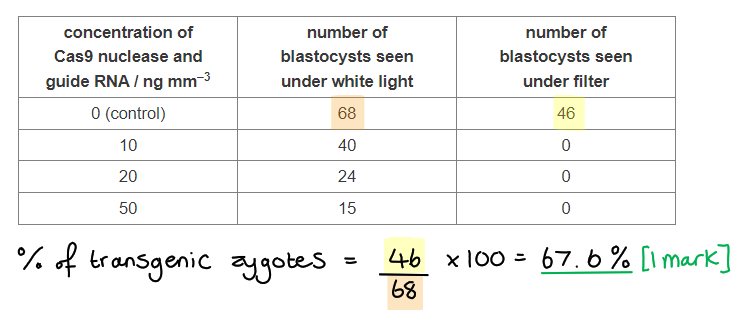
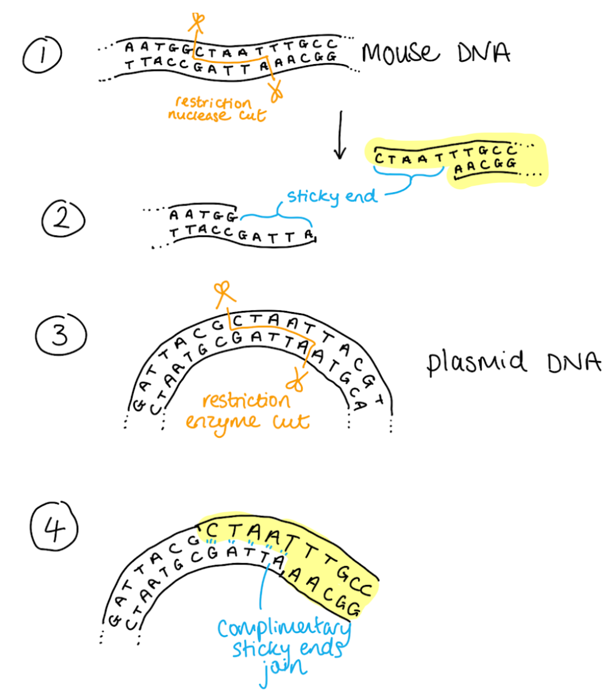
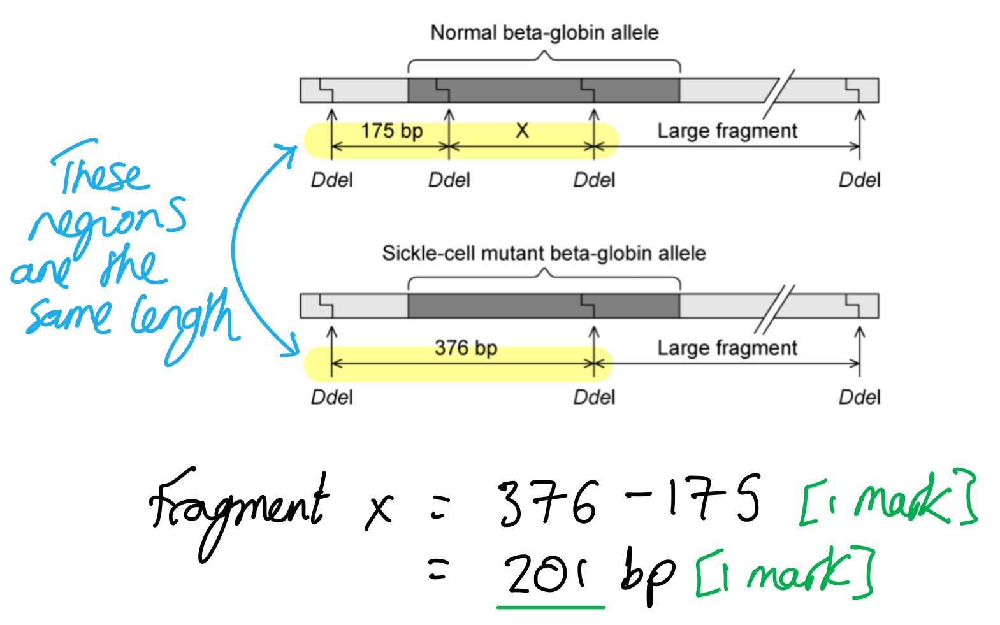
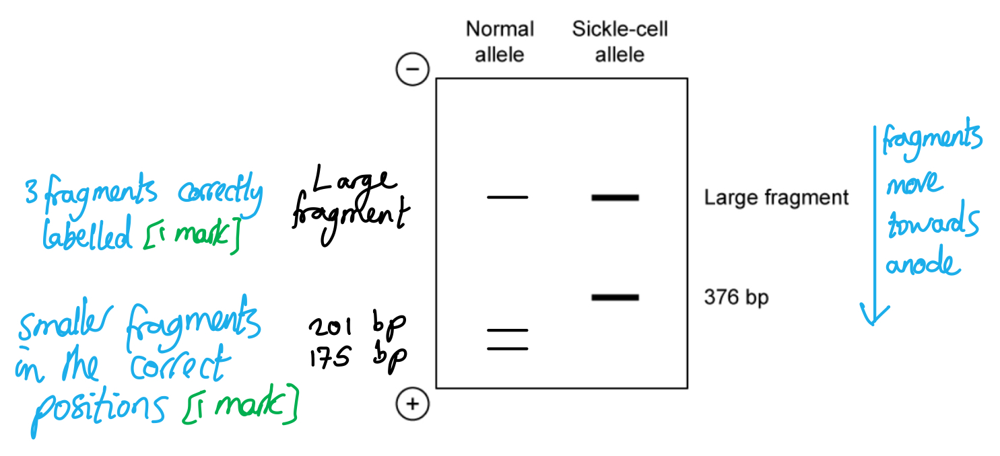

# Mark Schemes — Principles of Genetic Technology
**19. Genetic Technology** · Cambridge (CIE) A-LEVEL biology (9700)

## Structured Questions (11 questions)

### Q1
(i) The research assistant concluded that more than 35 CAG repeats are needed for the development of spinocerebellar ataxia because...

- There is no onset (at any age) when the number of repeats is less than  (approximately) 35; **[1 mark]**

(ii) Evaluative points regarding the conclusion that it is possible to predict the age at which spinocerebellar ataxia will develop from the number of CAG repeats could include...

In support of the conclusion

- There is a <u>negative</u> correlation between age of onset and number of CAG repeats **OR** the age of onset is lower when the individual has more repeats; **[1 mark]**
- The individual with the most CAG repeats (around 57 repeats) develops spinocerebellar ataxia at the lowest age; **[1 mark]**

Against the conclusion

**Final answer:** **A ****maximum of two**** of the following:**

- Not all individuals fit the trend / negative correlation (identified above) **OR** some individuals with many CAG repeats develop spinocerebellar ataxia later than other individuals with fewer CAG repeats **OR **some individuals with few CAG repeats develop spinocerebellar ataxia earlier than other individuals with more CAG repeats; **1 mark]**
- At any given number of repeats, spinocerebellar ataxia can develop at a range of ages **OR** at any given age of onset there are a range of ages at which spinocerebellar ataxia can develop; **[1 mark]**
- A correlation between two variables doesn't always mean that there is a causal link / that one variable has caused the other **OR** there may be variables other than the number of repeats that influences the age of onset; **[1 mark]**
- No statistical analysis has been provided to show the significance of the correlation; **[1 mark]**

**[Total: 4 marks]**

> *When evaluating a conclusion be sure to provide points both in support and against the conclusion for full marks.*
The allele is passed on in human populations because...

- Age of onset can be high / symptoms appear later in life/adulthood **SO** individuals have already had children / the allele/gene has been passed on (by the time they are aware they have the condition); **[1 mark]**

**[Total: 1 mark]**

> *As with Huntington's disease, spinocerebellar ataxia has a late onset, so it is possible for parents to pass the alleles to their children before being aware of the condition. Harmful genetic conditions with an early onset are more likely to affect an individual's ability to survive and pass on their alleles and so are more likely to be lost from the gene pool.*

> *It is also possible that a recessive condition can remain in the gene pool due to the presence of carriers in a population, but as the question refers to Fig. 2.1 your answer points about recessive alleles will not be credited here.*
Only one band was seen for person **X** because...

**Final answer:** **Any ****one**** of the following:**

- They are homozygous; **[1 mark]**
- (CAG) fragments in the alleles are the same length/size/mass; **[1 mark]**

**[Total: 1 mark]**

> *Each band is equivalent to a fragment of the same length/mass. Usually, individuals have a different number of CAG repeats on each allele and are therefore heterozygous. Person **X **has two alleles that have the same number of repeats and are therefore the same size. Fragments of the same size travel the same distance through the gel and will show up as a single band.*
(i) The person who tested positive for spinocerebellar ataxia was...

- Person **W**; **[1 mark]**

(ii) We can say this because...

- **W** has the band that travelled the shortest distance **SO** has the largest (DNA) fragment / number of CAG repeats; **[1 mark]**

**Final answer:** **[Total: 2 marks]**

> *You must relate the distance travelled to the size of the DNA fragment. Smaller fragments suffer less resistance and therefore travel further through the gel. Spinocerebellar ataxia patients have many CAG repeats which therefore results in longer fragments (more repeats means more nucleotides which means longer nucleotide chains), therefore you should expect the patient’s band to move the least.*

### Q2
(i) The main steps involved in creating recombinant DNA for this example of gene therapy are...

**Final answer:** **Any ****four ****of the following:**

- Synthesise/obtain the therapeutic/correct <u>allele</u> / produce (c)DNA for the correct <u>allele</u>; **[1 mark]**
- From the mRNA of a healthy person / from a gene library; **[1 mark]**
- Use a probe / carry out electrophoresis/DNA sequencing to identify the therapeutic/correct allele; **[1 mark]**
- Use PCR to amplify allele/gene/DNA; **[1 mark]**
- A <u>restriction</u> enzyme/endonuclease is used **AND **its role is to** **cut DNA at a specific recognition site/sequence (to isolate the required gene); **[1 mark]**
- (DNA) <u>ligase</u> is used **AND** its role is to** **join together DNA nucleotides / catalyse the formation of phosphodiester bonds (in the DNA backbone); **[1 mark]**
- Add a promoter region; **[1 mark]**

(ii) The fact that LCA is an autosomal recessive genetic disease makes it suitable for treatment with gene therapy because...

**Final answer:** **Any ****two ****of the following:**

- (It is possible to) insert the correct DNA/allele; **[1 mark]**
- (Only) one allele/copy is needed per cell; **[1 mark]**
- To cure disease / restore vision; **[1 mark]**
- (As this allows the cells of the eye) to synthesise functional protein; **[1 mark]**
- (There is) no need to edit/remove the faulty allele (as would be the case if faulty allele was dominant); **[1 mark]**

(iii) The retinal injection method of gene therapy was used for LCA before it was trialled on other retinal diseases that gradually reduce the vision of people as they get older because...

**Final answer:** **Any ****two ****of the following:**

- LCA patients are already blind / have lost vision; **[1 mark]**
- It is (therefore) less likely to harm/worsen vision for LCA patients; **[1 mark]**
- Other age-related diseases may involve many genes / dominant alleles; **[1 mark]**

**[Total: 8 marks]**

> *i) You need to make sure your answer aligns with the **specific example** given in the question, so don't just regurgitate your knowledge of genetic engineering without altering your answers to suit the information provided. For example the question tells you that a **viral vector** has been used so any references to plasmids would be incorrect, and references to genes being located in pancreas cells would also be incorrect (this question is about an eye disease and not about producing insulin!).*

> *Note that the terms gene and allele should not be used interchangeably; here the gene codes for a protein and it is the** allele **of the gene that determines whether or not the protein functions correctly.*
(i) Errors occurring during PCR can cause base substitution mutations in the DNA sequence of AAV because...

**Final answer:** **Any ****three ****of the following:**

- Wrong base added / wrong bases pair up...; **[1 mark]**
- ...To template DNA/strand; **[1 mark]**
- *Taq *polymerase is inaccurate / no proofreading occurs; **[1 mark]**
- In extension/elongation stage; **[1 mark]**
- Mistake/mutation is replicated/copied (many times); **[1 mark]**
- High temperature speeds up replication and increases the chance of mistakes; **[1 mark]**

(ii) The photoreceptor cells of the mouse fluoresced in step 3 because...

**Final answer:** **Any ****two ****of the following:**

- AAV/7m8/virus crossed the fluid / reached the photoreceptors/retina; **[1 mark]**
- (The virus) delivered (new/GFP) allele/DNA to photoreceptors/retina cells; **[1 mark]**
- (GFP) gene/DNA expressed in photoreceptors/retina cells; **[1 mark]**
- GF<u>P</u>/<u>protein</u> product is fluorescent; **[1 mark]**

(iii)  A prediction of the impact of the 7m8 AAV on treatment for age‐related retinal diseases is...

- (7m8) will decrease the risk involved with / increase treatment by <u>gene therapy</u>; **[1 mark]**

**[Total: 6 marks]**

> *ii) Don't confuse the **gene for** GFP, which is a section of DNA, with the protein product GFP, which glows green under UV light.*

### Q3
These three enzymes could be used in genetically engineering a transgenic pig containing the *GFP* gene by...

- Restriction endonuclease/enzyme cuts vector/plasmid; **[1 mark]**
- Reverse transcriptase to make cDNA using mRNA; **[1 mark]**
- DNA ligase joins sugar phosphate backbone (between gene and vector) **OR** DNA ligase forms phosphodiester bonds (between gene and vector); **[1 mark]**

**[Total: 3 marks]**

> *It is very important to include enough detail in your answers, for example saying that ligase joins the DNA together is not the same as saying that it catalyses the formation of the phosphodiester bonds in the sugar phosphate backbone of the DNA. Think about whether your answer contains enough A Level detail as opposed to something you remember from your GCSE level studies.*
The *GFP* gene was chosen for testing the new technique because...

- <u>Marker</u>; **[1 mark]**
- No fluorescence means GFP gene was deleted; **[1 mark]**

**[Total: 2 marks]**

> *A marker gene is a gene used to help scientists identify whether genetic modification has been successful. GFP is a good gene to use because you can see visibly if the gene is present or not, rather than having to do complex DNA sequencing to identify the DNA of a genetically engineered organism.  *
(i) The percentage of zygotes in the control group that were transgenic is...

- 67.6 or 68%; **[1 mark]**

(ii) The percentage is...

- Higher, as expect 50% (of offspring to get GFP gene from heterozygous male); **[1 mark]**

*Accept: *lower, as expect 50%, (if answer to (c)(i) less than 50%); **[1 mark]**

(iii) A statistical test that would allow you to test the significance of the difference between the percentage you calculated and the expected percentage is...

- χ2 / chi-squared; **[1 mark]**

(iv) The best concentration of Cas9 nuclease and guide RNA to use to cause a deletion in the *GFP *gene is...

- 10 ng mm–3; **[1 mark]**

**Final answer:** **Plus any ****two ****of the following:**

- More blastocysts; **[1 mark]**
- Less toxic; **[1 mark]**
- No blastocysts seen under filter / as successful as higher concentrations / all blastocysts have deleted GFP; **[1 mark]**

**[Total: 6 marks]**

> *Make sure you include the units in your answer.*
Fig. 1 indicates that...

**Final answer:** **Any ****three ****of the following:**

- Lanes **1–4** show 4 kbp fragment; **[1 mark]**
- So technique is 100% successful; **[1 mark]**
- (6 kbp gene has) 2 kbp deleted/lost; **[1 mark]**
- Pigs (**1–4**) have no (normal cell surface) protein; **[1 mark]**
- PRRSV/virus cannot infect the cells/pigs (**1–4**); **[1 mark]**

**[Total: 3 marks]**

### Q4
(i) The type of variation shown in Fig. 2 is...

- Continuous (variation); **[1 mark]**

(ii) Genes and the environment contribute to variation in IPD in humans as follows...

**Final answer:** **Any ****three**** of the following:**

- Several/many genes; **[1 mark]**
- (Genes have an) additive effect / (gene products) interact; **[1 mark]**
- The environment has a large/significant effect (on IPD); **[1 mark]**
- (Named) environmental factors affect gene expression (e.g. diet, stress); **[1 mark]**
- Age / diet / disease / parasites / chemicals (e.g. in the uterus during development) can affect the phenotype; **[1 mark]**

***Accept**** mutagens or alcohol for chemicals in marking point 5.*

***Accept ****development or IPD for phenotype in marking point 5.*

**[Total: 4 marks]**

> *It can be difficult to explain the genetic and environmental factors that influence specific types of variation.*

> *Continuous variation in a particular characteristic, such as IPD, occurs as the result of multiple genes interacting with each other; such genes can be referred to as polygenes. These genes can have an additive effect, each having a small effect on the overall phenotype of an organism.*

> *The environment also has an impact on such characteristics. In this instance factors such as age, diet, and exposure to chemicals during development may all influence IPD. For example, overall growth of the skull may be affected by environmental factors such that the orbits (eye sockets) develop closer together or further apart, which will also affect the interpupillary distance.*
(i) The term that is used to describe a gene, such as *PAX3*, that controls the expression of other genes is...

- <u>Regulator</u>(y) (gene); **[1 mark]**

**AND**

The PAX3 protein controls the expression of other genes by...

**Final answer:** **Any ****two**** of the following:**

- The gene codes for (a protein that is) a transcription factor / activator/inducer; **[1 mark]**
- (The protein expressed from the gene) binds to DNA; **[1 mark]**
- The DNA binding site is the) promoter/enhancer (region); **[1 mark]**
- (Binding to the promoter) enables <u>RNA polymerase</u> (to bind to the start of a gene); **[1 mark]**

(ii) Microarray analysis could be used to identify the genes switched on by PAX3 in embryonic cells as follows...

**Final answer:** **Any ****five**** of the following:**

- Take mRNA from (embryonic) cell (that is expressing *PAX3*); **[1 mark]**
- Make cDNA from the mRNA; **[1 mark]**
- Add a fluorescent tag to the (c)DNA (that has just been made from the mRNA); **[1 mark]**
- The microarray has DNA probes for known genes; **[1 mark]**
- cDNA hybridises with / binds to complementary base pairs (on the relevant probes); **[1 mark]**
- Fluorescence indicates expression (of genes); **[1 mark]**
- Wash off excess cDNA after hybridisation **OR** use UV to see fluorescence **OR** intensity of the fluorescence gives a quantitative measure (of expression); **[1 mark]**

(iii) Knowledge of the *PAX3 *gene helps scientists explain how humans and chimpanzees are very different in facial structure, even though they have very similar DNA because...

**Final answer:** **Any ****three**** of the following:**

- Small genetic differences / difference in a single gene can have a large phenotype effect; **[1 mark]**
- (This is) because *PAX3* regulates many other genes; **[1 mark]**
- There is a different pattern of gene expression / different genes are expressed (in chimps compared to humans); **[1 mark]**
- More PAX3 (protein) in chimps reduces chimp IPD / distance between chimp eyes / face width; **[1 mark]**

**[Total: 11 marks]**

> *i) Read the question carefully here; you are asked to name the type of **gene** and not the type of protein expressed from the gene.*

> *ii) Make sure that you are familiar with the details of microarray analysis. For example you should know that it is **mRNA** that is extracted from the cell of interest and not DNA; this is because the mRNA present will tell scientists which genes are being expressed and not just which genes are present in the cell. **cDNA** can then be made from this mRNA and labelled with **fluorescent** tags before being allowed to bind to complementary DNA probes that are **already present **on the microarray. Washing the microarray removes any unbound pieces of cDNA and then **UV light** can be used to reveal whether or not the cell is expressing particular genes.*

> *iii) This is a 'suggest' question, meaning that you are expected to apply knowledge of gene function to this unfamiliar scenario. The fact that PAX3 protein has a regulatory role that affects the expression of 'many other genes' (see question stem) is key here. If PAX3 protein is expressed differently in chimps then this could lead to different expression of multiple other genes in the cells of developing chimps. The image provided allows you to be specific about the effects of different PAX3 levels on facial structure.*

### Q5
The pieces of mouse DNA would be able to join the plasmid DNA because...

- Both mouse DNA and plasmid DNA have <u>sticky ends</u> **OR** both DNA ends have unpaired nucleotides ; **[1 mark]**
- The unpaired nucleotides / sticky ends are <u>complementary</u> **SO** base-pairing occurs; **[1 mark]**

**[Total: 2 marks]**

> *Take note of the underlined words in this mark scheme - restriction enzymes produce a staggered cut meaning that there is a short section of single-stranded DNA at the end of each resulting fragment. If the same enzyme is used to cut the mouse and plasmid DNA then the single-stranded sections will be complementary and form hydrogen bonds joining the separate fragments.*

(i) The other enzyme added was...

- (DNA) ligase; **[1 mark]**

(ii) The role of this enzyme is...

- To join the sugar-phosphate backbone / form phosphodiester bonds between DNA fragments and the plasmid DNA; **[1 mark]**

**[Total: 2 marks]**

> *Once the sticky ends have joined together and hydrogen bonds are formed spontaneously between complementary nucleotide bases, the DNA backbones are joined by DNA ligase.*
A vector is...

- A carrier of DNA / a gene; **[1 mark]**
- Into another cell/organism/host; **[1 mark]**

**[Total: 2 marks]**
Human recombinant insulin can be produced as follows…

**Final answer:** **Any ****six**** of the following:**

- Human insulin mRNA is extracted from human pancreatic cells; **[1 mark]**
- Reverse transcriptase is used to make complementary DNA/cDNA **OR** DNA is synthesised from nucleotides in the lab / in a synthesiser (machine); **[1 mark]**
- DNA polymerase is used to convert single-stranded cDNA into double-stranded cDNA; **[1 mark]**
- DNA/gene is amplified using PCR; **[1 mark]**
- Insulin gene/DNA is cut using restriction enzyme/endonuclease (to create sticky ends) **AND** bacterial plasmid cut using <u>same</u> restriction enzyme/endonuclease; **[1 mark]**
- Amplified gene is inserted into a plasmid (vector);** [1 mark]**
- The recombinant plasmid is introduced into host cells/bacteria;** [1 mark]**
- Transformed cells are identified using marker genes; **[1 mark]**
- Transformed cells are grown in culture / a fermenter; **[1 mark]**
- Expressed insulin is separated/extracted and purified from the host cells; **[1 mark]**

**[Total: 6 marks]**

> *The question has asked for the key steps in the commercial production of human insulin. Although improved methodologies have been developed (including using transgenic crops) these have not been implemented on a commercial scale. The standard robust process relies on isolating the gene of interest, inserting it into a plasmid/vector, inserting the plasmid into bacterial cells, and growing them on a large scale to ensure a large amount of insulin protein is produced/expressed.*

> *Note that marks have not been awarded for points covered elsewhere in the question, i.e. sticky ends, ligase, and the role of vectors.*

### Q6
PCR was used because...

- Only small amounts of DNA were obtained (from each individual) **SO** PCR was needed to increase/amplify the amount/mass of DNA; **[1 mark]**
- So there is enough/sufficient DNA available for genetic fingerprinting; **[1 mark]**

**[Total: 2 marks]**
(i) DNA is heated to 94 °C because...

- To separate the two strands of the DNA **OR** to break the hydrogen bonds between the DNA strands/bases; **[1 mark]**

(ii) DNA primers are...

- Short lengths/fragments of single-stranded DNA; **[1 mark]**
- Complementary to / to mark the beginning/ends of the part of DNA being amplified **OR** that are required for enzyme/DNA polymerase attachment to the nucleotides; **[1 mark]**

(iii) Temperature stable enzymes are used because...

- So that enzymes do not denature / the bonds holding the tertiary structure of the enzyme in place do not break (at high temperatures/94 °C); **[1 mark]**

**[Total: 4 marks]**

> *For part i) you will not be awarded the mark for stating the DNA is ‘unzipped’ as this suggests that DNA helicase is being used.*
(i) The father was...

- Adult C; **[1 mark]**

(ii) The reason for this is that...

- (Adult C) is the only adult that can provide all the (remaining) DNA fragments/bands (after the mother's DNA is accounted for) that the children have **OR** all fragments/bands from adults B and C together/combined match all the children’s fragments/bands; **[1 mark]**

**[Total: 2 marks]**

> *When talking about genetic fingerprinting you must refer to the DNA as ‘fragments’ or ‘bands’ you cannot call them ‘genes’. This is because it has not been stated that the DNA was cut into separate genes and that the DNA could come from non-coding sections of the genome.*
Genetic fingerprinting is carried out as follows...

**Final answer:** **Any ****five**** of the following:**

- DNA is extracted/isolated from a sample (e.g. cheek cell, root of a hair, blood, semen); **[1 mark]**
- DNA is copied/increased/amplified through <u>PCR</u> / the <u>polymerase chain reaction</u>; **[1 mark]**
- DNA sequences that are highly variable between individuals are selected; **[1 mark]**
- DNA is hydrolysed/cut into fragments using <u>restriction</u> enzymes/endonucleases; **[1 mark]**
- DNA fragments are separated using (gel) <u>electrophoresis</u>; **[1 mark]**
- (During gel electrophoresis the) DNA is put into wells in gel **AND **an electric current is passed through; **[1 mark]**
- Tracking dye used to show how far DNA fragments (from wells/samples) have travelled through the gel **OR** probe with fluorescent stain / radioactive marker added; **[1 mark]**
- (DNA) bands/fragments compared/matched with sample/reference DNA/DNA ladder (e.g. DNA from potential parent or suspected criminal);** [1 mark]**

**[Total: 5 marks]**

> *It is important in this topic for you to not only interpret the results of genetic techniques but also describe the **methods**. Method questions are usually high scorers and rely on relaying information that you can revise without any need for interpretation of data/context. It is therefore essential to dedicate time to learning the methods of all the techniques and remembering them step-by-step.*

### Q7
The role of DNA polymerase in RT-PCR is to...

- Join <u>nucleotides</u> to each other / form phosphodiester bonds between nucleotides / form the new sugar-phosphate backbone;** [1 mark]**

The role of reverse transcriptase in RT-PCR is to...

- Produce cDNA/complementary DNA from mRNA;** [1 mark]**

***Reject*** *any answer that suggests DNA polymerase is involved with the formation of hydrogen bonds or complementary base pairing.*

**[Total: 2 marks]**

> *It is essential that you know the roles of DNA polymerase, reverse transcriptase, and ligase within gene technologies. Not only will you be asked about their roles in questions but they also give good hints about what is happening in a particular technique and can help you if you don't know the technique itself. *
The DNA is hydrolysed because...

- Any DNA present would be amplified/replicated **OR** the researcher only wanted the RNA present to be amplified; **[1 mark]**

**[Total: 1 mark]**

> *PCR does not discriminate between what you want to amplify and what you do not and therefore if you only want the RNA present to be amplified then the DNA must be destroyed. If the DNA is not destroyed then the whole genome could be amplified and this will not give an accurate representation of the genes that the cell is currently expressing.*
DNA replication stops because…

**Final answer:** **Any ****one**** of the following:**

- DNA polymerase (eventually) denatures; **[1 mark]**
- There is a limited number of primers/nucleotides and / the primers/nucleotides are used up; **[1 mark]**

**[Total: 1 mark]**

> *The polymerase chain reaction is a cyclical process that uses temperature changes to amplify a DNA sample through semi-conservative replication. It requires primers to initially anneal the DNA fragments and act as a starting point for DNA polymerase to add free nucleotides. Therefore the lack of either primers, nucleotides, or DNA polymerase will stop replication.*
The researchers produced a variety of primers because...

- Base sequences differ/vary (between different viruses in the family); **[1 mark]**
- Therefore different <u>complementary</u> primers required **OR** primers with different <u>complementary</u> base sequences are required (to bind to the DNA of different viruses); **[1 mark]**

**[Total: 2 marks]**

> *Primers are lengths of complementary DNA that anneal to sections of DNA to aid in replication.*

### Q8
The zebrafish is attached to protein Q because...

- It acts as a marker gene to show that the pig gene has been taken up / that cells have been transformed; **[1 mark]**
- Only cells/embryos that contain the gene will (express the gene and) fluoresce / give off blue light;** [1 mark]**

**[Total: 2 marks]**

> *Marker genes are used to verify that the gene has been taken up by the cells and the protein is being expressed. Remember it is the **protein** that fluoresces blue, **not the gene**. This can sometimes act as a way of selecting cells that express the protein.*
(i) The role of a promoter is...

- It is the region of a gene to which RNA polymerase/transcription factors bind to <u>initiate</u>/<u>start transcription</u>;** [1 mark]**

(ii) Goat promoter DNA from a gene normally expressed in the milk glands is used because...

- The gene is <u>only</u> expressed in the milk glands / udder cells **OR** the gene is not expressed in every cell in the goat;** [1 mark]**

**[Total: 2 marks]**

> *The protein is expressed in milk, so it does not enter the bloodstream and is easy to harvest in the milk; both of these features make this a safe way of producing protein Q.*
(i) During gel electrophoresis DNA moves towards…

- The anode / positive (+ve) electrode; **[1 mark]**

(ii) The reason for this is...

- DNA is <u>negatively</u> charged;** [1 mark]**
- Due to the phosphate groups (in the phosphate backbone); **[1 mark]**

**[Total: 3 marks]**
(i) Fragment** X** is…

- 201 bp in length; **[1 mark]**

(ii) The following fragments should be drawn…

- A large fragment in the same position as the large fragment in the sickle cell allele **AND** a fragment labelled 175 bp **AND** a fragment labelled 201 bp; **[1 mark]**
- The fragments labelled 175 bp and 201 bp have both travelled further than the 376 bp fragments in the sickle cell allele **AND** the fragment labelled 175 bp has travelled furthest; **[1 mark]**

**[Total: 3 marks]**

> *The smaller restriction fragments are 201 bp and 175 bp in length so will migrate further down the gel compared to the 376 bp fragment as they are smaller and have less mass.*

### Q9
The purpose of PCR is to...

- Amplify / produce many (identical) copies of a DNA sequence/strand; **[1 mark]**

**[Total: 1 mark]**
(i) The purpose of primers is to...

- Bind to the start of the desired gene / produce a double stranded section of DNA **SO** that the polymerase enzyme can attach/bind/begin copying; **[1 mark]**

(ii) The purpose of a buffer solution is to...

- Control the pH **SO** that the DNA/enzymes do not denature; **[1 mark]**

(iii) The purpose of free DNA nucleotides is to...

- Provide a source/supply of nucleotides **SO** that new DNA strands can be built / assembled / made / synthesised; **[1 mark]**

**[Total: 3 marks]**

> *The question here has asked you to state **and** explain the purpose of each component added to the PCR machine, so be sure that you do this.*
At point X in Fig. 1...

- The DNA strand is denaturing / the two strands of the DNA molecule are separating/breaking apart; **[1 mark]**

This is occurring because...

- High temperatures/95 °C temperatures cause the hydrogen bonds (between the strands) to break; **[1 mark]**

**[Total: 2 marks]**

> *The breaking apart of the double helix at this stage in the PCR cycle exposes the bases, enabling each single strand to act as a template for the synthesis of new strands.*
Taq polymerase is the enzyme used in the elongation stage of the PCR cycle rather than human DNA polymerase because…

**Final answer:** **Any ****one**** of the following:**

- Taq polymerase does not denature at high temperatures (the thermocycler reaches temperatures of up to 95 °C); **[1 mark]**
- Taq polymerase has an optimum temperature of 72 °C (and high temperatures are required to break apart the DNA double strands); **[1 mark]**

**[Total: 1 mark]**

> *Human DNA polymerase would denature at the temperatures required to break apart the double helix in the PCR machine. In addition to this, at the optimum temperature of human DNA polymerase the DNA single strands would anneal back together again, preventing the synthesis of new DNA copies. *

### Q10
The term recombinant DNA can be defined as follows...

- (DNA that) contains bases/nucleotides/genes from <u>different species</u> / <u>different sources</u>; **[1 mark]**

**[Total: 1 mark]**
(i) The names of the enzymes that cut DNA at specific base sequences are...

- Restriction endonuclease(s)/enzyme(s);** [1 mark]**

(ii) Enzymes that are used to make a single-stranded DNA copy of a piece of mRNA are...

- Reverse transcriptase(s); **[1 mark]**

(iii) Enzymes that pieces of DNA together are...

- (DNA) ligase(s)<u>;</u> **[1 mark]**

**[Total: 3 marks]**
An example, other than the desired gene, of a section of DNA that might be found in a plasmid during genetic engineering is...

- Promoter (region); **[1 mark]**
- Allows RNA polymerase to bind / transcription/expression (of the desired gene) to occur; **[1 mark]**

**OR**

- Marker gene / gene for antibiotic resistance / gene for fluorescence/GFP; **[1 mark]**
- Allows identification of transformed cells / cells that contain the recombinant plasmid/DNA; **[1 mark]**

**[Total: 2 marks]**
The name of the component that is used to transfer DNA into the cells of organisms is...

- Vector; **[1 mark]**

**[Total: 1 mark]**

> *Plasmids are just one example of a **vector**; other examples include viruses and liposomes.*

### Q11
VNTRs are useful for carrying out genetic fingerprints like that shown in Fig. 1 because...

- The length of VNTRs varies between people / the chances of two people having the same lengths of VNTR are very small / only identical twins will have the same length VNTRs; **[1 mark]**

**[Total: 1 mark]**

> *The coding DNA of every human is almost identical, so coding DNA is not very useful for distinguishing between individuals, but VNTRs vary in number from one individual to another, so when analysing several VNTRs at the same time the chances of all of them being the same length are virtually zero (unless two people are identical twins). *
DNA fragments travel through the gel because...

- The DNA fragments move/travel towards the positive electrode **OR** the DNA fragments are negatively charged so are attracted to the positive electrode; **[1 mark]**

DNA fragments appear as bands at different positions because...

- Smaller/lighter DNA fragments travel more quickly / larger/heavier DNA fragments travel more slowly;** [1 mark]**

**[Total: 2 marks]**
The suspect likely to have been present at the crime scene is...

- (Suspect) 2; **[1 mark]**

This is because...

- The DNA bands for suspect 2 are at the same positions as the bands from the crime scene sample / suspect 2 has the same length VNTRs/DNA fragments as the crime scene sample;** [1 mark]**

**[Total: 2 marks]**
Other applications of genetic profiling techniques are...

**Final answer:** **Any ****two**** of the following:**

- Identifying individuals at risk of genetic disease / diagnosing genetic disease (when a specific mutation sequence isn’t known, or when several genetic variants could be involved); **[1 mark]**
- Determining family relationships (e.g. paternity testing) / ancestry testing; **[1 mark]**
- Determining relatedness of animals/plants in captive breeding programmes (breeding closely related organisms together can cause inbreeding depression); **[1 mark]**
- Determining genetic variation in a population (for conservation purposes); **[1 mark]**

**[Total: 2 marks]**
