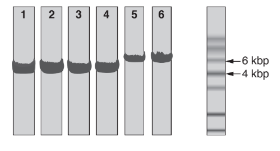
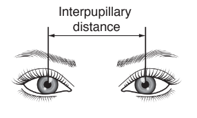
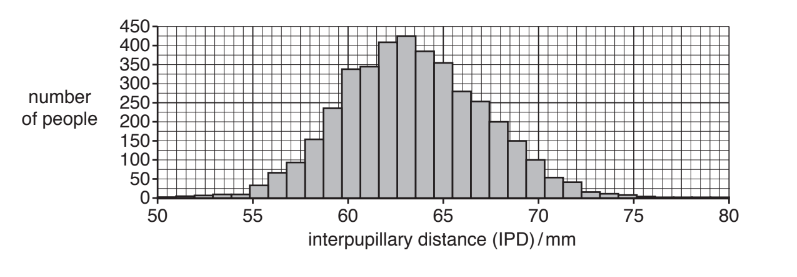
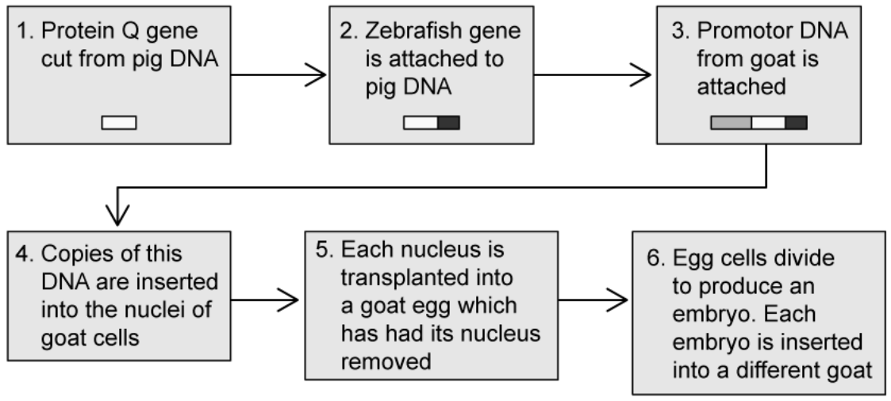
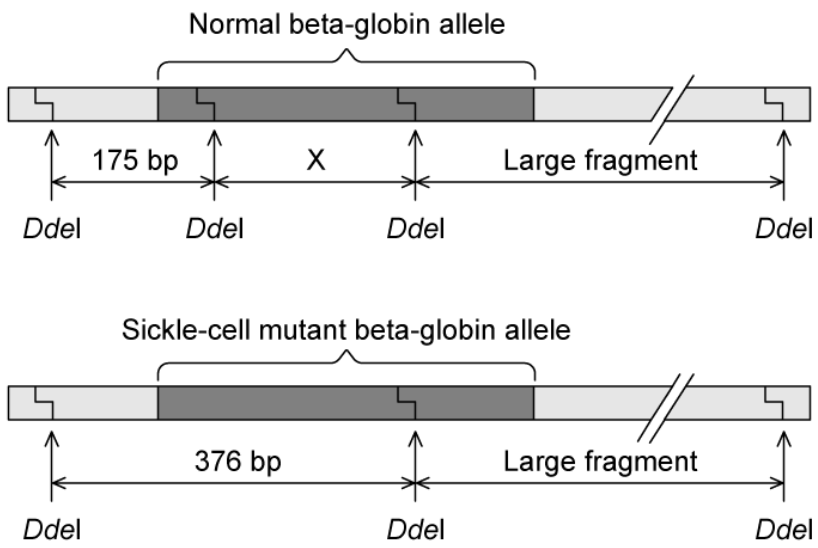
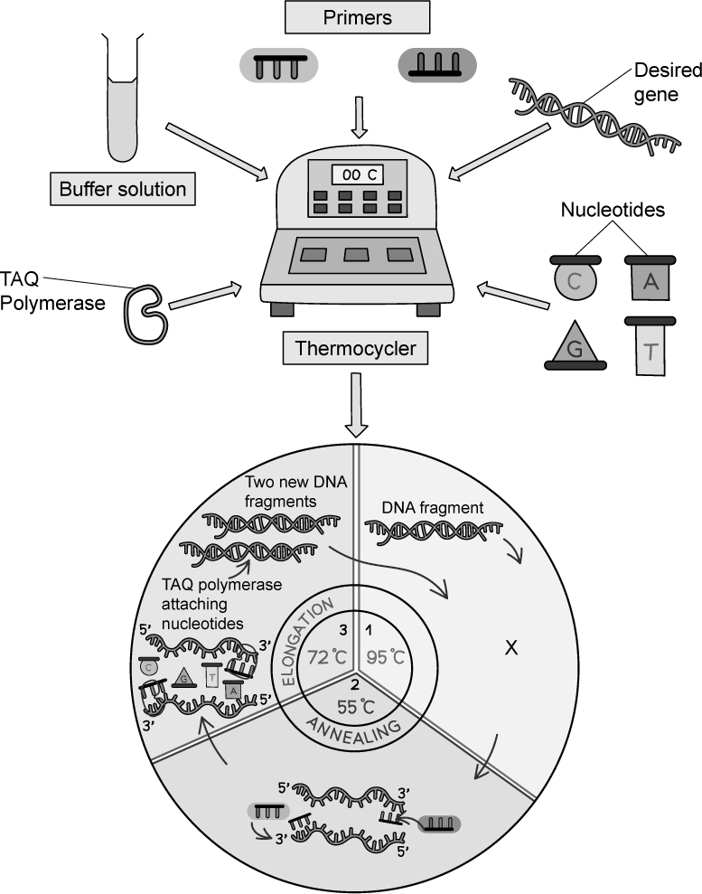

# Exam Questions — Principles of Genetic Technology
**19. Genetic Technology** · Cambridge (CIE) A-LEVEL biology (9700)
> Source: [https://www.savemyexams.com/a-level/biology/cie/25/topic-questions/](https://www.savemyexams.com/a-level/biology/cie/25/topic-questions/) · 11 questions across 1 sets

## Structured Questions (11 questions)

### Q1 — hard — 8 marks

**Q1** [4 marks]

Spinocerebellar ataxia is a genetic condition that leads to a loss in the brain’s ability to coordinate movement in hands, eyes, and speech. The gene involved contains a section of DNA with many repeats of the base sequence CAG. The number of these repeats determines whether or not an allele of this gene will cause spinocerebellar ataxia. People can be tested to determine the number of CAG repeats on this allele.

Fig.1 shows the age at which a sample of patients with spinocerebellar ataxia first developed symptoms and the number of CAG repeats in the allele causing spinocerebellar ataxia in each patient.

**Fig. 1**

A research assistant decided that the following conclusions can be drawn from Fig.1:

- More than 35 CAG repeats are needed for the development of spinocerebellar ataxia.
- It is possible to predict the age at which spinocerebellar ataxia will develop from the number of CAG repeats.

Use the information in Fig.1 to:

(i) State how the research assistant concluded that more than 35 CAG repeats are needed for the development of spinocerebellar ataxia.

[1]

(ii) Evaluate the conclusion that it is possible to predict the age at which spinocerebellar ataxia will develop from the number of CAG repeats.

[3]

**Q1** [1 mark]

**Extract:**

Spinocerebellar ataxia is a genetic condition that leads to a loss in the brain's ability to coordinate movement in hands, eyes, and speech. The gene involved contains a section of DNA with many repeats of the base sequence CAG. The number of these repeats determines whether or not an allele of this gene will cause spinocerebellar ataxia. People can be tested to determine the number of CAG repeats on this allele.

Fig.1 shows the age at which a sample of patients with spinocerebellar ataxia first developed symptoms and the number of CAG repeats in the allele causing spinocerebellar ataxia in each patient.

With reference to Fig.1, suggest why the allele that causes spinocerebellar ataxia is passed on in human populations despite the condition being fatal.

**Q1** [1 mark]

DNA samples were taken from four people; **W**, **X**, **Y** and **Z**. The polymerase chain reaction (PCR) was used to produce many copies of the section of DNA containing CAG repeats obtained from each person. The DNA fragments were then separated by gel electrophoresis and detected using a radioactively labelled probe.

Fig. 2 shows the appearance of part of the gel after an X-ray was taken. The bands show the DNA fragments that contain the CAG repeats.

**Fig. 2**

Each individual usually has two bands.

Suggest why only one band was seen for person **X**.

**Q1** [2 marks]

**Extract:**

DNA samples were taken from four people; W, X, Y and Z. The polymerase chain reaction (PCR) was used to produce many copies of the section of DNA containing CAG repeats obtained from each person. The DNA fragments were then separated by gel electrophoresis and detected using a radioactively labelled probe.

Fig. 2 shows the appearance of part of the gel after an X-ray was taken. The bands show the DNA fragments that contain the CAG repeats.

Fig. 2

Only one of **W**, **X**, **Y** and **Z** tested positive for spinocerebellar ataxia.

(i) Use Fig.1 to suggest which person tested positive for spinocerebellar ataxia.

[1]

(ii) Explain your answer to part i).

[1]

### Q2 — hard — 14 marks

**Q2** [8 marks]

Leber’s congenital amaurosis (LCA) is an autosomal recessive eye disease. LCA results in eye disorders, including severe loss of vision, at birth. LCA has been successfully treated by gene therapy, using a virus instead of a plasmid as the vector.

Adeno‐associated virus (AAV) vectors containing the therapeutic allele were injected directly into the retina, the layer at the back of the eye containing the photoreceptor cells. People who had been blind from a young age were able to see again.

There is a risk associated with the injection method used to deliver the vectors, as it might cause the retina to detach, damaging vision. This method of delivery was first used for LCA before being trialled on other retinal diseases that gradually reduce the vision of people as they get older.

(i) Suggest the main steps involved in creating recombinant DNA for this example of gene therapy.

[4]

(ii) Explain why the fact that LCA is an autosomal recessive genetic disease makes it suitable for treatment with gene therapy.

[2]

(iii) Suggest why the retinal injection method of gene therapy was used for LCA before it was trialled on other retinal diseases that gradually reduce the vision of people as they get older.

[2]

*Source: Oct/Nov 2018 9700/41 Q5A*

**Q2** [6 marks]

**Extract:**

Leber's congenital amaurosis (LCA) is an autosomal recessive eye disease. LCA results in eye disorders, including severe loss of vision, at birth. LCA has been successfully treated by gene therapy, using a virus instead of a plasmid as the vector.

Adeno‐associated virus (AAV) vectors containing the therapeutic allele were injected directly into the retina, the layer at the back of the eye containing the photoreceptor cells. People who had been blind from a young age were able to see again.

There is a risk associated with the injection method used to deliver the vectors, as it might cause the retina to detach, damaging vision. This method of delivery was first used for LCA before being trialled on other retinal diseases that gradually reduce the vision of people as they get older.

Scientists tried to create an improved virus vector for gene therapy.

| step 1 | The scientists used a special form of the polymerase chain reaction (PCR). This form of PCR causes mutations in the DNA sequence of AAV by base substitution. |
|---|---|
| step 2 | The viruses containing different base substitutions were tested. This was done by using the different viruses to deliver a new gene, the gene for green fluorescent protein (GFP), into the photoreceptor cells of mice, using the retinal injection method. |
| step 3 | The best virus, known as 7m8, caused the photoreceptor cells in the retina of the mouse to fluoresce brightly, even when the recombinant virus was injected into the fluid inside the eye instead of into the retina itself. |
| step 4 | The 7m8 virus was used to cure a mouse with LCA by injecting this virus containing the therapeutic allele into the fluid inside the eye of the mouse. |

(i) Suggest how errors occurring during PCR can cause base substitution mutations in the DNA sequence of AAV.

[3]

(ii) Explain why the photoreceptor cells of the mouse fluoresced in step 3.

[2]

(iii) Predict the impact of the 7m8 AAV on treatment for age‐related retinal diseases.

[1]

*Source: Oct/Nov 2018 9700/41 Q5B*

### Q3 — hard — 14 marks

**Q3** [3 marks]

Traditional techniques for genetically modifying organisms use three enzymes:

- Restriction endonuclease
- Reverse transcriptase
- DNA ligase

For example, these enzymes have been used to produce genetically modified (transgenic) pigs containing the *GFP* gene coding for green fluorescent protein, originally sourced from jellyfish.

Outline how these three enzymes could be used in genetically engineering a transgenic pig containing the *GFP* gene.

*Source: Oct/Nov 2018  9700/42 Q5A*

**Q3** [2 marks]

**Extract:**

These enzymes have been used to produce genetically modified (transgenic) pigs containing the *GFP* gene coding for green fluorescent protein, originally sourced from jellyfish.

A new technique that aims to cause a **deletion** in a gene uses an enzyme called Cas9 nuclease. It is injected into zygotes along with an RNA sequence (the guide RNA) that is complementary to a target gene. The Cas9 nuclease causes a deletion in the target gene in the zygotes, preventing the expression of that gene.

The toxicity and efficiency of the new technique was tested on four groups of pig zygotes. These pig zygotes were produced by IVF using:

- Ova from a female non-transgenic pig
- Sperm from a male transgenic pig whose somatic (body) cells contained one copy of the *GFP* gene per cell

The pig zygotes in three groups were injected with different concentrations of Cas9 nuclease and guide RNA **targeted at the *****GFP***** gene**.

The fourth group of pig zygotes (control group) was **not** injected with Cas9 nuclease and guide RNA.

Explain why the *GFP* gene was chosen for testing the new technique.

*Source: Oct/Nov 2018  9700/42 Q5B*

**Q3** [6 marks]

**Extract:**

A new technique that aims to cause a deletion in a gene uses an enzyme called Cas9 nuclease. It is injected into zygotes along with an RNA sequence (the guide RNA) that is complementary to a target gene. The Cas9 nuclease causes a deletion in the target gene in the zygotes, preventing the expression of that gene.

The toxicity and efficiency of the new technique was tested on four groups of pig zygotes. These pig zygotes were produced by IVF using:

- Ova from a female non-transgenic pig
- Sperm from a male transgenic pig whose somatic (body) cells contained one copy of the GFP gene per cell

The pig zygotes in three groups were injected with different concentrations of Cas9 nuclease and guide RNA targeted at the GFP gene.

The fourth group of pig zygotes (control group) was not injected with Cas9 nuclease and guide RNA.

Some of the zygotes in each group survived and after six days each had developed into a group of cells called a blastocyst.

The blastocysts were counted using a light microscope. A filter was then added to the microscope, so that only blastocysts expressing the green fluorescent protein showed up. These were counted and the results are summarised in Table 1.

**Table 1**

| **concentration of** **Cas9 nuclease and** **guide RNA / ng mm****–3** | **number of** **blastocysts seen** **under white light** | **number of** **blastocysts seen** **under filter** |
|---|---|---|
| 0 (control) | 68 | 46 |
| 10 | 40 | 0 |
| 20 | 24 | 0 |
| 50 | 15 | 0 |

(i) Calculate the percentage of zygotes in the control group that were transgenic. Show your working.

[1]

(ii) Explain whether the percentage you calculated for (**i**) is higher or lower than expected.

[1]

(iii) Name a statistical test that would allow you to test the significance of the difference between the percentage you calculated in (**i**) and the expected percentage.

[1]

(iv) State the best concentration of Cas9 nuclease and guide RNA to use to cause a deletion in the *GFP* gene **and** give reasons for your choice.

[3]

*Source: Oct/Nov 2018  9700/42 Q5C*

**Q3** [3 marks]

**Extract:**

A new technique that aims to cause a **deletion** in a gene uses an enzyme called Cas9 nuclease. It is injected into zygotes along with an RNA sequence (the guide RNA) that is complementary to a target gene. The Cas9 nuclease causes a deletion in the target gene in the zygotes, preventing the expression of that gene.

Fig. 1 shows the results from a second trial of the new technique, analysed by electrophoresis.

- Lanes **1–4** show DNA from four pigs born after Cas9 nuclease was used to cause a deletion in a target gene coding for a cell surface protein.
- Lane **5** shows DNA from their surrogate mother.
- Lane** 6** shows DNA from another normal pig for comparison.

The size of the DNA fragments is given in kilobase pairs (kbp) as shown in Fig. 1. 1kbp is 1000 base pairs of DNA.

The target gene measures 6kbp and codes for a cell surface protein that is essential for the disease virus PRRSV to infect cells in the pig’s body.

**Fig. 1**

Explain what Fig. 1 indicates about the success of the new technique in causing a deletion in a gene in pigs so that they show resistance to PRRSV.

*Source: Oct/Nov 2018  9700/42 Q5D*

### Q4 — hard — 15 marks

**Q4** [4 marks]

The interpupillary distance (IPD) is the distance in millimetres between the centres of the pupils of the eyes. Fig. 1 shows how IPD is measured.

**Fig. 1**

IPD is one example of a characteristic of human facial structure that shows variation.

Fig. 2 shows the pattern of variation in IPD in a large sample of adults.

**Fig. 2**

(i) Name the type of variation shown in Fig. 2.

[1]

(ii) Suggest **and** explain how genes and the environment contribute to variation in IPD in humans.

[3]

*Source: May/June 2019 9700/41 Q2A*

**Q4** [11 marks]

Individuals with an IPD of 70 mm or more have a mutation in the *PAX3 *gene that results in less PAX3 protein being made.

The normal role of the PAX3 protein is to increase the expression of many other genes involved in embryonic development. These genes affect a range of phenotypic features such as facial structure, hearing and eye colour.

(i) State the term that is used to describe a gene, such as *PAX3*, that controls the expression of other genes **and **suggest how the PAX3 protein controls the expression of other genes.

[3]

(ii) Describe how microarray analysis could be used to identify the genes switched on by PAX3 in embryonic cells.

[5]

(iii) The chimpanzee, *Pan troglodytes*, has DNA that is 98.5 % similar to humans, including possession of the *PAX3 *gene. Investigations show that chimpanzees express higher levels of the PAX3 protein during embryonic development than humans.

Fig. 3 shows a chimpanzee, *Pan troglodytes*.

**Fig. 3**

Suggest how knowledge of the *PAX3 *gene helps scientists explain how humans and chimpanzees are very different in facial structure, even though they have very similar DNA.

[3]

*Source: May/June 2019 9700/41 Q2B*

### Q5 — medium — 12 marks

**Q5** [2 marks]

A scientist used a restriction enzyme to cut a section of mouse DNA into multiple pieces. They wanted to insert these pieces of DNA into plasmids and used the same restriction enzyme to cut the plasmids.

Explain why the pieces of mouse DNA would be able to join to the cut DNA of the plasmids.

**Q5** [2 marks]

**Extract:**

A scientist used a restriction enzyme to cut a section of mouse DNA into multiple pieces. They wanted to insert these pieces of DNA into plasmids and used the same restriction enzyme to cut the plasmids.

The scientist added another enzyme to the mixture used to form recombinant plasmids.

(i) Name the other enzyme the scientist added to the mixture.

[1]

(ii) Describe the function of the enzyme identified in part i).

[1]

**Q5** [2 marks]

**Extract:**

A scientist used a restriction enzyme to cut a section of mouse DNA into multiple pieces. They wanted to insert these pieces of DNA into plasmids and used the same restriction enzyme to cut the plasmids.

The scientist added another enzyme to the mixture used to form recombinant plasmids.

The plasmid formed from this experiment is used as a vector.

Define the term vector when used in this context.

**Q5** [6 marks]

Outline the key steps involved in the commercial production of human recombinant insulin.

### Q6 — medium — 13 marks

**Q6** [2 marks]

Seven skeletons were discovered in a house in Pompeii, three of which were children. It is believed they were inhabitants and workers within the house when Mount Vesuvius erupted in 79 AD. Researchers were able to isolate very small amounts of DNA from these skeletons. The DNA obtained was used in the polymerase chain reaction (PCR). Genetic fingerprinting was then carried out on this DNA to identify the skeletons.

Fig. 1 shows some of the results of the genetic fingerprinting of the three children and four adults.

**Fig. 1**

Explain why the researchers used PCR in their investigation.

**Q6** [4 marks]

During PCR DNA is heated to 94 °C and DNA primers, nucleotides and enzymes are added to the mixture.

(i) Explain why the DNA is heated to 94 °C.

[1]

(ii) Describe what is meant by the term **DNA primers*** *and explain why these are added during PCR.

[2]

(iii) State why the enzymes used in PCR must be stable at high temperatures.

[1]

**Q6** [2 marks]

**Extract:**

Seven skeletons were discovered in a house in Pompeii, three of which were children. It is believed they were inhabitants and workers within the house when Mount Vesuvius erupted in 79 AD. Researchers were able to isolate very small amounts of DNA from these skeletons. The DNA obtained was used in the polymerase chain reaction (PCR). Genetic fingerprinting was then carried out on this DNA to identify the skeletons.

Fig. 1 shows some of the results of the genetic fingerprinting of the three children and four adults.

Fig. 1

It was determined that the three children were siblings and shared the same biological parents. Their mother is **Adult B**.

(i) Suggest which of the other adults was the children’s father.

[1]

(ii) Give a reason for your answer to part i).

[1]

**Q6** [5 marks]

Describe the method by which genetic fingerprinting (also known as DNA fingerprinting or DNA profiling) is undertaken.

### Q7 — medium — 6 marks

**Q7** [2 marks]

A researcher wanted to detect and measure accurately the amount of RNA present in a liver tissue sample in order to determine the types of proteins being expressed. They carried out a process called RT-PCR (reverse transcriptase-polymerase chain reaction) in order to accomplish this.

RT-PCR uses a reaction mixture containing:

- the sample for testing
- DNA polymerase
- primers
- reverse transcriptase
- DNA nucleotides
- fluorescent dye

Suggest the roles of DNA polymerase and reverse transcriptase in RT-PCR.

**Q7** [1 mark]

**Extract:**

A researcher wanted to detect and measure accurately the amount of RNA present in a liver tissue sample in order to determine the types of proteins being expressed. They carried out a process called RT-PCR (reverse transcriptase-polymerase chain reaction) in order to accomplish this.

RT-PCR uses a reaction mixture containing:

- the sample for testing
- DNA polymerase
- primers
- reverse transcriptase
- DNA nucleotides
- fluorescent dye

Before commencing the study the researcher added hydrolytic enzymes to the sample to ensure all DNA is hydrolysed.

Suggest why the researcher carried out this step.

**Q7** [1 mark]

**Extract:**

RT-PCR uses a reaction mixture containing:

- the sample for testing
- DNA polymerase
- primers
- reverse transcriptase
- DNA nucleotides
- fluorescent dye

The polymerase chain reaction will only run for a finite amount of time, even if the researcher does not return to it.

Suggest why this is the case.

**Q7** [2 marks]

**Extract:**

A researcher wanted to detect and measure accurately the amount of RNA present in a liver tissue sample in order to determine the types of proteins being expressed. They carried out a process called RT-PCR (reverse transcriptase-polymerase chain reaction) in order to accomplish this.

RT-PCR uses a reaction mixture containing:

- the sample for testing
- DNA polymerase
- primers
- reverse transcriptase
- DNA nucleotides
- fluorescent dye

Researchers have used the RT-PCR method to detect the presence of different hepatitis viruses; a family of RNA viruses that affect the liver.

Explain why the researchers needed to produce a variety of primers for this procedure.

### Q8 — medium — 10 marks

**Q8** [2 marks]

Farmers use genetic engineering to quickly introduce genes that benefit the health and value of their livestock. Protein Q is a protein that gives pigs resistance to a disease that is killing livestock. Goats can be genetically engineered to produce Protein Q in their milk.

Fig. 1 shows the stages involved in this process.

**Fig. 1**

The zebrafish gene attached to the pig protein Q gene codes for a protein that glows blue under fluorescent light.

Suggest why this gene has been attached.

**Q8** [2 marks]

**Extract:**

Farmers use genetic engineering to quickly introduce genes that benefit the health and value of their livestock. Protein Q is a protein that gives pigs resistance to a disease that is killing livestock. Goats can be genetically engineered to produce Protein Q in their milk.

Fig. 1 shows the stages involved in this process.

Fig. 1 shows the addition of goat promoter DNA

(i) State the role of promoter DNA.

[1]

(ii) The goat promoter DNA is taken from a gene normally expressed in milk glands.

Suggest why this is the case.

[1]

**Q8** [3 marks]

For the process of gel electrophoresis:

(i) Identify which electrode the DNA will move towards.

[1]

(ii) Explain your answer to part i).

[2]

**Q8** [3 marks]

Restriction enzymes and gel electrophoresis can be used in genetic screening to identify genes associated with a disease. The mutation of the Beta-globin gene which gives rise to sickle-cell anaemia removes a recognition site of the restriction enzyme *Dde*I as shown in Fig. 2 below. The lengths of some fragments are shown in numbers of base pairs (bp).

**Fig. 2**

(i) Calculate the length of fragment **X**.

[1]

(ii) *Dde*I digested DNA from an individual who was a carrier for the sickle-cell beta-globin gene was analysed with gel electrophoresis as shown in Fig. 4.3 below.

**Fig. 3**

Draw the DNA fragments that would result from a normal individual in Fig. 4.3. Label these DNA fragments clearly.

[2]

### Q9 — easy — 7 marks

**Q9** [1 mark]

Fig. 1 below shows the polymerase chain reaction (PCR).

**Fig. 1**

State the purpose of PCR.

**Q9** [3 marks]

State **and** explain the purpose of the following molecules/substances in the thermocycler shown in Fig. 1.

(i) Primers

[1]

(ii) Buffer solution

[1]

(iii) Free DNA nucleotides

[1]

**Q9** [2 marks]

**Extract:**

Fig. 1 below shows the polymerase chain reaction (PCR).

Fig. 1

Describe **and** explain the events taking place at the point marked **X **in Fig. 1.

**Q9** [1 mark]

**Extract:**

At point X in Fig. 1...

- The DNA strand is denaturing / the two strands of the DNA molecule are separating/breaking apart; [1 mark]

This is occurring because...

- High temperatures/95 °C temperatures cause the hydrogen bonds (between the strands) to break; [1 mark]

Taq polymerase is a DNA polymerase enzyme usually found in the cells of the thermophilic bacterium *Thermus aquaticus*.

State why Taq polymerase is used in the elongation stage of the PCR cycle rather than human DNA polymerase.

### Q10 — easy — 7 marks

**Q10** [1 mark]

Define the term **recombinant DNA**.

**Q10** [3 marks]

Recombinant DNA is produced during the process of genetic engineering.

Genetic engineering involves the use of several groups of enzymes.

Name the groups of enzymes used for the following techniques in genetic engineering:

(i) Cutting DNA at specific base sequences.

[1]

(ii) Making a single-stranded DNA copy of a piece of mRNA.

[1]

(iii) Joining pieces of DNA together, e.g. a desired gene and a plasmid.

[1]

**Q10** [2 marks]

Plasmids are loops of bacterial DNA that can be altered during genetic engineering to contain desired genes, e.g. a gene that provides pest resistance in crops.

In addition to such desired genes, plasmids may be further altered to contain additional sections of DNA.

Describe **one** example, **other than** the desired gene, of a section of DNA that might be added into a plasmid during genetic engineering.

**Q10** [1 mark]

Plasmids can be used to transfer recombinant DNA into the cells of living organisms.

Give the biological term used to describe components that transfer DNA into the cells of organisms.

### Q11 — easy — 7 marks

**Q11** [1 mark]

Fig. 1 below shows the result from a genetic fingerprinting (also known as genetic profiling) test using gel electrophoresis.

**Fig. 1**

Genetic fingerprints use sections of DNA known as variable number tandem repeats (VNTRs); short sequences of repeated bases found within non-coding sections of DNA.

State why VNTRs are useful for carrying out genetic fingerprints like that shown in Fig. 1.

**Q11** [2 marks]

**Extract:**

Fig. 1 below shows the result from a genetic fingerprinting (also known as genetic profiling) test using gel electrophoresis.

**Fig. 1**

After being cut into fragments, DNA is initially placed into the wells at the top of the gel in Fig. 1, before the electrodes, represented by (-) and (+), are switched on.

The DNA bands show the final position of DNA fragments after a specified amount of time has passed.

Explain why DNA fragments travel through the gel **and** why they appear as bands at different positions.

**Q11** [2 marks]

**Extract:**

Fig. 1 below shows the result from a genetic fingerprinting (also known as genetic profiling) test using gel electrophoresis.

Genetic fingerprints use sections of DNA known as variable number tandem repeats (VNTRs); short sequences of repeated bases found within non-coding sections of DNA.

After being cut into fragments, DNA is initially placed into the wells at the top of the gel in Fig. 1, before the electrodes, represented by (-) and (+), are switched on.

The DNA bands show the final position of DNA fragments after a specified amount of time has passed.

The wells in Fig. 1 are labelled CS for crime scene, and 1, 2 and 3 for three different suspects who may or may not have been present at the crime scene.

Identify which of the suspects is likely to have been present at the crime scene.

Explain your answer.

**Q11** [2 marks]

Other than in crime scene investigations, suggest **two** other applications of genetic profiling techniques.
