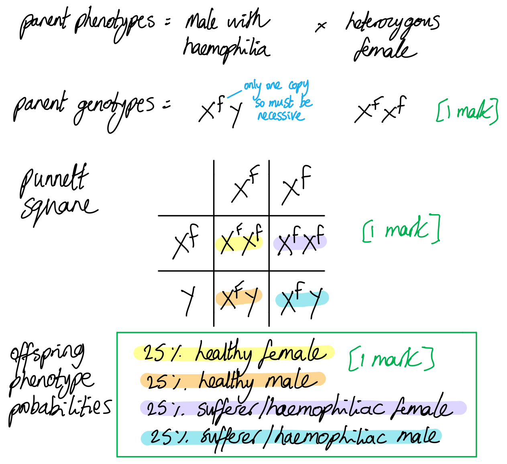
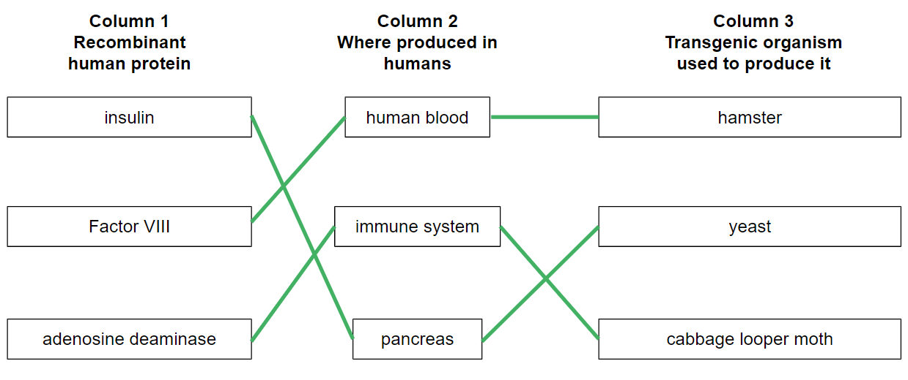

# Mark Schemes — Genetic Technology Applied to Medicine
**19. Genetic Technology** · Cambridge (CIE) A-LEVEL biology (9700)

## Structured Questions (9 questions)

### Q1
rhFVIII can be produced using hamster cells as follows...

**Final answer:** **Any ****four**** of the following:**

- The gene is cut from the DNA using restriction enzymes/endonucleases **OR** the gene is made into cDNA using reverse transcriptase **OR** the gene is synthesised artificially from nucleotides; **[1 mark]**
- The gene is amplified / many copies of the gene are made using PCR; **[1 mark]**
- The gene is transferred into hamster cells using a vector; **[1 mark]**
- Marker genes are used to identify the hamster cells that have taken up the new gene; **[1 mark]**
- Hamster cells (containing the new gene) are cultured in a fermenter; **[1 mark]**
- Factor VIII is extracted **AND** purified; **[1 mark]**

***Reject**** references to plasmid vectors.*

**[Total: 4 marks]**

> *This question requires you to apply what you know about genetic engineering to the example of rhFVIII production in hamster cells. Most of the process will be the same as the more familiar process of genetically engineering bacteria, but be careful to avoid the use of plasmid vectors. Plasmids are not normally found in animal cells so they will not replicate when the animal cells divide; this means that any new cells produced after the introduction of the plasmids would not contain the new gene.*
Advantages of producing rhFVIII rather than extracting factor VIII from human blood include...

- Reduced risk of transmitting (blood) disease; **[1 mark]**
- Increased availability / rate/volume of production **OR** availability not limited by the number of donors; **[1 mark]**

**[Total: 2 marks]**

> *No marks have been allocated here for references to ethical or religious concerns or to immune responses to the proteins. This is because the process still uses hamster cells, so any concerns relating to the use of non-human sources will still apply.*
(i) Post-translational modifications might include...

**Final answer:** **Any ****two**** of the following:**

- Folding of proteins / development of secondary/tertiary structure / formation of hydrogen/ionic/disulfide bonds; **[1 mark]**
- Joining of additional polypeptide chains/subunits; **[1 mark]**
- Addition of (named) non-protein elements / prosthetic groups; **[1 mark]**
- Break down by proteases; **[1 mark]**

*Named non-protein elements could include haem/iron ions, phosphate, carbohydrate, methyl groups or acetyl groups.*

(ii) It is preferable to produce factor VIII that is identical to that produced by fully developed humans because...

- The protein will not be recognised as foreign / initiate an immune response **OR **the proteins will not be attacked/disabled/destroyed by the immune system  **OR** antibodies will not be produced against the protein; **[1 mark]**

**[Total: 3 marks]**

> *All of the elements of protein structure beyond primary structure can be considered to be post-translational modification, so a good knowledge of secondary, tertiary, and quaternary structures will provide all that you need here.*

> *The risk of introducing non-human proteins into human patients is immune rejection; if the immune system recognises a non-human element in a protein then the proteins will be attacked and destroyed by the immune system, reducing their functionality.*
The phenotype probabilities for the children of male with haemophilia and a heterozygous woman are...

- (The genotypes of the parents =) XfY **AND** XFXf; **[1 mark]**
- (The genotypes of the children =) XFXf **AND **XFY **AND** XfXf **AND** XfY; **[1 mark]**
- (The phenotype probabilities for the children =) 25 % healthy female **AND** 25 % healthy male **AND** 25 % sufferer/haemophiliac female **AND** 25 % sufferer/haemophiliac male; **[1 mark]**

***Accept**** correct offspring phenotype probabilities for full marks in the absence of other notes.*

***Accept*** *genotypes of parents and children given within a Punnett square. *

**[Total: 3 marks]**

> *Note that being heterozygous / a carrier is not usually an observable trait, so the phenotype of a female carrier will be healthy.*

### Q2
An evaluation of the scientist's suggestion would include...

**Final answer:** **Any ****three ****from the following:**

- In agreement: Negative correlation / the number of CAG repeats correlates to the age of onset of Huntington's disease; **[1 mark]**
- In agreement: Overlap of data / more than one result at each CAG repeat ; **[1 mark]**
- In disagreement: Small sample size / only 65 people tested; **[1 mark]**
- In disagreement: Wide range of results / CAG repeats are present from age 19 to age 56; **[1 mark]**
- In disagreement: Other factors may be involved in the age of onset / example of named factor; **[1 mark]**

**[Total: 3 marks]**

> *A wide range in the age of onset for the same number of CAG repeats suggests that other factors may also be involved.*
Huntington's disease is present in the population because...

- Age of onset is most frequent after age 40 ; **[1 mark]**
- Individuals (may have) already had children; **[1 mark]**
- Before their symptoms appear / they become aware that they have Huntington's disease; **[1 mark]**

**[Total: 3 marks]**

> *Use of the command word "suggest" here means that you need to apply your knowledge to a new concept. You are not expected to know about Huntington's disease and the age individuals have children, you can gain your answer from the information given in the question. A common misconception here is that Huntington’s disease is recessive and would therefore be passed on to offspring without a person knowing; this is not the case. You may also assume that someone with Huntington’s disease may survive well into adulthood and then reproduce, but this would be very unlikely. *
*In vivo* gene therapy may be used to treat Huntington's disease by...

**Final answer:** **Any ****four**** of the following:**

- Adeno-associated viruses/vector is used; **[1 mark]**
- Containing the normal/healthy alleles for Huntingtin/HTT gene; **[1 mark]**
- Injected into nerve cells/brain tissue/medium spiny neurones; **[1 mark]**
- Healthy gene is transcribed into mRNA; **[1 mark]**
- mRNA is translated into healthy version of huntingtin protein; **[1 mark]**

**[Total: 4 marks]**

> *Here you need to apply your knowledge of gene therapy to the information provided about Huntington's disease. You are specifically asked to describe **in vivo** gene therapy which you should have learnt about with the example of inherited eye disorders.*
The benefits of genetic screening for Huntington's disease would include...

**Final answer:** **Any ****four ****from the following:**

- Early detection means the couple can be proactive medically / start treatments earlier; **[1 mark]**
- The couple can make informed decisions about family planning / named examples of family planning such as prenatal diagnosis, preimplantation genetic testing, or adoption; **[1 mark]**
- The couple can prepare themselves psychologically for the potential onset of the disease; **[1 mark]**
- Gives the opportunity for support networks and resources for individuals with Huntington's disease; **[1 mark]**
- Gives the opportunity to contribute to genetic research; **[1 mark]**

**[Total: 4 marks]**

> *Although this question may seem fairly straightforward, you are required to come up with four benefits of screening and be specific in your response rather than give vague answers such as "they can plan for the future". *

### Q3
(i) It is necessary to heat the mixture to 95 °C in order to...

**Final answer:** **Any ****two**** of the following:**

- Separate the two (DNA) strands / denature the DNA; **[1 mark]**
- Break the <u>hydrogen</u> bonds (between the base pairs); **[1 mark]**
- Expose the bases; **[1 mark]**
- Produce template strands for copying/replication; **[1 mark]**

(ii) Primers are included in the mixture because...

**Final answer:** **Any ****two**** of the following:**

- (Primers) bind/anneal to DNA by complementary base pairing; **[1 mark]**
- (Primers) attach close/next to the specific section of DNA (to be copied); **[1 mark]**
- (DNA) polymerase attaches to the double-stranded DNA/dsDNA / to the primer; **[1 mark]**
- Any reference to forward **AND** reverse primers; **[1 mark]**

(iii) The enzyme *Taq* polymerase, rather than any other type of DNA polymerase, is used in PCR because...

**Final answer:** **Any ****two**** of the following:**

- (*Taq* polymerase) is heat-stable/thermostable / works at high temperatures; **[1 mark]**
- (*Taq* polymerase) does not need to be added again / replaced for each cycle; **[1 mark]**
- The process is more efficient/faster (than for other polymerases); **[1 mark]**

***Accept**** reverse answers for marking points 1 and 2, e.g. for marking point 1 "other polymerases are not heat stable" and for marking point 2 "other polymerases need replacing regularly"*

**[Total: 6 marks]**

> *When learning about the PCR process make sure that you can describe the steps involved and that you can give the **reasons** for each of the stages.*
(i) The term genome can be defined as...

- All of the DNA/genetic material (in a person's cells); **[1 mark]**

***Accept**** references to combined nuclear AND mitochondrial DNA.*

(ii) The type of cell from a blood sample that is suitable for testing for the presence of these faulty alleles and the reason for this is...

- (Named) white blood cell **AND** it contains a nucleus / DNA; **[1 mark]**

***Accept**** leucocyte/leukocyte for white blood cell.*

(iii) Faulty alleles of the *BRCA2* gene can be detected using the microarray as follows......

**Final answer:** **Any ****four**** of the following:**

- Probes/reporters are (short) lengths of DNA; **[1 mark]**
- (Probes are) <u>complementary</u> to the faulty alleles/DNA being tested for; **[1 mark]**
- Many copies of <u>one</u> type of probe are placed in <u>each</u> cell (of the microarray); **[1 mark]**
- DNA fragments (being tested) are single-stranded (due to being denatured); **[1 mark]**
- DNA fragments are labelled (with fluorescent tags); **[1 mark]**
- (Any) faulty DNA (fragments) / DNA with mutation will hybridise/bind to probes; **[1 mark]**
- Unbound sample DNA is washed off; **[1 mark]**
- Laser/UV light detects flurorescence / bound probes / faulty alleles; **[1 mark]**

***Accept ****reverse statement for marking point 7, e.g. "bound DNA is not washed off".*

(iv) Advantages of screening for faulty alleles of the *BRCA2* gene include...

**Final answer:** **Any ****four**** of the following:**

- Allowing people to make informed choices about lifestyle change; **[1 mark]**
- Allowing people to make informed choices about the need for preventative treatment; **[1 mark]**
- Removing worry (if results are negative); **[1 mark]**
- Preventative treatment can be cheaper than treating the disease; **[1 mark]**
- Allowing people to make informed choices about having children; **[1 mark]**
- Can have a positive impact on (cost of) life insurance; **[1 mark]**

**[Total: 10 marks]**

### Q4
Symptoms of beta thalassemia could include...

**Final answer:** **Any ****three**** of the following:**

- Breathlessness; **[1 mark]**
- Fatigue; **[1 mark]**
- Muscle weakness; **[1 mark]**
- Pale skin / red blood cells are pale in colour; **[1 mark]**
- Slow growth; **[1 mark]**
- Inability to digest food / absorb nutrients; **[1 mark]**
- Differently shaped / small red blood cells; **[1 mark]**
- Increased production of red blood cells; **[1 mark]**

**[Total: 3 marks]**

> *Your knowledge of the function of haemoglobin should allow you to come up with answers to this question. Haemoglobin's role is to transport oxygen around the body. This fuels aerobic respiration and allows the production of ATP. The absence of functioning haemoglobin will mean a lack of oxygen reaching the body cells, leading to feelings of breathlessness and a lack of ATP production. This will affect any processes that require ATP such as muscle contraction, digestion, absorption of nutrients, and growth, as well as general feelings of fatigue. Red blood cells will be smaller as their development is affected by the lack of beta haemoglobin, and the body will increase red blood cell production in an attempt to compensate for the lack of oxygen in the blood. Haemoglobin is a red pigment so a lack of this pigment will cause a pale appearance in the red blood cells and the skin.*
(i) The stem cells found in bone marrow are...

**Final answer:** **Any ****two**** of the following:**

- Multipotent / no longer toti/pluripotent; **[1 mark]**
- Able to differentiate into only a few different types of cell; **[1 mark]**
- Able to differentiate into types of blood cell / red and white blood cells; **[1 mark]**

(ii) The process by which the stem cells can be altered involves...

**Final answer:** **Any ****three**** of the following:**

- The desired <u>allele</u> is inserted into a <u>virus</u>/<u>vector</u>; **[1 mark]**
- The (stem) cells are exposed to / mixed with the virus/vector; **[1 mark]**
- The virus/vector inserts the desired <u>allele</u> into the (DNA of the stem) cells; **[1 mark]**
- The altered/transgenic cells are grown/cultured in the lab (before being infused back into the patient); **[1 mark]**

*Reject gene or DNA in the place of the allele. *

**[Total: 5 marks]**

> *It is good to get into the habit of referring to the inserted gene as an **allele** as opposed to just a gene or some DNA. In this particular case, it means that the mark point requires you to provide more information that you are given in the question stem to part c) below, but in general, it is helpful to make it clear that the inserted genetic information is another version of an existing gene rather than a new gene altogether or just a piece of DNA. *
The insertion of DNA in the wrong location could be a problem because...

**Final answer:** **Any ****two**** of the following:**

- (DNA) could be inserted in the middle of / within a gene / within a gene regulatory sequence; **[1 mark]**
- (This would lead to) altered / non functional / no proteins being produced/synthesised (from that gene)/ a gene being switched on/off; **[1 mark]**
- (This could lead to) harmful side effects / a different genetic disorder / tumour development / named example of a harmful side effect that results from a failure to produce a particular protein; **[1 mark]**

**OR**

**Final answer:** **Any ****two**** of the following:**

- (DNA) could be inserted into a non-coding section of DNA / intron **OR** a section of DNA without a promoter; **[1 mark]**
- (This would mean that) the new/desired gene would not be expressed / protein would not be produced/synthesised from the new/desired gene; **[1 mark]**
- The gene therapy would be ineffective / have no effect / fail to cure/treat the genetic disorder; **[1 mark]**

**[Total: 2 marks]**

> *In any attempt at genetic engineering, it is essential that a new gene is inserted in such a way that it is able to function and does not negatively impact the individual in question. If a new gene is inserted into the middle of another important gene, this will negatively impact the expression of that gene and the effect of this on an individual could be harmful, e.g. the development of a tumour, or a failure to produce an important enzyme or hormone. Similarly, if the new gene is inserted into a section of DNA that is not expressed by a cell then the new gene itself will not be expressed and the therapy will fail.*
Other concerns related to gene therapy could be...

**Final answer:** **Any ****three**** of the following:**

- It can be difficult to find a safe/effective vector / the immune system can attack/react to the vector; **[1 mark]**
- Gene therapies are often temporary / may not offer a permanent cure; **[1 mark]**
- Gene therapies can (currently) only treat recessive conditions; **[1 mark]**
- Concern around inserting new genes into germ/gamete/embryo cells; **[1 mark]**
- Concern around the ethics of removing (so-called) undesirable genes from the gene pool / attempting to 'improve' humanity / eugenics; **[1 mark]**
- Concern around the ethics of people choosing to alter non-medical / non-life-threatening characteristics / a named characteristic of this type (e.g. appearance, height, sporting ability); **[1 mark]**
- There is a lack of incentive for drug companies to develop treatments for rare diseases (meaning that those suffering from such diseases are treated unfairly); **[1 mark]**
- Gene therapy is expensive so it may not be affordable for everyone; **[1 mark]**

**[Total: 3 marks]**

> *Note here that the question requires difficulties that are not connected with causing harm to gene expression, so problems relating to side effects such as cancer will not be accepted.*

### Q5
(i) Mutations occur in DNA when...

**Final answer:** **Any ****one**** of the following:**

- Copying errors / mistakes occur during DNA/semi-conservative replication; **[1 mark]**
- A base / series of bases is deleted/inserted/substituted; **[1 mark]**

(ii) Mutations in BRCA1 and BRCA2 genes could increase the likelihood of tumour development because...

**Final answer:** **Any ****three**** of the following:**

- The sequence of amino acids /primary structure of the protein (that they code for) is altered; **[1 mark]**
- The 3D/tertiary structure of the protein is altered **SO** it becomes non-functional; **[1 mark]**
- DNA mutations/copying errors are not repaired; **[1 mark]**
- Mutations in the genes that control the cell cycle can lead to uncontrolled cell division (which leads to tumour development); **[1 mark]**

**[Total: 4 marks]**

> *You have been told in the question that BRCA1 and 2 code for proteins that are involved with the repair of DNA mutations; this, together with your knowledge of the effect of mutations on protein function and how tumours develop, should enable you to work out the answer. Non-functional proteins from the BRCA1 and 2 genes will prevent the repair of mutations; if this occurs in the genes that regulate the cell cycle then tumour development may result.*
Genetic screening can reduce the risk of breast cancer in high risk individuals by...

**Final answer:** **Any ****two**** of the following:**

- A patient will be aware that they are at increased risk of breast cancer; **[1 mark]**
- A patient may decide to have a mastectomy / breast tissue removed; **[1 mark]**
- A patient may have more regular breast cancer checks/screening tests; **[1 mark]**
- A patient may take medication to lower their risk of cancer / may decide not to take medication that might increase their risk of cancer; **[1 mark]**

**[Total: 2 marks]**
A DNA probe can be used to show the presence of a particular allele by...

**Final answer:** **Any ****two**** of the following:**

- The probe is complementary / has bases that are complementary to the allele being screened for; **[1 mark]**
- The probe binds/hybridises / forms hydrogen bonds with the allele (in a patient DNA sample); **[1 mark]**
- If it is present the probe label shows up / fluoresces (under UV light); **[1 mark]**

**[Total: 2 marks]**

> *You are not expected to know how genetic screening works but your knowledge of DNA base pairing, together with Fig. 1, should help you to answer this question. You have been shown an image of a single-stranded DNA probe binding to a single strand of patient DNA; in order for two single strands of DNA to bind together they must have complementary base sequences. The probe allows the allele to be seen at the end of the test if it is present in the sample as the label will fluoresce under UV light.*
Social and ethical issues around genetic screening are as follows...

**Final answer:** **Any ****three**** of the following:**

- Preventative treatments / lifestyle advice can be offered to those at increased risk of disease; **[1 mark]**
- Health services can save money on treatments (if preventative measures are successful); **[1 mark]**
- People can make decisions on whether or not to have (natural) children based on their genetics **OR** people might decide to have IVF (along with PGD) to avoid passing a genetic disorder on to their children; **[1 mark]**
- Screening embryos raises the possibility of designer babies / parents being able to choose the features of their child; **[1 mark]**
- The technology around embryo screening is expensive and can only be afforded by wealthy sections of the population; **[1 mark]**
- A positive screening result during pregnancy means that people may consider terminating a pregnancy / having an abortion; **[1 mark]**

**[Total: 3 marks]**

### Q6
ADA deficiency can lead to severe combined immune deficiency (SCID) because...

**Final answer:** **Any ****four**** of the following:**

- (Mature) B/T lymphocytes have specific receptors on their cell surface membranes which bind to antigens / allow clonal selection; **[1 mark]**
- (Activated) B/T lymphocytes divide by mitosis / carry out clonal expansion / differentiate into different cell types; **[1 mark]**
- Plasma cells produce antibodies to neutralise pathogens / prevent pathogens from infecting host cells / increase phagocytosis of pathogens / reduce the mobility of pathogens / cause lysis of pathogen cells; **[1 mark]**
- Helper T cells release chemicals/cytokines that activate B cells / increase phagocyte activity; **[1 mark]**
- Killer T cells secrete toxins that destroy pathogens; **[1 mark]**
- Memory B/T cells remain in the blood and provide immunity; **[1 mark]**

*Accept antibodies instead of receptors in reference to B lymphocytes for mark point 1.*

**[Total: 4 marks]**

> *The question tells you that ADA deficiency prevents the maturation of lymphocytes, so your answer needs to explain the role of mature lymphocytes. In the absence of this function, there would be greatly reduced immune activity.*
An advantage and a disadvantage of each of these treatment types could be...

|   | Advantage | Disadvantage |
|---|---|---|
| ERT | **Final answer:** **Any ****one**** of the following:**  - Injection is a straightforward procedure; **[1 mark]** - Can take effect quickly; **[1 mark]** - Enzymes can be sourced/produced reliably (so there will not be any shortages); **[1 mark]** - No/less risk of infection with (recombinant proteins); **[1 mark]** - Can be used while waiting to receive another treatment; **[1 mark]** | **Final answer:** **Any ****one**** of the following:**  - A short-term treatment / injections would need to be repeated; **[1 mark]** - Some might be concerned by the ethics of producing human proteins in animals / animal cells / cabbage looper moths; **[1 mark]** - Proteins may be processed / modified differently in animal cells **SO** there is a risk of immune response; **[1 mark]** |
| HSCT | **Final answer:** **Any ****one**** of the following:**  - A long-term treatment/cure; **[1 mark]** - Will enable the patient to produce healthy lymphocytes / white blood cells (produced by bone marrow stem cells); **[1 mark]** | **Final answer:** **Any ****one**** of the following:**  - Risk of immune rejection (if donor is not a good match); **[1 mark]** - May have to take drugs to suppress the risk of immune rejection; **[1 mark]** - Matching donor may not be available / may be a long waiting list; - Risk of infection during procedure; **[1 mark]** - May take time for the new cells to begin producing (mature) lymphocytes; **[1 mark]** |

**[Total: 4 marks]**

> *You should know about the advantages and disadvantages associated with recombinant proteins, so these can be applied to the use of recombinant enzymes here, along with other logical advantages such as simplicity of injections and the immediate action of enzymes injected into the blood. *

> *You are not expected to know about stem cell transplants but your knowledge of stem cells, their role in the bone marrow, and the role of antigens in identifying foreign cells should allow you to answer this part of the question. Bone marrow stem cells are responsible for the production of new blood cells, so a donation of stem cells from a healthy donor should allow a patient to produce their own healthy white blood cells. The risk with any donor tissue is that if the antigens are not a good match immune rejection may occur.*
The process of gene therapy for ADA SCID involves...

**Final answer:** **Any ****three**** of the following:**

- Ex vivo gene therapy is carried out in adult/somatic cells/lymphocytes that have been taken out of the body; **[1 mark]**
- A normal <u>allele</u> for ADA is transferred into viral vectors; **[1 mark]**
- T-lymphocytes from the patients are combined/mixed with vectors / the vectors transfer the allele into patient T-lymphocytes; **[1 mark]**
- (Modified) T-lymphocytes/cells are transfused/inserted/replaced/ into the patient; **[1 mark]**
- The infusion process / treatment needs to be repeated regularly / every few months; **[1 mark]**

**[Total: 3 marks]**

### Q7
Two techniques that can be used to obtain cells from a growing foetus in order for that foetus to undergo genetic screening are:

- Amniocentesis; **[1 mark]**
- Chorionic villus sampling / CVS; **[1 mark]**

*Allow a description of sampling amniotic fluid*

**[Total: 2 marks]**

> *It's important to note that these two techniques pose inherent risks of miscarriage and can only be carried out in the first half of a normal-term pregnancy: 10-15 weeks for amniocentesis and 10-13 weeks for CVS. A normal full-term pregnancy is 40 weeks. *
Gene delivery has been largely difficult to implement because:

**Final answer:** **One**** from the following:**

- Difficulty inserting alleles to replace faulty ones; **[1 mark]**
- Lack of a suitable <u>vector</u>; **[1 mark]**
- New alleles are only expressed in existing cells and not in future generations; **[1 mark]**
- (Giving) only short-term relief (from the symptoms); **[1 mark]**

**[Total: 1 mark]**
The terms *in vivo* and *ex vivo*:

- Both involve genes/alleles being delivered into cells/nuclei/chromosomes; **[1 mark]**
- *In vivo* means delivery into cells **inside** the body **whereas** *ex vivo* is delivered into cells **outside** the body;** [1 mark]**

**[Total: 2 marks]**

*For a ***[2 mark] ***question where the command line is 'compare and contrast' it is reasonable to answer on the basis that the examiners are looking for **one** similarity and **one** difference between the two modes of delivery. *
The choices that genetic screening may offer this couple in their family planning considerations are:

**Final answer:** **Two**** from the following:**

- Establishing whether they (the parents) are carriers / heterozygous or non-carriers / homozygous; **[1 mark]**
- Assessing the likelihood / % chance of a child inheriting the condition; **[1 mark]**
- (If already pregnant) taking steps to prepare for the birth / further care of a child with the condition; **[1 mark]**
- Making a decision on birth/termination (if medical criteria / religious / ethical beliefs allow); **[1 mark]**
- Whether to participate in research / clinical trials; **[1 mark]**

**[Total: 2 marks]**

### Q8
The part of the probe labelled **X** is...

- A radioactive/fluorescent label; **[1 mark]**

Its role is to...

- Show the presence/location of the probe **OR** shows whether or not the probe has bound to its complementary DNA sequence; **[1 mark]**

**[Total: 2 marks]**

> *The DNA base sequence will bind to its complementary sequence if it is present, and the label shows whether or not this binding has occurred. If the probe binds then its presence can be identified by the label, showing that a particular gene/base sequence is present in a sample.*
The process in which a DNA probe binds to a complementary sequence on a DNA strand is called...

- (DNA) hybridisation; **[1 mark]**

**[Total: 1 mark]**
The process of genetic screening involves...

**Final answer:** **Any ****three**** of the following:**

- Patient DNA is isolated / the patient provides a sample of DNA; **[1 mark]**
- The patient DNA is amplified using PCR; **[1 mark]**
- Restriction endonucleases are used to cut the DNA into smaller fragments; **[1 mark]**
- The fragments undergo gel electrophoresis; **[1 mark]**
- DNA fragments are transferred to a nylon membrane; **[1 mark]**
- DNA probes are added to the sample/nylon membrane;** [1 mark]**
- The gel/sample is washed (to remove any unbound probe); **[1 mark]**
- UV light or an x-ray is used to reveal the position/presence of the probe; **[1 mark]**

**[Total: 3 marks]**

*There are other ways of carrying out genetic screening, such as the use of a microarray to screen many samples at once, or to screen a sample for multiple different genes. Because there are so many marking points available above, you should still be able to pick up 3 marks for describing a different screening method e.g. Isolate patient DNA ***[1 mark],*** add DNA probes to sample ***[1 mark],*** wash sample/microarray ***[1 mark],*** shine UV light on the sample to reveal probe ***[1 mark].**
A patient might choose to receive genetic counselling because...

**Final answer:** **Any ****two**** of the following:**

- To help decide whether or not to undergo genetic screening; **[1 mark]**
- To explain the results of a genetic screening test; **[1 mark]**
- To help a patient learn about a particular condition / living with a particular condition; **[1 mark]**
- To discuss treatments available for a genetic condition; **[1 mark]**
- To discuss lifestyle choices that might reduce the risk of a genetic condition developing / make a genetic condition easier to manage; **[1 mark]**
- To discuss implications of a (potential) parent’s result for children / future children / deciding whether or not to have a child / deciding whether to continue with a pregnancy; **[1 mark]**
- To discuss ethical issues thrown up by any results gained (e.g. pregnancy termination); **[1 mark]**

**[Total: 2 marks]**

### Q9
The production of beneficial proteins is usually carried out by eukaryotic cells, such as yeasts or animal cells in culture, rather than by prokaryotic cells because:

- (Eukaryotic cells) will carry out post-translational modification; **[1 mark]**
- (By using their) Golgi Apparatus and / or enzymes that are required to produce a suitable human protein; **[1 mark]**

*Allow 'prokaryotic cells are too unsophisticated / simple / are unable to carry out all the stages of human protein synthesis'*

**[Total: 2 marks]**
Three advantages of using genetic engineering to produce recombinant human proteins are:

**Final answer:** **Three**** from:**

- <u>More</u> cost-effective (to produce large volumes); **[1 mark]**
- Simpl<u>er</u> (with regards to using prokaryotic cells); **[1 mark]**
- Fast<u>er</u> to produce many proteins; **[1 mark]**
- More reliable supply available; **[1 mark]**
- The proteins are engineered to be identical to human proteins or have modifications that are beneficial; **[1 mark]**
- It can solve the issue for people who have moral/ethical/religious concerns against using cow or pork produced proteins; **[1 mark]**

**[Total: 3 marks]**

> *When listing advantages, it is important to make it clear that using GM gives a better outcome than not using it. So to say, 'GM is fast at producing proteins' will not get the mark, but 'GM is fast**er** at producing proteins' will. It's all about comparison versus what was there before. *
The correctly-joined boxes from Fig. 1 are as follows:

**[1 mark]** for each correct pair links from Column 1.

**[Total: 3 marks]**
Advantages of treating diabetics with recombinant insulin over the use of animal-extracted insulin are:

**Final answer:** **Two**** from the following:**

- It is identical to human insulin, so no issues of rejection / allergic response / an adverse immune response; **[1 mark]**
- There is a reliable supply available to meet demand (no need to depend on availability of meat stock); **[1 mark]**
- Fewer ethical, moral or religious concerns (proteins are not extracted from cows or pigs); **[1 mark]**
- Cheaper to produce in large volumes; **[1 mark]**
- That it is useful for people who have animal insulin tolerance; **[1 mark]**

**[Total: 2 marks]**
