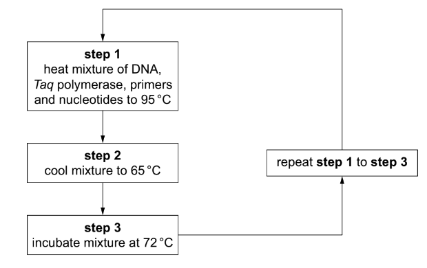

# Exam Questions — Genetic Technology Applied to Medicine
**19. Genetic Technology** · Cambridge (CIE) A-LEVEL biology (9700)
> Source: [https://www.savemyexams.com/a-level/biology/cie/25/topic-questions/](https://www.savemyexams.com/a-level/biology/cie/25/topic-questions/) · 9 questions across 1 sets

## Structured Questions (9 questions)

### Q1 — hard — 12 marks

**Q1** [4 marks]

Human Factor VIII is a protein required for the process of blood clotting. Recombinant human clotting factor VIII (rhFVIII) can be produced in the kidney or ovary cells of hamsters.

Suggest how rhFVIII can be produced using hamster cells.

**Q1** [2 marks]

**Extract:**

Human Factor VIII is a protein required for the process of blood clotting. Recombinant human clotting factor VIII (rhFVIII) can be produced in the kidney or ovary cells of hamsters.

Before the production of rhFVIII, factor VIII protein was extracted from the blood of human donors.

State **two** advantages of producing rhFVIII rather than extracting factor VIII from human blood.

**Q1** [3 marks]

**Extract:**

Human Factor VIII is a protein required for the process of blood clotting. Recombinant human clotting factor VIII (rhFVIII) can be produced in the kidney or ovary cells of hamsters.

Recent research has shown that it is possible to produce rhFVIII using human embryonic kidney (HEK) cells. Scientists believe that this could be advantageous because the post-translational modifications that take place in hamster cells are different to those that occur in human cells. rhVIII produced in human cells would therefore be identical to factor VIII produced by fully developed humans.

(i) Suggest what might happen to proteins during post-translational modification.

[2]

(ii) Suggest why it is preferable to produce factor VIII that is identical to that produced by fully developed humans.

[1]

**Q1** [3 marks]

rhFVIII is essential for the treatment of haemophilia, a genetic condition in which non-functioning factor VIII means that blood does not clot.

Haemophilia is caused by a mutation in a gene located on the X chromosome. The dominant **F** allele codes for normal factor VIII while the mutated **f** allele codes for non-functioning factor VIII.

A male with haemophilia has a child with a heterozygous woman. Give the phenotype probabilities for their children.

### Q2 — hard — 12 marks

**Q2** [1 mark]

Huntington's disease is an inherited condition that affects brain function. It is described as a progressive disease as it gets worse over time. The mutation that causes Huntington's disease involves a DNA segment known as a CAG trinucleotide repeat. Normally, the CAG segment is repeated 10 to 35 times within the gene. In a person who has inherited the allele for Huntington's disease there can be 30 to 180 repeats within the gene.

Scientists studied the allelic profile of CAG repeats in 65 individuals affected by Huntington's disease. There results are shown in the graph below.

**Fig. 1**

Individuals can be tested to see if they have an allele for the gene carrying more than 35 CAG repeats. The scientists suggest that their data can be used to predict the age that the individual will develop Huntington's disease.

Use the information provided in the question and the graph in Fig. 1 to evaluate this suggestion.

**Q2** [3 marks]

**Extract:**

Huntington's disease is an inherited condition that affects brain function. It is described as a progressive disease as it gets worse over time. The mutation that causes Huntington's disease involves a DNA segment known as a CAG trinucleotide repeat. Normally, the CAG segment is repeated 10 to 35 times within the gene. In a person who has inherited the allele for Huntington's disease there can be 30 to 180 repeats within the gene.

Scientists studied the allelic profile of CAG repeats in 65 individuals affected by Huntington's disease. There results are shown in the graph below.

Fig. 1

Individuals can be tested to see if they have an allele for the gene carrying more than 35 CAG repeats. The scientists suggest that their data can be used to predict the age that the individual will develop Huntington's disease.

The allele for Huntington's disease is inherited from parent to offspring. Huntington's disease is always fatal.

Use the data from the graph in Fig. 1 to suggest why Huntington's is present in the population despite its fatality.

**Q2** [4 marks]

Huntington's disease is caused by a single faulty gene (HTT) that codes for the protein Huntingtin. The repeated CAG segments leads to the production of an abnormally long version of the huntingtin protein which is cut into smaller, toxic fragments that bind together in neurones called medium spiny neurones, disrupting the normal functions of these cells. *In vivo* gene therapy has shown promise as a possible treatment for Huntington's disease.

Outline how *in vivo* gene therapy may be used to treat Huntington's disease.

**Q2** [4 marks]

**Extract:**

Huntington's disease is an inherited condition that affects brain function. It is described as a progressive disease as it gets worse over time. The mutation that causes Huntington's disease involves a DNA segment known as a CAG trinucleotide repeat. Normally, the CAG segment is repeated 10 to 35 times within the gene. In a person who has inherited the allele for Huntington's disease there can be 30 to 180 repeats within the gene.

A couple are planning to start a family and wants to undergo genetic screening to assess their risk of passing on Huntington's disease to their unborn children.

Discuss the benefits of genetic screening in the context of Huntington's disease.

### Q3 — hard — 16 marks

**Q3** [6 marks]

The polymerase chain reaction (PCR) is used to produce large quantities of DNA from a very small original sample. The main steps of one PCR method are shown in Fig. 1.

**Fig. 1**

(i) Explain why it is necessary to heat the mixture to 95 °C (**step 1**).

[2]

(ii) Explain why primers are included in the mixture.

[2]

(iii) Explain why the enzyme *Taq* polymerase, rather than any other type of DNA polymerase, is used in PCR.

[2]

*Source: Specimen 2022 9700/04 Q4AI, AII, AIII*

**Q3** [10 marks]

The presence of a faulty allele of the gene *BRCA2* can lead to an increased chance of developing breast cancer. There are many different faulty alleles of the gene *BRCA2*.

People who are considered to be at risk of breast cancer may choose to be tested for the presence of these alleles in their genomes.

A microarray can be used to test blood samples for the presence of these alleles. The microarray contains DNA probes for different faulty alleles of the *BRCA2 gene.*

(i) State the meaning of the term genome.

[1]

(ii) Suggest which type of cell from a blood sample is suitable for testing for the presence of these faulty alleles.

Give a reason for your choice.

[1]

(iii) Outline how faulty alleles of the *BRCA2* gene can be detected using the microarray.

[4]

(iv) Outline the advantages of screening for faulty alleles of the *BRCA2* gene.

[4]

*Source: Specimen 2022 9700/04 Q4B(I,II,III,IV)*

### Q4 — medium — 13 marks

**Q4** [3 marks]

Adult haemoglobin is a protein made up of four polypeptide chains; two alpha chains and two beta chains.

Beta thalassemia is a genetic condition in which a mutation in the gene for the beta chain of adult haemoglobin either reduces or prevents its production.

Suggest **three** symptoms of beta thalassemia.

**Q4** [5 marks]

A form of gene therapy is being trialled for use in the treatment of beta thalassemia. The treatment involves harvesting stem cells from the bone marrow of patients before altering them in the lab and infusing the cells back into the patient's body.

(i) Describe the stem cells found in bone marrow.

[2]

(ii) Outline the process by which the stem cells can be altered.

[3]

**Q4** [2 marks]

One difficulty with carrying out safe and effective gene therapy is of ensuring that any new DNA is inserted into the right part of a patient's DNA.

Suggest why the insertion of DNA in the wrong location could be a problem.

**Q4** [3 marks]

**Extract:**

One difficulty with carrying out safe and effective gene therapy is of ensuring that any new DNA is inserted into the right part of a patient's DNA.

The insertion of DNA in the wrong location could be a problem because:
- (DNA) could be inserted in the middle of / within a gene / within a gene regulatory sequence;
- (This would lead to) altered / non functional / no proteins being produced/synthesised (from that gene)/ a gene being switched on/off;
- (This could lead to) harmful side effects / a different genetic disorder / tumour development / named example of a harmful side effect that results from a failure to produce a particular protein;

OR

- (DNA) could be inserted into a non-coding section of DNA / intron OR a section of DNA without a promoter;
- (This would mean that) the new/desired gene would not be expressed / protein would not be produced/synthesised from the new/desired gene;
- The gene therapy would be ineffective / have no effect / fail to cure/treat the genetic disorder;

Give **three** **other** concerns related to gene therapy.

### Q5 — medium — 11 marks

**Q5** [4 marks]

BRCA1 and BRCA2 are genes that code for proteins involved with the repair of DNA mutations

(i) State how mutations occur in DNA.

[1]

(ii) Suggest how mutations in BRCA1 and BRCA2 genes could increase the likelihood of tumour development.

[3]

**Q5** [2 marks]

Individuals with a family history of breast cancer will often have genetic screening to identify mutations in the BRCA1 and BRCA2 genes.

Outline how genetic screening can reduce the risk of breast cancer in high risk individuals.

**Q5** [2 marks]

**Extract:**

BRCA1 and BRCA2 are genes that code for proteins involved with the repair of DNA mutations

Individuals with a family history of breast cancer will often have genetic screening to identify mutations in the BRCA1 and BRCA2 genes.

Fig. 1 shows a genetic screening technique.

**Fig. 1**

Use Fig. 1 to suggest how a DNA probe can be used to show the presence of a particular allele.

**Q5** [3 marks]

Screening for BRCA1 and BRCA2 is carried out in adults, but some other genetic traits are tested for in foetuses prior to birth. In either case the results can bring up difficult decisions and individuals considering or undergoing such screening will often receive help from a genetic counsellor to help them think through ethical and social issues.

Outline the social and ethical issues around genetic screening.

### Q6 — medium — 11 marks

**Q6** [4 marks]

Adenosine deaminase (ADA) is an enzyme involved with multiple chemical reactions inside cells. One effect of ADA deficiency is a lack of lymphocyte maturation.

Outline how ADA deficiency can lead to severe combined immune deficiency (SCID).

**Q6** [4 marks]

**Extract:**

Adenosine deaminase (ADA) is an enzyme involved with multiple chemical reactions inside cells. One effect of ADA deficiency is a lack of lymphocyte maturation.

Treatment options for SCID caused by an ADA deficiency include:

- Enzyme replacement therapy (ERT), in which patients receive injections of recombinant ADA enzymes.
- Haemoatopoietic stem cell transplant (HSCT), in which patients receive a bone marrow transplant from a donor.

Complete the table below by suggesting an advantage and a disadvantage of each of these treatment types.

|   | **Advantage** | **Disadvantage** |
|---|---|---|
| **ERT** |   |   |
| **HSCT** |   |   |

**Q6** [3 marks]

**Extract:**

Adenosine deaminase (ADA) is an enzyme involved with multiple chemical reactions inside cells. One effect of ADA deficiency is a lack of lymphocyte maturation.

More recent treatment for ADA SCID involves the use of gene therapy.

Describe the process of gene therapy for ADA SCID.

### Q7 — easy — 7 marks

**Q7** [2 marks]

Name **two** techniques that can be used to obtain cells from a growing foetus in order for that foetus to undergo genetic screening.

**Q7** [1 mark]

One of the main problems of finding effective gene therapies is that of gene delivery.

Give **one** explanation of why gene delivery has been largely difficult to implement.

**Q7** [2 marks]

Some gene therapies are being developed for delivery to patients *in vivo*, whereas other are delivered *ex vivo*.

Compare and contrast the terms *in vivo* and *ex vivo* in this context.

**Q7** [2 marks]

A couple contemplating whether to have children are concerned about the risk of their child(ren) being born with cystic fibrosis, due to the presence of cases of cystic fibrosis in their extended families in previous generations.

Both would-be parents are non sufferers of cystic fibrosis, which is a recessive condition.

Outline the choices that genetic screening may offer this couple in their family planning considerations.

### Q8 — easy — 8 marks

**Q8** [2 marks]

Fig. 1 below shows a representation of a gene probe.

**Fig. 1**

Identify the part of the probe in Fig. 1 labelled **X** and describe its role.

**Q8** [1 mark]

DNA probes are used to test for the presence of a particular allele. The DNA being tested is split into separate strands and the probe in Fig. 1 will bind to the complementary base sequence on the DNA strand. State the name of this binding process.

**Q8** [3 marks]

A patient decided to undergo genetic screening for a particular inherited condition.

Describe the process of genetic screening.

**Q8** [2 marks]

The offer of a genetic screening test is often accompanied by genetic counselling.

Give **two** reasons why a patient might choose to receive genetic counselling.

### Q9 — easy — 10 marks

**Q9** [2 marks]

The production of proteins to benefit humans using recombinant DNA technology utilises cells from both prokaryotic and from eukaryotic organisms.

Explain why the production of such proteins is usually carried out by eukaryotic cells, such as yeasts or animal cells in culture, rather than by prokaryotic cells.

**Q9** [3 marks]

State **three** advantages of using genetic engineering to produce recombinant human proteins.

**Q9** [3 marks]

Column 1 of Fig. 1 shows three separate human proteins that have been produced successfully using genetic modification of a separate organism.

**Fig. 1**

Join one of the boxes from Column 1 to the most appropriate box in Column 2 with a straight line.

Do the same linking the boxes in Columns 2 and 3.

**Q9** [2 marks]

Prior to the use of transgenic organisms to produce insulin, diabetic patients were often given injections of insulin extracted from the pancreases of pigs or cows.

State **two** advantages of treating diabetics with recombinant insulin over the use of animal-extracted insulin.
