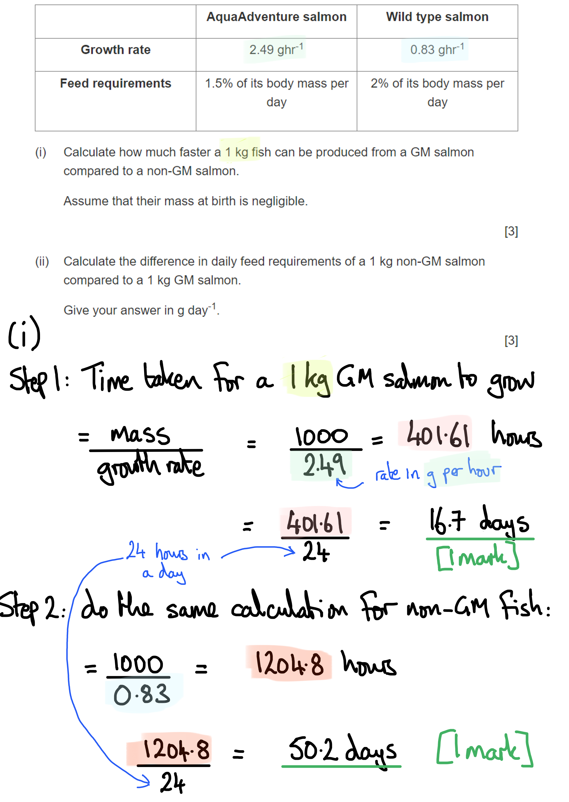
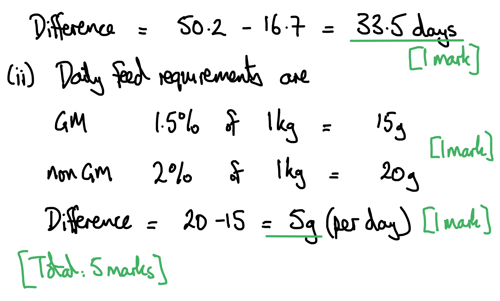

# Mark Schemes — Genetically Modified Organisms in Agriculture
**19. Genetic Technology** · Cambridge (CIE) A-LEVEL biology (9700)

## Structured Questions (9 questions)

### Q1
(i) We can calculate how much faster a 1kg fish can be produced in GM salmon as follows:

- (GM salmon = 1000 ÷ 2.49 =) 401.61 hours / 16.73 days / 16.7 days; **[1 mark]**
- (Non-GM salmon = 1000 ÷ 0.83 =) 1205.82 hours / 50.20 days / 50.2 days; **[1 mark]**
- (Difference = any value within the range) 33.0 - 34.0 days (faster); **[1 mark]**

*Award full marks for the correct answer in the absence of calculations*

(ii) The difference in daily feed requirements can be calculated as follows:

- (1.5 % of 1kg =_ 0.015 kg **AND (**2 % of 1kg =) 0.02 kg; **[1 mark]**
- (Difference = 0.02 - 0.015 = 0.005 kg =) 5 (g day-1); **[1 mark]**

*Award full marks for the correct answer in the absence of calculations*

**[Total: 5 marks]**
The benefits of increased disease resistance include:

**Final answer:** **Any ****two**** of the following:**

- Fish use less energy fighting infection **SO** fewer inputs are needed to reach a target size/mass of fish; **[1 mark]**
- Reduced fish death due to disease / fewer infections in farmed fish **SO **increased yield / increased food safety; **[1 mark]**
- Reduced requirement of antibiotic / medicinal use in farmed salmon** SO **increased food safety / decreased release of chemicals into the environment; **[1 mark]**

**[Total: 2 marks]**

> *This question requires a discussion so this means that you should elaborate on the effects of increased disease resistance to explain the benefit to the producer of that effect.*
GM salmon escaping into the wild may be of concern because...

**Final answer:** **Any ****three**** of the following:**

- GM salmon may compete with wild salmon **SO** causing a decline in wild salmon populations; **[1 mark]**
- GM salmon may breed with wild salmon **SO** introducing new genes into wild populations; **[1 mark]**
- New genes may provide a selective advantage **SO **becoming more frequent in the fish population / reducing genetic diversity; **[1 mark]**
- Fish with new genes may be more effective predators / may catch more prey **SO** disrupting the food web / causing local extinctions / reducing biodiversity; **[1 mark]**

**[Total: 3 marks]**

### Q2
The process of gene transfer and role of the plasmid vector can be explained as follows...

- Gene transfer involves the transfer of a gene from one species to another / between species; **[1 mark]**
- The plasmid vector is used to carry the target gene sequence into the host cells; **[1 mark]**
- Cells take up the new gene in the process of transformation / cells that take up the new gene have been transformed; **[1 mark]**
- Cold calcium chloride solution and incubation / electroporation / an electric shock increases the membrane permeability / makes the membrane more porous (so** **recombinant plasmids can be taken up); **[1 mark]**

**[Total: 4 marks]**

> *Note that this question specifically asks for details on the process of **gene transfer**, but **not** on the entire process of genetic modification. Ensure you read the question carefully to make sure you provide a focused and concise** **answer**.*
The function of a promotor sequence is....

- A region of DNA that marks / is present at the start of the gene sequence to be expressed; **[1 mark]**
- RNA polymerase binds to the promotor / the promoter allows RNA polymerase to bind (to the start of the gene); **[1 mark]**
- RNA polymerase initiates transcription; **[1 mark]**
- The new/recombinant protein (which gives resistance to pests) is synthesised by the cells of the host; **[1 mark]**

**[Total 4 marks]**

> *This question requires you to relate the role of the promotor region to the process of genetic modification, so it is important that you relate its general role in transcription to the production of recombinant proteins in the cells of a host.*
(i) The correlation between the data in graphs **A** and **B **can be explained as follows:

- There is an increase in resistance to insect pests **SO** less insecticide is needed; **[1 mark]**

> *Note that this is an **explain** question so you need to make a causal connection between graphs A and B in your answer.*

(ii) The relationship between the data in graphs **A** and **B** changes between 2006-2011 as follows:

- The correlation is weaker between 2006-2010 **OR** between 2006 and 2010 the percentage of land covered by GM crops increases steeply while insecticide use only decreases slightly; **[1 mark]**
- Between 2010-2011 the correlation is reversed / an increase in percentage of the GM crop occurs at the same time as an increase in insecticide use; **[1 mark]**

> *This is a describe question, so you need to say what you see. Be sure to focus on the specific part of the graph referred to in the question, and include enough information for two marks.*

(iii) An explanation for the changed relationship described in part (ii) could be:

- Insects with an allele for resistance to the GM crop have a selective advantage / are more likely to survive and reproduce; **[1 mark]**
- The resistance allele is passed on to offspring; **[1 mark]**
- The resistance allele is becoming more frequent in the population; **[1 mark]**

*Award 1 mark for stating that the insects have evolved to become resistant to the new crop variety.*

> *Simply stating that the insects have evolved resistance is not enough to gain full marks here; you need to use your knowledge of natural selection to explain how this has occurred.*

**[Total: 6 marks]**
Strategies to address ethical considerations might include...

- Laws/regulations that ensure safe production/testing of GMOs **OR** carry out extensive research into the effects of GMOs on human health; **[1 mark]**
- This may help to reduce/prevent long-term health impacts of GMOs; **[1 mark]**

**OR**

- Laws/regulations for clear labelling of GM foods; **[1 mark]**
- Consumers can make informed decisions about foods they consume; **[1 mark]**

**OR**

- Crop varieties must be sterile; **[1 mark]**
- GM crops cannot interbreed with wild plant species; **[1 mark]**

**OR**

- Limiting the percentage area per farm that can be used to grow a particular GM variety / farmers must grow the GM variety alongside the regular crop variety / GM crop varieties should only be grown where they are needed; **[1 mark]**
- Reduce the strength of any selection pressure / reduce the potential for the evolution of resistance; **[1 mark]**

***Accept**** other suitable strategies with appropriate justification*

**[Total: 2 marks]**

### Q3
Genetic engineering gave MON810 the trait of insect resistance as follows...

**Final answer:** **Any ****four**** of the following:**

- A gene is taken from another (named) species; **[1 mark]**
- Restriction enzymes/endonucleases are used; **[1 mark]**
- A plasmid / virus / gene gun / vector is used; **[1 mark]**
- (DNA) ligase (joins the ends of the gene and the vector); **[1 mark]**
- New gene / recombinant DNA/plasmid enters the maize cells / DNA; **[1 mark]**
- The gene is expressed / transcribed (and translated) to make protein / toxin; **[1 mark]**
- Marker genes are used (to identify transformed cells) **OR** promoters are inserted (to ensure gene expression); **[1 mark]**

**[Total: 4 marks]**
The data in Table 1 suggests the following about the social and ethical implications of growing GM maize...

**Final answer:** **Any ****four**** of the following:**

*Data description*

- A ban on / 0 % GM maize growth decreases yield; **[1 mark]**
- Increased / 88 % GM maize growth increases yield; **[1 mark]**

*Social implications of data*

- GM crops increase food supply; **[1 mark]**
- GM crops decrease food cost (because food availability has increased); **[1 mark]**
- GM crops increase a country's wealth (because they do not need to import as much food / can export food); **[1 mark]**

*Ethical implications of data*

- GM crops relieve hunger/starvation (because of the increased food supply and decreased cost); **[1 mark]**
- GM crops reduce land area needed for crops (because existing land becomes more productive) **SO** farmers can conserve habitats / protect biodiversity / allow land to be used for biofuels; **[1 mark]**

**[Total: 4 marks]**

> *The tricky element of this question is that it is not just asking for a general list of social and ethical implications of GM use; it is asking for social and ethical implications that can be **directly related to the data** shown in Table 6.1.*

> *The data shows that increasing the use of GM crops **increases the yield** of maize in all of the countries shown. Your answers must therefore all clearly relate to the benefits of an increased maize yield, e.g. an increased food supply and decreased food costs (social benefits) that will decrease starvation and potentially free up land for other, more sustainable uses (ethical benefits). *

> *More generic answers, e.g. the increased cost to farmers of buying GM seed, or concerns about long-term health benefits to humans, or superweeds, are not relevant as they cannot be directly linked to an increased maize yield.*

### Q4
The main benefit of this genetic modification process for the producers involved is...

- Growth hormone is continually expressed in the salmon all year round / in cold conditions / in the winter (instead of only in the spring and summer); **[1 mark]**
- The GM salmon grow more rapidly / have a longer growing season than non-GM salmon; **[1 mark]**
- Producers have more product / a higher mass of fish to sell in a shorter time period; **[1 mark]**

**[Total: 3 marks]**

> *It is key that you thoroughly read the passage above in order to gain full marks here. The passage states that ocean pout are **cold-water fish** and they thrive in near-freezing waters, suggesting that they are able to **grow in size** in these conditions (meaning growth hormone is being produced continually). Furthermore, Fig. 1 shows that the GM salmon is significantly **larger in size** compared to the non-GM salmon of the same age, indicating an increased rate of growth.*
The GM salmon was made sterile...

**Final answer:** **Any ****one**** of the following:**

- To ensure they could not breed with the wild population; **[1 mark]**
- To maintain/protect the genetic diversity within the wild population of salmon; **[1 mark]**

**[Total: 1 mark]**

> *There are strict regulations and protocols surrounding the use of GMOs. Many precautions are taken to try and ensure that wild populations are minimally affected.*
Ethical and social implications of using genetically modified organisms (GMOs) in food production include:

*Ethical implications*

**Final answer:** **A maximum of ****three ****of the following:**

- A reduction in global hunger / starvation; **[1 mark]**
- A reduction in health problems, e.g. due to vitamin A in Golden rice; **[1 mark]**
- There is a lack of long-term research on the effects on human health; **[1 mark]**
- Reduced impact on the environment / fewer beneficial insects being harmed due to reduction in pesticide use; **[1 mark]**
- GM crops may invade the natural habitats bordering the farmland **SO** reducing biodiversity / damaging local populations; **[1 mark]**
- Resistance to the introduced genes may arise in the wild population of insects, e.g. resistance to Bt toxin; **[1 mark]**
- Harm to non-targeted species, e.g. Bt cotton and the Monarch butterfly; **[1 mark]**
- The herbicides that are used on the GM crops could leave toxic residues that enter food chains / kill animals higher up food chains; **[1 mark]**
- Without appropriate labelling, the consumer cannot make an informed decision / has a lack of choice about the consumption of GM foods; **[1 mark]**

**AND**

*Social implications*

**Final answer:** **A maximum of ****three ****of the following:**

- GM crops may provide cheaper food for consumers;
- Increased crop yield may improve national economies;
- Expensive seeds mean that poorer farmers / communities cannot grow GM crops / are locked out of the market for GM crops **OR** the ability to buy GM seeds is dependent on wealth; **[1 mark]**
- Cost to farmers required to purchase new seed needs every year; **[1 mark]**
- Reduced pressure in health services due to a reduction in dietary deficiences; **[1 mark]**

*Without a named example the maximum number of marks that can be gained is three.*

**[Total: 4 marks]**

> *It is clearly stated in your syllabus that you should be able to discuss the social and ethical implications of using GMOs in food production. Make sure to learn a few real-life **examples** to back up the different points of discussion!*

### Q5
The gene could be isolated in the following ways:

- Using reverse transcriptase; **[1 mark]**
- Create cDNA/complementary DNA from mRNA; **[1 mark]**

**OR**

- Using restriction endonucleases/enzymes; **[1 mark]**
- Cut the gene at a specific base sequence/recognition site; **[1 mark]**

**OR**

- Using a gene machine / make artificial DNA; **[1 mark]**
- Produce the desired fragment/gene from a known DNA sequence** /** using DNA polymerase; **[1 mark]**

**[Total: 2 marks]**

> *Whilst the salt tolerance gene has originated and could be extracted using **restriction enzymes** to cut the gene from the **Arabidopsis** DNA, it is also possible to produce the required DNA sequence using alternative methods. This could be done using bioinformatics databases to **sequence the gene** required and then create copies of the sequence from nucleotide bases. Another method is to work backwards, **isolate the mRNA** from the protein first then use the **reverse transcriptase enzyme** to produce a **cDNA** strand using the **mRNA as a template**. Then building up the single-stranded cDNA into the double-stranded fragment required using **DNA polymeras**e.*
The transgenic tomato plant is able to produce the sodium pump because:

**Final answer:** **Any ****two**** of the following:**

- The genetic code is universal **OR** every organism uses the same combinations of nucleotide bases to create amino acids; **[1 mark]**
- Transcription and translation mechanisms are universal; **[1 mark]**
- The transferred DNA can be used to synthesise proteins in the recipient organism; **[1 mark]**

**[Total: 2 marks]**
The tomato plant cells in Fig. 1 are totipotent because...

- The cells are grown into complete new plants **OR** the cells give rise to whole new plants;** [1 mark]**
- Cells differentiate into all other specialised cell types; **[1 mark]**

**[Total: 2 marks]**

> *Totipotency is demonstrated by the ability of these plant cells to differentiate to become any of the cells required to produce a whole plant. *
The cells with the sodium pump gene could be selected by...

- Use a marker gene; **[1 mark]**
- The cells will fluorescence / show radioactivity / be resistant to antibiotics if the marker gene is present;** [1 mark]**

**OR**

- Exposing the cells to a high salt environment; **[1 mark]**
- Only the salt tolerant cells survive / cells without the salt tolerance gene do not survive; **[1 mark]**

**[Total: 2 marks]**

> *In order to identify the cells which have taken up the required gene, we need to find a way to distinguish between them and those which have not taken up the gene. The best way to do this in this scenario is to use a label or marker which could be observed.*

> *It would also be possible to identify transformed cells by testing their salt tolerance, however, this method is likely to be less definitive because salt-tolerance is likely to be on a scale and cells may not immediately die when they are exposed to salt.*

### Q6
The zebrafish gene is attached to protein **Q** because...

- It acts as a <u>marker gene</u> to show that the pig gene has been taken up / expressed; **[1 mark]**
- Only cells/embryos that contain the gene will fluoresce / give off blue light; **[1 mark]**

**[Total: 2 marks]**

> *Marker genes are used to verify that the gene has been taken up by the cells and the protein is being expressed. Remember, it is the **protein that fluoresces** blue and **not the gene**. This can sometimes act as a way of selecting cells that express the protein.*
The role of a promoter is to...

- Allow RNA polymerase/transcription factors bind to DNA **AND** initiate / start <u>transcription;</u> **[1 mark]**

A goat promoter specific to the milk gland is used because...

- Protein **Q** is present in milk **OR** protein **Q** is extracted from milk; **[1 mark]**
- The gene is only expressed in the milk glands / udder **OR** the gene is not expressed elsewhere; **[1 mark]**

**[Total: 3 marks]**

> *It is a much easier process to produce and harvest a sufficient amount of protein that can be given to pigs as milk or as an injection rather than trying to add the gene straight into the pig's germline. Gene expression is hard to control within the pig's body and it could be harmful if the protein is overexpressed in certain areas of the body. That is why the protein is ideally expressed in milk as it does not enter the bloodstream of the host animal and can be harvested and given to pigs in a controlled amount.  Pig's milk is hard to harvest and therefore a different, more lactating animal has been chosen.*
Very few live births result from embryos that are implanted because...

- Mutations may arise **OR** the nucleus/chromosomes/DNA may be damaged **OR** genes are disrupted; **[1 mark]**
- Which may interfere with the proteins that are produced / gene expression / translation; **[1 mark]**

**OR**

- Embryo/antigens produced due to genetic modification are foreign; **[1 mark]**
- Which causes the embryo to be rejected/attacked by their immune system; **[1 mark]**

**[Total: 2 marks]**
Farmers could use a genetic profile to find unrelated pigs by...

- Comparing genetic fingerprints/profiles from different individuals **AND **selecting mating partners with different numbers of DNA repeats / different patterns of DNA fragments; **[1 mark]**

**[Total: 1 mark]**

> *When the parents of animals are too closely related there is a lack of genetic variation in the offspring. This could result in an increased likelihood of inheriting a rare genetic disease or could make the offspring more vulnerable to infectious diseases as they don’t inherit protection from either parent. *

### Q7
(i) Salmon have been altered using genetic engineering as follows...

- Growth hormone produced throughout the year / all year (instead of in spring and summer only); **[1 mark]**

(ii) This is beneficial to salmon farmers because...

- The salmon grow all year **SO** are ready to be sold much more quickly / in half the time; **[1 mark]**

> *This is an **explain** question so you need to state **why** this change is useful to farmers.*

**[Total: 2 marks]**
Salmon farmers ensure that the new gene inserted into the GM salmon does not enter wild salmon populations by...

**Final answer:** **Any ****one**** of the following:**

- Only farming sterile females; **[1 mark]**
- Keep fish in controlled environments / (sea water) cages; **[1 mark]**

**[Total: 1 mark]**
A conclusion from the data in Table 1 is...

- There is an increase in growth/mass of genetically engineered salmon compared to non-engineered salmon **OR **genetically engineered salmon have a greater/larger mean mass than non-genetically engineered; **[1 mark]**

**[Total: 1 mark]**

> *Don't be put off by the novel context or the large amount of 'blurb' that is often presented to you in data analysis questions. Keep focused on what the question is asking of you; here you are writing a simple conclusion and no explanation is needed. *

> *Be careful when drawing conclusions from single data sets like this; you should always stick to what you can say from the data alone. E.g. you should generally avoid stating that one factor has **caused** a change in the other.*
A feature of the design of the investigation that helped to ensure the validity of the experiment is...

**Final answer:** **Any ****one ****of the following:**

- Large sample size **SO** it is representative of the salmon population; **[1 mark]**
- Carried out over 12 months **SO** there is enough time for the salmon to grow **OR **12 months is enough time to assess growth; **[1 mark]**
- A control group / non-engineered salmon were included **SO **comparisons can be made / any difference will be due to the *GH* gene; **[1 mark]**

**[Total: 1 mark]**

> *The **validity** of an investigation is about whether it truly **measures what it set out to measure**. Aspects of design that will increase validity include ensuring that a sample size is **representative** of the population of interest, controlling additional **variables**, and the inclusion of an **experimental control**.*

> *The command word here is **explain** so you need to make sure you express **why **the identified feature made the experiment more valid. *

### Q8
The effect this gene modification has on these cotton plants is...

- Plants modified with the Bt toxin gene produce an insecticide / a chemical that is toxic to insects; **[1 mark]**

**[Total: 1 mark]**
The impact of resistance, in the context of cotton plants and the Bt toxin, is...

**Final answer:** **Any ****two**** of the following:**

- Insects are no longer affected/killed by the Bt toxin; **[1 mark]**
- (Resistant) insects will continue to damage/eat cotton plants **OR **cotton plant yields may be reduced/affected by insect pests; **[1 mark]**
- Insects with the allele for Bt resistance are more likely to survive and reproduce / the Bt toxin acts as a selection pressure / alleles for Bt toxin resistance become more common in the insect population; **[1 mark]**

**[Total: 2 marks]**

> *Over time, insect populations have developed **resistance **to the genes for Bt toxin, reducing its effectiveness as a means of protecting crops. *

> *This is very similar in mechanism to the way in which bacteria become resistant to antibiotics.*
The scientists concluded that the presence of the resistance gene protects plants against glyphosate herbicide because...

- The standard deviations do not overlap; **[1 mark]**
- The difference between the data sets is <u>significant</u> / the data sets are <u>significantly</u> different **OR** <u>significantly</u> more plants with the resistance gene reach full growth; **[1 mark]**

**[Total: 2 marks]**

> *The question asks you to specifically comment on **the data**, so you should be looking at all the information provided.*

> *Note that the standard deviations would not have been included if the examiners didn't want you to comment on them!*

> *Be careful with your language when you are describing statistical significance; you must NEVER state that 'the data is significant', but should instead always say that 'the **difference** between the data sets is significant'.*
The effect of the herbicide resistance gene on soybean plants can be explained as follows...

**Final answer:** **Any ****two**** of the following:**

- Soybean plants with the resistance gene can produce an enzyme which allows the synthesis of amino acids / proteins required for growth; **[1 mark]**
- In plants without the resistant gene the herbicide/glyphosate inhibits the enzyme so the plants die/cannot grow; **[1 mark]**
- Weeds/plants that compete with the soybeans (for light, water and minerals) are killed; **[1 mark]**
- Soybean plants that have no competition can grow faster (so increasing the yield); **[1 mark]**

**[Total: 2 marks]**

### Q9
Genetic engineering can assist farmers in meeting the world's food demands as follows...

**Final answer:** **Any ****two ****of the following:**

- Increased yield / a bigger harvest in a shorter time (of meat or crops); **[1 mark]**
- Example of a feature that leads to increased yield, e.g. frost / drought resistant crops OR disease / pest / herbicide resistant crops; **[1 mark]**
- Increased nutrient/vitamin content (of meat/crops) / named example of increased nutrient content; **[1 mark]**

*Accept other specific examples that relate to increasing the quantity or quality of food production.*

**[Total: 2 marks]**

> *This is a specific learning point from your specification, so make sure that you can explain the benefits of genetic engineering in relation to meeting the global demand for food.*
Three social and/or ethical implications of using GMOs in food production are...

*Negative implications*

- A lack of long term research on the effects on human health; **[1 mark]**
- Reduction in biodiversity (due to only growing a few GM varieties of crops); **[1 mark]**
- Pollen from GM crops contaminate nearby non-GM crops that have been certified as organic; **[1 mark]**
- GM crops may invade the natural habitats bordering the farmland / interbreed with wild plant species; **[1 mark]**
- GM crops may have non-target effects / named non-target effect, e.g. killing insects that are not pests/pollinators; **[1 mark]**
- GM crop seeds are expensive / only affordable for some farmers / need to be repurchased every year; **[1 mark]**

*Positive implications*

- Many with nutrient deficiencies can be helped by enriched foods; **[1 mark]**
- Reduced impact on the environment due to there being less need to spray pesticides; **[1 mark]**

**[Total: 3 marks]**
Non-labelling of genetically modified food is a concern for some people because...

**Final answer:** **Any ****one**** of the following:**

- Some people may not want to eat genetically engineered food; **[1 mark]**
- People cannot make informed decisions (if the food is not labelled); **[1 mark]**
- People will not be able to monitor whether they are eating genetically engineered food; **[1 mark]**

**[Total: 1 mark]**

> *This is a **suggest** question, meaning that you need to do some reasoning to work out the answer. A lot of ethics is about the rights of an individual to choose what they want to do, so here the concern is that if people don't know what they are buying, they do not truly have a choice.*
