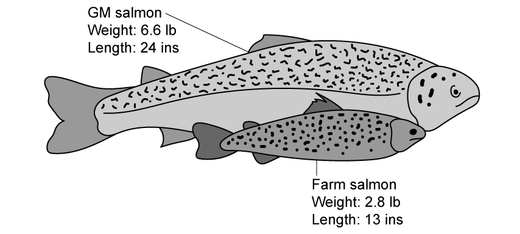
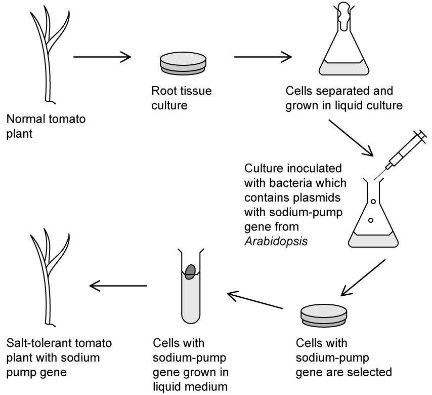
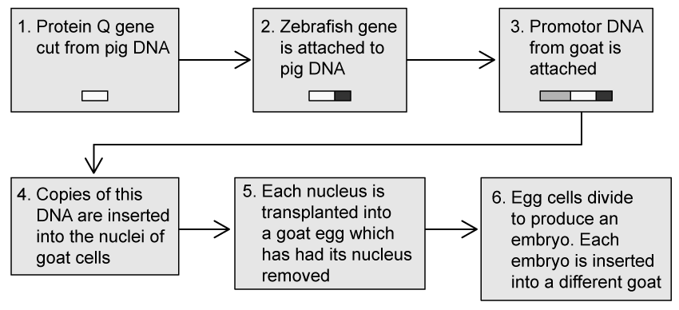

# Exam Questions — Genetically Modified Organisms in Agriculture
**19. Genetic Technology** · Cambridge (CIE) A-LEVEL biology (9700)
> Source: [https://www.savemyexams.com/a-level/biology/cie/25/topic-questions/](https://www.savemyexams.com/a-level/biology/cie/25/topic-questions/) · 9 questions across 1 sets

## Structured Questions (9 questions)

### Q1 — hard — 11 marks

**Q1** [6 marks]

AquaAdventure salmon is a form of genetically modified salmon that has become available to consumers in the USA.

Table 1 shows some data presented to the US Food and Drug Authority to promote approval of the GM salmon.

**Table 1**

|   | **AquaAdventure salmon** | **Wild type salmon** |
|---|---|---|
| **Growth rate** | 2.49 ghr-1 | 0.83 ghr-1 |
| **Feed requirements** | 1.5% of its body mass per day | 2% of its body mass per day |

(i) Calculate how much faster a 1 kg fish can be produced from a GM salmon compared to a non-GM salmon.

Assume that their mass at birth is the same.

[3]

(ii) Calculate the difference in daily feed requirements of a 1 kg non-GM salmon compared to a 1 kg GM salmon.

Give your answer in g day-1.

[2]

**Q1** [2 marks]

AquaAdventure also reported that the GM salmon produced showed evidence of increased resistance to common diseases affecting non-GM salmon.

Discuss the benefits of this to the producer.

**Q1** [3 marks]

**Extract:**

AquaAdventure salmon is a form of genetically modified salmon that has become available to consumers in the USA.

Table 1 shows some data presented to the US Food and Drug Authority to promote approval of the GM salmon.

Table 1

|   | AquaAdventure salmon | Wild type salmon |
| Growth rate | 2.49 ghr^-1^ | 0.83 ghr^-1^ |
| Feed requirements | 1.5% of its body mass per day | 2% of its body mass per day |

AquaAdventure also reported that the GM salmon produced showed evidence of increased resistance to common diseases affecting non-GM salmon.

Critics of AquaAdventure argue that there is a risk that GM salmon may escape into the wild.

Explain why this may be of concern.

### Q2 — hard — 16 marks

**Q2** [4 marks]

A group of scientists have developed a genetically modified crop variety that exhibits increased resistance to a common agricultural pest. The modified plant produces a protein that is toxic to the pest when ingested, reducing crop damage and increasing yields.

The method used by the scientists involved use of a plasmid vector.

Explain the process of gene transfer and the role of the plasmid vector in this process.

**Q2** [4 marks]

Describe the function of a promotor sequence in the genetic modification process.

**Q2** [6 marks]

**Extract:**

A group of scientists have developed a genetically modified crop variety that exhibits increased resistance to a common agricultural pest. The modified plant produces a protein that is toxic to the pest when ingested, reducing crop damage and increasing yields.

Fig. 1 below shows data collected on the GM crop variety described in part (a).

**Fig. 1**

(i) Explain the correlation between the data in graphs **A** and **B **between 1998 and 2006.

[1]

(ii) Describe how the relationship between the data in graphs **A** and **B** changes between 2006-2011.

[2]

(iii) Suggest an explanation for your answer to part (ii).

[3]

**Q2** [2 marks]

While GM crop varieties are thought to provide many benefits, some are concerned about their increased use.

Suggest and justify **one** strategy that could be employed to address ethical considerations surrounding genetic modification in agriculture.

### Q3 — hard — 8 marks

**Q3** [4 marks]

Maize, *Zea mays*, is an important food crop for human consumption and for feeding to animals.

MON810 and Justina are two varieties of maize plant. Justina has been developed in the traditional way by selective breeding (artificial selection) and MON810 is an example of a genetically modified (GM) organism.

MON810 produces a chemical that is toxic to insect pests. It is described as insect-resistant.

Outline how genetic engineering gave MON810 the trait of insect resistance.

*Source: May/June 2019 9700/41 Q6A*

**Q3** [4 marks]

Countries vary in the extent to which they grow GM varieties such as MON810, instead of traditional varieties such as Justina.

- In the USA 88 % of the total maize that is grown is GM.
- In most European countries 0 % of the maize that is grown is GM.

Scientists used computer models to predict the effect of two different changes in agricultural practice on maize crop yields:

- A global ban that reduces the cultivation of GM maize to 0 % everywhere
- All countries increasing the cultivation of GM maize to the 88 % level of the USA.

Table 1 shows the results of this modelling for four countries.

**            Table 1**

| country | percentage change in yield of maize |   |
|---|---|---|
| decrease GM maize cultivation to 0 % of total | increase GM maize cultivation to 88 % of total |   |
| Argentina | –8.86 | +2.90 |
| Honduras | –1.26 | +16.75 |
| Spain | –3.82 | +5.39 |
| USA | –7.63 | 0.00 |

Explain what the data in Table 1 suggests about the social and ethical implications of growing GM maize.

*Source: May/June 2019 9700/41 Q6B*

### Q4 — medium — 8 marks

**Q4** [3 marks]

Many scientists believe that genetic engineering could help solve the global food crisis by improving the quality and productivity of farmed animals and crop plants. In 2015 AquaAdventure Salmon was approved by the US Food and Drug Authority (FDA) for human consumption.

Scientists combined a growth hormone gene from Chinook salmon (*Oncorhynchus tshawytscha*) with the promoter gene from a cold-water fish, ocean pout (*Zoarces americanus*). Ocean pout can thrive in near-freezing waters.

Fig. 1 depicts the new GM salmon alongside non-GM salmon at age 18 months.

**Fig. 1**

Using the information above to explain the main benefit of this genetic modification process for the producers involved.

**Q4** [1 mark]

**Extract:**

Many scientists believe that genetic engineering could help solve the global food crisis by improving the quality and productivity of farmed animals and crop plants. In 2015 AquaAdventure Salmon was approved by the US Food and Drug Authority (FDA) for human consumption.

Scientists combined a growth hormone gene from Chinook salmon (*Oncorhynchus tshawytscha*) with the promoter gene from a cold-water fish, ocean pout (*Zoarces americanus*). Ocean pout can thrive in near-freezing waters.

Fig. 1 depicts the new GM salmon alongside non-GM salmon at age 18 months.

The GM salmon in Fig. 1 was deliberately made sterile by scientists.

Suggest why this was done.

**Q4** [4 marks]

**Extract:**

Many scientists believe that genetic engineering could help solve the global food crisis by improving the quality and productivity of farmed animals and crop plants. In 2015 AquaAdventure Salmon was approved by the US Food and Drug Authority (FDA) for human consumption.

Scientists combined a growth hormone gene from Chinook salmon (*Oncorhynchus tshawytscha*) with the promoter gene from a cold-water fish, ocean pout (*Zoarces americanus*). Ocean pout can thrive in near-freezing waters.

Fig. 1 depicts the new GM salmon alongside non-GM salmon at age 18 months.

The GM salmon in Fig. 1 was deliberately made sterile by scientists.

Discuss the ethical and social implications of using genetically modified organisms (GMOs) in food production. Use at least **one** named example in your answer.

### Q5 — medium — 8 marks

**Q5** [2 marks]

Salty soils can inhibit the growth of crop plants, such as tomatoes, particularly in coastal areas. Scientists have genetically modified some species of tomato to increase their salt tolerance. Fig. 1 shows the process used to introduce a gene for a sodium-pump protein obtained from another species of plant (*Arabidopsis*), into the genome of tomato plants. The gene resulted in increased tolerance of the tomato plants to high salt soil, without affecting the taste or salt content of the fruit produced.

**Fig. 1**

Describe **one** method that could be used to obtain the DNA fragment which contains the gene for the sodium pump protein.

**Q5** [2 marks]

**Extract:**

Salty soils can inhibit the growth of crop plants, such as tomatoes, particularly in coastal areas. Scientists have genetically modified some species of tomato to increase their salt tolerance. Fig. 1 shows the process used to introduce a gene for a sodium-pump protein obtained from another species of plant (*Arabidopsis*), into the genome of tomato plants. The gene resulted in increased tolerance of the tomato plants to high salt soil, without affecting the taste or salt content of the fruit produced.

In the process shown in Fig. 1, the required gene sequence is extracted from *Arabidopsis* and is inserted into the tomato plant.

Explain why the transgenic tomato plant is able to produce the sodium pump protein despite being a different species to the donor plant.

**Q5** [2 marks]

**Extract:**

Salty soils can inhibit the growth of crop plants, such as tomatoes, particularly in coastal areas. Scientists have genetically modified some species of tomato to increase their salt tolerance. Fig. 1 shows the process used to introduce a gene for a sodium-pump protein obtained from another species of plant (Arabidopsis), into the genome of tomato plants. The gene resulted in increased tolerance of the tomato plants to high salt soil, without affecting the taste or salt content of the fruit produced.

Fig. 1

Explain the evidence from Fig. 1 that the genetically modified tomato plant cells are totipotent.

**Q5** [2 marks]

**Extract:**

Salty soils can inhibit the growth of crop plants, such as tomatoes, particularly in coastal areas. Scientists have genetically modified some species of tomato to increase their salt tolerance. Fig. 1 shows the process used to introduce a gene for a sodium-pump protein obtained from another species of plant (*Arabidopsis*), into the genome of tomato plants. The gene resulted in increased tolerance of the tomato plants to high salt soil, without affecting the taste or salt content of the fruit produced.

**Fig. 1**

Suggest **two** possible ways that cells with the sodium pump gene might be selected in stage **4** of Fig. 1.

### Q6 — medium — 8 marks

**Q6** [2 marks]

Farmers use genetic engineering to quickly introduce genes that benefit the health and value of their livestock. Protein **Q** is a protein that gives pigs resistance to a disease that is killing livestock. Goats can be genetically engineered to produce Protein **Q** in their milk. Fig. 1 shows the stages involved in the process.

**Fig. 1**

The zebrafish gene attached to pig protein **Q** gene in stage **2** codes for a protein that glows blue under fluorescent light.

Explain why this gene has been attached.

**Q6** [3 marks]

**Extract:**

Farmers use genetic engineering to quickly introduce genes that benefit the health and value of their livestock. Protein Q is a protein that gives pigs resistance to a disease that is killing livestock. Goats can be genetically engineered to produce Protein Q in their milk. Fig. 1 shows the stages involved in the process.

State the role of a promoter **and** suggest why a goat promoter specific to the milk gland was used instead of a pig promoter.

**Q6** [2 marks]

**Extract:**

Farmers use genetic engineering to quickly introduce genes that benefit the health and value of their livestock. Protein Q is a protein that gives pigs resistance to a disease that is killing livestock. Goats can be genetically engineered to produce Protein Q in their milk. Fig. 1 shows the stages involved in the process.

Very few live births occur despite multiple embryos being implanted. The likelihood of producing offspring from genetically modified eggs is low.

Suggest **one** reason why few live births result from the many embryos that are implanted.

**Q6** [1 mark]

When pigs are bred on farms, it is important to ensure only unrelated pigs breed.

State how a genetic profile might be used to do this.

### Q7 — easy — 6 marks

**Q7** [2 marks]

Salmon is an example of a farmed food organism that has been genetically engineered.

(i) State how salmon have been altered using genetic engineering.

[1]

(ii) Explain how the alteration in part (i) is beneficial to salmon farmers.

[1]

**Q7** [1 mark]

State how salmon farmers ensure that the new gene inserted into the GM salmon does not enter wild salmon populations.

**Q7** [2 marks]

A scientist investigated a gene (*GH*) that codes for a growth hormone. They inserted copies of the *GH* gene into plasmids. They then microinjected these recombinant plasmids into fertilised egg cells from farmed salmon. The aim of the investigation was to determine whether or not the transferred *GH* gene increased the growth of salmon.

The scientists carried out the investigation as follows:

- The scientist microinjected 3 000 fertilised egg cells with the *GH* plasmid and left 3 000 fertilised egg cells untreated.
- After 12 months they determined the mean mass of the genetically engineered salmon and non-genetically engineered fish.

The results the scientist obtained are shown in Table 1.

**Table 1**

| **Type of salmon** | **Mean mass of salmon / g ** |
|---|---|
| Genetically engineered | 1.85 |
| Non-genetically engineered | 0.63 |

Give a conclusion that could be drawn from Table 1 on the impact of the *GH* gene on the growth of salmon.

**Q7** [1 mark]

**Extract:**

A scientist investigated a gene (*GH*) that codes for a growth hormone. They inserted copies of the *GH* gene into plasmids. They then microinjected these recombinant plasmids into fertilised egg cells from farmed salmon. The aim of the investigation was to determine whether or not the transferred *GH* gene increased the growth of salmon.

The scientists carried out the investigation as follows:

- The scientist microinjected 3 000 fertilised egg cells with the *GH* plasmid and left 3 000 fertilised egg cells untreated.
- After 12 months they determined the mean mass of the genetically engineered salmon and non-genetically engineered fish.

The results the scientist obtained are shown in Table 1.

**Table 1**

| **Type of salmon** | **Mean mass of salmon / g ** |
| Genetically engineered | 1.85 |
| Non-genetically engineered | 0.63 |

Explain **one** feature of the design of the scientist's investigation that helped to ensure the validity of the experiment.

### Q8 — easy — 7 marks

**Q8** [1 mark]

Some species of cotton have been genetically modified to contain a gene for the Bt toxin, which is taken from the bacterium *Bacillus thuringiensis.*

Describe the effect that this gene modification has on these cotton plants.

**Q8** [2 marks]

**Extract:**

Some species of cotton have been genetically modified to contain a gene for the Bt toxin, which is taken from the bacterium Bacillus thuringiensis.

One problem that has arisen with genetic engineering of cotton plants is resistance to the Bt toxin.

Describe the impact of **resistance** in this context.

**Q8** [2 marks]

Scientists investigated resistance to a herbicide in soybean plants. They transferred a herbicide resistance gene that comes from a strain of the bacterium *Agrobacterium. *

The scientists grew varieties of the soybean crop plant with and without the resistance gene. The crops were grown on farmland where the occurrence of non-crop plants (weeds) was common. Both types of soybean plants were sprayed with the herbicide glyphosate. The scientists measured the mean number of soybean plants that achieved full growth and were ready to harvest.

Fig. 1 shows their results. The error bars represent standard deviation.

**Fig. 1**

The scientists concluded that the presence of the resistance gene protects plants against glyphosate herbicide.

Use the data shown in Fig. 1 to explain why they came to this conclusion.

**Q8** [2 marks]

**Extract:**

Scientists investigated resistance to a herbicide in soybean plants. They transferred a herbicide resistance gene that comes from a strain of the bacterium *Agrobacterium. *

The scientists grew varieties of the soybean crop plant with and without the resistance gene. The crops were grown on farmland where the occurrence of non-crop plants (weeds) was common. Both types of soybean plants were sprayed with the herbicide glyphosate.

Explain the effect of the herbicide resistance gene on soybean plants.

### Q9 — easy — 5 marks

**Q9** [1 mark]

Describe how genetic engineering can assist farmers in meeting the world's food demands.

**Q9** [3 marks]

The use of genetically modified organisms (GMOs) in food production is associated with a number of social and ethical issues.

State **three **social and/or ethical implications of using GMOs in food production.

**Q9** [1 mark]

In March 2023 England passed the Genetic Technology Act into law. This means that food products with altered genes can be developed commercially.

Labelling of gene-altered food is not a requirement and there is concern that genetically modified food may enter other parts of the UK, such as Wales and Scotland.

Suggest why a lack of clear labelling is an ethical concern for some people.
