# Exam Questions — Testing for Biological Molecules
**2. Biological Molecules** · Cambridge (CIE) A-LEVEL biology (9700)
> Source: [https://www.savemyexams.com/a-level/biology/cie/25/topic-questions/](https://www.savemyexams.com/a-level/biology/cie/25/topic-questions/) · 42 questions across 2 sets

## Multiple Choice Questions (30 questions)

### Q1 — hard — 1 marks

**Q1** [1 mark]

Four sugar solutions were tested with Benedict’s solution. The observed colour of each solution is given in the table below.

| **solution** | **colour** |
|---|---|
| 1  2  3  4 | yellow  green  blue  brick red |

Which of the following options would be the best interpretation of the observed results?

|   | **solution 1** | **solution 2** | **solution 3** | **solution 4** |
|---|---|---|---|---|
| **A** | 0.1% reducing sugar | 0.05% reducing sugar | 0.5% non-reducing sugar | 1.0% reducing sugar |
| **B** | 0.5% reducing sugar | 1.0% reducing sugar | 1.0% non-reducing sugar | 1.5% reducing sugar |
| **C** | 0.05% reducing sugar | 0.1% reducing sugar | 1.0% reducing sugar | 0.5% reducing sugar |
| **D** | 1.5% reducing sugar | 1.0% non-reducing sugar | 1.5% reducing sugar | 1.0% non-reducing sugar |

### Q2 — hard — 1 marks

**Q2** [1 mark]

Four tests were conducted to determine the types of biological molecules present in a sample solution. Observations from these tests are shown in the table below.

| **test** | **observation** |
|---|---|
| emulsion  iodine  Benedict’s  biuret | milky  blue-black  green  blue |

Which molecules are present in this solution?

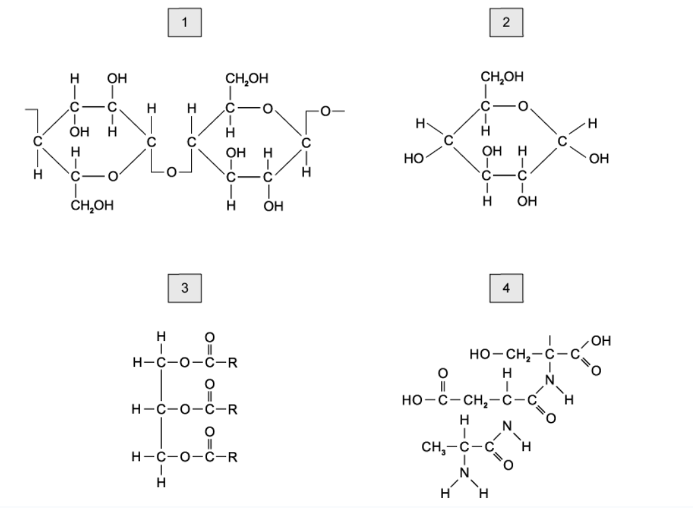

### Q3 — hard — 1 marks

**Q3** [1 mark]

Samples of four different fruit juices (**A**, **B**, **C** and **D**), were heated with Benedict’s solution.

A second sample of the same four juices was heated with dilute hydrochloric acid and then neutralised before being heated with Benedict’s solution.

The table below shows the masses of precipitates formed in each test.

Which juice contains the highest mass of non-reducing sugar?

|   | mass of precipitate before acid hydrolysis / mg | mass of precipitate after acid hydrolysis /mg |
|---|---|---|
| **A**  **B**  **C**  **D** | 60  20  55  40 | 70  45  75  40 |

### Q4 — hard — 1 marks

**Q4** [1 mark]

Using a large number of aphids, the solution from the sieve tube elements of a strawberry plant was extracted, as shown in the image below.

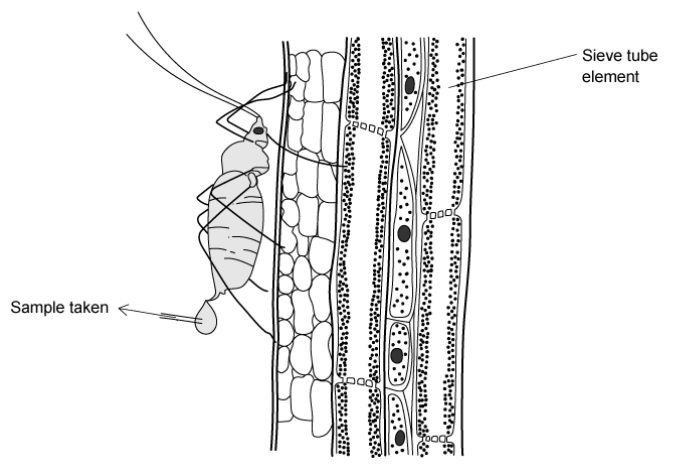

Different samples of the extracted solution were tested in the lab.

Which of the following would be the correct result?

|   | **observation** | **iodine in KI** |   |
|---|---|---|---|
| **before hydrolysis** | **after hydrolysis** |   |   |
| **A** | blue | red | blue-black |
| **B** | red | blue | blue-black |
| **C** | red | blue | brown |
| **D** | blue | red | brown |

### Q5 — hard — 1 marks

**Q5** [1 mark]

A teacher demonstrates the following biological tests on four food samples:

- starch
- reducing sugar
- protein
- lipids

One of the food samples, a banana milkshake, was found to contain reducing sugar, protein and lipid.

Which of the food samples shown in the table below could be banana milkshake?

| Food | observation |   |   |   |
|---|---|---|---|---|
| adding Biuret reagent | heating with Benedict’s solution | adding iodine in potassium iodide solution | mixing with ethanol and adding to water |   |
| **A** | purple | blue | orange | clear |
| **B** | pale blue | orange precipitate | blue-black | clear |
| **C** | purple | orange precipitate | orange | milky emulsion |
| **D** | pale blue | blue | blue-black | milky emulsion |

### Q6 — hard — 1 marks

**Q6** [1 mark]

A sample solution underwent a series of biological tests to determine the substances present in the solution.

When the biuret test was carried out a pale blue colour was observed; the same observation was made when the sample was heated with Benedict’s solution.

When the sample was shaken in an organic solvent and then added to water, a milky emulsion was observed.

Based on the information given, which of the following molecules are **not** present in this solution?

### Q7 — hard — 1 marks

**Q7** [1 mark]

A teacher demonstrates several biological tests on two food samples to her class.

- Sample 1 was a mixture of phospholipids and starch.
- Sample 2 tested positive for lipids and protein, but negative for reducing sugars.

| **food** | **observation** |   |   |   |   |
|---|---|---|---|---|---|
| adding Biuret reagent | heating with Benedict’s solution | adding iodine in potassium iodide solution | mixing with ethanol and adding to water | hydrolysed and heated with Benedict’s |   |
| **1** | purple | orange | blue-black | clear | blue |
| **2** | purple | blue | orange | milky | brick-red |
| **3** | pale blue | orange | orange | milky | blue |
| **4** | pale blue | blue | blue-black | milky | brick-red |

Which of the following options would be correct?

|   | **sample 1** | **sample 2** |
|---|---|---|
| **A**  **B**  **C**  **D** | 1  4  2  4 | 3  2  3  1 |

### Q8 — hard — 1 marks

**Q8** [1 mark]

Two solutions, one containing glucose and amylase, the other containing starch and sucrose, were tested with a variety of reagents to confirm their identity.

The table below shows the results recorded following the outcome of the biological tests.

Which row correctly identifies the two solutions?

|   | add biuret | add iodine in KI | boil with Benedict’s solution | boil with Benedict’s solution after acid hydrolysis |   |   |   |   |
|---|---|---|---|---|---|---|---|---|
| 1 | 2 | 1 | 2 | 1 | 2 | 1 | 2 |   |
| **A** | + | ー | ー | + | ー | + | ー | + |
| **B** | + | ー | + | ー | + | ー | ー | + |
| **C** | ー | + | + | ー | ー | + | + | ー |
| **D** | + | ー | ー | + | + | + | ー | + |

Key: + = biological molecule present, ー = biological molecule absent

### Q9 — hard — 1 marks

**Q9** [1 mark]

Four tests were conducted to determine the types of biological molecules present in a sample solution. Observations from these tests are shown in the table below.

| **test** | **observation** |
|---|---|
| emulsion  iodine  Benedict’s  biuret | clear  orange  brick-red  purple |

Which molecules are present in this solution?

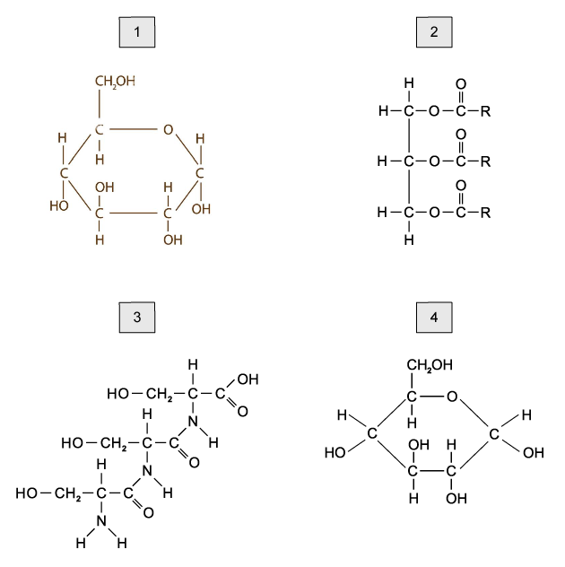

### Q10 — hard — 1 marks

**Q10** [1 mark]

Birch trees can be tapped to extract a solution from their sieve tube elements.

Different samples of the solution extracted from several birch trees were tested.

Which of the following would be the correct result?

|   | **observation** | **iodine in KI** |   |
|---|---|---|---|
| **before hydrolysis** | **after hydrolysis** |   |   |
| **A** | blue | red | blue-black |
| **B** | green | blue | brown |
| **C** | blue | red | brown |
| **D** | red | yellow | blue-black |

### Q11 — medium — 1 marks

**Q11** [1 mark]

A group of students carried out a series of tests on a liquid solution obtained from a plant. The table below shows the results of their tests:

| **reagent** | **observation** |
|---|---|
| Benedict's solution biurets  ethanol and water | orange  lilac  clear |

Which of the following biological molecules were found in the plant liquid solution?

### Q12 — medium — 1 marks

**Q12** [1 mark]

A group of students tested four solutions for sugars. The colours observed after testing are shown in the table below.

|   | **test 1 ** | **test 2** |
|---|---|---|
| **solution** | heated with Benedict’s solution | hydrolysed, then heated with Benedict’s solution |
| 1  2  3  4 | brown  blue  yellow  brown | blue  red  green  orange |

Which solution may contain non-reducing sugars?

### Q13 — medium — 1 marks

**Q13** [1 mark]

A group of students carry out several tests on a sample of a solution.

The table below shows the results.

| **test** | **observations** |
|---|---|
| Benedict’s | yellow |
| Biuret | lilac |
| Ethanol | clear |
| iodine in potassium iodide solution | orange |

Which of the following molecules would be present in the sample tested based on the student’s observations?

### Q14 — medium — 1 marks

**Q14** [1 mark]

A group of students tested four solutions by heating them with Benedict’s reagent. The table below shows the students’ observations after testing.

Which solution contains a non-reducing sugar?

|   | **heated with Benedict’s reagent** | **boiled with hydrochloric acid, neutralised and then heated with Benedict’s reagent ** |
|---|---|---|
| **A** | orange | blue |
| **B** | orange | orange |
| **C** | blue | orange |
| **D** | blue | blue |

### Q15 — medium — 1 marks

**Q15** [1 mark]

A solution is mixed with dilute hydrochloric acid, heated and then cooled before being neutralised with sodium hydrogencarbonate until the solution is slightly alkaline. The mixture is then heated gently with Benedict’s reagent.

The final observation of the solution is a blue colour. This is the same as the observation of the solution when it was gently heated with Benedict’s solution without treatment with acid and subsequent neutralisation.

What can be determined about the composition of the solution?

### Q16 — medium — 1 marks

**Q16** [1 mark]

A teacher demonstrated several food tests on a sample solution with an unknown composition of biological molecules.

| **test** | **observation** |
|---|---|
| non-reducing  sugar  lipid  starch  protein | blue  milky  orange  lilac |

Which row of the table below correctly identifies the molecules present in the sample?

|   | **fatty acids** | **starch** | **protein** | **non-reducing sugar** |
|---|---|---|---|---|
| **A** | ✓ | ✓ | X | X |
| **B** | X | ✓ | ✓ | ✓ |
| **C** | ✓ | X | ✓ | X |
| **D** | ✓ | ✓ | ✓ | X |

**Key:** ✓ = present, X = absent

### Q17 — medium — 1 marks

**Q17** [1 mark]

A group of students tested three solutions for sugars. The colours observed after testing are shown in the table below.

|   | **test 1** | **test 2** |
|---|---|---|
| **solution** | heated with Benedict’s solution | boiled with hydrochloric acid, neutralised, then heated with Benedict’s solution |
| 1  2  3 | brown  blue  yellow | blue  red  orange |

Which solutions may contain reducing sugars?

### Q18 — medium — 1 marks

**Q18** [1 mark]

A starch solution was mixed with amylase.

Which of the following reagents could be used to confirm that a reaction had occurred and what observation would be made?

|   | **reagent** | **observation of mixture** |
|---|---|---|
| **A** | iodine in potassium iodide solution | blue-black |
| **B** | Benedict’s solution | blue |
| **C** | Biurets solution | purple |
| **D** | Benedict’s solution | brick-red |

### Q19 — medium — 1 marks

**Q19** [1 mark]

Using a large number of aphids, a solution from the sieve tube elements of a tomato plant was extracted.

The following tests and observations were made:

| **reagent** | **observation** |
|---|---|
| Benedict’s solution  Biuret  ethanol and water | brown precipitate  lilac colour  clear |

Which row correctly shows the molecules found in the solution?

|   | **fatty acids** | **protein** | **reducing sugar** |
|---|---|---|---|
| **A** | ✓ | X | X |
| **B** | X | ✓ | X |
| **C** | ✓ | X | ✓ |
| **D** | X | ✓ | ✓ |

**Key:** ✓ = present, X = absent

### Q20 — medium — 1 marks

**Q20** [1 mark]

The diagram below shows a biological molecule.

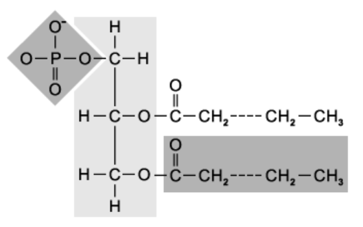

Which of the following tests would give a positive result for this molecule?

### Q21 — easy — 1 marks

**Q21** [1 mark]

Which carbohydrate would form a brick-red solution when heated gently with Benedict’s solution?

### Q22 — easy — 1 marks

**Q22** [1 mark]

Which of the following biological molecules would not form a purple colour when added to biuret solution?

### Q23 — easy — 1 marks

**Q23** [1 mark]

Which of the following sequences correctly shows the colour change in precipitates formed when a solution with a high concentration of reducing sugar is heated with Benedict’s solution?

### Q24 — easy — 1 marks

**Q24** [1 mark]

Samples of a mixture of biological molecules underwent a series of biological tests.

When the biuret test was carried out on a sample of the mixture, the mixture turned lilac.

When iodine in potassium iodide was added to a sample, the mixture turned black.

Which biological molecules were present in the mixture?

### Q25 — easy — 1 marks

**Q25** [1 mark]

The diagram below shows part of a biological molecule.

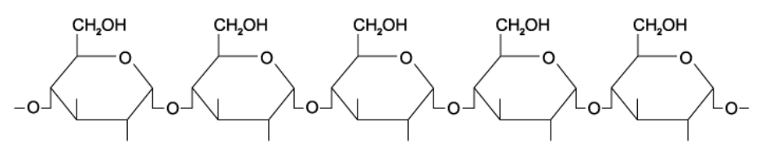

Which of the following tests would give a positive result for this molecule?

### Q26 — easy — 1 marks

**Q26** [1 mark]

Which of the following steps would not be involved in testing a sample for the presence of a non-reducing sugar?

### Q27 — easy — 1 marks

**Q27** [1 mark]

The diagram below shows a biological molecule.

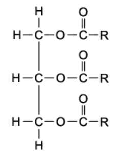

Which of the following tests would give a positive result for this molecule?

### Q28 — easy — 1 marks

**Q28** [1 mark]

A sample of food was blended and several drops were decanted into a test tube with an equal volume of ethanol solution. The test tube was shaken vigorously for a minute before the mixture was poured into a test tube of water.

A milky emulsion was observed. Which of the following biological molecules must have been present in the food?

### Q29 — easy — 1 marks

**Q29** [1 mark]

Which carbohydrate would test positive for the Benedict’s test after acid hydrolysis, but negative before acid hydrolysis, has occurred?

### Q30 — easy — 1 marks

**Q30** [1 mark]

The diagram below shows a biological molecule.

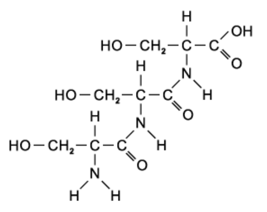

Which of the following tests would give a positive result for this molecule?

## Structured Questions (12 questions)

### Q1 — medium — 11 marks

**Q1** [4 marks]

Students are presented with an unknown solution which they need to test for the presence of starch, reducing sugar and protein.

(i) Outline the test for reducing sugar.

[3]

(ii) State how students could estimate the concentration of reducing sugar present in the solution.

[1]

**Q1** [3 marks]

Samples of the original solution are removed and iodine solution is added to one of the samples (**A**), while biuret reagent is added to the other sample (**B**). The results of these tests are found in Table 1.

**Table 1**

| **Sample** | **End colour of the solution** |
|---|---|
| A | Orange-brown |
| B | Purple |

Discuss the results obtained for each sample.

**Q1** [3 marks]

**Extract:**

(i) The test for reducing sugar involves the following steps...

- Add Benedict's solution/reagent; [1 mark]
- Boil / heat to 95 °C; [1 mark]
- For a positive result, a precipitate will form / colour change from blue to green/yellow/orange/red/brown; [1 mark]

Explain how the test for reducing sugar, outlined in part (a) (i), could be modified to test whether the solution contained sucrose.

**Q1** [1 mark]

**Extract:**

(i) The test for reducing sugar involves the following steps...
- Add Benedict's solution/reagent;
- Boil / heat to 95 °C;
- For a positive result, a precipitate will form / colour change from blue to green/yellow/orange/red/brown;

Explain how the test for reducing sugar, outlined in part (a) (i), could be modified to test whether the solution contained sucrose.

The test for reducing sugar can be modified as follows to test for non-reducing sugar...
- Heat a sample of the unknown solution with hydrochloric acid;
- Neutralise the acid / add an alkali/sodium hydroxide;
- Repeat the Benedict's test / mix with Benedict's solution and heat to a high temperature;

After following the procedure outlined in part (c) the mass of precipitate that formed was heavier than when the test for reducing sugar was performed.

State the significance of these results.

### Q2 — medium — 9 marks

**Q2** [3 marks]

The enzyme amylase breaks down starch to form the reducing sugar maltose. Iodine solution can be used to measure the progress of this enzyme-controlled reaction during a practical investigation.

Explain how iodine solution can be used to measure the rate of this enzyme-controlled reaction.

**Q2** [2 marks]

After all the starch was broken down into maltose by amylase, the enzyme maltase was added to the solution. A sample (**sample 1**) was taken from the solution immediately after the maltase was mixed with the solution. The remaining solution (**sample 2**) was incubated at 37 °C for an hour.

Describe a chemical test you could carry out to show that maltose is a reducing sugar.

**Q2** [3 marks]

**Extract:**

After all the starch was broken down into maltose by amylase, the enzyme maltase was added to the solution. A sample (sample 1) was taken from the solution immediately after the maltase was mixed with the solution. The remaining solution (sample 2) was incubated at 37 °C for an hour.

Describe a chemical test you could carry out to show that maltose is a reducing sugar.

The chemical test in part (b) was carried out on both **samples 1** and **2**. All experimental variables were kept the same when testing both of the samples. Both tubes were left for 15 minutes to allow the precipitate to settle.

State and explain how the result of **sample 2** would differ from **sample 1**.

**Q2** [1 mark]

Explain why iodine solution would not be a suitable reagent to use when testing for biological molecules present in extracts from animal cells.

### Q3 — medium — 9 marks

**Q3** [2 marks]

Scientists wanted to test the nutritional content of a new meal replacement shake under development. Table 1 shows some of the results that were gathered by the scientists.

**Table 1**

| **Biological molecule tested** | **Test reagent(s) used** | **End results observed** |
|---|---|---|
| Glucose | (i) | Brick-red precipitate forms |
| Sucrose | (ii) | Blue colour |
| Protein | (iii) | Blue colour |
| Lipids | (iv) | Cloudy suspension forms |

Complete the table by identifying the test reagents used in each case.

**Q3** [3 marks]

**Extract:**

Scientists wanted to test the nutritional content of a new meal replacement shake under development. Table 1 shows some of the results that were gathered by the scientists.

Table 1

| **Biological molecule tested** | **Test reagent(s) used** | **End results observed** |
| Glucose | (i) | Brick-red precipitate forms |
| Sucrose | (ii) | Blue colour |
| Protein | (iii) | Blue colour |
| Lipids | (iv) | Cloudy suspension forms |

Describe the procedure the scientists would have followed to test for the presence of protein **and** state the meaning of the results that they obtained.

**Q3** [2 marks]

**Extract:**

Scientists wanted to test the nutritional content of a new meal replacement shake under development. Table 1 shows some of the results that were gathered by the scientists.

**Table 1**

| **Biological molecule tested** | **Test reagent(s) used** | **End results observed** |
| Glucose | (i) | Brick-red precipitate forms |
| Sucrose | (ii) | Blue colour |

Discuss the results that were obtained by the scientists when they were testing for the presence of carbohydrates.

**Q3** [2 marks]

**Extract:**

**Table 1**

| **Biological molecule tested** | **Test reagent(s) used** | **End results observed** |
| Glucose | (i) | Brick-red precipitate forms |
| Sucrose | (ii) | Blue colour |
| Protein | (iii) | Blue colour |
| Lipids | (iv) | Cloudy suspension forms |

The test reagents used for each biological molecule were as follows...

- (i) Benedict's **AND** (ii) hydrochloric acid with Benedict's; [1 mark]
- (iii) Biuret **AND** (iv) ethanol/alcohol; [1 mark]

To get full marks for this question you must correctly identify **all** the reagents for four biological molecules tested. Take note that the test for non-reducing sugar requires the addition of hydrochloric acid first *before* Benedict's reagent is used. This is to hydrolyse the glycosidic bond between the two monosaccharides making up sucrose.

While testing for the presence of sucrose, the scientists accidentally left out the sodium hydroxide after adding the hydrochloric acid to the solution.

Explain how this could have affected their results.

### Q4 — medium — 9 marks

**Q4** [4 marks]

Triglycerides are the main form of dietary lipids ingested by humans. They are digested by the enzyme lipase in the stomach.

Describe a biochemical test that could be performed to determine whether a sample of food contains triglycerides.

**Q4** [3 marks]

**Extract:**

Triglycerides are the main form of dietary lipids ingested by humans. They are digested by the enzyme lipase in the stomach.

Describe a biochemical test that could be performed to determine whether a sample of food contains triglycerides.

The biochemical test for triglycerides is...
- The (ethanol) emulsion test
- Mix the food sample with ethanol/alcohol
- Then add water / pour into water
- (If lipids are present) a white/milky emulsion forms

A positive result is that the clear solution will turn milky when the water is added.

Using your knowledge of the structure of triglycerides, explain the visual result of a positive test for the presence of lipids.

**Q4** [2 marks]

Seeds are a good source of lipids. They also contain starch which serve as a food source for the growing plant embryo during germination.

Outline the biological test that can be used to confirm the presence of starch.

### Q5 — easy — 8 marks

**Q5** [3 marks]

Complete the following sentences.

The presence of protein may be tested for using __________ reagent. In the presence of proteins the reagent will turn from __________ to __________.

The reagent reacts with _________ bonds present in the protein.

**Q5** [2 marks]

Fig. 1 shows two amino acids.

**Fig. 1**

Draw the chemical bond that forms when these two amino acids are joined during a condensation reaction. You need only draw the parts of the molecules shown in the box.

**Q5** [2 marks]

The chemical test for a protein is described as a qualitative test.

Explain why this is the case.

**Q5** [1 mark]

**Extract:**

The presence of protein may be tested for using biuret reagent. The reagent reacts with peptide bonds present in the protein.

A student was using the reagent, named in part (a), to test for the presence of an amylase enzyme. The student accidentally heated the reaction solution, containing amylase, as part of their experiment and then tested the reaction solution using the reagent for proteins.

Suggest why the error in their method may cause an inaccurate result.

### Q6 — easy — 6 marks

**Q6** [1 mark]

Iodine in potassium iodide is used to test the presence of starch.

Describe what you would expect to observe in a positive result.

**Q6** [2 marks]

Starch is a carbohydrate often stored in plant cells.

Fig. 1 shows a starch grain in a section of plant tissue at a magnification of ×500.

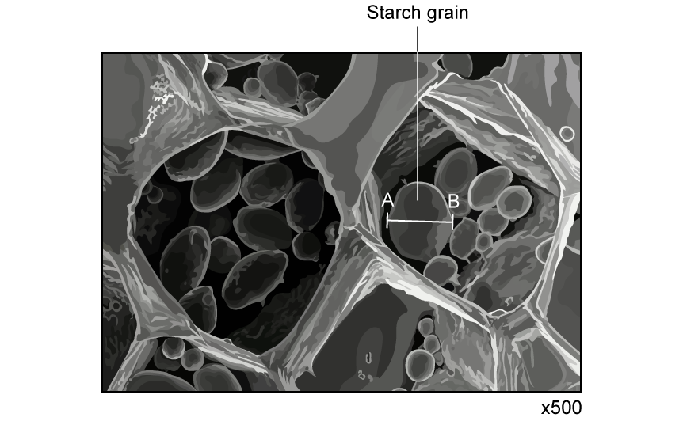

**Fig. 1**

The size of the diameter of the starch grain on the image is 18 mm.

Calculate the actual diameter of the starch grain between points **A** and **B.** Give your answer in micrometers.

**Q6** [2 marks]

**Extract:**

Starch is a carbohydrate often stored in plant cells.

Fig. 1 shows a starch grain in a section of plant tissue at a magnification of ×500.

State the type of microscope that was used to obtain the image shown in Fig. 1 and explain the evidence for this.

**Q6** [1 mark]

**Extract:**

Iodine in potassium iodide is used to test the presence of starch.

A different reagent is used to test for the presence of proteins.

Give the name of this reagent.

### Q7 — easy — 10 marks

**Q7** [4 marks]

Describe the test for non-reducing sugars.

**Q7** [1 mark]

Give the name of a non-reducing sugar.

**Q7** [4 marks]

The presence of other molecules can also be tested for with a range of biochemical reagents.

Complete Table 1 to show which reagents are used for which molecule.

**Table 1**

| **reagent** | **biological molecule** |
|---|---|
| potassium iodide |   |
| Benedict's |   |
| biuret |   |
| ethanol |   |

**Q7** [1 mark]

Some of the biological molecules identified in Table 1 can be described as polymers.

Define the term **polymer**.

### Q8 — easy — 6 marks

**Q8** [3 marks]

Benedict's reagent can be used to test for the presence of reducing and non-reducing sugars.

Outline the method for test for a reducing sugar.

**Q8** [2 marks]

The Benedict's test for reducing sugar is often referred to as a semi-quantitative test.

(i) Suggest what is meant by a semi-quantitative test.

[1]

(ii) Describe the colour change in Benedict's solution you would expect to see as the concentration of the test substance increases.

[1]

**Q8** [1 mark]

**Extract:**

Benedict's reagent can be used to test for the presence of reducing and non-reducing sugars.

The qualitative test for reducing sugar is:
- Add Benedict's reagent to the sample (to be tested) in a test tube
- Heat/boil the sample
- A positive result will show an orange/brown/red coloured precipitate form

The Benedict's test for reducing sugar is often referred to as a semi-quantitative test.

(i) A semi-quantitative Benedict's test means the results do not give a precise value BUT they show a relative concentration / indicate low and high concentration / allow concentration to be estimated.

(ii) The colour change you can expect to see is from blue to green to yellow to orange/brown to (brick) red.

Fig. 1 shows the colour change scale of five known concentrations of reducing sugar solutions.

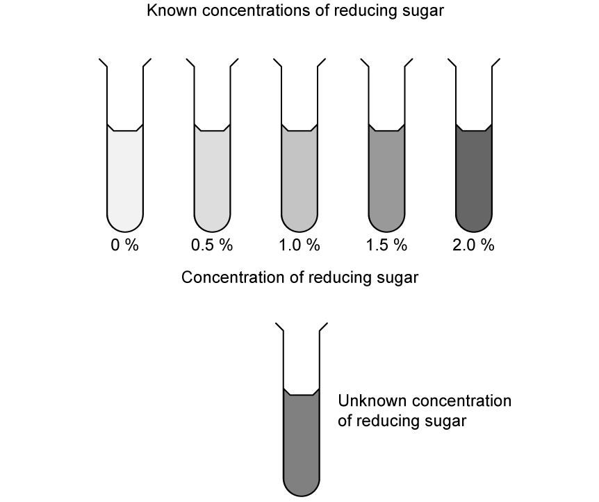

**Fig. 1**

Estimate the concentration of the unknown sample.

### Q9 — easy — 7 marks

**Q9** [4 marks]

A student wants to determine whether a sample of food contains lipids.

Describe the test the student should carry out and include the positive result.

**Q9** [1 mark]

**Extract:**

A student wants to determine whether a sample of food contains lipids.

The test for lipids is:
- Add ethanol to the sample
- Shake to mix the sample and the ethanol
- Add to a test tube of water
- A positive result is a milky emulsion

Describe how the student could determine the concentration of the lipid in the sample.

**Q9** [1 mark]

**Extract:**

A student wants to determine whether a sample of food contains lipids. Describe the test the student should carry out and include the positive result.

The test for lipids is:
- Add ethanol to the sample
- Shake to mix the sample and the ethanol
- Add to a test tube of water
- A positive result is a milky emulsion

State **one **health and safety precaution the student should take when using the reagent to test for a lipid.

**Q9** [1 mark]

Fig. 1 shows the structure of a lipid, also known as a triglyceride.

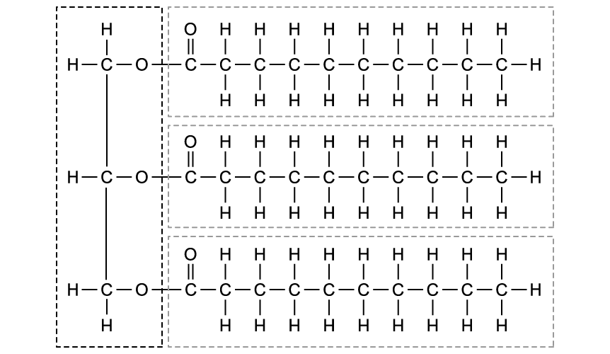

**Fig. 1**

Lipids cannot cross the cell-surface membranes of cells lining the gut during the absorption of nutrients.

Suggest why it **cannot** cross cell-surface membranes.

### Q10 — hard — 8 marks

**Q10** [1 mark]

The Benedict's test for reducing sugars gives a semi-quantitative result when used on samples of reducing sugar solution.

Explain the term *semi-quantitative* in this context.

**Q10** [3 marks]

A solution with an unknown concentration of glucose is tested for reducing sugar.

Outline a method for determining the concentration of glucose in this solution.

**Q10** [2 marks]

Table 1 below gives the experimental protocol for making a serial dilution of a glucose solution.

The concentration of the stock solution of glucose that is to be used is 20 mmol dm-3.

**Table 1**

| **Concentration of glucose required / mmol dm****-3** | **Volume of stock solution required /** **cm****3** | **Volume of distilled water required /** **cm****3** | **Total volume of solution required /** **cm****3** |
|---|---|---|---|
| 0 | 0 | 100 | 100 |
| 2 |   |   | 100 |
| 4 |   |   | 100 |
| 10 |   |   | 100 |
| 15 |   |   | 100 |
| 20 | 100 | 0 | 100 |

Calculate the missing values and complete Table 1 with your calculated values.

**Q10** [2 marks]

In a similar procedure to that outlined in part (c), a student wished to make up a solution of glucose of 0.1 mmol dm -3 from a laboratory stock solution with a concentration of 100 mmol dm-3.

The student evaluated two methods of producing this solution, methods **A **and **B **as shown below in Table 2.

**Table 2**

| **Method A** | **Method B** |
|---|---|
| 0.1 cm3 stock solution and 99.9 cm3 of distilled water | 10 cm3 stock solution and 900 cm3 distilled water, to make solution **X**, followed by... |
| 1 cm3 of solution **X** and 9 cm3 of distilled water |   |

Select which method, **A **or **B, **would be the better method for the student to follow.

Give a reason for your choice.

### Q11 — hard — 11 marks

**Q11** [2 marks]

A group of students wanted to test a food sample to measure the concentration of reducing sugars.

They began their investigation by testing a series of samples of known glucose concentration using a colorimeter. Their results are shown in Table 1 below.

**Table 1**

| **Glucose concentration / mmol dm****-3** | **% absorbance** |
|---|---|
| 1.0 | 69 |
| 2.0 | 58 |
| 3.0 | 46 |
| 4.0 | 39 |
| 5.0 | 25 |
| 6.0 | 17 |

Explain why the students began their investigation in this way.

**Q11** [2 marks]

**Extract:**

A group of students wanted to test a food sample to measure the concentration of reducing sugars.

They began their investigation by testing a series of samples of known glucose concentration using a colorimeter. Their results are shown in Table 1 below.

**Table 1**

| **Glucose concentration / mmol dm**^**-3**^ | **% absorbance** |
| 1.0 | 69 |
| 2.0 | 58 |
| 3.0 | 46 |
| 4.0 | 39 |
| 5.0 | 25 |
| 6.0 | 17 |

Calculate the percentage change in absorbance as the glucose concentration increases from 1.0 mmol dm-3 to 6.0 mmol dm-3. Give your answer to three significant figures.

**Q11** [4 marks]

**Extract:**

A group of students wanted to test a food sample to measure the concentration of reducing sugars.

They began their investigation by testing a series of samples of known glucose concentration using a colorimeter. Their results are shown in Table 1 below.

**Table 1**

| **Glucose concentration / mmol dm**^**-3**^ | **% absorbance** |
| 1.0 | 69 |
| 2.0 | 58 |
| 3.0 | 46 |
| 4.0 | 39 |
| 5.0 | 25 |
| 6.0 | 17 |

Use the data in Table 1 to plot a graph of glucose concentration against absorbance.

**Q11** [3 marks]

**Extract:**

A group of students wanted to test a food sample to measure the concentration of reducing sugars.

They began their investigation by testing a series of samples of known glucose concentration using a colorimeter. Their results are shown in Table 1 below.

Table 1

| Glucose concentration / mmol dm^-3^ | % absorbance |
| 1.0 | 69 |
| 2.0 | 58 |
| 3.0 | 46 |
| 4.0 | 39 |
| 5.0 | 25 |
| 6.0 | 17 |

Describe **three** measures that the students should take to ensure that their results are valid.

### Q12 — hard — 13 marks

**Q12** [5 marks]

The effect of storage on the sugar content of winter squash fruits was studied. The results are shown in Fig. 1 below. Note that the error bars show standard deviation.

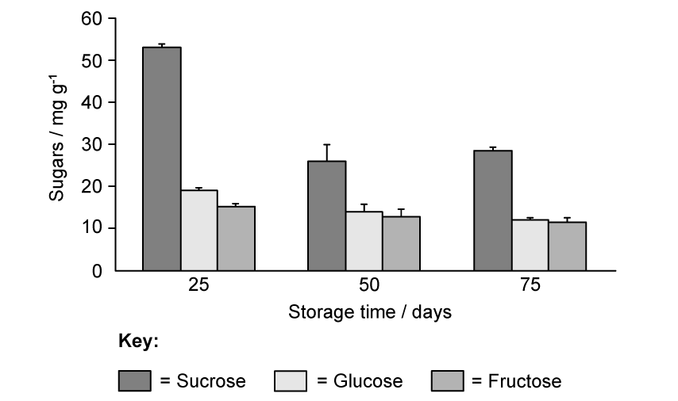

**Fig. 1**

Suggest how the squash may have been tested to assess sugar content.

**Q12** [4 marks]

**Extract:**

The effect of storage on the sugar content of winter squash fruits was studied. The results are shown in Fig. 1 below. Note that the error bars show standard deviation.

Fig. 1 shows changes in the levels of sucrose, glucose and fructose in fruit after 25, 50 and 75 days of storage.

Describe the effect of storage time on squash sugar content shown in Fig. 1.

**Q12** [2 marks]

**Extract:**

The effect of storage time on squash sugar content shown in Fig. 1:
- There is an overall decrease in sugar content as storage time increases
- The mass of sucrose decreases significantly between day 25 and day 50 and then increases (slightly) between day 50 and day 75
- The change in sucrose levels is greater than the change in levels of glucose and fructose
- There is significantly more sucrose present than glucose and fructose at all times during storage
- There is significantly more glucose than fructose present at day 25 and only slightly more glucose / similar levels of glucose and fructose present at day 50 and day 75

Suggest an explanation for the results observed in part (b).

**Q12** [2 marks]

**Extract:**

The effect of storage on the sugar content of winter squash fruits was studied. The results are shown in Fig. 1 below. Note that the error bars show standard deviation.

**Fig. 1**

Fig. 2 shows another set of data gathered during the investigation into the effect of storage time on squash biochemistry.

**Fig. 2**

The researchers concluded from this data that winter squash would become more appealing to consumers over time.

Discuss this conclusion.
