# Mark Schemes — Carbohydrates & Lipids
**2. Biological Molecules** · Cambridge (CIE) A-LEVEL biology (9700)

## Multiple Choice Questions (30 questions)

### Q1
**Final answer:** **The correct answer is**** A ****because:**

- **Lactose is a disaccharide composed of one molecule of glucose and one molecule of galactose held together by a glycosidic bond**
- **Hydrolysis of lactose releases galactose and glucose:** 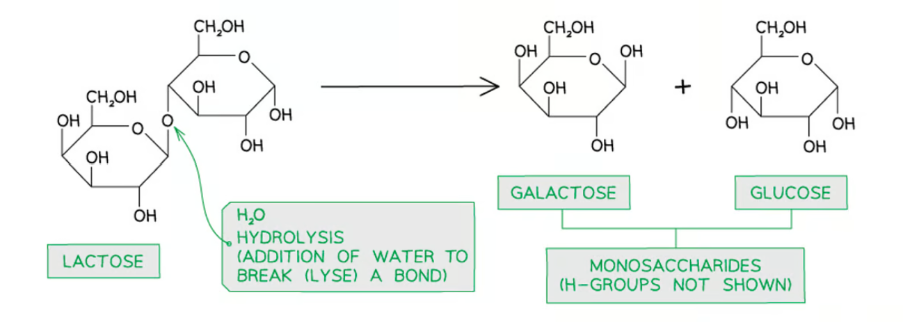

### Q2
**Final answer:** **The correct answer is ****C ****because:**

- **Statement 1 is not true as hydrolysis of amylose releases **$α$**-glucose molecules**
- **Statement 2 is not true as glycogen contains bond 1,4 and 1 ,6-glycosidic bonds whereas amylose only contains 1 ,4-glycosidic bonds**
- **Statement 3 is not true as triglycerides are not polymers — the definition of a polymer is a molecule made from many repeating or similar smaller subunits ('poly' meaning 'many').**

> *Triglycerides are made from simpler biomolecules, but this does not make them polymers; they are only formed from four subunits (three fatty acid chains and one glycerol molecule).*

### Q3
**Final answer:** **The correct answer is**** C**** as only fatty acids contain a C=O bond:**

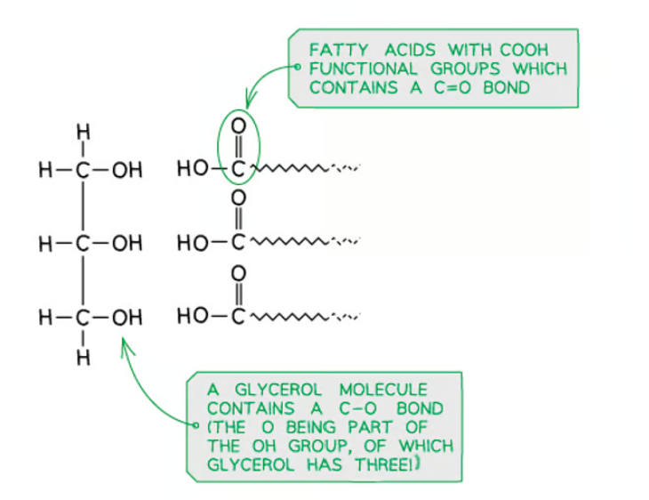

### Q4
**Final answer:** **The correct answer is ****C**** because glycosidic, peptide and ester bonds are all example of covalent bonds which form between two molecules to form a larger molecule, with a small molecule (usually water in living organisms) being lost in the process.**

### Q5
**Final answer:** **The correct answer is ****D**** maltose is a reducing sugar, whereas sucrose is not. In order to prove that a solution contains sucrose, it needs to first test negative for the Benedict's test (no colour change). After acid hydrolysis of a new sample of the same solution, a subsequent Benedict's test will be positive (showing a colour change from blue to green/orange/brick-red dependent on concentration). This is because acid hydrolysis of sucrose releases the monosaccharides fructose and glucose (both are reducing sugars)**

### Q6
**Final answer:** **The correct answer is ****B**** because the question is asking for the statements that are not true:**

- **Statement 1 is false: Molecule ****P**** is part of the primary structure of a protein and does contain peptide bonds but Molecule ****R**** contains two types of glycosidic bond (1-4 and 1-6) whereas Molecule**** Q ****only has one type (1-4)**
- **Statement 2 is false, as although ****R**** could be representative of glycogen (it has 1-4 and 1-6 glycosidic bonds) ****T**** is amylose which is a component of starch and therefore wouldn't be found in animals. ****Q**** is cellulose (notice the alternating orientation of the 1-4 glycosidic bond between **$β$**-glucose molecules) which is found in plant and algae cell walls, never in animal cells**
- **Statement 3 is false, ****S**** is a glucosylceramide, an important component in neuronal membranes. It has two hydrocarbon chains which are hydrophobic which enable it to form part of the cell membrane.**** Q**** (cellulose) does have a structural role**
- **Statement 4 could be true; ****R**** could be amylopectin (a component of starch) and**** T**** is amylose which would form a helical structure, starch is an important energy storage molecule in plants**

### Q7
**Final answer:** **The correct answer is**** D**** because:**

- **For **$α$**-glucose, the rule for OH group placement from ****1****C to ****4****C is: 'down-down-up-down'**
- **For **$β$**-glucose, the rule for OH group placement from ****1****C to ****4****C is: 'up-down-up-down'** 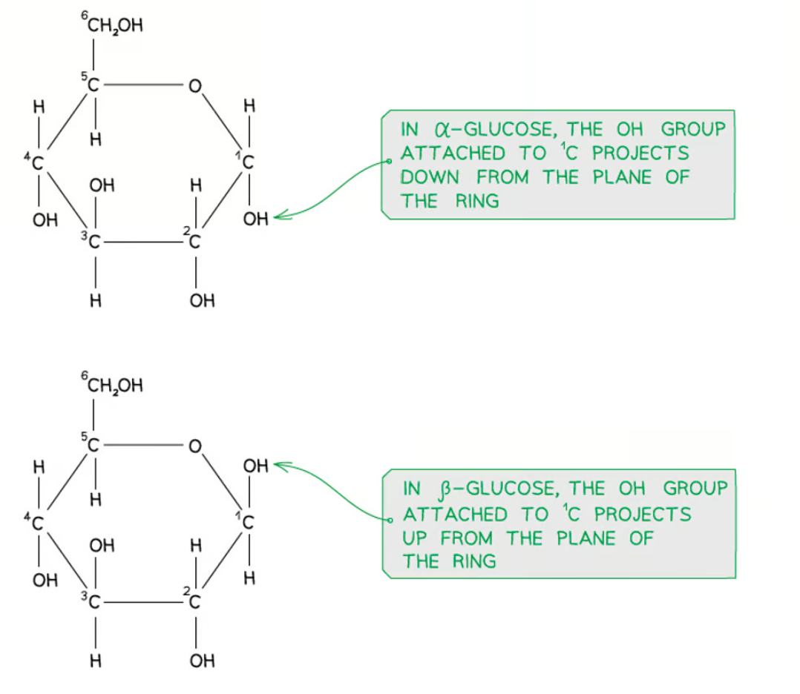

### Q8
**Final answer:** **The correct answer is ****C**** because:**

- **The triglyceride is the molecule on the right, the phospholipid is on the left**
- **Statements ****2**** and**** 4**** are ****true**
- **Statement ****1**** is false because the fatty acid chains in the triglyceride molecule are all the same length, whereas one of the chains in the phospholipid is longer and contains a double bond (causing a 'kink' in the chain)**
- **Statement ****3**** is false because the triglyceride in a nonpolar molecule (is not charged) and would therefore not be able to form hydrogen bonds with water molecules**

### Q9
**Final answer:** **The correct answer is ****D ****because:**

- **The only non-reducing sugar in the given list is sucrose which is a disaccharide, so answers ****B**** and ****D ****are the only two that can be correct**
- **The remaining options are all reducing sugars; glucose and fructose are both monosaccharides, whereas maltose is a disaccharide, so option ****D**** is correct**

> *A reducing sugar has the ability to act as an electron donor; this requires the presence of a hemiacetal functional group in the molecule which allows the sugar to exist in equilibrium in open-ring form. This exposes an aldehyde group allowing for reduction of Cu**2+** ions present in Benedict's solution. A non-reducing sugar has a 'locked' shape and does not exist in equilibrium with an open-ring form.*

### Q10
**Final answer:** **The correct answer is**** D ****because:**

- **Molecule Q is cellulose, composed of **$β$**-glucose subunits**
- **Molecule R could be glycogen or amylopectin, composed of **$α$**-glucose subunits**
- **Molecule S is a phospholipid composed of a glycerol backbone, fatty acids and glycerol**
- **Molecule T is amylose, composed of a-glucose subunits**

### Q11
**Final answer:** **The correct answer is ****D**** because:**

**Final answer:** **Polysaccharides are generally insoluble in cold water (the solubility of starch increases as the temperature of water increases), meaning that it does not dissolve in cytoplasm of plant cells. This is important because substances dissolved in the cytoplasm lower the water potential of cells and cause the inward movement of water by osmosis.**

**Final answer:** **The formation of the polysaccharides amylose and amylopectin means that a source of glucose is available in the cell without affecting the cell's water potential.**

> *Option **A **is incorrect because** hydrolysis** reactions result in the breakdown of amylose and amylopectin.*

> *Option **B** is incorrect because the complex is **insoluble**, and starch does **not** travel in the phloem but is **stored inside cells**.*

> *Option **C** is incorrect as **amylose** has a coiled, unbranched structure whereas amylopectin is **branched**. The compact nature of starch aids its storage inside cells rather than its transport in the phloem.*

### Q12
**Final answer:** **The correct answer is**** D ****because:**

**Final answer:** **Amylopectin, like glycogen, has a branched structure, so contains ****1,4**** and ****1,6-glycosidic bonds.**

**Final answer:** **A bond between ****k-p represents a 1,4-glycosidic bond**** (k = ****1****C and p =****4****C). Note that this could also be represented by a bond between n (****1****C) and h (****4****C) if the molecules were rearranged, but this is not an available option.**

**Final answer:** **A bond between ****n-i represents a 1,6-glycosidic bond**** (n = ****1****C and i = ****6****C). This could also be represented by a bond between k (****1****C) and m (****6****C), but again this option is not available.**

### Q13
**Final answer:** **The correct answer is ****C ****because:**

**Final answer:** **Molecule 1**** ****is a triglyceride and the skeletal formula of the fatty acid chains shows ****no double bonds**** within the fatty acid chains, so all of the fatty acids are ****saturated****.**

**Final answer:** **Molecule 2 is a phospholipid, and one of its two fatty acid chains contains ****a double bond****, so this fatty acid is ****unsaturated****.**

> *A** is incorrect as the statement about** **molecule 1 is correct but the statement about** **molecule 2 is incorrect; the phospholipid has **one unsaturated fatty acid**.*

> *B** is incorrect as molecule 1 has **three ester bonds** and **no phosphate group**, whereas molecule 2 has two fatty acid chains attached via **ester bonds **to a glycerol molecule. **Phosphodiester **bonds are found in the backbone of **DNA **and **RNA** molecules, not in lipids.*

> *D** is incorrect as **molecule 1 is non-polar** whereas molecule 2 is polar.*

### Q14
**Final answer:** **The correct answer is ****B ****because:**

**Final answer:** **The only polysaccharide with by β-1,4-glycosidic bonds is ****cellulose****, formed from ****β-glucose**** molecules where every second glucose is rotated by 180****o**** relative to its neighbours. The molecule rotation results in the CH****2****OH group attached to ****5****C ****projecting in an alternating pattern**** on each side of the polysaccharide chain.**

> *Options **A**, **C** and **D** are all polysaccharides of **α-glucose**, where the CH**2**OH always projects on the **same side **of the molecule. Note that amylose is unbranched, like cellulose, but its structure is **coiled** and it contains **α-1,4-glycosidic bonds**.*

### Q15
**Final answer:** **The correct answer is**** C**** because:**

**Final answer:** **A disaccharide contains ****two monosaccharides**** held together by a ****glycosidic bond****. Note that glycosidic bonds are a type of covalent bond.**

**Final answer:** **A water molecule is given off during the formation of a glycosidic bond, so this is an example of a ****condensation reaction****.**

### Q16
**Final answer:** **The correct answer is ****B ****because:**

- **Statement 1 applies to amylose, amylopectin and cellulose, as polysaccharides are generally insoluble in water**
- **Statement 2 only applies to cellulose, as the glucose molecules in amylose form a highly coiled helical structure, unlike the straight chains in cellulose**
- **Statement 3 applies to both amylose and cellulose; in amylose these bonds form between an oxygen bound to ****2****C of one subunit and the oxygen bound to ****3****C of the next glucose molecule. In cellulose, many hydrogen bonds are able to form between the OH groups on adjacent chains**

### Q17
**Final answer:** **The correct answer is ****B**** because:**

**Final answer:** **This question needs you to know the position of the OH and H groups on carbons 1-4. While you are likely to know this for carbon 1, it is wise to be aware of the arrangements on carbons 2-4 as well:**

- **For ****α-glucose**** the rule for OH group position reading from ****1****C to**** 4****C is '****down-down-up-down****'**

- **For ****β-glucose ****the rule is '****up-down-up-down****'**

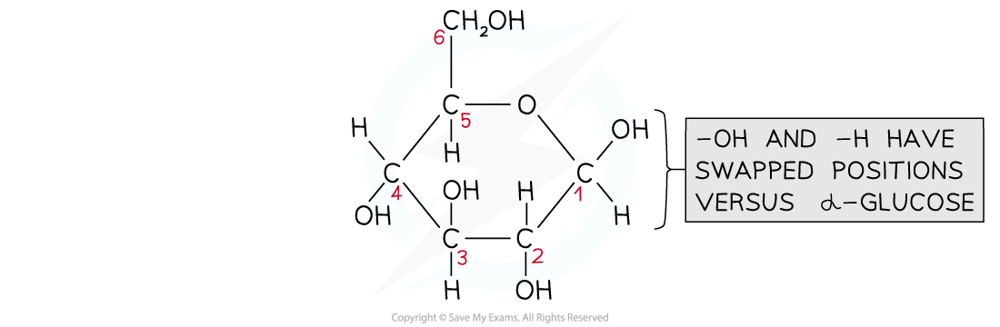

### Q18
**Final answer:** **The correct answer is ****C**** because:**

**Final answer:** **Triglycerides are made from three fatty acid chains joined to a glycerol molecule, so they are composed of smaller subunits, but these are not ****repeating**** subunits, which is a key feature of polymers.**

> *A** is incorrect as glycosidic bonds form during **condensation** reactions, not hydrolysis reactions.*

> *B** is incorrect as a triglyceride **is** formed from smaller subunits joined together.*

> *D **is incorrect as glycosidic bonds join **mono**saccharides together to form **di**saccharides and polysaccharides.*

### Q19
**Final answer:** **The correct answer is ****C**** because:**

**Final answer:** **The glycosidic bonds holding sucrose subunits together need to be broken (hydrolysed) in order to release the sugar subunits glucose and fructose, both of which can be tested for using Benedict's solution. Hydrolysis can be achieved using a hydrolytic enzyme or by boiling the sucrose with hydrochloric acid.**

> *Statement 1 is incorrect because dissolving in water will not break the glycosidic bonds between the molecules in sucrose.*

### Q20
**Final answer:** **The correct answer is ****C**** because:**

**Final answer:** **Sucrose is a non-reducing sugar that forms when ****two reducing sugars****, glucose and fructose, bond together. This is an example of a condensation reaction, where ****a molecule of water is formed**** from two adjacent -OH groups, forming a glycosidic bond.**

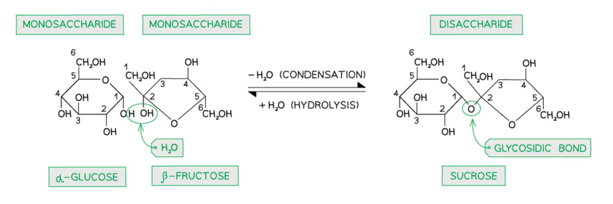

### Q21
**Final answer:** **The correct answer is ****D**** because:**

**Final answer:** **Glycosidic bonds form between monosaccharides, and molecule 1 shows two molecules of beta glucose joined together:**

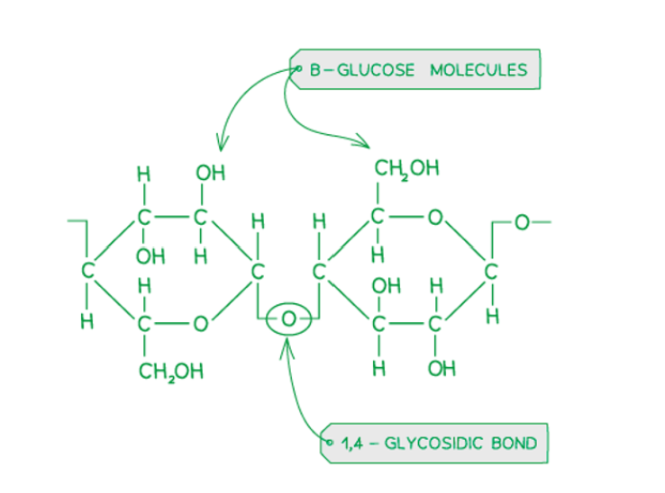

> *Molecule 2 is a single α-glucose** **molecule; it has the ability to form glycosidic bonds but it doesn't **contain** a glycosidic bond in the form shown.*

> *Molecule 3 is a triglyceride molecule; one glycerol molecule bonded to three fatty acid chains by** **ester** bonds.*

> *Molecule 4 shows part of a polypeptide chain, with amino acids held together by **peptide** **bonds.*

### Q22
**Final answer:** **The correct answer is**** D ****because:**

**Final answer:** **An unsaturated fatty acid has at least one double bond between carbon atoms (C=C) in the fatty acid chain**

**Final answer:** **There is also a double bond in the carboxylic acid (COOH) functional group part of an unbound fatty acid.**

> *The glycerol molecule within a lipid does not contain any double bonds.*

### Q23
**Final answer:** **The correct answer is ****D**** because:**

**Final answer:** **Starch contains two components: amylose and amylopectin. Amylose is a polymer of α-glucose held together by 1,4-glycosidic**** ****bonds to form an unbranched structure. This is different to glycogen, which has a branched structure.**

> *Statements **A**, **B** and **C** could all be applied correctly to glycogen as well as to starch.*

### Q24
**Final answer:** **The correct answer is ****B ****because:**

**Final answer:** **Molecule B is a triglyceride, within which fatty acid chains are joined to glycerol by ester bonds:**

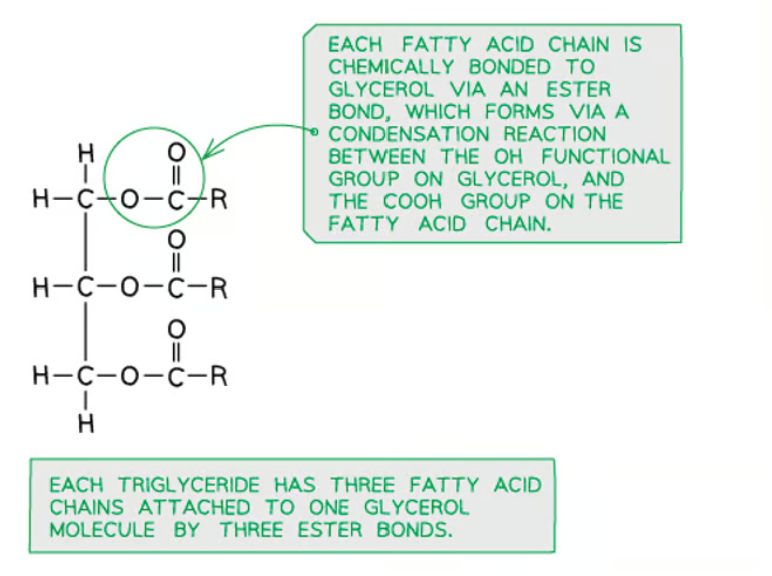

### Q25
**Final answer:** **The correct answer is**** C**** because:**

**Final answer:** **All triglycerides contain ****at least one double bond****, regardless of saturation of the hydrocarbon chain. The double bond is part of the carboxylic acid (COOH) region of the fatty acid chains:**

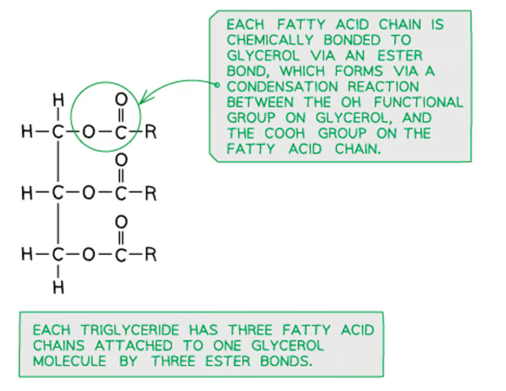

### Q26
**Final answer:** **The correct answer is ****D**** because:**

**Final answer:** **The structure shown in the image is a polysaccharide of ****α-glucose**** molecules. The polymer contains both**** 1,4 ****and ****1,6-glycosidic bonds****, giving it a branched structure. Both amylopectin (found in starch inside plant cells) and glycogen (only found in animals) have branched structures made of α-glucose.**

> *Amylose is an unbranched molecule, so the image cannot show amylose.*

> *Cellulose contains β-glucose, with every other glucose molecule rotated by 180°. This can be clearly seen in cellulose when carbon 6 sticks out in opposite directions on each consecutive glucose molecule. Here carbon 6 is on the top of every molecule of glucose, so the image cannot show cellulose.*

### Q27
**Final answer:** **The correct answer is ****D**** because:**

- **Glycogen is a polysaccharide with ****1,4-glycosidic bonds**** and ****1,6-glycosidic bonds****, giving it a branched structure**
- **The only type of glucose molecule found in glycogen is ****α-glucose**

> *A** is incorrect as 1,4-β bonds are found in cellulose, a straight-chain molecule that contains β-glucose.*

> *B** is incorrect as amylose is the only polysaccharide of α-glucose to contain **only** 1,4-α bonds.*

> *C** is incorrect as no polysaccharide contains all three of these bonds (as no polysaccharide contains a mixture of α-glucose and β-glucose)*

### Q28
**Final answer:** **The correct answer is ****D**** because:**

**Final answer:** **The only difference between the structure of α-glucose and β-glucose is the arrangement of the OH and H groups attached to the ****first carbon**** on the glucose molecule.**

- **For ****α-glucose****, the ****OH group**** is located**** below carbon 1****, as shown below:**

- **For ****β-glucose**** the ****OH group**** is located ****above carbon 1**

**Final answer:** **Another way of remembering this is to consider the position of the ****hydrogen atom**** on carbon 1; it is:**

- **A****bove the carbon in ****a****lpha glucose**
- **B****elow the carbon in ****b****eta glucose**

### Q29
**Final answer:** **The correct answer is ****A****, because:**

**Final answer:** **The major biological molecules (carbohydrates, proteins and lipids) contain the elements C, H and O. These are non-metal elements which achieve a full outer shell of electrons by ****sharing electrons**** to form a**** covalent bond****.**

> *B** is incorrect as hydrogen bonds are weak bonds that are responsible for interactions within the structure, but not for holding monomers together in polymers.*

> *C** & **D** are incorrect as hydrophobic interactions and ionic bonds largely occur in the tertiary structure of proteins.*

### Q30
**Final answer:** **The correct answer is ****C ****because:**

**Final answer:** **Cellulose contains long, straight and unbranched chains of **$β$**-glucose held together by ****glycosidic bonds****.**

**Final answer:** **These straight chains of cellulose can pack together, forming a structure called a microfibril; the cellulose molecules in a microfibril are held together by ****hydrogen bonds****.**

> *Ionic bonds are not a feature of bonding in carbohydrates and lipids, but they are one of the bonding types found in the tertiary structure of **proteins**.*

## Structured Questions (15 questions)

### Q1
Comparison between amylopectin and glycogen:

**Final answer:** **Any ****two**** of the following:**

*Similarities:*

- Both are composed of <u>α-glucose</u> molecules;** [1 mark]**
- Molecules are branched / contain both <u>1,4 and 1,6 linkages/glycosidic bonds</u>; **[1 mark]**

*Differences:*

- Glycogen is more branched / contains more 1,6 branching points/linkages/glycosidic bonds (than amylopectin) **OR** Amylopectin is less branched / contains less 1,6 branching points/linkages/glycosidic bonds (than glycogen); **[1 mark]**

**[Total: 2 marks]**

> *Remember that glycogen and amylopectin share a similar molecular structure with one another. It is important to specify the type of glucose that both are made of, i.e. α-glucose, not just glucose.*
The importance to cells of storing glucose in an appropriate form would include the following:

- Glucose could decrease the water potential in the cell / make the cell contents too concentrated (due to its solubility); **[1 mark]**
- This would have a serious effect on the <u>osmotic properties</u> of the cell / water would be drawn in from neighbouring cells; **[1 mark]**
- Excess glucose would interfere with normal cell chemistry (as it is a very reactive molecule); **[1 mark]**

**[Total: 3 marks]**

> *Storing glucose in the form of starch (in plant cells) and glycogen (in animal cells) will eliminate the** osmotic effect** that glucose would have on the cell. Linking many glucose molecules together through condensation reactions makes them **unreactive** and **insoluble**. Storage polysaccharides are also **compact**, which means that a large amount of glucose can be stored in a relatively small area of the cell.*
The structure of cellulose molecules makes it suitable for its structural role in cell walls due to:

Any **four** of the following:

- Alternate glucose molecules are rotated/inverted / many OH groups are present **SO** hydrogen bonds form between molecules
- Hydrogen bonds hold cellulose <u>molecules</u> together **SO **they form fibrils / microfibrils **[1 mark]**
- Fibrils/microfibrils contain many cellulose molecules **SO** are very strong / have high tensile strength
- The molecules are straight/linear **SO** they can be arranged parallel to each other / can be packed together **[1 mark]**
- Cellulose fibres are arranged at angles / in a criss-cross pattern **SO** provide increased strength **[1 mark]**
- Cellulose chains are tightly packed together / water cannot get between the cellulose chains **SO** cellulose is insoluble **[1 mark]**

**[Total: 4 marks]**

> *Note that this is an **explain** question, so every point made about cellulose structure needs to clearly relate to an explanation of its importance.*
Covalent bonds are of great importance in the formation of polysaccharides because...

- They are very stable and require a substantial amount of energy to break (the bonds); **[1 mark]**
- They link monomers/monosaccharides together during condensation reactions to form polymers/polysaccharides (that have important functions in organisms); **[1 mark]**

**[Total: 2 marks]**

> *Covalent bonds involve the **sharing of electron pairs** between atoms. When the electron orbitals of two monomers overlap, a covalent bond can form due to the sharing of electrons between them. This is the main type of bond that hold biological molecules, such as carbohydrates, lipids and proteins, together.*

### Q2
(i) Lipase solution was freshly prepared because...

- Enzymes (solutions) can denature / lose activity if left in solution; **[1 mark]**

(ii) Whole milk was used because...

- Whole milk has a higher fat (lipid) content than semi-skimmed milk; **[1 mark]**

**[Total: 2 marks]**
All three curves...

- Show a reduction of pH due to the production of fatty acids / hydrolysis/breakdown of lipids; **[1 mark]**

The 5°C curve...

- Shows a smaller decrease in pH level **BECAUSE** of low molecular kinetic energy / fewer E-S complexes formed; **[1 mark]**

The 35°C curve...

- Is the fastest curve go to completion / fully hydrolyse the lipids **BECAUSE** it is the <u>optimum</u> temperature; **[1 mark]**

The 55°C curve...

- Remains at the highest pH level / pH remains stable **BECAUSE** lipase has been denatured / loses its activity / can’t form E-S complexes / fatty acids are not formed; **[1 mark]**

**[Total: 4 marks]     **
Features of the curve for phospholipids:

- Curve starts at pH 8.0;** [1 mark]**
- Curve drops but stays above the milk curve **AND** plateaus at a higher pH than the milk curve;** [1 mark]**

**[Total: 2 marks]  ****   **

> *Phospholipids contain 2 fatty acids per molecule, whereas triglycerides (in milk) contain 3 fatty acids. This means that fewer acid molecules will be generated by the hydrolysis of phospholipids, resulting in fewer H**+** ions being released into the solution. This means that the pH will not fall as sharply, nor will the pH at the end be as low as that for the milk.  *

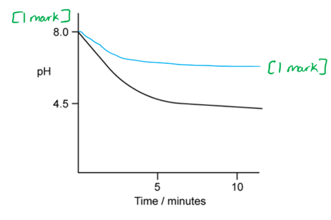
Triglycerides are metabolised for…

**Final answer:** **Any ****three**** of the following:**

- Synthesis of new plasma membranes (as phospholipids); **[1 mark]**
- Converted to other fatty acids / fatty tissue / adipose tissue (for energy storage); **[1 mark]**
- Respired (to generate energy); **[1 mark]**
- Converted to transport fat-soluble substances e.g. some vitamins / steroid hormones; **[1 mark]**

**[Total: 3 marks]**

### Q3
The structure of the triglyceride should show...

- Three fatty acids, all ester bonded to one glycerol; **[1 mark]**
- At least one ester bond labelled; **[1 mark]**
- Correct configuration of ester bonds; **[1 mark]**
- Water as a by-product (1 or 3 molecules); **[1 mark]**  ** **
- Correct length of fatty acid chains; **[1 mark]**  ** **

**[Total: 5 marks]**

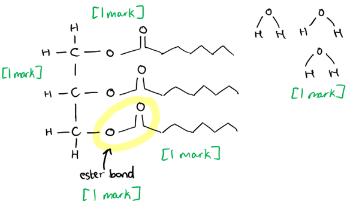
Triglycerides are not polymers because...

- Polymers contain many repeated monomers bonded together **WHILE **triglycerides only contain three fatty acids /** **contain more than one type of molecule / contain fatty acid and glycerol molecules;** [1 mark]**

**[Total: 1 mark]  ****   **
The energy content of fat is:

- 0.3 (30%) x 8400 = 2520
- 2520 ÷ 55 = 45.8; **[1 mark]**
- 46 kJ g-1 **OR** kJ/g **OR** kJ/gram; **[1 mark]**  ** **

**[Total: 2 marks]**

> *Make sure to read the question to follow the instructions about rounding and expressing units; omitting these details by writing as your answer 45.81 will score zero, even though you will have performed the calculations correctly. Care needed!*

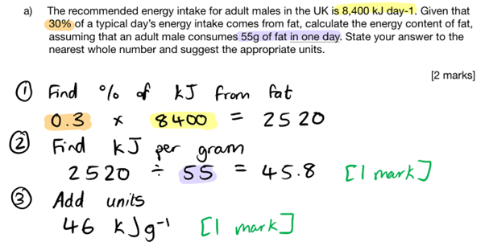
A function of chylomicrons could be...

**Final answer:** **Any ****two**** of the following:**

- The transport of lipids/triglycerides across membranes; **[1 mark]**
- The absorption of lipids/triglycerides from the small intestine; **[1 mark]**
- The transport of lipids/triglycerides to the liver / fat stores / cardiac muscle / skeletal muscle; **[1 mark]**

**AND**

The structure of chylomicrons makes them suitable for this because...

- The hydrophobic parts/regions are inside SO can interact with hydrophobic lipids** OR** the hydrophilic parts/regions are on the outside SO can interact with watery/aqueous surroundings; **[1 mark]**

**[Total: 3 marks]    **** **

### Q4
(i) The structure of sucrose must show:

- By-product water / H2O shown; **[1 mark]**
- Correctly-drawn sugar structure away from the glycosidic bond; **[1 mark]**

(ii) The bond should be drawn as shown...

- Correctly drawn between the two sugar molecules; **[1 mark]**
- Labelled glycosidic bond; **[1 marks]**

**[Total: 4 marks]**

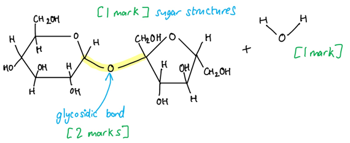
The percentage improvement in finishing time is:

- 182 seconds improvement (1,412 - 1,230) **OR** 3 minutes 2 seconds; **[1 mark]**
- As a percentage of 1412 seconds **OR** of 23.533 minutes
- 12.9% **OR** 13%; **[1 mark]**

**[Total: 2 marks]**

> *When working out percentage changes in time, it is helpful to convert all times into seconds for ease of mathematical calculations. A common mathematical error here would be to use minutes and state that a time of 23:32 = 23.32 minutes. A time of 23:32 is in fact 23.53 minutes, expressed as a decimal. *

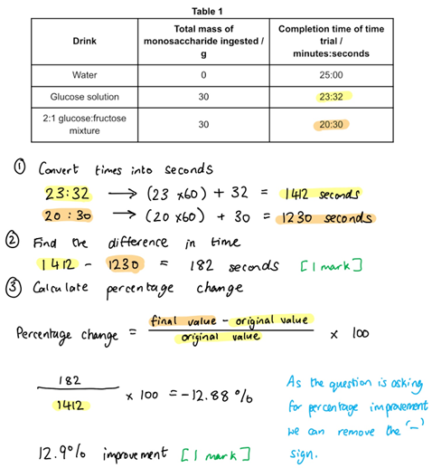
(i) Explanation of results in **Table 1**:

- Solutions containing glucose and fructose produce faster time trial results than water **BECAUSE** they are respiratory substrates that can release energy / produce ATP through respiration; **[1 mark]**
- There is an incremental/small decrease in time trial results when using mixed monosaccharides **BECAUSE** although the glucose transport channels become saturated, fructose has its own separate absorption channels (in the ileum); **[1 mark]**

(ii) Assessment of the scientific method:

**Final answer:** **Any ****two ****of the following:**

- Only 8 subjects were observed in the trial / small sample size; **[1 mark]**
- All cyclists were male adults / no data for females or children; **[1 mark]**
- No data on other sports / endurance events; **[1 mark]**
- No data was given on age / ethnicity / underlying medical conditions of the subjects; **[1 mark]**

**[Total: 4 marks]  **

> *The command word here is 'assess' which asks you to make an informed judgement on the information available. You need to look at the information and data as a whole before answering the question to ensure you cover all points. *
Humans can metabolise fructose because…

**Final answer:** **Any ****two ****of the following:**

- Fructose is a naturally-occurring monosaccharide e.g. in many fruits; **[1 mark]**
- Fructose has a high calorific content so is a good food source; **[1 mark]**
- Fructose makes up part of sucrose, so is formed naturally as a digestion product of cane/beet/table sugar; **[1 mark]**

**[Total: 2 marks]  **

### Q5
Calculating the daily lipid intake for adult men:

- 8100 x 0.25 = 2025 kJ day-1; **[1 mark]**
- 2025 ÷ 38 = <u>53.3</u> g;** [1 mark]**

*Full marks awarded for the correct answer only.*

**[Total: 2 marks]**

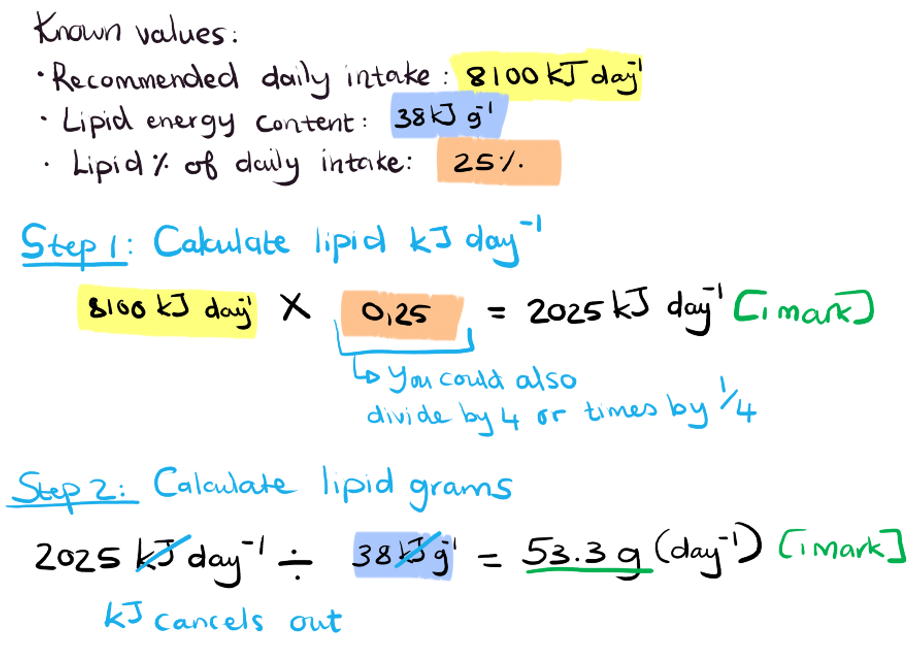
PGME cannot be digested in the stomach because:

- It does not contain any ester bonds **OR** the bonds between glycerol/fatty acid and propylene glycol are different; **[1 mark]**
- Lipase is specific to triglycerides shape/bonds **OR** PGME does not fit in / does not have a complementary shape to the active site (of lipase) **OR** no enzyme-substrate complex formed;** [1 mark]**

**[Total: 2 marks]**

> *This question requires some general knowledge of how enzymes function. It is important to remember that lipase breaks the ester bonds between glycerol and fatty acids. Since PGME does not contain ester bonds between glycerol and fatty acids, lipase would be unable to break it down in the stomach. Enzyme active sites are also very specific to the shape of the substrate that binds to it, any deviations from that shape would not be able to fit.*
Phospholipids can form cell membranes because:

- They have a polar head group / phosphate group;** [1 mark]**
- (The phosphate head) can form <u>hydrogen bonds</u> with water / is <u>hydrophilic</u>;** [1 mark]**
- Fatty acid tails are non-polar/hydrophobic;** [1 mark]**
- (Phospholipids) will therefore form a <u>bilayer</u> (when placed in a watery environment); **[1 mark]**

**[Total: 4 marks]**

> *It is the fact that phospholipids have a hydrophilic head and hydrophobic tails that makes them arrange themselves with the heads (phosphate groups) pointing outward towards the watery environment, while the fatty acid tails will point towards each other to form the hydrophobic core of the membrane.*

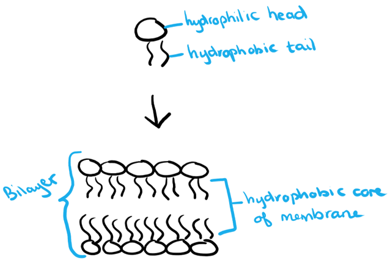

### Q6
(i) Drawing two amino acids forming a dipeptide:

- Water (H2O) formed from –OH and –H; **[1 mark]**
- Peptide bond shown correctly between C of carboxylic acid and N of amino group; **[1 mark]**
- Complete dipeptide drawn; **[1 mark]**

(ii) R1 and R2 represent...

- An R group / variable group; **[1 mark]**
- Different amino acids; **[1 mark]**

**[Total: 5 marks]**

> *For (a)(i) don't forget to draw out the water molecule produced in your diagram!*

> *While R groups do play a role in stabilising the structure of proteins mentioning this in your answer won't get you a mark for (a)(ii) as the examiner is looking for you to identify that the R groups are specific to different types of amino acid. *

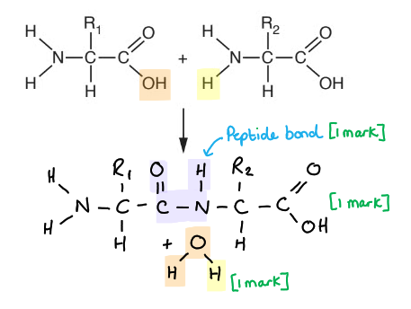
How the **structure** of a cellulose molecule differs from the **structure** of an amylose molecule is...

**Final answer:** **Any ****two**** of the following:**

- Cellulose is a linear/straight chain polymer whereas amylose is a helical molecule; **[1 mark]**
- In cellulose β-glucose is present whereas α-glucose is present in amylose **OR** β-1:4 glycosidic bonds are present in cellulose whereas α-1:4 glycosidic bonds are present in amylose; **[1 mark]**
- (In cellulose) β-glucose monomers are arranged rotated 180° to each other; **[1 mark]**

**[Total: 2 marks]**

> *A detailed answer here should **compare** the structure of these two polymers instead of simply stating facts about one of them. Make sure that you clearly write the symbols for alpha and beta glucose, if they are unclear you may not get the mark!*
Cellulose is suitable as a component of plant cell walls because...

**Final answer:** **Any ****four**** of the following:**

- Cellulose molecules form fibrils and fibres; **[1 mark]**
- There is hydrogen bonding between (cellulose) <u>molecules</u>; **[1 mark]**
- Cellulose molecules are linear which allows them to lie parallel to each other; **[1 mark]**
- Providing strength to the cell wall to prevent cell bursting / withstand (turgor) pressure; **[1 mark]**
- There are several gaps in cell walls/between fibres, which makes cell wall permeable; **[1 mark]**

**[Total: 4 marks]**

> *In order to gain full marks for this question you need to relate the structure of cellulose to its function. For example, the permeability of cell walls is linked to the gaps between cellulose fibres.*

### Q7
Unsaturated fatty acids are...

**Final answer:** **Any**** three**** of the following:**

- Long hydrocarbon chains **OR** long chains of carbon and hydrogen; **[1 mark]**
- There is a carboxylic acid/carboxyl/RCOOH group at the end OR there is a terminal carboxylic acid/carboxyl/RCOOH group; **[1 mark]**
- (The hydrocarbon chain) contains one or more double bonds;** [1 mark]**
- (These double bonds occur) between neighbouring carbon atoms; **[1 mark]**

**[Total: 3 marks]**

> *In order to receive all the marks for this question, ensure that you give a full explanation of the term. Remember to be specific in your answer - if you say that the molecule contains double bonds, you need to state between which atoms these bonds are found. Make sure you define both "unsaturated" and "fatty acid" in your answer.*
The results show the following:

- Higher omega-3 intake is linked to a lower risk of developing cardiovascular disease; **[1 mark]**
- The greatest decrease in risk occurs between a consumption of 50 to 100 mg per day; **[1 mark]**
- Any data points quoted (i.e. risk decreased from 1 to around 0.6 as omega-3 consumption increased from 50 to 100 mg per day); **[1 mark]**
- Very little variation (in relative risk) at higher omega-3 consumption; **[1 mark]**

**[Total: 4 marks]**

> *For description of data questions you need to pay close attention to what is happening on the graph. Note any **major increases** or **decreases** in data, as well as any areas of the graph that seem to reach a **plateau**. You will always receive a mark if you can back up your description by quoting a relevant data point. No need to provide explanations for the graph if you're only asked to describe.*
A triglyceride forms in the following way:

- Three fatty acids combine with (an alcohol) glycerol;** [1 mark]**
- Each hydroxyl/OH group of glycerol undergoes a <u>condensation reaction</u> with a fatty acid; **[1 mark]**
- This forms three <u>ester</u> bonds;** [1 mark]**

**[Total: 3 marks]**

> *Be specific when answering this question. You need to mention the chemical groups that are involved in the condensation reaction and the formation of the ester bonds. Remember that glycerol has three hydroxyl/OH groups that can each form an ester bond with a fatty acid.*
Triglycerides make excellent energy stores because....

- They contain many carbon-hydrogen/C-H bonds; **[1 mark]**
- The breakdown of these bonds will yield a high amount of energy (per given mass); **[1 mark]**

**[Total: 2 marks]**

> *The secret to the high energy content of triglycerides lies in the number of carbon-hydrogen/C-H bonds. These bonds are able to store large amounts of energy which is released when the bonds are broken.*

### Q8
Sucrose is made of the monomers:

- (α) Glucose; **[1 mark]**
- Fructose;** [1 mark]**

**[Total: 2 marks]**

> *The three most common disaccharides that you will come across is:*

- *Maltose = glucose + glucose*
- *Lactose = glucose + galactose*
- *Sucrose = glucose + fructose*

> *Note how they all contain at least one molecule of glucose.*
The calculation would be as follows:

- 0.74 - 0.05 = 0.69; **[1 mark]**
- 0.69 ÷ 0.05 = 13.8 ; **[1 mark]**
- 13.8 x 100 = 1380; **[1 mark]**

*Full marks are awarded for the correct answer only.*

**[Total: 3 marks]**

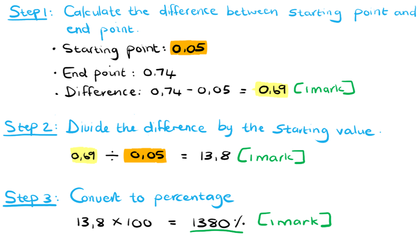
The reason sucrose was hydrolysed first is because...

**Final answer:** **Any ****two**** of the following:**

- Sucrose is a non-reducing sugar / non-reducing / not a reducing sugar; **[1 mark]**
- (Sucrose will not reduce) (blue) copper II ions to (red) copper I ions / will not react with Benedict's reagent; **[1 mark]**
- Cannot donate electrons; **[1 mark]**

**[Total: 2 marks]**
The main structural differences between sucrose and sucralose is:

- (Three) hydroxyl/OH- groups have been replaced by chlorine/Cl- atoms (in sucralose); **[1 mark]**
- The chlorine/Cl- atom (on the 6C ring of sucralose) is above the plane (of the molecule) OR The hydroxyl/OH- group (on the 6C ring of sucrose) is below the plane (of the molecule); **[1 mark]**

**[Total: 2 marks]**

> *It is important to be able to apply knowledge to unfamiliar scenarios. You will need to pay close attention to the structure of the molecules in order to spot any differences between them.*

### Q9
Marks will be allocated for the following aspects of the completed diagram:

- Indicate the formation of a molecule of water (H2O); **[1 mark]**
- Glycosidic bond correctly shown as the oxygen atom (O) linking carbon 1 and 4 of α-glucose molecules;** [1 mark]**
- Complete disaccharide drawn; **[1 mark]**

**[Total: 3 marks]**

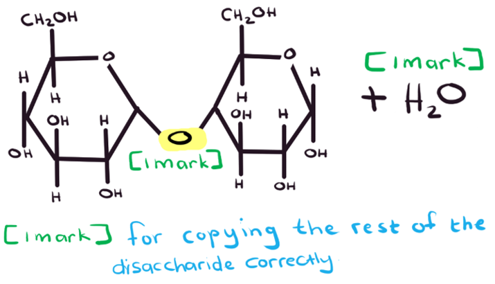
A non-reducing sugar:

- Cannot donate electrons / act as a reducing agent (and therefore cannot be oxidised); **[1 mark]**
- Must first be hydrolysed before a Benedict's test can be done / Does not react / give a positive result with Benedict's solution (on its own); **[1 mark]**

**[Total: 2 marks]**

> *The ability of a sugar to donate electrons is what classifies it as either a reducing or non-reducing sugar. By donating electrons, the sugar becomes a **reducing** agent (therefore a **reducing** sugar) to the molecule that accepts those electrons. Non-reducing sugars do not have the ability to donate electrons and reduce another molecule.*
The completed table is as follows...

|   | Cellulose | Glycogen | Amylose | Amylopectin |
|---|---|---|---|---|
| Contains 1-6 glycosidic bonds |   | ✓ |   | ✓ |
| Contains α glucose |   | ✓ | ✓ | ✓ |
| Contains hydrogen bonds | ✓ |   | ✓ |   |

**[1 mark] **for each correct row

**[Total: 3 marks]**
The breakdown of lactose involves the following steps:

- The (α 1,4-) glycosidic bond breaks; **[1 mark]**
- During a hydrolysis reaction; **[1 mark]**
- (This is done) by the addition of a water molecule; **[1 mark]**

**[Total: 3 marks]**

> *Remember that the covalent bonds that form between biological molecules are all broken by hydrolysis reactions. This requires enzymes that will add a molecule of water to separate the monomers from one another.*

### Q10
Structures A-C are...

- A = glycerol; **[1 mark]**
- B = fatty acid; **[1 mark]**
- C = phosphate; **[1 mark]**

**[Total: 3 marks]     **

> *You must be able to recognise the constituents of phospholipids and triglycerides and know how they fit together. *
The R stands for...

- R = hydrocarbon chain **OR** chain made of carbons and hydrogens; **[1 mark]**

**[Total: 1 mark]****     **

> *R is often used to represent a group or a chain of molecules that aren’t required in a reaction or bond. Fatty acid R groups are long chains of carbons with hydrogens attached and can be between 4 and 24 carbons long. *
The correct sketch would appear as follows...

- Glycerol drawn correctly; **[1 mark]**
- Three correctly drawn ester bonds **AND** at least one labelled bond; **[1 mark]**
- Three correctly drawn fatty acid chains;** [1 mark]**

**[Total: 3 marks]**

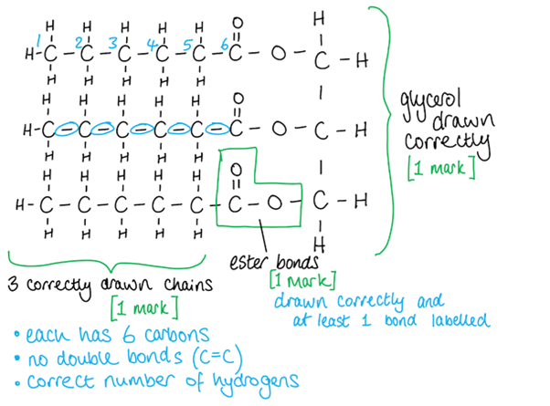
In the formation of a phospholipid...

- <u>Three</u> water molecules are <u>produced</u>; **[1 mark]**

**[Total: 1 mark] ****    **

> *A phospholipid is made from one glycerol molecule, two fatty acid molecules and one phosphate molecule. The fatty acids and phosphate each join to one of glycerol's three alcohol (OH) groups. These are condensation reactions and each will produce one molecule of water. Phospholipids are broken down in hydrolysis reactions, these use water (hydro) molecules to break (lysis) the molecule. *

### Q11
The type of bond that forms between two sugar molecules in a disaccharide is:

- (A) <u>glycosidic</u> bond; **[1 mark]**

**[Total: 1 mark]**
The drawing should be annotated as follows:

- Ring around the oxygen in the glycosidic bond; **[1 mark]**

**[Total: 1 mark]**

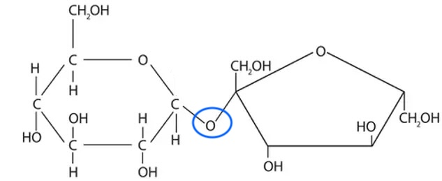
The completed table is as follows...

|   | **Reducing sugar** | **Non-reducing sugar** |
|---|---|---|
| Glucose | ✓ |   |
| Maltose | ✓ |   |
| Sucrose |   | ✓ |
| Lactose | ✓ |   |

*Award 1 mark*** ***for each correct ****column***

**[Total: 2 marks]**
(i) Molecules A and B are...

- A = water; **[1 mark]**
- B = glucose; **[1 mark]**

> *The breakdown of disaccharides (maltose, fructose and lactose) requires water. A **common incorrect answer** for this question is to state that the enzyme maltase is a reactant, this is incorrect as maltase is only used to speed up the reaction and is not used up in the reaction.*

(ii) The type of chemical reaction is...

- Hydrolysis; **[1 mark]**

> *Water is used (hydro) to break down (lysis) the maltose.*

**[Total: 3 marks]**

### Q12
Properties of starch that make it an effective storage polysaccharide are...

**Final answer:** **Any ****two ****of the following:**

- Compact / folded; **[1 mark]**
- Insoluble; **[1 mark]**
- Branched; **[1 mark]**

**[Total: 2 marks]**

> *Because the command word is 'state' this means that no elaboration or explanation is needed. You can literally write each property. *
(i) The names of the bonds are...

- 1,6 glycosidic bond; **[1 mark]**
- 1,4 glycosidic bond; **[1 mark]**

(ii) The reasons for the names are...

- The name comes from which numbered carbons are joined together e.g. carbon 4 on one glucose with carbon 1 on the other makes a 1,4 glycosidic bond; **[1 mark]**

**[Total: 3 marks]**

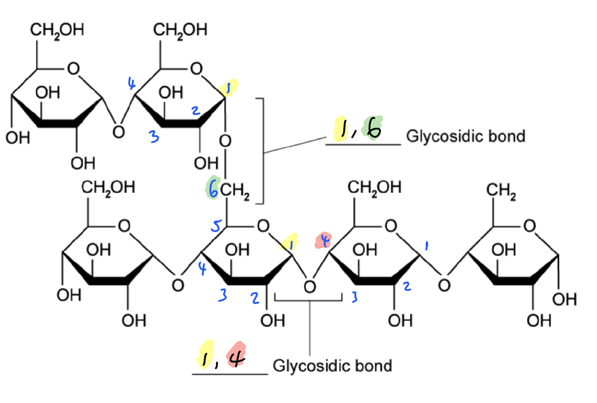
Glycogen's highly branched structure helps by...

**Final answer:** **Any**** two**** of the following:**

- Creates many free ends / terminal glucose molecules; **[1 mark]**
- That can be quickly hydrolysed off / added; **[1 mark]**
- Glucose can be quickly stored / mobilised when needed; **[1 mark]**

**[Total: 2 marks]**
To determine if the granules contained starch, you could...

- Add iodine **AND** granules will turn blue/black (if starch is present);** [1 mark]**

**[Total: 1 mark]**

### Q13
The low oxygen content of lipids enables them to be more energy-dense forms of energy storage than carbohydrates because:

**Final answer:** **Any ****one**** of the following:**

- (More) oxygen is used from the air in respiration; **[1 mark]**
- So (lipids) can store energy in C-H and C-C bonds / rely on oxygen for respiration / releasing energy; **[1 mark]**

**[Total: 1 mark]**
The lipids sector of the chart is so much larger than that of carbohydrates because:

**Final answer:** **Any ****one**** of the following:**

- Lipids are more energy-rich / energy-dense than carbohydrates;** [1 mark]**
- Better for a growing chick's/embryos nutrition; **[1 mark]**

**[Total: 1 mark]**
Two other advantages to a mammal of having fat in its tissues are…

**Final answer:** **Any ****two ****of the following:**

- Insulation (against heat / electrical insulation of nerves); **[1 mark]**
- Protection of organs (e.g. fat layer around the heart); **[1 mark]**
- Buoyancy; **[1 mark]**

**[Total: 2 marks]   ****  **

> *The myelin sheath that insulates nerve axons has a high fat content. This helps in allowing nerves to transmit impulses accurately and quickly. Fat tissue also helps animals who live in cold habitats retain body heat, e.g. seal blubber. Large internal organs such as the heart and liver carry a permanent layer of fat tissue around them, which gives the organs some protection against physical damage.  Fat tissue is usually less dense than water so can assist in helping semi-aquatic, air-breathing animals stay near the surface or float back up to the surface for breathing.*
(i) Parts **A** and **B** in **Figure 2 **are...

- **A** = phosphate group; **[1 mark]**
- **B** = (unsaturated) fatty acid chain / hydrocarbon chain; **[1 mark]   **

(ii) The structural aspect of a phospholipid that causes phospholipid molecules to assemble in a bilayer in an aqueous environment is...

- The hydrophobic/nonpolar tail;** [1 mark]**

Phospholipids assemble in a bilayer because...

- Tails arrange ‘toe-to-toe’ to minimise contact with water / aqueous environment;** [1 mark]**

**[Total: 4 marks]**

### Q14
The two distinct parts of a typical fatty acid molecule are...

- (Carboxylic) acid / -COOH group; **[1 mark]**
- Hydrocarbon chain; **[1 mark]**

**[Total: 2 marks]**
(i) The type of fatty acid shown is...

- A <u>saturated</u> fatty acid;** [1 mark]**

(ii) The reason for this is...

- (Because) it has 100% C-C single bonds / no C=C double bonds / there is no more room for more hydrogen atoms to be added;** [1 mark]**

**[Total: 2 marks]**
The completed table is as follows:

| Monounsaturated | Polyunsaturated | Saturated |
|---|---|---|
|   | **✓** |   |

| All Cis | All Trans | Mixture of Cis- and Trans- |
|---|---|---|
| **✓** |   |   |

**[1 mark] **for each correct table

**[Total: 2 marks]**

> *The fatty acid is **poly**unsaturated because there are **two or more** C=C double bonds in its hydrocarbon tail.*

> *Both double bonds are in the Cis- formation because the H atoms at the ends of the double bonds are both oriented on the same side of the chain as each other. Do not be put off by the fact that one double bond is drawn with both H atoms above the chain, and the other with both H atoms below the chain; they are both Cis- but drawn differently. *
The alcohol is...

- Common name is <u>glycerol</u>; **[1 mark]**
- Bonds to fatty acids/a phosphate group to form lipids/phospholipids/triglycerides; **[1 mark]**

**[Total: 2 marks]**

> *Each hydroxyl group (-OH) loses its H atom during condensation reactions with fatty acids, allowing the formation of an ester bond. Three fatty acids can join in this way, forming a triglyceride. *

### Q15
Properties of cellulose that make it an effective structural polysaccharide are...

**Final answer:** **Any**** two**** of the following:**

- (Chemically) inert **OR** not easily digested/broken down/hydrolysed; **[1 mark]**
- Strong/durable; **[1 mark]**
- Insoluble; **[1 mark]**
- (Slightly) elastic; **[1 mark]**

**[Total: 2 marks]**

> *Because the command word is 'list' this means that no elaboration or explanation is needed. You can literally write a list. *
β-glucose has the following structure...

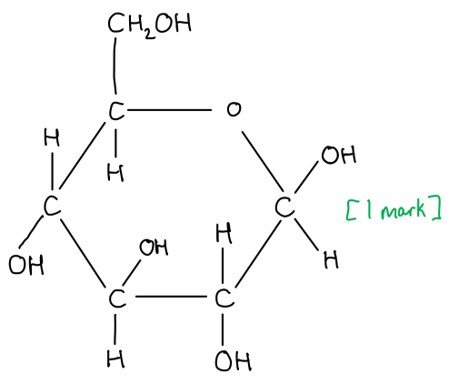

**[Total: 1 mark]**

> *Remember that beta glucose has the -OH group above carbon 1, whereas alpha glucose has the -OH group below carbon 1.*
The structure of β-glucose helps to increase the strength of cellulose by...

**Final answer:** **Any ****two**** of the following:**

- The glucose molecules are rotated 180°/upside down compared to the next; **[1 mark]**
- Glucose molecules are able to form hydrogen bond cross links between the chains; **[1 mark]**
- Large quantity of hydrogen bonds increases the strength of the cellulose; **[1 mark]**

**[Total: 2 marks]**
Plant cells use starch as a storage molecule rather than glucose because...

**Final answer:** **Any ****one**** of the following:**

- Starch is insoluble so does not affect <u>water potential</u> / has no osmotic effect / cannot leave the cell; **[1 mark]**
- Starch has a coiled/helical/spiral structure so can fit many molecules into small area / compact / tightly packed; **[1 mark]**

**[Total: 1 mark]**

> *When answering ‘explain’ questions use the phrase "which means that" or "therefore" or "so" for each statement you make - this will ensure that you fully explain what is happening. For example, “starch is insoluble **which means that** it cannot leave the cell, whereas glucose is soluble so is not trapped/stored in the cell”.*
