# Exam Questions — Carbohydrates & Lipids
**2. Biological Molecules** · Cambridge (CIE) A-LEVEL biology (9700)
> Source: [https://www.savemyexams.com/a-level/biology/cie/25/topic-questions/](https://www.savemyexams.com/a-level/biology/cie/25/topic-questions/) · 30 questions across 1 sets

## Multiple Choice Questions (30 questions)

### Q1 — hard — 1 marks

**Q1** [1 mark]

Lactose is a disaccharide that can be broken down to two different monosaccharides, one of which is galactose.

Which of the following correctly describes what occurs when lactose breaks down?

### Q2 — hard — 1 marks

**Q2** [1 mark]

| 1 | Sucrose hydrolysis results in the breakage of glycosidic bonds, releasing equal amounts of fructose and $α$-glucose molecules, whereas the hydrolysis of amylose in plant cells results in only $β$-glucose molecules. |
|---|---|
| 2 | The glycosidic bonds of glycogen have been formed between two $α$-glucose molecules and only contain 1,4-glycosidic bonds, whereas the structure of amylose contains both 1 and 1,6-glycosidic bonds. |
| 3 | Triglycerides are polymers of three fatty acid chains joined to a glycerol molecule, forming a macromolecule which is not soluble in water. |

Which of the statements above are not true?

### Q3 — hard — 1 marks

**Q3** [1 mark]

Which of the following molecules would have a structural formula that contains C=O bonds?

| 1 | fatty acids |
|---|---|
| 2 | glucose |
| 3 | glycerol |

### Q4 — hard — 1 marks

**Q4** [1 mark]

Glycosidic bonds join monosaccharides together to form disaccharides and polysaccharides. Peptide bonds join amino acid subunits together to form polypeptide chains. Triglyceride molecules contain three fatty acid chains joined to one glycerol molecule via three ester bonds.

Which of the following statements correctly describes a feature all of the polymers described above share?

### Q5 — hard — 1 marks

**Q5** [1 mark]

Which of the following is a correct description?

### Q6 — hard — 1 marks

**Q6** [1 mark]

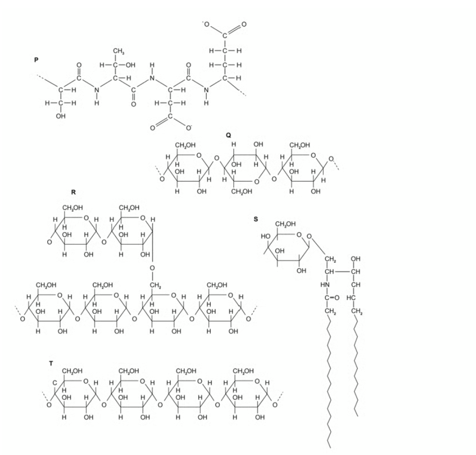

| 1 | Molecule **P** contains peptide bonds, whereas Molecules **R** and **Q** are polymers with one type of covalent bond holding their sub-units together |
|---|---|
| 2 | Molecules **R** and **T** could both be found in animals and plants, whereas Molecule **Q** will never be found in animals. |
| 3 | Molecule **S **is commonly used for every storage in plants, whereas Molecule **Q** has a structural role only. |
| 4 | Molecule **T** has a helical structure, and Molecule **R** is commonly used for energy storage in plants. |

Which of the statements above are not true?

### Q7 — hard — 1 marks

**Q7** [1 mark]

Which of the following is a correct description of a monosaccharide?

### Q8 — hard — 1 marks

**Q8** [1 mark]

The diagram below shows the molecular structures of two molecules.

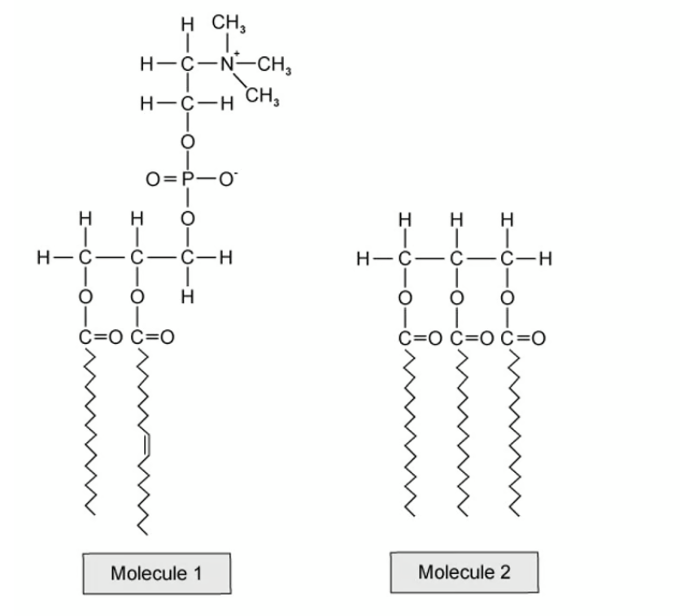

| 1 | The phospholipid has fatty acid chains of the same length whereas the triglyceride has fatty acid chains of different lengths. |
|---|---|
| 2 | The phospholipid has two ester bonds in its structure whereas the triglyceride has three. |
| 3 | The triglyceride is non-polar and will form hydrogen bonds with water molecules. |
| 4 | The fatty acid chains in the triglyceride are all saturated, whereas in the phospholipid there is an unsaturated bond. |

Which of the above statements are true?

### Q9 — hard — 1 marks

**Q9** [1 mark]

The names of four biological molecules are given below:

| 1 | glucose |
|---|---|
| 2 | fructose |
| 3 | maltose |
| 4 | sucrose |

Which of the following combinations contains a disaccharide that would act as a reducing agent when mixed with copper (II) sulfate ions, and a disaccharide that wouldn't?

### Q10 — hard — 1 marks

**Q10** [1 mark]

A number of biological molecules are shown in the diagram below.

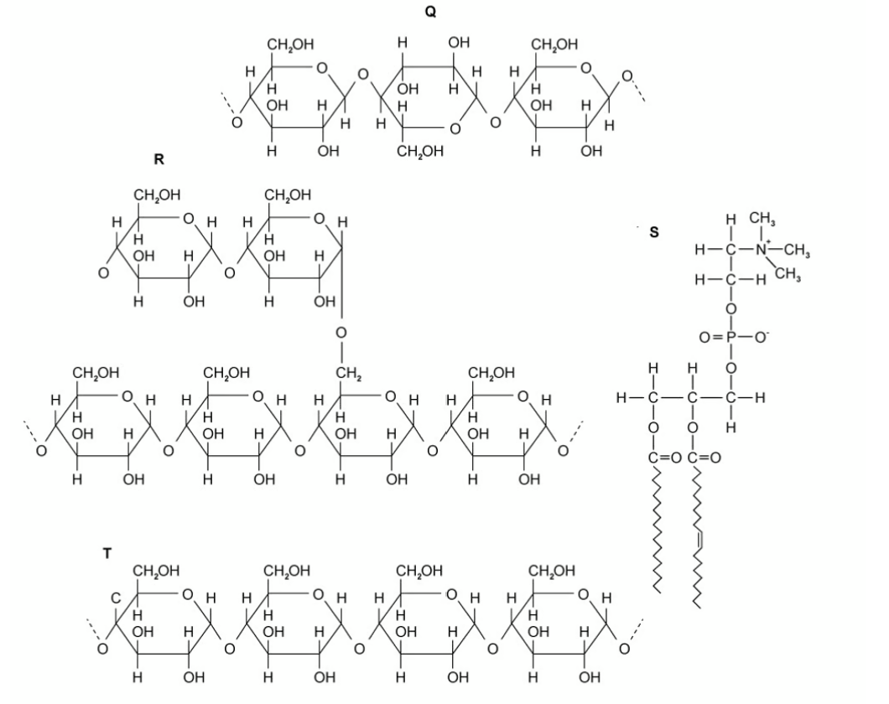

Which row of the table below correctly identifies some of the products of hydrolysis of the molecules above?

|   | **Q** | **R** | **S** | **T** |
|---|---|---|---|---|
| **A** | $α$-glucose | $β$-glucose | glycerol | $α$-glucose |
| **B** | $α$-glucose | $β$-glucose | fatty acids | $α$-glucose |
| **C** | $β$-glucose | $α$-glucose | glycerol | $β$-glucose |
| **D** | $β$ -glucose | $α$-glucose | phosphate group | $α$-glucose |

### Q11 — medium — 1 marks

**Q11** [1 mark]

The molecular structure of starch means that starch is well suited to its function.

Which of the following statements best explains this?

### Q12 — medium — 1 marks

**Q12** [1 mark]

Two molecules of glucose are shown in the diagram below.

Possible bonding positions are labelled **h**, **i**,** j**, and **k** on the first molecule, and **m**, **n**, **o** and **p** on the second.

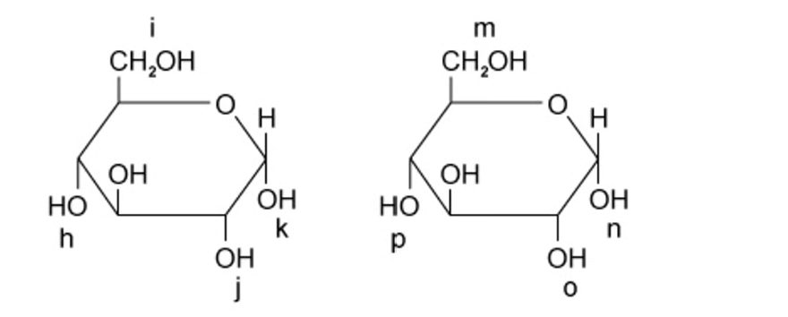

When these two molecules condense to form amylopectin, between which of the letters on the diagram could bonds form?

### Q13 — medium — 1 marks

**Q13** [1 mark]

Two biological molecules are shown in the diagram below.

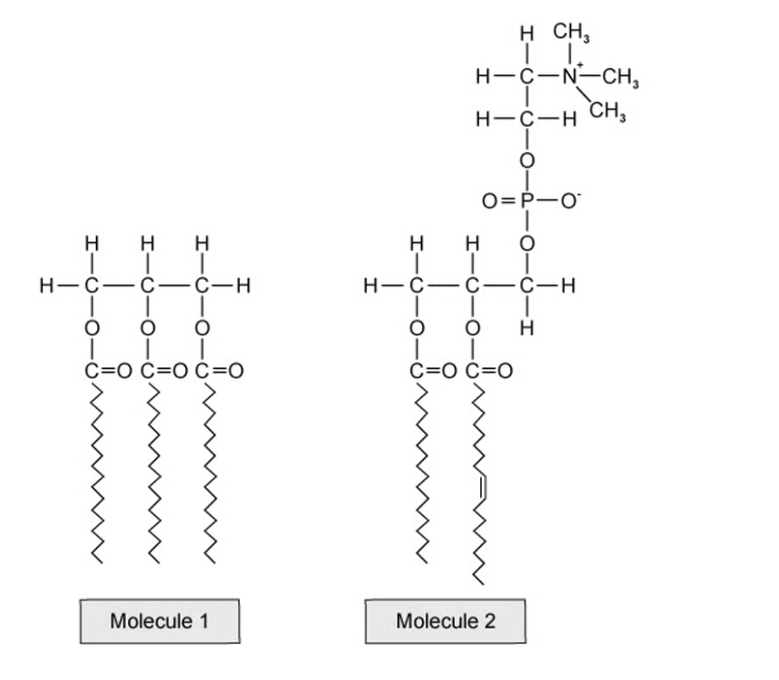

Which row of the table correctly identifies features of these molecules?

|   | **Molecule 1** | **Molecule 2** |
|---|---|---|
| **A** | has 3 fatty acid chains | fatty acid chains are all saturated |
| **B** | has 2 ester bonds and a phosphate group | has 3 phosphodiester bonds |
| **C** | has 3 saturated fatty acid chains | has 1 unsaturated fatty acid chain |
| **D** | molecule is polar | molecule is polar |

### Q14 — medium — 1 marks

**Q14** [1 mark]

A naturally occurring polysaccharide has an unbranched chain structure which contains molecules of acetylglucosamine held together by β-1,4-glycosidic bonds.

There are many weaker bonds between the unbranched chains, and -CH2OH groups are located on alternate sides of the polysaccharide chain.

Which of the following polysaccharides has a structure similar to that described above?

### Q15 — medium — 1 marks

**Q15** [1 mark]

Which of the statements below correctly describes a disaccharide?

### Q16 — medium — 1 marks

**Q16** [1 mark]

All biological molecules have structures that relate to their functions.

Three statements relating to molecule structure are given below:

| 1 | insoluble in water |
|---|---|
| 2 | forms long, straight chains of sugar subunits held together by glycosidic bonds |
| 3 | many hydrogen bonds are able to form |

Which of the options below would all three statements above apply to?

### Q17 — medium — 1 marks

**Q17** [1 mark]

Which of the following shows the structure of β-glucose and α-glucose?

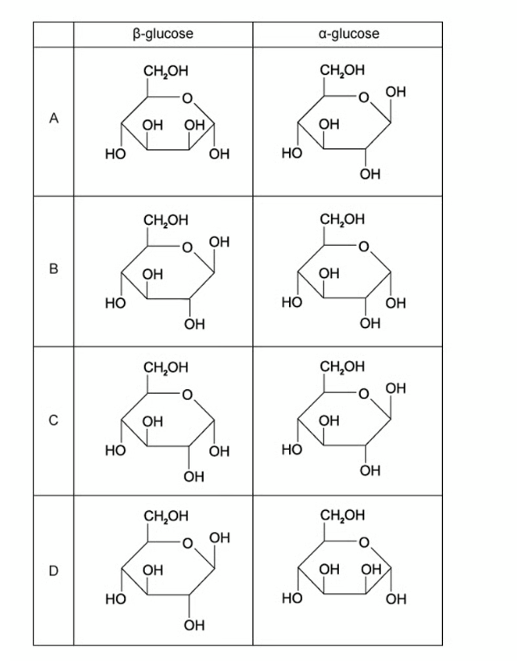

### Q18 — medium — 1 marks

**Q18** [1 mark]

Which of the following statements correctly describes a feature of carbohydrates or lipids?

### Q19 — medium — 1 marks

**Q19** [1 mark]

Which of the following procedures could be applied sucrose to achieve a positive test result?

| 1 | dissolve in water, neutralise with acid and then heat with Benedict's reagent |
|---|---|
| 2 | boil with hydrochloric acid, neutralise and then heat with Benedict's reagent |
| 3 | add hydrolytic enzymes and then heat with Benedict's reagent |

### Q20 — medium — 1 marks

**Q20** [1 mark]

Which of the following occurs when sucrose is formed from monosaccharides?

### Q21 — easy — 1 marks

**Q21** [1 mark]

The diagrams below show a number of biological molecules.

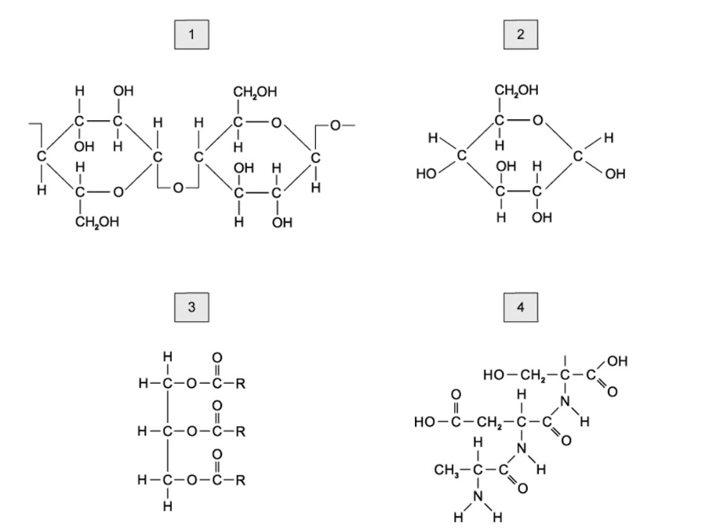

Which of the molecules above contains a glycosidic bond?

### Q22 — easy — 1 marks

**Q22** [1 mark]

Where are the double bonds located in unsaturated lipid molecules?

### Q23 — easy — 1 marks

**Q23** [1 mark]

Which of the following features distinguishes starch from glycogen?

### Q24 — easy — 1 marks

**Q24** [1 mark]

Which molecule in the image below contains ester bonds?

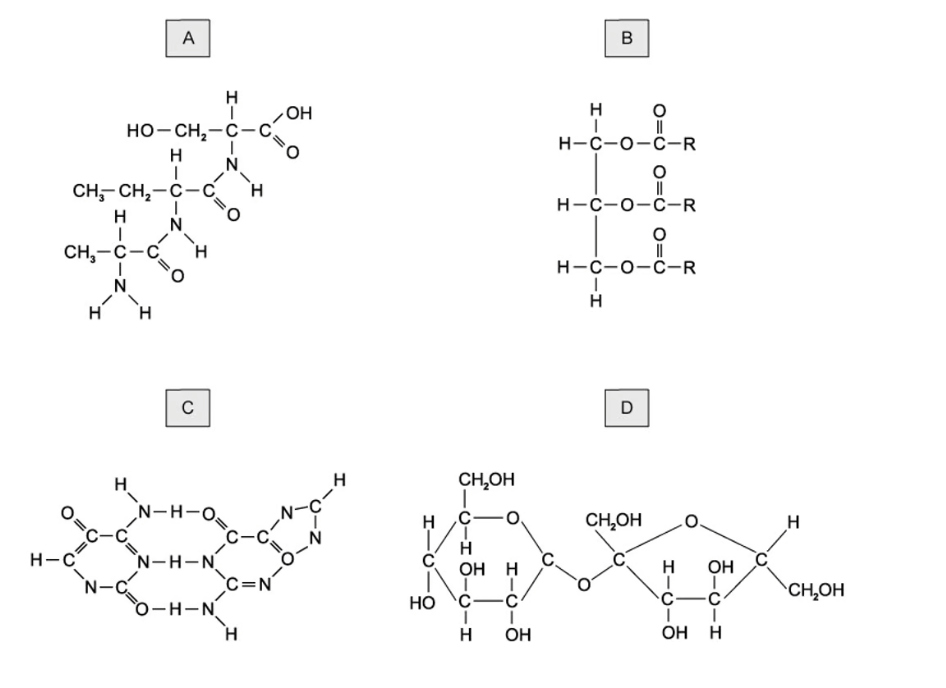

### Q25 — easy — 1 marks

**Q25** [1 mark]

Which of the following statements about triglycerides is **not **correct?

### Q26 — easy — 1 marks

**Q26** [1 mark]

A biological molecule is shown in the image below.

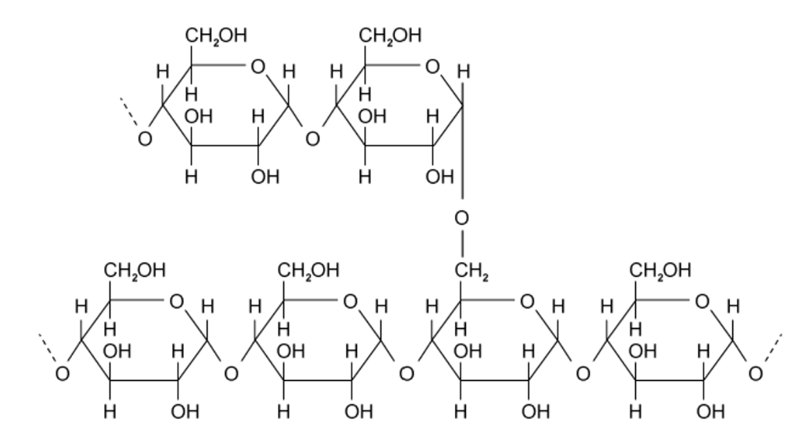

Which of the following could be the molecule in the image?

| 1 | amylose |
|---|---|
| 2 | amylopectin |
| 3 | cellulose |
| 4 | glycogen |

### Q27 — easy — 1 marks

**Q27** [1 mark]

Which bonds are found in glycogen?

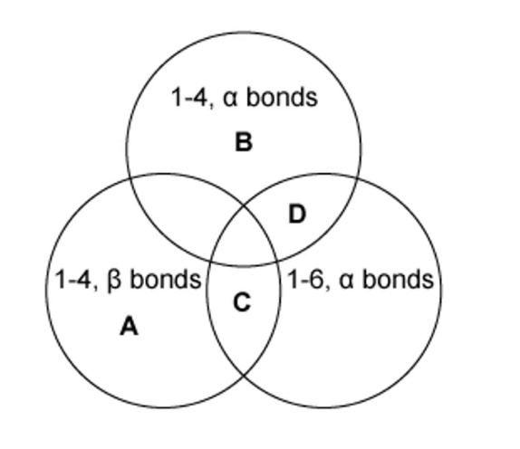

### Q28 — easy — 1 marks

**Q28** [1 mark]

Which of the molecules below is α-glucose?

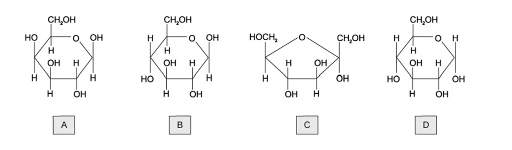

### Q29 — easy — 1 marks

**Q29** [1 mark]

Which of the following types of bond is responsible for joining smaller molecules together to form biological polymers?

### Q30 — easy — 1 marks

**Q30** [1 mark]

The structure of cellulose is held together by which type of bond?

| 1 | ionic bonds |
|---|---|
| 2 | glycosidic bonds |
| 3 | hydrogen bonds |
