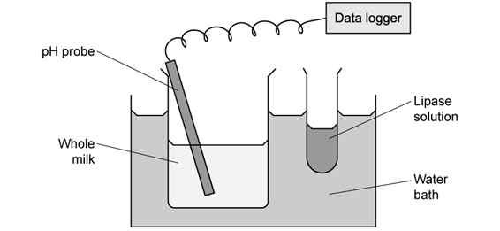
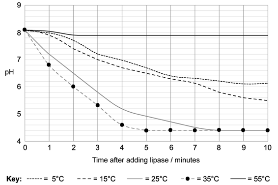
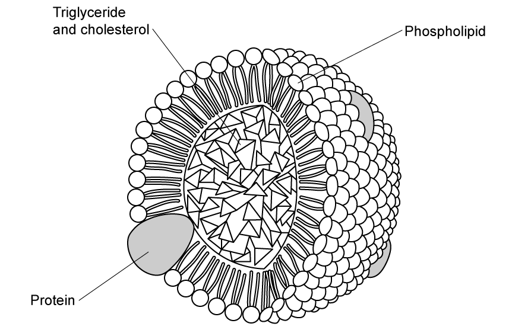
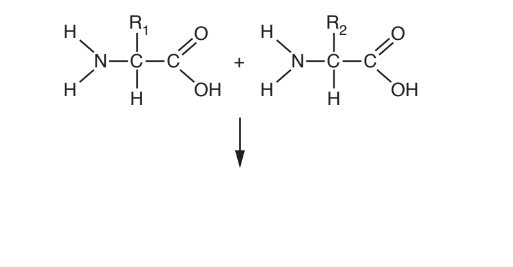
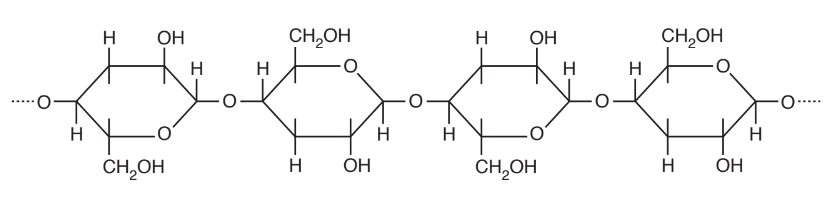
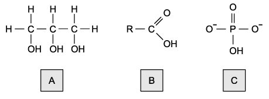
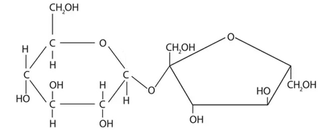
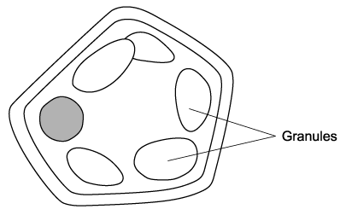
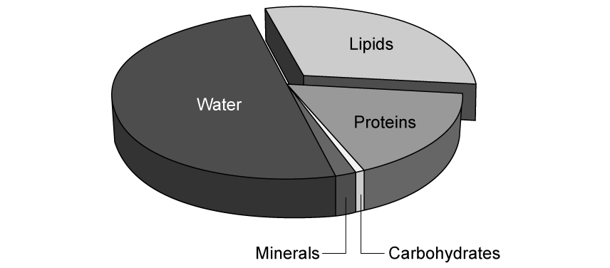
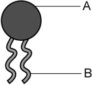

# Exam Questions — Carbohydrates & Lipids
**2. Biological Molecules** · Cambridge (CIE) A-LEVEL biology (9700)
> Source: [https://www.savemyexams.com/a-level/biology/cie/25/topic-questions/](https://www.savemyexams.com/a-level/biology/cie/25/topic-questions/) · 45 questions across 2 sets

## Multiple Choice Questions (30 questions)

### Q1 — hard — 1 marks

**Q1** [1 mark]

Lactose is a disaccharide that can be broken down to two different monosaccharides, one of which is galactose.

Which of the following correctly describes what occurs when lactose breaks down?

### Q2 — hard — 1 marks

**Q2** [1 mark]

| 1 | Sucrose hydrolysis results in the breakage of glycosidic bonds, releasing equal amounts of fructose and $α$-glucose molecules, whereas the hydrolysis of amylose in plant cells results in only $β$-glucose molecules. |
|---|---|
| 2 | The glycosidic bonds of glycogen have been formed between two $α$-glucose molecules and only contain 1,4-glycosidic bonds, whereas the structure of amylose contains both 1 and 1,6-glycosidic bonds. |
| 3 | Triglycerides are polymers of three fatty acid chains joined to a glycerol molecule, forming a macromolecule which is not soluble in water. |

Which of the statements above are not true?

### Q3 — hard — 1 marks

**Q3** [1 mark]

Which of the following molecules would have a structural formula that contains C=O bonds?

| 1 | fatty acids |
|---|---|
| 2 | glucose |
| 3 | glycerol |

### Q4 — hard — 1 marks

**Q4** [1 mark]

Glycosidic bonds join monosaccharides together to form disaccharides and polysaccharides. Peptide bonds join amino acid subunits together to form polypeptide chains. Triglyceride molecules contain three fatty acid chains joined to one glycerol molecule via three ester bonds.

Which of the following statements correctly describes a feature all of the polymers described above share?

### Q5 — hard — 1 marks

**Q5** [1 mark]

Which of the following is a correct description?

### Q6 — hard — 1 marks

**Q6** [1 mark]

| 1 | Molecule **P** contains peptide bonds, whereas Molecules **R** and **Q** are polymers with one type of covalent bond holding their sub-units together |
|---|---|
| 2 | Molecules **R** and **T** could both be found in animals and plants, whereas Molecule **Q** will never be found in animals. |
| 3 | Molecule **S **is commonly used for every storage in plants, whereas Molecule **Q** has a structural role only. |
| 4 | Molecule **T** has a helical structure, and Molecule **R** is commonly used for energy storage in plants. |

Which of the statements above are not true?

### Q7 — hard — 1 marks

**Q7** [1 mark]

Which of the following is a correct description of a monosaccharide?

### Q8 — hard — 1 marks

**Q8** [1 mark]

The diagram below shows the molecular structures of two molecules.

| 1 | The phospholipid has fatty acid chains of the same length whereas the triglyceride has fatty acid chains of different lengths. |
|---|---|
| 2 | The phospholipid has two ester bonds in its structure whereas the triglyceride has three. |
| 3 | The triglyceride is non-polar and will form hydrogen bonds with water molecules. |
| 4 | The fatty acid chains in the triglyceride are all saturated, whereas in the phospholipid there is an unsaturated bond. |

Which of the above statements are true?

### Q9 — hard — 1 marks

**Q9** [1 mark]

The names of four biological molecules are given below:

| 1 | glucose |
|---|---|
| 2 | fructose |
| 3 | maltose |
| 4 | sucrose |

Which of the following combinations contains a disaccharide that would act as a reducing agent when mixed with copper (II) sulfate ions, and a disaccharide that wouldn't?

### Q10 — hard — 1 marks

**Q10** [1 mark]

A number of biological molecules are shown in the diagram below.

Which row of the table below correctly identifies some of the products of hydrolysis of the molecules above?

|   | **Q** | **R** | **S** | **T** |
|---|---|---|---|---|
| **A** | $α$-glucose | $β$-glucose | glycerol | $α$-glucose |
| **B** | $α$-glucose | $β$-glucose | fatty acids | $α$-glucose |
| **C** | $β$-glucose | $α$-glucose | glycerol | $β$-glucose |
| **D** | $β$ -glucose | $α$-glucose | phosphate group | $α$-glucose |

### Q11 — medium — 1 marks

**Q11** [1 mark]

The molecular structure of starch means that starch is well suited to its function.

Which of the following statements best explains this?

### Q12 — medium — 1 marks

**Q12** [1 mark]

Two molecules of glucose are shown in the diagram below.

Possible bonding positions are labelled **h**, **i**,** j**, and **k** on the first molecule, and **m**, **n**, **o** and **p** on the second.

When these two molecules condense to form amylopectin, between which of the letters on the diagram could bonds form?

### Q13 — medium — 1 marks

**Q13** [1 mark]

Two biological molecules are shown in the diagram below.

Which row of the table correctly identifies features of these molecules?

|   | **Molecule 1** | **Molecule 2** |
|---|---|---|
| **A** | has 3 fatty acid chains | fatty acid chains are all saturated |
| **B** | has 2 ester bonds and a phosphate group | has 3 phosphodiester bonds |
| **C** | has 3 saturated fatty acid chains | has 1 unsaturated fatty acid chain |
| **D** | molecule is polar | molecule is polar |

### Q14 — medium — 1 marks

**Q14** [1 mark]

A naturally occurring polysaccharide has an unbranched chain structure which contains molecules of acetylglucosamine held together by β-1,4-glycosidic bonds.

There are many weaker bonds between the unbranched chains, and -CH2OH groups are located on alternate sides of the polysaccharide chain.

Which of the following polysaccharides has a structure similar to that described above?

### Q15 — medium — 1 marks

**Q15** [1 mark]

Which of the statements below correctly describes a disaccharide?

### Q16 — medium — 1 marks

**Q16** [1 mark]

All biological molecules have structures that relate to their functions.

Three statements relating to molecule structure are given below:

| 1 | insoluble in water |
|---|---|
| 2 | forms long, straight chains of sugar subunits held together by glycosidic bonds |
| 3 | many hydrogen bonds are able to form |

Which of the options below would all three statements above apply to?

### Q17 — medium — 1 marks

**Q17** [1 mark]

Which of the following shows the structure of β-glucose and α-glucose?

### Q18 — medium — 1 marks

**Q18** [1 mark]

Which of the following statements correctly describes a feature of carbohydrates or lipids?

### Q19 — medium — 1 marks

**Q19** [1 mark]

Which of the following procedures could be applied sucrose to achieve a positive test result?

| 1 | dissolve in water, neutralise with acid and then heat with Benedict's reagent |
|---|---|
| 2 | boil with hydrochloric acid, neutralise and then heat with Benedict's reagent |
| 3 | add hydrolytic enzymes and then heat with Benedict's reagent |

### Q20 — medium — 1 marks

**Q20** [1 mark]

Which of the following occurs when sucrose is formed from monosaccharides?

### Q21 — easy — 1 marks

**Q21** [1 mark]

The diagrams below show a number of biological molecules.

Which of the molecules above contains a glycosidic bond?

### Q22 — easy — 1 marks

**Q22** [1 mark]

Where are the double bonds located in unsaturated lipid molecules?

### Q23 — easy — 1 marks

**Q23** [1 mark]

Which of the following features distinguishes starch from glycogen?

### Q24 — easy — 1 marks

**Q24** [1 mark]

Which molecule in the image below contains ester bonds?

### Q25 — easy — 1 marks

**Q25** [1 mark]

Which of the following statements about triglycerides is **not **correct?

### Q26 — easy — 1 marks

**Q26** [1 mark]

A biological molecule is shown in the image below.

Which of the following could be the molecule in the image?

| 1 | amylose |
|---|---|
| 2 | amylopectin |
| 3 | cellulose |
| 4 | glycogen |

### Q27 — easy — 1 marks

**Q27** [1 mark]

Which bonds are found in glycogen?

### Q28 — easy — 1 marks

**Q28** [1 mark]

Which of the molecules below is α-glucose?

### Q29 — easy — 1 marks

**Q29** [1 mark]

Which of the following types of bond is responsible for joining smaller molecules together to form biological polymers?

### Q30 — easy — 1 marks

**Q30** [1 mark]

The structure of cellulose is held together by which type of bond?

| 1 | ionic bonds |
|---|---|
| 2 | glycosidic bonds |
| 3 | hydrogen bonds |

## Structured Questions (15 questions)

### Q1 — hard — 11 marks

**Q1** [2 marks]

Amylopectin and glycogen are polysaccharides. Fig. 1 shows the structure of part of an amylopectin molecule.

**                                                     Fig. 1**

With reference to Fig. 1, compare the **structure** of an amylopectin molecule with the **structure** of a glycogen molecule.

**Q1** [3 marks]

Starch and glycogen are both storage polysaccharides.

Discuss the importance to cells of storing glucose in an appropriate form.

**Q1** [4 marks]

Cellulose is an important structural component of plant cell walls.

Explain how the structure of cellulose molecules makes them suitable for this role.

**Q1** [2 marks]

State the importance of covalent bonds in the formation of polysaccharides, such as cellulose.

### Q2 — hard — 11 marks

**Q2** [2 marks]

A scientist set up an experiment to examine the effect of temperature on the hydrolysis of lipids by the enzyme lipase. She used 100 cm3 of whole cow’s milk in a beaker, immersing the beaker in a water bath at a range of different temperatures. During that time, she set up a pH probe and data logger.  After 10 minutes, she added 10 cm3 of freshly prepared lipase solution and mixed the beaker’s contents, and continued to monitor pH. The apparatus is shown in Fig. 1.

**Fig. 1**

(i) Suggest why the lipase solution that she used had to be freshly prepared.

[1]

(ii) Suggest why whole milk was used, rather than semi-skimmed milk.

[1]

**Q2** [4 marks]

**Extract:**

A scientist set up an experiment to examine the effect of temperature on the hydrolysis of lipids by the enzyme lipase. She used 100 cm³ of whole cow's milk in a beaker, immersing the beaker in a water bath at a range of different temperatures. During that time, she set up a pH probe and data logger. After 10 minutes, she added 10 cm³ of freshly prepared lipase solution and mixed the beaker's contents, and continued to monitor pH.

Fig. 2 shows the pH readings starting from the time at which lipase was added to the milk.

**Fig. 2**

Explain the shapes of the curves at 5°C, 35°C and 55°C in Fig. 2.

**Q2** [2 marks]

**Extract:**

A scientist set up an experiment to examine the effect of temperature on the hydrolysis of lipids by the enzyme lipase. She used 100 cm^3^ of whole cow's milk in a beaker, immersing the beaker in a water bath at a range of different temperatures. During that time, she set up a pH probe and data logger. After 10 minutes, she added 10 cm^3 ^of freshly prepared lipase solution and mixed the beaker's contents, and continued to monitor pH.

Fig. 2 shows the pH readings starting from the time at which lipase was added to the milk. All three curves show a reduction of pH due to the production of fatty acids / hydrolysis/breakdown of lipids. The 35°C curve is the fastest curve to go to completion / fully hydrolyse the lipids because it is the optimum temperature.

Fig. 3 is a sketched copy of the curve at 35°C from this experiment.

Sketch and explain the position of the curve that would be obtained with a solution containing phospholipids only (also at 35°C), rather than using whole milk.

**Fig. 3**

**Q2** [3 marks]

Outline **three** of the main biochemical outcomes for triglycerides that are ingested as part of an animal’s diet.

### Q3 — hard — 11 marks

**Q3** [5 marks]

Fig. 1 shows the components of a triglyceride.

Draw out the molecular structure of the triglyceride that forms from these two components. Show clearly and label the molecular structure of the bond(s) that form(s) between the molecules, and any by-products formed.

**Fig. 1**

**Q3** [1 mark]

**Extract:**

Fig. 1 shows the components of a triglyceride.

Draw out the molecular structure of the triglyceride that forms from these two components.

Triglycerides are not referred to as polymers.

State why this is the case.

**Q3** [2 marks]

The recommended energy intake for adult males in the UK is 8,400 kJ day-1.

Given that 30 % of a typical day’s energy intake comes from fat, calculate the energy content of fat, assuming that an adult male consumes 55 g of fat in one day.

State your answer to the nearest whole number and suggest the appropriate units.

**Q3** [3 marks]

Chylomicrons are molecular assemblies that include phosphate ‘heads’ of phospholipids and proteins on their surface. Within the interior of the assembly are triglycerides, lipoproteins and cholesterol.

With reference to their structure, suggest a possible function of chylomicrons.

### Q4 — hard — 12 marks

**Q4** [4 marks]

Fig. 1 shows the structures of two monosaccharides, ∝-glucose and fructose. These combine to form the disaccharide sucrose.

**Fig. 1**

(i) Draw the structure of sucrose, including any by-products produced

[2]

(ii) Label the bond between the two monosaccharides

[2]

**Q4** [2 marks]

Participants and coaches involved in competitive sports have taken part in research into the optimum formulation of sports drinks. One such study is set out below.

Eight trained, competitive male cyclists took part in a study in which they fasted for 12 hours.  They were then given either water, glucose solution, or a 2:1 glucose: fructose beverage immediately prior to competing in a 10-mile time-trial race. The results are shown in Table 1.

**Table 1**

| Drink | Total mass of monosaccharide ingested / g | Completion time of trial / minutes:seconds |
|---|---|---|
| Water | 0 | 25:00 |
| Glucose solution | 30 | 23:32 |
| 2:1 glucose:fructose mixture | 30 | 20:30 |

Calculate the percentage improvement in finishing time from using the  2:1 glucose: fructose mixture, to using glucose solution on its own.

**Q4** [4 marks]

**Extract:**

Participants and coaches involved in competitive sports have taken part in research into the optimum formulation of sports drinks. One such study is set out below.

Eight trained, competitive male cyclists took part in a study in which they fasted for 12 hours. They were then given either water, glucose solution, or a 2:1 glucose: fructose beverage immediately prior to competing in a 10-mile time-trial race. The results are shown in Table 1.

Table 1

| Drink | Total mass of monosaccharide ingested / g | Completion time of trial / minutes:seconds |
| Water | 0 | 25:00 |
| Glucose solution | 30 | 23:32 |
| 2:1 glucose:fructose mixture | 30 | 20:30 |

(i) Explain the results in **Table 1.**

[2]

(ii) Assess the scientific methods used in the study.

[2]

**Q4** [2 marks]

**Extract:**

Fig. 1 shows the structures of two monosaccharides, ∝-glucose and fructose. These combine to form the disaccharide sucrose.

High-fructose corn syrup (HFCS) is a widely used material in the food industry. Fructose is discerned as sweeter than glucose by human taste buds; this gives food manufacturers the opportunity to maintain food’s sweetness by using less carbohydrate material. Fructose is not metabolised in all cells (as glucose is) but is metabolised in the liver to form glycogen and can be subsequently converted to fat. Health campaigners have claimed that increased use of HFCS promotes obesity.

Suggest why humans have a mechanism for metabolising fructose.

### Q5 — hard — 8 marks

**Q5** [2 marks]

The recommended daily intake of lipids should make up 25% of your total energy intake. The recommended energy intake for adult men is 8100 kJ day-1. The energy content of lipids is 38 kJ g-1.

Calculate the recommended lipid intake per day for adult men. Give your answer in grams and show your working.

**Q5** [2 marks]

Lipids are high energy foods because of the number of carbon atoms in the fatty acid chains. Synthetically made fat substitutes are used by food manufacturers to make 'low-fat' foods with a lower energy content than traditional 'high-fat' foods. Fig. 1 shows the structure of a fat substitute known as PGME.

**                                                    Fig. 1**

Based on the information in Fig. 1, suggest possible reasons why PGME **cannot** be digested in the stomach by lipase like regular triglycerides.

**Q5** [4 marks]

Phospholipids are a different type of lipid and they form the main component of cell surface membranes.

Explain how the structure of a phospholipid molecule enables it to form a cell surface membrane.

### Q6 — medium — 11 marks

**Q6** [5 marks]

Proteins are macromolecules composed of many amino acids.

(i) Two amino acids are represented in the diagram in Fig.1.

Complete the diagram to show how the two amino acids react together to form a dipeptide.

**Fig.1**

[3]

(ii) State what is represented by R1 and R2 in Fig.1.

[2]

*Source: Oct/Nov 2018 Series 3 9700/23 Q2AI, AII*

**Q6** [2 marks]

Amylose and cellulose are polysaccharides.

Fig. 2 shows the structure of part of a cellulose molecule.

**Fig. 2**

With reference to Fig. 2, state how the **structure** of a cellulose molecule differs from the **structure** of an amylose molecule.

*Source: Oct/Nov 2018 Series 3 9700/23 Q2B*

**Q6** [4 marks]

Cellulose is the main component of plant cell walls.

Explain why cellulose is suitable as a component of plant cell walls.

*Source: Oct/Nov 2018 Series 3 9700/23 Q2C*

### Q7 — medium — 12 marks

**Q7** [3 marks]

Cod liver oil is often used as a dietary supplement due to the fact that it is very high in an unsaturated fatty acid called Omega-3.

Define the term 'unsaturated fatty acid'.

**Q7** [4 marks]

Fig. 1 shows the data obtained by scientists investigating the effect of omega-3 consumption on the relative risk of coronary heart disease.

**                                                           Fig. 1**

Using the data in Fig. 1, describe the results obtained from the study.

**Q7** [3 marks]

Fatty acids, such as omega-3, join with other biological molecules to form triglycerides.

Explain how a triglyceride forms.

**Q7** [2 marks]

**Extract:**

Unsaturated fatty acids are:
- Long hydrocarbon chains OR long chains of carbon and hydrogen;
- There is a carboxylic acid/carboxyl/RCOOH group at the end OR there is a terminal carboxylic acid/carboxyl/RCOOH group;
- (The hydrocarbon chain) contains one or more double bonds;
- (These double bonds occur) between neighbouring carbon atoms;

A triglyceride forms in the following way:
- Three fatty acids combine with (an alcohol) glycerol;
- Each hydroxyl/OH group of glycerol undergoes a condensation reaction with a fatty acid;
- This forms three ester bonds;

Discuss the reasons why triglycerides make good energy stores.

### Q8 — medium — 9 marks

**Q8** [2 marks]

Name the monomers from which a sucrose molecule is made.

**Q8** [3 marks]

A teacher produces a dilution series of a sucrose solution in order to plot a calibration curve. The teacher starts with a stock solution of sucrose of a concentration of 0.75 mol dm-3 and distilled water with which they make a series of dilutions from 0.1 to 0.5 mol dm-3.

The teacher hydrolysed the sucrose by adding hydrochloric acid before performing Benedict's test on the five sucrose dilutions ranging from 0.1 mol dm-3 to 0.5 mol dm-3. A sample of each solution was placed in a colorimeter and the light absorbance was measured. Table 1 shows the light absorbance for each sample.

**Table 1**

| **Concentration of sucrose / mol dm****-3** | **Light absorbance / a.u.** |
|---|---|
| 0.1 | 0.05 |
| 0.2 | 0.21 |
| 0.3 | 0.25 |
| 0.4 | 0.48 |
| 0.5 | 0.74 |

Calculate the percentage increase in light absorbance between a sucrose concentration of 0.1 mol dm-3 and 0.5 mol dm-3.

**Q8** [2 marks]

**Extract:**

A teacher produces a dilution series of a sucrose solution in order to plot a calibration curve. The teacher starts with a stock solution of sucrose of a concentration of 0.75 mol dm^-3^ and distilled water with which they make a series of dilutions from 0.1 to 0.5 mol dm^-3^.

The teacher hydrolysed the sucrose by adding hydrochloric acid before performing Benedict's test on the five sucrose dilutions ranging from 0.1 mol dm^-3^ to 0.5 mol dm^-3^. A sample of each solution was placed in a colorimeter and the light absorbance was measured.

Explain why it was necessary to hydrolyse the sucrose before adding Benedict's reagent.

**Q8** [2 marks]

Sucralose is a popular artificial sweetener that is often used to replace sucrose in our diets. Fig.1 compares the structure of sucrose and sucralose.

**                                                        Fig. 1**

Based on the information in Fig.1, discuss the main **differences** in structure between sucrose and sucralose.

### Q9 — medium — 11 marks

**Q9** [3 marks]

Disaccharides, such as maltose, sucrose and lactose, are formed when two monosaccharides join together. Two such monosaccharides (α-glucose) are represented in the diagram in Fig. 1

**                                                               Fig. 1**

Complete the diagram to show how the two monosaccharides react together to form a disaccharide.

**Q9** [2 marks]

Some disaccharides, such as sucrose, are known as non-reducing sugars.

Explain what is meant by the term 'non-reducing sugar'.

**Q9** [3 marks]

**Table 1** contains statements that could apply to four polysaccharides.

Complete the table with a tick (✓) in each box if the statement correctly applies.

**Table 1**

|   | Cellulose | Glycogen | Amylose | Amylopectin |
|---|---|---|---|---|
| Contains 1-6 glycosidic bonds |   |   |   |   |
| Contains α glucose |   |   |   |   |
| Contains hydrogen bonds |   |   |   |   |

**Q9** [3 marks]

Lactose is a disaccharide that can be broken down into its monomers.

Describe what happens when lactose is broken down like this.

### Q10 — medium — 8 marks

**Q10** [3 marks]

Fig. 1 shows three structures (**A**, **B** and **C**) that are found in phospholipid molecules.

**Fig. 1**

Identify structures **A**-**C** in Fig. 1.

**Q10** [1 mark]

**Extract:**

Fig. 1 shows three structures (A, B and C) that are found in phospholipid molecules.

State what the ‘R’ stands for in structure** **B in Fig. 1.

**Q10** [3 marks]

**Extract:**

Fig. 1 shows three structures (A, B and C) that are found in phospholipid molecules.

Structures A-C are:
- A = glycerol
- B = fatty acid
- C = phosphate

Hexanoic acid is a saturated fatty acid consisting of six carbon atoms.

Use the correct components from Fig. 1 to sketch the structure of a triglyceride formed from solely hexanoic acid and label the bond joining separate molecules.

**Q10** [1 mark]

**Extract:**

Fig. 1 shows three structures (A, B and C) that are found in phospholipid molecules.

Structures A-C are:
- A = glycerol
- B = fatty acid
- C = phosphate

In the formation of a phospholipid, state how many water molecules are produced and/or used up.

### Q11 — easy — 7 marks

**Q11** [1 mark]

State the type of bond that forms between two sugar molecules in a disaccharide.

**Q11** [1 mark]

A disaccharide has the formula C12H22O11 and is pictured below.

Draw a ring around the chemical group that bonds two monosaccharides together.

**Q11** [2 marks]

Table 1 lists some examples of monosaccharide and disaccharide sugars.

Draw a tick (✓) in the correct boxes to indicate which of the sugars are reducing sugars or non-reducing sugars.

**Table 1**

|   | **Reducing sugar** | **Non-reducing sugar** |
|---|---|---|
| Glucose |   |   |
| Maltose |   |   |
| Sucrose |   |   |
| Lactose |   |   |

**Q11** [3 marks]

The equation shows the reaction catalysed by the enzyme maltase.

Maltose  +  **A**    →   Glucose +  **B**

(i) State the name of the molecules **A** and **B**.

[2]

(ii) Give the type of chemical reaction shown in the equation in part (i).

[1]

### Q12 — easy — 8 marks

**Q12** [2 marks]

State **two** properties of starch that make it an effective storage polysaccharide.

**Q12** [3 marks]

Amylopectin has a highly branched structure caused by the different types of glycosidic bonds between the monomers.

Fig. 1 shows a diagram of a section of amylopectin with two different types of glycosidic bonds labelled.

**Fig.1**

(i) Complete the labels on Fig. 1 to name the types of glycosidic bonds in amylopectin.

[2]

(ii) For the two bonds you've labelled in part (i), explain the science behind the different names.

[1]

**Q12** [2 marks]

Glycogen has an even more branched structure than amylopectin, which makes it ideal as an energy storage molecule in animal cells.

Describe how the branched structure of glycogen helps fulfill its role as a short-term energy storage compound.

**Q12** [1 mark]

Fig. 2 shows a cell from a garden pea.

**Fig. 2**

Describe how you could determine if the granules contained starch.

### Q13 — easy — 8 marks

**Q13** [1 mark]

The low oxygen content of lipids enables them to be more energy-dense forms of energy storage than carbohydrates.

Explain why.

**Q13** [1 mark]

**Extract:**

The low oxygen content of lipids enables them to be more energy-dense forms of energy storage than carbohydrates.

The pie chart in Fig.1 gives the proportions of the main food groups in the yolk of a typical hen's egg, which serves as a source of nutrition for the growing embryo. This does not include the 'egg white'.

**Fig. 1**

Suggest why the lipids sector of the chart is so much larger than that of carbohydrates.

**Q13** [2 marks]

Other than energy storage, state **two** advantages to a mammal of having fat in its tissues.

**Q13** [4 marks]

Fig.2 shows a diagram of a phospholipid molecule.

**Fig. 2**

(i) Identify parts **A** and **B** in Fig. 2.

[2]

(ii) Identify the structural aspect of a phospholipid that causes phospholipid molecules to assemble in a bilayer in an aqueous environment.

Explain why molecules assemble in this way.

[2]

### Q14 — easy — 8 marks

**Q14** [2 marks]

Identify the **two **distinct parts of a typical fatty acid molecule.

**Q14** [2 marks]

Fig. 1 shows a fatty acid.

**Fig. 1**

(i) Identify the type of fatty acid shown in the diagram.

[1]

(ii) State a reason for your answer in part (i).

[1]

**Q14** [2 marks]

**Extract:**

Fig. 1 shows a fatty acid.

**Fig. 1**

(i) Identify the type of fatty acid shown in the diagram.

(ii) State a reason for your answer in part (i).

Mark scheme: The type of fatty acid shown is a saturated fatty acid. The reason for this is (because) it has 100% C-C single bonds / no C=C double bonds / there is no more room for more hydrogen atoms to be added.

Fig. 2 shows a different fatty acid.

**Fig. 2**

Use a tick (**✓**) in each table to identify words to describe the structure of the fatty acid shown.

| Monounsaturated | Polyunsaturated | Saturated |
|---|---|---|
|   |   |   |

| All Cis | All Trans | Mixture of Cis- and Trans- |
|---|---|---|
|   |   |   |

**Q14** [2 marks]

Fig. 3 shows the structure of a molecule of an alcohol.

**Fig. 3**

**Give its common name and its role in biological systems.**

### Q15 — easy — 6 marks

**Q15** [2 marks]

Give **two** properties of cellulose that make it an effective structural polysaccharide.

**Q15** [1 mark]

Cellulose is made from the monomer β-glucose.

Draw a diagram of the structure of β-glucose.

**Q15** [2 marks]

**Extract:**

Cellulose is made from the monomer β-glucose.

Explain how the structure of β-glucose helps to increase the strength of cellulose.

**Q15** [1 mark]

Explain **one **reason why plant cells use starch as a storage molecule rather than glucose.
