# Mark Schemes — Proteins
**2. Biological Molecules** · Cambridge (CIE) A-LEVEL biology (9700)

## Multiple Choice Questions (29 questions)

### Q1
**Final answer:** **The correct answer is ****B****.**

**Final answer:** **A ****is a single**** polypeptide chain**** with an ****alpha-helical**** ****secondary structure****:**

- **Three polypeptide chains coil around each other to form a ****triple helix****, this is labelled B.**

**Final answer:** **B ****is**** a collagen molecule ****also known as a microfibril:**

- **Many collagen molecules cluster together to make a stronger structure - ****C**

**Final answer:** **C**** is a collagen ****fibril****:**

- **Many collagen fibrils are clustered together to make the final structure - ****D**

**Final answer:** **D**** is a collagen ****fibre****:**

- **Found in ****tendons ****and**** ligaments.**
- **A very strong structure due to many fibrous proteins clustered together, like a rope.**

### Q2
**Final answer:** **The correct answer is ****A ****as:**

- **Glu, or ****glutamic acid****, has a ****carboxylic acid**** (COOH) group on its side chain which can donate a hydrogen ion to form ****negatively charged COO-**** and is therefore ****acidic**
- **Arg, or ****arginine****, has an ****amine group**** (NH****2****) and an ****isocyanide group**** (NH) which can accept a hydrogen ion to form ****positively charged C(NH****2****)NH****2****+**** and is therefore ****basic.**
- **Ser, or ****serine****, has a ****polar hydroxyl**** ****group**** (OH) in which the oxygen holds the bonding electron pair closer to itself than hydrogen, therefore creating a slightly negative oxygen and ****slightly positive hydrogen****. The slightly positive hydrogen can form a strong intermolecular force called a ****hydrogen bond**** with ****water****, making the amino acid ****hydrophilic ****(water loving).**
- **Val, or ****valine****, has a completely ****hydrocarbon side chain**** which ****cannot ****form hydrogen bonds with water. Valine is therefore ****hydrophobic**** (water hating).**

### Q3
**Final answer:** **The correct answer is ****B ****as**

- **Two amino acids form a peptide bond to create a ****dipeptide****.**
- **In the formation of a ****peptide bond****, the H of the amine group (NH2) and OH of the carboxylic acid group (COOH) are lost as ****water****, and a covalent bond forms between ****N and C****.**
- **Therefore, the length of the dipeptide is determined by the ****single bond diameters**** of the following atoms:**
- **H + O + C + C + N + C + C + N + H    **$\rightarrow$**the peptide bond is between the highlighted atoms**

- **  = 0.06 + 0.13 + 0.154 + 0.154 + 0.14 + 0.154 + 0.154 + 0.14 + 0.06 = 1.15 nm **
- **1.15 nm rounded to the nearest answer is 1.2**

> *Answer **C **is a **common incorrect answer** because:*

- *It assumes the length of a dipeptide is double the length of an amino acid and that no atoms are lost or new bonds formed in its formation. *
- *Remember:** a peptide bond is formed by a **condensation reaction** in which OH and H is lost from different amino acids to produce water.*

### Q4
**Final answer:** **The correct answer is ****B ****as:**

- **The ****tertiary structure**** of a protein is its overall 3D shape.**
- **Glutenin has three separate areas of ****secondary structure****: two tightly coiled regions and a middle loose spiral.**
- **The overall shape formed from the different regions is the tertiary structure.**

> *A **is incorrect as this answer ignores the two **tightly coiled regions** of the protein that also are secondary structures. Overall, the protein has a tertiary structure.*

> *C **& **D **are incorrect as the protein is made of only **one polypeptide chain** and therefore **cannot **have a quaternary structure.*

### Q5
**Final answer:** **The correct answer is ****D ****as:**

- **An ****alpha-helix**** is a type of ****secondary structure****.**
- **The secondary structure of proteins is maintained by ****hydrogen bonds**** which are sensitive to pH.**
- **At pH 10 the protein has become a ****random coil**** and therefore has lost its regularity of hydrogen bonding and therefore its secondary structure. **

> *A **is incorrect as at pH 2 the protein has an **alpha-helical structure** which is a type of **secondary structure**.*

> *B **is incorrect as at pH 2 the protein has an **alpha-helical structure** which is a type of **secondary structure**. The information given suggests this protein does **not** have a tertiary structure.*

> *C **is incorrect as the **primary structure** is the specific **sequence of amino acids** within the polypeptide chain. This is **not **broken by altering the pH of the solution as the primary structure is maintained by strong covalent bonds called **peptide bonds**.*

### Q6
**Final answer:** **The correct answer is ****D**** the order of bonds from weakest to strongest is as follows:**

- **Hydrophobic interactions**** are ****weak**** intermolecular forces between hydrophobic groups such as ****CH****3****. Hydrophobic interactions are a form of van der Waals forces.**
- **Hydrogen bonds**** are ****strong intermolecular**** forces between ****polar groups****, such as the oxygen of an OH group and a hydrogen of a different OH group. These form due to an uneven distribution of electrons within these groups causing slightly positive and slightly negative atoms.**
- **Ionic bonds**** are formed between ****oppositely charged ions**** formed by the ****movement of electron****(s) forming a positive ion and a negative ion. They are ****stronger**** than intermolecular forces. Ionic bonds are easily broken when dissolved in water because the ****polarity of the water**** molecules can ****stabilize the charges**** of ions.**
- **Disulfide bonds**** are a type of ****covalent bond**** that forms between two**** sulfurs**** of separate ****cysteine**** amino acids. In covalent bonds an ****electrons are shared**** between the two atoms to form a molecule and are therefore stronger than ionic bonds and intermolecular forces.**
- **Peptide bonds**** are ****very strong**** because as well as electrons being shared between the carbon and the nitrogen in a ****covalent bond****, electrons can move (****resonance****) through the planar structure between O=C–N:**

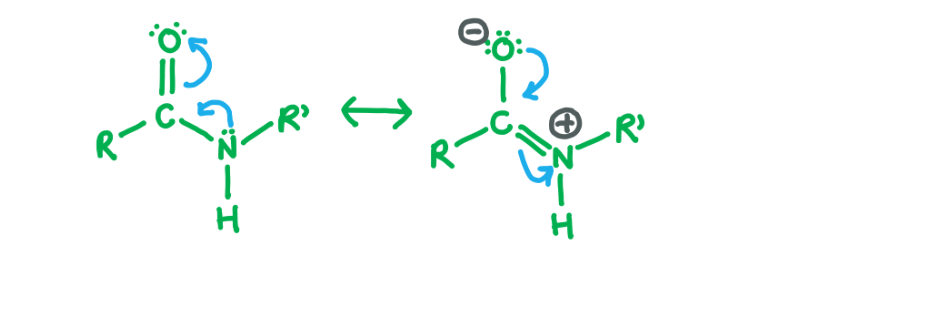

### Q7
**Final answer:** **The correct answer is ****B**** as: **

- **A ****haemoglobin ****protein consists of ****four**** separate polypeptide chains, each with its own ****haem prosthetic**** (non-protein) group.**
- **Each haem group has an ****iron ion (2+)**** in its centre which can form a ****complex ****with an oxygen molecule. When oxygen is associated with iron the haemoglobin molecule becomes an ‘****oxyhaemoglobin****’ molecule.**
- **Haemoglobin is a ****globular protein**** that is ****soluble**** in water, therefore the amino acids on its surface have ****polar R groups**** (side chains) that can ****hydrogen bond**** with water and aid dissolving. To dissolve in water any amino acids with ****hydrophobic R groups**** must be ****hidden**** from water and are therefore found together in the centre of the molecule.**
- **Each haem group (there are four in haemoglobin, one associated with each polypeptide chain) can bind one molecule of oxygen. Therefore, at ****50%**** saturation 2 of the 4 haem groups have an oxygen bound, so ****2 ****oxygen molecules are bound.**

> *A **is incorrect as each haemoglobin protein can transport up to four oxygen molecules (O**2**) which is 8 oxygen atoms.*

> *C **is incorrect as *

- * each polypeptide chain is folded into **alpha helices.*
- * the haem binding pocket is enriched with aromatic R groups (ring structures).*

> *D **is incorrect as *

- *polypeptide chains interact to produce a globular** spherical** shape.*
- *each chain contains a haem **prosthetic group** which is **not** made from amino acids/protein.*

### Q8
**Final answer:** **The correct answer is ****B**

- **To be ****soluble**** in water, a protein (or any molecule) must have amino acids with ****polar side chains**** on its surface that can ****hydrogen bond**** with water. **
- **This is important because water has a complex hydrogen bonding network between all the separate water molecules and hence if a protein is to dissolve the bonding network will be disrupted.**
- **Polar side chains on the surface of proteins are able to provide hydrogen bonds to replace the ones lost in the water bonding network and can therefore dissolve.**
- **Therefore, because fibrous proteins have non-polar amino acids on their surface they ****cannot form hydrogen bonds**** with the water and hence ****cannot dissolve****.**

> *A **is incorrect as very large proteins are able to dissolve if they have polar amino acids on their surface.*

> *C **is incorrect as being insoluble makes fibrous proteins good for structural roles but being structural does not cause a protein to be insoluble. Being insoluble is a **property** which allows it to perform a structural **function**.*

> *D **is incorrect as the number of polypeptide chains in a protein does not affect its solubility – haemoglobin has four polypeptide chains and is soluble.*

### Q9
**Final answer:** **The correct answer is ****D ****as: **

- **Collagen is insoluble due to the ****non-polar R groups**** on its surface. Being insoluble allows it to perform its function to give ****strength**** in muscles and tendons.**
- **A ****collagen molecule**** is made from ****three**** polypeptide chains, each chain has an ****alpha-helical**** structure and the three chains wrap around each other to form a ****triple helix**
- **At the end of each collagen molecule there are ****covalent bonds**** that attach separate collagen molecules together. These bonds between separate collagen molecules are called ****cross-links**** and by connecting separate molecules it increases the ****tensile strength**** of the overall collagen fibre.**
- **Collagen is made of a repeating tripeptide of ****glycine****, ****proline**** and ****hydroxyproline****. Glycine is the smallest amino acids with only a hydrogen in its ****R group**. **This allows the collagen polypeptides to twist around each other to form a strong collagen molecule. **

### Q10
**Final answer:** **The correct answer is ****C ****as**

- **Oxygen**** binds to the ****iron**** in the ****haem group****.**** **
- **As oxygen binds it pulls the iron ion into the ****plane**** of the haem group:**

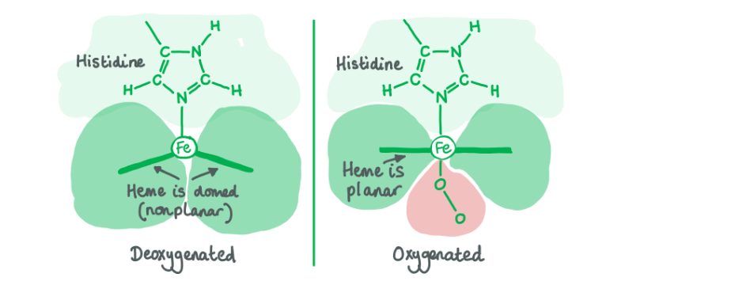

- **The movement of the iron slightly changes the ****tertiary shape**** of that individual ****globin polypeptide**** (haemoglobin is made of 4 separate globin polypeptides).**
- **The change in shape of one polypeptide is ****mechanically transmitted**** to the other 3 globin polypeptides in the haemoglobin molecule, this is called ****cooperative interaction**** and increases affinity for the other haem groups for ****O****.**
- **Therefore, as the number of oxygen molecules bound to haemoglobin increases, the ****affinity**** of the other haem sites for oxygen ****increases****. The opposite is true when oxygen molecules dissociate – overall affinity for oxygen decreases. **
- **This means that haemoglobin is a very efficient carrier for oxygen as it can bind to oxygen and also deposit it.**

> *A, B **&** D **are incorrect as ron on its own would not bind oxygen reversibly if it wasn’t within the haemoglobin protein. In haemoglobin, the globin protein molecule protects the iron haem group and enables it to form an iron-oxygen complex. Without the globin protein, iron would be oxidized to Fe(III) irreversibly. *

### Q11
**Final answer:** **The correct answer is ****D ****as:**

- **(CH****2****)****4****NH is a ****basic R group****.**
- **This R group can exist either as (CH****2****)****4****NH at high pH or (CH****2****)****4****NH****2****+ ****at low pH (when it accepts a hydrogen ion from solution).**
- **In its ****charged**** form, (CH****2****)****4****NH****2****+**** can form ****ionic bonds**** with negatively charged amino acids such as glutamic acid. These bonds hold together the ****tertiary structure**** of the protein.**
- **As shown in the graph, if the pH changes the ****shape**** ****of the enzyme can change (as ionic bonds and hydrogen bonds can be formed or lost) which will alter the shape of the ****active site**** and the enzyme’s ability to catalyse the reaction.**

> *The other options given are not acids or bases (they don’t donate or accept hydrogen ions) and therefore are not directly affected by pH. The hydrogen bonds formed by CH**2**OH will be disrupted by pH change but the R group itself will not be altered.*

### Q12
**Final answer:** **The correct answer is ****D ****as:**

- **Haemoglobin**** is an oxygen transporting protein found in red blood cells. It is made of four separate polypeptide chains, each with its own prosthetic (non-protein) ****haem group****. The haem group contains an ****iron ion**** (Fe****2+****) that associates with oxygen. **
- **Lipase is an ****enzyme**** that breaks down lipids. Like all enzymes, it has a ****globular**** (nearly spherical) structure and is ****soluble**** in water. In order to perform its function it has a binding site for lipids which acts as the ****active site**** for the catalytic reaction. **
- **A ****collagen molecule**** is a protein consisting of ****three separate polypeptide chains**** tightly coiled around each other to form a ****triple helix****. This structure is long and fibrous and makes the protein very ****strong**** – a property required to undergo its role in tendons and muscles.**

### Q13
**Final answer:** **The correct answer is ****A ****as:**

- **If there were 20 different amino acids available, like in humans, then n=20.**
- **The number of ****dipeptides**** that could be formed would be 20 x 20 or ****n x n ****or n****2****.**
- **Therefore the number of possible polypeptides is n multiplied by itself as many times as there are amino acids in the length of the protein : a ****length y**** amino acids made from ****n possible different amino acids**** can produce ****ny**** different polypeptides****.**

### Q14
**Final answer:** **The correct answer is ****B**** because: **

- **For a protein to ****denature**** the bonds in its ****tertiary structure**** have to break. These include ****ionic bonds**** and ****hydrogen bonds****, which are both pH dependent.**

  - **HCl is an ****acid ****and will therefore have more ****hydrogen ions**** present in solution than the protein’s natural cell environment.**
  - **At acidic pH, ****carboxylic acid groups**** on the side chains of glutamic acid and aspartic acid will ****accept hydrogen ions**** and become ****uncharged**** – this will disable them from forming ionic bonds, or salt bridges. **

- **Phospholipids have a ****hydrophilic**** phosphate head and ****hydrophobic**** lipid tail and are therefore dissolvable in an organic solvent such as ethanol.**

  - **Ethanol has a ****non-polar main chain**** (CH****3****CH****2****) that would form intermolecular forces, such as van der Waals, with the lipid chains.**
  - **Ethanol also has a ****polar hydroxyl group**** (OH) which can form hydrogen bonds with the phosphate head – as the whole phospholipid molecule can forms ****intermolecular forces**** with ethanol, it dissolves. **

### Q15
**Final answer:** **The correct answer is ****D ****because:**

- **The mutation would cause a different ****amino acid**** to be inserted into the polypeptide chain.**
- **This would change the ****specific sequence**** of amino acids, also known as the protein’s ****primary structure****.**

> *A **is incorrect as the **quaternary structure** is the overall structure made from the four polypeptide chains that make haemoglobin. Changing one amino acid is unlikely to change the entire shape of the protein.*

> *B **is incorrect as **iron** in haemoglobin is found in the **prosthetic** (non-protein) **haem** group and therefore is unaffected by a change in amino acid sequence*

> *C **is incorrect as the **secondary structure**, such as alpha helix or beta sheet, is maintained by **hydrogen bonds** between amino acid **main chains** (which are the same in all amino acids).*

### Q16
**Final answer:** **The correct answer is ****D ****as:**

- **Amino acid ****1**** is on the ****surface**** of a ****fibrous**** protein and is therefore likely to be ****non-polar****, as fibrous proteins are usually ****insoluble**** in water. Amino acid 1 could be either H or CH****3**
- **Amino acid ****2**** is on the ****surface**** of a ****globular protein****. Globular proteins are usually ****soluble**** in water and therefore must have ****polar, hydrophilic**** amino acids on their ****surface**** that can form ****hydrogen bonds**** with water. Amino acid 2 can ****only**** be CH****2****OH out of the two options as the polar O-H bond causes the hydrogen to be slightly positive and can form a hydrogen bond with an oxygen of a water molecule.**
- **Amino acid ****3**** is in the ****centre**** of a ****globular protein****, and therefore likely to be in a ****hydrophobic cluster**** shielded from water. Therefore, it is likely that amino acid 3 is CH(CH****3****)****2****.**

### Q17
**Final answer:** **The correct answer is ****C**** as:**

- **The stomach has a low, ****acidic pH ****which aids digestion and protects the body from ingested pathogens.**
- **Water has a ****neutral pH**** – higher than the pH of the stomach.**
- **Bond 1**** is an ****ionic bond****, or salt bridge, formed by the R groups of two oppositely ****charged**** amino acids. If the pH changes, the R groups will either donate or accept hydrogen ions which will make them lose their charge and therefore the bond will be broken.**

  - **In acidic conditions, both groups will accept hydrogen ions and the COO****-**** group will become COOH.**
  - **In alkaline conditions, both groups will donate hydrogen ions and the NH****3****+**** group will become NH****2****.**
- **Bond 4**** is a ****hydrogen bond**** formed between two ****polar**** side chains. The slightly positive hydrogen in OH is attracted to the slightly negative oxygen in C=O. A change in the concentration of hydrogen ions in solution (the pH) will affect the strength of the hydrogen bond.**

> *A **is incorrect as It does **not** include the **hydrogen bond**, which is also affected by pH.*

> *B **is incorrect as 3 is a **disulfide bond** which is a type of **covalent bond**. Covalent bonds are not affected by pH.*

> *D **is incorrect as *

- *3 is a **disulfide bond** which is a type of **covalent bond**. Covalent bonds are not affected by pH.*
- *2 is a **hydrophobic interaction** between two **aliphatic** amino acids, these intermolecular forces are **not** affected by pH.*

### Q18
**Final answer:** **The correct answer is ****D ****as:**

- **Each ****haemoglobin**** protein can carry four molecules of oxygen (O****2****) which is ****eight atoms****.**
- **At 98% saturation nearly all the haemoglobin molecules are ****100% saturated**** and therefore are carrying 8 oxygen atoms.**

> *A **is incorrect as this would imply 25% saturation, or one oxygen molecule per haemoglobin.*

> *B **is incorrect as at 98% saturation the majority of haemoglobin molecules will have four oxygen molecules bound, which is eight oxygen atoms. This is a **common incorrect answer** due to the question not being read properly. Remember O**2** is 2 oxygen atoms bound together. *

> *C **is incorrect as if the majority of haemoglobin molecules were carrying 6 oxygen atoms, the saturation would be ~75% or 3 oxygen molecules bound. This is a **common incorrect answer** but although the % saturation is not 100, at 98% the **majority** of haemoglobin proteins will be fully saturated.*

### Q19
**Final answer:** **The correct answer is ****B ****as:**

- **To be ****soluble**** in water a protein must have amino acids with ****polar side chains**** on its surface that can ****hydrogen bond**** with water. **
- **This is important because water has a complex hydrogen bonding network between all the separate water molecules and hence if a protein is to dissolve the bonding network will be disrupted.**
- **Polar side chains on the surface of proteins are able to provide hydrogen bonds to replace the ones lost in the water bonding network and can therefore dissolve.**
- **Therefore, for a globular protein to be insoluble it must have non-polar, hydrophobic amino acids on its surface that ****cannot form hydrogen bonds**** with the water and hence ****cannot dissolve****.**

### Q20
**Final answer:** **The correct answer is ****D**** as:**

- **Two amino acids form a peptide bond between them to become a dipeptide.**
- **The peptide bond is made between the ****nitrogen ****(from the amine group –NH****2****) of one amino acid and the ****carbon**** (from the carboxylic acid group –COOH) of another amino acid.**
- **The groups that form a ****peptide bond**** must on the ****main chain**** of the amino acid, not in the R group (side chain).**

> *A **is incorrect as  the carboxylic acid (-COOH) labelled 5 is on the side chain, rather than main chain, of the amino acid.*

> *B **is incorrect as the carboxylic acid (-COOH) labelled 2 is on the side chain, rather than main chain, of the amino acid.*

> *C **is incorrect as a peptide bond is formed between the **nitrogen **(from the amine group –NH**2**) of one amino acid and the **carbon** (from the carboxylic acid group –COOH) of another amino acid. A peptide bond cannot form between two carbonsor two carboxylic acid groups.*

### Q21
**Final answer:** **The correct answer is ****C ****as: **

- **The ****tertiary structure**** of a protein is its overall ****three-directional shape****.**
- **This is maintained by hydrogen bonds, disulfide bonds and ionic bonds between the ****side chains (R groups)**** of amino acids in different parts of the polypeptide chain:**

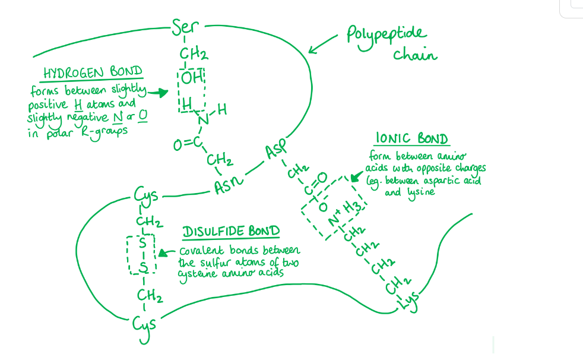

- **Polar R groups can also form hydrogen bonds with ****water****, which enables the protein to ****dissolve**** and maintain its tertiary structure.**
- **As these bonds are occurring between amino acids that are not close to each other on the polypeptide chain they cause the protein to ****fold**** into its ****tertiary structure****.**

> *A **is incorrect as **disulfide bonds** are used to maintain **tertiary structure**.*

> *B **& **D** are incorrect as **peptide bonds** are **covalent bonds** between the **main chain** of amino acids and maintain the **primary structure** (the specific sequence of amino acids) of the protein.*

### Q22
**Final answer:** **The correct answer is ****D ****as...**

- **The ****quaternary structure**** is the overall three-dimensional shape formed through the joining of ****separate polypeptide chains, ****and in the case of haemoglobin it also binds to a haem group as part of the quaternary structure**
- **Haemoglobin is made of four separate polypeptide chains**
- **The overall shape of haemoglobin is ****globular**** as it is slightly spherical in shape**

> *A **is incorrect as the globular shape of haemoglobin also describes its quaternary structure.*

> *B **is incorrect as an **α-helix** is a type of **secondary structure**.*

> *C **is incorrect as the specific order of amino acids is the **primary structure** of a protein.*

### Q23
**Final answer:** **The correct answer is ****A ****as:**

- **Fibrous proteins**** are ****less**** sensitive to changes in heat than globular proteins. **
- **A large increase in heat will ****break hydrogen bonds****. **
- **Fibrous proteins are ****not soluble**** and therefore do ****not**** rely on forming hydrogen bonds with water to maintain their structure, therefore are not very sensitive to changes in heat.**

> *B **is incorrect as fibrous proteins are **insoluble**.*

> *C **is incorrect as fibrous proteins are used as **structural proteins**. For example: actin is part of the cells cytoskeleton and keratin strengthens hair and nails. *

> *D **is incorrect as fibrous proteins often form **long coils** which strengthen the protein structure – like a rope!*

### Q24
**Final answer:** **The correct answer is ****C**** because:**

**Final answer:** **Primary structure **

- **Is the ****specific sequence**** of amino acids.**
- **Amino acids are joined together in a condensation reaction to form a specific covalent bond called a ****peptide bond ****(which is a ****covalent**** bond).**
- **A peptide bond is between the ****nitrogen ****(from the amine group –NH2) of one amino acid and the ****carbon**** (from the carboxylic acid group –COOH) of another amino acid.**

**Final answer:** **Secondary structure **

- **Is the first level of shape formed by the polypeptide.**
- **Either ****alpha-helix**** or ****beta-sheet****.**
- **Held together ****only**** by ****hydrogen bonds**** between the ****main chain**** amino acid groups (****oxygen**** from the C=O and ****hydrogen**** from the N–H) **

**Final answer:** **Tertiary structure **

- **Is the overall ****three-dimensional shape**** of the polypeptide chain**
- **Bonds usually form between the R groups (****side chains****) of amino acids**
- **Can be held together by:**

  - **Disulfide bonds**** between two ****cysteine**** amino acids**
  - **Hydrogen bonding between polar amino acids**
  - **Ionic bonding between amino acids with opposite charged**
  - **Hydrophobic interactions between two aliphatic amino acids**

*A*** ***&** D **are incorrect as the secondary structure of a protein is not maintained by ionic bonds.*

> *B **s incorrect as the primary structure of a protein is not maintained by ionic bonds.*

### Q25
**Final answer:** **The correct answer is ****B**** as**

- **The diagram in the question shows a ****tripeptide**** made from three amino acids joined together. **
- **A ****peptide bond**** is a covalent bond that joins two separate amino acids together in a polypeptide (protein).**
- **The peptide bond forms between the ****nitrogen of the amine group**** (–NH2) of one amino acid and the ****carbon of the carboxylic acid group**** (-COOH) of another amino acid.**
- **During peptide bond formation, a hydrogen attached to the nitrogen and the hydroxyl (OH) attached to the carbon form ****water**** – this is known as a ****condensation**** reaction.**

**       **

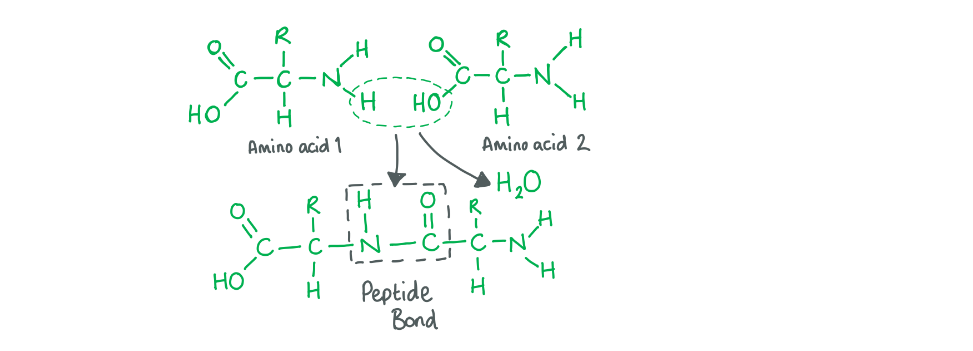

> *A **is incorrect as this is a carbon-oxygen **double bond** and is part of the structure of a single amino acid.*

> *C **is incorrect as this is a nitrogen-hydrogen **single bond** and is part of the structure of a single amino acid.*

> *D **is incorrect as this is a carbon-carbon single bond and is part of the **main chain** of a single amino acid. The bond connects the **alpha-carbon **(Cα – which is connected to all four groups on an amino acid) to the carboxylic acid carbon.*

### Q26
**Final answer:** **The correct answer is ****D ****as:**

- **One**** ion of iron (****Fe****2+****) is found at the centre of a ****haem group****.**
- **One ion of iron binds ****one**** molecule of oxygen (****O****2****). **
- **There are four subunits (separate polypeptides) in ****haemoglobin****, each has a haem group. Therefore, one haemoglobin molecule can bind ****4**** molecules of oxygen.**

> *A **is incorrect as iron does **not** undergo oxidation during the binding of oxygen and instead forms **an iron-oxygen (Fe(II)-O**2**) complex**. If there was no globin protein to protect the haem group, the iron would be oxidized from Fe(II) to Fe(III).*

> *B **is incorrect as iron does **not** stabilize the quaternary structure of haemoglobin. The quaternary structure is stabilized by **intermolecular forces** and **hydrogen bonding** between the four haemoglobin polypeptides.*

> *C **is incorrect as iron does **not** affect the solubility of haemoglobin. Haemoglobin is soluble because it has **polar amino acids** on its surface that form **hydrogen bonds with water** in the red blood cell cytoplasm.*

### Q27
**Final answer:** **The correct answer is ****C**

- Globular proteins are characterised by:

  - being **water soluble**; protein X is described as being ‘dissolved’
  - having a roughly **spherical shape**
- Fibrous proteins are characterised by:

  - a long, fibrous structure, for example the **coiled coil** in protein Y
  - having a **structural role**

### Q28
**Final answer:** **The correct answer is ****C ****as**

- **The ****primary structure**** of collagen (the specific sequence of amino acids) is a repeating tripeptide of ****glycine, proline ****and ****hydroxyproline****.**
- **Therefore, ****1/3**** of collagen is glycine – a very high proportion relative to other proteins.**
- **Glycine is the ****smallest**** amino acid because the ****R group**** (the amino acid side chain) is a ****hydrogen****.**

> *A **is incorrect as three alpha-helical **polypeptide chains** coil around each other to form a collagen molecule, the structure of this is called a triple helix. **Three collagen molecules** can then coil around each other to make a **collagen fibre**.*

> *B **is incorrect as **peptide bonds** are **covalent** bonds that are only formed between amino acids that are next to each other in the **same polypeptide** chain.*

> *D **is incorrect as a collagen **polypeptide** forms a long, **single alpha helix** that is then coiled around 2 other separate collagen polypeptides in a regular spiral arrangement to form a **collagen molecule**.*

### Q29
**Final answer:** **The correct answer is ****A**** as**

- **The ****quaternary structure**** of a protein is the shape formed by ****separate polypeptide chains ****held together by hydrogen bonds and intermolecular forces.**
- **Haemoglobin is made from ****four**** separate polypeptide chains that come together to form a quaternary structure.**
- **Myoglobin**** is made from ****one polypeptide chain**** and therefore cannot have a quaternary structure.**
- **The highest level of structure myoglobin has is tertiary, it’s three-dimensional shape.**

> *B **is incorrect as myoglobin is a **globular** structure. Whether a protein in fibrous or globular does not determine whether it has  quaternary structure.*

> *C **is incorrect as myoglobin contains a **haem group**. The presence of a prosthetic (non-protein) group does not determine whether a protein has quaternary structure.*

> *D **is incorrect as myoglobin has 8 **alpha-helices**. Alpha-helices are an example of **secondary structure**.*

## Structured Questions (15 questions)

### Q1
A prosthetic group...

- Is a non-amino acid chemical group within / (permanently) bound to a protein; **[1 mark]**

Haemoglobin's prosthetic group:

- Consists of a central, iron/Fe atom / Fe2+ ion; **[1 mark]**
- Organic/carbon/porphyrin ring structure; **[1 mark]**

**[Total: 3 marks]**
The mode of operation of the prosthetic group within a haemoglobin molecule is...

**Final answer:** **Three ****from:**

- To bind to <u>oxygen</u> / an oxygen molecule; **[1 mark]**
- Binding is reversible; **[1 mark]**
- Binding depends on the oxygen concentration / partial pressure of the surroundings; **[1 mark]**
- Binding alters the tertiary/quaternary structure so that further oxygen binding is promoted; **[1 mark]**

*Allow references to unbinding of oxygen*

**[Total: 3 marks]**
The number of oxygen molecules that are bound within a single red blood cell when the cell is 7% saturated with oxygen is calculated as follows:

- Number of oxygen molecules when fully saturated = 2.8 × 108 × 4 = 1.12 × 109; **[1 mark] **
- 0.07 × 1.12 × 109= 78 400 000; **[1 mark] **
- 2 sf = 78 000 000 / 78 million / 7.8 × 107; **[1 mark] **

**[Total: 3 marks]**

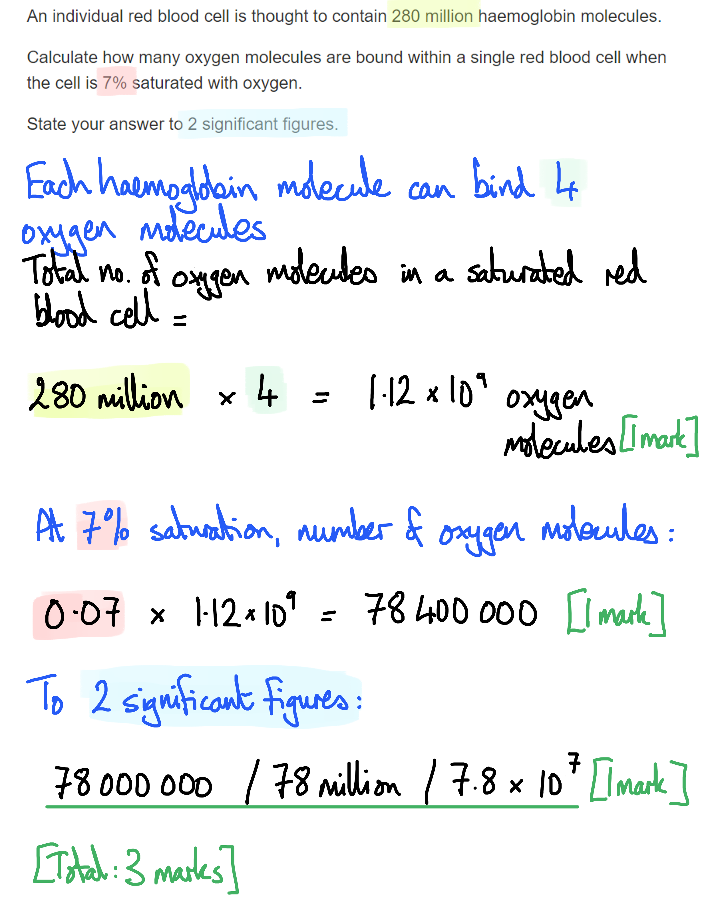

> *This question is about oxygen **molecules** (O**2**), so be sure to state that 4 oxygen molecules are bound to each haemoglobin, as opposed to 8 oxygen **atoms**. *
A prosthetic group is needed in a haemoglobin molecule...

- To bind oxygen; **[1 mark]**
- Because amino acids are not suited to binding / unbinding oxygen;** [1 mark]**

**[Total: 2 marks]**

*Take note of the number of marks available in a question; if you just answer with 'to bind oxygen' you will only be awarded ***[1 mark]***. A statement of explanation is required for the second mark. *

### Q2
The insulin must be injected into the blood instead of taken orally because...

- Stomach conditions are acidic / have a low pH; **[1 mark]**
- This would cause the protein/insulin to become denatured / lose its tertiary structure; **[1 mark]**

**[Total: 2 marks]**
Pig and cow insulin is less effective at regulating blood glucose levels than human insulin because...

**Final answer:** **Any ****two**** of the following:**

- The amino acid sequence / primary structure of pig/cow insulin is different to that of human insulin; **[1 mark]**
- Hydrogen bonds / ionic bonds / disulfide bonds / hyrophobic/hydrophilic interactions form in different places; **[1 mark]**
- The protein/insulin has a different 3D shape / tertiary structure; **[1 mark]**

**[Total: 2 marks]**
(i) Fetal haemoglobin is different from adult haemoglobin as follows...

- (Fetal haemoglobin) has two γ/gamma subunits/chains **WHILE** adult haemoglobin has two β subunits/chains; **[1 mark]**

(ii) Fetal haemoglobin has a different structure to adult haemoglobin because...

- (The difference in structure) allows fetal haemoglobin to bind more easily/readily to oxygen / to bind to oxygen at low pO2; **[1 mark]**

**[Total: 2 marks]**

> *Being able to apply your knowledge of the structure of haemoglobin to an unfamiliar scenario is important in constructing a sensible answer to this question. The structure of fetal haemoglobin is almost identical to adult haemoglobin but instead of two β globin subunits, it has two γ globin subunits instead. This enables fetal haemoglobin to bind more easily to oxygen, as suggested by the information provided in the question stem that states that fetal haemoglobin has a higher affinity for oxygen.*
(i) The part of haemoglobin that is shown in Fig. 2 is...

- Haem (prosthetic) group; **[1 mark]**

(ii) The haem group facilitates the role of haemoglobin in the following way...

**Final answer:** **Any ****two**** of the following:**

- It contains an iron ion/Fe2+which is able to (reversibly) combine with an oxygen molecule/O2; **[1 mark]**
- This forms oxyhaemoglobin (which can carry oxygen to respiring cells/tissue); **[1 mark]**
- Haemoglobin contains 4 of these regions so can bind to 4 oxygen molecules/O2 / 8 oxygen atoms/O;** [1 mark]**

**[Total: 3 marks]**

> *In Biology it is important to be able to relate the structure of different molecules/tissues/organs to the function they perform in living organisms. It is the haem group that enables haemoglobin to bind to and transport oxygen to cells for the process of aerobic respiration which will release the energy needed for cellular processes.*

### Q3
A comparison of the structure of myoglobin and haemoglobin includes the following...

*Similarities*

**A ****maximum of three**** of the following:**

- Both contain an oxygen-binding site / haem/prosthetic group; **[1 mark]**
- Both contain one prosthetic group per subunit/polypeptide; **[1 mark]**
- They are both globular proteins;** [1 mark]**
- Both consist of <u>globin</u> proteins; **[1 mark]**

*Differences*

- Myoglobin (only) has a <u>tertiary structure</u> **WHILE** haemoglobin (also) has a <u>quaternary structure</u>; **[1 mark]**
- Myoglobin has one subunit/polypeptide **WHILE** haemoglobin has four subunits/polypeptides / two α and two β subunits; **[1 mark]**

**[Total: 4 marks]**

> *Note that the comparisons here must relate to **structural** features, as stated in the question. Points relating to the roles of the proteins will not be credited.*

> *Questions with the command word **compare** require both similarities and differences between the structures mentioned in the question. When describing differences you must be sure to refer to the **features of both** structures in order to demonstrate how they **differ** from each other.*
(i) Differences in the dissociation curves can be explained as follows...

**Final answer:** **Any ****three**** of the following:**

- (The curve for myoglobin is to the left because) myoglobin has a high<u>er</u> <u>affinity</u> for oxygen **OR** haemoglobin has a low<u>er</u> <u>affinity</u> for oxygen; **[1 mark]**
- (Myoglobin is more saturated at low pO2 because) myoglobin binds <u>more</u> easily/readily with oxygen at low pO2 **OR** haemoglobin binds <u>less</u> easily/readily with oxygen at low pO2; **[1 mark]**
- (Myoglobin does not have a sigmoid curve while haemoglobin does because) for myoglobin (which only has one oxygen binding site) the binding of oxygen to one binding site does not affect the ability of other oxygen molecules to bind **WHILE **for haemoglobin (which has multiple binding sites) the binding of oxygen to one binding site affects the ease of binding for further oxygen molecules; **[1 mark]**
- Myoglobin does not bind co-operatively to oxygen **WHILE** haemoglobin does; **[1 mark]**

> *Carefully observe the main differences between the shapes of the curve. Here you need to **explain** the data, so marks will not come from describing what is happening but for explaining **why** the curves look as they do.*

> *In this case, the oxygen dissociation curve for haemoglobin is sigmoidal; this is due to co-operative binding of oxygen. This means that the shape of haemoglobin is slightly distorted when an oxygen molecule binds to it, making it easier for the next one to bind. Myoglobin does not show co-operative binding with oxygen, hence the lack of sigmoid curve.*

> *Remember that whenever you are discussing the **differences** between any items, each statement must be **comparative**. E.g. X is **more** than Y, or X is ... **WHILE** Y is ... .*

(ii) The percentage saturation for myoglobin at a partial pressure of 20 mmHg is...

- (Roughly) 82 %; **[1 mark]**

*Accept any value between 81 and 83 %.*

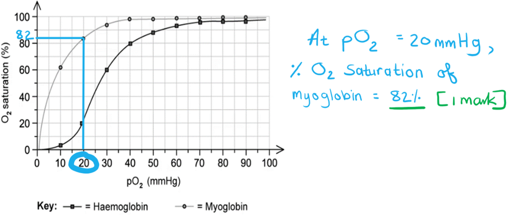

**[Total: 4 marks]**

> * *
The tertiary and quaternary structures of haemoglobin facilitates the transport of oxygen as follows...

**Final answer:** **Any ****three**** of the following:**

- Hydrophilic amino acids/R-groups face outward / hydrophobic amino acids/R-groups face inwards **SO** it is soluble / can dissolve in water/blood plasma; **[1 mark]**
- Contains a haem/prosthetic group/ iron (ion) **SO** can bind oxygen to form oxyhaemoglobin;  **[1 mark]**
- Contains four polypeptides/haem groups **SO** can bind to 4 oxygen molecules / 8 oxygen atoms; **[1 mark]**
- The binding of an oxygen molecule distorts/changes the shape of haemoglobin **SO** making subsequent oxygen binding easier / leading to co-operative binding; **[1 mark]**

**[Total: 3 marks]**

> *The way in which the different polypeptide subunits interact with one another plays an important role in the transport of oxygen. Haemoglobin must be **soluble** in the cytoplasm, so as not to distort the shape of the red blood cells. The **iron ions** at the centre of the **haem groups** allows oxygen to bind to haemoglobin in order to be transported in the bloodstream.*

> *Note that this question is asking you to **explain** how haemoglobin's structure enables it to carry out its function, so each statement must **clearly relate structure to function**.*

### Q4
The ratio of non-coding to coding DNA is...

- (585 x 3 =) 1 755 coding bases; **[1 mark]**
- (16 961 - 1 755 =) 15 206 non-coding bases;** [1 mark]**
- Ratio = 8.66 : 1; **[1 mark]**

*Full marks awarded for the correct answer only*

**[Total: 3 marks]**

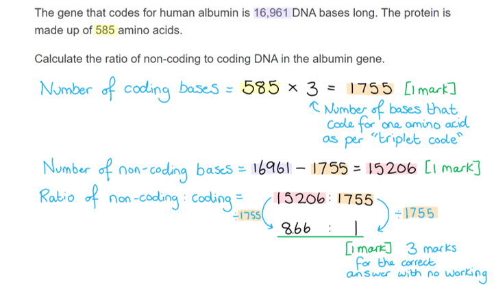
(i) One example of secondary structure visible in Fig. 1 is...

- α/alpha helix/helices; **[1 mark]**

> *Note that while you may be familiar with both alpha helix and beta-pleated sheet secondary structures, only alpha helices are clearly visible in human albumin here.*

(ii) A description of the bond(s) found in an α-helix includes...

**Final answer:** **Any ****two**** of the following:**

- Hydrogen bonds; **[1 mark]**
- Between every fourth peptide bond; **[1 mark]**
- Between the oxygen of the carboxyl group and the hydrogen of the amine group; **[1 mark]**

*Ignore references to other types of bond.*

> *Make sure that you have a good understanding of the bonds that are found at each level of protein structure.*

**[Total: 3 marks]**
The student could investigate how temperature affects the denaturing of albumin as follows...

**Final answer:** **Any ****four**** of the following:**

- A named method of varying the temperature, e.g. water bath; **[1 mark]**
- Add the egg white to a series of named temperatures, e.g. 20 °C, 30 °C, 40 °C, 50 °C, 60 °C ; **[1 mark]**
- Record the time taken for denaturation to occur / for the egg white to change from colourless to white; **[1 mark]**
- Repeat the experiment at least 3 times at each temperature; **[1 mark]**
- A named control variable is kept constant, e.g. pH / type of egg / volume of egg white; **[1 mark]**

**[Total: 4 marks]**
The different properties before and after denaturing can be explained as follows...

- In its normal state the hydrophobic amino acids in albumin are at the centre of the molecule **SO** albumin is soluble; **[1 mark]**
- Heating/denaturing breaks ionic / hydrogen / disulfide bonds in the protein **SO** changing its tertiary structure / 3D shape; **[1 mark]**
- Heating/denaturing causes the hydrophobic amino acids to move to the outside of the molecule **SO** albumin becomes insoluble;** [1 mark]**

**[Total: 3 marks]**

> *Remember that denaturing is a permanent process, so once this change has occurred the hydrophobic amino acids cannot return to their previous position in the protein. *

### Q5
The number of possible combinations of amino acids that could exist are...

- 2026; **[1 mark]**
- 6.71 x 1033; **[1 mark]**

*Full marks awarded for the correct answer only.*

*Maximum of 1 mark for an answer that is not in standard form.*

**[Total: 2 marks]**

> *If there were only one amino acid in the chain then the number of possibilities would be 20. Adding a second would add 20 more possibilities to the first 20, so to calculate this it would be 20 x 20. Adding a third adds another 20 possibilities on top of a large number of possibilities for the first two amino acids, which would be 20 x 20 x 20 ... and so on.*

> *20 x 20 x 20 = 20**3**.*

> *This equation can be simplified to 20**n**,** **where **n** is the number of amino acids in the chain. *

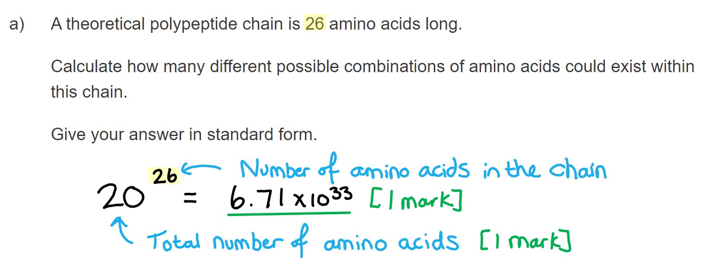
Selenocysteine is unusual compared to other amino acids because...

- It contains the element selenium/Se; **[1 mark]**

**[Total: 1 mark]**

> *Selenocysteine is very similar to the amino acid cysteine. Cysteine contains sulfur instead of selenium. *
The mark allocation for the drawing would be...

- Dipeptide correctly drawn, indicating the peptide bond; **[1 mark]**
- Indication of a water molecule released/formed; **[1 mark]**

**[Total: 2 marks]**

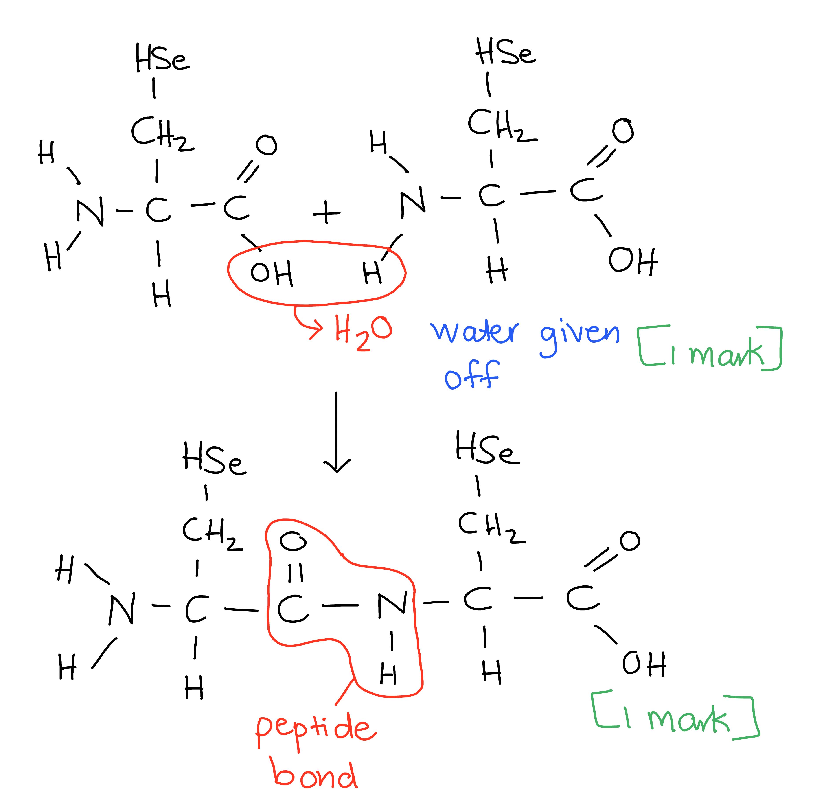
In order to be classified as amino acids the molecules must have...

- A central carbon atom bonded to a H/hydrogen **AND** an R group; **[1 mark]**
- A carboxylic acid group / COOH; **[1 mark]**
- An amino/amine group / NH2; **[1 mark]**

**[Total: 3 marks]**

> *All amino acids share the same generalised structure but just vary in the structure of their R groups.*

### Q6
Label **A** represents the following:

**Final answer:** **Any ****three**** of the following:**

- It represents the secondary structure (of the polypeptide/protein); **[1 mark]**
- The structure is an alpha / α-helix; **[1 mark]**
- There is hydrogen bonding/bonds (in the part labelled **A**); **[1 mark]**
- (This bonding is) between NH and CO groups of different amino acids (four places apart) **OR** bonding is between the hydrogen of the NH group and oxygen of the CO group; **[1 mark]**

**[Total: 3 marks]**
Marks will be allocated to the following aspects of your diagram:

- Correctly identifying where the peptide bond is between the amino acids; **[1 mark]**
- Correctly drawing the COOH and NH2 groups after hydrolysis occurred; **[1 mark]**
- Correctly drawing the rest of each amino acid; **[1 mark]**

**[Total: 3 marks]**

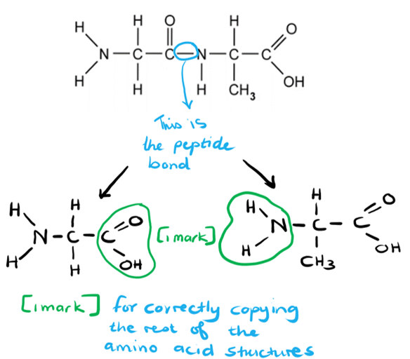
A low pH can affect the structure of a protein as follows:

**Final answer:** **Any ****two**** of the following:**

- Hydrogen ions can interact with charged R-groups of amino acids; **[1 mark]**
- This could break ionic bonding holding the 3D shape together; **[1 mark]**
- Causing the protein to denature; **[1 mark]**

**[Total: 2 marks]**

> *This question requires a bit of knowledge on enzymes. pH is a measure of the concentration of hydrogen ions in a solution. Since they are positively charged, they will affect any charged R-group on amino acids. Ionic bonds involve charged R-groups and therefore these are the main types of bonds affected by a change in pH. When the shape of a protein changes, it is said to have denatured and will be unable to perform its function.*

### Q7
A lack of iron in the diet would lead to fatigue due to the following reasons:

**Final answer:** **Any ****three ****of the following:**

- Iron is needed for haem / haem contains iron; **[1 mark]**
- Less haemoglobin (produced when there is insufficient iron); **[1 mark]**
- This leads to a decrease in oxygen transported/supplied/delivered (to the cells); **[1 mark]**
- So that the rate of respiration will decrease (causing fatigue); **[1 mark]**

**[Total: 3 marks]**

> *Oxygen binds to the **iron ion** at the centre of the **haem group**. Without this binding place, haemoglobin is unable to transport oxygen to the cells that require it. Oxygen is one of the requirements for **aerobic respiration** to take place, which releases energy in the form of ATP.*
The percentage decrease in saturation can be calculated at follow:

- 98.0 - 57.5 = 40.5; **[1 mark]**
- 40.5 ÷ 98.0 = 0.41; **[1 mark]**
- 0.41 x 100 = <u>41%</u>; **[1 mark]**

*Full marks awarded for the correct answer only.*

**[Total: 3 marks]**

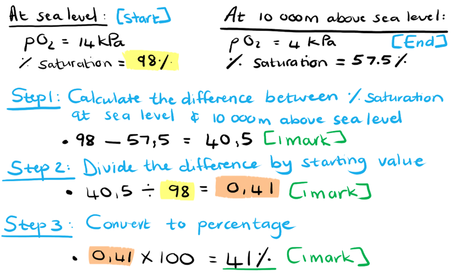
The comparison would include the following:

- Both contain (the elements) carbon, hydrogen and oxygen; **[1 mark]**
- Nitrogen and sulfur are only found in proteins **OR** carbohydrates do not contain nitrogen and sulfur; **[1 mark]**

**[Total: 2 marks]**

> *When thinking about the different biological macromolecules that you have to learn about, remember that both lipids and carbohydrates contain carbon, hydrogen and oxygen. Nitrogen and sulfur are found in proteins only.*
Proteases are able to break protein molecules down in the following way:

- They are able to break the <u>peptide</u> bond (between amino acids); **[1 mark]**
- By the addition of a molecule of water / hydrolysis reaction; **[1 mark]**

**[Total: 2 marks]**

> *Remember that all the covalent bonds in the biological molecules that you've learnt about are broken down by **hydrolysis** reactions. This involves the **addition of water molecules** to break the bonds between the monomers of a polymer / macromolecule, such as protein.*

### Q8
A polypeptide is formed as follows...

**Final answer:** **Any ****two**** of the following:**

- (It forms when) <u>condensation</u> reactions occur; **[1 mark]**
- <u>Peptide</u> bonds form; **[1 mark]**
- Bonds form between the amine/amino group of one amino acid and the carboxyl/carboxylic acid group of another; **[1 mark]**

**[Total: 2 marks]**

> *It is important to note that the question is not asking you for a description of protein synthesis. An indicator of this is the command word 'state' in the question that tells you that a description of a long process is not required.  Another clue as to what is expected of you is the mark allocation; if you were required to describe protein synthesis the question would be worth many more marks.*
Most cellular enzymes are made predominantly from protein because...

**Final answer:** **Any ****four**** of the following:**

- The function of a protein is determined by its shape/structure; **[1 mark]**
- The structure/shape of a protein is determined by the primary structure / the amino acid sequence; **[1 mark]**
- Many different possible combinations of amino acids are possible **SO** many different protein structures can be formed; **[1 mark]**
- The primary structure determines the tertiary structure / 3D structure; **[1 mark]**
- The tertiary structure is determined by the bonds that occur between amino acids (within the primary structure); **[1 mark]**
- These bonds include hydrogen bonds **AND** ionic bonds **AND** disulfide bonds; **[1 mark]**

**[Total: 4 marks]**

> *It is essential that you are able to relate the structure of proteins to their functions or properties. Remember that each protein has its own particular shape and therefore functions within a cell and that the shape is determined by the amino acid sequence within the polypeptide chain.*

> *Keep in mind that peptide bonds only hold amino acids together in the polypeptide chain, they do not directly influence the 3D structure. The sequence in which they hold the amino acids however, will affect where hydrogen, ionic and disulfide bonds can form.*
The number of amino acids in the protein can be calculated as follows:

- (100 x 140) ÷ 28 = 500 (peptide bonds present); **[1 mark]**
- (500 + 1) = 501 amino acids; **[1 mark]**

*Full marks awarded for the correct answer in the absence of other calculations*

**[Total: 2 marks]**

> *Remember that there is always one more amino acid than there are peptide bonds in a polypeptide!*

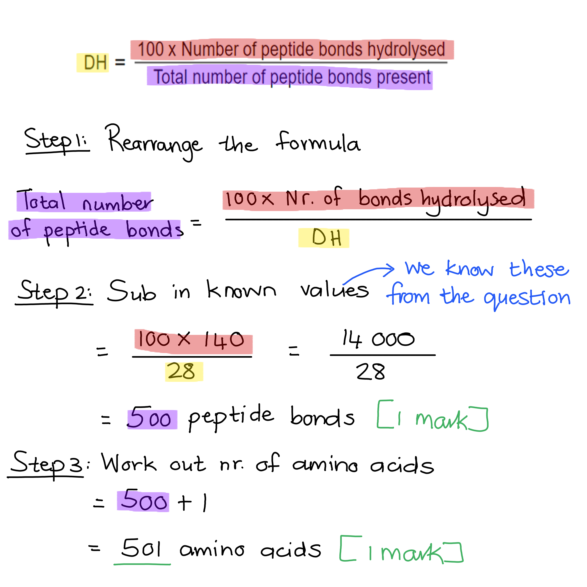
It is beneficial for washing powders to contain molecules that can break down proteins because...

- Some (fabric) stains may be protein based / may be made of protein molecules **OR** it allows for the removal of protein based stains/marks (on clothes); **[1 mark]**

**[Total: 1 mark]**

### Q9
(i) Marks are allocated to the following on the completed diagram:

- Water molecule formed; **[1 mark]**
- Peptide bond correctly indicated between C of carboxylic acid and N of amino group;** [1 mark]**
- The rest of the dipeptide was correctly drawn; **[1 mark]**

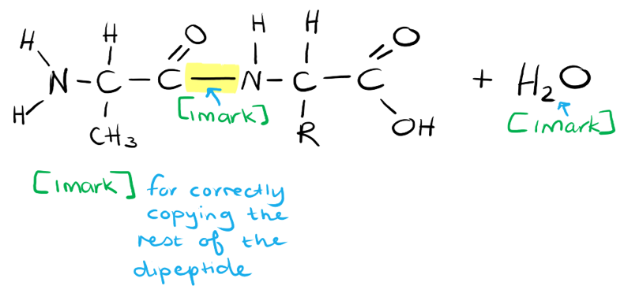

(ii) R represents the following:

- The R group / side chain / variable group / residual group / functional group; **[1 mark]**
- (This group) indicates different amino acids /  types of amino acid **OR** specific to each amino acid **OR** the two amino acids are different; **[1 mark]**

**[Total: 5 marks]**

> *Amino acids have a similar structure, except for the R-groups. There are 20 different amino acids each with a different R-group. Sometimes the R group consists of only one atom, such as glycine where it is a H-atom, but some R-groups can be quite large. You will not be required to memorise these R-groups for exam purposes.*
The secondary structure of a protein refers to:

- Hydrogen bonding occurs; **[1 mark]**
- (This occurs) between CO- group of one amino acid and NH- group of another; **[1 mark]**
- (To form) alpha/α-helix <u>and</u> beta/β-pleated sheet; **[1 mark]**

**[Total: 3 marks]**

> *The secondary structure of a protein/polypeptide relies on the interaction between different amino acids. This interaction is due to hydrogen bonding between polar groups in the amino acids. This will result in the amino acid chain coiling into an α-helix or folding into a β-pleated sheet.  *
The levels of protein structure that is visible in Fig.2 is:

- Secondary structure; **[1 mark]**
- Tertiary structure;** [1 mark]**

**[Total: 2 marks]**

> *The α helix and β pleated sheets represent the secondary structure of a protein. Enzymes are folded into 3D structures and since there is only one polypeptide chain present, it would represent the tertiary structure of a protein. It is important to be familiar with the different levels of protein structure in order to identify them correctly.*

### Q10
The number of amino acids in a single collagen molecule would be:

- 1035 x 3 = <u>3105</u> (amino acids); **[1 mark]**

Explanation:

- If there are 1034 peptide bonds in one polypeptide chain, then there must be 1035 amino acids (in that chain); **[1 mark]**
- Each collagen molecule is formed from three polypeptide chains; **[1 mark]**

**[Total: 3 marks]**

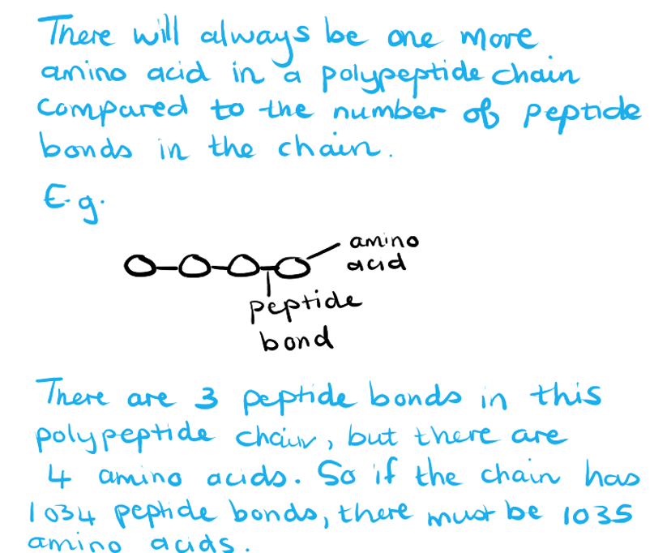
Collagen is described as having a quaternary structure because:

- It has more than one polypeptide chain / three polypeptide chain(s); **[1 mark]**
- Which form a <u>triple helix</u>; **[1 mark]**

**[Total: 2 marks]**

> *Be careful not to confuse helixes! The primary structure of a protein folds into a secondary structure which may contain alpha (ɑ) helixes, whereas **three** **separate polypeptide chains** coil together in a** triple helix** to form one molecule of collagen. And then separately we also have the DNA double helix.*
**One** mark per correct column:

|   | **Haemoglobin** | **Collagen** |
|---|---|---|
| **Globular or fibrous** | **Globular** | **Fibrous** |
| **Solubility in water** | **Soluble** | **Insoluble** |
| **Number of polypeptide chains** | **4** | **3** |
| **Prosthetic group present** | **Yes** | **No** |
| ** ** | **[1 mark]** | **[1 mark]** |

**[Total: 2 marks]**
The structure of a collagen molecule relates to its function in the following ways:

**Final answer:** **Any ****three**** of the following:**

- Collagen is a structural protein / it has a structural role; **[1 mark]**
- It is a fibrous protein **OR** it is insoluble; **[1 mark]**
- Consists of three polypeptide chains / forms a <u>triple helix</u>; **[1 mark]**
- Strands are held together by hydrogen (and covalent) bonds; **[1 mark]**
- Every third amino acid is glycine; **[1 mark]**
- (The glycine) allows strands to form a tight coil; **[1 mark]**

**[Total: 3 marks]**

> *Collagen is the most abundant protein found in animals, which is mainly due to its importance as a structural protein. The structure and arrangement of collagen molecules are crucial in order to fulfil this role. Do not confuse a collagen molecule with a collagen fibre; the question is asking about the structure of a collagen **molecule**, which consists of three polypeptide chains. Many collagen molecules make up a collagen fibril, which in turn forms part of a collagen fibre.*

### Q11
The main role of haemoglobin is...

- To bind/carry/transport <u>oxygen</u> (to tissues/organs); **[1 mark]**

**[Total: 1 mark]**
The reason why a sickle cell patient's haemoglobin would be less soluble is because...

- A non-polar amino acid / valine (at the surface) would be hydrophobic; **[1 mark]**
- Which means that it does not interact with water (making haemoglobin less soluble); **[1 mark]**

**[Total: 2 marks]**

> *The ability of a molecule to interact with water will determine how soluble it is. Non-polar amino acids will normally be found at the centre of a haemoglobin molecule since they are hydrophobic and will be repelled by water. Having polar, hydrophilic amino acids at the surface of such molecules will enable it to be much more soluble as these amino acids will interact with water.*
The theoretical maximum number of oxygen molecules that could be carried in the red blood cells can be calculated as follows...

- 1.2 x 109 / 1.2 billion / 1 200 000 000 oxygen molecules per red blood cell; **[1 mark]**
- 3.6 x 1022 oxygen molecules in total; **[1 mark]**

*Full marks awarded for the correct answer in the absence of other calculations*

**[Total: 2 marks]**

> *It is impossible that all the haemoglobin in circulation will be oxygenated all at the same time, as that would mean that no oxygen is being delivered into respiring tissues, so this value is just a theoretical figure of how much oxygen **could** be carried by the haemoglobin in a person's blood.*

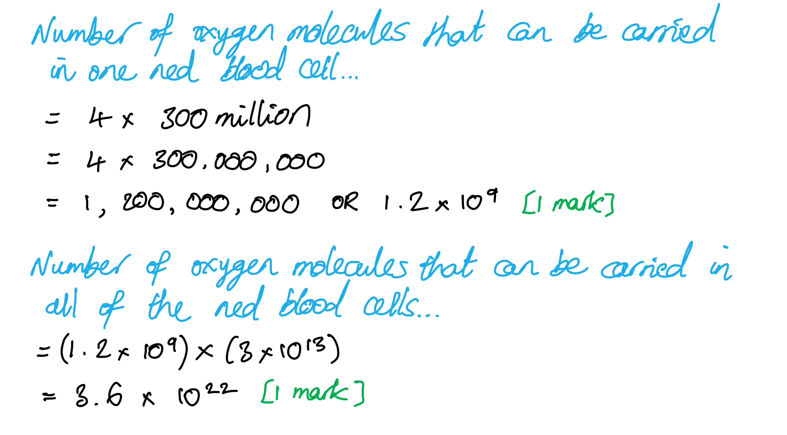
Features of collagen shown in Fig. 1 that enable it to be a strong, structural protein include...

**Final answer:** **Any ****three**** of the following:**

- It forms a triple helix; **[1 mark]**
- The triple helix contains both covalent **and** hydrogen bonds;** [1 mark]**
- Collagen molecules link together to form fibrils; **[1 mark]**
- Fibrils contain covalent bonds / cross linkages; **[1 mark]**
- The collagen molecules in a fibril have staggered ends (avoiding weak points at the join); **[1 mark]**
- Many collagen fibrils join together to form a collagen fibre; **[1 mark]**

**[Total: 3 marks]**

> *There are other features of collagen that contribute to its strength, but the question asks you to **use Fig. 1**, so you must be sure that any answer you give is visible on the diagram.*

### Q12
The completed table should be as follows...

| **Aspect of protein structure** | **Level of structure / primary, secondary, tertiary, quaternary** |
|---|---|
| α-helix | secondary |
| Disulfide bridge | tertiary |
| Sequence of amino acids | primary |
| β-pleated sheet | secondary |
| Separate polypeptide chains interacting | quaternary |
| Hydrogen bonds | secondary and tertiary |
| Ionic bonds | tertiary |

All 6 rows are correct; **[3 marks]** 
4 or 5 rows correct; **[2 marks]** 
2 or 3 rows correct; **[1 mark]** 
0 or 1 row correct; **[0 marks]**

**[Total: 3 marks]**
The globular protein is...

- Protein **B**; **[1 mark]**
- (This is because) it has a 3D/spherical structure **OR** Protein** A** has long strands (and is therefore fibrous); **[1 mark]**

**[Total: 2 marks]**

> *Globular means 'globe-shaped' or spherical. Proteins like haemoglobin and immunoglobulins are shaped in this way, as are many membrane proteins. Fibrous proteins arrange themselves in fibres as the name suggests; these include keratin and collagen.*
The colour change observed in a positive Biuret test is...

- (Blue to) purple/lilac colour produced; **[1 mark]**

**[Total: 1 mark]**
The Biuret test is referred to as 'qualitative' because...

- It will (only) indicate the presence/absence of protein / that protein is present/absent (in a sample); **[1 mark]**
- It will not show how much protein is present **OR** it will not indicate the quantity/concentration of protein (in a sample); **[1 mark]**

**[Total: 2 marks]**

### Q13
The mark allocation for this question is...

- Correctly identifying the R group; **[1 mark]**

**[Total: 1 mark]**

> *The R-group can be identified as follows...*

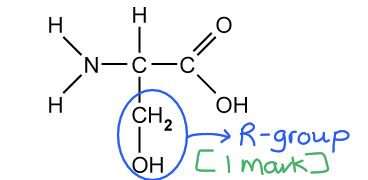
The ability to form hydrogen bonds indicates the following about the polarity of the R group of serine...

- (The R group is) polar / has a charge across it / has an unevenly distributed charge; **[1 mark]**

**[Total: 1 mark]**

> *Serine is polar since it carries a hydroxyl (-OH) group. This polar group can participate in hydrogen bond formation with another polar group.*
Phenylalanine is more likely to be found...

- At the <u>centre</u> (of a globular protein); **[1 mark]**
- (This is because) non-polar amino acids are hydrophobic / repelled by water **OR** polar ones will be at the surface (in contact with water); **[1 mark]**

**[Total: 2 marks]**

> *Globular proteins will always have hydrophilic (polar) amino acids arranged at the surface of the protein while the hydrophobic (non-polar) amino acids will be found at the centre of the protein in order to avoid contact with water.*
Other bonds found in protein molecules include...

**Final answer:** **Any ****two**** of the following:**

- Peptide; **[1 mark]**
- Disulfide; **[1 mark]**
- Ionic; **[1 mark]**

**[Total: 2 marks]**

### Q14
The reason why glycine makes up every third amino acid in collagen is...

- Glycine is the smallest (amino acid) / contains only an H-atom in its R group; **[1 mark]**
- This allows for the three chains to be arranged closely together / formation of a tight triple helix structure; **[1 mark]**

**[Total: 2 marks]**

> *Since collagen is a structural protein, it is very important that the three polypeptide chains making up the triple helix is arranged close enough for the relevant hydrogen- and covalent bonds to form that will stabilise the collagen molecule.*
High tensile strength means...

- (The molecule can) withstand large pulling forces (at its ends); **[1 mark]**
- Without stretching or breaking; **[1 mark]**

**[Total: 2 marks]**

> *Structural proteins, such as collagen, will experience many pulling forces during everyday life. These proteins must be able to withstand these forces in order to maintain the integrity of tissues and organs within the body.*
(i) The purpose of a primary structure with a highly repetitive amino acid sequence is...

- It creates organised/strong (polypeptide) structures; **[1 mark]**

(ii) The presence of a large number of amino acids with hydrophobic R groups is to...

- Make (collagen molecules) insoluble in water (and therefore suitable for its structural role); **[1 mark]**

**[Total: 2 marks]**

> *Make sure that you have a good understanding of how the structure of collagen molecules relate to its function as a structural protein.*
Other examples of fibrous proteins include...

**Final answer:** **Any ****one**** of the following:**

- Keratin; **[1 mark]**
- Myosin; **[1 mark]**
- Actin; **[1 mark]**
- Fibrin; **[1 mark]**

**[Total: 1 mark]**

### Q15
The term *polymer* can be defined as follows...

- (Molecules that are) made up of (many) repeating subunits/monomers; **[1 mark]**
- (These subunits/monomers are) joined together by (covalent) bonds; **[1 mark]**

**[Total: 2 marks]**

> *Knowing the definitions of biological terminology forms the foundation of a good understanding of the subject, so invest some time into studying these.*
Functions of proteins in living organisms include...

**Final answer:** **Any ****four**** of the following:**

- Enzymes are proteins / they form enzymes; **[1 mark]**
- They form important components of cell membranes e.g. carrier/channel proteins / glycoproteins; **[1 mark]**
- Certain hormones are proteins / they form hormones such as insulin/glucagon; **[1 mark]**
- Some are transport proteins e.g. haemoglobin/myoglobin; **[1 mark]**
- Proteins form part of the immune system / help destroy pathogens e.g. antibodies; **[1 mark]**
- They play an important structural role in hair/skin/nails e.g. collagen/keratin; **[1 mark]**
- Some are responsible for muscle contraction e.g. myosin/actin; **[1 mark]**
- Certain proteins may act as energy storage molecules e.g. casein/ovalbumin; **[1 mark]**

**[Total: 4 marks]**

> *There are many marks up for grabs here, so choose to study the four functions that you will remember the easiest.*
Chemical elements found in proteins include...

**Final answer:** **Any ****two**** of the following:**

- Carbon/C; **[1 mark]**
- Hydrogen/H; **[1 mark]**
- Oxygen/O; **[1 mark]**
- Nitrogen/N; **[1 mark]**
- Sulfur/S; **[1 mark]**

*Accept iron/Fe as an answer if given*

**[Total: 2 marks]**

> *Sulfur does not form part of all proteins, only those containing the amino acids cysteine or methionine. Keratin is the main protein found in hair and it contains cysteine, which is the reason why hair that have been scorched (by a hair dryer or other heating instrument) smells like burning sulfur.*
The hydrolysis of a polypeptide can be described as follows...

**Final answer:** **Any ****two**** of the following:**

- (The) <u>peptide</u> bond is broken; **[1 mark]**
- By the addition of (a) water (molecule); **[1 mark]**
- (Polypeptide is) broken down to amino acids; **[1 mark]**

**[Total: 2 marks]**
