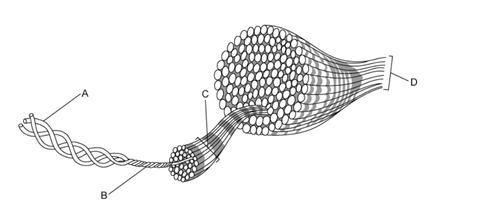
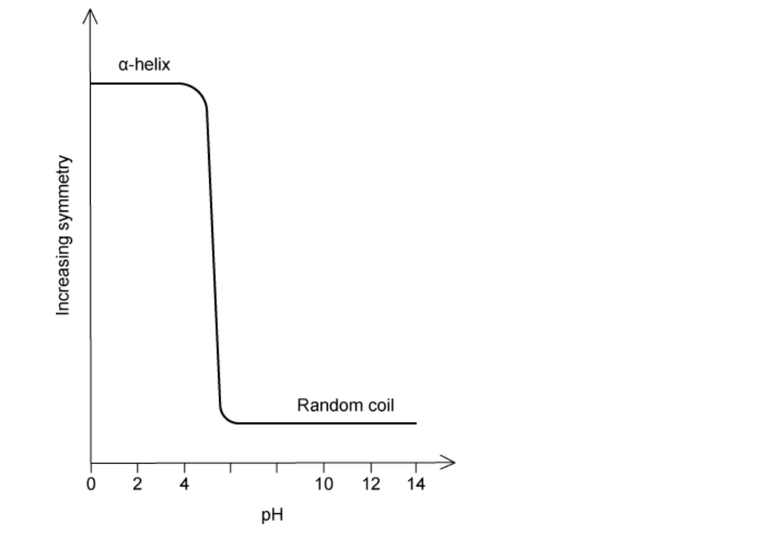
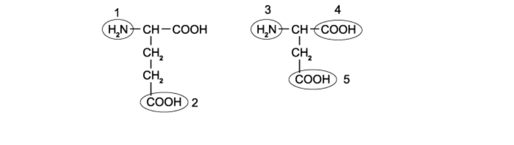

# Exam Questions — Proteins
**2. Biological Molecules** · Cambridge (CIE) A-LEVEL biology (9700)
> Source: [https://www.savemyexams.com/a-level/biology/cie/25/topic-questions/](https://www.savemyexams.com/a-level/biology/cie/25/topic-questions/) · 29 questions across 1 sets

## Multiple Choice Questions (29 questions)

### Q1 — medium — 1 marks

**Q1** [1 mark]

The structure of collagen is illustrated in the diagram below.

Which label correctly identifies a molecule of collagen?

### Q2 — medium — 1 marks

**Q2** [1 mark]

Every amino acid has an R group which gives the molecule its properties. The diagram below shows the R groups for the amino acids Arg, Ser, Glu and Val.

|   | Acidic | Basic | Hydrophilic | Hydrophobic |
|---|---|---|---|---|
| **A** | Glu | Arg | Ser | Val |
| **B** | Ser | Arg | Glu | Val |
| **C** | Glu | Val | Ser | Arg |
| **D** | Arg | Val | Glu | Ser |

### Q3 — medium — 1 marks

**Q3** [1 mark]

Amino acids consist of oxygen, hydrogen, carbon and nitrogen atoms. The diameter of each atom when bonded to another atom is shown in the table below.

| atom | single bond / nm | double bond / nm |
|---|---|---|
| O  H  C  N | 0.13  0.06  0.154  0.14 | -  0.110  0.120  0.134 |

Using the figures in the table, the approximate length of one amino acid is 0.7nm.

What is the approximate length of a dipeptide of this amino acid?

### Q4 — medium — 1 marks

**Q4** [1 mark]

The diagram shows a polypeptide of the protein glutenin, which has an important role in maintaining the strength and elasticity of bread dough.

What is the structure of glutenin and why?

|   | Structure | Reason |
|---|---|---|
| **A** | Secondary | the loose spiral is an alpha helix |
| **B** | Tertiary | a 3D shape is formed from the different regions |
| **C** | Quaternary | there are globular and fibrous regions |
| **D** | Quaternary | the structure consists of spiral and coiled regions |

### Q5 — medium — 1 marks

**Q5** [1 mark]

A protein entirely made from repeating residues of the same amino acid was produced.

The graph shows the structure of this protein molecule at different pH values.

Which statement is true?

### Q6 — medium — 1 marks

**Q6** [1 mark]

Protein molecules contain multiple different types of bond, some of which are stronger than others.

Which is the correct order from weakest to strongest?

### Q7 — medium — 1 marks

**Q7** [1 mark]

Which row of statements describes haemoglobin correctly?

| **A** | polypeptide chains interact to produce an almost spherical molecule | an iron ion is present within each haem group | quaternary structure of two alpha chains and two beta chains | each molecule can transport a total of four oxygen atoms |
|---|---|---|---|---|
| **B** | four polypeptide chains, each containing a prosthetic group | iron ions can associate with oxygen forming oxyhaemoglobin | in each chain, hydrophobic R groups of amino acids point towards the centre of the molecule | at 50 % saturation, two oxygen molecules are transported by the molecule |
| **C** | polypeptide chains produce a loose helical shape, which curls to form a spherical molecule | iron ions in the molecule can bind reversibly with oxygen | in each chain, hydrophobic R groups of amino acids surround the iron ion | each molecule can transport a total of eight oxygen atoms |
| **D** | polypeptide chains interact to produce a globular chain | each chain contains a prosthetic group of amino acids surrounding an iron | two identical alpha chains and two identical beta chains | each chain can transport an oxygen molecule |

### Q8 — medium — 1 marks

**Q8** [1 mark]

Which of the following causes fibrous proteins to be insoluble?

### Q9 — medium — 1 marks

**Q9** [1 mark]

Which of the following facts about collagen explain its role in muscles and tendons?

| 1 | Collagen is insoluble |
|---|---|
| 2 | Collagen chains form a helical structure |
| 3 | Different collagen molecules are bonded together by covalent bonds |
| 4 | Collagen is made of amino acids with small R groups |

### Q10 — medium — 1 marks

**Q10** [1 mark]

Haemoglobin carries oxygen in the blood.

Which of the following best describes why this is possible?

| 1 | Oxygen binds to iron reversibly |
|---|---|
| 2 | Oxygen binding causes haemoglobin to change shape |
| 3 | Oxygen binds to the haem group |

### Q11 — hard — 1 marks

**Q11** [1 mark]

The graph shows the effect of pH on enzyme activity.

Which of the following R groups in the active site will be directly affected by pH?

### Q12 — hard — 1 marks

**Q12** [1 mark]

Four proteins 1, 2, 3 and 4 are described below

| 1 | consists of four polypeptides each with a prosthetic group |
|---|---|
| 2 | consists of a globular tertiary structure with a binding site |
| 3 | consists of four polypeptides held together by disulfide bonds |
| 4 | consists of three polypeptides tightly coiled together |

Which description matches the proteins collagen, haemoglobin and the enzyme lipase?

|   | **Collagen** | **Haemoglobin** | **Lipase** |
|---|---|---|---|
| **A** | 1 | 3 | 4 |
| **B** | 3 | 2 | 1 |
| **C** | 4 | 3 | 2 |
| **D** | 4 | 1 | 2 |

### Q13 — hard — 1 marks

**Q13** [1 mark]

There is estimated to be 20,000 genes in the human body, but over 300,000 proteins.

If a chain consists of *y *amino acid residues and there are *n* different amino acids available, how many different polypeptides can be made?

### Q14 — hard — 1 marks

**Q14** [1 mark]

An experiment was undertaken to test the permeability of the plasma membrane and tonoplast of beetroot cells in various different chemicals. Vacuoles of beetroot cells carry a red pigment which cannot diffuse through their plasma membranes and tonoplasts to leave the cell.

The beetroot was cut into equal 1 cm3 cubes before being washed under a tap for 15 minutes to remove pigment released from outer damaged cells. The cubes were then placed in the various solutions, all of which turned red.

The table below shows four possible behaviors of phospholipids and proteins in different solutions, which is correct?

|   | **solution** | **protein denatures** | **solution** | **phospholipids dissolve** |
|---|---|---|---|---|
| **A** | ethanol | ✓ | dilute HCl | ✓ |
| **B** | dilute HCL | ✓ | ethanol | ✓ |
| **C** | ethanol | ✓ | 40°C water | ✓ |
| **D** | 40°C water | ✓ | dilute HCl | ✓ |

### Q15 — hard — 1 marks

**Q15** [1 mark]

A total of four polypeptide chains, 2 alpha chains and 2 beta chains, make up a globular protein called Haemoglobin. In normal cases, the DNA code for each beta chain for glutamic acid in the sixth triplet.

However, Sickle cell anaemia in individuals causes the base triplet to change and code for valine instead.

This mutation changes one aspect of the haemoglobin molecule. Which is it?

### Q16 — hard — 1 marks

**Q16** [1 mark]

The diagram shows a fibrous and globular protein with three amino acids labelled 1, 2 and 3. Amino acids 1 and 2 are on the outer surface of the protein whereas amino acid 3 in internal.

Which row identifies the most likely amino acid R group at each point?

|   | **R group** |   |   |
|---|---|---|---|
|   | **1** | **2** | **3** |
| **A** | H | CH(CH3)2 | CH(CH3)2 |
| **B** | H | (CH2)4NH2 | CH2OH |
| **C** | CH3 | CH(CH3)2 | (CH2)4NH2 |
| **D** | CH3 | CH2OH | CH(CH3)2 |

### Q17 — hard — 1 marks

**Q17** [1 mark]

A protein found in the stomach is placed in water, this causes the protein to denature.

Which of the following bonds are affected?

### Q18 — hard — 1 marks

**Q18** [1 mark]

When leaving the lungs, haemoglobin is 98 % saturated.

How many oxygen atoms will be carried by the majority of haemoglobin molecules?

### Q19 — hard — 1 marks

**Q19** [1 mark]

What describes a globular protein that is not soluble in water?

### Q20 — easy — 1 marks

**Q20** [1 mark]

Two amino acids, both containing two carboxylic acid (-COOH) groups are illustrated below.

Which labelled groups take part in the formation of a dipeptide of these amino acids?

### Q21 — easy — 1 marks

**Q21** [1 mark]

The tertiary structure of a protein molecule is maintained by which bonds?

|   | peptide | hydrogen | disulfide | ionic |
|---|---|---|---|---|
| **A** | X | ✓ | X | ✓ |
| **B** | ✓ | ✓ | X | X |
| **C** | X | ✓ | ✓ | ✓ |
| **D** | ✓ | X | ✓ | X |

### Q22 — easy — 1 marks

**Q22** [1 mark]

How can the quaternary structure of haemoglobin be described?

1. a specific order of amino acids
2. a globular structure
3. an α-helix
4. a dipeptide
5. four polypeptide chains connected together

### Q23 — easy — 1 marks

**Q23** [1 mark]

Which of the following statements about fibrous proteins is incorrect?

### Q24 — easy — 1 marks

**Q24** [1 mark]

In protein molecules, which bonds are responsible for producing the primary, secondary and tertiary structure?

|   | level of structure |   |   |
|---|---|---|---|
| primary | secondary | tertiary |   |
| **A** | covalent | ionic | ionic |
| **B** | ionic | hydrogen | covalent |
| **C** | peptide | hydrogen | disulfide |
| **D** | covalent | ionic | hydrogen |

### Q25 — easy — 1 marks

**Q25** [1 mark]

The diagram shows a biological molecule found in cells.

Which arrow labels a peptide bond?

### Q26 — easy — 1 marks

**Q26** [1 mark]

The protein haemoglobin contains iron.

What is the role of iron within the molecule?

### Q27 — easy — 1 marks

**Q27** [1 mark]

Protein X is a transport protein found dissolved in blood plasma and is used to transport different things around the body. It contains six internal disulfide bridges and has a roughly spherical shape.

Protein Y is a structural protein found in the hair and nails of mammals. It is made of two alpha-helices twisted round each other to make a coiled coil.

Are these examples of globular or fibrous proteins?

### Q28 — easy — 1 marks

**Q28** [1 mark]

Which description of collagen is correct?

### Q29 — easy — 1 marks

**Q29** [1 mark]

The protein myoglobin has a similar function to haemoglobin except myoglobin does not have a quaternary structure.

Why does myoglobin not have a quaternary structure?
