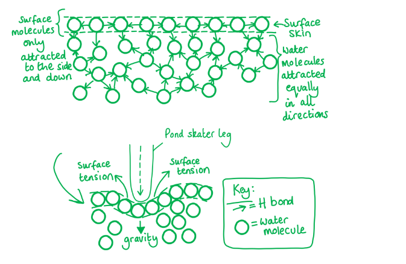
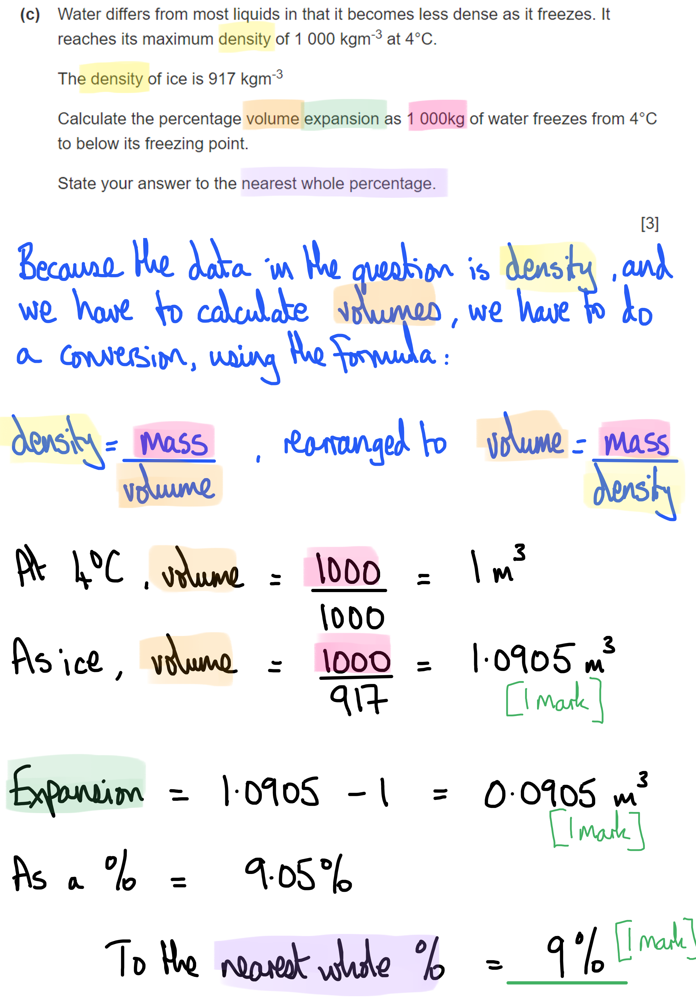
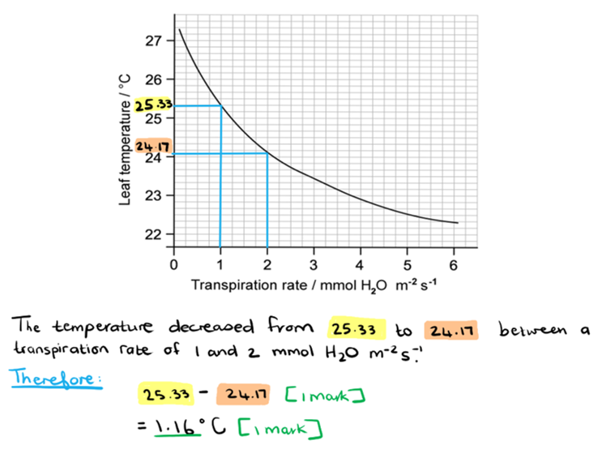
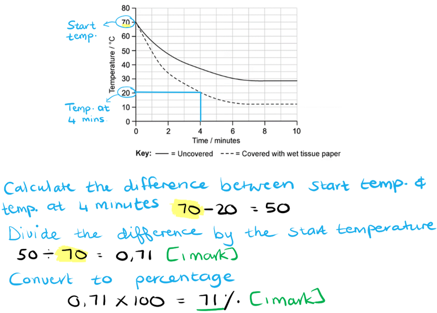

# Mark Schemes — Water
**2. Biological Molecules** · Cambridge (CIE) A-LEVEL biology (9700)

## Multiple Choice Questions (12 questions)

### Q1
**Final answer:** **The correct answer is ****A**** because:**

**Final answer:** **Heat loss through evaporation of sweat relies on the ****latent heat of vaporisation****; the energy required to turn a specific amount of liquid (sweat) into the same amount of gas (through evaporation). **

> *The specific heat capacity describes the energy required to heat a specified mass of water by a specified temperature. Water has a high specific heat capacity due to the hydrogen bonds between water molecules. This means that a lot of energy is required to break the hydrogen bonds between molecules in order to heat the water.*

> *B **is incorrect as enzyme function relies on the body’s temperature staying constant; body temperature does not fluctuate significantly with changes in the environment due to the high specific heat capacity of water.*

> *C **is incorrect as aquatic ecosystems withstand extreme temperatures as it takes a lot of energy to heat a body of water, and in cold temperatures water retains its heat for a long time. This is due to the high specific heat capacity of water.*

> *D **is incorrect as humans can live in sub-zero temperatures because their body remains at 37 °C due to the water in blood retaining its heat for a long period of time. This is due to the high specific heat capacity of water.*

### Q2
**Final answer:** **The correct answer is ****C**** because:**

**Final answer:** **Minerals are ****dissolved**** in the water because water is ****polar ****(statement 1) and can form electrostatic attractions with solutes.  **

**Final answer:** **Ice melting produces cold water at ~0 °C, this**** ****water sinks as the water molecules are more tightly packed and do not move as freely due to hydrogen bonds. The cold, dense water is ****replaced**** by warmer water, e.g. at 4 °C (statement 4) from lower in the pond; this movement of water creates a ****current ****and brings minerals with it.**

> *Statement 2** **is incorrect as the formation of hydrogen bonds does not directly cause minerals to rise to the surface.*

> *Statement 3 is incorrect as having high specific heat capacity does not directly cause minerals to rise to the surface.*

### Q3
**Final answer:** **The correct answer is ****C**** because:**

**Final answer:** **Enzymes rely on interactions with polar water molecules to maintain their shape and the shape of their active site; soluble proteins have polar amino acids on their surface which form hydrogen bonds to water.**

**Final answer:** **If the solvent is changed to a non-polar solvent then the shape of the enzyme will change, as hydrophobic amino acids will need to move to the surface of the protein in order to stay in solution; this will ****change the shape of the active site**** and ****decrease the rate of reaction****.**

> *A **is incorrect as changing solvents will cause the protein shape to change which will affect the rate of reaction.*

> *B **is incorrect as the active site is very specifically formed to provide a fast rate of reaction. Changing the solvent will change the shape of the active site and decrease the rate of reaction.*

> *D **is incorrect as it is possible that the enzyme could precipitate out of solution, but this is less likely than the scenario described above.*

### Q4
**Final answer:** **The correct answer is ****D**** because:**

**Water is a ****polar**** molecule because it has an ****uneven distribution**** of electrons in the molecule.**** ****Hydrogen atoms in water have a ****slightly positive ****charge which ****attracts**** and ****stabilises ****the negative bicarbonate ions.**

> *A **is incorrect as oxygen atoms in water do not form **ionic bonds** with other molecules.*

> *B **is incorrect as the oxygen atom in water is **slightly negatively** charged and therefore will not attract and stabilise a negative ion.*

> *C **is incorrect as hydrogen atoms do not form hydrogen bonds with bicarbonate ions as the bicarbonate ion is not polar but **charged**.*

### Q5
**Final answer:** **The correct answer is ****D ****because:**

**Final answer:** **Surface tension**** of water (1) relies on hydrogen bonds; at the interface between liquid and air, surface tension results from liquid molecules having a greater attraction to each other (due to cohesion) than to the molecules in the air (due to adhesion) **

**Final answer:** **Water is a**** good solvent**** (2) because many different molecules are able to dissolve in it. Water is a ****polar**** molecule and therefore able to form ****electrostatic attractions**** (a type of intermolecular force), such as ****hydrogen bonds****, with solutes.**

**Final answer:** **Water molecules forms hydrogen bonds with neighbouring water molecules; this attraction to other water molecules is known as ****cohesion**** (3).**

**Final answer:** **Water has a ****high specific heat capacity ****(4), meaning it is able to ****retain heat**** for a long period of time. This is because a relatively large amount of heat is required to break the**** hydrogen bonds**** between water molecules and raise the temperature.**

### Q6
**Final answer:** **The correct answer is ****A**** because:**

**Water’s ability to form hydrogen bonds with other water molecules (****cohesion****) does not allow it to dissolve metabolites within cells. Dissolving metabolites relies on water’s ability to form ****hydrogen bonds**** ****and other electrostatic interactions with other molecules.**

> *B **is incorrect as water is a **polar** molecule; the regions of different charge on water molecules can attract and stabilise ions of the opposite charge, allowing them to dissolve in water.*

> *C **is incorrect as the **high specific heat capacity** of water means a lot of energy is required to change the temperature of water. Therefore, the body’s temperature stays **constant** and enzymes remain at their optimum activity.*

> *D **is incorrect as a high **latent heat of vaporisation** means that sweat (consisting mainly of water) will **evaporate** from the skin in hot conditions. The evaporation cools the surface of the skin and therefore **cools** the individual.*

### Q7
**Final answer:** **The correct answer is ****D ****because:**

- **Water loss from the leaves via transpiration is vital to maintain upward transport of water and minerals from the roots to the leaves**
- **As water has a high specific heat capacity, a lot of energy is required to evaporate water**
- **Evaporation of water leads to evaporative cooling which prevents leaves from reaching temperatures that could denature enzymes**

> *Statement 1 is incorrect as water does retain a lot of heat, but this alone would lead to the temperature of the leaves increasing which could denature enzymes. *

> *Statements 2 & 4 are incorrect as the ability of water molecules to be adhesive and cohesive as a result of hydrogen bond formation does not explain the lack of denaturation of leaf enzymes.*

### Q8
**Final answer:** **The correct answer is ****C ****as **

- **Globular proteins**** are important for many functions with the body such as**** ****enzymatic reactions, oxygen transport and signalling**
- **Monosaccharides ****are an important source of energy within living organisms**

**Final answer:** **Globular proteins and monosaccharides can dissolve in water due the ****polarity ****(the uneven distribution of electrons) of water molecules; this is vital, as it allows substances to move around within and between cells.**

> *A **is incorrect; water is **less** dense as a solid than as a liquid.*

> *B **is incorrect as water is **formed** in **condensation reactions**, not used.*

> *D **is incorrect as water requires a **large** amount of energy to raise its temperature, not a small amount. This is due to the many strong hydrogen bonds between molecules of water.*

### Q9
**Final answer:** **The correct answer is ****B**** because:**

**Final answer:** **Water molecules are held together by strong ****intermolecular forces**** called ****hydrogen bonds****; this means that**** ****water molecules in a liquid are attracted to other water molecules equally in all directions. On the surface of water, the topmost layer of water molecules are attracted to water molecules ****at the side and beneath them****, creating a strong ‘skin’ of water molecules on the surface of the pond upon which a pond skater can stand without water molecules separating from one another; this is called ****surface tension****. ****                                                                                       **

> *A is incorrect as water's high specific heat capacity does not affect surface tension.*

> *C is incorrect as none of the pond water mentioned in the question had frozen.*

> *D is incorrect as lack of colour and odour in water does not relate to surface tension.*

### Q10
**Final answer:** **The correct answer is ****D ****because:**

**Final answer:** **Water molecules are polar, and so can form ****hydrogen bonds**** with the inside surface of the xylem. This is known as ****adhesion****.**

> *A is incorrect as cohesion is the attraction of molecules to other molecules of the same kind, e.g. water to water. This does not describe the attraction to the xylem, nor does it name the type of bond involved.*

> *B is incorrect as water molecules cannot form ionic bonds.*

> *C is incorrect as covalent bonds are usually found within molecules, for example between the oxygen and hydrogens of the same molecule. A covalent bond holds a lot of energy and is not transient, which is what is needed for the movement of water up the xylem.*

### Q11
**Final answer:** **The correct answer is ****B ****because:**

**Final answer:** **The heat capacity of a substance is the heat energy required to raise the temperature of a mass of a substance (1 kg) by a specified amount (1 °C). **

**Final answer:** **Water has a ****high specific heat capacity****, meaning it is able to ****retain heat**** for a long period of time.**

> *A **is incorrect as ‘the heat required to change one mole of liquid into one mole of gas’ is the definition of the latent heat of vaporisation.*

> *C **is incorrect as ‘the heat required to change one mole of solid into one mole of liquid’ is the definition of the latent heat of sublimation.*

> *D **is incorrect as the transfer of heat from a solid to a liquid occurs through a mix of convection and conduction.*

### Q12
**Final answer:** **The correct answer is ****D ****because **

**Final answer:** **Ice is ****less dense**** than water because the spaces between water molecules in ice are greater than when water is liquid; water molecules in ice form a ****lattice****, where hydrogen bonds still occur between molecules but in a more structured way.. When frozen water floats to the top of the lake (or any body of water) it ****insulates**** the liquid underneath from further heat loss.**

> *A **is incorrect as fish do not regulate their body temperature in this way.*

> *B **is incorrect as a lot of energy is required to heat a body of water due to the high specific heat capacity of water; this energy is not available when air temperatures are freezing.*

> *C **is incorrect as fish do not contain an enzyme that stops their blood from freezing.*

## Structured Questions (9 questions)

### Q1
An advantage to ecosystems of solid water (ice) being less dense than liquid water is:

- Ice floats / forms from the top down (in lakes/oceans); **[1 mark]**
- Ice insulates the water below **OR** aquatic organisms do not freeze when the water freezes; **[1 mark]**

**[Total: 2 marks]**
The bond angle of water is lower than the expected value of 109° because:

- The (2 pairs of) lone electrons (on oxygen); **[1 mark]**
- Repel the electrons in the O-H covalent bonds / push them closer together which narrows the bond angle; **[1 mark]**

**[Total: 2 marks]**
The percentage volume expansion as water freezes from 4°C to below its freezing point can be calculated as follows:

- Volume occupied by 1000 kg of water at <0°C =) (1000 ÷ 917) = 1.0905 m3; **[1 mark]**
- (Difference in volume occupied =) 1.0905 - 1 = 0.0905; **[1 mark]**
- 9 (%);** [1 mark]**

*Award 2 marks for a correct calculation of percentage change in *<u>*density*</u>* = 8 %*

**[Total: 3 marks]**

> *The key here is to calculate the percentage difference in the **volumes** of water and ice, not the % difference in their densities. The key word in the question is 'expansion', which means **how much an object's volume changes**, with that object being a tonne of water.*

> *Note that percentage change is calculated as (change ÷ starting point) x 100. Here the change is 0.0905 and the starting point is 1, so (0.0905 ÷ 1) x 100 is 9.05 %.*

### Q2
The properties of water that make it a useful component of blood include:

**Final answer:** **Any ****four**** of the following:**

*Solvent*

- Water can form hydrogen bonds with polar solutes **SO** functions as a solvent; **[1 mark]**
- Water functions as a transport medium **AND** an example of a solute, e.g. haemoglobin / sodium ions etc.; **[1 mark]**

*High specific heat capacity*

- Hydrogen bonds mean that a lot of energy is needed to heat up water **SO** water has a high specific heat capacity; **[1 mark]**
- The temperature of blood remains constant / does not change easily when environmental temperature changes **OR **blood remains at the optimum temperature for enzyme function; **[1 mark]**

*High latent heat of vaporisation*

- Hydrogen bonds mean that a lot of energy is need to convert water from a liquid to a gas / for water to evaporate **SO** water has a high latent heat of vaporisation; **[1 mark]**
- Water is liquid at body temperature; **[1 mark]**

**[Total: 4 marks]**
The results from their investigation include the following:

**Final answer:** **Any ****two**** of the following:**

- With an increase in transpiration rate there is a decrease in leaf temperature; **[1 mark]**
- Temperature decreases at a higher rate when the transpiration rate is lower **OR** temperature decreases at a lower rate when the transpiration rate is high; **[1 mark]**
- Any pair of data points correctly quoted to support the statement, e.g. to support marking point 1: at a transpiration rate of 1 mmol m-2 s-1 the temperature is 25.3 °C while at a transpiration rate of 6 mmol m-2 s-1 the temperature is 22.3 °C; **[1 mark]**

**[Total: 2 marks]**

> *Remember when describing data to pay close attention to the shape of the graph. Note any decreases or increases and look at the gradient of the graph to determine whether it was a rapid or more gradual increase/decrease. Quoting data points correctly from the graph to **support your statements** is always worth a mark.*
The properties of water that contribute to the cooling effect of transpiration are as follows:

- Water has a high latent heat of vaporisation;** [1 mark]**
- Water requires a large amount of heat to evaporate / to change from a liquid to a gas; **[1 mark]**
- Heat energy is removed from the leaf when water evaporates **SO** cooling the leaf surface down; **[1 mark]**

**[Total: 3 marks]**
The decrease in temperature is:

- 1.16 (°C); **[1 mark]**

**[Total: 1 mark]**

> *Take great care reading the y-axis scale here, which is an unusual one. Each small division is **1**/**6** of a degree (0.17°C).*

### Q3
The results can be described as follows:

- The cup covered with tissue paper cooled down faster / more (than the uncovered cup) **OR** the uncovered cup cooled down slower / less (than the covered cup); **[1 mark]**

**[Total: 1 mark]**

> *'Describe' questions often require details of rates, and numbers from the data, but here only one mark is available, so a statement of the overall trend is enough to gain the mark.*
The percentage decrease in the first 4 minutes of the covered cup:

- (50 ÷ 70) x 100; **[1 mark]**
- 71 (%); **[1 mark]**

*Full marks awarded for the correct answer only.*

**[Total: 2 marks]**

Control variables for the experiment could include:

**Final answer:** **Any ****two ****of the following:**

- The volume/mass/amount of water the cups contain;** [1 mark]**
- (The cups must be) placed in the same environment **OR **placed** **on the same surface; **[1 mark]**
- (The cups must be) the same shape/size/volume/surface area;** [1 mark]**

**[Total: 2 marks]**

> *Control variables are factors, other than the independent variable (in this case, the absence vs presence of wet tissue paper) that could affect the dependent variable (in this case, the rate of cooling).*

> *Material of cups would not gain a mark as it is already stated in the question that both cups are made of thin plastic. Type of water would also not gain a mark.*
The thermal properties of water would play a role in the response of humans to overheating in the following ways:

**Final answer:** **Any ****four**** of the following:**

- Water has a high latent heat/high heat of vaporisation; **[1 mark]**
- Energy is required to evaporate the water from the tissue paper; **[1 mark]**
- Evaporation of the water (from the tissue paper) leads to cooling; **[1 mark]**
- Sweat is produced by the skin in response to heat; **[1 mark]**
- (In the same way as the evaporation of water from the wet tissue paper cools the water in the cup) evaporation of sweat cools the body; **[1 mark]**

**[Total: 4 marks]**

> *The high heat of vaporisation of water enables it to act as a heat sink in living organisms. Water provides a strong cooling effect when it is evaporated from living bodies in the form of perspiration (sweat) in animals and transpiration in plants. This property/function of water is especially important for animals and plants living in hot habitats.*

### Q4
The role of water in a cell includes:

**Final answer:** **Any ****three**** of the following:**

- It provides a medium for chemical/metabolic reactions within the cell to occur; **[1 mark]**
- It serves as a solvent for ions and polar molecules (within the cell); **[1 mark]**
- Water keeps the temperature of the cell contents relatively constant; **[1 mark]**
- (The constant temperature) ensures that biochemical / enzyme-controlled reactions happen at a relatively constant rate (within the cell); **[1 mark]**

**[Total: 3 marks]**

> *Water is essential for life on Earth. There are many additional roles that water performs in living organisms, such as cooling the body by the evaporation of water, but the question specifically asks about the role of water in the cell.*
**Y** represents a:

- Hydrogen bond; **[1 mark]**

The bond forms as follows:

- Water is a dipole / has an unequal distribution of charge (between H and O); **[1 mark]**
- <u>Slightly</u> negatively charged oxygen atom (of one water molecule) is attracted to <u>slightly</u> positively charged hydrogen atom (of another water molecule); **[1 mark]**

*Accept the idea of partial charge instead of 'slightly'*

**[Total: 3 marks]**

> *Remember that the difference in charge across a water molecule is only a **slight**, or **partial**, difference in charge; this is important, as it distinguished hydrogen bonds from ionic bonds, which form between ions of different charge.*
Contrasts between covalent bonds and hydrogen bonds include:

- Covalent bonds occur within a molecule **WHILE** hydrogen bonds are attractions between different molecules; **[1 mark]**
- Covalent bonds are strong<u>er</u> than hydrogen bonds; **[1 mark]**

**[Total: 2 marks]**

> *Remember that covalent bonds occur when atoms within a molecule share electron pairs. Hydrogen bonds typically form between different (polar) molecules. Even though hydrogen bonds are not very strong individually, it can provide great strength to structures collectively.*

### Q5
The properties of water that enable it to dissolve solutes can be described as follows:

**Final answer:** **Any ****two**** of the following:**

- Solute particles are surrounded by water molecules; **[1 mark]**
- Hydrogen bonds form between regions of the water molecule and solute particles with opposite (partial) charge; **[1 mark]**
- The polarity of water molecules enables it to dissolve polar substances / charged particles / ions; **[1 mark]**

*Award marks for a diagram that illustrates the above points.*

**[Total: 2 marks]**

> *Water is a good solvent because of its chemical structure. It is a solvent for a wide range of organic as well as inorganic substances. The solvent properties of water are due to its polarity and hydrogen bonds. Water can dissolve any substance that contains charged particles (ions) or electronegative atoms (polarity). The polar attraction of large numbers of water molecules can sufficiently weaken intermolecular forces in the solid, and result in the separation (breaking apart) of individual solute molecules. Each separate solute particle is then surrounded by water molecules, which form hydrogen bonds with it.*
The relatively high specific heat capacity of water enables it to buffer changes in temperature because:

**Final answer:** **Any**** two ****of the following:**

- Hydrogen bonds are present between water molecules; **[1 mark]**
- Heating of water requires the breaking of hydrogen bonds **AND** this requires energy; **[1 mark]**
- Water can gain a lot of heat/energy without changing temperature **OR** it takes a lot of heat/energy to increase the temperature (of water); **[1 mark]**

**[Total: 2 marks]**

> *Compared to other materials/substances, water can absorb relatively large amounts of heat before changing state. This is due to the hydrogen bonds between water molecules. The H-bonds need to be broken before a state-change can occur and this requires the absorption of energy (heat). As a result, water is an excellent medium for living organisms as it is relatively slow to change temperature, which supports the maintenance of constant conditions (internal and external) that organisms require (i.e. for homeostasis).*
The importance of the high latent heat of vaporisation of water to organisms is:

**Final answer:** **Any ****two**** of the following:**

- A lot of energy is required to change the state of water / change water from a liquid to a gas / cause water to evaporate; **[1 mark]**
- Water is liquid at temperatures found in most environments on Earth / at room temperature; **[1 mark]**
- Evaporation (of water) can be used as a cooling mechanism **AS** heat energy is lost when sweat evaporates from skin / water evaporates from leaves; **[1 mark]**

**[Total: 2 marks]**

> *The latent heat of vaporisation refers to the amount of heat energy needed for a liquid to turn into a gas. Hydrogen bonding makes water molecules 'stick' together, which means that water can absorb a large amount of heat energy before this bond is broken and it vaporises. This loss of heat energy will cool the evaporative surface down without losing large amounts of water, making it a very effective cooling mechanism in living organisms.*
An example of the biological importance of this property could be:

**Final answer:** **Any**** one ****of the following:**

- It maintains a stable habitat for aquatic organisms (by stopping bodies of water from changing temperature too quickly);** [1 mark]**
- It allows organisms (which are mainly composed of water) to maintain stable body temperature;** [1 mark]**

**[Total: 1 mark]*** *

### Q6
(i) A description of the structure of cellulose is...

**Final answer:** **Any ****three ****of the following:**

- (Cellulose is a polymer of) β-glucose; **[1 mark]**
- (It contains) glycosidic bonds/linkages; **[1 mark]**
- (It contains) 1–4 (glycosidic) bonds; **[1 mark]**
- (Within cellulose the) glucose units are linked at 180° to each other / alternately orientated; **[1 mark]**
- (Cellulose is) unbranched / a straight chain / linear; **[1 mark]**
- (Cellulose can) form hydrogen bonds with parallel chains; **[1 mark]**

***Reject**** marking point 3 if there is any statement that says cellulose has 1-6 glycosidic bonds.*

(ii) One feature visible in Fig.1, other than the cell wall, that identifies the cells as plant cells is...

- Chloroplast / granum/thylakoid / <u>large</u> vacuole; **[1 mark]**

(iii) The role of ATP in a leaf cell is...

- To release energy (for the cell); **[1 mark]**

**AND**

**Final answer:** **Any ****two ****of the following:**

- Protein synthesis / photosynthesis / DNA replication; **[1 mark]**
- Active transport / proton pumping; **[1 mark]**
- Movement of vesicles / chromosomes; **[1 mark]**
- Endocytosis / exocytosis; **[1 mark]**

***Reject ***<u>*produce*</u>* energy for marking point one*

> *You must **never** state that energy is produced! Energy **cannot** be created, only transferred from one form to another, e.g. from glucose molecules to ATP molecules during respiration. The role of ATP is to store very small amounts of energy within its bonds and to release it to the cells when required for cellular processes such as active transport.*

> *Note that this is a 3 mark question so you need to give more than one example of a process that requires ATP to gain full marks here.*

**[Total: 7 marks]**
Hydrogen bonding occurs between water molecules as follows...

**Final answer:** **Any ****two ****of the following:**

- Water molecules are dipoles/polar; **[1 mark]**
- Each water molecule has slightly positive/δ+ hydrogen (atoms) and a slightly negative/δ– oxygen (atom); **[1 mark]**
- The slightly positively charged hydrogen (atom) of one water molecule is attracted to the slightly negatively charged oxygen (atom) of another water molecule; **[1 mark]**

**[Total: 2 marks]**

> *It is important to understand the distinction between **charged** ions and **polar** molecules. You can't describe the components of water molecules as being charged, i.e. they do **not **contain hydrogen ions and oxygen ions, but rather there is an unequal distribution of charge across the molecule. This unequal distribution of charge is represented by the symbols δ**+** and δ**–**, and can be described as 'slight' or 'partial' charge.*
Water is an excellent solvent for ions because...

**Final answer:** **Any ****two ****of the following:**

- Water molecules are polar; **[1 mark]**
- Ions are charged; **[1 mark]**
- There is attraction between water molecules and ions; **[1 mark]**
- Oxygen  faces positive ions /  hydrogen faces negative ions ; **[1 mark]**

**[Total: 2 marks]**

> *Stating that water is a good solvent because many substances are able to dissolve in it, or stating that it is important to dissolve ions for transport around an organism isn't what is needed to gain marks here. You need to state the **properties of water** that makes it a good solvent.*

### Q7
The term hydrophilic means:

- Will mix / interact with / dissolve in <u>water</u>; **[1 mark]**

**[Total: 1 mark]**
The orientation of the five molecules would show:

- 4 water molecules surrounding one potassium ion; **[1 mark]**
- Oxygen atoms are closest to potassium; **[1 mark]**

**[Total: 2 marks]**

The correctly completed passage is:

- The specific heat capacity of a substance is the amount of **(thermal) energy / heat** required...; **[1 mark]**
- ...to raise the temperature of **1kg** of that substance...; **[1 mark]**
- ...by **1°C**. Water’s specific heat capacity is 4200 J / kg°C; **[1 mark]**

**[Total: 3 marks]**

> *The second sentence gives the answers in a disguised format. Because the units are quoted J / kg °C, you could work back from that to get the answers. Joules (J) is a unit of energy, the mass of water is given in kg, as is the temperature difference required (1 °C).*
The property of water that  allows it to aid temperature regulation in humans is:

- (High) latent heat of vaporisation; **[1 mark]**
- Heat energy is carried away/dissipated/lost when sweat evaporates; **[1 mark]**

**[Total: 2 marks]**

### Q8
The type of chemical bonding that exists within a single water molecule is:

- Covalent (bonding); **[1 mark]**

**[Total: 1 mark]**

> *You may be tempted to write 'hydrogen bonds' here, but these bonds are present **between** **water molecules; the question asks you for the bonding that is **within** **each molecule, i.e. the bonds that link hydrogen atoms and oxygen atoms. *
As water changes to ice, its density...

- Decreases / goes down / reduces; **[1 mark]**

*Observation:*

**Final answer:** **Any ****one**** of the following:**

- Ice takes up more space/volume than water, e.g. frozen pipes that burst; **[1 mark]**
- Ice floats on water; **[1 mark]**

**[Total: 2 marks]**
The line showing the position of a hydrogen bond should be:

- Dotted / dashed **AND** linking an oxygen atom to a hydrogen atom of a <u>different water molecule</u>; **[1 mark]**

**[Total: 1 mark]**

Polar, in the context of water molecules, means:

- The molecules have two distinct ends / areas (of charge) **OR** there is a difference in charge across the molecule; **[1 mark]**
- The <u>slightly</u> negative charge at one 'pole' **AND **<u>slightly</u> positive at the other; **[1 mark]**

*Allow use of symbols eg. δ**+**, δ**-** instead of 'slight negative/positive'.*

**[Total: 2 marks]**

### Q9
The nature of the interaction between water molecules is:

- Hydrogen bonds; **[1 mark]**

**[Total: 1 mark]**
The cohesive and adhesive forces of water are useful to living organisms because:

*Cohesion*

**Final answer:** **A ****maximum of**** ****one**** of the following:**

- Cohesive forces create surface tension **SO** allowing smaller organisms to move across the surface of water; ** [1 mark]**
- Cohesive forces allow water to be transported through plants in the xylem / enable the transpiration stream to occur;** [1 mark]**

**AND**

*Adhesion*

- Adhesive forces allow water molecules to adhere/stick to the walls of xylem **SO** helping water to move upwards;** [1 mark]**

**[Total: 2 marks]**

> *This is a synoptic link to Topic 7.2 Transport in Plants, which covers the cohesive and adhesive properties of water molecules that allows water to be drawn up a plant's stem in a continuous column. *

> *The command word is 'explain' which means you need to add extra detail to your answer within the context of the question. *
Two other properties of water that are essential for sustaining life are:

**Final answer:** **Any**** two ****of the following:**

- High latent heat of vaporisation; **[1 mark]**
- Solvent; **[1 mark]**
- High specific heat capacity;** [1 mark]**

**[Total: 2 marks]**
