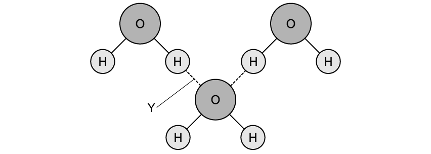
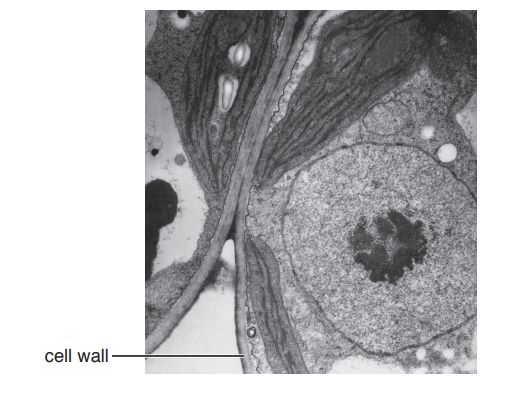

# Exam Questions — Water
**2. Biological Molecules** · Cambridge (CIE) A-LEVEL biology (9700)
> Source: [https://www.savemyexams.com/a-level/biology/cie/25/topic-questions/](https://www.savemyexams.com/a-level/biology/cie/25/topic-questions/) · 21 questions across 2 sets

## Multiple Choice Questions (12 questions)

### Q1 — hard — 1 marks

**Q1** [1 mark]

Which of the following does** not** rely on the specific heat capacity of water?

### Q2 — hard — 1 marks

**Q2** [1 mark]

When ice on the surface of a pond melts, minerals rise to the surface.

Which properties of water cause this?

| 1 | it is a solvent |
|---|---|
| 2 | it forms hydrogen bonds |
| 3 | it has high specific heat capacity |
| 4 | its greatest density is at 4 °C |

### Q3 — hard — 1 marks

**Q3** [1 mark]

Enzymes are soluble proteins that use their specific shape to catalyse biological reactions.

What is most likely to happen to the rate of reaction if an enzyme is dissolved in a non-polar solvent such as hexane (C6H14)?

### Q4 — hard — 1 marks

**Q4** [1 mark]

Sodium hydrogen carbonate (NaHCO3) dissociates into sodium ions (Na+) and bicarbonate ions (HCO3-) when it is dissolved. The latter creates an alkaline environment, suitable for enzymes, and bicarbonate ions in the blood, which help to buffer lactic acid during exercise.

How does water help the production of bicarbonate ions?

### Q5 — medium — 1 marks

**Q5** [1 mark]

Which of the following properties of water are a result of intermolecular forces?

| 1 | high surface tension |
|---|---|
| 2 | good solvent |
| 3 | cohesive |
| 4 | high specific heat capacity |

### Q6 — medium — 1 marks

**Q6** [1 mark]

Which property of water is paired with an incorrect physiological use?

|   | **property** | **use** |
|---|---|---|
| **A** | forms hydrogen bonds between water molecules | dissolves metabolites within cells |
| **B** | is a polar molecule | dissolves ionic molecules required in signalling |
| **C** | has a high specific heat capacity | optimum enzymatic activity is maintained |
| **D** | has a high latent heat of vapourisation | enables heat loss through sweating |

### Q7 — medium — 1 marks

**Q7** [1 mark]

Which of the following properties of water stops enzymes in leaves from being denatured during transpiration?

| 1 | water retains a lot of heat |
|---|---|
| 2 | water forms hydrogen bonds with other polar and non-polar molecules |
| 3 | a lot of heat is required to evaporate water |
| 4 | water is cohesive |

### Q8 — medium — 1 marks

**Q8** [1 mark]

Water counts for about 70% of the mass of living organisms.

Why is water essential for living organisms?

### Q9 — easy — 1 marks

**Q9** [1 mark]

*Gerridae lacustris*, more commonly known as pond skaters, are able to rest on the surface of a pond.

Which of the following properties of water enables this?

### Q10 — easy — 1 marks

**Q10** [1 mark]

Plants transport water against the force of gravity up the xylem to provide leaves and flowers with water.

Which bonds hold water to the surface of the xylem?

### Q11 — easy — 1 marks

**Q11** [1 mark]

The specific heat capacity of water is the highest of all liquids.

Which of the following is a correct definition of specific heat capacity?

### Q12 — easy — 1 marks

**Q12** [1 mark]

During winter when temperatures drop below freezing (0 °C), fish are able to survive in lakes.

Why is this possible?

## Structured Questions (9 questions)

### Q1 — hard — 7 marks

**Q1** [2 marks]

Suggest and explain **one** advantage to ecosystems of solid water (ice) being less dense than liquid water.

**Q1** [2 marks]

Fig. 1 shows a water molecule with its bond angle labelled as 104.49°.

**Fig. 1**

The bond angle that would be expected in a molecule of this shape would usually be larger, around 109°.

Use information in Fig. 1 to suggest why water's bond angle is less than that of the expected geometric shape of a water molecule.

**Q1** [3 marks]

Water reaches its maximum density of 1 000 kg m-3 at 4 °C, while the density of ice is 917 kg m-3.

Density can be calculated using the formula:

Density = mass ÷ volume

Use the formula provided to calculate the percentage volume expansion that occurs when 1 000 kg of water freezes from 4 °C to below its freezing point.

State your answer to the nearest whole number.

### Q2 — hard — 10 marks

**Q2** [4 marks]

Explain the properties of water that make it a useful component of blood.

**Q2** [2 marks]

A group of scientists investigated the cooling effect of transpiration on the surface temperature of leaves from the species *Eucalyptus saligna*.

Fig. 1 shows their results.

**                                                           Fig. 1**

Describe the results shown in Fig. 1.

**Q2** [3 marks]

Explain how the properties of water contribute to the cooling effect of transpiration in a leaf.

**Q2** [1 mark]

**Extract:**

A group of scientists investigated the cooling effect of transpiration on the surface temperature of leaves from the species *Eucalyptus saligna*.

Fig. 1 shows their results.

**                                                           Fig. 1**

Calculate the decrease in temperature when the transpiration rate increases from 1 mmol H2O m-2 s-1 to 2 mmol H2O m-2 s-1.

### Q3 — hard — 9 marks

**Q3** [1 mark]

A group of students wanted to investigate the thermal properties of water. They poured hot water into two thin plastic cups and measured the rate of cooling of each cup. The sides of one cup were covered with tissue paper soaked in hot water while the sides of the other cup were left uncovered. The temperature of the water was recorded with a thermometer every two minutes over a 10 minute time period.

The results of this experiment is shown in Fig. 1.

**Fig. 1**

Describe the results shown in Fig. 1.

**Q3** [2 marks]

**Extract:**

A group of students wanted to investigate the thermal properties of water. They poured hot water into two thin plastic cups and measured the rate of cooling of each cup. The sides of one cup were covered with tissue paper soaked in hot water while the sides of the other cup were left uncovered. The temperature of the water was recorded with a thermometer every two minutes over a 10 minute time period.

The results of this experiment is shown in Fig. 1.

**Fig. 1**

Calculate the percentage decrease in temperature of the covered cup in the first 4 minutes.

**Q3** [2 marks]

**Extract:**

A group of students wanted to investigate the thermal properties of water. They poured hot water into two thin plastic cups and measured the rate of cooling of each cup. The sides of one cup were covered with tissue paper soaked in hot water while the sides of the other cup were left uncovered. The temperature of the water was recorded with a thermometer every two minutes over a 10 minute time period.

State **two** control variables for the experiment described in part (a), **other than** any that have been mentioned in the question above.

**Q3** [4 marks]

**Extract:**

A group of students wanted to investigate the thermal properties of water. They poured hot water into two thin plastic cups and measured the rate of cooling of each cup. The sides of one cup were covered with tissue paper soaked in hot water while the sides of the other cup were left uncovered. The temperature of the water was recorded with a thermometer every two minutes over a 10 minute time period.

The results of this experiment is shown in Fig. 1.

The cup covered with tissue paper cooled down faster / more (than the uncovered cup) OR the uncovered cup cooled down slower / less (than the covered cup).

Explain how the experiment in part (a) can demonstrate how humans respond to overheating, with reference to the thermal properties of water.

### Q4 — medium — 8 marks

**Q4** [3 marks]

Water is a very important component of cells and performs a variety of functions within living organisms.

Explain the role of water within a cell.

**Q4** [3 marks]

Fig.1 shows a diagram of three water molecules.

**Fig. 1**

Identify **Y** in Fig.1 and describe how it forms.

**Q4** [2 marks]

Contrast covalent bonds and hydrogen bonds with one another.

### Q5 — medium — 7 marks

**Q5** [2 marks]

Describe the properties of water that enable it to dissolve solutes.

**Q5** [2 marks]

Explain, with reference to bonding, how the relatively high specific heat capacity of water enables it to buffer temperature changes.

**Q5** [2 marks]

Explain the importance of the high latent heat of vaporisation of water to living organisms.

**Q5** [1 mark]

The relatively high specific heat capacity of water is of great biological significance to organisms.

Give **one** example of the biological importance of this property.

### Q6 — medium — 11 marks

**Q6** [7 marks]

Fig.1 is a transmission electron micrograph showing two adjacent cells in a leaf.

**Fig. 1**

(i) Cellulose is the main polysaccharide in cell walls of plants.

Describe the structure of cellulose.

[3]

(ii) State **one** feature** visible** in Fig. 1, other than the cell wall, that identifies the cells as plant cells.

[1]

(iii) Outline the role of ATP in a leaf cell.

[3]

*Source: Oct/Nov 2018 9700/21 Q3A*

**Q6** [2 marks]

Water is a main component of plant cells.

Fig. 2 shows two water molecules linked by a hydrogen bond.

**Fig. 2**

Explain how hydrogen bonding occurs between water molecules.

*Source: Oct/Nov 2018 9700/21 Q2B*

**Q6** [2 marks]

**Extract:**

Water is a main component of plant cells.

Fig. 2 shows two water molecules linked by a hydrogen bond.

Explain how hydrogen bonding occurs between water molecules.

Suggest why water is an excellent solvent for ions.

*Source: Oct/Nov 2018 9700/21 Q3C*

### Q7 — easy — 8 marks

**Q7** [1 mark]

Define the term *hydrophilic*.

**Q7** [2 marks]

Fig. 1 shows four water molecules (H2O) and a potassium ion (K+).

**Fig. 1**

Redraw the five molecules in Fig.1  to show how they would arrange themselves in an aqueous solution of potassium salt.

**Q7** [3 marks]

Complete the passage below with the correct scientific terms:

The specific heat capacity of a substance is the amount of ________ required to raise the temperature of _______ of that substance by _________. Water’s specific heat capacity is 4200 J / kg °C

**Q7** [2 marks]

** **State and explain the property of water that allows it to aid temperature regulation in humans.

### Q8 — easy — 6 marks

**Q8** [1 mark]

State the type of chemical bonding that exists within a single water molecule.

**Q8** [2 marks]

Describe the change in density of water as it changes to ice.

Give an observation that confirms your answer.

**Q8** [1 mark]

Fig. 1  shows three water molecules.

**Fig.1**

On Fig. 1 draw the position of **one **hydrogen bond, using a dotted line.

**Q8** [2 marks]

Water is described as a **polar** molecule

Define the term polar in this context.

### Q9 — easy — 5 marks

**Q9** [1 mark]

Give the name of the interaction between water molecules that determines the properties of water.

**Q9** [2 marks]

Explain how the properties of cohesion and adhesion are useful to living organisms.

**Q9** [2 marks]

**Extract:**

Explain how the properties of cohesion and adhesion are useful to living organisms.

State** two **other properties of water that are essential for sustaining life.
