# Exam Questions — Mode of Action of Enzymes
**3. Enzymes** · Cambridge (CIE) A-LEVEL biology (9700)
> Source: [https://www.savemyexams.com/a-level/biology/cie/25/topic-questions/](https://www.savemyexams.com/a-level/biology/cie/25/topic-questions/) · 45 questions across 2 sets

## Multiple Choice Questions (30 questions)

### Q1 — hard — 1 marks

**Q1** [1 mark]

The following equation shows a reversible reaction:

In this reaction, which row best describes what is occurring?

|   | **active site present on** | **reaction at 1** | **reaction at 1** | **reaction at 2** |
|---|---|---|---|---|
| **A**  **B**  **C**  **D** | lipase  glycerol  glycerol  lipase | hydrolysis  condensation  condensation  hydrolysis | increases pH  decrease pH  increase pH  decreases pH | Condensation  Hydrolysis  Hydrolysis  Condensation |

### Q2 — hard — 1 marks

**Q2** [1 mark]

The HIV virus produces a long polypeptide that is hydrolysed by a protease enzyme to producing several smaller peptides. The smaller peptides help the virus to successfully invade their host, so this viral protease is the target of many anti-AIDS drugs.

Which feature is important if this drug is to be successful in preventing AIDS?

### Q3 — hard — 1 marks

**Q3** [1 mark]

The breakdown of hydrogen peroxide to water and oxygen is catalysed by the enzyme catalase.  In an investigation into the effect of pH on the rate of reaction of catalase, potato cubes were added to hydrogen peroxide.

Which of these would not be a control variable in this experiment?

### Q4 — hard — 1 marks

**Q4** [1 mark]

4-Oxalocrotonate tautomerase forms part of a bacterial metabolic pathway that catabolises several small molecules together into a larger molecule.  With a monomer size of just 62 amino acid residues, this enzyme is one of the smallest enzymes known.  However, in solution, the enzyme forms a hexamer of six identical subunits, so the active site is formed by amino acid residues from several subunits.

Which level of protein structure is most important in the catabolic reaction in the bacterial metabolic pathway?

### Q5 — hard — 1 marks

**Q5** [1 mark]

The graph shows the activation energy of an enzyme-catalysed reaction and the same reaction without a catalyst.

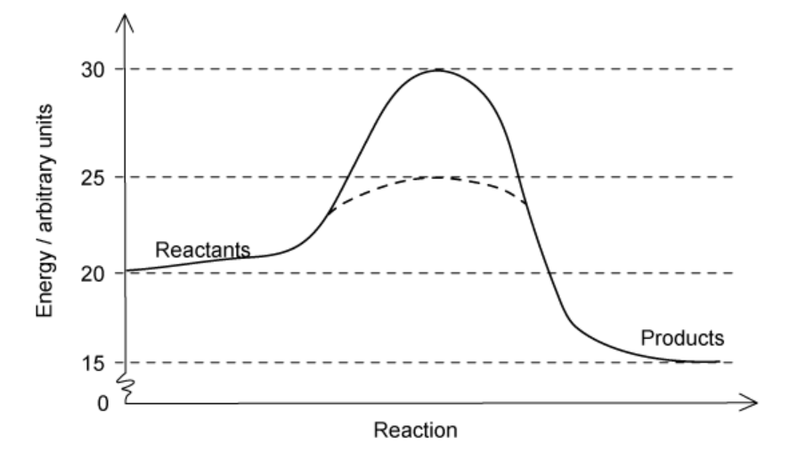

Which of the following statements is not true?

### Q6 — hard — 1 marks

**Q6** [1 mark]

The diagram below shows a metabolic pathway that generates an important hormone:

$\mathrm{reactant}\overset{\mathrm{enzyme}1}{\rightarrow}\mathrm{intermediate}X\overset{\mathrm{enzyme}2}{\rightarrow}\mathrm{intermediate}Y\overset{\mathrm{enzyme}3}{\rightarrow}\mathrm{hormone}$

A metabolic poison is able to slow the production of the hormone by inhibiting one or more of the enzymes in the pathway.  The effect of adding this poison is a large increase in the amount of reactant, a decrease in the amount of intermediate X, a slight increase in amount of intermediate Y and a large decrease in the amount of the hormone

Which enzymes is the metabolic poison targeting?

### Q7 — hard — 1 marks

**Q7** [1 mark]

In an experiment, students were trying to determine the amount of starch in different types of flour.  They blended equal amounts of the different foods in 100 cm3 of water and then added iodine to each of the solutions.  They then took a sample from each of the blended food mixtures and analysed them with a colourimeter.  The colourimeter was set to measure the percentage transmission of dark blue light.

The graph below shows their results:

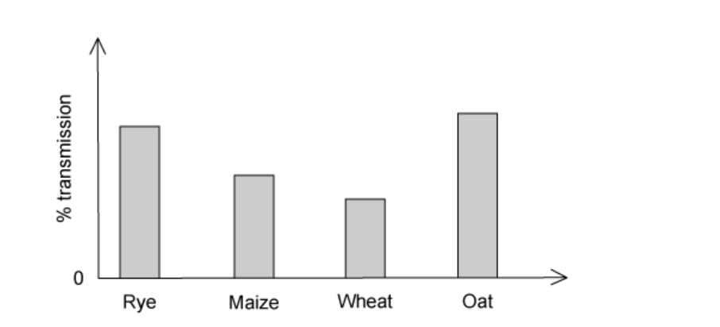

Which food substance contained the most starch?

### Q8 — hard — 1 marks

**Q8** [1 mark]

The graph below shows a calibration curve for the absorbance of different concentrations of glucose in solution.

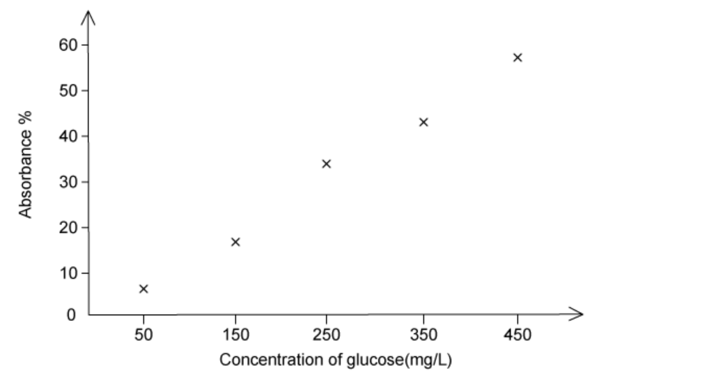

Calibration curves can be used to determine the concentration of unknown samples.  A student was wanted to determine how much sucrose they had in an unknown sample using the figure above. To make their results comparable, they first added sucrase to hydrolyse the sucrose into glucose and fructose.  They then set their colourimeter to the same settings as the one used in the calibration curve and tested the unknown sample. The sample had an absorbance of 25%.

How much sucrose was present in the unknown solution?

### Q9 — hard — 1 marks

**Q9** [1 mark]

This figure shows a calibration curve for of blood samples at 5% concentration with known amounts of glucose.  An average person has a blood glucose level of around 350 mg/l when measured 30 minutes after consuming a starchy meal.

The blood of a person with type 2 diabetes was sampled 30 minutes after eating a starchy meal.  A colorimeter was used to assess the amount of glucose present in the person’s blood. To do this, first the blood sample was diluted to 1/20th of its original concentration with water (so that light could penetrate more easily). Then Benedict’s reagent was added, and the solution was heated in a water bath for five minutes.  The final step was to measure the absorbance of red light by the sample using a colorimeter.

What absorbance value could reflect the diabetic blood sample?

### Q10 — hard — 1 marks

**Q10** [1 mark]

Phenylalanine is one of the nine amino acids necessary to sustain human life. Other molecules can bind directly to the surface of phenylalanine and undergo chemical reactions. The chemical reaction facilitated involves the breakdown of a large molecule into two parts, a process termed hydrolysis.

Which level of protein structure is most important for this hydrolysis reaction?

### Q11 — medium — 1 marks

**Q11** [1 mark]

Why do large increases in temperature or pH reduce the rate of reaction in enzymes?

| 1 | They disrupt ionic bonds. |
|---|---|
| 2 | They change the three-dimensional shape of the enzyme |
| 3 | They increase hydrophobic interactions. |
| 4 | They cause changes in the hydrogen bonds. |

### Q12 — medium — 1 marks

**Q12** [1 mark]

The graph below shows the activation energy of an enzyme-catalysed reaction, and the same reaction without a catalyst.

What is the value of activation energy for the enzyme-catalysed reaction?

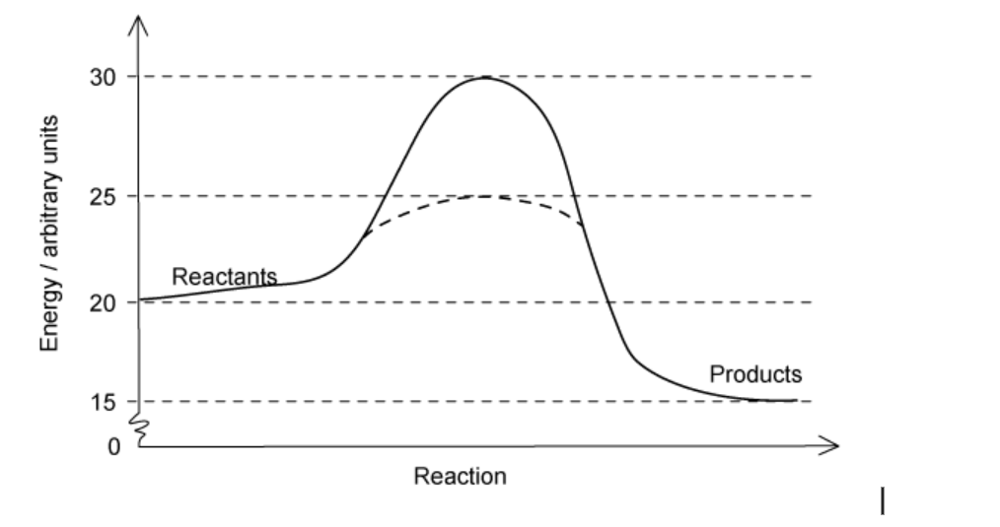

### Q13 — medium — 1 marks

**Q13** [1 mark]

The graph below shows the activation energy of an enzyme-catalysed reaction and the same reaction without a catalyst.

Which values represent the activation energy of the uncatalysed reaction?

### Q14 — medium — 1 marks

**Q14** [1 mark]

Which type of bonds would be the last to break when an enzyme is heated above its optimum temperature?

### Q15 — medium — 1 marks

**Q15** [1 mark]

The breakdown of hydrogen peroxide to water and oxygen is catalysed by the enzyme catalase.  In an investigation into the effect of temperature on the rate of reaction of catalase, mashed liver (which contains catalase) was added to hydrogen peroxide.

What would the independent variable be in this experiment?

### Q16 — medium — 1 marks

**Q16** [1 mark]

When investigating the rate of reaction of the enzyme lipase on the hydrolysis of triglycerides, the pH must be maintained to prevent the lipase denaturing.

What is the correct reason for this?

### Q17 — medium — 1 marks

**Q17** [1 mark]

Which of the following statements about enzymes is not correct?

### Q18 — medium — 1 marks

**Q18** [1 mark]

Which levels of protein structure always determine the specificity of an enzyme?

| **1** | Primary |
|---|---|
| **2** | Secondary |
| **3** | Tertiary |
| **4** | Quaternary, when present |

### Q19 — medium — 1 marks

**Q19** [1 mark]

Biological washing detergents use enzymes to efficiently break down food stains.  They contain protease, carbohydrase and lipase.  As the optimum temperatures for these enzymes is around 40°C, they allow washing to be conducted at lower temperatures and so are seen to be environmentally friendly.

Which of these would be the washing advice on a packet of biological detergent?

|   | wash silk clothing | 90°C wash cycle | remove blood stains |
|---|---|---|---|
| **A**  **B**  **C**  **D** | yes  yes  no  no | yes  no  no  no | Yes  Yes  No  Yes |

### Q20 — medium — 1 marks

**Q20** [1 mark]

Colorimeters are often used in biology to provide quantitative data on the rate of enzyme activity.

Which of the following statements about colorimeters is not true?

### Q21 — easy — 1 marks

**Q21** [1 mark]

Which of the statements below correctly describe the roles of enzymes?

| 1 | They catalyse the building of larger molecules from smaller molecules. |
|---|---|
| 2 | They cause more frequent collisions between molecules. |
| 3 | They lower the activation energy required to start a reaction. |
| 4 | They are translated from mRNA by a ribosome. |

### Q22 — easy — 1 marks

**Q22** [1 mark]

Which statements are true about the optimum temperature of all enzymes?

| 1 | It is equal to the human body temperature (36.5 – 37.5°C) |
|---|---|
| 2 | Enzyme/substrate complexes are formed at the quickest rate. |
| 3 | It is the maximum temperature an enzyme will function. |
| 4 | Increasing temperature past the optimum will break bonds in the tertiary structure. |

### Q23 — easy — 1 marks

**Q23** [1 mark]

Which level(s) of protein structure arise from being made of several polypeptide chains?

| 1 | Primary |
|---|---|
| 2 | Secondary |
| 3 | Tertiary |
| 4 | Quaternary |

### Q24 — easy — 1 marks

**Q24** [1 mark]

Enzymes function optimally in detergents at temperatures between 20 and 60°C and within a pH range of 7–10.5.  The most widely used detergent enzymes efficiently break down protein, carbohydrate and fat stains.

If a washing cycle is set to run at 40°C and pH 8, which row best describes what is happening.

|   | **protease** | **carbodydrase** | l**ipase** |
|---|---|---|---|
| **A** | condensation of peptide bonds | condensation of glycosidic bonds | condensation of ester bonds |
| **B** | condensation of peptide bonds | hydrolysis of peptide bonds | hydrolysis of ester bonds |
| **C** | hydrolysis of peptide bonds | hydrolysis of glycosidic bonds | hydrolysis of ester bonds |
| **D** | condensation of glycosidic bonds | hydrolysis of ester bonds | hydrolysis of peptide bonds |

### Q25 — easy — 1 marks

**Q25** [1 mark]

Catalase was added to a large amount of hydrogen peroxide solution.  The volume of oxygen produced in the first five seconds was measured to be 250 cm3

What is the initial rate of reaction in dm3 min-1?

### Q26 — easy — 1 marks

**Q26** [1 mark]

Washing powder contains various enzymes to remove stains efficiently from clothing

Which of the following would be the most important for removing a butter stain from a shirt?

### Q27 — easy — 1 marks

**Q27** [1 mark]

What best describes the effect of an enzyme in an enzyme-catalysed reaction?

### Q28 — easy — 1 marks

**Q28** [1 mark]

Which of the following statements is true of all enzymes?

### Q29 — easy — 1 marks

**Q29** [1 mark]

During the production of fruit juice, the enzyme pectinase is used to break down pectin, a polysaccharide commonly found in the cell walls of plant cells. This releases more juice.

What product would be formed by the hydrolysis of the cell walls?

### Q30 — easy — 1 marks

**Q30** [1 mark]

The following statements are about enzymes:

1. The speed at which they function can be reduced by competitive inhibitors.
2. Their primary structure is translated from mRNA.
3. Their rate of reaction can be investigated using a colorimeter.
4. They function best at 37 ℃.

Which statements are correct for all enzymes?

## Structured Questions (15 questions)

### Q1 — hard — 10 marks

**Q1** [3 marks]

Enzymes are known to reduce the activation energy of biochemical reactions.

Suggest and explain two mechanisms by which activation energy might be lowered.

Use the context of an anabolic reaction.

**Q1** [3 marks]

Explain the induced fit hypothesis.

**Q1** [1 mark]

**Extract:**

Explain the induced fit hypothesis.

The induced fit hypothesis can be explained as follows:

- Active site structure is not rigid / can move/flex;
- The active site and substrate are not a perfect fit / not precisely complementary in shape;
- The active site changes shape to fit the substrate;

The first step of cellular respiration is the phosphorylation of glucose in the cell cytoplasm.

This is catalysed by the enzyme hexokinase:

glucose + ATP → glucose 6-phosphate + ADP

Fig. 1 shows the images obtained of the enzyme and enzyme-substrate complex. X-ray crystallography was used to obtain these images.

**Fig. 1**

Identify the evidence for the induced fit hypothesis in Fig. 1.

**Q1** [3 marks]

Explain **two** ways in which an enzyme can become denatured.

### Q2 — hard — 9 marks

**Q2** [1 mark]

Some species of sexually-reproducing plants produce an enzyme called pyrophosphatase. This enzyme plays a role in ensuring self-incompatibility, preventing a plant from fertilising itself. The advantage of self-incompatibility is that more cross-breeding can occur within a species; this maintains a large gene pool and so ensures that genetic variation is present.

Known volumes of pyrophosphatase and substrate can be mixed in a cuvette with a dye that starts as colourless and turns blue over time as the reaction progresses. The rate of colour development can be measured in a colorimeter by measuring the absorbance of light by the sample in the cuvette over time. A red filter was used in the colorimeter, meaning that a beam of red light (at a wavelength of 620 nm) was used to assess the absorbance of the solution.

Fig. 1 shows the mean rate of reaction of pyrophosphatase measured over five repeats at 20°C.

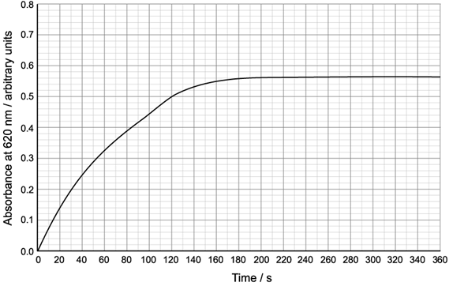

**Fig. 1**

Use your knowledge of colorimetry to suggest why a red filter was selected for the colorimeter.

**Q2** [3 marks]

**Extract:**

Known volumes of pyrophosphatase and substrate can be mixed in a cuvette with a dye that starts as colourless and turns blue over time as the reaction progresses. The rate of colour development can be measured in a colorimeter by measuring the absorbance of light by the sample in the cuvette over time. A red filter was used in the colorimeter, meaning that a beam of red light (at a wavelength of 620 nm) was used to assess the absorbance of the solution.

Fig. 1 shows the mean rate of reaction of pyrophosphatase measured over five repeats at 20°C.

Fig. 1

Use Fig. 1 from part (a) to calculate the rate of the reaction at 100 seconds.

Give your answer in suitable units.

**Q2** [2 marks]

**Extract:**

Some species of sexually-reproducing plants produce an enzyme called pyrophosphatase. This enzyme plays a role in ensuring self-incompatibility, preventing a plant from fertilising itself. The advantage of self-incompatibility is that more cross-breeding can occur within a species; this maintains a large gene pool and so ensures that genetic variation is present.

Known volumes of pyrophosphatase and substrate can be mixed in a cuvette with a dye that starts as colourless and turns blue over time as the reaction progresses. The rate of colour development can be measured in a colorimeter by measuring the absorbance of light by the sample in the cuvette over time. A red filter was used in the colorimeter, meaning that a beam of red light (at a wavelength of 620 nm) was used to assess the absorbance of the solution.

Fig. 1 shows the mean rate of reaction of pyrophosphatase measured over five repeats at 20°C.

Use Fig. 1 from part (a) to calculate the rate of the reaction at 100 seconds.

(i) Predict the effect that a higher enzyme concentration at the start of the experiment would have on the results calculated in part (b).

[1]

(ii) Explain your answer in part (i).

[1]

**Q2** [3 marks]

As the temperature increases, the rate at which pyrophosphatase works also increases up to a point, before decreasing.

Explain why these changes in the reaction rate take place.

### Q3 — hard — 18 marks

**Q3** [5 marks]

A student was provided with two proteases that hydrolyse the amino acid chains of protein in different ways, producing mixtures of single amino acids and peptides of varying lengths:

- An **endoprotease** that hydrolyses peptide bonds between **specific** amino acids within the protein molecule. The enzyme only functions if there is a minimum of two amino acids on each side of the hydrolysis site.
- An **exoprotease** that hydrolyses protein molecules by removing amino acids one at a time from the terminal carboxyl (–COOH) end. This enzyme only functions if the substrate molecule has a minimum of three amino acids.

The student used these enzymes to hydrolyse a protein formed by the linking of two polypeptides.

Fig. 1 shows the hydrolysis sites of these two enzymes on this protein.

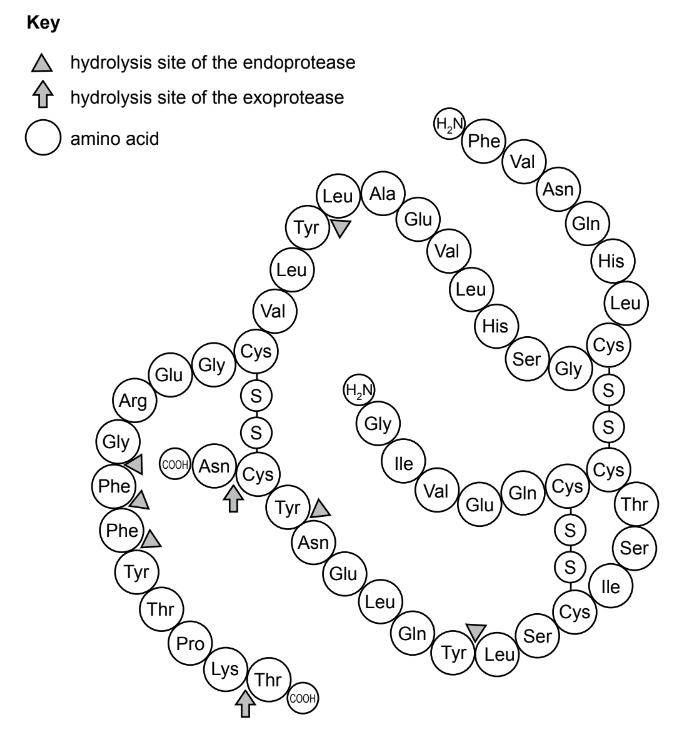

**Fig. 1**

The student investigated the effect of these two enzymes on the hydrolysis of this protein by incubating the protein separately with each of the enzymes.

- Each mixture of enzyme and protein was incubated at 35 °C and a pH of 7.6.
- At intervals of 5 minutes, a sample of each mixture was removed using a capillary tube.
- The products of hydrolysis within each sample were separated by chromatography using the same solvent.
- The products of hydrolysis were located by spraying the chromatogram with a specific dye that stains proteins, peptides and amino acids.
- The student continued sampling the mixtures every 5 minutes and running chromatograms for each sample until hydrolysis of the protein was completed by each enzyme.

(i) Identify the **independent** variable in this investigation.

[1]

(ii) Identify three variables, **other than** the chromatography solvent and the specific dye, that the student standardised in this investigation.

[1]

(iii) Describe how the student could have standardised **two** of the variables you described in** **(a) (ii).

[2]

(iv) Suggest how the student could have determined when hydrolysis of the protein was complete.

[1]

*Source: Specimen 2022 9700/05 Q1A(I,II,III,IV)*

**Q3** [8 marks]

**Extract:**

A student was provided with two proteases that hydrolyse the amino acid chains of protein in different ways, producing mixtures of single amino acids and peptides of varying lengths:

- An **endoprotease** that hydrolyses peptide bonds between **specific** amino acids within the protein molecule. The enzyme only functions if there is a minimum of two amino acids on each side of the hydrolysis site.
- An **exoprotease** that hydrolyses protein molecules by removing amino acids one at a time from the terminal carboxyl (–COOH) end. This enzyme only functions if the substrate molecule has a minimum of three amino acids.

The student used these enzymes to hydrolyse a protein formed by the linking of two polypeptides.

The student investigated the effect of these two enzymes on the hydrolysis of this protein by incubating the protein separately with each of the enzymes.

Describe how the student could prepare **and** use chromatograms to compare the products of hydrolysis of the protein by the two different proteases.

Your method should be set out in a logical order and be detailed enough to allow another person to follow it.

Details of how the proteins were hydrolysed should **not** be included.

*Source: Specimen 2022 9700/05 Q1B*

**Q3** [3 marks]

**Extract:**

A student was provided with two proteases that hydrolyse the amino acid chains of protein in different ways, producing mixtures of single amino acids and peptides of varying lengths:

- An endoprotease that hydrolyses peptide bonds between specific amino acids within the protein molecule. The enzyme only functions if there is a minimum of two amino acids on each side of the hydrolysis site.
- An exoprotease that hydrolyses protein molecules by removing amino acids one at a time from the terminal carboxyl (–COOH) end. This enzyme only functions if the substrate molecule has a minimum of three amino acids.

Fig. 2 shows the chromatograms produced when complete hydrolysis of the protein by each protease had occurred. Fig. 2 also shows the time taken for complete hydrolysis.

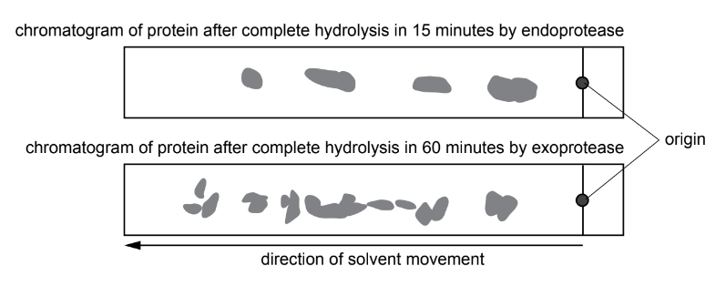

**Fig. 2**

The student concluded that:

1. The endoprotease worked faster than the exoprotease because fewer bonds needed to be hydrolysed.
2. The products of hydrolysis by the exoprotease were all single amino acids giving more spots on the chromatogram.
3. Hydrolysing the protein with a mixture of endoprotease and exoprotease would give the same results as for the exoprotease alone but more quickly.

State **and** explain whether each of these conclusions is supported **or** not supported by all of the information provided about these two enzymes, including the evidence in Fig. 2.

*Source: Specimen 2022 9700/05 Q1C*

**Q3** [2 marks]

Using an internet search the student found that:

- electrophoresis can also be used to separate the products of enzyme hydrolysis of proteins
- a combination of electrophoresis and chromatography has been used to study haemoglobin from people with sickle cell anaemia.

In an investigation, samples of haemoglobin from people with sickle cell anaemia and people without sickle cell anaemia were hydrolysed by an endoprotease. Each sample was placed centrally on one side of a piece of chromatography paper and separated by electrophoresis.

Negatively charged peptides moved to the anode (+) and positively charged peptides moved to the cathode (–).

After electrophoresis, the paper was turned through 90° and chromatography was used to further separate the peptides.

Fig. 3 shows the main stages of this experiment.

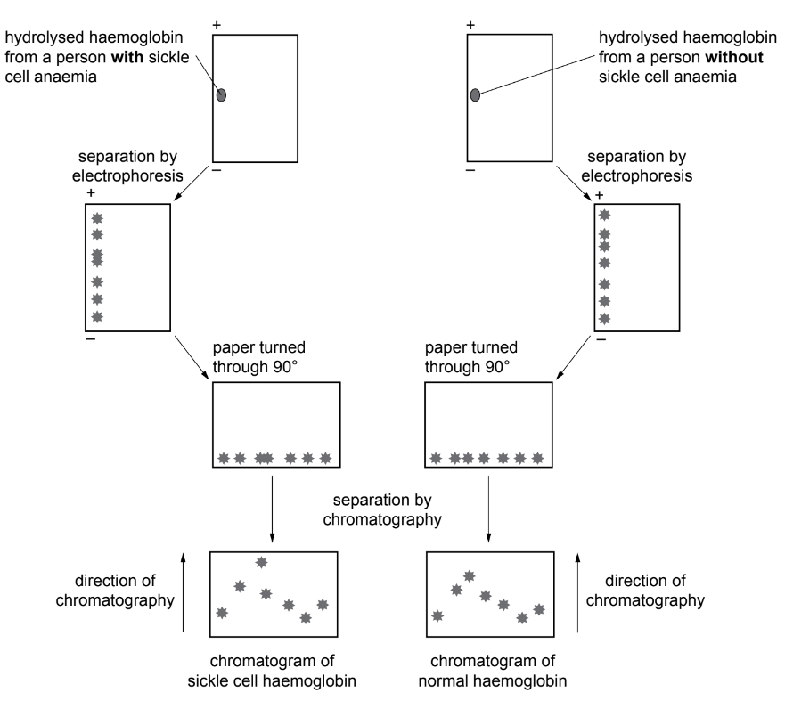

**                                                      Fig. 3**

(i) Sickle cell haemoglobin and normal haemoglobin have a difference in amino acid sequence.

In Fig. 3, draw a circle around the spot in each chromatogram that shows that the two types of haemoglobin have different amino acid sequences.

[1]

(ii) Explain your answer to part (i).

[1]

*Source: Specimen 2022 9700/05 Q1DI & DII*

### Q4 — hard — 9 marks

**Q4** [3 marks]

A researcher investigated the effect of pH on the activity of the stomach enzyme pepsin.

Their results are shown in Fig.1 below.

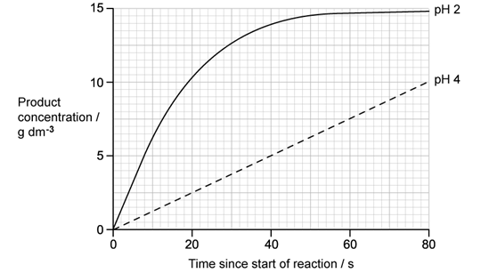

**Fig. 1**

The rate of reaction can be calculated by using the following formula:

$\mathrm{reaction} \mathrm{rate}=\frac{\mathrm{product} \mathrm{produced}(g\mathrm{dm}^{-3})}{\mathrm{time}(s)}$

Calculate the rate of reaction at 20 seconds at pH 2. Give your answer in suitable units.

**Q4** [2 marks]

**Extract:**

A researcher investigated the effect of pH on the activity of the stomach enzyme pepsin. 

Their results are shown in Fig.1 below. 

Fig. 1

Explain the differences between the curves at pH 2 and pH 4.

**Q4** [1 mark]

Explain why enzyme-substrate complexes only form for a short time period.

**Q4** [3 marks]

**Extract:**

A researcher investigated the effect of pH on the activity of the stomach enzyme pepsin. 

Their results are shown in Fig.1 below. 

pepsin-rate-of-reaction-at-different-ph-sq

Fig. 1

The rate of reaction can be calculated by using the following formula:

$\text{reaction} \text{rate} = \frac{product \text{produced} ( \mathrm{g} dm^{- 3} )}{time ( \mathrm{s} )}$

A copy of Fig. 1 is reproduced below as** **Fig. 2.

**Fig. 2**

(i) Sketch a curve on Fig. 2 to predict the outcome if the temperature were decreased from 37°C to 25°C at pH 2.

[1]

(ii) Explain the features of the curve you have drawn in part (i).

[2]

### Q5 — hard — 14 marks

**Q5** [2 marks]

Trypsin is a protease enzyme that digests a milk protein called casein. Casein causes milk to have an opaque white appearance. When it is digested by trypsin the white colour changes to colourless.

A student investigated the effect of trypsin concentration on the rate of casein digestion. In preparation for this they needed to prepare 10 cm3 of 6 different trypsin test solutions. They started with a large container of 1% trypsin stock solution and some distilled water.

Complete the table below to show how they would make up the test solutions required for the experiment.

| **Concentration of trypsin test solution (%)** | **Volume of 1% trypsin stock solution (cm****3****)** | **Volume of distilled water (cm****3****)** |
|---|---|---|
| 0.0 |   |   |
| 0.2 |   |   |
| 0.4 |   |   |
| 0.6 |   |   |
| 0.8 |   |   |
| 1.0 |   |   |

**Q5** [3 marks]

**Extract:**

Trypsin is a protease enzyme that digests a milk protein called casein. Casein causes milk to have an opaque white appearance. When it is digested by trypsin the white colour changes to colourless.

A student investigated the effect of trypsin concentration on the rate of casein digestion.

The student used a colorimeter to measure the rate of reaction at different trypsin concentrations.

Suggest why a colorimeter would be a suitable piece of equipment to use for this investigation.

**Q5** [6 marks]

**Extract:**

Trypsin is a protease enzyme that digests a milk protein called casein. Casein causes milk to have an opaque white appearance. When it is digested by trypsin the white colour changes to colourless. 

A student investigated the effect of trypsin concentration on the rate of casein digestion.

Suggest an experimental method that could be used by the student to investigate the effect of trypsin concentration on the rate of casein digestion.

Your answer should include the use of a colorimeter.

**Q5** [3 marks]

**Extract:**

Trypsin is a protease enzyme that digests a milk protein called casein. Casein causes milk to have an opaque white appearance. When it is digested by trypsin the white colour changes to colourless.

Some example data from this experiment is shown below:

| **Trypsin concentration (%)** | **Absorbance / au** |   |   |   |
|---|---|---|---|---|
| **0 seconds** | **20 seconds ** | **40 seconds** | **60 seconds** |   |
| 0.0 | 1.97 | 1.97 | 1.97 | 1.97 |
| 0.2 | 1.97 | 1.67 | 1.05 | 0.82 |
| 0.4 | 1.97 | 1.43 | 0.87 | 0.46 |
| 0.6 | 1.97 | 1.29 | 0.76 | 0.31 |
| 0.8 | 1.97 | 1.18 | 0.62 | 0.17 |
| 1.0 | 1.97 | 1.05 | 0.57 | 0.13 |

(i) Describe the relationship between trypsin concentration and rate of casein digestion.

[2]

(ii) Explain the relationship between trypsin concentration and rate of casein digestion.

[1]

### Q6 — medium — 9 marks

**Q6** [2 marks]

Fig.1 represents the change in the amount of energy needed for two reactions (**P** and **Q**) to occur over time.

**                                                    Fig. 1**

(i) Identify the reaction in Fig.1 that is catalysed by an enzyme.

[1]

(ii) Explain your answer in part i).

[1]

**Q6** [1 mark]

The enzyme lactase catalyses the breakdown of the glycosidic bond in lactose.

A student investigated the effect of increasing the concentration of lactose on the rate of activity of lactase.

Five test tubes were set up with each containing 3 cm3 of different concentrations of a lactose solution. The test tubes were placed in a water bath at 38°C for ten minutes. A container with a lactase solution was also put into the water bath.

After ten minutes, 1 cm3 of the lactase solution was added to each test tube. The test tubes were returned to the water bath and kept at 38°C for another ten minutes.

Thereafter, the temperature of the water bath was raised to boiling point before Benedict's solution was added to each test tube. The time taken for a colour change was recorded and used to calculate the rate of enzyme activity.

The results are shown in Fig. 2

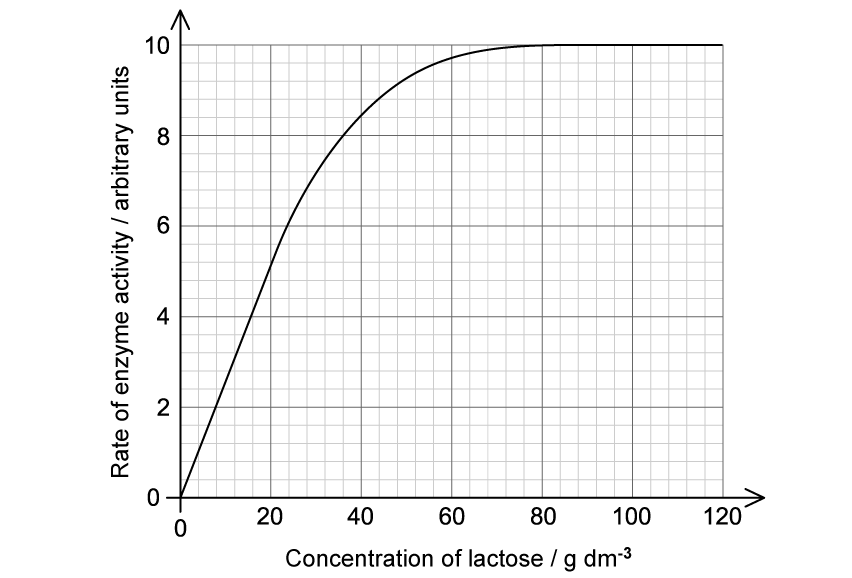

**                                                            Fig. 2**

Explain why the action of lactase can be described as 'catabolic'.

**Q6** [1 mark]

**Extract:**

The enzyme lactase catalyses the breakdown of the glycosidic bond in lactose.

A student investigated the effect of increasing the concentration of lactose on the rate of activity of lactase.

Five test tubes were set up with each containing 3 cm^3^ of different concentrations of a lactose solution. The test tubes were placed in a water bath at 38°C for ten minutes. A container with a lactase solution was also put into the water bath.

After ten minutes, 1 cm^3^ of the lactase solution was added to each test tube. The test tubes were returned to the water bath and kept at 38°C for another ten minutes.

Thereafter, the temperature of the water bath was raised to boiling point before Benedict's solution was added to each test tube. The time taken for a colour change was recorded and used to calculate the rate of enzyme activity.

State what happened to lactase when the temperature in this investigation was raised to boiling point.

**Q6** [5 marks]

**Extract:**

The enzyme lactase catalyses the breakdown of the glycosidic bond in lactose.

A student investigated the effect of increasing the concentration of lactose on the rate of activity of lactase.

Five test tubes were set up with each containing 3 cm^3^ of different concentrations of a lactose solution. The test tubes were placed in a water bath at 38°C for ten minutes. A container with a lactase solution was also put into the water bath.

After ten minutes, 1 cm^3^ of the lactase solution was added to each test tube. The test tubes were returned to the water bath and kept at 38°C for another ten minutes.

Thereafter, the temperature of the water bath was raised to boiling point before Benedict's solution was added to each test tube. The time taken for a colour change was recorded and used to calculate the rate of enzyme activity.

The results are shown in Fig. 2

Describe **and** explain the results shown in Fig. 2

### Q7 — medium — 10 marks

**Q7** [3 marks]

Lysozyme is an enzyme found in many secretions of the body, such as tears, saliva and milk. It is able to break down the peptidoglycan cell walls of bacteria and form part of the body's chemical defence system against pathogens.

Fig.1 shows a molecular model of lysozyme.

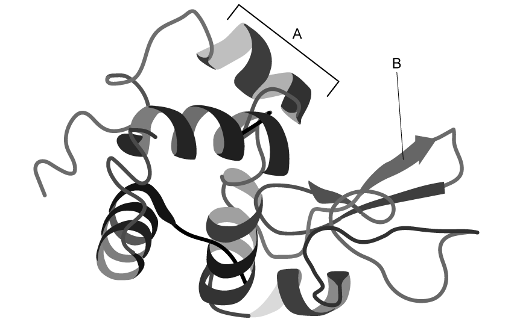

**                                                               Fig. 1**

With reference to Fig.1 and the parts labelled **A** and **B**, explain the term 'secondary structure'.

**Q7** [2 marks]

Enzymes, such as lysozyme, are described as being 'biological catalysts'.

Outline what is meant by the term 'biological catalyst'.

**Q7** [2 marks]

**Extract:**

Lysozyme is an enzyme found in many secretions of the body, such as tears, saliva and milk. It is able to break down the peptidoglycan cell walls of bacteria and form part of the body's chemical defence system against pathogens.

State whether lysozyme can be classified as an intracellular or extracellular enzyme and explain your answer.

**Q7** [3 marks]

Lysozyme molecules will eventually stop working and are broken down.

Outline how cells replace the enzymes that are broken down.

### Q8 — medium — 8 marks

**Q8** [3 marks]

Fig. 1 shows two ways in which enzymes interact with their substrates.

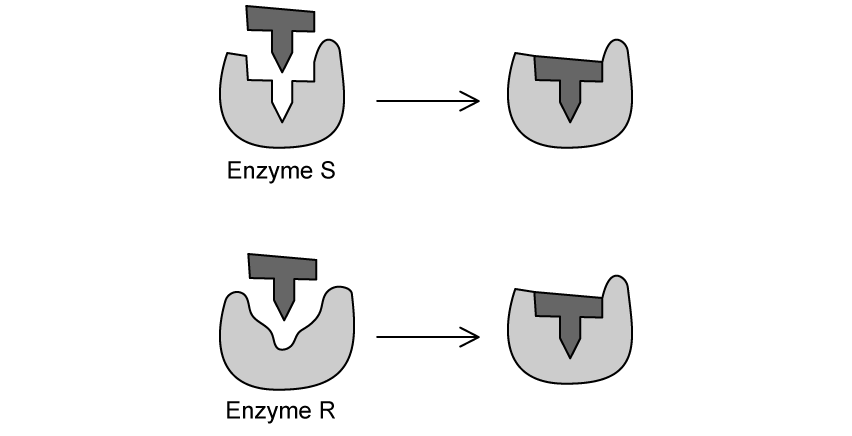

**                                                          Fig. 1**

Explain the difference between the two ways in which enzymes interact with their substrates as shown in Fig. 1

**Q8** [2 marks]

The amount of substrate available can have an impact on the rate of an enzyme catalysed reaction. A group of students carried out an investigation into the effects of substrate concentration on the rate of the reaction.

They had ten test tubes for each of the different substrate concentrations to which they added 2 cm3 of an enzyme solution. The test tubes were incubated at 40°C for 20 minutes, during which time the mass of the product that formed was measured as an indication of the rate of the reaction.

Their results are shown in Table 1.

**Table 1**

| **Substrate concentration / mM** | **Product formed per minute / µg** |
|---|---|
| 1.5 | 0.25 |
| 2.0 | 0.27 |
| 3.0 | 0.30 |
| 4.0 | 0.33 |
| 8.0 | 0.42 |
| 16.0 | 0.42 |

Calculate the percentage increase in the amount of product formed during the duration of this investigation.

Show your working.

**Q8** [2 marks]

**Extract:**

The amount of substrate available can have an impact on the rate of an enzyme catalysed reaction. A group of students carried out an investigation into the effects of substrate concentration on the rate of the reaction.

They had ten test tubes for each of the different substrate concentrations to which they added 2 cm^3^ of an enzyme solution. The test tubes were incubated at 40°C for 20 minutes, during which time the mass of the product that formed was measured as an indication of the rate of the reaction.

Explain why it was important that the students kept the temperature constant during the investigation described in part b).

**Q8** [1 mark]

**Extract:**

The amount of substrate available can have an impact on the rate of an enzyme catalysed reaction. A group of students carried out an investigation into the effects of substrate concentration on the rate of the reaction.

They had ten test tubes for each of the different substrate concentrations to which they added 2 cm³ of an enzyme solution. The test tubes were incubated at 40°C for 20 minutes, during which time the mass of the product that formed was measured as an indication of the rate of the reaction.

State **one** other factor, besides temperature, that could affect the structure of the enzyme molecules during the investigation mentioned in part b).

### Q9 — medium — 8 marks

**Q9** [3 marks]

Explain how the levels of protein structure enable enzyme specificity.

**Q9** [2 marks]

Carbonic anhydrase is an enzyme that has a Zn2+ ion within its active site.

State the name given to this kind of structure in a protein **and** identify the level of protein structure that this affects.

**Q9** [1 mark]

Carbonic anhydrase catalyses the conversion of carbon dioxide and water into carbonic acid, as well as the reverse of this reaction as follows:

CO2 + H2O ⟶ H2CO3

H2CO3 ⟶ CO2 + H2O

Suggest how one enzyme is able to catalyse two different reactions.

**Q9** [2 marks]

When it is not catalysed by an enzyme, the rate at which carbon dioxide combines with water to produce carbonic acid is 0.067 reactions per second. With the addition of carbonic anhydrase, and in optimal conditions, the same reaction is 107 times faster.

Calculate the rate at which carbonic acid is produced when the reaction is catalysed by carbonic anhydrase. Give your answer in standard form.

### Q10 — medium — 8 marks

**Q10** [2 marks]

A student wanted to investigate the effect of enzyme concentration on the rate of a reaction. The student made a serial dilution of a 10% amylase solution. He had three test tubes for each of the different concentrations of amylase that contained 2 cm3 of starch solution.

After incubating both amylase and starch solutions for 10 minutes at 40°C, he mixed 1 cm3 of the different amylase solutions with the starch solution in the relevant test tubes. The student removed samples from the mixtures at 1 minute intervals and tested for the presence of starch using iodine solution. He recorded the time taken for all the starch to be digested by the amylase.

His results are presented in Table 1

**Table 1**

** **

i) State the conclusion that can be drawn from these results.

[1]

ii) Explain the importance of having three test tubes for each of the different concentrations of amylase.

[1]

**Q10** [2 marks]

**Extract:**

A student wanted to investigate the effect of enzyme concentration on the rate of a reaction. The student made a serial dilution of a 10% amylase solution. He had three test tubes for each of the different concentrations of amylase that contained 2 cm³ of starch solution.

After incubating both amylase and starch solutions for 10 minutes at 40°C, he mixed 1 cm³ of the different amylase solutions with the starch solution in the relevant test tubes. The student removed samples from the mixtures at 1 minute intervals and tested for the presence of starch using iodine solution. He recorded the time taken for all the starch to be digested by the amylase.

The student judged the colour change of the iodine solution by eye.

Describe a more accurate method that the student could use to determine when all the starch had been digested.

**Q10** [2 marks]

**Extract:**

A student wanted to investigate the effect of enzyme concentration on the rate of a reaction. The student made a serial dilution of a 10% amylase solution. He had three test tubes for each of the different concentrations of amylase that contained 2 cm³ of starch solution.

After incubating both amylase and starch solutions for 10 minutes at 40°C, he mixed 1 cm³ of the different amylase solutions with the starch solution in the relevant test tubes. The student removed samples from the mixtures at 1 minute intervals and tested for the presence of starch using iodine solution. He recorded the time taken for all the starch to be digested by the amylase.

The student repeated the investigation described in part a) but incubated the starch and amylase solution at 60°C.

Suggest **and **explain the possible outcome of this investigation.

**Q10** [2 marks]

**Extract:**

A student wanted to investigate the effect of enzyme concentration on the rate of a reaction. The student made a serial dilution of a 10% amylase solution. He had three test tubes for each of the different concentrations of amylase that contained 2 cm³ of starch solution.

After incubating both amylase and starch solutions for 10 minutes at 40°C, he mixed 1 cm³ of the different amylase solutions with the starch solution in the relevant test tubes. The student removed samples from the mixtures at 1 minute intervals and tested for the presence of starch using iodine solution. He recorded the time taken for all the starch to be digested by the amylase.

Identify **two** variables that must be controlled during the investigation described in part a).

### Q11 — easy — 10 marks

**Q11** [2 marks]

**Extract:**

- Accept "mass of potato cubes" as the size/number/total surface area of potato cubes point.
- Accept "time allowed for oxygen collection" or "time each reaction is left to collect gas" as a creditable control variable.

A student wanted to investigate the effect of substrate concentration on the activity of an enzyme called catalase. Catalase is an enzyme that commonly occurs inside living cells where it breaks down toxic hydrogen peroxide into oxygen and water.

Fig. 1 below shows the experimental set up used by the student.

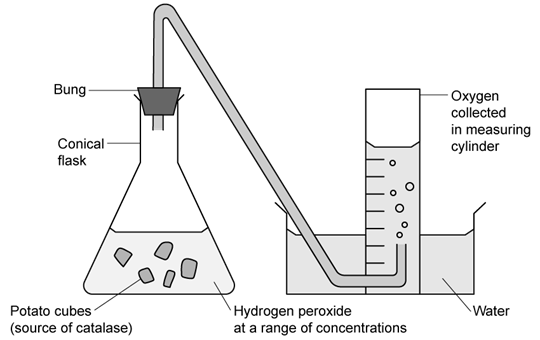

**Fig. 1**

List **two** control variables that the student would need to be aware of in the experiment shown in Fig. 1.

**Q11** [1 mark]

The student decided to make up solutions at five different hydrogen peroxide concentrations. Their measurements for these solutions are shown in Table 1 below.

**Table 1**

| **Concentration of hydrogen peroxide solution (%)** | **Volume of hydrogen peroxide required (cm****3****)** | **Volume of distilled water required (cm****3****)** |
|---|---|---|
| 10 | 10 | 90 |
| 8 | **B** | **C** |
| 6 | 6 | 94 |
| **A** | 4 | 96 |
| 2 | 2 | 98 |

Give the measurements needed to fill in gaps **A-C** in** **Table 1.

**Q11** [1 mark]

After measuring out the range of hydrogen peroxide concentrations shown in** **part (b), the student carried out the experiment using the equipment set up in part (a). They recorded the volume of oxygen (the product) produced after one minute, and repeated this measurement three times at each concentration.

Their results are shown in Table 2.

**Table 2**

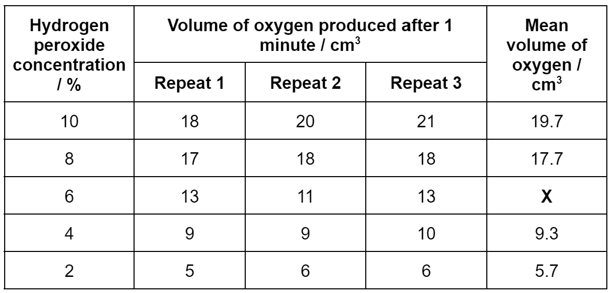

Use the data in Table 2** **to calculate the value missing from the square marked **X**.

**Q11** [2 marks]

**Extract:**

A student wanted to investigate the effect of substrate concentration on the activity of an enzyme called catalase. Catalase is an enzyme that commonly occurs inside living cells where it breaks down toxic hydrogen peroxide into oxygen and water.

After measuring out the range of hydrogen peroxide concentrations, the student carried out the experiment. They recorded the volume of oxygen (the product) produced after one minute, and repeated this measurement three times at each concentration.

State the purpose of repeating the experiment three times at each concentration of hydrogen peroxide.

**Q11** [4 marks]

**Extract:**

After measuring out the range of hydrogen peroxide concentrations shown in part (b), the student carried out the experiment using the equipment set up in part (a). They recorded the volume of oxygen (the product) produced after one minute, and repeated this measurement three times at each concentration.

Their results are shown in Table 2.

Table 2

Using the data in part (c), draw a graph of hydrogen peroxide concentration against the mean volume of oxygen.

### Q12 — easy — 7 marks

**Q12** [2 marks]

A researcher investigated the effect of pH on the activity of the stomach enzyme pepsin.

Their results are shown in Fig. 1 below.

**Fig. 1**

The rate of reaction can be calculated by using the formula:

$\mathrm{reaction} \mathrm{rate}=\frac{\mathrm{product} \mathrm{produced}(g\mathrm{dm}^{-3})}{\mathrm{time}(s)}$

Calculate the rate of reaction at pH 4. Give your answer with the correct units.

**Q12** [2 marks]

**Extract:**

A researcher investigated the effect of pH on the activity of the stomach enzyme pepsin. 

Their results are shown in Fig. 1 below. 

[Fig. 1 - pepsin-rate-of-reaction-at-different-ph-sq]

Describe the differences between the curves at pH 2 and pH 4.

**Q12** [1 mark]

**Extract:**

A researcher investigated the effect of pH on the activity of the stomach enzyme pepsin. 

Their results are shown in Fig. 1 below. 

**Fig. 1**

State why product production at pH 2 does not continue indefinitely but reaches a plateau at around 14.75 g.

**Q12** [2 marks]

Some students suggested that they could use a colorimeter to measure the rate of an enzyme controlled reaction involving a colour change.

Describe how the colorimeter could be used.

### Q13 — easy — 8 marks

**Q13** [3 marks]

Enzymes are globular proteins that catalyse metabolic reactions.

Describe the features of globular proteins.

**Q13** [3 marks]

Explain how enzymes catalyse specific reactions.

**Q13** [2 marks]

Fig.1 shows a reaction catalysed by an enzyme.

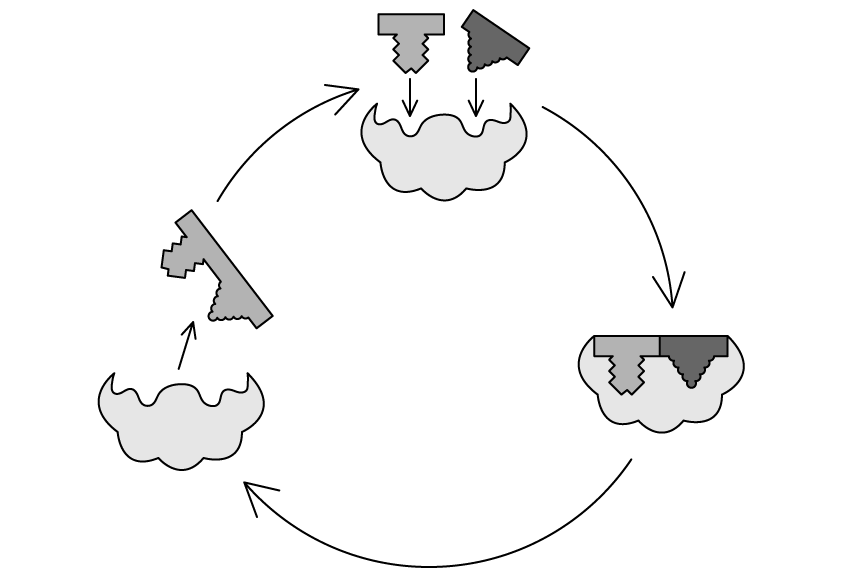

**                                                             Fig.1**

Describe the type of reaction that is displayed in Fig.1.

### Q14 — easy — 8 marks

**Q14** [2 marks]

State what is meant when an enzyme is described as being intracellular or extracellular.

**Q14** [2 marks]

Proteases are enzymes that break down proteins from food in the digestive system.

Explain why proteases only break down proteins.

**Q14** [2 marks]

Pepsin is an example of a protease enzyme that digests proteins in the stomach.

(i) State whether pepsin catalyses a catabolic or anabolic reaction.

[1]

(ii) State whether pepsin catalyses a hydrolysis or a condensation reaction.

[1]

**Q14** [2 marks]

Compare the lock and key model of enzyme action with the induced fit model of enzyme action.

### Q15 — easy — 6 marks

**Q15** [1 mark]

State why enzymes are referred to as** **biological catalysts.

**Q15** [3 marks]

Fig. 1 shows a representation of an enzyme-controlled reaction.

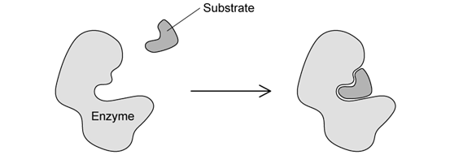

**Fig. 1**

Describe the events taking place in Fig. 1.

**Q15** [2 marks]

State what is meant by the term *enzyme specificity*.
