# Exam Questions — Factors that Affect Enzyme Action
**3. Enzymes** · Cambridge (CIE) A-LEVEL biology (9700)
> Source: [https://www.savemyexams.com/a-level/biology/cie/25/topic-questions/](https://www.savemyexams.com/a-level/biology/cie/25/topic-questions/) · 45 questions across 2 sets

## Multiple Choice Questions (30 questions)

### Q1 — hard — 1 marks

**Q1** [1 mark]

Enzymes can be immobilized in various ways. The diagram below shows two different ways of immobilization:

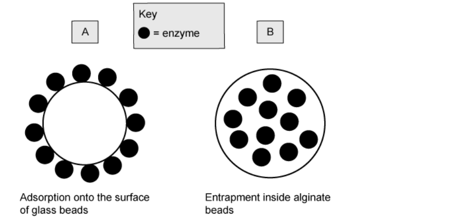

Immobilised lactase enzymes are used to make milk digestible for lactose intolerant people.  A student carried out an investigation to compare the activity of the enzyme lactase that had been immobilised in the two different ways shown.

A 500 cm3 solution containing 50 mg cm–3 of lactose was poured through a column containing the immobilised enzyme.  The solution containing the products was collected and the concentration of glucose measured.

The student collected the following data:

|   | method of immobilisation |   |
|---|---|---|
| **A** | **B** |   |
| time for solution to pass through column / seconds | 36 | 28 |
| glucose concentration of end solution / mg cm–3 | 20 | 14 |

What was the rate of glucose production in method **A** in mg cm–3 min-1 rounded to two significant figures?

### Q2 — hard — 1 marks

**Q2** [1 mark]

Km is the concentration of substrate which permits the enzyme to achieve half Vmax.  An enzyme with a high Km requires a greater concentration of substrate to achieve Vmax.

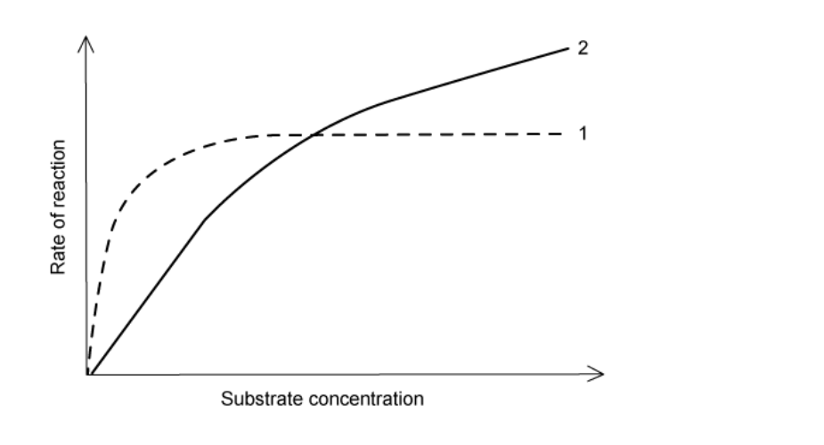

Which of the following statements is correct?

### Q3 — hard — 1 marks

**Q3** [1 mark]

Ethylene glycol is a colourless and odourless type of alcohol found in many household products.  People sometimes drink ethylene glycol mistakenly (or on purpose as a substitute for ethanol), however drinking it can cause profound shock, organ failure, and even death.

Ethylene glycol itself is not toxic, rather the products it gets broken down into.  The same enzyme in the body that normally breaks down ethanol into harmless products is also responsible for the hydrolysis of ethylene glycol.  This is due to ethylene glycol having a similar structure to ethanol.  Accordingly, the treatment for someone who has ingested ethylene glycol is a large dose of ethanol.

Which statement explains why this unusual treatment works?

### Q4 — hard — 1 marks

**Q4** [1 mark]

Immobilised lactase enzymes are used to make milk digestible for lactose intolerant people.  A student carried out an investigation to compare the activity of the enzyme lactase that had been immobilised in the two different ways shown below:

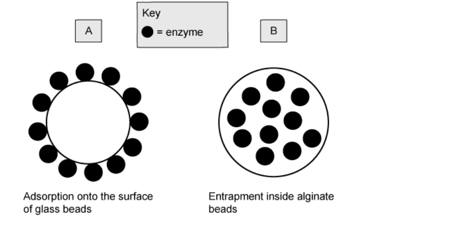

A 500 cm3 solution containing 50 mg cm–3 of lactose was poured through a column containing the immobilised enzyme.  The solution containing the products was collected and the concentration of glucose measured:

|   | method of immobilisation |   |
|---|---|---|
| **A** | **B** |   |
| time for solution to pass through column / seconds | 36 | 28 |
| glucose concentration of end solution / mg cm–3 | 2.0 | 1.4 |
| rate of glucose production / mg sec-1 | 0.055 | 0.05 |

Assuming the mass of glucose is equal to half the initial lactose concentration (i.e. 1 mg of glucose indicates the hydrolysis of 2 mg of lactose), how much lactose could be hydrolysed by method **B** in an hour with unlimited starting solution?

### Q5 — hard — 1 marks

**Q5** [1 mark]

**Question 22 - CIE IAS 3.2 Factors that Affect Enzyme Action - HARD**

This diagram shows a metabolic pathway occurring in an organelle.  The speed of this metabolic pathway is self-regulating as the end product acts as a competitive inhibitor to enzyme 2

$\mathrm{reactant}\overset{\mathrm{enzyme}1}{\rightarrow}\mathrm{intermediate}X\overset{\mathrm{enzyme}2}{\rightarrow}\mathrm{intermediate}Y\overset{\mathrm{enzyme}3}{\rightarrow}\mathrm{end} \mathrm{product}$

What would you not expect to occur when adding additional end product to the organelle?

### Q6 — hard — 1 marks

**Q6** [1 mark]

The graphs show the rate of reaction of an enzyme-catalyzed reaction.

Which graph shows the effect of increasing the concentration of the substrate both with and without a competitive inhibitor?

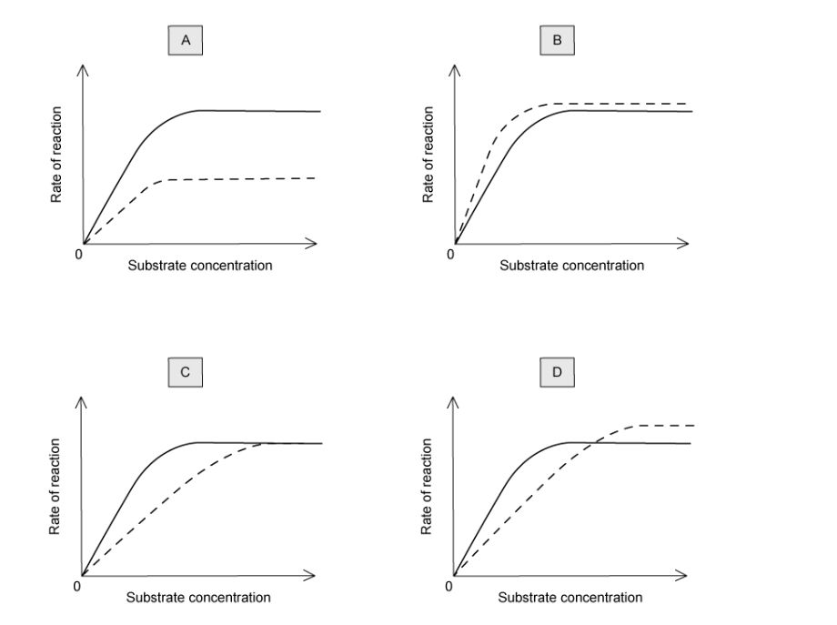

### Q7 — hard — 1 marks

**Q7** [1 mark]

Km is the concentration of substrate which permits the enzyme to achieve half Vmax.

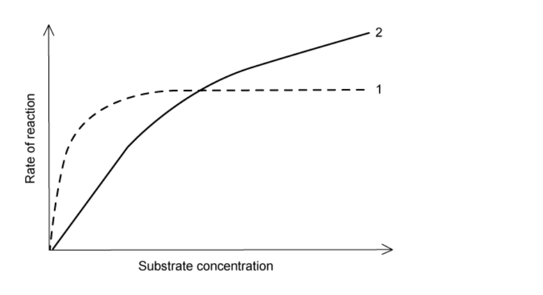

Which of the following statements is incorrect?

### Q8 — hard — 1 marks

**Q8** [1 mark]

In the graph, **Z **represents the relationship between the initial rate of reaction of an enzyme and the concentration of its substrate under optimal conditions and without an inhibitor.

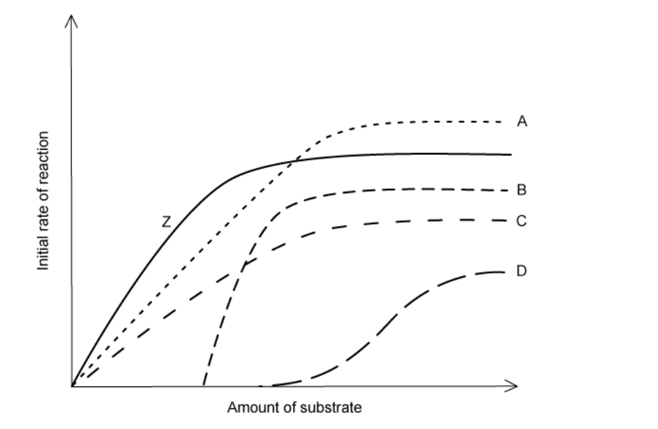

Which curve would represent the same experiment carried out in the presence of a low concentration of a non-competitive inhibitor?

### Q9 — hard — 1 marks

**Q9** [1 mark]

The curve **Z** shows the activity of catalase at 25 °C. Curves **A**,** B**, **C** and **D** show the effect of different conditions on the activity of catalase.

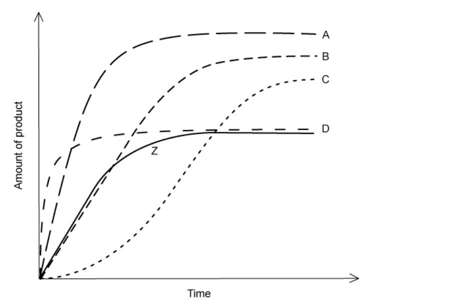

Which curve shows the effect of increasing the temperature by 10 °C and adding additional substrate?

### Q10 — hard — 1 marks

**Q10** [1 mark]

The graph shows the effect of substrate concentration on the rate of an enzyme-controlled reaction. The enzyme concentration is constant.

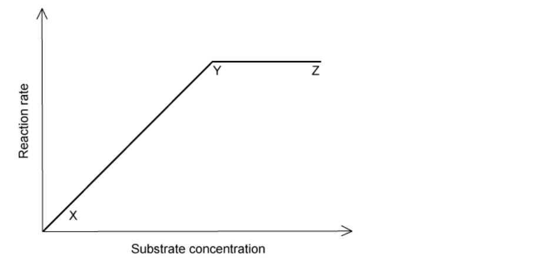

Which statement about the graph is correct?

|   | **Between X and Y** | **Between Y and Z** |
|---|---|---|
| **A** | Enzyme is limiting rate | Enzyme is limiting rate |
| **B** | Enzyme is limiting rate | Substrate is limiting rate |
| **C** | Substrate is limiting rate | Enzyme is limiting rate |
| **D** | Substrate is limiting rate | Substrate is limiting rate |

### Q11 — medium — 1 marks

**Q11** [1 mark]

The graph shows the course of two enzyme-catalysed reaction at 30 °C.  The only thing that was changed between experiment 1 and 2 was some additional substrate was added at the beginning of experiment 2

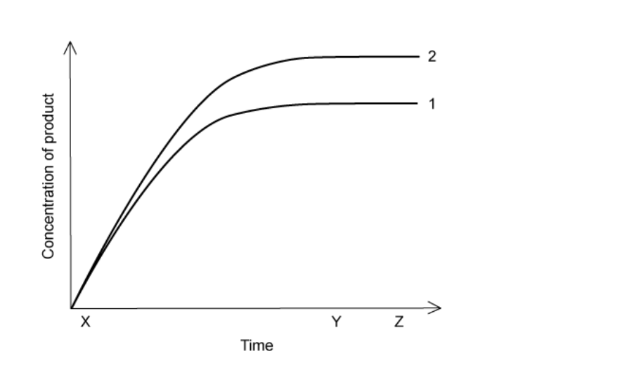

Which statement about the experiment is not true?

### Q12 — medium — 1 marks

**Q12** [1 mark]

This graph shows the effect of temperature on enzyme activity

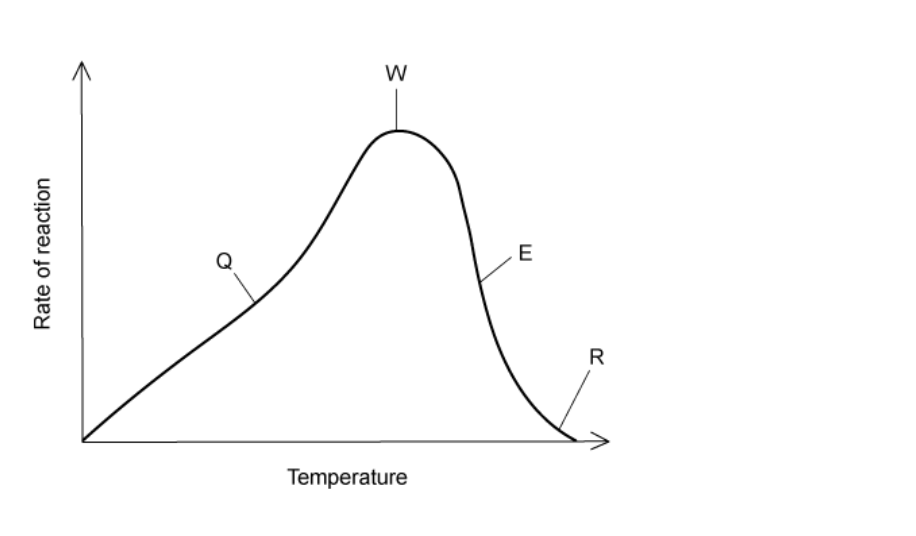

Which statement is not true?

### Q13 — medium — 1 marks

**Q13** [1 mark]

In the graph, **Z **represents the rate of an enzyme reaction under optimal conditions and without an inhibitor.

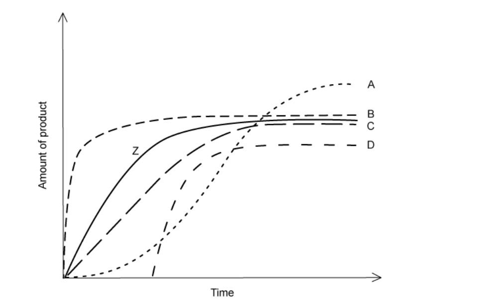

Which curve would represent the same experiment carried out in the presence of a low concentration of competitive inhibitor?

### Q14 — medium — 1 marks

**Q14** [1 mark]

The graph shows the rate of glucose production with increasing concentration of maltase.

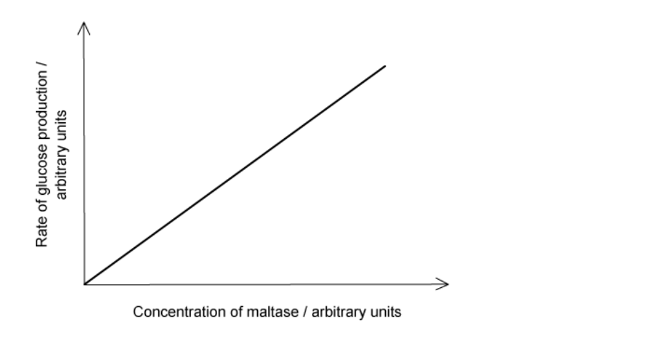

To get a graph with a linear correlation like this which procedure would not be necessary?

### Q15 — medium — 1 marks

**Q15** [1 mark]

This graph shows the effect of increasing substrate on enzyme activity

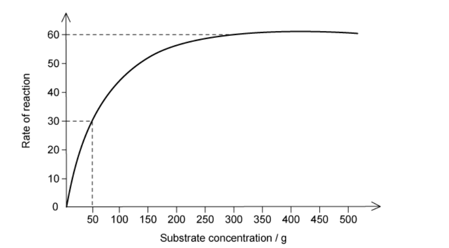

What is the Km value?

### Q16 — medium — 1 marks

**Q16** [1 mark]

The graph shows the course of an enzyme-catalysed reaction at 25 °C.

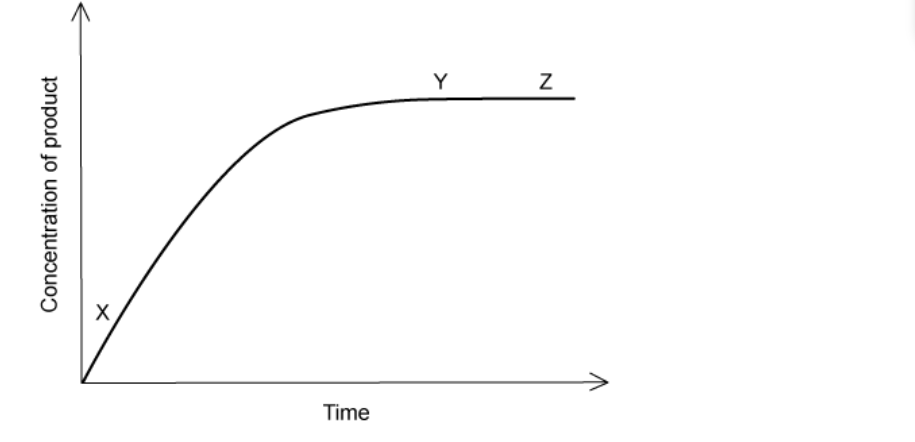

Which statement about the graph is incorrect?

### Q17 — medium — 1 marks

**Q17** [1 mark]

The graph shows the effect of pH on the rate on three different enzyme-controlled reactions. The enzyme concentration is constant.

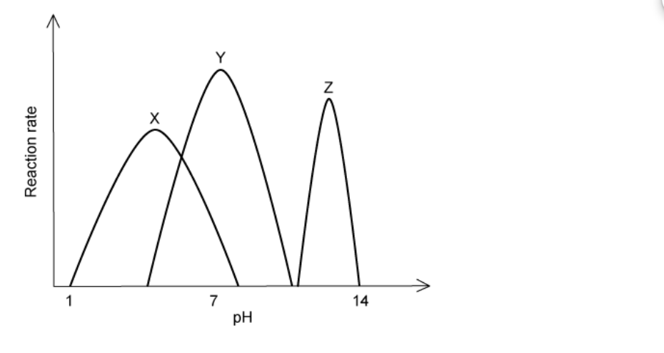

Which statement about the graph is correct?

### Q18 — medium — 1 marks

**Q18** [1 mark]

This diagram shows a metabolic pathway.

$\mathrm{reactant}\overset{\mathrm{enzyme}x}{\rightarrow}\mathrm{intermediate}1\overset{\mathrm{enzyme}y}{\rightarrow}\mathrm{intermediate}2\overset{\mathrm{enzyme}z}{\rightarrow}\mathrm{end} \mathrm{product}$

What would be the effect of adding a competitive inhibitor of enzyme z?

### Q19 — medium — 1 marks

**Q19** [1 mark]

Enzymes can be immobilised in various ways. The diagram below shows two different ways of immobilisation

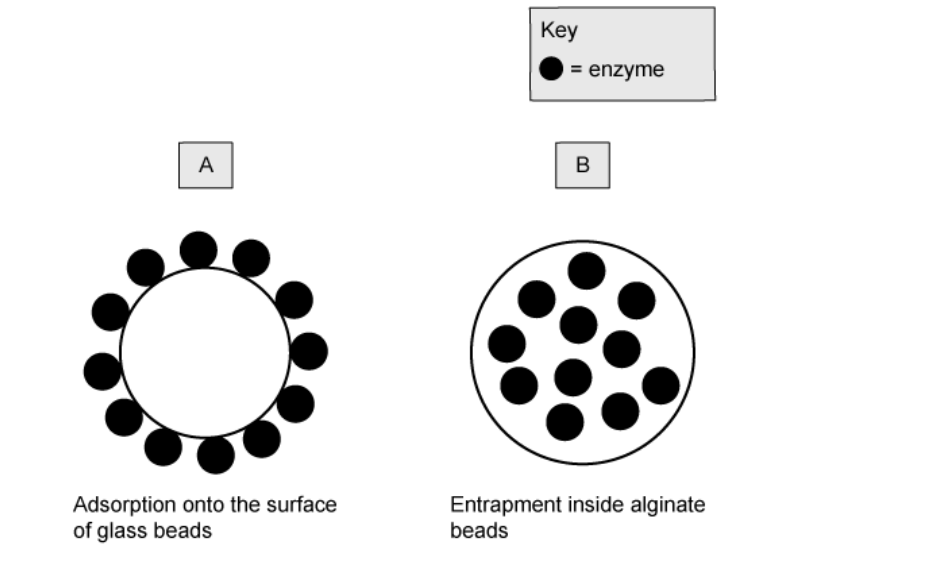

Immobilised lactase enzymes are used to make milk digestible for lactose intolerant people.  A student carried out an investigation to compare the activity of the enzyme lactase that had been immobilised in the two different ways shown.

A solution containing 50 mg cm–3 of lactose was poured through a column containing the immobilised enzyme.  The solution containing the products was collected and the concentration of glucose measured.

What is the independent variable for this experiment?

### Q20 — medium — 1 marks

**Q20** [1 mark]

The graph shows the effect of enzyme concentration on the rate of an enzyme-controlled reaction. The substrate concentration is constant.

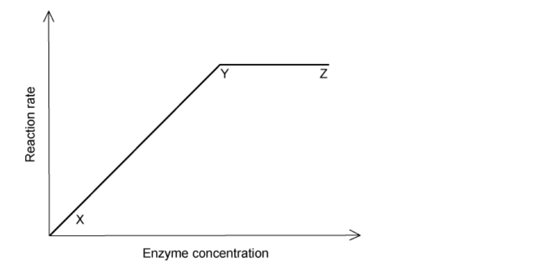

Which statement about the graph is correct?

### Q21 — easy — 1 marks

**Q21** [1 mark]

Enzymes can be immobilised in various ways. The diagram below shows two different ways of immobilisation

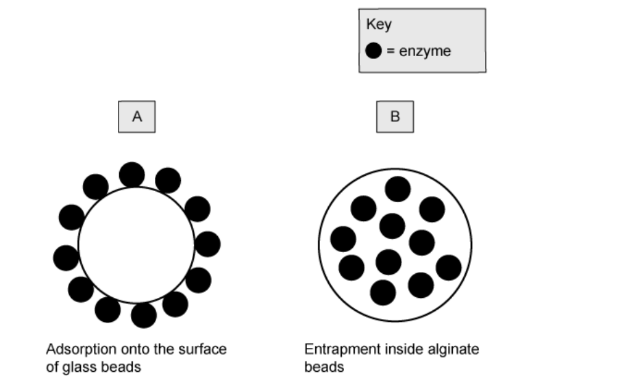

Immobilised lactase enzymes can be used to make milk digestible for lactose intolerant people.  Which of the following statements about the milk produced by the use of immobilised lactase enzymes is not correct?

### Q22 — easy — 1 marks

**Q22** [1 mark]

How does increasing substrate concentration affect the rate of an enzyme-catalysed reaction in the presence of a competitive inhibitor?

### Q23 — easy — 1 marks

**Q23** [1 mark]

Inhibitors of enzyme reactions form enzyme / inhibitor complexes.

Which statements about enzyme inhibition are correct?

| 1 | The initial rate of reaction is decreased. |
|---|---|
| 2 | The active site changes shape while forming the enzyme/inhibitor complex. |
| 3 | The inhibition can be competitive or non-competitive. |
| 4 | The maximum rate of reaction (Vmax) is increased. |

### Q24 — easy — 1 marks

**Q24** [1 mark]

Which properties are characteristic of a competitive inhibitor of an enzyme?

|   | **binds** | **effect of adding more substrate** |
|---|---|---|
| **A** | at active site | reduces inhibition |
| **B** | at active site | does not reduce inhibition |
| **C** | at allosteric site | reduces inhibition |
| **D** | at allosteric site | does not reduce inhibition |

### Q25 — easy — 1 marks

**Q25** [1 mark]

Which statements would be true regarding the action of all enzyme inhibitors?

| 1 | bind to the active site of an enzyme |
|---|---|
| 2 | cause a change in the tertiary structure of an enzyme |
| 3 | reduce the rate of an enzyme catalysed reaction |

### Q26 — easy — 1 marks

**Q26** [1 mark]

Pepsin is a digestive enzyme present in the stomach of humans. The stomach environment has a pH of 2.5.  Pepsin is most active in acidic environments between pH 1.5 to 2.5. The optimum temperature of pepsin is between 37°C and 42°C.

Which of the following statements is not true?

### Q27 — easy — 1 marks

**Q27** [1 mark]

The graph below shows the effect of pH on the rate on three different enzyme-controlled reactions. The enzyme concentration is constant.

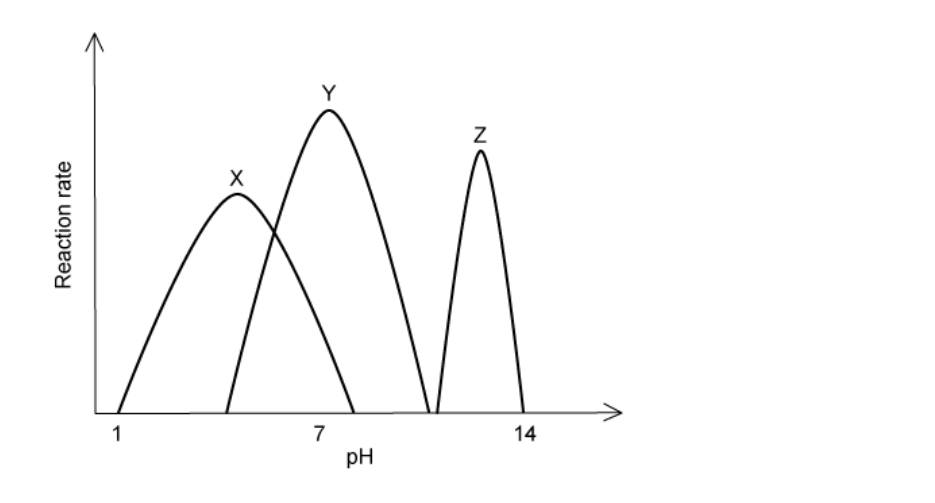

Which statement about the graph is not true?

### Q28 — easy — 1 marks

**Q28** [1 mark]

The graph shows the effect of substrate concentration on the rate of an enzyme-controlled reaction. The enzyme concentration is constant.

Which statement about the graph is correct?

### Q29 — easy — 1 marks

**Q29** [1 mark]

Hyperthermophiles grow optimally at temperatures between 80 and 110°C and comprise of species from both the bacterial and archaeal domains.  These organisms have been isolated from all types of terrestrial and marine hot environments, including natural and man-made environments.

Which graph would represent the relationship between temperature and the rate of enzyme activity in hyperthermophiles?

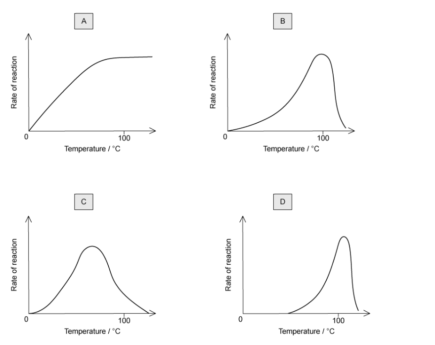

### Q30 — easy — 1 marks

**Q30** [1 mark]

The Vmax is the rate of reaction when the enzyme is saturated with substrate. This graph shows the effect of increasing substrate on enzyme activity.

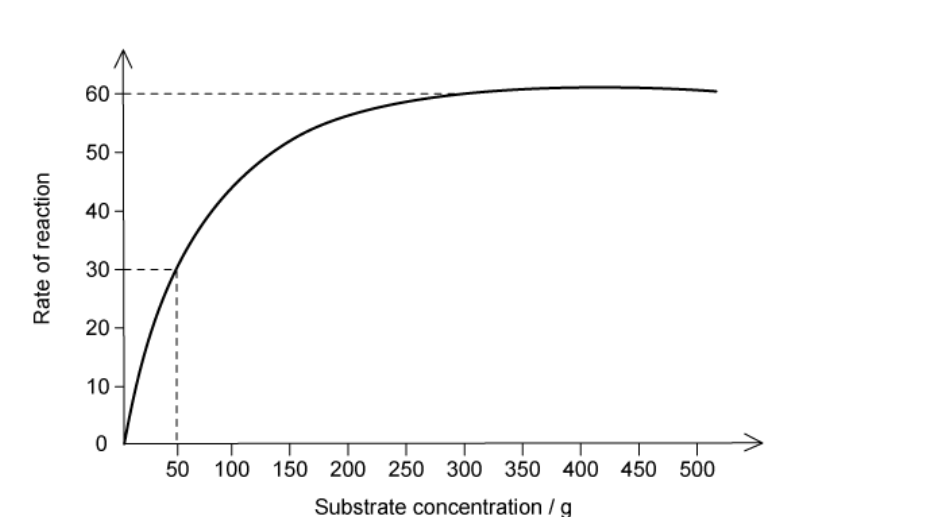

What mass of substrate is equal to the ½ Vmax?

## Structured Questions (15 questions)

### Q1 — hard — 11 marks

**Q1** [2 marks]

Organic waste materials, such as vomit or urine, can cause stains and unpleasant odours if they get into the fibres of household furnishings. This can be a particular issue for pet owners or parents of very young children. To combat this, many companies have created specialist cleaning chemicals that contain enzymes.

Explain how these cleaning chemicals carry out their function.

**Q1** [4 marks]

**Extract:**

Organic waste materials, such as vomit or urine, can cause stains and unpleasant odours if they get into the fibres of household furnishings. This can be a particular issue for pet owners or parents of very young children. To combat this, many companies have created specialist cleaning chemicals that contain enzymes.

Vomit contains acidic juices from the inside of the stomach.

(i) Explain how this could affect the effectiveness of the cleaning chemicals described in part (a).

[3]

(ii) Suggest how the chemical companies could improve the efficiency of these chemicals under the circumstances described in part (i).

[1]

**Q1** [3 marks]

**Extract:**

Organic waste materials, such as vomit or urine, can cause stains and unpleasant odours if they get into the fibres of household furnishings. This can be a particular issue for pet owners or parents of very young children. To combat this, many companies have created specialist cleaning chemicals that contain enzymes.

It is important that the cleaning chemicals described in part (a) are non-toxic.

Suggest why this might be important to the consumer, **and** why the companies are able to make this claim.

**Q1** [2 marks]

**Extract:**

Organic waste materials, such as vomit or urine, can cause stains and unpleasant odours if they get into the fibres of household furnishings. This can be a particular issue for pet owners or parents of very young children. To combat this, many companies have created specialist cleaning chemicals that contain enzymes.

The cleaning products can be sold in the form of a powder that can be sprinkled directly onto the stain, or dissolved in warm water before being sprayed onto the stain.

Explain the potential benefits of dissolving the powder in warm water before it is applied to the stain.

### Q2 — hard — 11 marks

**Q2** [4 marks]

The unicellular fungus *Kluyveromyces lactis* is found in dairy products. It is a safe microorganism to culture for the extraction of the enzyme lactase.

Lactase catalyses the breakdown of lactose, a sugar found in milk.

The reaction catalysed by lactase is summarised in Fig. 1.

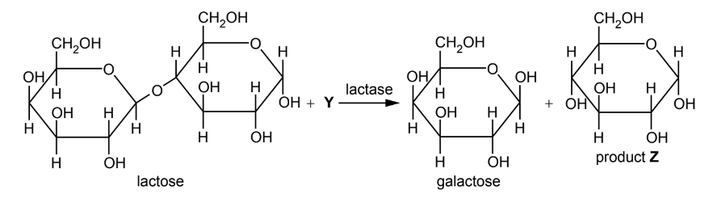

**Fig. 1**

Describe the reaction that is catalysed by lactase. Use Fig. 1 to help you.

In your answer, identify **Y** and product **Z**.

*Source: Specimen 2022 9700/02 Q3A*

**Q2** [4 marks]

**Extract:**

The unicellular fungus *Kluyveromyces lactis* is found in dairy products. It is a safe microorganism to culture for the extraction of the enzyme lactase.

Lactase catalyses the breakdown of lactose, a sugar found in milk.

The reaction catalysed by lactase is summarised in Fig. 1.

**Fig. 1**

On a commercial scale, immobilised lactase can be used to produce lactose-free milk.

One of the products of the reaction shown in Fig. 1 acts as an inhibitor of lactase. This is an example of product inhibition.

(i) Explain why product inhibition is useful in *K. lactis* when lactase is acting as an intracellular enzyme, but can be a disadvantage when extracted lactase is used free in solution for the production of lactose-free milk.

[2]

(ii) Suggest how using immobilised lactase for the production of lactose-free milk helps to reduce the problem of product inhibition.

[1]

(iii) The first large-scale production of lactose-free milk with an immobilised enzyme used lactase trapped in cellulose triacetate fibres.

Suggest **one** feature of cellulose triacetate that makes it useful as an immobilising material.

[1]

*Source: Specimen 2022 9700/02 Q3B*

**Q2** [3 marks]

When developing an enzyme-catalysed reaction for use in industry, the progress of the reaction is studied.

Outline how the progress of an enzyme-catalysed reaction can be investigated experimentally.

*Source: Specimen 2022 9700/02 Q3C*

### Q3 — hard — 12 marks

**Q3** [2 marks]

The enzyme catalase catalyses the following reaction:

H2O2 → O2 + H2O

A student studied the action of catalase by measuring the volume of oxygen released from the reaction solution using a gas syringe. They recorded the volume of oxygen every 60 seconds over 15 minutes.

The results of the experiment are shown in Fig. 1 below:

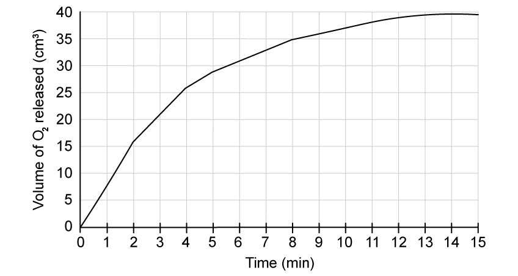

**Fig. 1**

Calculate the initial rate of reaction shown in Fig. 1.

**Q3** [4 marks]

**Extract:**

The enzyme catalase catalyses the following reaction:

H₂O₂ → O₂ + H₂O

A student studied the action of catalase by measuring the volume of oxygen released from the reaction solution using a gas syringe. They recorded the volume of oxygen every 60 seconds over 15 minutes.

The results of the experiment are shown in Fig. 1 below:

Fig. 1

The student wanted to investigate the effect of temperature on the rate of reaction of catalase. They did so by repeating the experiment using water baths kept at 20 °C, 30 °C, 40 °C, 50 °C, and 60 °C.

(i) The data from Fig. 1 was taken from the experiment carried out at 30°C.

Sketch a line onto the Fig. 1 graph to predict the outcome of the experiment at 60 °C.

[2]

(ii) Explain the shape of your line from part (i).

[2]

**Q3** [3 marks]

**Extract:**

The enzyme catalase catalyses the following reaction:

H~2~O~2 ~→ O~2 ~+ H~2~O

A student studied the action of catalase by measuring the volume of oxygen released from the reaction solution using a gas syringe. They recorded the volume of oxygen every 60 seconds over 15 minutes.

The student wanted to investigate the effect of temperature on the rate of reaction of catalase. They did so by repeating the experiment using water baths kept at 20 °C, 30 °C, 40 °C, 50 °C, and 60 °C.

State **three** factors that the student would need to consider when designing the experiment described in (a) and (b) to ensure valid results.

**Q3** [3 marks]

**Extract:**

The enzyme catalase catalyses the following reaction:

H~2~O~2 ~→ O~2 ~+ H~2~O

A student studied the action of catalase by measuring the volume of oxygen released from the reaction solution using a gas syringe. They recorded the volume of oxygen every 60 seconds over 15 minutes.

The student wanted to investigate the effect of temperature on the rate of reaction of catalase. They did so by repeating the experiment using water baths kept at 20 °C, 30 °C, 40 °C, 50 °C, and 60 °C.

Catalase is an enzyme found in human body cells, such as liver cells, and plays an important role in metabolism.

Predict what you would expect the student's results to show about the effect of temperature on catalase activity.

### Q4 — hard — 9 marks

**Q4** [7 marks]

Neutrase® is an enzyme that is used to hydrolyse proteins in solution. When the enzyme is mixed with a 2% protein solution the reaction mixture changes from white to colourless.

A student carried out an experiment to find the effect of copper sulfate and potassium sulfate on the activity of Neutrase®.

The student made four reaction mixtures in test tubes **A** to **D. **Test tubes **A **to **C **contained equal volumes of protein solution and 0.1 cm3 of solutions of copper sulfate or potassium sulfate. Test tube **D **contained the same volume of protein solution and 0.1 cm3 of water.

0.5 cm3 of a 1% Neutrase® solution was added to test tube **A **and immediately placed into a colorimeter. The colorimeter was used to measure the intensity of light that is absorbed by the solution (absorbance) over 100 seconds. The procedure was repeated with the other reaction mixtures, **B**, **C **and **D**.

The results are shown in Fig. 1.

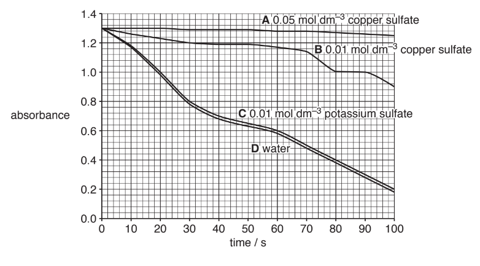

**Fig. 1**

(i) Suggest **and **explain why measuring the absorbance of the reaction mixture over 100 s is a suitable method for determining the activity of Neutrase®.

[2]

(ii) With reference to Fig. 1:

- Describe the effects of copper sulfate solution and potassium sulfate solution on the activity of Neutrase®
- Suggest explanations for the effects that you have described.

[5]

*Source: May/June 2019 9700/21 Q3A*

**Q4** [2 marks]

Neutrase® can be immobilised in alginate. Immobilised Neutrase® is used in the food industry to produce foods with high nutritional content.

Explain the advantages of using immobilised enzymes, such as Neutrase®, compared with using the same enzymes free in solution.

*Source: May/June 2019 9700/21 Q3B*

### Q5 — hard — 9 marks

**Q5** [2 marks]

Table 1 provides information about the enzymes carbonic anhydrase and penicillinase.

**Table 1**

| **Enzyme** | **Substrate** | **V****max**** / arbitrary units** | **K****m**** / µmol dm****-3** |
|---|---|---|---|
| Carbonic anhydrase | Carbon dioxide | 550 000 | 7500 |
| Penicillinase | Penicillin | 2300 | 54 |

(i) Identify the enzyme that has the highest affinity for its substrate.

[1]

(ii) Give a reason for your answer to part (i).

[1]

**Q5** [4 marks]

Hydrogen peroxide is broken down by the enzyme catalase.

A student investigated the initial rates of reaction for seven different concentrations of hydrogen peroxide. The results of this investigation are represented by line **A** in Fig. 1.

The investigation was repeated after adding copper ions to the different concentrations of hydrogen peroxide. The results of this investigation are represented by line **B** in Fig. 1.

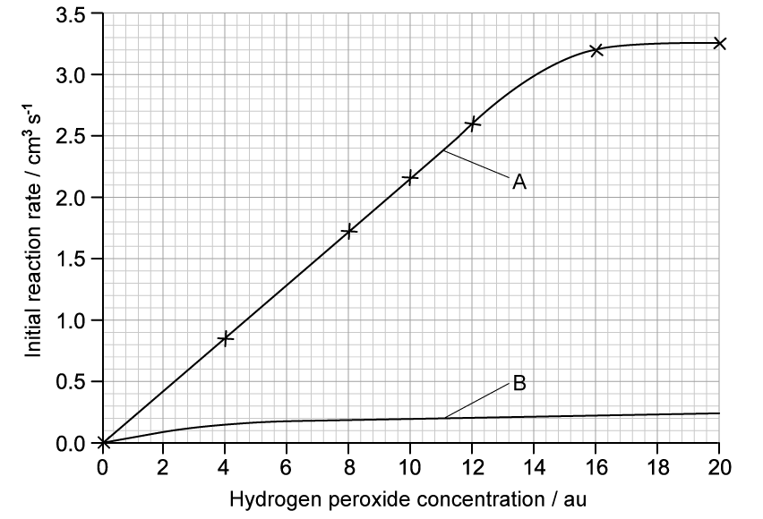

**Fig. 1**

With reference to Fig. 1, suggest an explanation for the effect of copper ions on the action of catalase.

**Q5** [2 marks]

**Extract:**

Hydrogen peroxide is broken down by the enzyme catalase.

A student investigated the initial rates of reaction for seven different concentrations of hydrogen peroxide. The results of this investigation are represented by line A in Fig. 1.

The investigation was repeated after adding copper ions to the different concentrations of hydrogen peroxide. The results of this investigation are represented by line B in Fig. 1.

Fig. 1
[Graph showing initial rate of reaction vs hydrogen peroxide concentration, with line A representing catalase without copper ions and line B representing catalase with copper ions]

Calculate the Km value for catalase in the absence of copper ions, using Fig. 1.

**Q5** [1 mark]

**Extract:**

Table 1 provides information about the enzymes carbonic anhydrase and penicillinase.

**Table 1**

| **Enzyme** | **Substrate** | **V**~**max**~** / arbitrary units** | **K**~**m**~** / µmol dm**^**-3**^ |
| Carbonic anhydrase | Carbon dioxide | 550 000 | 7500 |
| Penicillinase | Penicillin | 2300 | 54 |

The Michaelis-Menten constant, or K~m~, value provides information about an enzyme's affinity for its substrate. There is an inverse relationship between the two factors; the lower the K~m~ value, the higher the affinity of the enzyme for its substrate and vice versa.

Describe the effect that a competitive inhibitor would have on the affinity of an enzyme for its substrate.

### Q6 — medium — 8 marks

**Q6** [2 marks]

Fig. 1 shows the results of an investigation into the effects of pH on the activity of two enzymes (**X** and **Y**) taken from two different parts of the human digestive system.

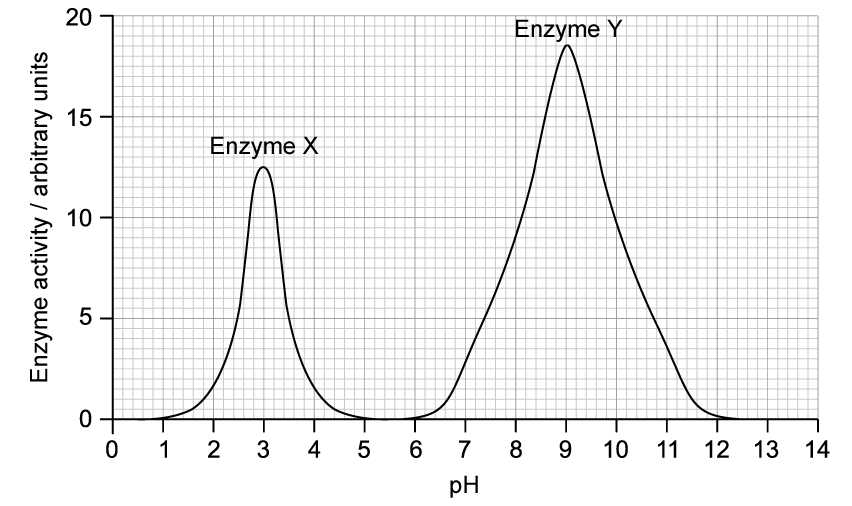

**Fig. 1**

Contrast the activity of enzymes **X** and **Y** in Fig. 1.

**Q6** [1 mark]

State the role of a buffer solution when investigating the effect of pH on the rate of the reaction.

**Q6** [3 marks]

Table 1 shows the results of an investigation into the effects of temperature on the reaction rate of amylase. Note that a.u. denotes arbitrary units.

**Table 1**

| **Temperature / °C** | **Rate of the reaction / a.u.** |
|---|---|
| 10 | 0.5 |
| 20 | 1.1 |
| 30 | 2.8 |
| 40 | 4.5 |
| 50 | 3.2 |
| 60 | 0.3 |
| 70 | 0 |

Explain the results when the temperature increased above 40 °C.

**Q6** [2 marks]

**Extract:**

Table 1 shows the results of an investigation into the effects of temperature on the reaction rate of amylase. Note that a.u. denotes arbitrary units.

Table 1

| **Temperature / °C** | **Rate of the reaction / a.u.** |
| 10 | 0.5 |
| 20 | 1.1 |
| 30 | 2.8 |
| 40 | 4.5 |
| 50 | 3.2 |
| 60 | 0.3 |
| 70 | 0 |

Calculate the percentage increase in the reaction rate between 10 °C and 40 °C.

### Q7 — medium — 9 marks

**Q7** [1 mark]

Fig. 1 shows the disaccharide lactose, which is found in milk.

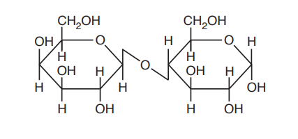

**Fig. 1**

Name the type of bond that joins the two monosaccharides in lactose.

*Source: Oct/Nov 2018 9700/21 Q2A*

**Q7** [3 marks]

The enzyme lactase catalyses the breakage of the bond between the two monosaccharides in lactose.

(i) Name the type of reaction that breaks this bond.

[1]

(ii) Some people do not produce the enzyme lactase, so cannot digest lactose.

The presence of lactose in the lumen of the intestine reduces the volume of water absorbed into the blood, resulting in diarrhoea.

Suggest why the presence of lactose in the intestine reduces the volume of water absorbed.

[2]

*Source: Oct/Nov 2018 9700/21 Q2B*

**Q7** [5 marks]

Enzymes, such as lactase, are often immobilised for use in the food industry.

A scientist carried out an investigation to determine the effects of temperature on the activity of lactase when it was immobilised and when it was free in solution.

The scientist produced alginate beads containing lactase for use in this investigation. The beads varied in size. The scientist selected small beads for the investigation and put them into a glass column.

(i) Suggest the advantage of using small beads rather than large beads.

[2]

(ii) Fig. 2 shows the results of the investigation to determine the effects of temperature on the activity of lactase when it was immobilised, **I**, and when it was free in solution, **F**.

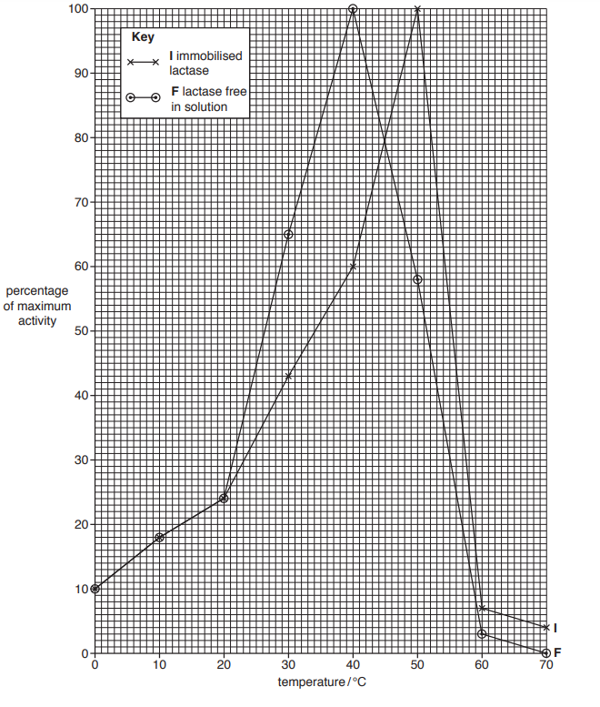

**Fig. 2**

With reference to Fig. 2, compare the effect of temperature on the activity of immobilised lactase, **I**, and lactase free in solution, **F**.

*Source: Oct/Nov 2018 9700/21 Q2C*

### Q8 — medium — 8 marks

**Q8** [2 marks]

Explain the effect that increasing the concentration of an enzyme would have on the rate of a reaction.

**Q8** [2 marks]

Sketch a graph showing enzyme concentration against the rate of reaction when the amount of substrate is limited.

**Q8** [2 marks]

Hydrogen peroxide is broken down by the enzyme catalase into water and oxygen. Catalase can be found inside most types of living cells, including potato cells.

A group of students investigated the effect of various concentrations of hydrogen peroxide on the reaction rate of catalase. They ground up a 3 cm piece of potato cylinder with 5 cm3 of distilled water to provide a solution containing catalase. They then made a serial dilution of the original 100 % stock solution of hydrogen peroxide before setting up three test tubes for each concentration of hydrogen peroxide. For each test tube, they dipped a filter paper disc into the catalase suspension and placed the disc at the bottom of the test tube containing 10 cm3 of hydrogen peroxide. They measured the time taken for the disc to float up to the surface of the hydrogen peroxide solution.

Their results are shown in Table 1.

**Table 1**

Calculate the reaction rate for the 100% hydrogen peroxide concentration. Show your working.

**Q8** [2 marks]

**Extract:**

Hydrogen peroxide is broken down by the enzyme catalase into water and oxygen. Catalase can be found inside most types of living cells, including potato cells.

A group of students investigated the effect of various concentrations of hydrogen peroxide on the reaction rate of catalase. They ground up a 3 cm piece of potato cylinder with 5 cm^3^ of distilled water to provide a solution containing catalase. They then made a serial dilution of the original 100 % stock solution of hydrogen peroxide before setting up three test tubes for each concentration of hydrogen peroxide. For each test tube, they dipped a filter paper disc into the catalase suspension and placed the disc at the bottom of the test tube containing 10 cm^3^ of hydrogen peroxide. They measured the time taken for the disc to float up to the surface of the hydrogen peroxide solution.

Their results are shown in Table 1.

Table 1

Explain the results of the investigation shown in Table 1.

### Q9 — medium — 10 marks

**Q9** [3 marks]

Researchers immobilised an amylase enzyme in alginate beads. They investigated the effects of temperature on the activity of the immobilised amylase compared with amylase that was free in solution.

The results for this investigation are shown in Fig. 1.

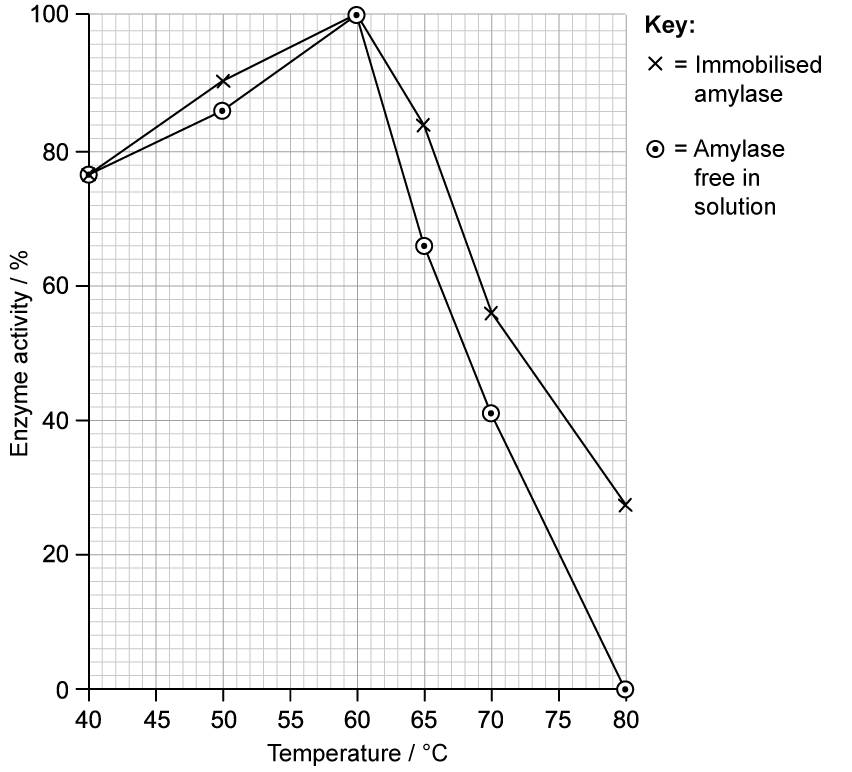

**                                                       Fig. 1**

Compare the effects of temperature on the activity of immobilised and free amylase shown in Fig. 1.

**Q9** [2 marks]

When the researchers immobilised amylase they had to ensure that the alginate beads were all the same size.

Suggest and explain **one** reason why using different sized alginate beads would affect the activity of immobilised amylase.

**Q9** [2 marks]

**Extract:**

Researchers immobilised an amylase enzyme in alginate beads. They investigated the effects of temperature on the activity of the immobilised amylase compared with amylase that was free in solution.

When the researchers immobilised amylase they had to ensure that the alginate beads were all the same size.

(i) State **one** variable **other than** bead size that the researchers should keep constant in this investigation.

[1]

(ii) Explain your answer to part (i).

[1]

**Q9** [3 marks]

State **three** advantages of using immobilised enzymes in industrial processes.

### Q10 — medium — 8 marks

**Q10** [2 marks]

Trypsin is an enzyme produced by the pancreas that hydrolyses proteins in the small intestine.

The activity of trypsin was investigated by placing a small amount of the enzyme with a known concentration of protein.

Fig. 1 shows the progress of this reaction when it is carried out at 25 °C.

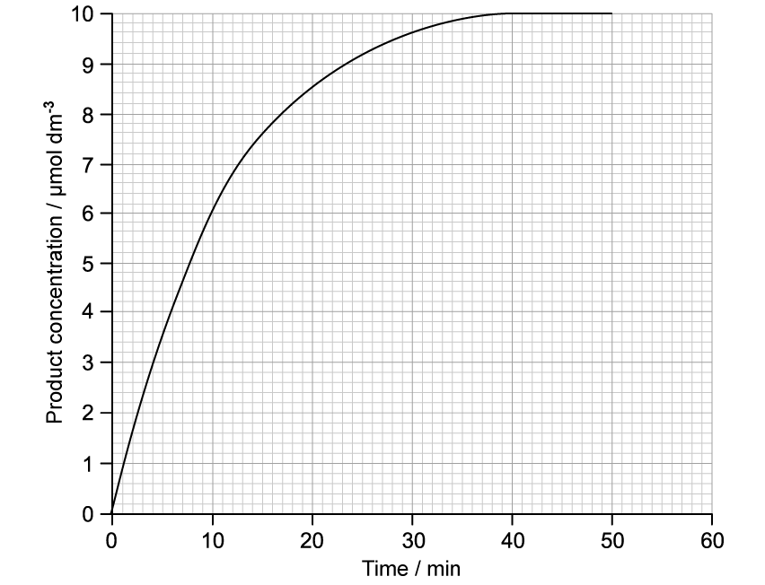

**Fig. 1**

Calculate the initial rate of the reaction in Fig. 1. Show your working.

**Q10** [2 marks]

**Extract:**

Trypsin is an enzyme produced by the pancreas that hydrolyses proteins in the small intestine. 

The activity of trypsin was investigated by placing a small amount of the enzyme with a known concentration of protein.

Fig. 1 shows the progress of this reaction when it is carried out at 25 °C.

**Fig. 1**

The procedure was repeated at the same temperature in the presence of a competitive inhibitor of trypsin.

Predict the results that will be obtained using the competitive inhibitor.

**Q10** [2 marks]

**Extract:**

Trypsin is an enzyme produced by the pancreas that hydrolyses proteins in the small intestine. The activity of trypsin was investigated by placing a small amount of the enzyme with a known concentration of protein. Fig. 1 shows the progress of this reaction when it is carried out at 25 °C.

The procedure was repeated at the same temperature in the presence of a competitive inhibitor of trypsin. Predict the results that will be obtained using the competitive inhibitor.

Describe how your prediction for part (b) would be different if a non-competitive inhibitor was used rather than a competitive inhibitor.

**Q10** [2 marks]

**Extract:**

Trypsin is an enzyme produced by the pancreas that hydrolyses proteins in the small intestine. 

The activity of trypsin was investigated by placing a small amount of the enzyme with a known concentration of protein.

Fig. 1 shows the progress of this reaction when it is carried out at 25 °C.

The investigation was extended to compare the initial reaction rates of trypsin obtained from different species of animals.

Suggest **two** advantages of calculating the **initial** reaction rates of enzyme catalysed reactions here rather than the reaction rates at another point during the experiment.

### Q11 — easy — 9 marks

**Q11** [2 marks]

Fig. 1 shows the results of an investigation into the effects of pH on the activity of two enzymes (**X** and **Y**) taken from two different parts of the human digestive system.

**Fig. 1**

Describe the effect that increasing the pH from 3 to 5 would have on the structure of enzyme **X**, based on the information in Fig. 1.

**Q11** [2 marks]

**Extract:**

Fig. 1 shows the results of an investigation into the effects of pH on the activity of two enzymes (X and Y) taken from two different parts of the human digestive system.

Use Fig. 1 to calculate the difference in the maximum enzyme activity of enzyme **X** and **Y**.

Give your answer in arbitrary units (a.u).

**Q11** [2 marks]

**Extract:**

Fig. 1 shows the results of an investigation into the effects of pH on the activity of two enzymes (**X** and **Y**) taken from two different parts of the human digestive system.

**Fig. 1**

Suggest which part of the digestive system enzyme **Y** was taken from and give a reason for your answer.

**Q11** [3 marks]

Amylase is an enzyme involved with the digestion of starch. It is active across a pH range of 5 to 10, with an optimum pH of 7. The maximum enzyme activity of amylase is 16 a.u.

Plot a curve in Fig. 1 to show the effect of pH on the activity of amylase.

### Q12 — easy — 6 marks

**Q12** [1 mark]

Define the term **optimum temperature** in the context of enzyme activity.

**Q12** [2 marks]

Fig. 1 below shows a set of graph axes labelled *rate of reaction* and *temperature*.

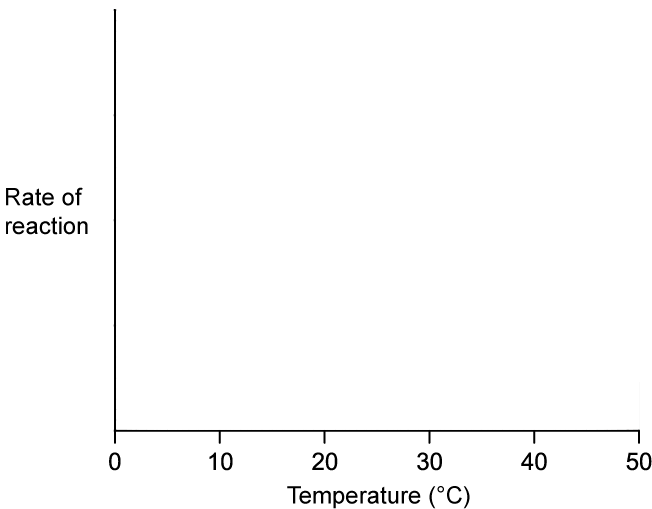

**Fig. 1**

(i) Sketch a line on Fig. 1 to show the relationship between the rate of an enzyme catalysed reaction and temperature. Assume that the enzyme is active in the cells of the human body.

[1]

(ii) Draw another line on Fig. 1 to identify the optimum temperature of the enzyme. Label the line clearly.

[1]

**Q12** [2 marks]

**Extract:**

Assume that the enzyme is active in the cells of the human body.

The optimum temperature of this enzyme should be indicated as any value between 35-40°C.

Taq polymerase is an enzyme taken from the bacterium *Thermus aquaticus.* *T. aquaticus* is found at extremely high temperatures within hydrothermal vents in the deep ocean.

Taq polymerase is a thermostable enzyme with an optimum temperature between 75-80 °C. It is used in a process called PCR, which has a large number of important scientific applications.

Explain the possible benefit of using *Taq* polymerase for PCR, rather than polymerase from human cells.

**Q12** [1 mark]

**Extract:**

Taq polymerase is an enzyme taken from the bacterium *Thermus aquaticus.* *T. aquaticus* is found at extremely high temperatures within hydrothermal vents in the deep ocean.

Taq polymerase is a thermostable enzyme with an optimum temperature between 75-80 °C. It is used in a process called PCR, which has a large number of important scientific applications.

Explain the possible benefit of using *Taq* polymerase for PCR, rather than polymerase from human cells.

*Taq* polymerase has a different chemical structure to human polymerase, allowing it to function at high temperatures.

Using your knowledge of protein structure, suggest **one** possible structural difference between the two types of polymerase.

### Q13 — easy — 6 marks

**Q13** [1 mark]

Fig. 1 shows the effect of increasing substrate concentration on reaction rate.

**Fig. 1**

Explain shape of the graph at point X.

**Q13** [1 mark]

**Extract:**

Fig. 1 shows the effect of increasing substrate concentration on reaction rate.

Identify the Vmax of the enzyme-catalysed reaction in Fig. 1.

**Q13** [2 marks]

Enzyme concentration is another factor that can affect the rate of an enzyme-controlled reaction.

Explain the relationship between enzyme concentration and rate of reaction when the supply of substrate is limited.

**Q13** [2 marks]

In an experimental scenario where both enzyme and substrate concentrations are high, state **two** circumstances under which the rate of reaction would not reach the maximum rate.

### Q14 — easy — 8 marks

**Q14** [2 marks]

Fig. 1 shows how the addition of a molecule (molecule **X**) affects the rate of an enzyme-controlled reaction.

**Fig. 1**

Describe how the addition of molecule **X** affects the rate of the reaction in Fig. 1.

**Q14** [2 marks]

**Extract:**

Fig. 1 shows how the addition of a molecule (molecule X) affects the rate of an enzyme-controlled reaction.

Fig. 2 shows how molecule X interacts with the enzyme.

**Fig. 2**

Explain the results shown in Fig. 1 by using the information in Fig. 2.

**Q14** [2 marks]

**Extract:**

Fig. 2 shows how molecule X interacts with the enzyme.

**Fig. 2**

Fig. 3 shows another molecule, molecule **Y**.

**Fig. 3**

Suggest how molecule **Y** might interact with the enzyme shown in Fig. 2.

**Q14** [2 marks]

**Extract:**

Fig. 1 shows how the addition of a molecule (molecule **X**) affects the rate of an enzyme-controlled reaction.

**Fig. 1**

Fig. 3 shows another molecule, molecule **Y**.

**Fig. 3**

Molecule **Y** might interact with the enzyme by...

Any **two** of the following:

- Binding to the active site; [1 mark]
- Preventing the substrate from binding / formation of an enzyme-substrate complex; [1 mark]
- Therefore acting as a competitive inhibitor; [1 mark]

Sketch a line on Fig. 1 to show how molecule **Y** might affect the rate of the reaction.

### Q15 — easy — 8 marks

**Q15** [2 marks]

The Michaelis-Menten constant (Km) measures the affinity of an enzyme for its substrate.

Define the term *Michaelis-Menten constant*.

**Q15** [1 mark]

**Extract:**

The Michaelis-Menten constant (K~m~) measures the affinity of an enzyme for its substrate.

Define the term *Michaelis-Menten constant*.

The Michaelis-Menten constant is the substrate concentration at which an enzyme works at half its maximum rate / ½V~max~.

An enzyme has a low Km value.

State the deduction that can be made regarding the affinity of the enzyme for its substrate.

**Q15** [3 marks]

Temperature is a factor that will affect the rate of an enzyme catalysed reaction.

State and explain the effect that lower temperatures would have on the rate of reaction.

**Q15** [2 marks]

Various factors may affect the rate of an enzyme catalysed reaction.

Other than temperature, state **two** such factors.
