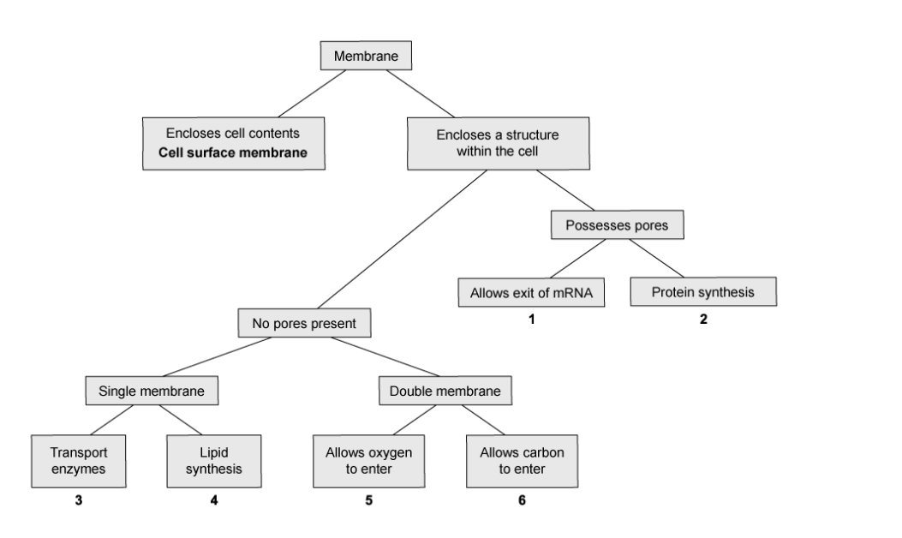
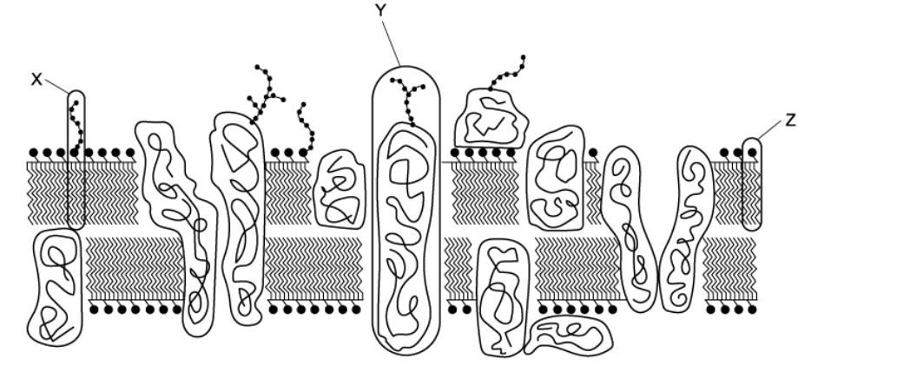
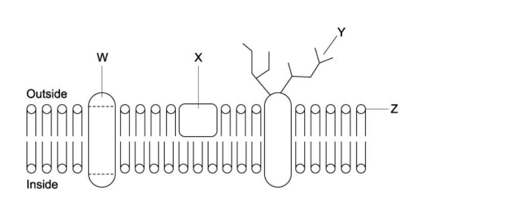
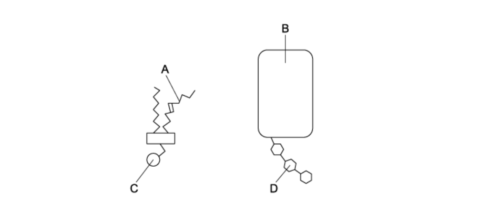
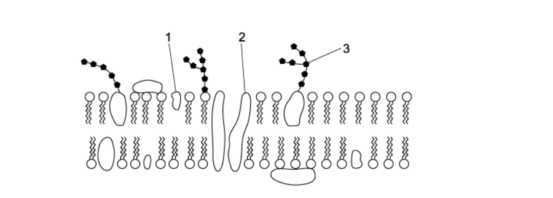
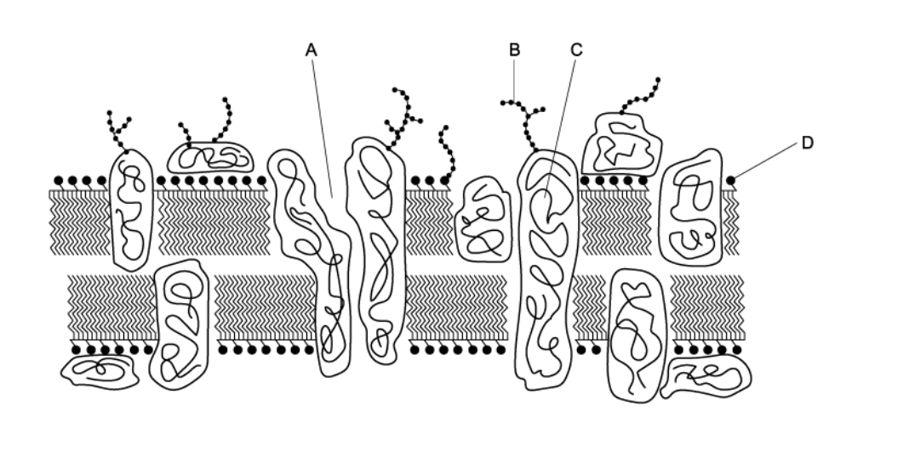
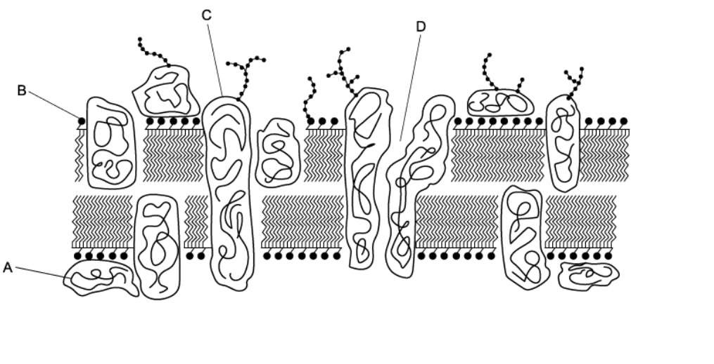
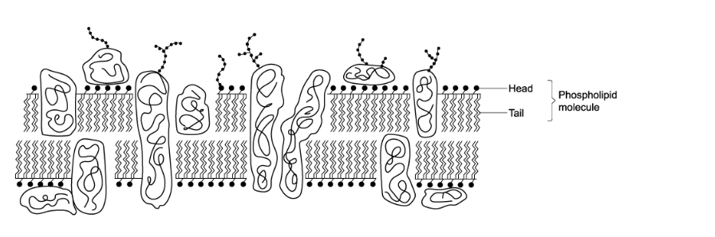
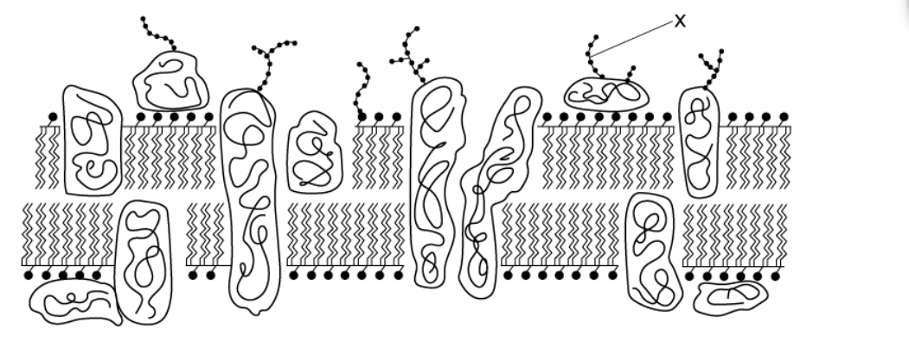
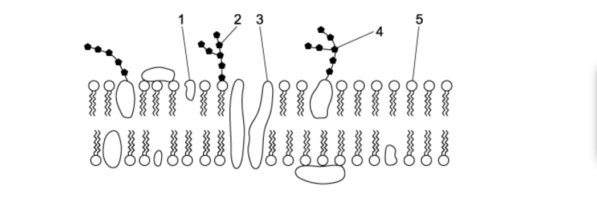

# Exam Questions — Fluid Mosaic Membranes
**4. Cell Membranes & Transport** · Cambridge (CIE) A-LEVEL biology (9700)
> Source: [https://www.savemyexams.com/a-level/biology/cie/25/topic-questions/](https://www.savemyexams.com/a-level/biology/cie/25/topic-questions/) · 30 questions across 1 sets

## Multiple Choice Questions (30 questions)

### Q1 — hard — 1 marks

**Q1** [1 mark]

Cell surface membranes and organelle cell membranes have different roles.

The diagram enables the identification of specific cell organelles based on their membrane’s structure and function.

Based on the information provided in the diagram, what is the correct outcome?

|   | 1 | 2 | 3 | 4 | 5 | 6 |
|---|---|---|---|---|---|---|
| **A** | chloroplast | vesicle | smooth ER | rough ER | nucleolus | mitochondrion |
| **B** | nucleus | rough ER | vesicle | smooth ER | mitochondrion | chloroplast |
| **C** | nucleolus | rough ER | vesicle | smooth ER | nucleus | mitochondrion |
| **D** | nucleus | smooth ER | mitochondrion | rough ER | vesicle | chloroplast |

### Q2 — hard — 1 marks

**Q2** [1 mark]

The diagram shows a section of a cell surface membrane.

What is the correct function of molecules X, Y and Z?

|   | X | Y | Z |
|---|---|---|---|
| **A** | chemical receptor | allow lipid soluble molecules to pass through | control the fluidity of the membrane |
| **B** | barrier to polar molecules | stabilise the membrane | antigen |
| **C** | antigen | chemical receptor | allow lipid soluble molecules to pass through |
| **D** | stabilise the membrane | control the fluidity of the membrane | barrier to polar molecules |

### Q3 — hard — 1 marks

**Q3** [1 mark]

Which statement correctly describes the intermolecular interactions that drive the bilayer formation when phospholipids are added to water?

### Q4 — hard — 1 marks

**Q4** [1 mark]

Epilepsy is a disorder of the central nervous system caused by the over-excitation of neurons. One cause of epilepsy is the inability for potassium ions to enter the cell.

What structural component of the cell membrane would be most likely to cause epilepsy if its structure was altered?

### Q5 — hard — 1 marks

**Q5** [1 mark]

Cholesterol and temperature both affect the fluidity of cell surface membranes.

Which statement is correct about the effect of cholesterol at different temperatures?

### Q6 — hard — 1 marks

**Q6** [1 mark]

An experiment was undertaken to test the permeability of the plasma membrane and tonoplast of beetroot cells in various different chemicals. Vacuoles of beetroot cells carry a red pigment which cannot diffuse through their plasma membranes and tonoplasts to leave the cell.

The beetroot was cut into equal 1 cm3 cubes before being washed under a tap for 15 seconds to remove pigment released from outer damaged cells. The cubes were then placed in the various solutions, all of which turned red.

The table below shows four possible behaviors of phospholipids and proteins in different solutions, which is correct?

|   | **solution** | **protein denatures** | **solution** | **phospholipids dissolve** |
|---|---|---|---|---|
| **A**  **B**  **C**  **D** | ethanol  50°C water  ethanol  dilute HCl | ✓  ✓  ✓  ✓ | dilute HCl  ethanol  50°C water  dilute HCl | ✓  ✓  ✓  ✓ |

### Q7 — hard — 1 marks

**Q7** [1 mark]

Which of the following do cell surface membranes and membranes within cells have in common?

### Q8 — hard — 1 marks

**Q8** [1 mark]

Signaling molecules are used to transfer information around the body. Once at the target cell there are different ways in which types of signaling molecules cause a response.

Which of the following acts directly in the nucleus?

### Q9 — hard — 1 marks

**Q9** [1 mark]

Membranes in cells include the following components.

| 1 | cholesterol |
|---|---|
| 2 | glycoproteins |
| 3 | phospholipids |
| 4 | proteins |

What is the correct function of each component?

|   | stabilising the hydrophobic layer | recognising self / non self | separating dissolved ions | transporting ions through membranes |
|---|---|---|---|---|
| **A**  **B**  **C**  **D** | 1  3  1  4 | 2  1  3  3 | 3  2  1  4 | 4  4  2  2 |

### Q10 — hard — 1 marks

**Q10** [1 mark]

Proteins in the cell surface membranes of mouse cells and human cells were labelled with green and red fluorescent dyes respectively.

When a cell from each species is fused together, the green and red fluorescent labels are first found in different regions of the hybrid cell’s cell surface membrane. After 40 minutes, the labels are evenly distributed around the entire cell surface membrane.

What explains this observation?

### Q11 — medium — 1 marks

**Q11** [1 mark]

A section of a cell surface membrane is shown in the diagram below.

Four functions of a cell surface membrane are listed:

| **1** | movement of fat-soluble molecules |
|---|---|
| **2** | gives the cell shape |
| **3** | cell recognition |
| **4** | movement of ions |

Which molecule is correctly paired with its function?

### Q12 — medium — 1 marks

**Q12** [1 mark]

An increase in which bond type will increase the fluidity of the cell surface membrane?

### Q13 — medium — 1 marks

**Q13** [1 mark]

A water-soluble signalling molecule binds to the cell surface membrane, causing the following processes to occur.

| 1 | Enzyme catalysed reaction |
|---|---|
| 2 | 2nd messenger production |
| 3 | Protein receptor conformational change |
| 4 | G-protein activation |

What is the correct sequence of events in the cell signalling pathway?

### Q14 — medium — 1 marks

**Q14** [1 mark]

Which row correctly matches the molecules found in the cell surface membrane with their function?

|   | form hydrogen bonds with water | act as receptor sites for hormones | recognise antibodies |
|---|---|---|---|
| **A** | proteins and glycolipids | phospholipids and cholesterol | cholesterol and proteins |
| **B** | cholesterol and proteins | proteins and glycolipids | phospholipids and cholesterol |
| **C** | glycolipids and glycoproteins | glycolipids and glycoproteins | glycolipids and glycoproteins |
| **D** | phospholipids and cholesterol | cholesterol and proteins | proteins and glycolipids |

### Q15 — medium — 1 marks

**Q15** [1 mark]

Temperature affects the fluidity of the cell surface membrane. Single celled species that cannot internally control their temperature, such as bacteria and yeast, change the composition of their membrane to maintain membrane structure.

How could bacteria and yeast adapt to an environment with a low temperature?

### Q16 — medium — 1 marks

**Q16** [1 mark]

Cystic fibrosis causes a defect in the cell surface membrane of epithelial cells, disrupting the transport of chloride ions out of affected cells.

Which membrane component is involved?

### Q17 — medium — 1 marks

**Q17** [1 mark]

Two cell surface membrane molecules are shown in the diagrams below.

Which part affects the fluidity of the membrane?

### Q18 — medium — 1 marks

**Q18** [1 mark]

A section of a cell surface membrane is shown in the diagram below.

What is the correct function for each of the structures labelled?

|   | regulates membrane fluidity | forms hydrogen bonds with water to stabilise membrane | transports ions and large polar molecules |
|---|---|---|---|
| **A**  **B**  **C**  **D** | 1  3  2  1 | 1  2  1  2 | 2  1  3  2 |

### Q19 — medium — 1 marks

**Q19** [1 mark]

Which row correctly describes the hydrophobicity of cell surface membrane molecules?

|   | Interior of a transport protein | Exterior of an intrinsic protein | Carbohydrate chain on a glycolipid |
|---|---|---|---|
| **A**  **B**  **C**  **D** | hydrophobic  hydrophobic  hydrophilic  hydrophilic | hydrophilic  hydrophobic  hydrophilic  hydrophobic | hydrophilic  hydrophobic  hydrophobic  hydrophilic |

### Q20 — medium — 1 marks

**Q20** [1 mark]

When an individual requires a blood transfusion it is important that their blood type is known. Humans have 4 different blood types and if the incorrect type is used it can lead to the body rejecting the new blood.

Which label shows the part of a molecule that is different on the cell surface membrane of red blood cells of different blood types?

### Q21 — easy — 1 marks

**Q21** [1 mark]

The fluid mosaic model of membrane structure is shown in the diagram.

Which labelled structure enables a hormone to recognise its target cell?

### Q22 — easy — 1 marks

**Q22** [1 mark]

Which of the following decreases the fluidity of the cell surface membrane?

| 1 | double bonds between carbon atoms in the fatty acid chains |
|---|---|
| 2 | cholesterol |
| 3 | fatty acids having longer chains |

### Q23 — easy — 1 marks

**Q23** [1 mark]

Which molecules found in the cell surface membrane are involved in cell recognition?

### Q24 — easy — 1 marks

**Q24** [1 mark]

If a membrane protein is temporarily attached to the membrane it is called ‘peripheral’. If it is permanently attached to the membrane it is called ‘integral’.

Proteins can either be described as ‘intrinsic’, if they extend across the whole bilayer, or ‘extrinsic’ if they are found in only one side of the bilayer.

What best describes a channel protein?

### Q25 — easy — 1 marks

**Q25** [1 mark]

A section of a cell surface membrane is shown in the diagram below.

Why are the phospholipid molecules arranged as shown?

### Q26 — easy — 1 marks

**Q26** [1 mark]

Which of the following statements about the fluid mosaic model of membrane is correct?

### Q27 — easy — 1 marks

**Q27** [1 mark]

A section of a cell surface membrane is shown in the diagram below and a molecule is labelled X.

What is molecule X made from?

### Q28 — easy — 1 marks

**Q28** [1 mark]

Triglycerides and phospholipids include the following structures:

1   glycerol linked to fatty acids

2   saturated fatty acid chains

3   hydrophobic fatty acid chains

Which structures cause the cell surface membrane to form a phospholipid bilayer?

### Q29 — easy — 1 marks

**Q29** [1 mark]

Which row correctly labels this diagram of a cell surface membrane?

|   | cholesterol | glycoprotein | glycolipid | protein | phospholipid |
|---|---|---|---|---|---|
| **A**  **B**  **C**  **D** | 3  5  1  5 | 2  3  4  2 | 4  2  2  4 | 1  4  3  3 | 5  1  5  1 |

### Q30 — easy — 1 marks

**Q30** [1 mark]

What is the function of cholesterol in the cell surface membrane?
