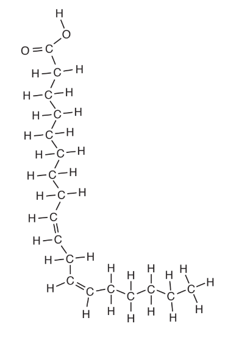
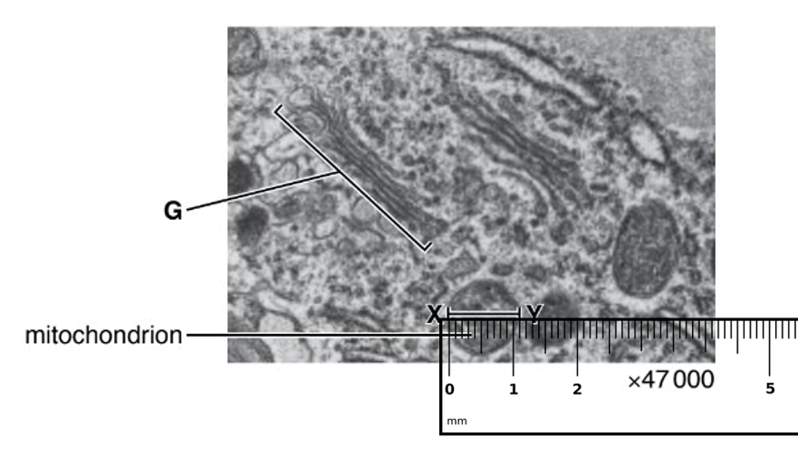
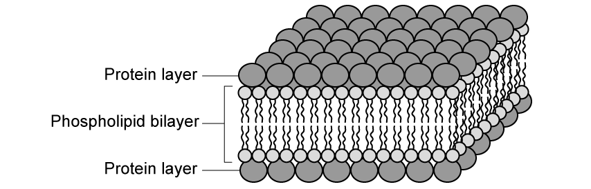
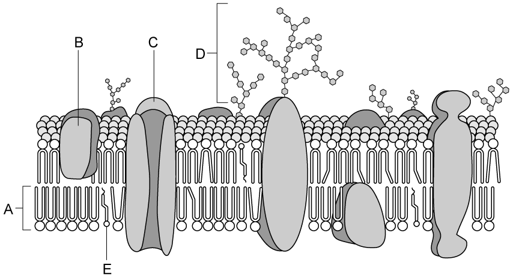
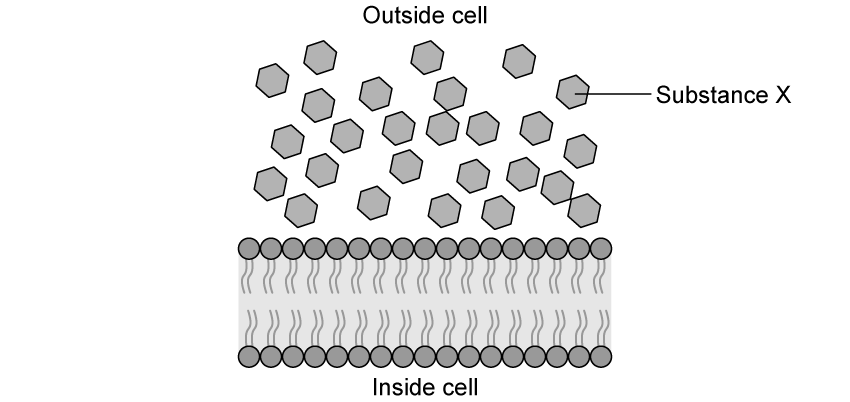

# Exam Questions — Fluid Mosaic Membranes
**4. Cell Membranes & Transport** · Cambridge (CIE) A-LEVEL biology (9700)
> Source: [https://www.savemyexams.com/a-level/biology/cie/25/topic-questions/](https://www.savemyexams.com/a-level/biology/cie/25/topic-questions/) · 39 questions across 2 sets

## Multiple Choice Questions (30 questions)

### Q1 — hard — 1 marks

**Q1** [1 mark]

Cell surface membranes and organelle cell membranes have different roles.

The diagram enables the identification of specific cell organelles based on their membrane’s structure and function.

Based on the information provided in the diagram, what is the correct outcome?

|   | 1 | 2 | 3 | 4 | 5 | 6 |
|---|---|---|---|---|---|---|
| **A** | chloroplast | vesicle | smooth ER | rough ER | nucleolus | mitochondrion |
| **B** | nucleus | rough ER | vesicle | smooth ER | mitochondrion | chloroplast |
| **C** | nucleolus | rough ER | vesicle | smooth ER | nucleus | mitochondrion |
| **D** | nucleus | smooth ER | mitochondrion | rough ER | vesicle | chloroplast |

### Q2 — hard — 1 marks

**Q2** [1 mark]

The diagram shows a section of a cell surface membrane.

What is the correct function of molecules X, Y and Z?

|   | X | Y | Z |
|---|---|---|---|
| **A** | chemical receptor | allow lipid soluble molecules to pass through | control the fluidity of the membrane |
| **B** | barrier to polar molecules | stabilise the membrane | antigen |
| **C** | antigen | chemical receptor | allow lipid soluble molecules to pass through |
| **D** | stabilise the membrane | control the fluidity of the membrane | barrier to polar molecules |

### Q3 — hard — 1 marks

**Q3** [1 mark]

Which statement correctly describes the intermolecular interactions that drive the bilayer formation when phospholipids are added to water?

### Q4 — hard — 1 marks

**Q4** [1 mark]

Epilepsy is a disorder of the central nervous system caused by the over-excitation of neurons. One cause of epilepsy is the inability for potassium ions to enter the cell.

What structural component of the cell membrane would be most likely to cause epilepsy if its structure was altered?

### Q5 — hard — 1 marks

**Q5** [1 mark]

Cholesterol and temperature both affect the fluidity of cell surface membranes.

Which statement is correct about the effect of cholesterol at different temperatures?

### Q6 — hard — 1 marks

**Q6** [1 mark]

An experiment was undertaken to test the permeability of the plasma membrane and tonoplast of beetroot cells in various different chemicals. Vacuoles of beetroot cells carry a red pigment which cannot diffuse through their plasma membranes and tonoplasts to leave the cell.

The beetroot was cut into equal 1 cm3 cubes before being washed under a tap for 15 seconds to remove pigment released from outer damaged cells. The cubes were then placed in the various solutions, all of which turned red.

The table below shows four possible behaviors of phospholipids and proteins in different solutions, which is correct?

|   | **solution** | **protein denatures** | **solution** | **phospholipids dissolve** |
|---|---|---|---|---|
| **A**  **B**  **C**  **D** | ethanol  50°C water  ethanol  dilute HCl | ✓  ✓  ✓  ✓ | dilute HCl  ethanol  50°C water  dilute HCl | ✓  ✓  ✓  ✓ |

### Q7 — hard — 1 marks

**Q7** [1 mark]

Which of the following do cell surface membranes and membranes within cells have in common?

### Q8 — hard — 1 marks

**Q8** [1 mark]

Signaling molecules are used to transfer information around the body. Once at the target cell there are different ways in which types of signaling molecules cause a response.

Which of the following acts directly in the nucleus?

### Q9 — hard — 1 marks

**Q9** [1 mark]

Membranes in cells include the following components.

| 1 | cholesterol |
|---|---|
| 2 | glycoproteins |
| 3 | phospholipids |
| 4 | proteins |

What is the correct function of each component?

|   | stabilising the hydrophobic layer | recognising self / non self | separating dissolved ions | transporting ions through membranes |
|---|---|---|---|---|
| **A**  **B**  **C**  **D** | 1  3  1  4 | 2  1  3  3 | 3  2  1  4 | 4  4  2  2 |

### Q10 — hard — 1 marks

**Q10** [1 mark]

Proteins in the cell surface membranes of mouse cells and human cells were labelled with green and red fluorescent dyes respectively.

When a cell from each species is fused together, the green and red fluorescent labels are first found in different regions of the hybrid cell’s cell surface membrane. After 40 minutes, the labels are evenly distributed around the entire cell surface membrane.

What explains this observation?

### Q11 — medium — 1 marks

**Q11** [1 mark]

A section of a cell surface membrane is shown in the diagram below.

Four functions of a cell surface membrane are listed:

| **1** | movement of fat-soluble molecules |
|---|---|
| **2** | gives the cell shape |
| **3** | cell recognition |
| **4** | movement of ions |

Which molecule is correctly paired with its function?

### Q12 — medium — 1 marks

**Q12** [1 mark]

An increase in which bond type will increase the fluidity of the cell surface membrane?

### Q13 — medium — 1 marks

**Q13** [1 mark]

A water-soluble signalling molecule binds to the cell surface membrane, causing the following processes to occur.

| 1 | Enzyme catalysed reaction |
|---|---|
| 2 | 2nd messenger production |
| 3 | Protein receptor conformational change |
| 4 | G-protein activation |

What is the correct sequence of events in the cell signalling pathway?

### Q14 — medium — 1 marks

**Q14** [1 mark]

Which row correctly matches the molecules found in the cell surface membrane with their function?

|   | form hydrogen bonds with water | act as receptor sites for hormones | recognise antibodies |
|---|---|---|---|
| **A** | proteins and glycolipids | phospholipids and cholesterol | cholesterol and proteins |
| **B** | cholesterol and proteins | proteins and glycolipids | phospholipids and cholesterol |
| **C** | glycolipids and glycoproteins | glycolipids and glycoproteins | glycolipids and glycoproteins |
| **D** | phospholipids and cholesterol | cholesterol and proteins | proteins and glycolipids |

### Q15 — medium — 1 marks

**Q15** [1 mark]

Temperature affects the fluidity of the cell surface membrane. Single celled species that cannot internally control their temperature, such as bacteria and yeast, change the composition of their membrane to maintain membrane structure.

How could bacteria and yeast adapt to an environment with a low temperature?

### Q16 — medium — 1 marks

**Q16** [1 mark]

Cystic fibrosis causes a defect in the cell surface membrane of epithelial cells, disrupting the transport of chloride ions out of affected cells.

Which membrane component is involved?

### Q17 — medium — 1 marks

**Q17** [1 mark]

Two cell surface membrane molecules are shown in the diagrams below.

Which part affects the fluidity of the membrane?

### Q18 — medium — 1 marks

**Q18** [1 mark]

A section of a cell surface membrane is shown in the diagram below.

What is the correct function for each of the structures labelled?

|   | regulates membrane fluidity | forms hydrogen bonds with water to stabilise membrane | transports ions and large polar molecules |
|---|---|---|---|
| **A**  **B**  **C**  **D** | 1  3  2  1 | 1  2  1  2 | 2  1  3  2 |

### Q19 — medium — 1 marks

**Q19** [1 mark]

Which row correctly describes the hydrophobicity of cell surface membrane molecules?

|   | Interior of a transport protein | Exterior of an intrinsic protein | Carbohydrate chain on a glycolipid |
|---|---|---|---|
| **A**  **B**  **C**  **D** | hydrophobic  hydrophobic  hydrophilic  hydrophilic | hydrophilic  hydrophobic  hydrophilic  hydrophobic | hydrophilic  hydrophobic  hydrophobic  hydrophilic |

### Q20 — medium — 1 marks

**Q20** [1 mark]

When an individual requires a blood transfusion it is important that their blood type is known. Humans have 4 different blood types and if the incorrect type is used it can lead to the body rejecting the new blood.

Which label shows the part of a molecule that is different on the cell surface membrane of red blood cells of different blood types?

### Q21 — easy — 1 marks

**Q21** [1 mark]

The fluid mosaic model of membrane structure is shown in the diagram.

Which labelled structure enables a hormone to recognise its target cell?

### Q22 — easy — 1 marks

**Q22** [1 mark]

Which of the following decreases the fluidity of the cell surface membrane?

| 1 | double bonds between carbon atoms in the fatty acid chains |
|---|---|
| 2 | cholesterol |
| 3 | fatty acids having longer chains |

### Q23 — easy — 1 marks

**Q23** [1 mark]

Which molecules found in the cell surface membrane are involved in cell recognition?

### Q24 — easy — 1 marks

**Q24** [1 mark]

If a membrane protein is temporarily attached to the membrane it is called ‘peripheral’. If it is permanently attached to the membrane it is called ‘integral’.

Proteins can either be described as ‘intrinsic’, if they extend across the whole bilayer, or ‘extrinsic’ if they are found in only one side of the bilayer.

What best describes a channel protein?

### Q25 — easy — 1 marks

**Q25** [1 mark]

A section of a cell surface membrane is shown in the diagram below.

Why are the phospholipid molecules arranged as shown?

### Q26 — easy — 1 marks

**Q26** [1 mark]

Which of the following statements about the fluid mosaic model of membrane is correct?

### Q27 — easy — 1 marks

**Q27** [1 mark]

A section of a cell surface membrane is shown in the diagram below and a molecule is labelled X.

What is molecule X made from?

### Q28 — easy — 1 marks

**Q28** [1 mark]

Triglycerides and phospholipids include the following structures:

1   glycerol linked to fatty acids

2   saturated fatty acid chains

3   hydrophobic fatty acid chains

Which structures cause the cell surface membrane to form a phospholipid bilayer?

### Q29 — easy — 1 marks

**Q29** [1 mark]

Which row correctly labels this diagram of a cell surface membrane?

|   | cholesterol | glycoprotein | glycolipid | protein | phospholipid |
|---|---|---|---|---|---|
| **A**  **B**  **C**  **D** | 3  5  1  5 | 2  3  4  2 | 4  2  2  4 | 1  4  3  3 | 5  1  5  1 |

### Q30 — easy — 1 marks

**Q30** [1 mark]

What is the function of cholesterol in the cell surface membrane?

## Structured Questions (9 questions)

### Q1 — hard — 9 marks

**Q1** [2 marks]

Linoleic acid is an unsaturated fatty acid that is found in some triglycerides and some phospholipids.

Phospholipids are components of cell membranes.

Fig. 1 shows a molecule of linoleic acid.

**Fig. 1**

The composition of cell membranes of plants changes in response to changes in temperature.

At the start of the cold season, there is an increase in the proportion of phospholipids with unsaturated fatty acids in the chickpea, *Cicer arietinum*. Chickpea plants that do not make this change do not survive.

Suggest how the increase in the proportion of phospholipids with unsaturated fatty acids helps plants, such as chickpea, survive decreases in temperature.

*Source: May/June 2019 9700/21 Q2A*

**Q1** [3 marks]

(i) State why triglycerides and phospholipids **cannot **be described as polymers.

[1]

(ii) State two **differences **in the **structure **of triglycerides and phospholipids.

[2]

*Source: May/June 2019 9700/21 Q2B*

**Q1** [4 marks]

Platelets metabolise linoleic acid to produce a molecule known as thromboxane.

Thromboxane is released by platelets when blood loss occurs. Thromboxane acts on smooth muscle cells in the walls of arteries. This causes arteries to constrict, which reduces blood flow.

Explain why the constriction of arteries following blood loss is an example of cell signalling.

*Source: May/June 2019 9700/21 Q2C*

### Q2 — hard — 8 marks

**Q2** [2 marks]

Glucagon is a hormone that affects the activity of liver cells, leading to an increase in blood glucose levels. Glucagon acts as a ligand.

Suggest the features of glucagon that make it an example of a ligand.

**Q2** [2 marks]

Glucagon is a hydrophilic peptide hormone, while oestrogen is a hydrophobic steroid hormone.

Using your knowledge of the cell surface membrane:

(i) Suggest one contrasting feature between the mechanism of action of glucagon and oestrogen signalling molecules.

[1]

(ii) Explain your answer to part (i).

[1]

**Q2** [4 marks]

Glycoproteins play an important role in cell signalling.

Explain the role of glycoproteins in initiating a response inside a cell.

### Q3 — hard — 8 marks

**Q3** [1 mark]

Fig. 1 shows the molecular diagram of part of the fluid mosaic structure of the plasma membrane. These molecules play an important role in maintaining the stability of the plasma membrane.

**Fig. 1**

Identify the part of the fluid mosaic structure of the plasma membrane represented by the molecular diagram in Fig.1.

**Q3** [3 marks]

Scientists have found that wheat crops adapted to grow in winter have increased unsaturated phospholipid content.

Suggest why the presence of unsaturated phospholipids would be advantageous.

**Q3** [2 marks]

Pieces of phospholipid bilayer were analysed from two different mammalian cell surface membranes. Sample **X** contained phospholipid molecules at a density of 4.2 x 106 molecules µm-2, whereas sample **Y** contained phospholipid molecules at a density of 5.5 x 106 molecules µm-2. One sample was from an exocrine pancreatic cell and the other was from a skin cell. Identify, with reasons, which cell type corresponds to samples **X** and** Y**.

**Q3** [2 marks]

Researchers have discovered that an individual phospholipid molecule can exchange places with its neighbouring phospholipid molecule in a monolayer as frequently as 107 times per second.

By contrast, phospholipid molecules almost never exchange places with each other from one monolayer to the other within a bilayer, referred to as a ‘flip-flop’ exchange. The ‘flip-flop’ takes place around once a month for a typical phospholipid molecule.

Suggest why there is this difference in molecular behaviour.

### Q4 — medium — 9 marks

**Q4** [1 mark]

Fig. 1 is an electron micrograph of part of a eukaryotic cell.

A ruler is shown in the image for scale.

**Fig. 1**

State how it is possible to deduce that Fig. 1 is a transmission electron micrograph and **not** a scanning electron micrograph.

*Source: Specimen 2022 9700/02 Q1A*

**Q4** [2 marks]

**Extract:**

Fig. 1 is an electron micrograph of part of a eukaryotic cell.

A ruler is shown in the image for scale.

Both the Golgi body and the rough endoplasmic reticulum are part of the network of membranes inside cells.

Outline structural features shown in Fig. 1 that identify **G** as the Golgi body and **not** the rough endoplasmic reticulum.

*Source: Specimen 2022 9700/02 Q1B*

**Q4** [2 marks]

**Extract:**

Fig. 1 is an electron micrograph of part of a eukaryotic cell.

A ruler is shown in the image for scale.

Calculate the actual diameter, **X–Y,** of the mitochondrion labelled in Fig. 1

Write down the formula that you will use to make your calculation. Give your answer to the nearest whole **nanometre** (nm).

*Source: Specimen 2022 9700/02 Q1C*

**Q4** [4 marks]

Many of the cell structures in Fig. 1 are surrounded by membranes.

Membranes are approximately 6 nm to 7 nm wide.

(i)Describe the fluid mosaic model of membrane structure.

[3]

(ii)The inner membrane of the mitochondrial envelope is much less permeable than the outer membrane.

Suggest **one** way in which the structure of the inner membrane of the mitochondrion may differ from that of the outer membrane to produce a **less permeable** inner membrane.

[1]

*Source: Specimen 2022 9700/02 Q1DI & DII*

### Q5 — medium — 11 marks

**Q5** [5 marks]

Some components of the cell surface membrane include:

- Phospholipid molecules
- Protein molecules
- Cholesterol molecules

Draw a labelled diagram of a section through a cell surface membrane to show how the components mentioned above are organised within the membrane. Include other named components and label the inner and outer surfaces of the membrane.

**Q5** [2 marks]

The cell surface membrane is said to be partially permeable.

Explain how the structure of a phospholipid prevents some substances from diffusing directly between the phospholipids that make up the cell surface membrane.

**Q5** [3 marks]

High temperatures can denature membrane proteins.

Suggest the effect this would have on a cell surface membrane.

**Q5** [1 mark]

State **one** role of phospholipid bilayers **within** the cell.

### Q6 — medium — 11 marks

**Q6** [2 marks]

In 1935 a model describing the structure of the cell surface membrane was proposed by the biologists Davson and Danielli. Fig. 1 shows a representation of their proposal.

**                                                                 Fig. 1**

The model shown in Fig. 1 was replaced in 1972 when two other scientists, Singer and Nicolson, proposed the fluid mosaic model to describe the structure of the cell surface membrane.

Describe what is meant by the term 'fluid mosaic'.

**Q6** [4 marks]

**Extract:**

In 1935 a model describing the structure of the cell surface membrane was proposed by the biologists Davson and Danielli. Fig. 1 shows a representation of their proposal.

The model shown in Fig. 1 was replaced in 1972 when two other scientists, Singer and Nicolson, proposed the fluid mosaic model to describe the structure of the cell surface membrane.

Compare the model of membrane structure shown in Fig. 1 with the fluid mosaic model that replaced it.

**Q6** [3 marks]

Explain how the features of a phospholipid contribute to the structure of a cell surface membrane.

**Q6** [2 marks]

State **two** features of cell membranes **other than** the structure that can be explained by the fluid mosaic model.

### Q7 — easy — 10 marks

**Q7** [3 marks]

(i) State the **two** types of molecules that most often act as receptors on the surfaces of cell membranes.

[2]

(ii) State the generic name of the signalling molecules that are secreted from certain cells.

[1]

**Q7** [2 marks]

Describe the step that occurs between the secretion of the signalling compound stated in part (a)(ii) and its arrival at the membrane compound stated in part (a)(i).

**Q7** [4 marks]

Fig. 1 shows some keywords from the cell signalling pathway involved in the regulation of blood glucose levels.

**Fig. 1**

Link each box on the left with the most appropriate one on the right using a straight line.

**Q7** [1 mark]

Hormones, like insulin mentioned in part (c), act as messengers in cell signalling in the endocrine system.

Name the group of chemical messengers that play a role in the transmission of nervous impulses.

### Q8 — easy — 8 marks

**Q8** [2 marks]

Fig. 1 shows a diagram of part of a cell surface membrane.

**                                                              Fig. 1**

Identify molecules **A **and **B**.

**Q8** [2 marks]

**Extract:**

Fig. 1 shows a diagram of part of a cell surface membrane.

Describe the role of molecule **C** in Fig. 1.

**Q8** [2 marks]

**Extract:**

Fig. 1 shows a diagram of part of a cell surface membrane.

State **two **functions of molecule **D** in Fig. 1.

**Q8** [2 marks]

**Extract:**

Fig. 1 shows a diagram of part of a cell surface membrane.

Explain the importance of molecule **E **in Fig. 1 when the cell is exposed to **high** temperatures.

### Q9 — easy — 9 marks

**Q9** [4 marks]

Fig. 1 shows a cell surface membrane and some molecules of a small, nonpolar substance shown as substance **X**.

**Fig. 1**

Predict and explain what will happen to substance **X **in Fig. 1.

**Q9** [1 mark]

**Extract:**

Fig. 1 shows a cell surface membrane and some molecules of a small, nonpolar substance shown as substance **X**.

Give a possible name for substance **X**.

**Q9** [2 marks]

Substance **Y **is a large molecule and is not lipid-soluble.

Describe how substance **Y **would travel across a cell membrane from an area of high to low concentration.

[2]

**Q9** [2 marks]

**Extract:**

Substance **Y** is a large molecule and is not lipid-soluble.

State and explain how an increase in temperature would affect the rate of movement of substance **Y **across a cell membrane.
