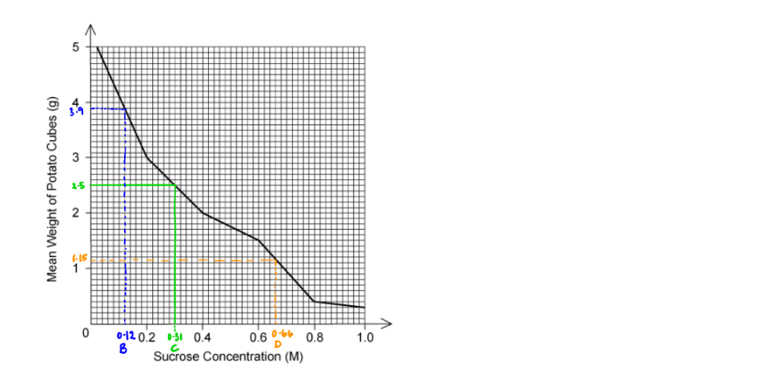
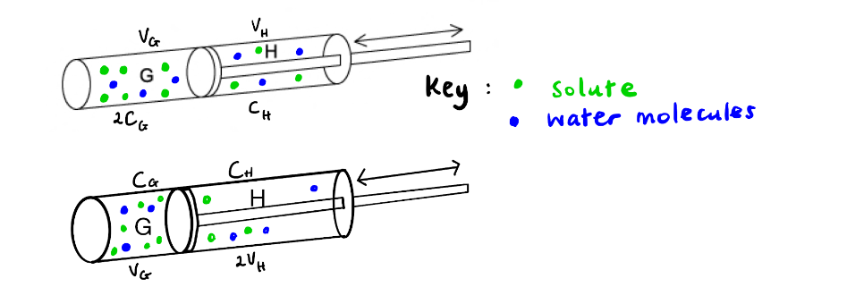

# Mark Schemes — Movement into & out of Cells
**4. Cell Membranes & Transport** · Cambridge (CIE) A-LEVEL biology (9700)

## Multiple Choice Questions (30 questions)

### Q1
**Final answer:** **The correct answer is ****C**

- In solutions with a water potential below this value the droplets moved down; this is because they have been extracted from bathing solutions that had a higher water potential than that of the beetroot cells

  - Water molecules moved out of the beetroot discs, resulting in a **more dense** solution
  - The droplet has a higher density than its surroundings after transfer and so it **sinks**
- In solutions with water potential above this value the droplets moved up; this is because they have been extracted from bathing solutions that had a lower water potential than that of the beetroot cells

  - Water molecules moved into the beetroot discs, resulting in a **less dense** solution
  - The droplet has a lower density than its surroundings after transfer and so it **rises**
- Where there was an equal concentration on both sides of a membrane there was no net movement of water molecules

  - The density of the sucrose solution extracted from the bathing solution  is **equal to** the density of the solution into which it is transferred
  - There is **no vertical movement** of the droplet

**Determining the most likely concentration of the solution:**

**Step 1**: note the concentration at which there is no vertical movement of the droplet

- **0.4 mol dm****-3**

**Step 2**: consider which of the given water potential values is most likely to correspond to this concentration

- We know that:

0.1 dm-3 = -251 kPa

0.7 dm-3 = -1876 kPa

- We would expect a value corresponding to 0.4 dm-3 to be approximately half way between this two values, meaning that **-1083 kPa** is a more likely value than -593

  - The value that falls half way between these values is -1063; this can be calculated by working out the mean value

### Q2
**Final answer:** **The correct answer is ****B ****because:**

**Final answer:** **Cuboid (1):**

- **The surface area of the cuboid (1) is 32 cm****2 **

  - **(4 x 2 x 4) + (4 x 1 x 2) = 32**
- **The volume is 8 cm****3**** **

  - **4 x 2 x 1 = 8**
- **Therefore the ratio is ****4:1**

  - **32:8 = 4:1 (divide both by 8)**

**Final answer:** **Cube (2):**

- **The surface area of the cube (2) is 24cm****2**** **

  - **(2 x 2) x 6 = 24**
- **The volume is 8 cm****3**

  - **2 x 2 x 2 = 8**
- **Therefore the ratio is ****3:1**

  - **24:8 = 3:1 (divide both by 8)**
- **The ****greater**** the surface area to volume ratio the ****faster**** the rate of diffusion (Fick’s Law states that the rate of diffusion is directly proportional to the surface area)**

> *A **is incorrect as the SA:V ratio is bigger in 1 than 2 **not **smaller*

> *C **is incorrect as the SA:V is smaller in 2 than 1*

> *D **is incorrect as the SA:V are **not** equal*

### Q3
**Final answer:** **The correct answer is ****C ****because:**

- **If the potato has the same water potential as the sucrose concentration then the ****net ****movement of water molecules will be zero, that is there will not be a change in weight**
- **If the initial weight of the potato cubes was 2.5g then the sucrose concentration where there has been no change in mass is at 0.31M**

> *A **is incorrect as 0 M of sucrose (water) would cause the potato cubes to **increase** in weight as the water molecules moved from higher water potential (in the test tube) to lower water potential (inside the potato)*

> *B **is incorrect as 0.12 M would cause the potato cubes to **increase** in weight, as shown on the graph, as the water moved by osmosis from the higher water potential (in the test test tube) to the lower water potential (inside the potato)*

> *D **is incorrect as 0.66 M would cause the potato cubes to **decrease** in weight, as shown on the graph, as the water moved by osmosis from the higher water potential (inside the potato) to the lower water potential (in the test tube)*

### Q4
**Final answer:** **The correct answer is ****D ****because:**

- **Active transport is dependent on the presence of ****carrier**** ****proteins**** that undergo conformational change (due to the presence of ATP) to move substances from a lower concentration to a higher concentration ****not**** on the fluidity of the cell surface membrane**

> *A **is incorrect as endocytosis involves the cell surface membrane needing to move to engulf large molecules or large quantities of molecules.*

> *B **& **C **are incorrect as osmosis and diffusion involve molecules moving through the cell surface membrane.*

### Q5
**Final answer:** **The correct answer is ****C**** because:**

- **Water potential is dependent on the ****concentration**** of a ****solute**
- **Glucose is the smallest molecule out of the options and therefore more molecules of glucose is needed to make up the same weight, resulting in a higher concentration of glucose**
- **A higher concentration of solute results in a lower (less pure) water potential**

### Q6
**Final answer:** **The correct answer is ****D ****because:**

- **Initially the concentration in compartment G is twice that of compartment H (C****G**** = 2C****H****) and the volumes of the compartments are equal (V****G**** = V****H****)**
- **Therefore to reach osmotic equilibrium the volume in H must be doubled to increase the concentration to reach the same concentration as compartment G**

> *A **is incorrect as doubling the concentration **and** volume of compartment H would result in a higher concentration in compartment H.*

> *B is incorrect as as the initial concentration in G was double H then having the same volume in both compartments would not allow the osmotic equilibrium to be reached*

> *C **is incorrect as  this would result in compartment H having double the concentration of G*

### Q7
**Final answer:** **The correct answer is ****D ****because:**

- **The closer the water potential is to 0 the less solutes are present and therefore the more pure the water is**
- **Cell Y ****(-300 kPa) has the ****highest**** water potential and therefore water will move by osmosis from this cell to the other two**
- **Cell Z ****(-600 kPa) has a ****higher**** water potential than ****cell X**** (-900 kPa) therefore water will move by osmosis from Z to X**

> *A **is incorrect as water will move from an area of high (less negative) water potential to an area of low (more negative) water potential, therefore water would not travel from X (-900 kPa) to Y (-300 kPa)*

> *B **is incorrect as the water would not move from cell Z to Y as there is a **lower** water potential in Z (-600 kPa) than Y (-300 kPa)*

> *C **is incorrect as the water would not move from cell X to Z as there is a **lower** water potential in X (-900 kPa) than Z (-600 kPa)*

### Q8
**Final answer:** **The correct answer is ****D ****because:**

- **If the volume of the cytoplasm increases the surface area (SA) to volume (V) ratio decreases thus the rate of ****diffusion**** slows as does the rate of metabolism **
- **This is because diffusion is only effective over ****short**** distances, and if the oxygen needs to travel a long distance to the mitochondria for use in respiration the rate of energy (****ATP****) production will ****decrease**** **
- **If oxygen cannot diffuse into the cell quickly enough aerobic respiration cannot occur and therefore ****active transport**** and ****exocytosis**** will not occur as these processes require cellular energy**

> *A **& **C **are incorrect as the growth of the cell affects diffusion, active** **transport** and** exocytosis.*

> *B **is incorrect as the rate of osmosis is not dependent on the mass of the cell. It is **dependent** on the water potential.*

### Q9
**Final answer:** **The correct answer is ****D ****because:**

- **As the percentage of oxygen ****increases****, so does the ****rate**** of sodium uptake, which means that sodium uptake is ****dependent**** on oxygen**
- **Oxygen is used in ****respiration**** to produce ****ATP**** (cellular energy), at low oxygen percentages there is not enough ATP produced to transport the sodium ions**
- **Therefore, sodium ions are moving by ****active**** transport (energy requiring) ****up**** their concentration gradient**
- **The other options are all examples of ****passive**** transport, which don’t require energy. However, ****only**** water can move via osmosis - not sodium ions.**

### Q10
**Final answer:** **The correct answer is ****C ****because:**

**Final answer:** **Susbtance Y is moving into the cell by facilitated diffusion, meaning that it is ****dependent on transport proteins**** to move across the membrane. Once the concentration of susbtance Y is high enough for all of the transport proteins to be in use at the same time, it is ****not possible for transport to occur any faster****, and the rate of movement into the cell levels off; it can be said that the ****transport proteins are saturated****. The proteins are only saturated briefly as they transport a molecule before they are available for use again, meaning that transport continues to occur at this constant rate.**

> *A** is incorrect because **ATP is only required during the active transport** of molecules; facilitated diffusion occurs down a concentration gradient and no ATP is required.*

> *B **is incorrect because equilibrium will not be reached in this situation. The **X axis shows an increasing concentration of the substance outside the cell**, so there is no opportunity for equilibrium to occur. We can also note here that if equilibrium were the reason, then there would be no reason for substance X to not show the same pattern as substance Y. Furthermore, equilibrium would lead to a reduction in the rate of entry to the cell, not a levelling off.*

> *D** is incorrect because the higher concentration does not alter the number of carrier proteins present or their effectiveness in transporting molecules, so they will continue to move substances into and out of the cell depending on the concentration gradient.*

### Q11
**Final answer:** **The correct answer is**** A ****because:**

- **The pores in the membrane separating the two solutions is ****too small**** for glucose to pass through, so the amount of glucose in each solution remains ****constant**
- **Therefore, water moves by ****osmosis**** down its ****water potential gradient ****to create an ****equilibrium**** between the two solutions**
- **Water moves from solution ****1**** to solution ****2**** so that there is an equal ratio of water to glucose which cause the volume of water in solution 1 to decrease and the volume of solution 2 to increase by the same amount**
- **The concentration of solution 1 from the start to the end increases as there is less water per glucose molecule, the opposite is true for solution 2.**

### Q12
**Final answer:** **The correct answer is ****C**** because:**

- **In distilled water the water will move from the pure water (high water potential) ****into**** the cell (lower water potential) via osmosis, causing ****animal cells**** to swell and ****burst**** **
- **The ****cell wall**** of plant cells is ****strong**** and withstands the pressure of increased water in the cell cytoplasm, therefore plant cells swell and become ****turgid**

> *Both** plant and animal cell surface membranes are **partially permeable**, which means that they let **some** molecules across, but **not** all. This is thanks to the phospholipids creating a **hydrophobic barrier** and channel/carrier proteins enabling the transport of **specific** molecules.*

> *The presence of a vacuole does **not** affect the movement of water into the cell causing cell bursting.*

> *Plant cell walls are made of cellulose and are freely permeable, however, this does not explain why animal cells burst but plant cells do not.*

### Q13
**Final answer:** **The correct answer is ****C**** because:**

- **-2500 kPa is a ****very low water potential****, lower than most cells, and this will cause water to move ****out**** of cells via ****osmosis**** down its water potential gradient into the seawater**
- **The movement of water out of the cells will cause them to ****shrivel**** and ****die**
- **The root hair cells need to ****lower**** their own water potential by ****increasing**** the concentration of ****solutes****, such as salts, in order to create a concentration ****equilibrium**** with the seawater and stop the movement of water by osmosis**

> *If root hair cells had a very high water potential then this would **increase** the rate of osmosis out of the cell and cause the root hair cell to shrivel and die.*

> *Having leaves with a large surface area will **increase** the rate of osmosis out of the cell as there will be a larger surface area for osmosis to take place.*

> *Having a high density of **stomata** (pores in the underside of leaves which allow gas exchange and **transpiration**) will increase the amount of water loss which will **not** be favourable for the plant. *

### Q14
**Final answer:** **The correct answer is ****C ****because:**

- **Water will move by osmosis ****into**** Z down a water potential gradient due to the solution at Z being more concentrated **
- **This causes a corresponding increase in the pressure at Z (referred to as hydrostatic pressure) and therefore a pressure gradient between Z and Y, causing a mass flow of sucrose solution from Z to Y (moving fluid from a source to a sink)**
- **This would make X the phloem and W the xylem. Water will initially be drawn along tube W from the beaker with Y to the beaker with Z (as water gradient established by water being drawn into Z)**
- **Z therefore represents leaves and Y represents roots**

> *A **& **B **are incorrect as this option involves the solution moving against the direction of flow created by hydrostatic pressure increasing at Z as a result of the movement of water by osmosis.*

> *D **is incorrect as this option lists the source as the roots and the sink as the leaves which would be incorrect.*

### Q15
**Final answer:** **The correct answer is ****B**** because:**

- **Water moves from a ****high water potential**** to a ****low water potential**** via ****osmosis.**
- **Diagram 1 ****shows ****normal**** red blood cells with water constantly moving in both directions across the cell membrane via osmosis, this means that the water potential outside the cell is the ****same**** as the water potential inside the cell. The solution is therefore ****isotonic****.  **
- **Diagram 2 ****shows red blood cells swelling and ****bursting**** because more water is moving ****into**** the cell than out of the cell, this means that the water potential outside the cell is ****higher**** than the water potential inside the cell. The solution is ****hypotonic****.  **
- **Diagram 3**** shows red blood cells ****shrivelling**** because more water is leaving the cell than entering the cell because the water potential outside the cell is ****lower**** than the water potential inside the cell. The solution is ****hypertonic****.  **
- **Therefore, cells in diagram 3 are in the solution with the lowest water potential, followed by cells in diagram 1. The cells in diagram 2 are in solution with the highest water potential (the closest to pure water). **

### Q16
**Final answer:** **The correct answer is ****C**** because:**

- **Viruses enter the cell by ****endocytosis**** (specifically phagocytosis)**
- **A virus will bind to a ****protein receptor**** (probably a glycoprotein) on the ****extracellular**** side of the cell surface membrane **
- **This protein will then signal for the cell membrane to wrap around the virus and ****engulf**** it **
- **The cell membrane completely surrounds the virus and pinches off to form a ****vesicle**** within the cell**

> *The virus would bind to a protein receptor, not a phosphate head. Bulk transport **into** the cell is called **endocytosis** (**en** sounds like **in**), bulk transport **out** of the cell is called **exocytosis** (**ex**it).*

### Q17
**Final answer:** **The correct answer is ****D ****because: **

- **All of these structures are very large, much larger than 2.4nm**
- **For example, haemoglobin is the ****smallest**** of the options and it is a protein that spans ****6.9nm****.**
- **Glycogen is a ****polymer**** made of glucose molecules, therefore if one glucose molecule is just about to fit through a pore, glycogen will not be able to. **

> *Visking tubing** mimics the membrane of cells and these structures would require bulk transport (endocytosis and exocytosis) to cross a cell membrane.*

### Q18
**Final answer:** **The correct answer is ****D**** because:**

- **A ****steeper**** ****concentration gradient**** (a large difference between the concentration of two areas) ****increases**** the speed of diffusion**
- **Higher**** ****temperatures**** give molecules more ****kinetic energy**** which causes them to diffuse ****faster****. **
- **A ****higher surface area to volume ratio**** means that for a specific volume, there is ****more**** surface area (more cell membrane) for the molecules to diffuse across hence ****increasing**** the rate of diffusion**
- **Smaller****, ****non-polar**** and ****non-charged**** molecules diffuse ****faster**** across the membrane because they can travel directly past the phospholipids and do ****not**** rely on ****channel/carrier proteins**** which slow down the speed of transport**
- **Option ****D**** gives is the best ****overall**** speed due to the values of each of the factors being ****favourable**** to diffusion speed**

### Q19
**Final answer:** **The correct answer is ****B ****because:**

- **Sucrose is actively transported from companion cells into the sieve tubes resulting in a higher solute concentration (lower water potential or a more negative water potential)**
- **This allows for the translocation of sucrose and amino acids**

> *A **is incorrect as the increased number of sucrose molecules **increases** the **solute** concentration thus decreasing the water potential or making it more negative.*

> *C **& **D **are incorrect as sucrose is **actively** **transported** into sieve tubes.*

### Q20
**Final answer:** **The correct answer is ****D**** because:**

- **There are two types of transporter proteins in cell membranes: ****channel proteins ****and ****carrier proteins**
- **Channel proteins allow a specific molecule to travel down its concentration gradient and does ****not**** undergo ****conformational change**** (it is basically a tunnel through the membrane that fits one specific molecule) **
- **Therefore, a non-gated channel protein does not undergo conformational change**
- **Carrier proteins**** require a ****conformational change**** to enable the transport of molecules across the membrane, this may be because:**

  - ** The channel is ****gated**** and only opens in particular situations (e.g. when a neurotransmitter binds)**
  - **The carrier protein is a ****symporter**** or ****antiporter**** which transport two different molecules at the same time**
  - **The carrier protein requires ATP hydrolysis (energy) to ****actively**** transport the molecules up their concentration gradient**

### Q21
**Final answer:** **The correct answer is ****D ****because:**

- **Bulk transport is the movement of large structures or large amounts of structures and/or liquid across the cell membrane using ****vesicular transport**
- **Bacterium is engulfed by phagocytes during the process of ****phagocytosis**** (cell eating) which a specific type of ****endocytosis**** for solid particles and a form of bulk transport**
- **Enzymes and neurotransmitters are ****secreted**** by cells into the extracellular fluid during ****exocytosis****, which is bulk transport ****out**** of the cell**
- **The uptake of liquid into a cell is known as ****pinocytosis**** (cell drinking) which is a specific type of ****endocytosis**** and a form of bulk transport**

### Q22
**Final answer:** **The correct answer is ****D**** because:**

- **Molecules are only actively transported (require energy) if they are being pumped against their concentration gradient**
- **If glucose is moving from an area of high concentration to an area of low concentration then it diffuses (does not require energy)**
- **As glucose is a polar molecule, it requires a protein carrier to create a hydrophilic pore in the cell membrane for it to pass through to cross the membrane**

> *Protein channels are specific to one type of molecule, for example, sodium ion channels and chloride ion channels have different sized pores because the ions are different sizes, therefore they are selective.*

> *Proteins can be transported across the membrane by bulk transport (endocytosis and exocytosis). In endocytosis, the protein will be surrounded by the cell membrane and engulfed into a vesicle within the cell. In exocytosis secretory proteins leave the Golgi apparatus in a vesicle which then fuses with the cell surface membrane to release the proteins.*

> *Polar and charged solutes can cross the cell membrane, they just require a channel protein or carrier protein to facilitate their crossing. Polar and charged solutes are unable to pass through the phospholipid bilayer directly as this would disrupt the membrane structure due to the clash of hydrophobic and hydrophilic molecules.*

### Q23
**Final answer:** **The correct answer is ****D**** because:**

- **The question states that substance X travels through a protein ****channel****, which is a hydrophilic pore in the membrane created by a protein**
- **Protein channels do not undergo conformational changes when they transport molecules, therefore the chloride ion uses the protein channel to ****diffuse**** down its concentration gradient into a cell**

> *Osmosis** is the movement of **water** down its concentration gradient and this process does not require proteins.*

> *Glucose** can only move across a membrane if it is facilitated by a protein because it is polar and therefore this statement would have to say “**facilitated diffusion**” to be correct.*

> *Active** transport requires **carrier proteins **(transmembrane transport proteins that undergo conformational change) **not** channel proteins. *

### Q24
**Final answer:** **The correct answer is ****C**** because:**

- **All molecules have ****kinetic energy ****which causes them to move ****randomly**** and collide**
- **Diffusion occurs because molecules will move randomly ****down**** a concentration gradient in order to create an ****even**** distribution of the molecule (concentration ****equilibrium****)**

> *Diffusion does not use cellular energy (ATP) to move molecules as this would be **active** transport.*

> *The attraction between molecules (intermolecular force) is **not** strong enough to work over distance and only has an effect if the molecules are very close or touching. *

### Q25
**Final answer:** **The correct answer is ****D ****because:**

- **The movement of molecules from low concentration to high concentration (against their concentration gradient) requires ****energy**** and therefore is ****active transport **
- **The movement of molecules from high concentration to low concentration is ****diffusion****, if this movement requires the aid of a ****protein**** (for example because the molecule is ****charged**** and cannot pass directly through the phospholipid bilayer) this is ****facilitated diffusion**

### Q26
**Final answer:** **The correct answer is ****D**** because:**

- **Plasmolysis**** is the shrinking of the plant cell membrane and protoplasm ****away**** from the cell wall due to a reduction in the volume of the cell’s cytoplasm**
- **The reduction of the cytoplasm volume is due to water leaving the cell by ****osmosis**** when the cell is in a solution with a ****lower water potential ****than it**
- **Water potential is a measure of the purity of water and the strong saline solution contains more solutes than the cell cytoplasm and therefore will have a lower water potential**
- **Water moves via osmosis (a special type of diffusion) from a high water potential to a lower water potential to achieve ****equilibrium**** across a membrane **

> *Animal cells do **not** plasmolyse because they do **not** have a **cell wall**. In saline solution, animal cells will **shrink**.*

> *In pure water, the water will move from the pure water (high water potential) **into** the cell (lower water potential). This will cause **animal cells** to swell and **burst** and **plant cells** to become **turgid**. Plant cells do not burst because the cell wall is strong and holds the cell together. *

### Q27
**Final answer:** **The correct answer is ****A ****because being energy ****independent**** means that the transport does ****not**** require energy. ****Diffusion**** does not require energy because molecules will travel from an area of high concentration to an area of low concentration in order to achieve ****equilibrium**** (equal concentrations on either side of the membrane). **

> *Active transport, endocytosis and exocytosis all require energy.*

### Q28
**Final answer:** **The correct answer is ****B**** because glucose is polar and amino acids are charged, therefore neither can pass through the hydrophobic middle section of the phospholipid bilayer. Therefore, hydrophilic protein pores must be used to enable the transport of glucose and amino acids across the cell membrane.**

> *Water and oxygen can pass through the phospholipid bilayer because they are small molecules and can pass between phospholipids in the cell membrane. Although water is polar, because it is so small, one molecule of water can pass through the bilayer without distrusting its structure.*

### Q29
**Final answer:** **The correct answer is ****C**** because:**

- **The solute potential is the extent to which the solute molecules decrease the water potential of the solution**
- **The ****more**** solute there is, the lower the tendency for water to move out of the solution and therefore the ****lower**** the water potential**
- **Pressure potential is the ****amount**** of pressure the solution is under, for example, there is a high pressure on the blood in arteries or there is a high pressure if a plunger is being forced down onto a solution**
- **Increasing**** the pressure on a solution increases the tendency of water to move out of it – that is, it ****increases**** its water potential**
- **Therefore, water potential (Ψ) from solute potential (Ψs)and pressure potential (Ψp)**

> *The exam board specification states that you are not expected to know the details about the solute potential and pressure potential but it is useful to understand. *

### Q30
**Final answer:** **The correct answer is ****D**** because:**

- **The dark grey circle represents a large ****solid particle**** which ****cannot**** cross the membrane**
- **The particle is then ****engulfed**** by the cell which forms a ****vesicle**** from the cell surface membrane which contains the particle within the cell**
- **The light grey circle represents a ****lysosome**** which is a vesicle within a cell that contains ****digestive enzymes**** and usually has an ****acidic**** internal environment**
- **The lysosome ****fuses**** with the vesicle in order to ****degrade**** the engulfed particle**
- **This is an example of ****endocytosis**** (bulk transport into a cell) and specifically ****phagocytosis**** (bulk transport of solid matter into a cell). **

> *Exocytosis** is bulk transport **out** of a cell, for example, secretion of an enzyme or hormone produced by the cell.*

> *Facilitated diffusion** and **protein pumps** both use **transmembrane proteins** in the cell surface membrane that transport small molecules (such as glucose) and ions into and out of cells.*
