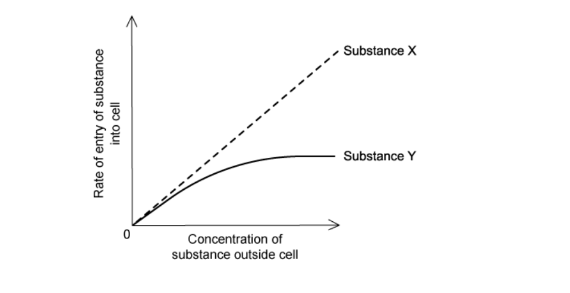
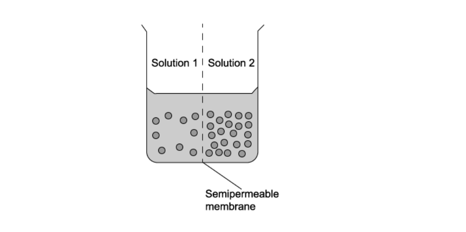
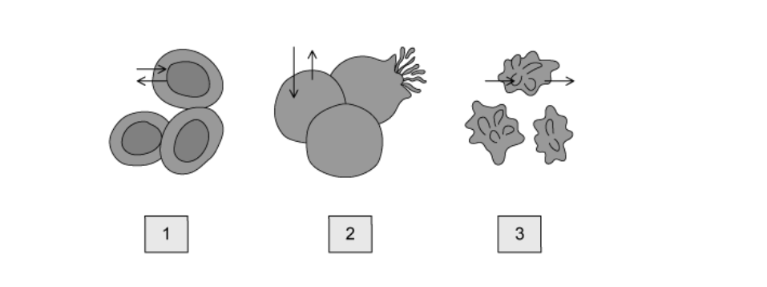
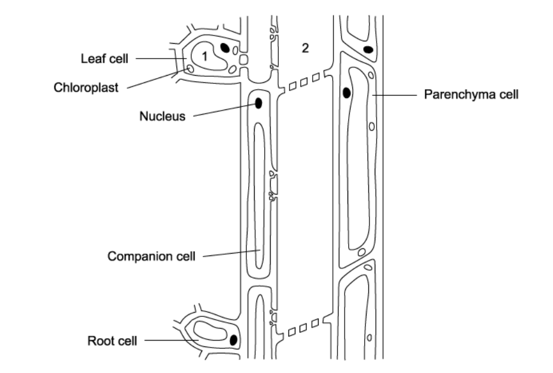

# Exam Questions — Movement into & out of Cells
**4. Cell Membranes & Transport** · Cambridge (CIE) A-LEVEL biology (9700)
> Source: [https://www.savemyexams.com/a-level/biology/cie/25/topic-questions/](https://www.savemyexams.com/a-level/biology/cie/25/topic-questions/) · 30 questions across 1 sets

## Multiple Choice Questions (30 questions)

### Q1 — hard — 1 marks

**Q1** [1 mark]

The diagram shows an experiment constructed by a student to measure the water potential of beetroot cells. The results are shown in the table below.

| Concentration of sucrose solution (mol dm-3) | Water potential of sucrose solution (kPa) | Direction and speed of droplet movement |
|---|---|---|
| 0.1 | -251 | down, very quickly |
| 0.2 |   | down, quickly |
| 0.3 |   | down, slowly |
| 0.4 |   | no movement |
| 0.5 |   | up, slowly |
| 0.6 |   | up, quickly |
| 0.7 | -1876 | up, very quickly |

What is the most likely water potential of the beetroot cells?

### Q2 — hard — 1 marks

**Q2** [1 mark]

Two agar blocks of different sizes are produced and universal indicator is added, making the agar turn purple.

The cubes are then placed in hydrochloric acid solution. Universal indicator turns red in acid. After 10 minutes, the amount of agar that has turned red is measured.

In which agar block will the rate of diffusion be fastest and why?

### Q3 — hard — 1 marks

**Q3** [1 mark]

An experiment to calculate the water potential of potato was performed using the following protocol:

1. Dice potato into 1cm3 cubes.
2. Add potato cubes to 6 test tubes, each containing solution with a different sucrose concentration.
3. Wait 12 hours.
4. Weigh the cubes from each test tube and plot a graph.

The mean weight of the potato cubes was 2.5g before being added to solution and the graph shows the weights of potato cubes after the experiment.

What concentration of sucrose has the same water potential as the potato?

### Q4 — hard — 1 marks

**Q4** [1 mark]

The fluidity of the cell surface membrane can be altered by a variety of factors.

Which process would be **least** changed if the fluidity of cell surface membranes is decreased?

### Q5 — hard — 1 marks

**Q5** [1 mark]

Four solutions are made, each containing 15 g l-1 of a molecule. Which molecule would produce the solution with the lowest water potential?

### Q6 — hard — 1 marks

**Q6** [1 mark]

The diagram shows a glass cylinder within which a partially permeable membrane separates two compartments, **G** and **H**, of the same volume (V).

Each compartment contains saline solution, the concentration (C) in **G** is double the concentration in **H. **

The membrane is attached to a sliding piston.

Which equations correctly describe the concentration and volume of compartments when osmotic equilibrium is reached?

### Q7 — hard — 1 marks

**Q7** [1 mark]

The cell walls of three plant cells, **X**, **Y** and **Z**, are in contact with each other. The water potentials inside each cell are shown in the table

| Cell | Water potential (kPa) |
|---|---|
| X  Y  Z | -900  -300  -600 |

How will water move by osmosis between the cells?

### Q8 — hard — 1 marks

**Q8** [1 mark]

An aerobic cell stops responding to growth regulation signals, causing the volume of the cytoplasm to increase and the cell to grow. Eventually the cell dies.

Which of the following cell transport methods are affected by cell growth?

| **1** | diffusion |
|---|---|
| **2** | active transport |
| **3** | exocytosis |
| **4** | osmosis |

### Q9 — hard — 1 marks

**Q9** [1 mark]

Radish discs were placed in a solution containing Na+ ions.

The concentration of O2 in the air bubbled through the solution was changed and the rate of Na+ uptake measured. The results are shown.

| Concentration of oxygen / % | Rate of Na+ uptake / arbitrary units |
|---|---|
| 3.10 | 31 |
| 12.6 | 64 |
| 19.8 | 83 |

Which process is responsible for the uptake of Na+ in this experiment?

### Q10 — hard — 1 marks

**Q10** [1 mark]

The graph shows how the concentration of a substance affects its rate of absorption into a cell.

Substance **X** enters by simple diffusion, substance **Y** by facilitated diffusion.

Why does the curve for substance **Y** plateau above a certain concentration?

### Q11 — medium — 1 marks

**Q11** [1 mark]

Two solutions are separated by a partially permeable membrane. The two solutions have a different concentration of glucose (black dots).

Which of the following best describes what will happen to the amount of glucose, volume of water and concentration of solution?

|   | Solution | Amount of glucose | Volume of Water | Concentration |
|---|---|---|---|---|
| **A** | 1  2 | remains constant  remains constant | decreases  increases | increases  decreases |
| **B** | 1  2 | increases  decreases | remains constant  remains constant | increases  decreases |
| **C** | 1  2 | remains constant  remains constant | increases  decreases | decreases  increases |
| **D** | 1  2 | decreases  increases | increases  decreases | remains constant  remains constant |

### Q12 — medium — 1 marks

**Q12** [1 mark]

A student places an animal cell and a plant cell into distilled water and notes down the following observations.

Animal cell: swells then bursts Plant cell: swells

What is the reason for this difference?

### Q13 — medium — 1 marks

**Q13** [1 mark]

The water potential of sea water is approximately –2500 kPa. Halophytes are plants that are able to survive in regions where they are regularly exposed to sea water.

Which adaptation would you expect halophytes to have to enable them to live in this environment?

### Q14 — medium — 1 marks

**Q14** [1 mark]

A model to demonstrate the mass flow hypothesis of translocation is illustrated in the diagram.

In a plant, what are the structures W, X, Y and Z and what is the direction of flow of solution along X?

|   | phloem | xylem | roots | leaves | direction of flow along X |
|---|---|---|---|---|---|
| **A** | W | X | Y | Z | from Y to Z |
| **B** | W | X | Z | Y | from Y to Z |
| **C** | X | W | Y | Z | from Z to Y |
| **D** | X | W | Z | Y | from Z to Y |

### Q15 — medium — 1 marks

**Q15** [1 mark]

Diagrams 1, 2 and 3 show red blood cells in different states after each being submerged in a different solution.

What is the correct order of the water potential of each solution from lowest to highest?

### Q16 — medium — 1 marks

**Q16** [1 mark]

Some viruses bind to the cell surface membrane before entering the host cell.

Which sequence of events results in a viral invasion of a cell?

### Q17 — medium — 1 marks

**Q17** [1 mark]

An artificial partially permeable membrane called visking tubing can be used to demonstrate diffusion. The pores in the membrane are approximately 2.4 nm in diameter which allows glucose molecules to pass through.

Which of the following could pass through the pores?

| 1 | haemoglobin |
|---|---|
| 2 | bacteria |
| 3 | glycogen |
| 4 | ribosomes |

### Q18 — medium — 1 marks

**Q18** [1 mark]

Various factors affect the rate of diffusion of molecules.

Which conditions would result in the fastest rate of diffusion?

|   | difference in concentration (mmol dm–3) | temperature (°C) | surface area : volume ratio | molecule |
|---|---|---|---|---|
| **A** | 1 | 25 | 4 | sodium |
| **B** | 5 | 15 | 2 | glucose |
| **C** | 10 | 35 | 0.5 | water |
| **D** | 20 | 20 | 3 | oxygen |

### Q19 — medium — 1 marks

**Q19** [1 mark]

The diagram represents the phloem pathway and adjacent cells from leaf to root in a plant.

What process is occurring between 1 to 2 and what is the effect on the water potential at 2?

|   | **process from 1 to 2** | **water potential at 2** |
|---|---|---|
| **A** | active transport of sucrose | becomes less negative |
| **B** | active transport of sucrose | becomes more negative |
| **C** | diffusion of sucrose | becomes less negative |
| **D** | diffusion of sucrose | becomes more negative |

### Q20 — medium — 1 marks

**Q20** [1 mark]

Which of the following membrane proteins does not undergo a conformational change to perform its function?

### Q21 — easy — 1 marks

**Q21** [1 mark]

The following are all examples of cellular transport:

| 1 | bacterium engulfed by phagocytes |
|---|---|
| 2 | digestive enzymes being secreted from the pancreas |
| 3 | an egg cell taking up liquid nutrients from follicle cells |
| 4 | the release of neurotransmitters from the presynaptic neuron |

Which examples require bulk transport?

### Q22 — easy — 1 marks

**Q22** [1 mark]

Which of the following statements regarding membrane transport is false?

### Q23 — easy — 1 marks

**Q23** [1 mark]

Substance X moves through a protein channel into a cell.

Which statement best describes substance X and it’s movement?

### Q24 — easy — 1 marks

**Q24** [1 mark]

“Diffusion is a result of…”

Which option correctly completes the sentence?

### Q25 — easy — 1 marks

**Q25** [1 mark]

The diagram represents three possible pathways through a cell surface membrane.

Which process is represented by each arrow?

|   | 1 | 2 | 3 |
|---|---|---|---|
| **A** | facilitated diffusion | diffusion | active transport |
| **B** | active transport | diffusion | facilitated diffusion |
| **C** | facilitated diffusion | active transport | diffusion |
| **D** | active transport | facilitated diffusion | diffusion |

### Q26 — easy — 1 marks

**Q26** [1 mark]

Complete the sentence:

“Plasmolysis occurs when a(n)  ____X____     cell is immersed in a   _____Y_____       solution.”

|   | X | Y |
|---|---|---|
| **A** | animal cell | pure water |
| **B** | animal cell | strong saline |
| **C** | plant cell | pure water |
| **D** | plant cell | strong saline |

### Q27 — easy — 1 marks

**Q27** [1 mark]

Which mode of transport is energy independent?

### Q28 — easy — 1 marks

**Q28** [1 mark]

Cells require the following molecules for normal functioning:

| 1 | glucose |
|---|---|
| 2 | water |
| 3 | amino acids |
| 4 | oxygen |

Which molecules require a protein for transport across the cell surface membrane?

### Q29 — easy — 1 marks

**Q29** [1 mark]

The movement of water is dependent on the water potential either side of a partially permeable membrane.

What is the correct equation for calculating the total water potential (Ψ) from solute potential (Ψs)and pressure potential (Ψp)?

### Q30 — easy — 1 marks

**Q30** [1 mark]

What form of cellular transport is shown in the diagram above?
