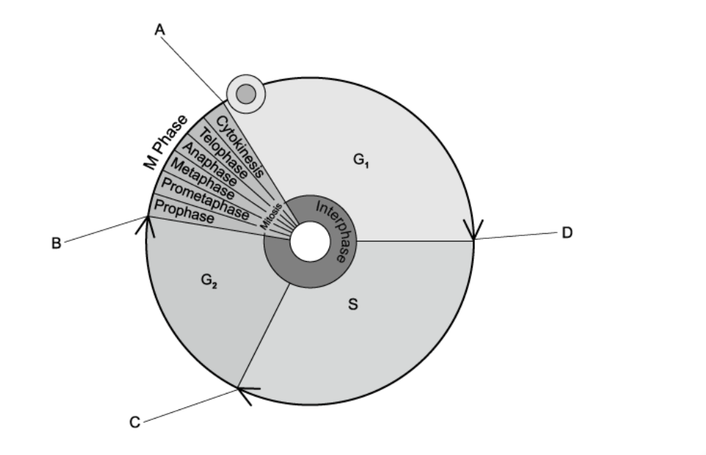
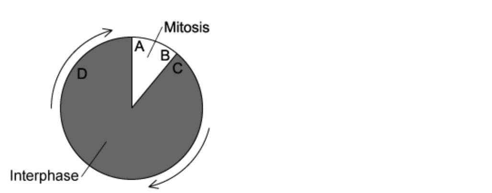
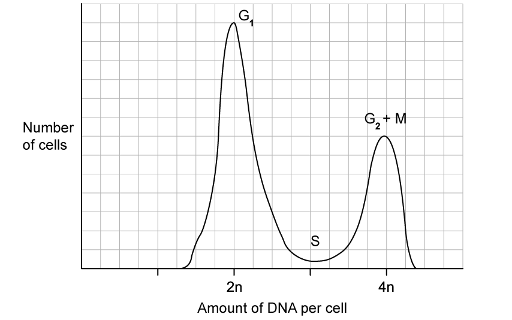
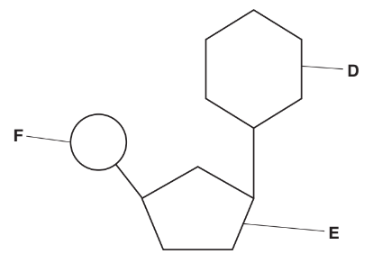
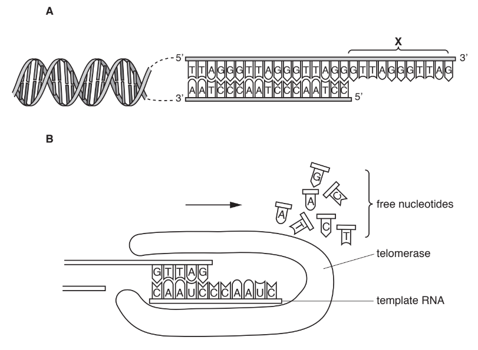
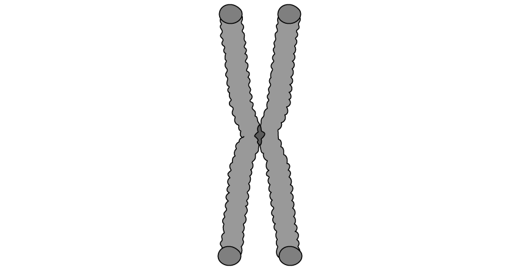
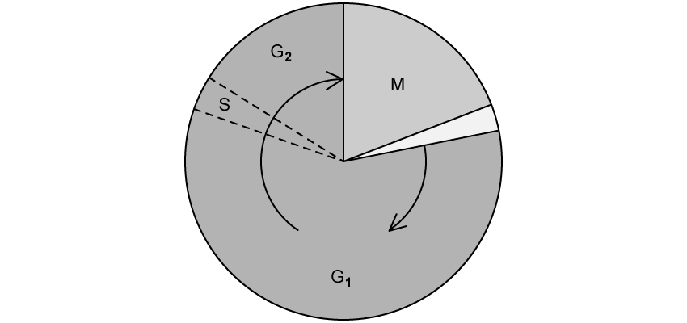
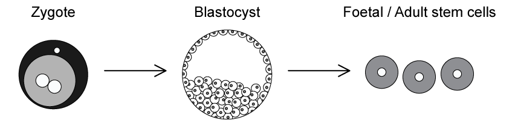
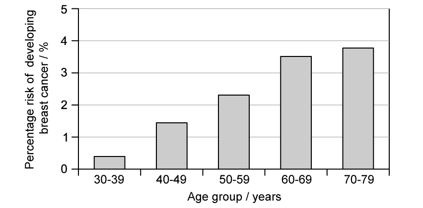

# Exam Questions — Replication & Division of Nuclei & Cells
**5. The Mitotic Cell Cycle** · Cambridge (CIE) A-LEVEL biology (9700)
> Source: [https://www.savemyexams.com/a-level/biology/cie/25/topic-questions/](https://www.savemyexams.com/a-level/biology/cie/25/topic-questions/) · 41 questions across 2 sets

## Multiple Choice Questions (29 questions)

### Q1 — hard — 1 marks

**Q1** [1 mark]

If a 14 cm long piece of string was packed into a 7 cm long tube, the packing ratio would be 2. The packing ratio is a useful measure of the degree of compactness achieved.

The linker DNA between nucleosomes is 72 base pairs long. Each base pair occupies a 0.52 nm length of the DNA double helix. Nucleosomes plus their linker DNA form a 10 nm wide fibre.

What is the packing ratio of DNA in this form of chromatin?

### Q2 — hard — 1 marks

**Q2** [1 mark]

Why does DNA condense into tightly packed chromosomes?

### Q3 — hard — 1 marks

**Q3** [1 mark]

Cells divide in response to a signal called a growth factor. Growth factors are proteins that bind to receptors on the surfaces of cells.

At which point in the cell cycle will the growth factor bind?

### Q4 — hard — 1 marks

**Q4** [1 mark]

The DNA of cancer cells is mutated.

Which of the following proteins would not cause cancer if mutated?

### Q5 — hard — 1 marks

**Q5** [1 mark]

Around 250 billion red blood cells and 20 billion white blood cells are replaced each day. Blood cells are generated from stem cells in the bone marrow.

What type of stem cells are found in human bone marrow?

### Q6 — hard — 1 marks

**Q6** [1 mark]

What is the composition of telomeres and why?

|   | composition | reason |
|---|---|---|
| **A** | protein | it is able to protect the DNA |
| **B** | RNA | it is made of different nucleotides to DNA |
| **C** | C/G nucleotides only | forms a high number of hydrogen bonds |
| **D** | C/G/A/T nucleotides | because telomeres are like the coding regions |

### Q7 — hard — 1 marks

**Q7** [1 mark]

Which of the following requires only mitosis during their production?

### Q8 — hard — 1 marks

**Q8** [1 mark]

Which cells contain telomerase?

| **1** | B-lymphocytes |
|---|---|
| **2** | embryonic cells |
| **3** | heart cells |

### Q9 — hard — 1 marks

**Q9** [1 mark]

The diagram shows a cell of an organism after replication division.

What is the diploid number for this organism?

### Q10 — medium — 1 marks

**Q10** [1 mark]

Tumors are formed from uncontrolled cell division of cancer cells.

Which statement describes the difference between a normal cell and a cancer cell?

### Q11 — medium — 1 marks

**Q11** [1 mark]

What processes during mitosis ensure that the genetic constitution of the cell is maintained?

| **1**  **2**  **3**  **4** | dividing of centromeres longitudinally  chromatids being pulled apart to opposite poles  parent cells replicate their DNA before mitosis begins  positioning the chromosomes on the equator of the spindle |
|---|---|

### Q12 — medium — 1 marks

**Q12** [1 mark]

What properties does a human cell have just before it enters prophase?

|   | nuclear envelope present | spindle present | number of chromatids | number of molecules of DNA in nucleus |
|---|---|---|---|---|
| **A**  **B**  **C**  **D** | no  yes  yes  yes | yes  no  yes  no | 46  92  46  92 | 46  92  92  46 |

### Q13 — medium — 1 marks

**Q13** [1 mark]

The cell cycle is shown in the diagram below.

If dividing cells, cells are supplied with radioactive nucleotides, at which point will the nucleotides be incorporated into the chromosomes?

### Q14 — medium — 1 marks

**Q14** [1 mark]

Radioactive thymine is supplied to mammalian skin cells in tissue culture.

At which stage in the cell cycle will the thymine be used in the nuclei?

### Q15 — medium — 1 marks

**Q15** [1 mark]

The statements below are about two genes involved in breast cancer.

- the *BRAC1 *gene codes for a protein that stops the growth of breast cancer cells
- the *p53* gene codes for a protein that suppresses tumours

Which genetic combination is most likely to result in breast cancer?

|   | gene |   |
|---|---|---|
|   | BRAC1 | p53 |
| **A** | ✓ | ✓ |
| **B** | ✓ | X |
| **C** | X | ✓ |
| **D** | X | X |

Key: **✓ **= normal active gene **x **= mutated gene

### Q16 — medium — 1 marks

**Q16** [1 mark]

Mitosis is required in which of the following processes?

| **1**  **2**  **3** | cloning plasma cells  replacing damaged cells  producing gametes |
|---|---|

### Q17 — medium — 1 marks

**Q17** [1 mark]

Mice in laboratories had their p53 genes switched off. These mice went on to develop tumours.

When their p53 genes were switched on again, the tumour cells stopped dividing and died within a few days. Healthy cells in the mice were unaffected.

What do these observations suggest?

### Q18 — medium — 1 marks

**Q18** [1 mark]

The risk of developing a cancerous tumour is increased by exposure to which of the following?

|   | ultraviolet light | viruses | carbon monoxide | X-rays |
|---|---|---|---|---|
| **A** | **✓** | **✓** | **x** | **✓** |
| **B** | **✓** | **x** | **✓** | **✓** |
| **C** | **x** | **✓** | **✓** | **x** |
| **D** | **✓** | **x** | **✓** | **x** |

key

**✓** increases risk

**x **does not increase risk

### Q19 — medium — 1 marks

**Q19** [1 mark]

DNA replication is promoted by chromosome telomeres and are not completely replaced during mitosis.

However, substance **X** is known to completely replace telomeres during mitosis.

What will be the effect of growing a cell culture with and without substance **X**?

|   | with substance **X** | without substance **X** |
|---|---|---|
| **A** | cell division stops immediately | cells continuously divide |
| **B** | cells continuously divide | cell division eventually slows and stops |
| **C** | cell division eventually slows and stops | cell division stops immediately |
| **D** | cells divide quicker | cells continuously divide |

### Q20 — easy — 1 marks

**Q20** [1 mark]

Chromosomes in a nucleus are shown in the diagram below.

What are the structures **R** and **S**?

|   | R | S |
|---|---|---|
| **A**  **B**  **C**  **D** | centromere  centromere  chromatid  chromatid | chromatid  centriole  centromere  centriole |

### Q21 — easy — 1 marks

**Q21** [1 mark]

A scientist counted 24 chromosomes in each of the root cells of a melon plant.

What is the diploid and haploid number of chromosomes for this species?

|   | haploid  number | diploid  number |
|---|---|---|
| **A**  **B**  **C**  **D** | 24  12  48  24 | 12  24  24  48 |

### Q22 — easy — 1 marks

**Q22** [1 mark]

In which of the processes shown in the table is mitosis required?

|   | **genetic variation** | **increase in cell number** | **replacement of damaged cells** |
|---|---|---|---|
| **A** | **x** | **✓** | **✓** |
| **B** | **✓** | **x** | **x** |
| **C** | **✓** | **✓** | **x** |
| **D** | **x** | **x** | **✓** |

key  **✓ **contributes to process

**x** does not contribute to process

### Q23 — easy — 1 marks

**Q23** [1 mark]

When animal cells undergo mitosis, which structure organises spindle formation?

### Q24 — easy — 1 marks

**Q24** [1 mark]

At what stage of the cell cycle would a cell be producing the most mRNA molecules?

### Q25 — easy — 1 marks

**Q25** [1 mark]

Which statement does not describe a stem cell?

### Q26 — easy — 1 marks

**Q26** [1 mark]

What is the role of a telomere?

### Q27 — easy — 1 marks

**Q27** [1 mark]

What is the end result of mitosis?

### Q28 — easy — 1 marks

**Q28** [1 mark]

Which of the following processes involve mitosis?

### Q29 — easy — 1 marks

**Q29** [1 mark]

Which statement about mitotic cell division is **incorrect**?

## Structured Questions (12 questions)

### Q1 — hard — 9 marks

**Q1** [2 marks]

Bowel cancer can result from adenoma polyps. Adenoma polyps form as a result of mutations occurring in dividing cells of the colon lining.

Suggest the differences in the cell cycle of a cancer cell compared with that of a normal intestinal cell.

**Q1** [3 marks]

Compare and contrast the process of cytokinesis in plants and animals.

**Q1** [2 marks]

Before the cell progresses from G1 into S phase, it needs to pass through a checkpoint, which prevents the cell cycle from proceeding if certain conditions are not met. Suggest **one** reason why a cell might not progress through the checkpoint.

**Q1** [2 marks]

Fig. 1 below shows data produced from a flow cytometer. This measures the number of cells that are labelled with DNA bound to a fluorescent dye, as this is proportional to DNA content. The stages of the cell cycle are indicated.

**Fig. 1**

Suggest why, during the S phase, that the amount of DNA per cell is between 2*n* and 4*n*.

### Q2 — hard — 8 marks

**Q2** [1 mark]

A chicken has approximately 40% of the DNA of a human in its genome, whereas it possesses a higher haploid number of chromosomes (*n *= 39, versus *n *= 23 for humans). Explain this apparent contradiction.

**Q2** [4 marks]

Describe and explain the factors that influence the duration of the cell cycle in multicellular organisms.

**Q2** [3 marks]

The human genome contains 2.9 x 109 base pairs. The S phase of a particular fast-growing cell type lasts 8 hours.

Given that DNA polymerase has a replication rate of 40 nucleotides s-1 enzyme molecule-1, calculate the number of DNA polymerase molecules in operation during S phase.

State your answer to an appropriate number of significant figures.

### Q3 — hard — 8 marks

**Q3** [2 marks]

A team of biologists estimated the number of cells in different phases of the cell cycle in *Saccharomyces cerevisiae *(brewer's yeast). They took two samples, **A** and **B**, from different environmental conditions. One sample came from a nutrient-rich environment, the other from a nutrient-poor environment.

Their results are shown in Table 1.

**Table 1**

| **Phase of the cell cycle** | **Sample A / number of cells counted** | **Sample B / number of cells counted** |
|---|---|---|
| G1 | 312 | 451 |
| S | 203 | 294 |
| G2 | 136 | 196 |
| Mitosis | 27 | 39 |
| **Total** | **678** | **980** |

In sample **A**, a full cell cycle took 1 hour and 35 minutes, whereas, in sample **B**, a full cell cycle took 60 minutes.

Calculate the time, in minutes, that the cells in sample **A** were in S phase during one cycle. Show your working.

**Q3** [2 marks]

**Extract:**

A team of biologists estimated the number of cells in different phases of the cell cycle in Saccharomyces cerevisiae (brewer's yeast). They took two samples, A and B, from different environmental conditions. One sample came from a nutrient-rich environment, the other from a nutrient-poor environment.

Their results are shown in Table 1.

Table 1

| Phase of the cell cycle | Sample A / number of cells counted | Sample B / number of cells counted |
| G~1~ | 312 | 451 |
| S | 203 | 294 |
| G~2~ | 136 | 196 |
| Mitosis | 27 | 39 |
| Total | 678 | 980 |

In sample A, a full cell cycle took 1 hour and 35 minutes, whereas, in sample B, a full cell cycle took 60 minutes.

The biologists studying the *Saccharomyces cerevisiae* (brewer's yeast) from part (a) hypothesised that when the yeast was exposed to stressful conditions, the growth rates were low.

Suggest, with a reason, which sample came from the nutrient-rich conditions.

**Q3** [2 marks]

The availability of nutrients is also a key factor in regulating the cell cycle of *Schizosaccharomyces pombe* (fission yeast).  Below is Table 2 containing data scientists collected for two sites which were deficient in nitrogen and phosphate.

**Table 2**

| **Phase of the cell cycle** | **Deficient in nitrogen  / number of cells counted** | **Deficient in phosphate / number of cells counted** |
|---|---|---|
| G1 | 207 | 181 |
| S | 135 | 118 |
| G2 | 90 | 79 |
| Mitosis | 0 | 0 |
| **Total** | **432** | **378** |

Deduce, giving a reason, the point at which a nutrient-poor environment would stop the cell cycle of the *Schizosaccharomyces pombe*.

**Q3** [2 marks]

The *Saccharomyces cerevisiae *(brewer's yeast) nuclei are, on average, 2 µm in diameter, but the DNA molecules packed into them have been measured up to 355 µm in length.

Describe the process that enables the DNA molecules, that comprise the 16 chromosomes of yeast, to be packed into the nuclei.

### Q4 — hard — 11 marks

**Q4** [4 marks]

Fig. 1 is a diagram of a monomer of the nucleic acid, messenger RNA.

**Fig. 1**

(i) Name** D**, **E **and **F** in Fig. 1.

(ii) State **one** way in which the **structure** of DNA differs from the structure of messenger RNA.

*Source: Oct/Nov 2018 Series 3 9700/23 Q3AI, AII*

**Q4** [4 marks]

Telomeres are repeating sequences of bases located at the ends of DNA molecules. 
These repeating sequences do not code for proteins.

The enzyme telomerase ensures that telomeres do not shorten each time DNA is replicated.

Fig. 2**A** shows the end of a DNA molecule during replication. DNA polymerase cannot attach to the region labelled** X**, so it cannot complete the synthesis of the new strand without the action of telomerase.

Telomerase synthesises additional lengths of DNA that are added to the telomere. These additional lengths are used by DNA polymerase to complete the process of replication.

Fig. 2**B** is an enlarged view of region **X** to show the action of the enzyme telomerase.

**Fig. 2**

Telomerase contains a short length of RNA that acts as a template for the synthesis of DNA as shown in Fig. 2**B**.

Explain how a molecule of telomerase synthesises additional lengths of DNA.

*Source: Oct/Nov 2018 Series 3 9700/23 Q3B*

**Q4** [1 mark]

**Extract:**

Telomeres are repeating sequences of bases located at the ends of DNA molecules. These repeating sequences do not code for proteins. The enzyme telomerase ensures that telomeres do not shorten each time DNA is replicated.

Telomerase is not present in prokaryotic cells.

Suggest why prokaryotes do not have telomerase.

*Source: Oct/Nov 2018 Series 3 9700/23 Q3C*

**Q4** [2 marks]

**Extract:**

Telomeres are repeating sequences of bases located at the ends of DNA molecules. These repeating sequences do not code for proteins. The enzyme telomerase ensures that telomeres do not shorten each time DNA is replicated.

One of the ways to diagnose lung cancer is to determine the concentration of telomerase in cells from the lining of the bronchus.

Explain why determining the activity of telomerase may be useful in the diagnosis of lung cancer.

*Source: Oct/Nov 2018 Series 3 9700/23 Q3D*

### Q5 — easy — 9 marks

**Q5** [3 marks]

Fig. 1 shows a diagram of a chromosome from the nucleus of a eukaryotic cell.

**Fig. 1**

With references to Fig. 1, describe the general structure of a chromosome.

**Q5** [1 mark]

**Extract:**

Fig. 1 shows a diagram of a chromosome from the nucleus of a eukaryotic cell.

The chromosome (in Fig. 1) consists of two identical (sister) chromatids joined by the centromere.

State **one** phase of the mitotic cell cycle during which the chromosomes would have the appearance of the chromosome in Fig. 1.

**Q5** [2 marks]

A horse (*Equus caballus*) has 64 chromosomes in the nucleus of each body cell. Calculate the number of chromosomes that will be present in the cell by the end of anaphase of mitosis.

**Q5** [3 marks]

Explain the importance of mitosis to living organisms.

### Q6 — easy — 7 marks

**Q6** [2 marks]

Fig. 1 shows a representation of the events that take place during the cell cycle.

**Fig. 1**

(i) Identify the phase of the cell cycle during which DNA replication occurs.

[1]

(ii) Describe the events that take place during G1.

[1]

**Q6** [1 mark]

The M phase of the cell cycle in Fig. 1 involves cell division by mitosis. The frequency of mitosis depends on the length of time that the cell spends completing the cell cycle.

A single human cell takes 12 hours to complete one cell cycle.

Calculate the number of cells present after 4 days if the cell cycle proceeds at a constant rate.

**Q6** [3 marks]

(i) **     **Identify the phase of the cell cycle that immediately follows the M phase.

[1]

(ii) Describe how this phase would occur in a **plant cell**.

[2]

**Q6** [1 mark]

Mutations of the genes controlling the cell cycle may cause cancer in humans.

State the name of these cancer-causing genes.

### Q7 — easy — 10 marks

**Q7** [2 marks]

During the process of fertilisation a totipotent zygote is formed.

Define the term **totipotent**.

**Q7** [4 marks]

Stem cells are also found in various parts of the adult human body.

(i) State **two** places in the body where adult stem cells can be found.

[2]

(ii) Describe the purpose of these stem cells.

[2]

**Q7** [3 marks]

Telomeres are structures found at the ends of chromosomes which ensure that no genetic information is lost during cell division.

(i) Identify the enzyme responsible for maintaining the length of the telomeres.

[1]

(ii) Explain why specialised cells lose their ability to divide.

[2]

**Q7** [1 mark]

New stem cell therapies being trialled involve the use of cells known as induced pluripotent stem cells (iPSCs). To produce iPSCs, adult body cells (such as skin and blood cells) are genetically reprogrammed to act like embryonic stem cells.

Suggest an advantage of using iPSCs in stem cell therapy.

### Q8 — medium — 10 marks

**Q8** [2 marks]

(i) Define the term **stem cell**.

[1]

(ii) State the importance of stem cells in the human body.

[1]

**Q8** [2 marks]

Fig. 1 shows stem cells from different stages of human development.

**                                                   Fig. 1**

Contrast the stem cells of the zygote and the foetal/adult stem cells.

**Q8** [3 marks]

Embryonic stem cells taken from blastocysts are highly sought after in stem cell research and therapy.

Explain the potential use of these embryonic stem cells in stem cell therapy.

**Q8** [3 marks]

**Extract:**

An (unspecialised) cell that can divide an unlimited number of times / continue dividing indefinitely

Specialised cells lose the ability to divide by mitosis.

(i) Suggest how the activity of telomerase differs between stem cells and specialised cells

[1]

(ii) Explain your answer to part (i).

[2]

### Q9 — medium — 12 marks

**Q9** [2 marks]

The risk of developing breast cancer was investigated in woman of different ages in the US.

Fig. 1 shows the results of this investigation.

**                                                          Fig. 1**

Describe the results of the investigation shown in Fig. 1.

**Q9** [2 marks]

**Extract:**

The risk of developing breast cancer was investigated in woman of different ages in the US.

Fig. 1 shows the results of this investigation.

The results in Fig. 1 show as women get older / age increases the risk of developing breast cancer increases; at age 30-39 the percentage risk is around 0.4, increasing to a percentage risk of around 3.8 at age 70-79.

Suggest **two** possible explanations for the results seen in Fig. 1.

**Q9** [3 marks]

Tumours can be either benign or malignant.

Contrast benign and malignant tumours.

**Q9** [5 marks]

Describe the stages in the development of cancer.

### Q10 — medium — 7 marks

**Q10** [2 marks]

The response of the human body to tissue damage depends on the types of tissues involved. Epithelial tissue, liver tissue and cardiac muscle tissue each respond differently to damage.

- Epithelial tissue of the gas exchange system contains stem cells.
- Liver tissue contains cells in a non‐dividing state that can enter a cell cycle when stimulated.
- Cardiac muscle tissue contains cells that cannot divide at all. Damage is permanent and is associated with scar tissue formation.

Explain the importance of mitosis in the repair of damaged tissue.

*Source: Oct/Nov 2018  9700/22 Q3A*

**Q10** [2 marks]

Explain why stem cells are important in tissue repair.

*Source: Oct/Nov 2018  9700/22 Q3B*

**Q10** [3 marks]

Following liver tissue damage, chemicals are produced and released into the circulation. These chemicals are able to stimulate the liver cells to help tissue repair.

Explain how this is an example of cell signalling.

*Source: Oct/Nov 2018  9700/22 Q3C*

### Q11 — medium — 9 marks

**Q11** [3 marks]

Describe the role of telomeres in chromosomes.

**Q11** [2 marks]

Telomerase is an enzyme that adds bases to the ends of telomeres. The antibiotic β-Rubromycin has a range of medical uses, one of which is as an inhibitor of human telomerase. Suggest how β-Rubromycin could be utilised as a cancer treatment drug

**Q11** [2 marks]

Skin cells complete the cell cycle in a very short amount of time. Suggest the advantage of this.

**Q11** [2 marks]

The average time required for a human skin cell to complete the cell cycle is 2 hours 50 minutes. Calculate the time required for one skin cell to multiply to produce 16 cells. Give your answer in minutes.

### Q12 — medium — 9 marks

**Q12** [2 marks]

Interphase is often described as a 'resting phase'.

Explain why this is not a suitable description for cells in interphase.

**Q12** [2 marks]

The length of the cell cycle can vary considerably between different tissues within the same organism and is carefully controlled by chemical signals such as cyclins. Suggest the importance of such control in mammals.

**Q12** [2 marks]

Fig. 1 represents an animal cell in the process of dividing.

**                                                                   Fig. 1**

**Other **than reasons relating to cell structure, state **two** features of Fig. 1 that show that this is an animal cell and not a plant cell.

**Q12** [3 marks]

The genetic differences that occur within populations allow them to be more resilient to change in their environment. Suggest why organisms that reproduce asexually will be more susceptible to extinction if there is a change in their environment.
