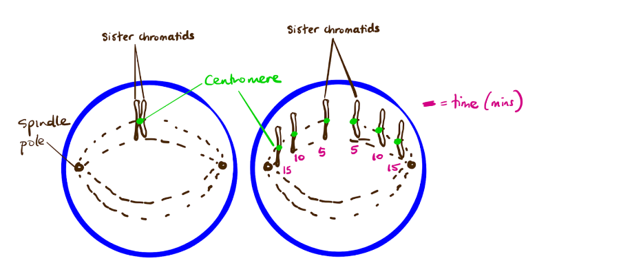
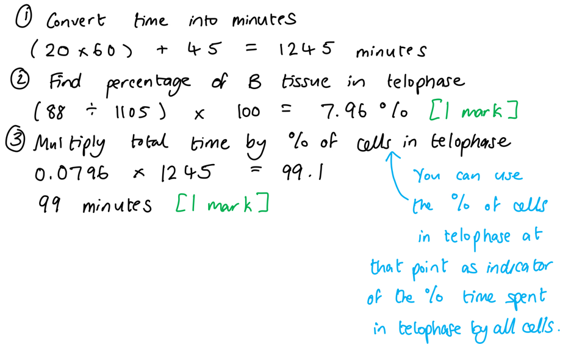
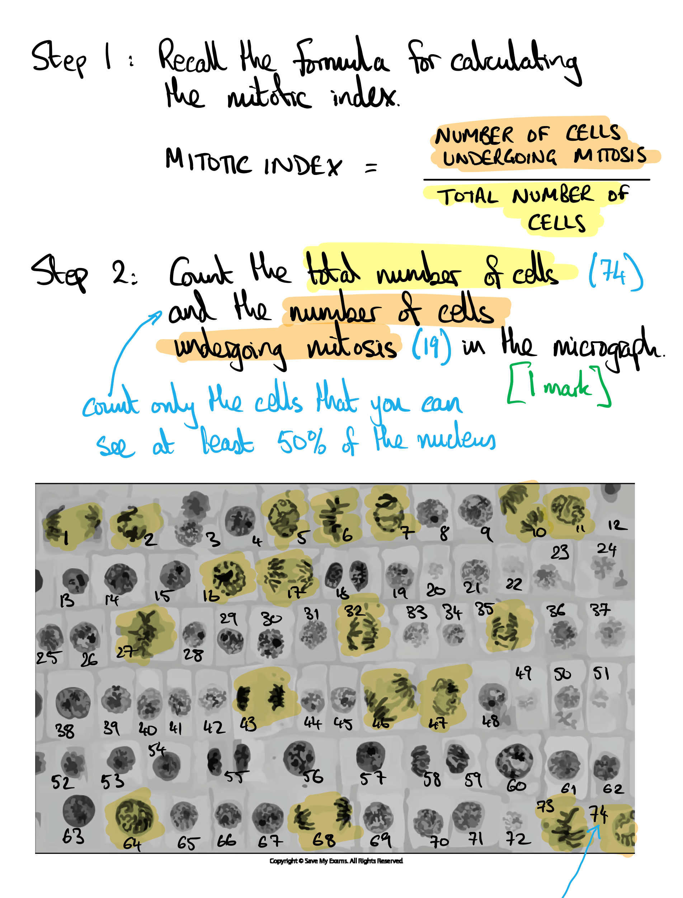
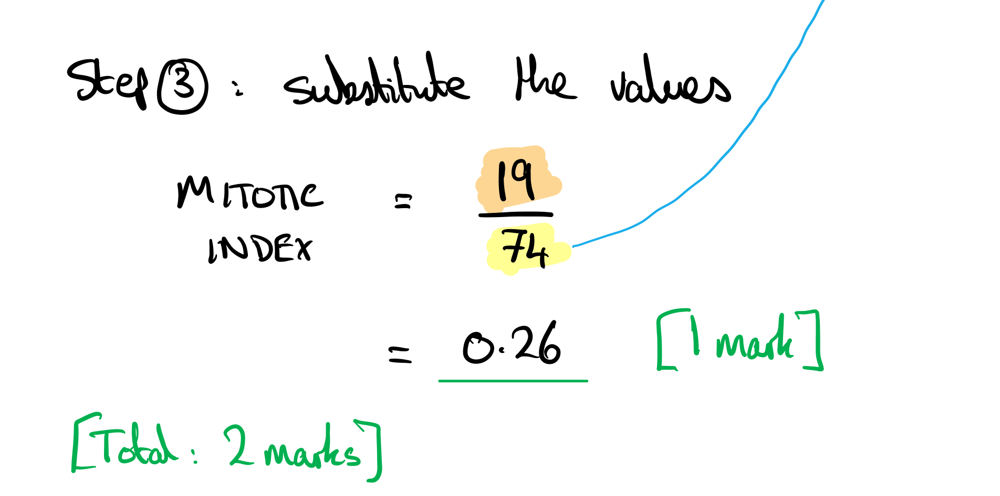
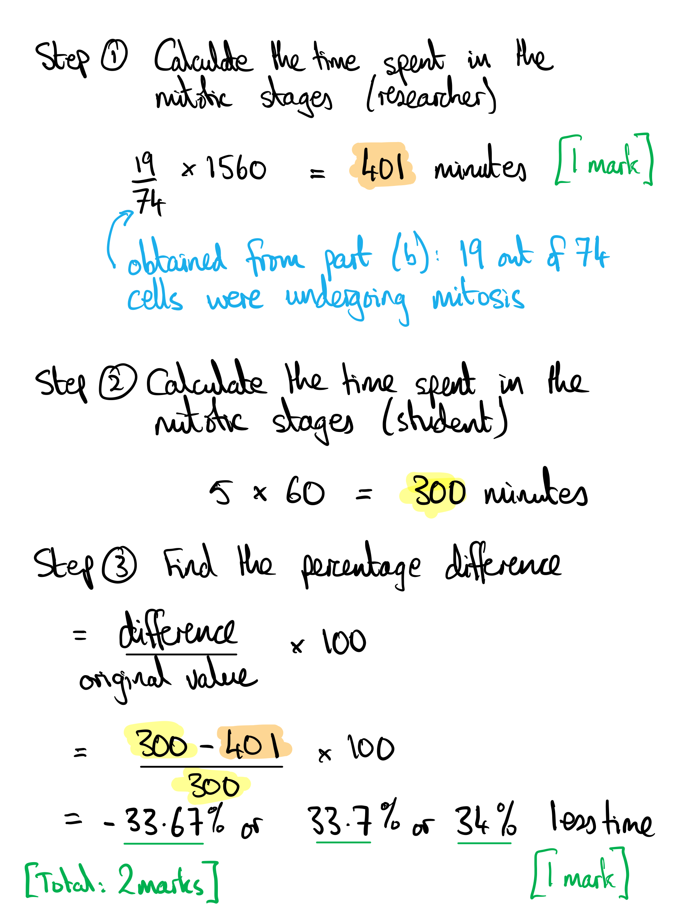
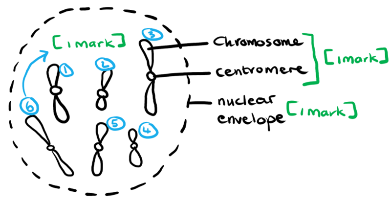
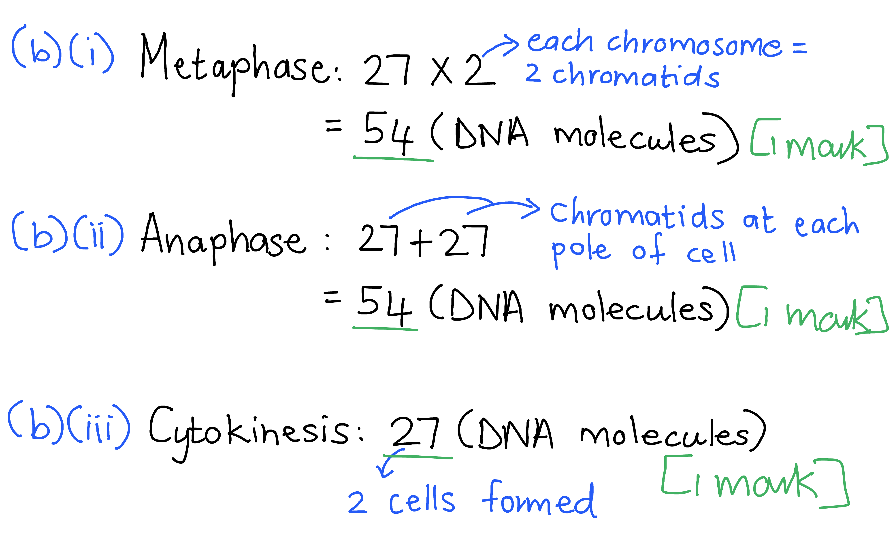
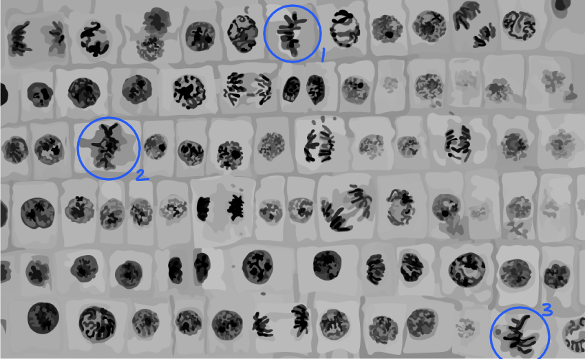

# Mark Schemes — Chromosome Behaviour in Mitosis
**5. The Mitotic Cell Cycle** · Cambridge (CIE) A-LEVEL biology (9700)

## Multiple Choice Questions (30 questions)

### Q1
**Final answer:** **The correct answer is ****B**** because:**

- **Metaphase**** is when the chromosomes line up on the cell ****equator**
- **Therefore if there are 18 out of a total 335 cells in this stage in the 24 hrs (1,440 minutes) then**

  - **18 divided by 335 = 0.054**
  - **0.054 x 1,440 = ****77.76 minutes**

> *A is incorrect as this is the number of minutes the cell spent in anaphase where the centromeres are dividing and the chromosomes are being pulled apart as the spindle microtubules contract*

> *C is incorrect as this is the number of minutes the cell spent in telophase where the DNA uncoils and the nuclear envelope reforms*

> *D is incorrect as this is the number of minutes the cell spent in prophase where the chromosomes are condence and the nuclear envelope breaks down*

### Q2
**Final answer:** **The correct answer is ****C**** because:**

- **Graph 1 shows that the distance between ****sister chromatids**** will not change until the ****spindle microtubules**** contract, causing the ****centromeres**** to divide and separate therefore pulling the sister chromatids away from each other towards opposite poles**
- **Graph 2 shows that initially the distance between the ****centromeres**** (the middle section of chromatids) and poles will not alter but when the spindle microtubules contract then the distance between centromeres and poles will decrease **
- **Graph 3 shows that the distance between the poles of spindle does not alter significantly**

> *A **& **B **are incorrect as the distance between the **poles** of spindle does **not** change whilst the chromosomes are being separated in **anaphase*

> *D **is incorrect as the sister chromatids are initially joined by the centromere in **metaphase **so there will be no distance between them until the spindle microtubules contract and the centromeres are separated and pulled to the poles during **anaphase*

### Q3
**Final answer:** **The correct answer is ****C ****because**

- **Prophase is the initial phase of mitosis **
- **The presence of MPF initiates prophase and therefore the cell will begin to divide again too soon (before it is ready)**
- **This could lead to uncontrolled cell division as if prophase is being encouraged to start then the cell may divide even when it shouldn’t **

> *A **is incorrect as although the cells produced may be smaller than normal as they have less time to grow, this is an effect and not a consequence.*

> *B **is incorrect as cytokinesis would occur at the right stage (not early) as MPF affects prophase starting but not subsequence events.*

> *D **is incorrect as the production of four cells from one parent cell is the result of meiosis, MPF wouldn’t cause this.*

### Q4
**Final answer:** **The correct answer is ****D**

- **As prophase is the first stage of mitosis and therefore the nuclear envelope is still present**
- **During the S phase of interphase DNA was replicated producing a copy of the 46 chromosomes**

> *A** is incorrect as during prophase the nuclear envelope gets broken down and the spindle fibres form. When the nucleus divides there would only be 23 chromosomes in the daughter cells*

> *C** is incorrect as there are no spindle fibres before prophase and when the 46 chromatids were separated during anaphase this would result in only 23 chromosomes in the daughter cells.*

> *B** is incorrect as there are too few molecules of DNA to produce two diploid cells that were genetically identical to the parent cell.*

### Q5
**Final answer:** **The correct answer is ****A ****because:**

- **Initially the distance between the centromeres and poles will not alter much, but when the spindle microtubules contract then the distance between centromeres and poles will decrease**
- **The distance between centromeres of sister chromatids will not change until the spindle microtubules contract causing the centromeres to divide and separate thus the sister chromatids will move away from each other towards the poles**
- **The distance between the poles of spindle should not alter significantly as the poles do not change location** 

> *B **& **C **are incorrect as the distance must decrease between the poles and the centromeres if the chromosomes are to be separated*

> *D **is incorrect as when the sister chromatids separate the centromeres divide and thus as the spindle microtubules contract moving the chromatids apart the distance increases*

### Q6
**Final answer:** **The correct answer is ****A ****because**** ****the stage after metaphase is ****anaphase**** where the sister chromatids are separated as the centromeres are pulled towards opposite poles by the spindle contracting**

> *B **is incorrect as centrioles become present during **prophase*

> *C** &** D **are incorrect as chromatin condenses during **prophase*

### Q7
**Final answer:** **The correct answer is ****B**** because:**

- **Chromosomes become visible when they condense in prophase and the cell undergoes mitosis (prophase, metaphase, anaphase & telophase)**
- **Chromosomes only have paired chromatids (sister chromatids) joined together in prophase ****and**** metaphase**
- **Therefore the number of cells recorded at these stages were 64 (prophase) and 21 (metaphase) out of 892 **

  - **64 + 21 = 85**
  - **85 divided 892 = 0.095**
  - **0.095 x 100 = ****9.5%**

> *A is incorrect as this is the percentage the cell spent in prophase only*

> *C is incorrect as this is the percentage the cell spent in prophase, metaphase and anaphase, however during anaphase the sister chromatids are no longer joined together*

> *D is incorrect as this is the percentage the cell spent in prophase, metaphase and interphase (where the chromosomes are not visible or have sister chromatids joined together)*

### Q8
**Final answer:** **The correct answer is ****D ****as during ****interphase****, the cell either carries out it’s normal function or prepares to divide by mitosis with DNA being replicated during the S phase of interphase. **

**Final answer:** **The DNA double helix uncoils and separates during ****semi-conservative DNA replication****, so if chemotherapy treatments affect this process then they are acting during interphase. **

> *Answers **A**, **B** and **C** are all stages of mitosis; during these phases the DNA has already been replicated. During metaphase the chromatids are separated but this does not involve the DNA double helix uncoiling and separating.*

### Q9
**Final answer:** **The correct answer is ****D**** because during ****telophase****, the nuclear envelope reforms separating the chromatids at each pole into 2 nuclei. This occurs immediately prior to cytokinesis.**

> *A **is incorrect as during S phase of **interphase** DNA is **replicating** therefore the DNA content is increasing, at** X** the graph shows a decrease in DNA content.*

> *B **& **C **are incorrect as this is when the cell is undergoing mitosis and although the sister chromatids (replicated DNA molecules) are being separated they are still located in the one cell *

### Q10
**Final answer:** **The correct answer is ****D**** because during interphase (****G1 phase****) the cell is producing most of the proteins it needs to function normally or to prepare to divide; this is the stage where loss of control occurs that can lead to cells proceeding to mitosis when they shouldn’t and hence being different sizes. **

> *A **& **B **are incorrect as these stages occur during mitosis; at this point a cell is already dividing but this is dependent upon previous events in the cell cycle. *

> *C **is incorrect as cytokinesis is the division of the cytoplasm following nuclear division to form the two daughter cells. *

### Q11
**Final answer:** **The correct answer is ****A**** because:**

- **A ****cell plate**** forms between the two new nuclei during ****cytokinesis**** in ****plant cells**** not in animal cells**
- **Animal daughter cells are formed during cytokinesis by the process of ****cleavage furrowing**

> *B is incorrect as DNA is expressed during interphase (G1 phase) when proteins are synthesised*

> *C is incorrect as the spindle is formed from microtubules in metaphase, to allow the sister chromatids to be separated*

> *D is incorrect as DNA is expressed and spindle is formed from microtubules in animal cells*

### Q12
**Final answer:** **The correct answer is ****C**** because:**

- **Plant cells do ****not ****have ****centrioles**
- **Centrioles are is the starting point for the microtubule formation to create the mitotic spindle**
- **Mitosis is the process of the nucleus dividing and therefore the cell wall is still present**
- **There are 8 chromosomes (n) present (these have been replicated during interphase to produce sister chromatids)**

### Q13
**Final answer:** **The correct answer is ****B ****because:**

- **This diagram is of a cell undergoing mitosis, which will produce two diploid daughter cells (each with the same number of chromosomes)**
- **There are 10 chromosomes (that have been replicated and therefore there are sister chromatids present, so ****each**** chromosome is made of ****2 chromatids****)**
- **The haploid number (n) is where there is only ****one**** set of chromosomes present**
- **Although it is difficult to see the aligning of the chromosomes at the equator the cell has not entered anaphase as the chromatids are still joined at the centromere**

> *A **& **C **are incorrect as both indicate the cell is in anaphase, however the chromatids are clearly still joined at the centromere*

> *D **is incorrect as this is the diploid number of the cell (there are **two** sets of chromosomes present **not** one)*

### Q14
**Final answer:** **The correct answer is ****B**** because spindle are microtubules. Microtubules are made from the protein tubulin.**

> *Answers **A**, **C **and **D **all represent other organic macromolecules present in organisms.*

### Q15
**Final answer:** **The correct answer is ****B ****because **

- **Cell 4 shows ****metaphase****: chromosomes align at the equator which is where the mitotic spindle will bind to the centromere region **
- **Cell 1 shows ****anaphase****: the chromosomes begin to separate into chromatids, which get pulled to the poles of the cell by the contracting mitotic spindle**
- **Cell 2 shows ****telophase****: the chromatids are at the poles ready for the nuclear envelope to reform **
- **Cell 3 shows ****late telophase****: the uncoiled chromosomes form two nuclei however cytokinesis (division of cytoplasm) has not occurred yet**
- **Cell 5 shows a single cell with a nucleus and no distinct chromosomes and therefore it is in ****interphase**

> *A is incorrect as it suggests the chromosomes have uncoiled before they collected at the poles*

> *C is incorrect as it suggests the cell at the interphase stage (with the uncoiled chromosomes within a nuclei)*

> *D is incorrect as anaphase is when the chromatid centromeres divide separating the chromatids and the contracting spindle microtubules move the chromatids to the poles*

### Q16
**Final answer:** **The correct answer is ****B ****because sister chromatids are separated during anaphase, which is after metaphase.**

> *A **is incorrect as sister chromatids are separated during anaphase*

> *C **is incorrect as sister chromatids are still joined by the centromere in prophase*

> *D **is incorrect as telophase occurs after anaphase, the chromatids need to be separated before telophase as this is when the nuclear envelopes reform around the DNA at each pole*

### Q17
**Final answer:** **The correct answer is ****C**** because during prophase **

- **The nuclear envelope breaks up so that the sister chromatids can be separated**
- **Centrioles begin to migrate to opposite ends of the nucleus (poles)**
- **The diplode number is the number of chromosomes present in the cell, eukaryotic cells have 2 copies of each chromosome before DNA replication (one from the mother and one from the father) and are therefore diploid**
- **Spindle microtubules begin to form ready for metaphase**

> *A **is incorrect as the centrioles have already replicated during prophase, they replicate during interphase.*

> *B **is incorrect as the nuclear envelope does not reform during metaphase, it reforms during telophase.*

> *D **is incorrect as the nuclear envelope is not breaking up during telophase, it is reforming. The nuclear envelope breaks up in prophase.*

### Q18
**Final answer:** **The correct answer is ****D ****because during prophase the centrioles (the proteins from which the mitotic spindle is formed) separate to opposite poles of the cell.**

> *A **is incorrect as the chromosomes condense and **nuclear envelope** breaks down in **prophase**. The chromosomes align at the **equator** during **metaphase**.*

> *B **is incorrect as the chromosomes separate during anaphase, **not** telophase.*

> *C **is incorrect as during anaphase it is the **centromeres** that divide.*

### Q19
**Final answer:** **The correct answer is ****D**** because:**

- **The order of the mitosis stages are ****prophase ****(two chromatids are joined by a centromere), ****metaphase ****(chromosomes line up along the equator of the spindle), ****anaphase**** (centromere divide, chromatids move to opposite poles of the cell) and ****telophase**** (chromosomes uncoil)**
- **During telophase the DNA ****uncoils**

> *Answers **A**, **B** and **C** all have the first stage as telophase, anaphase and metaphase respectively which does not follow the correct order (PMAT).*

### Q20
**Final answer:** **The correct answer is ****C**** because if haploid eukaryotic cells were to undergo meiosis then when fertilisation occurs the zygote would have an insufficient number of chromosomes to produce a diploid cell.**

> *A **is incorrect as although mutagens cause mutations not all mutations result in uncontrolled division (cancer), they can be beneficial or have no effect*

> *B **is incorrect as although the chromatids have separated to separate ends of the cell during anaphase they are still in the **same cell** so the mass has not changed yet*

> *D **is incorrect as mitosis is not involved in cell repair **but** cell replacement*

### Q21
**Final answer:** **The correct answer is ****B ****because**** **

- **During ****prophase**** the chromosomes ****condense**** showing the replicated DNA in the form of ****sister chromatids**
- **During the remaining stages of mitosis the sister chromatids separate to produce two genetically identical daughter cells**

> *A **& **C **are incorrect as during mitosis the sister chromatids are separated allowing for the formation of two genetically identical daughter cells.*

> *D **is incorrect as this suggests that the genetic material did not separate into two nuclei.*

### Q22
**Final answer:** **The correct answer is ****D ****because:**

- **DNA replication occurs during the S phase of ****interphase**
- **DNA replication must occur before the cell enters the mitotic (nuclear division) stages **

> *Answers **A**, **B** and **C** are all stages of mitosis; during these phases the DNA has already been replicated. During metaphase the chromatids are separated but this does not involve the DNA double helix uncoiling and separating.*

### Q23
**Final answer:** **The correct answer is ****C ****because:**

- **The order for mitosis is ****PMAT**** (prophase, metaphase, anaphase and telophase)**
- **In ****prophase ****the individual chromosomes (that have been replicated to form sister chromatids) become obvious as the chromatin (DNA + histones) condenses**
- **In ****metaphase**** the chromosomes align at the equator**
- **In ****anaphase**** the chromosomes are separated into chromatids as the spindle microtubules contract pulling the attached centromeres (and therefore chromatids) to the poles**
- **In ****telophase**** there are two distinct areas of chromatids**

> *A** & **D** are incorrect as the first diagram in the sequence suggested shows two distinct areas of chromatids which shows that division has already occurred.*

> *B **is incorrect as  the first diagram in the sequence suggested shows chromatids separated to the poles which is late anaphase.*

### Q24
**Final answer:** **The correct answer is ****A**** because **

- **Cytokinesis ****is the division of cytoplasm into two separate cells**
- **The nuclear envelope reforms during ****telophase**
- **Cell structures replicate during ****interphase**

### Q25
**Final answer:** **The correct answer is ****C**** because:**

- **During ****interphase**** (S phase) the DNA molecules have replicated to form sister chromatids**
- **Each chromatid contains one DNA molecule (therefore a chromosome contains 2 identical DNA molecules as it contains 2 identical siser chromatids)**
- **As human cells have a diploid number of 46 this replication results in 92 molecules**

> *A **is incorrect as cell 1 could not divide into 2 daughter cells with the **same **number of DNA molecules*

> *B **& **D **are incorrect as this would involve cells undergoing meiosis **not** mitosis as 23 is the haploid number for human gametes*

### Q26
**Final answer:** **The correct answer is ****D ****because:**

- **During DNA replication in interphase (S phase), all genetic material is cloned so there are two identical chromatids per chromosome**
- **In order for the sister chromatids to be separated they must align at the equator and their centromeres must attach to the spindle microtubules**

> *A **is incorrect as the replication of DNA occurs during interphase (S phase) and therefore this is when each chromosome forms the sister chromatids*

> *B **is incorrect as chromatids reach the poles of the mitotic spindle during anaphase*

> *C **is incorrect as the condensing of the chromatin occurs during prophase*

### Q27
**Final answer:** **The correct answer is ****B ****because:**

- **Centromeres are the narrow (pinched) region of chromosomes that contain no genes and which attach sister chromatids together**
- **The mitotic spindle attached to the centromere**
- **During ****anaphase**** the centromeres within chromosomes separate to form two separate sister chromatids and get pulled towards the poles as the spindle microtubules contract**
- **During ****prophase**** the chromatin (DNA and histones) condenses **

> *A **& **D **are incorrect as during metaphase the chromosomes align themselves at the equator and the centromeres attach to the spindle microtubules*

> *C **is incorrect as during telophase the condensed DNA uncoils and a nuclear envelope reforms around them*

### Q28
**Final answer:** **The correct answer is ****C **

- **During ****anaphase**** the microtubules contract pulling the chromosomes apart, separating them into ****chromatids**
- **One chromatid per chromosome gets pulled to each ****pole**
- **The microtubule attaches to the ****centromere**** which is a small pinched section of the chromatid, hence the centromere leads the way towards the poles**

> *A** & **D** are incorrect as the diagrams illustrate the chromosomes lining up at the **equator **which occurs during **metaphase*

> *B **is incorrect as the diagram illustrates chromosomes separated to the poles which is** late anaphase*

### Q29
**Final answer:** **The correct answer is ****D ****because**** **

- **DNA is replicated during the S (synthesis) phase of interphase **
- **Each DNA molecule is replicated so there are two versions (chromatids) of the same molecule of DNA **
- **A chromosome consists of two identical sister chromatids and therefore consists of 2 molecules of DNA**

> *A **is incorrect as prophase is where the chromosomes start to coil*

> *B **is incorrect as metaphase is when the chromosomes line up on the equator *

> *C **is incorrect as anaphase is when the chromatid centromeres divide separating the chromatids and the contracting spindle microtubules move the chromatids to the poles.*

### Q30
**Final answer:** **The correct answer is ****B**** because during **

- **Interphase**** - the nuclear envelope is present as cells are undergoing protein synthesis, growing and replicating the DNA so the nuclear envelope is needed to protect the genetic material**
- **Telophase**** - a nuclear envelope has reformed around the chromatids at each pole of the cell, ready for cytokinesis and the formation of two separate cells**

> *A **is incorrect as a nuclear envelope is also present during telophase*

> *C **& **D **are incorrect as during prophase the nuclear envelope breaks down and is therefre also not present in anaphase*

## Structured Questions (12 questions)

### Q1
The completed table would be as follows...

- Each correct row; **[1 mark]**

| **Label** | **Name of structure** | **Behaviour during prophase** | ** ** |
|---|---|---|---|
| **A** | centrosome | Moves to opposite poles **AND** anchors/attaches the spindle | ; **[1 mark]** |
| **B** | nucleolus | Disappears / disintegrates | ; **[1 mark]** |
| **C** | nuclear envelope/membrane | Breaks down into small <u>vesicles</u> | ; **[1 mark]** |

**[Total: 3 marks]**
The term 'cell multiplication' could be used because...

- The number of cells doubles (with every round of mitosis); **[1 mark]**
- The amount of genetic material/DNA doubles during (S-phase of) interphase **OR** DNA/chromosomes are not halved as a cell splits; **[1 mark]**
- (The) daughter cells contain the same number of chromosomes as the original cell; **[1 mark]**
- Tissues/organs/organisms <u>grow</u> so more cells are necessarily made; **[1 mark]**

**[Total: 4 marks]**
The time that the cells were in telophase can be calculated as follows...

- 20 hours 45 minutes = (20.75 hours x 60) = 1 245 minutes
- % of tissue **B** in telophase = (88 ÷ 1 105) x 100 = 7.96%; **[1 mark]**
- 0.0796 x 1 245 = <u>99</u> minutes; **[1 mark]**

*Full marks awarded for the correct answer in the absence of other calculations*

**[Total: 2 marks]**

The tissue sample taken from the root tip is...

- **B** because **[no mark without correct justification]**
- (There is a) lower percentage of cells in interphase **OR** a higher percentage of cells in mitosis / P, M, A, T / named stage of mitosis; **[1 mark]**
- This means that more of the cells are in the division stages/dividing / are dividing faster (than **A**); **[1 mark]**

**[Total: 2 marks]**

> *It is important to be aware that cells at a growing root tip are dividing more rapidly than those from a more 'static' tissue that is not experiencing significant growth.*

### Q2
The events that bring about the changes in the mass of DNA are...

- **A **= DNA replication (this doubles the mass of DNA per cell); **[1 mark]**
- **B **= Cytokinesis (this halves the mass of DNA per cell); **[1 mark]**

**[Total: 2 marks]**

> *The mass of DNA will double in a cell during the S-phase of interphase when DNA replication takes place. The amount of DNA will remain the same throughout mitosis until cytokinesis splits the parent cell into two daughter cells, resulting in a halving of the mass of DNA in each.*
The number of chromosomes in the stem cell of Fig. 1...

- (Briefly) doubles <u>after anaphase</u> (when the sister chromatids are separated into individual chromosomes); **[1 mark]**
- Returns to the starting number / is maintained / stays the same when the cell divides (during cytokinesis); **[1 mark]**

**[Total: 2 marks]**

> *After DNA replication each chromosome is made up of two sister chromatids; these separate during anaphase to form two new chromosomes, meaning that there is a brief period between the end of anaphase and cytokinesis during which the cell has twice the normal number of chromosomes. After anaphase is completed the new chromosomes are allocated into two new nuclei and cytokinesis separates them into two new daughter cells, restoring the original number of chromosomes and mass of DNA.*
Anaphase would not be able to occur in the presence of colchicine because...

- Spindle formation / production of spindle microtubules/fibres would not occur; **[1 mark]**
- (There would be) no attachment between spindle and centromeres (of chromosomes); **[1 mark]**
- (Sister) chromatids would not be pulled apart / separate (due to absence of microtubules); **[1 mark]**

**[Total: 3 marks]**

> *Under normal conditions the chromatids are pulled apart by the spindle microtubules during anaphase. Colchicine prevents the elongation of these microtubules, meaning that they will be unable to form during prophase, or extend and attach to the centromeres of the chromosomes during metaphase. In the absence of microtubules anaphase cannot occur and mitosis would be incomplete.*
The following will happen to **a chromosome** between the beginning of telophase and the next round of mitosis...

**Final answer:** **Any ****five**** of the following:**

- The chromosome uncoils / decondenses / becomes longer and thinner (during telophase); **[1 mark]**
- Chromosome is enclosed inside a new nuclear envelope (during telophase); **[1 mark]**
- DNA replication / semi-conservative replication of DNA will occur (during S-phase of interphase); **[1 mark]**
- (New) DNA wraps/folds around histone proteins;** [1 mark]**
- New sister chromatid is formed / attached to the original chromosome at the centromere; **[1 mark]**
- New DNA is checked for (copying) errors (before advancing from G2 into mitosis);** [1 mark]**
- Any (copying) errors that occur (during S phase) are repaired;** [1 mark]**
- Sections of the chromosome are transcribed into RNA (during protein synthesis, part of the normal functioning of the cell during interphase); **[1 mark]**

**[Total: 5 marks]**

> *Remember that the question is asking about the events that will happen to **a chromosome**, not the cell as a whole. Your answer should focus on the decondensing of the chromosome during telophase, followed by the events that occur during interphase, such as DNA replication and the folding of the DNA molecule around histone proteins. *

### Q3
The phase of mitosis shown is:

- metaphase; **[1 mark]**

**[Total: 1 mark]**

> *As there is no **nuclear envelope **then it is unlikely to be **prophase** or **telophase**. There is no indication of two distinct masses of chromosomes being separated which suggests it is not **anaphase**.*
The mitotic index can be calculated as follows...

- 19 cells undergoing mitosis **AND **74 cells in total; **[1 mark]**
- 0.26 / 26%; **[1 mark]**

**[Total: 2 marks]**

The percentage difference can be calculated as follows...

- Time spent in mitotic stages according to the data collected by the researcher:

  - (19 ÷ 74) x 1,560 = 401 minutes; **[1 mark]**

- Time spent in mitotic stages according to the student’s research:

  - 5 x 60 = 300 minutes
- The percentage difference between both values

  - 300 - 401 = -101
  - (-101 ÷ 300) x 100 = 33.66% / 33.7% / 34% (less time); **[1 mark]**

**[Total: 2 marks]**

Two possible reasons for the difference are...

**Final answer:** **Any ****two**** of the following:**

- Cells on the periphery could have/not have been counted; **[1 mark]**
- The counts occurred using different magnifications; **[1 mark]**
- The subjective determination of the stage / early prophase may not have been counted; **[1 mark]**
- Different variety used / species of plant used / genetic variation between plants / experimental variability; **[1 mark]**

**[Total: 2 marks]**

### Q4
The changes that occur in a cell between the beginning of prophase and the end of metaphase include...

**Final answer:** **Any ****five**** of the following:**

- Chromosomes/chromatin condenses / become shorter and thicker / coil up; **[1 mark]**
- Centrosomes/centrioles move to opposite <u>poles</u>; **[1 mark]**
- Nucleolus disappears; **[1 mark]**
- <u>Spindle</u> is formed / <u>microtubules</u> are assembled; **[1 mark]**
- Nuclear envelope disintegrates/breaks down; **[1 mark]**
- Chromosomes move to / line up at equatorial plate / equator (of cell) / metaphase plate; **[1 mark]**
- Centromeres attach to spindle / fibres; **[1 mark]**

**[Total: 5 marks]**
(i) Structure **P** is the...

- Centromere; **[1 mark]**

(ii) The role of structure **P** is...

**Final answer:** **    Any ****one**** of the following:**

- It is the site of attachment of spindle fibres/microtubules; **[1 mark]**
- Kinetochores at the centromere attach/connect it to spindle fibres/microtubules **OR** spindle fibres/microtubules extend from kinetochores at the centromere to the poles of the cell/spindle; **[1 mark]**
- This allows the chromatids to be pulled apart/separated (during anaphase); **[1 mark]**

**[Total: 2 marks]**

> *The centromere holds the two chromatids together and contains the kinetochores that will connect the centromere to the spindle fibres during metaphase. This attachment point will allow the chromatids to separate during anaphase when the spindle fibres shorten.*
(i) The stage of mitosis that the chromosome in Fig. 1 could be in is...

- Prophase **OR** Metaphase; **[1 mark]**

(ii) The reason for the answer to part i) is...

- The chromosome (still) consists of two (identical/sister) chromatids **OR** chromatids have not separated yet (during anaphase); **[1 mark]**

**[Total: 2 marks]**

> *The chromatids that make up the chromosome separate during anaphase. During prophase and metaphase each chromosome will be made up of two identical chromatids. At the end of anaphase, each chromosome will only contain one chromatid each.*
It is important for DNA replication to occur before mitosis because...

- (This ensures that) each daughter/new cell receives an exact copy of the DNA/genetic material / the correct/full number of chromosomes; **[1 mark]**

**[Total: 1 mark]**

### Q5
(i) The process by which many of the cells are dividing is:

- Mitosis; **[1 mark]**

(ii) The completed table is as follows:

- Each correct row; **[1 mark]**

| **Cell** | **Name of stage of cell division** |
|---|---|
| W | (Early) prophase |
| V | Anaphase |
| Z | Metaphase |

**[Total: 4 marks]**

- *The tips of plant roots and shoots are where plant growth is occurring, so these cells divide by mitosis*
- *During prophase, the chromosomes condense and the nuclear envelope containing them breaks down*
- *During anaphase, the spindle fibres pull the pairs of ‘sister’ chromatids apart - at this point biologists refer to each separated chromatid as a new ‘chromosome’*
- *During metaphase, chromosomes line up in the middle of the spindle (along the equator of the cell) and spindle fibres attach to the centromeres*
(i) Cells in which vesicles can now fuse to form new cell membranes across the cytoplasm in order to separate the cell into two daughter cells:

- X; **[1 mark]**
- Y; **[1 mark]**

(ii) Cells X and Y are in the stage of cell division known as

- Telophase; **[1 mark]**

**[Total: 3 marks]**

> *Cells X and Y are undergoing telophase. During telophase, the two sets of separated chromosomes collect at opposite ends of the cell and a new nuclear envelope forms around each set. Telophase is the final stage of mitosis before cytokinesis (the splitting of the cell into two daughter cells) occurs. In plant cells, the process of cytokinesis involves vesicles fusing to extend the cell membranes across the cytoplasm, before new cell walls develop between these cell membranes.*
The stain was used because:

- To distinguish the chromosomes **OR** because the chromosomes would not have been visible without the stain; **[1 mark]**

**[Total: 1 mark]**

> *Be careful - the stain is not used to stain the ‘cells’ or the ‘nucleus’ - it is the **chromosomes** we want to observe during mitosis and the stain helps us to see the chromosomes!*
The events that take place during mitosis include:

**Final answer:** **Any ****seven**** of the following:**

- The sequence of stages is prophase, (then) metaphase, (then) anaphase, (then) telophase; **[1 mark]**
- During <u>prophase</u>, chromosomes condense/supercoil/become shorter AND fatter; **[1 mark]**
- During <u>prophase/metaphase</u>, the spindle microtubules grow/extend (from poles to equator); **[1 mark]**
- During <u>prophase/metaphase</u>, the nuclear membrane (surrounding the chromosomes) breaks down; **[1 mark]**
- During <u>metaphase</u>, spindle microtubules attach to the centromeres/chromosomes; **[1 mark]**
- During <u>metaphase</u>, chromosomes line up at the (cell) equator; **[1 mark]**
- During <u>anaphase</u>, centromeres divide **OR** during <u>anaphase</u>, (sister) chromatids separate **OR** during <u>anaphase</u>, chromosomes separate into two (sister) chromatids; **[1 mark]**
- During <u>anaphase</u>, (sister) chromatids are pulled to opposite poles; **[1 mark]**
- During <u>telophase</u>, spindle microtubules disappear/break down; **[1 mark]**
- During <u>telophase</u>, the nuclear membrane reforms around chromosomes/chromatids; **[1 mark]**
- During <u>telophase</u>, chromosomes/chromatids decondense/uncoil/become longer AND thinner; **[1 mark]**

**[Total: 7 marks]**

### Q6
The stages of mitosis represented by the cells in Fig. 1 are...

- **Q** - anaphase; **[1 mark]**
- **R** - prophase; **[1 mark]**
- **S** - telophase; **[1 mark]**

**[Total: 3 marks]**

> *Cell **Q** is in anaphase as the chromosomes are moving to opposite poles of the spindle. In cell **R** the chromosomes are clearly visible so they must be condensed but they are not organised in any way. Cell **S** represents telophase as there are two clearly formed nuclei present in one cell.*
Marks can be allocated for the following aspects of the sketch of cell S...

- 6 chromosomes drawn; **[1 mark]**
- Each chromosome consists of only one chromatid **and** includes the centromere; **[1 mark]**
- Nuclear envelope drawn; **[1 mark]**

**[Total: 3 marks]**

> *Note that you have only been asked to sketch **one** of the two nuclei shown in cell S.*

It is important that daughter cells are genetically identical because...

**Final answer:** **Any ****two**** of the following:**

- (This emsures that) they have the correct chromosome number / number of chromosomes; **[1 mark]**
- (This ensures that) they can produce the same proteins / carry out the same cell processes/functions (as the parent cell); **[1 mark]**
- Genetically different cells would be rejected / immune system would destroy genetically different cells; **[1 mark]**

**[Total: 2 marks]**

> *Mitosis produce genetically identical cells to the parent cell due to its role in replacing dead cells and repairing damaged tissue. These cells must be identical to the parent cell in order to perform the same function as the cell they've replaced. The immune system would destroy cells that are genetically different to the parent cell as that may indicate that there were errors that occurred during DNA replication or mitosis.*

### Q7
The correct terms are as follows...

**Final answer:** **One**** mark per each correct ****section****:**

| **  1    **Helicase enzyme allows the DNA double helix to unwind and the hydrogen bonds between the two strands to break, exposing the four bases, A, T, C and G.  The names of these bases are:                A = **adenine**                 T = **thymine**                 C = **cytosine**                 G = **guanine**  **   2   **An enzyme molecule attaches to each of the two separated parental strands. The two enzyme molecules move in opposite directions, each catalysing the  formation of a new strand of DNA. This enzyme is known as **DNA**** polymerase**.  **   3**   DNA **nucleotides**, the monomers of DNA, are free in the nucleus for the synthesis of the new strands.  **   4**   The bases of the DNA monomers form hydrogen bonds with the bases on each separated parental strand of DNA, according to the rules of **complementary base pairing**.  **   5   **One DNA strand is synthesised continuously and the other is synthesised in sections known as Okazaki fragments. The fragments are joined by an enzyme called **DNA ligase**, which catalyses the formation of phosphodiester bonds.  **  6**   The result of replication is two DNA molecules, each one containing an original parental strand and a newly synthesised strand. This type of replication is described as **semi-conservative (replication)**. |
|---|

**[Total: 6 marks]**
(i) The stage of mitosis shown in each of cells **J**, **K** and **L** in Fig. 6.2 are...

- **J** = Metaphase; **[1 mark]**
- **K **= Prophase; **[1 mark]**
- **L** = Telophase (/ anaphase); **[1 mark]**

(ii) One feature of the cell in interphase, visible in Fig. 6.2, that shows this cell is not in early interphase is...

- Large size **OR** same size as cells (labelled in stages) in mitosis; **[1 mark]**

(iii) The stage of mitosis shown in cell **J** can be described as...

- Chromosomes orientated/arranged at the spindle equator/metaphase plate; **[1 mark]**

**Final answer:** **Plus any ****one ****of the following:**

- Chromosomes attached to spindle/spindle fibres at centromere/kinetochore; **[1 mark]**
- (Sister) chromatids still attached at centromere; **[1 mark]**
- Spindle fully formed; **[1 mark]**
- Nucleolus has disappeared; **[1 mark]**
- Nuclear envelope has disassembled/broken down; **[1 mark]**

**[Total: 6 marks]**

> *(i) It is important that you spend time during your revision looking at micrographs because in an exam you will be asked to study them and they may look slightly different to polished, neat diagrams. *

> *(ii) This question puts an emphasis on features that are **visible** in the figure so make sure you don't list any features that you can't see. *

### Q8
Mitosis can be defined as follows...

**Final answer:** **Any ****two**** of the following:**

- It is the process of <u>nuclear</u> division; **[1 mark]**
- Forming two <u>genetically</u> identical (daughter) nuclei; **[1 mark]**
- That are also <u>genetically</u> identical to the <u>parent</u> cell nucleus; **[1 mark]**

**[Total: 2 marks]**

> *Remember that the stages of mitosis involves the division of the genetic material to form two new nuclei that each contain the same number of chromosomes as the original parent nucleus. *
(i) The number of DNA molecules at the end of metaphase would be...

- 54; **[1 mark]**

(ii) The number of DNA molecules at the end of anaphase would be...

- 54; **[1 mark]**

(iii) The number of DNA molecules at the end of cytokinesis would be...

- 27; **[1 mark]**

**[Total: 3 marks]**

The completed paragraph would be as follows...

- The sister chromatids separate at the <u>**centromere**</u>; **[1 mark]**
- Spindle fibres begin to <u>**shorten**</u>; **[1 mark]**
- and the <u>**chromosomes**</u>; **[1 mark]**
- are pulled to <u>**opposite**</u> poles; **[1 mark]**

**[Total: 4 marks]**
The stage of mitosis where the chromosomes decondense into chromatin is...

- Telophase; **[1 mark]**

**[Total: 1 mark]**

> *Make sure that you are familiar with the different stages of mitosis and the events that occur during each.*

### Q9
The correct order of the stages would be...

- **C** - **D** - **A** - **B**; **[1 mark]**

**[Total: 1 mark]**
(i) Stage **C** can be identified as...

- Prophase; **[1 mark]**

(ii) Events that occur during prophase include...

**Final answer:** **Any ****two ****of the following:**

- The nuclear membrane/envelope breaks down; **[1 mark]**
- The centrosomes migrate to opposite ends of the cell; **[1 mark]**
- The chromosomes condense (and become visible); **[1 mark]**
- Spindle fibres start to form; **[1 mark]**
- The nucleolus breaks down; **[1 mark]**

**[Total: 3 marks]**
The reason for each step is as follows...

**Step 1:**

- The growing tip is where cells are dividing / undergoing mitosis; **[1 mark]**

**Step 6:**

- (Adding a suitable stain will) make the <u>chromosomes/DNA</u> visible (in the cells); **[1 mark]**

**[Total: 2 marks]**

> *Whenever you carry out or learn about a practical, it is a good idea to ensure that you understand the reason for the steps that you are asked to take.*
The number of cells in Fig. 2 in metaphase is...

- 3; **[1 mark]**

**[Total: 1 mark]**

> *To identify the cells in metaphase you should look for cells where the chromosomes are lined up down the middle of the cell. Remember that **m**etaphase = chromosomes in the **m**iddle.*

> *The cells undergoing metaphase:*

### Q10
The structures are as follows:

- **M **- Sister chromatid; **[1 mark]**
- **N** - Centromere; **[1 mark]**
- **O** - Chromosome; **[1 mark]**

**[Total: 3 marks]**

> *It is important to be familiar with when the terms sister chromatid and chromosome are used during mitosis. Remember **sister chromatid** is the term used whilst the **two identical chromosomes** are joined by the **centromere** (until anaphase). After the centromere divides the structures are now chromosomes.*
The stages shown are:

- Image A = metaphase; **[1 mark]**
- Image B = anaphase; **[1 mark]**

**[Total: 2 marks]**
Cells undergo mitosis because:

**Final answer:** **Any ****three**** of the following:**

- Embryonic / prenatal / fetal development; **[1 mark]**
- Growth; **[1 mark]**
- Tissue repair/production; **[1 mark]**
- Asexual reproduction; **[1 mark]**

**[Total: 3 marks]*** *
The process that occurs during prophase enabling chromosomes to condense is:

- Supercoiling; **[1 mark]**

**[Total: 1 mark]**

### Q11
The stages of the cell cycle for:

- **X** - anaphase; **[1 mark]**
- **Y** - metaphase; **[1 mark]**

**[Total: 2 marks]**
The events occurring during the stage shown as **Z **are:

**Final answer:** **Any ****three**** of the following:**

- (part of) interphase; **[1 mark]**
- **G1** (is where the) growth of cell (occurs) / organelles synthesised / cytoplasm volume increases; **[1 mark]**
- **S **(is when) DNA is replicated / synthesised / RNA synthesised; **[1 mark]**
- **G2** (is when) chromosomes begin condensation / cytoplasm volume continues to increase / preparation for cell division occurs; **[1 mark]**

**[Total: 3 marks]**
The daughter cells will contain:

- 24 chromosomes; **[1 mark]**

**[Total: 1 mark]**

> *Remember mitosis is the production of **genetically identical **daughter cells. *
The stage of the cell cycle that nuclear envelope formation takes place in is:

- Telophase; **[1 mark]**

**[Total: 1 mark]**

> *Telophase is the last stage of mitosis before cytokinesis. After the two new nuclei form then the rest of the cell can divide and complete the process of cell division. Remember that cytokinesis, the splitting of the cell into two new cells is not part of mitosis. *

### Q12
The stages of mitosis are as follows...

| **Description of stage** | **Name of stage** |
|---|---|
| Two nuclear envelopes form within the cell | Telophase; **[1 mark]** |
| After this stage is complete the chromatids are referred to as chromosomes | Anaphase; **[1 mark]** |
| The nuclear envelope disappears | Prophase; **[1 mark]** |

> *During telophase the two sets of separated chromosomes collect at opposite ends of the cell and a new nuclear envelope forms around each set.*

> *During anaphase the spindle fibres pull the pairs of chromatids apart; at this point biologists refer to each separated chromatid as a new chromosome.*

> *During prophase the chromosomes condense and the nuclear envelope containing them breaks down.*
The stage of mitosis that is visible in Fig. 1 is...

- Metaphase; **[1 mark]**

> *The chromosomes are lined up at the equator of the spindle, which is the main indicator that this cell is in metaphase.*
The main events that occur during metaphase include...

- Centrosomes/centrioles reach opposite poles; **[1 mark]**
- Chromosomes line up at the equator of the cell/spindle / metaphase plate; **[1 mark]**
- Spindle fibres/microtubules attach to the centromeres/kinetochores; **[1 mark]**

**[Total: 3 marks]**
