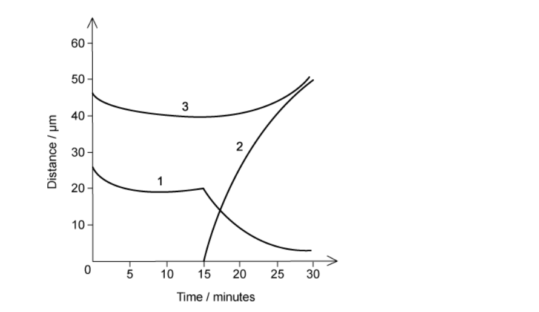
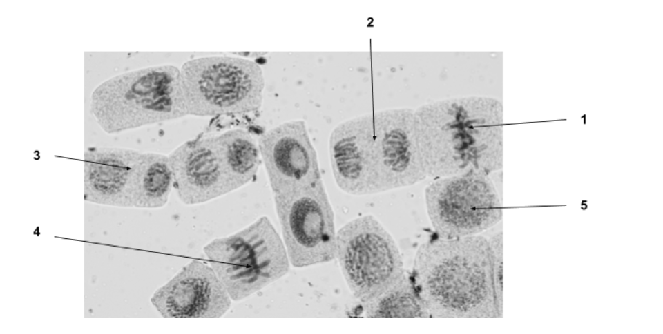
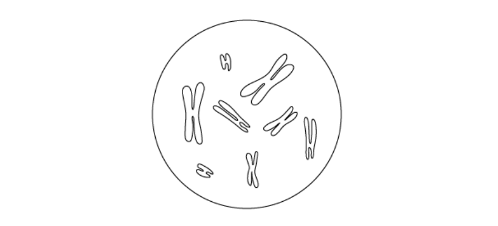
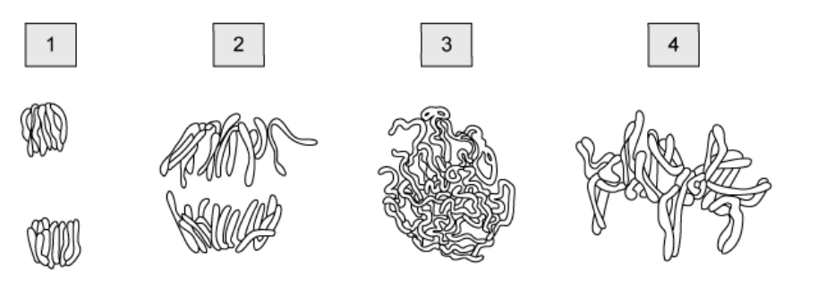
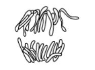
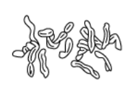

# Exam Questions — Chromosome Behaviour in Mitosis
**5. The Mitotic Cell Cycle** · Cambridge (CIE) A-LEVEL biology (9700)
> Source: [https://www.savemyexams.com/a-level/biology/cie/25/topic-questions/](https://www.savemyexams.com/a-level/biology/cie/25/topic-questions/) · 30 questions across 1 sets

## Multiple Choice Questions (30 questions)

### Q1 — hard — 1 marks

**Q1** [1 mark]

Cells of a root tip meristem were studied and the number of cells in each phase of the cell cycle are noted in the table below.

| **Stage** | **Number of Cells** |
|---|---|
| Interphase | 206 |
| Prophase | 57 |
| Metaphase | 18 |
| Anaphase | 10 |
| Telophase | 44 |
|   | Total = 335 |

A complete cell cycle of a root tip meristem cell is 24 hours.

How long do these cells take to line chromosomes up on the cell equator?

### Q2 — hard — 1 marks

**Q2** [1 mark]

The graphs show measurements taken from metaphase of mitosis onwards.

The graphs are to scale when compared to one another.

Which row correctly identifies each graph?

|   | 1 | 2 | 3 |
|---|---|---|---|
| **A** | distance of centromere from pole of spindle | distance between poles of spindle | distance between sister chromatids |
| **B** | distance between sister chromatids | distance between poles of spindle | distance of centromere from pole of spindle |
| **C** | distance between sister chromatids | distance of centromere from pole of spindle | distance between poles of spindle |
| **D** | distance between poles of spindle | distance of centromere from pole of spindle | distance between sister chromatids |

### Q3 — hard — 1 marks

**Q3** [1 mark]

The protein called mitosis-promoting factor (MPF) has been discovered in cells and is known to cause prophase to start. Usually MPF breaks down and stops functioning during anaphase.

What is a possible consequence of MPF not breaking down?

### Q4 — hard — 1 marks

**Q4** [1 mark]

What features would be observed in a human cell immediately before the onset of mitosis?

|   | number of molecules of DNA in nucleus | nuclear envelope present | number of chromatids | spindle present |
|---|---|---|---|---|
| **A** | 46 | no | 46 | yes |
| **B** | 46 | yes | 92 | no |
| **C** | 92 | yes | 46 | yes |
| **D** | 92 | yes | 92 | no |

### Q5 — hard — 1 marks

**Q5** [1 mark]

The graph shows three measurements obtained following metaphase of mitosis.

What measurements do the curves represent?

|   | distance between centromeres and poles of spindle | distance between centromeres of sister chromatids | distance between poles of spindle |
|---|---|---|---|
| **A** | 1 | 2 | 3 |
| **B** | 3 | 2 | 1 |
| **C** | 3 | 1 | 2 |
| **D** | 1 | 3 | 2 |

### Q6 — hard — 1 marks

**Q6** [1 mark]

Nocodazole is a chemical used in the study of mitosis. It causes all mitotic cells to stop dividing at metaphase.

Which statements correctly identify how this chemical might work?

| **1** | prevents replication of the centrioles |
|---|---|
| **2** | stops sister chromatids migrating to opposite poles |
| **3** | inhibits chromatin condensing in the nucleus |

### Q7 — hard — 1 marks

**Q7** [1 mark]

A student studied a garlic root tip under a microscope and records the following data.

| **Stage** | **Number of Cells** |
|---|---|
| Interphase | 793 |
| Prophase | 64 |
| Metaphase | 21 |
| Anaphase | 8 |
| Telophase | 6 |
|   | Total = 892 |

What percentage of studied cells have chromosomes visible and have pairs of chromatids joined together?

### Q8 — hard — 1 marks

**Q8** [1 mark]

Some chemotherapy treatments used to stop tumour growth work by preventing the DNA double helix from uncoiling and separating.

During which stage of the cell cycle would they act?

### Q9 — hard — 1 marks

**Q9** [1 mark]

The graph shows the changes in the quantity of DNA present in the nucleus of one cell at different stages of a mammal’s life cycle.

Which stage takes place at **X**?

### Q10 — hard — 1 marks

**Q10** [1 mark]

Cancer cells have distinctive differences from normal cell, for example they are sometimes much bigger and sometime smaller and they don’t produce proteins required on the cell surface for cell adhesion and signalling.

Which stage of the cell cycle is most affected in cancer cells?

### Q11 — medium — 1 marks

**Q11** [1 mark]

What of the following does not happen in an animal cell cycle?

| **1** | DNA is expressed |
|---|---|
| **2** | spindle is formed from microtubules |
| **3** | cell plate forms to divide daughter cells |

### Q12 — medium — 1 marks

**Q12** [1 mark]

The diagram shows a plant cell’s chromosomes during metaphase.

Which row correctly describes this plant cell during metaphase?

|   | diploid number (2n) for the plant | structures present at metaphase |   |   |
|---|---|---|---|---|
| cell wall | centriole | spindle |   |   |
| **A**  **B**  **C**  **D** | 4  8  8  16 | ✔  **✕**  ✔  ✔ | **✕**  ✔  **✕**  ✔ | ✔  ✔  ✔  **✕** |

### Q13 — medium — 1 marks

**Q13** [1 mark]

The diagram shows the chromosomes of a squashed cell during mitosis.

Which stage of mitosis is the cell in and what is the haploid chromosome number in this species?

|   | haploid chromosome number | stage of mitosis |
|---|---|---|
| **A**  **B**  **C**  **D** | 5  5  10  10 | anaphase  metaphase  anaphase  metaphase |

### Q14 — medium — 1 marks

**Q14** [1 mark]

The mitotic spindle has a key role in mitosis.

What macromolecule is the spindle made from?

### Q15 — medium — 1 marks

**Q15** [1 mark]

The photomicrograph shows cells in different stages of mitosis.

In which order do these stages occur?

### Q16 — medium — 1 marks

**Q16** [1 mark]

Colchicine is a drug that is used to treat imflammaton and pain. Its action within cells is to stop chromatids from separating during mitosis.

Which phase will the cell reach and then stop dividing?

### Q17 — medium — 1 marks

**Q17** [1 mark]

What row correctly describes an animal cell’s nuclear envelope, centrioles and spindle during mitosis?

|   | **phase** | **nuclear envelope** | **centrioles** | **spindle** |
|---|---|---|---|---|
| **A**  **B**  **C**  **D** | anaphase  metaphase  prophase  telophase | absent  reforms  breaks up  breaks up | replicate  present  move apart  replicate | present  present  forms  breaks up |

### Q18 — medium — 1 marks

**Q18** [1 mark]

Which statement about stages in mitosis is correct?

### Q19 — medium — 1 marks

**Q19** [1 mark]

Each of the following events takes place during mitosis.

| 1 | Chromosomes uncoil |
|---|---|
| 2 | Chromatids move to opposite poles of the cell |
| 3 | Centromeres divide |
| 4 | Chromosomes line up along the equator of the spindle |
| 5 | Two chromatids are joined by a centromere |

In which order do the events take place?

|   | First**        ⎯⎯⎯⎯⎯⎯⎯⎯⎯⎯⎯⎯⎯⎯→        **Last |   |   |   |   |
|---|---|---|---|---|---|
| **A**  **B**  **C**  **D** | 1  3  4  5 | 2  1  5  4 | 4  2  3  3 | 5  4  1  2 | 3  5  2  1 |

### Q20 — medium — 1 marks

**Q20** [1 mark]

Which is the correct statement concerning cell and nuclear division?

### Q21 — easy — 1 marks

**Q21** [1 mark]

The diagram shows a cell nucleus in prophase of mitosis.

What is the correct description of the chromosomes found in each daughter nucleus immediately after division of this cell by mitosis?

### Q22 — easy — 1 marks

**Q22** [1 mark]

During which stage of the mitotic cell cycle is DNA replicated?

### Q23 — easy — 1 marks

**Q23** [1 mark]

The diagrams show chromosomes at different stages of mitosis.

Which shows the correct order of the cell cycle?

### Q24 — easy — 1 marks

**Q24** [1 mark]

Which is always true of cytokinesis?

| **1** | cell structures are divided between two cells. |
|---|---|
| **2** | nuclear envelope reforms |
| **3** | cell structures replicate |

### Q25 — easy — 1 marks

**Q25** [1 mark]

The diagram shows a human cell (2n = 46) at different stages of mitosis. Cell 1 is at the end of prophase and the cells 2 and 3 are daughter cells just after telophase.

How many DNA molecules are there in the nucleus of cell 1 and cell 2?

|   | cell 1 | cell 2 |
|---|---|---|
| **A** | 46 | 46 |
| **B** | 46 | 23 |
| **C** | 92 | 46 |
| **D** | 92 | 23 |

### Q26 — easy — 1 marks

**Q26** [1 mark]

What happens to a cell’s DNA during metaphase of mitosis?

### Q27 — easy — 1 marks

**Q27** [1 mark]

At which stages of mitosis do centromeres separate and the DNA condenses?

|   | centromeres separate | condensation of DNA |
|---|---|---|
| **A** | metaphase | interphase |
| **B** | anaphase | prophase |
| **C** | metaphase | telophase |
| **D** | anaphase | interphase |

### Q28 — easy — 1 marks

**Q28** [1 mark]

Which row is correct?

|   | Diagram | Stage |
|---|---|---|
| **A** |  | Interphase |
| **B** |  | Metaphase |
| **C** |  | Anaphase |
| **D** |  | Telophase |

### Q29 — easy — 1 marks

**Q29** [1 mark]

Which statement describes interphase of mitosis?

### Q30 — easy — 1 marks

**Q30** [1 mark]

A scientist adds a fluorescent dye to dividing cells which stains the nuclear envelope.

At which stages of the cell cycle would the nucleus be visible?

| **1** | Interphase |
|---|---|
| **2** | Prophase |
| **3** | Telophase |
| **4** | Anaphase |
