# Mark Schemes — Structure of Nucleic Acids & Replication of DNA
**6. Nucleic Acids & Protein Synthesis** · Cambridge (CIE) A-LEVEL biology (9700)

## Multiple Choice Questions (30 questions)

### Q1
**Final answer:** **The correct answer is ****D**** because:**

- **Firstly, the ****DNA helix**** is unwound and the ****hydrogen bonds**** between complementary base pairs are broken (4).**
- **Breaking the ****hydrogen bonds**** allows the two strands to be separated (1), which gives space for each to be made into a new DNA molecule.**
- **Free ****DNA nucleotides**** are paired with ****complementary**** nucleotides on each strand by the enzyme ****DNA polymerase**** (2) and hydrogen bonds form between them (3). **
- **The free nucleotides are connected by covalent bonds called ****phosphodiester bonds ****(5). The formation of these bonds is catalysed by ****DNA ligase****. **

### Q2
**Final answer:** **The correct answer is ****B**** because:**

- **This experiment separates the DNA by weight – heavier DNA will appear towards the bottom of the test tube and lighter DNA at the top **
- **Before any DNA replication takes place (generation zero) ****all**** the nitrogen in DNA is ****heavy ****15****N**** and will therefore be the band closest to the bottom of the tube**
- **During the first ****replication cycle ****(generation one), the old ****15****N DNA will unwind and the two strands will separate. ****14****N containing free nucleotides will be added to complement the original strands**
- **The result will be two ****hybrid DNA**** molecules – all the DNA will have one ****strand**** of heavy ****15****N ****(this is the original and conserved DNA made from when bacteria was in ****15****N medium) and the other new strand will contain ****light ****14****N****. Therefore, one band can be seen higher up the test tube than generation zero**
- **In the second division (generation two), the hybrid DNA unwinds and the two strands separate and two new**** complementary**** strands are made. This produces:**

  - **One DNA molecule that has ****one ****15****N**** strand and ****one ****14****N**** strand (this will be the same weight as generation one**
  - **Another DNA molecule that consists of ****two ****14****N strands**** which is the lightest band **

### Q3
**Final answer:** **The correct answer is ****B**** because:**

- **This experiment separates the DNA by weight – heavier DNA (****15****N****) will appear towards the bottom of the test tube and lighter DNA (****14****N****) at the top. **
- **Before any DNA replication takes place (generation zero) ****all**** the nitrogen in DNA is ****heavy ****15****N**** as this is the medium the bacteria have been growing in. Therefore, the band will be closest to the bottom of the tube.**
- **During the first ****replication cycle ****(generation one), the original ****15****N DNA will unwind and the two strands will separate. ****Free nucleotides**** made from ****14****N**** will be added by DNA polymerase to complement the original strands and DNA ligase will attach them into a new strand of DNA.**
- **The result will be two ****hybrid DNA**** molecules – all the DNA will have one ****strand**** of heavy ****15****N ****(this is the original and conserved DNA made from when bacteria was in ****15****N medium) and the other new strand will contain ****light ****14****N****. Therefore, the weight of DNA will be halfway between all ****15****N ****DNA and all ****14****N**** DNA and a single band will be seen in the middle of the test tube.**

> *A **is incorrect as this is shows generation zero, all DNA is made from **15**N.*

> *C **is incorrect as this is shows conservative replication, the is DNA that is all **14**N **and DNA that is all **15**N**.*

> *D **is incorrect as this shows DNA only made with **14**N** which will be the result of many replication cycles in **14**N** medium.*

### Q4
**Final answer:** **The correct answer is ****B**** because:**

- **Reducing sugars are sugars that has an ****OH group**** attached to the ****number 1 carbon**** which can reduce other molecules. **
- **A deoxyribose sugar is part of the nucleic acid structure, which are the building blocks for DNA. Deoxyribose sugars are ****reducing**** as the OH group on number one carbon allows it to bind the ****nitrogenous base**** to form a nucleic acid. **
- **A type of covalent bond called a ****phosphodiester bond**** is formed between the ****OH group of deoxyribose**** carbon-3 and an ****oxygen in the phosphate**** ****group of another nucleic acid. This creates the ****‘phosphate-sugar backbone’**** of a DNA strand.**

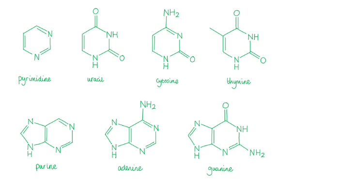

- **There are two strands of nucleic acids in a DNA molecule. The strands are joined by ****hydrogen bonds**** forming between complementary bases. ****Two**** hydrogen bonds form between ****adenine**** and ****thymine**** and ****three ****hydrogen bonds form between ****cytosine ****and ****guanine****.**

### Q5
**Final answer:** **The correct answer is ****B**** because:**

- **A DNA molecule has two complementary strands.**
- **Each strand is a chain of ****nucleic acids****.**
- **Each nucleic acid has ****1 phosphate****, ****1 pentose sugar**** and ****1 base****.**
- **The complementary base pairs are:**

  - **cytosine and guanine**
  - **adenine and thymine**

- **Therefore, the number of each constituent is:**

  - **14000 x 2 = ****28000 pentose sugars**
  - **14000 x 2 = ****28000 phosphate groups**
  - **equal ratios (1:1) of ****cytosine: guanine**** and ****adenine : thymine**

### Q6
**Final answer:** **The correct answer is ****A**** because:**

- **Nucleic acids are joined by a type of covalent bond called a ****phosphodiester bond****, shown by A.**
- **These bonds occur between carbon 3 of the ****pentose sugar**** and the ****oxygen**** of the ****phosphate group**** of different nucleic acids. **

> *B **is incorrect as this is an **ester bond** found in lipids and glycerol.*

> *C **is incorrect as this is a **carbon oxygen** bond found in sugars.*

> *D **is incorrect as this is a **peptide bond** found between amino acids in proteins.*

### Q7
**Final answer:** **The correct answer is ****D**** because:**

- **Within each sample of DNA, the percentage of adenine and thymine are very similar, and the percentage of cytosine and guanine are very similar.**
- **This shows that the four bases exhibit complementary pairing because the ratios of ****adenine : thymine**** and ****cytosine : guanine**** are nearly equal. **
- **Due to experimental error the numbers are not perfect however in cells the ratios will be exact **
- **These two sets of ****complementary bases**** are due the shape of the bases and the ability for ****hydrogen bonds**** to form between them. These hydrogen bonds ensure the DNA molecule is ****stable**** and the complementarity enables DNA to replicate using both strands **

> *A is incorrect as the abundance of any particular base does not relate to size or shape. It is the sequence of the bases that result in a specific amino acid sequence, and therefore protein.*

> *B is incorrect as the data shows the percentage of each base, not the exact amount. Therefore, all values for the bases of each DNA sample adds to 100%.*

> *C is incorrect as the structure of DNA in all animals is the same – a double helix. This data does not give any information about the sequence of DNA, which determines the similarity of two organisms.*

### Q8
**Final answer:** **The correct answer is ****D**** because:**

- **Before any DNA replication takes place the parent DNA is two original black strands.**
- **During the first ****replication cycle****, the old (black) DNA will unwind and the two strands will separate. New free nucleotides (grey) are added to complement the original strands resulting in two ****hybrid DNA**** ****molecules: one ****strand**** of original black DNA**** ****and the strand of new grey DNA.**
- **In the ****second division****, each hybrid DNA unwinds, and the two strands separate and two new**** complementary**** grey strands are made. Each of the hybrid DNA molecules from cycle 1 produces:**

  - **One DNA molecule that has one ****black**** strand and one ****grey**** strand**
  - **Another DNA molecule that consists of ****two grey strands**** which is the lightest band.**
- **Therefore, a total of 2 hybrid DNA molecules and 2 grey DNA molecules are produced.**

### Q9
**Final answer:** **The correct answer is ****C**** because:**

- **Helicase**** is the enzyme that unwraps the ****DNA double helix**** and breaks ****hydrogen bonds**** to enable access to the bases.**
- **DNA polymerase**** assembles ****complementary free nucleotides**** to hydrogen bond to the original DNA to form a new DNA molecule. **
- **DNA ligase**** catalyses the formation of ****phosphodiester bonds**** which are the covalent bonds that occur between a ****phosphate group**** of one nucleic acid and the ****deoxyribose sugar**** of another to join the new nucleotides together and form a complete ****strand****. **

> *RNA polymerase** is not needed for DNA replication, the enzyme is used to produce RNA used in **protein synthesis**.*

### Q10
**Final answer:** **The correct answer is ****D**** because:**

- **There are 153 base pairs total on the strand of DNA, therefore there are 153 bases on each strand.**
- **153 – 31 – 22 – 52 = ****48 adenine (A) bases on strand 1**
- **Adenine pairs with thymine, therefore if there is 48 adenines on strand 1, there are ****48 thymine (T) on strand 2****. **

### Q11
**Final answer:** **The correct answer is ****D**** because:**

- **Bacteria**** is grown in**** ****15****N medium**** for many generations**
- **This is to ensure that all bacteria in the experiment start with DNA that has ****only**** 15****N nitrogen in its bases**
- **Bacteria are then moved to ****14****N medium**** and sampled every hour. It is important to sample on this time scale because bacteria ****replicate**** quickly and when they divide to produce new cells, they will now use**** 14****N to produce the bases for DNA **
- **DNA is semi-conserved through the replication process. This means that in the first ****replication cycle****, the old ****15****N DNA will unwind and the two strands will separate. ****14****N containing free nucleotides will be added to complement each original strand and form two new strands **
- **The result will be two new bacteria, each with ****hybrid DNA**** – one ****strand**** of DNA will contain ****15****N only**** (this is the original and conserved DNA made from when bacteria was in ****15****N medium) and the other new strand will contain ****14****N only**
- **In the second division, the hybrid DNA unwinds and the two strands separate and two new**** complementary**** strands are made. This produces:**
- **one DNA molecule that has one ****15****N strand and one ****14****N strand**
- **Another DNA molecule that consists of two ****14****N strands.**

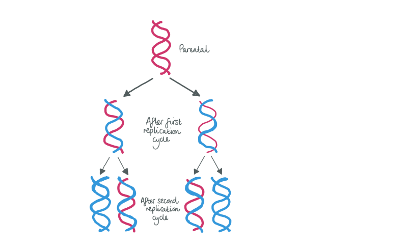

### Q12
**Final answer:** **The correct answer is ****B**** because:**

- **There is a total of 19 base pairs per chain**
- **19 – 8 – 3 – 4 = ****4**
- **Therefore, there are ****4 nucleotides containing adenine**** on strand 2**

> *On strand 1 there would be:*

- *4 thymine** that bond with the 4 adenine on strand 2*
- *4 guanine** that bond with the 4 cytosine on strand 2 *
- *3 cytosine** that bond with the 3 guanine on strand 2*

### Q13
**Final answer:** **The correct answer is ****D**** because:**

- **A ****pyrimidine**** is a type of base that has a ****single ring**** structure.**
- **The three pyrimidine bases found are:**

  - **cytosine****, found in ****both**** DNA and RNA**
  - **uracil****, found in RNA ****only**
  - **thymine****, found in DNA ****only**

> *A, B **&** C** are incorrect as adenine and guanine are double ring structures called purines. Adenine and guanine are found in both DNA and RNA.*

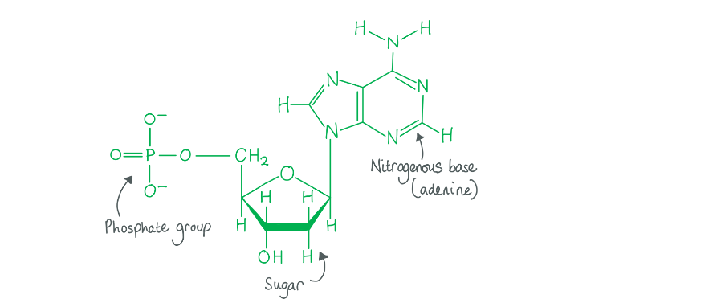

### Q14
**Final answer:** **The correct answer is ****A**** because:**

- **In every nucleotide there is one ****phosphate group****, one ****pentose sugar**** and one ****base****. Therefore there would be an equal ratio of pentose sugars to phosphates (1:1).**
- **Thymine**** and ****adenine**** are ****complementary bases**** and therefore they will appear in equal numbers in a DNA molecule.**

### Q15
**Final answer:** **The correct answer is ****C**** because:**

- **The circle shapes depict ****phosphate groups**** (****Z****).**
- **The pentagon shapes depict ****ribose sugars**** (****Y****).**
- **The different sized shapes depict different bases, ****purines**** have a ****double ****ring structure and are shown bigger than ****pyrimidines**** that are only ****single**** ringed.\**

  - **Adenine is already shown so the other purine is ****guanine**** (****W****).**
  - **X**** has a complementary shape to adenine and is therefore ****Uracil****.**

### Q16
**Final answer:** **The correct answer is ****B**** because:**

- **A strand of DNA consists of ****nucleotide monomers**** made up of a ****phosphate group**** (circle), a ****deoxyribose sugar**** (pentagon) and a ****base**** (the middle shapes)**
- **1**** shows the ****phosphate-sugar backbone**** which does ****not**** contain any bases or hydrogen bonds**
- **2**** shows a ****single nucleotide**** which contains a ****base**** but ****not**** any hydrogen bonds**
- **3**** shows a ****base pair**** which contains ****two**** bases and hydrogen bonds, this shows a cytosine-guanine base pair because there are ****three**** hydrogen bonds**
- **4**** shows just a ****base**** **

### Q17
**Final answer:** **The correct answer is ****D**** because:**

1. **In the first base pair: three ****hydrogen bonds**** form between cytosine (C) and guanine (G) and only two are shown**
2. **In the first base pair: cytosine (C) is a ****pyrimidine****, it had a ****1 ring structure****, and guanine (G) is a purine and has a 2 ring structure – therefore C should be shown as a small base and G a big base**
3. **In the last base pair: cytosine (C) and guanine (G) are complementary however ****adenine**** (A) is shown to pair with guanine **
4. **On the whole right strand: the ****phosphates**** are bound to the wrong side of the ****deoxyribose sugars****. Phosphates always bind to the opposite side to the base. The strands should run in antiparallel directions (one goes 3’ to 5’ and the other 5’ to 3’)**

### Q18
**Final answer:** **The correct answer is ****C**** because:**

- **The complementary bases pairs are adenine with thymine and cytosine with guanine**
- **The ratios of ****complementary base**** pairs are equal however the percentages found in this data aren’t exactly equal – this could be to do with experimental error**

  - **Because the % thymine is 11, ****W = 9%**** **
  - **Because the % guanine is 27, ****X = 25%**
  - **Because the % cytosine is 41, ****Y = 38%**
  - **Because the % adenine is 30, ****Z = 29%**

> *These values are percentages and therefore each row must add to 100!*

### Q19
**Final answer:** **The correct answer is ****C**** because:**

- **Thymine (T) and cytosine (C) are ****pyrimidines**** and have ****single**** ring structures.**
- **Adenine (A) and guanine (G) are ****purines**** and have a ****double**** ring structure.**
- **In this diagram, pyrimidines are shown as the smaller shapes and purines are shown as the larger shapes.**
- **Option ****C ****is incorrect because ****adenine is depicted as a pyrimidine**** (single ring structure).**

### Q20
**Final answer:** **The correct answer is ****B**** because:**

- **The first step in DNA replication is that the cell receives a ****signal to divide**
- **Semi-conservative**** replication copies the DNA of a cell so that there is two sets of DNA, one for each daughter cell of the division**
- **The ****DNA helix**** is then unwound to allow easier access to the n****ucleotide bases**
- **Once the helix is unwound, ****hydrogen bonds**** between bases must be broken to allow ****DNA polymerase**** to bind onto one strand**
- **When the strands are exposed, DNA polymerase moves from the 5’ end to the 3’ end of the old stranding adding ****free nucleotides**** to the bases and ****hydrogen bonds**** form between the nucleotide on the old chain and a complementary free nucleotide**
- **DNA ligase ****covalent bond**** then forms between the ****phosphate**** and the ****deoxyribose sugar**** of two free nucleotides next to each other and this creates a new chain**
- **Therefore, one strand of the new DNA molecule is old and one is new (made from free nucleotides) hence, semi-conservative replication**

### Q21
**Final answer:** **The correct answer is ****C**** because: **

- **The ****minimum**** amount of hydrogen bonds between base pairs is ****2****, between ****adenine**** and ****thymine****. **
- **There are 3 hydrogen bonds between cytosine and guanine.**
- **2 x 900 = 1800**

### Q22
**Final answer:** **The correct answer is ****D**** because:**

- **The diagram shows the complementary base pairing in DNA.**
- **All pairings are correct, adenine with thymine and cytosine with guanine.**
- **However, the size of the nucleotides shown in D are wrong:**
- **Guanine**** is a ****purine****, which means it has a ****double ring structure**** that should be represented by a bigger shape.**
- **Cytosine**** is a ****pyrimidine****, which means it has a ****single ring structure**** and therefore should be a smaller shape. **

### Q23
**Final answer:** **The correct answer is ****D**** because:**

- **The ****sequence of nucleotides**** is ****specific**** to each organism and it what makes the organism what it is**
- **The sequence of nucleotides relates to the sequence of amino acids (****primary protein structure****) made during protein synthesis**
- **The proteins in each organism are therefore different which is what results in different ****phenotypes**** (physical characteristics)**

> *A **is incorrect as **guanine** and **cytosine** are **complementary bases** and therefore the ratio between them will always be equal.*

> *B **is incorrect as DNA in **all** organisms contains the pentose sugar **deoxyribose**.*

> *C **is incorrect as the types of DNA nucleotides are the **same** in all organisms: cytosine, guanine, adenine and thymine.*

### Q24
**Final answer:** **The correct answer is ****A**** because:**

- **DNA, ****deoxyribose nucleic acid****, and RNA, ****ribose nucleic acid****, both contain a ****5-carbon ribose sugar****. Deoxyribose is missing an ****OH group**** on carbon 2**
- **Both DNA and RNA contain ****purine ****and ****pyrimidine**** bases:**

  - **In DNA the purine bases are ****guanine ****(G) and ****adenine**** (A) and the pyrimidine bases are thymine (T) and ****cytosine**** (C).**
  - **In RNA the purine bases are the same as in DNA but instead of thymine (T), RNA contains a different pyrimidine base called ****uracil ****(U)**

- **Both DNA and RNA form ****hydrogen bonds**** with RNA bases:**

  - **DNA forms hydrogen bonds with free ****RNA nucleotides**** during the formation of messenger RNA in protein synthesis**
  - **Hydrogen bonds are formed between RNA bases in ****tRNA**** molecules and ****rRNA**** molecules to form their structures **

### Q25
**Final answer:** **The correct answer is ****C ****because X illustrates a DNA base which has a complementary shape to adenine and is therefore ****thymine****.**

- *Y** is a **deoxyribose sugar*
- *Z** is a **phosphate group*
- *W** is **guanine** and it is the only other purine, the larger of the two types of bases*

### Q26
**Final answer:** **The correct answer is ****B**** because conservative**** DNA**** replication maintains the ****two original**** template DNA strands ****together**** in a double helix (black) and produces a ****complete copy**** composed of two new strands containing all new DNA nucleotides (grey).**

> *A **is incorrect as this cannot exist because it shows two DNA molecules completely newly synthesised and the original DNA molecule disappears.*

> *C **is incorrect as this shows the **semi-conservative model** of DNA replication. This is when the original DNA molecule (black) splits in two and new free nucleotides are attached to make a complementary strand (grey). Both DNA molecules produced are **hybrid**. This is what occurs in nature.*

> *D **is incorrect as this shows the **dispersive model** of DNA replication. This is when the original DNA molecule breaks apart and recombines randomly with newly synthesised sections of DNA. This does not occur in nature.*

### Q27
**Final answer:** **The correct answer is ****A**** because:**

- **Two**** hydrogen bonds form between ****adenine**** (A) and ****thymine**** (T).**
- **Three**** hydrogen bonds form between ****guanine ****(G) and ****cytosine**** (C). **
- **There are two sets of each pair and therefore: ****(2 x 2) + (2 x 3) = 10**** **

### Q28
**Final answer:** **The correct answer is ****A**** because: **

- **Guanine**** is a ****purine**** base (which have double ring structures) **
- **Guanine binds to ****cytosine**** (a pyrimidine / single ring structured base) **
- **In all nucleic acids, the base binds to the ****pentose sugar**** which is attached to the phosphate group **

> *B **is incorrect as **guanine **is attached to the pentose sugar, not the phosphate, in nucleotide*

> *C **is incorrect asguanine is a **purine** base and therefore has a **double** ring structure.*

> *D **is incorrect as guanine’s complementary base is **cytosine**.*

### Q29
**Final answer:** **The correct answer is ****C**** because:**

- **In DNA the nucleotide bases are attached to ****deoxyribose sugars**** whereas in RNA the nucleotide bases are attached to ****ribose sugars**
- **In DNA adenine binds to ****thymine**

> *Adenine does bind to uracil but only in RNA, not DNA.*

### Q30
**Final answer:** **The correct answer is ****B**** because:**

- **A nucleotide is formed from a phosphate group (the circle), a deoxyribose sugar (the pentagon) and a base (the other shape). **
- **Nucleotides are the monomers (building blocks) that form a strand of DNA.**

> *A **is incorrect as this shows the** phosphate-sugar backbone.*

> *C** is incorrect as this shows a **base pair** which is two nucleotides bonded by **hydrogen bonds** formed between bases.*

> *D **is incorrect asthis shows a **nitrogenous base,** which is part of a nucleotide.*

## Structured Questions (16 questions)

### Q1
Antiparallel means...

- (Two DNA) strands run alongside each other; **[1 mark]**
- But in opposite directions / 3' end on each strand is at opposite ends of the helix / 5' end on each strand is at opposite ends of the helix; **[1 mark]**

**[Total: 2 marks]**
The ends of a DNA strand are referred to as the 3' end and the 5' end because...

- Carbon 5/C5 of one nucleotide is bonded by a <u>phosphodiester</u> bond to carbon 3/C3 of the adjacent nucleotide (in a DNA strand); **[1 mark]**
- (Therefore) there will always be one free/unbonded carbon 3/C3 and one free/unbonded carbon 5/C5 at each end of the strand; **[1 mark]**

**[Total: 2 marks]**

> *Try and avoid going into detail about the double-helix; this question is purely about the structure of a single strand of DNA before it joins its complementary strand.*
Other molecules that can bind to DNA bases and the function they perform include...

**Final answer:** **Any ****two**** examples and their corresponding function:**

- DNA polymerase can bind to regions at the edges of the bases; **[1 mark]**
- To carry out DNA replication / synthesise new DNA strands; **[1 mark]**

**OR**

- RNA polymerase can bind to bases where DNA molecule unwinds; **[1 mark]**
- To carry out transcription / synthesise a strand of mRNA (to be translated); **[1 mark]**

**OR**

- (May act as a) binding site for other proteins / restriction enzymes / ligases / gene promoters / transcription factors / gene blockers; **[1 mark]**
- For the control of gene expression; **[1 mark]**

**[Total: 4 marks]**

> *DNA is well recognised as a stable molecule on account of its structure, but it cannot be so stable that it is chemically inert. In order to be useful, DNA must be reactive enough to be unwound and transcribed/copied, before re-forming and resuming its relatively static role within the nucleus.*
A comparison between DNA and RNA structure includes...

**Final answer:** **Any ****six**** of the following:**

**Similarities:**

- Both are polynucleotides / contain many nucleotides; **[1 mark]**
- Both contain adenine/A, cytosine/C and guanine/G bases; **[1 mark]**
- Both contain a pentose sugar **AND** a phosphate group; **[1 mark]**
- Both are linked by phosphodiester bonds between 3' and 5' carbon atoms; **[1 mark]**

**Differences:**

- DNA is double-stranded / RNA is single-stranded; **[1 mark]**
- DNA is a longer molecule / RNA is a shorter molecule; **[1 mark]**
- DNA contains deoxyribose sugars / RNA contains ribose sugars; **[1 mark]**
- DNA contains thymine/T base / RNA contains uracil/U base; **[1 mark]**

**[Total: 6 marks]**

> *Make sure that you stick to structural differences in your answer, no marks will be awarded for mentioning the different functions of DNA and RNA.*

### Q2
Two deductions that can be made from the data include:

- Within each species, the amount/percentage of adenine/A (roughly) equals the amount/percentage of thymine/T **AND** the amount/percentage of cytosine/C (roughly) equals the amount/percentage of guanine/G; **[1 mark]**
- The composition of DNA bases varies between different species **OR** the amount/percentage of purine and pyrimidine bases differs between species; **[1 mark]**

**[Total: 2 marks]**

> *These deductions are also known as Chargaff's rules, named after Erwin Chargaff who was one of the first scientists to analyse the base composition of DNA between different species.*
The value of **X** can be calculated as follows:

- **X**(%G) = 50.6 ÷ 2; **[1 mark]**
- = 25.3(%); **[1 mark]**

*Full marks awarded for the correct answer only.*

**[Total: 2 marks]**

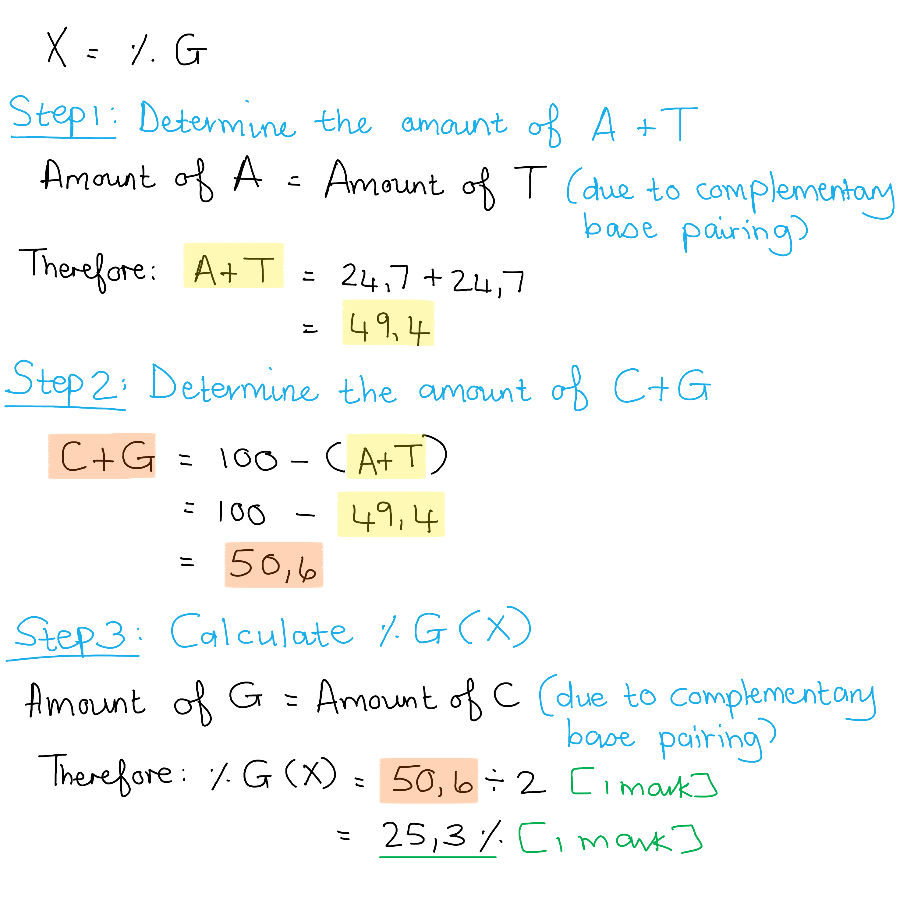
The results obtained by Chargaff impacted the work of Crick and Watson in the following ways:

- It showed that DNA was composed of equal numbers/amounts of purine and pyrimidine bases, suggesting (complementary) base pairing; **[1 mark]**
- Crick and Watson could deduce that the two strands / complementary bases had an antiparallel orientation towards each other **OR** (complementary) base pairing would lead to a double helix with a highly compacted structure; **[1 mark]**

**[Total: 2 marks]**

> *Complementary base pairing indicated that the DNA molecule was double stranded and that the most stable structure could be obtained if the two strands run antiparallel to each other. Chargaff was one of many scientists whose research provided clues to Crick and Watson which helped them to unravel the mystery of the structure of a DNA molecule.*
The base-pairing characteristics of pyrimidine and purine bases in DNA and RNA are...

- Pyrimidines are thymine/T, cytosine/C and uracil/U; **[1 mark]**
- Purines are adenine/A and guanine/G; **[1 mark]**
- Base-pairing: A-T or A-U with <u>two</u> hydrogen bonds **AND** C-G with <u>three</u> hydrogen bonds; **[1 mark]**

**[Total: 3 marks]**

> *Don't forget about uracil, as the question mentions RNA too. The number of hydrogen bonds in each base pair is important to mention, it's not enough to just state A-T / A-U and C-G.*

### Q3
The results at 7 seconds and 120 seconds can be contrasted as follow:

- At 7 seconds, most radioactivity was found in the smaller fragments **WHILE** the fragments were much larger after a "chase" period of 120 seconds; **[1 mark]**
- The radioactivity of the fragments was low / peaked below 1 cpm cm-3 at 7 seconds **WHILE** the radioactivity of the fragments was high / peaked above 5 cpm cm-3 at 120 seconds; **[1 mark]**

**[Total: 2 marks]**

> *The command word contrast requires you to look at the differences in the data between the two "chase" periods and compile your answer accordingly.*
An explanation for the results at 60 seconds would be:

- Two peaks indicate that there are both small and large / two different sized fragments present in this sample; **[1 mark]**
- The smaller fragments would result from (discontinuous) replication occurring on the lagging strand while the larger fragments would be due to the (continuous) replication of the leading strand; **[1 mark]**

**[Total: 2 marks]**

> *Only the leading strand can be replicated continuously since DNA polymerase can only add nucleotides in the 5' to 3' direction. This results in the presence of larger fragments in the DNA sample that was "chased" for 60 seconds. The lagging strand is replicated in short fragments (Okazaki fragments) which explains their presence in this DNA sample.*
A possible reason for the low number of small fragments at 120 seconds would be:

- Many of the smaller/Okazaki fragments would have been joined together by <u>DNA ligase</u> resulting in a decrease of small fragments / increase in larger fragments; **[1 mark]**

**[Total: 1 mark]**

> *It is important to be able to apply your knowledge of DNA replication to an unfamiliar scenario. At a "chase" period of 120 seconds, DNA ligase would have been able to join many of the smaller fragments produced on the lagging strand, which explains the low peak for the small fragments and the presence of many large fragments.*
A line of the predicted results at 150 seconds would include:

- First peak below **AND** second peak above 120 second line; **[1 mark]**
- Similar shape to 120 second line **AND** radioactivity at the start and end of the line is higher than for 120 second line; **[1 mark]**

**[Total: 2 marks]**

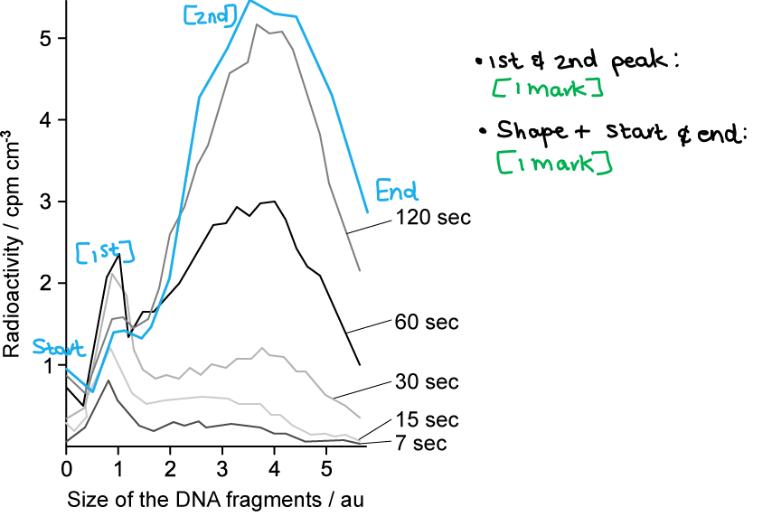

### Q4
The number of Kb in the DNA of the fruit fly is:

- 5.6cm = 56000μm; **[1 mark]**
- 56000 ÷ 0.34 = 164706; **[1 mark]**

*Full marks are awarded for the correct answer only*

**[Total: 2 marks]**

> *Note that you can only get one mark if you gave your answer as 164705.88 or 164705.9 because the question specifically asks you to give your answer to the nearest whole number. *

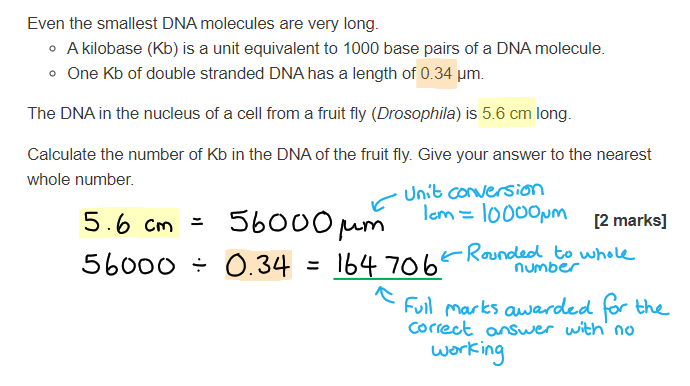
An advantage of DNA molecules having two strands is...

**Final answer:** **Any ****one ****of the following:**

- Hydrogen bonding between complementary bases (in double-stranded DNA) contributes to the stability (of the molecule);** [1 mark]**
- It provides protection for the bases (from mutagens/digestive enzymes);** [1 mark]**

**[Total: 1 mark]**

> *The structure of the DNA double helix ensures that the nitrogenous bases are kept on the inside of the molecule away from potential harm or damage.*
The numbering of the carbon atoms in the pentose sugars are as follows:

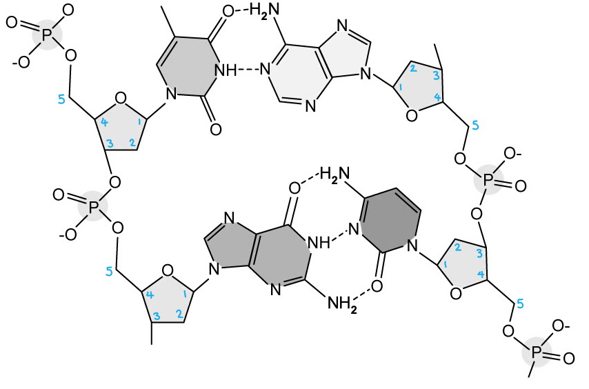

1 mark given for each correct strand; **[2 marks]**

**[Total: 2 marks]**

> *This question is quite tricky because with a skeletal formula the carbon atoms aren't labelled. Remember that wherever two lines meet there is a carbon atom. The rule with numbering the carbons is to start at the oxygen atom and go around the pentagon clockwise. Don't forget that the 5th carbon is outside the pentagon shape! *
The total number of each base present in the strand and the % composition of each base is:

- Number of adenine **and** thymine bases = 835 each; **[1 mark]**
- Number of cytosine **and** guanine bases = 365 each; **[1 mark]**
- % of adenine **and** thymine bases = 35% each; **[1 mark]**
- % of cytosine **and** guanine bases = 15% each; **[1 mark]**

*Full marks are awarded for the correct answer only*

**[Total: 4 marks]**

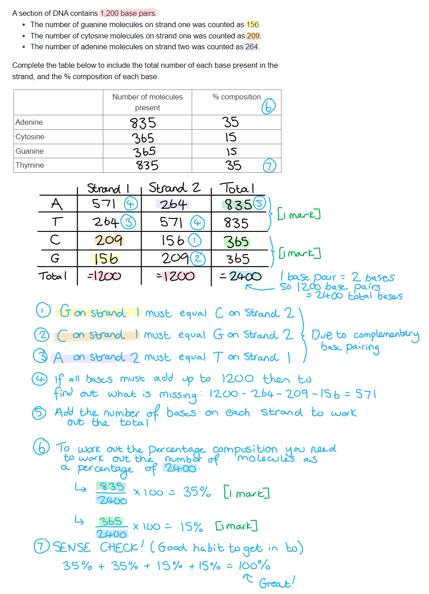

### Q5
(i) The band of DNA from bacteria first grown in the (15N) culture and then transferred to the normal (14N) culture would appear…

- Higher than tube A; **[1 mark]**
- Lower than tube C; **[1 mark] **

For example:

(ii) After one more generation in the (14N) culture the appearance of tube B would be...

- One band in the same position as part (i); **[1 mark]**
- One band in the same position as tube C; **[1 mark]**

**[Total: 4 marks]**

> *For part (ii) of the question it is important to understand that during the next phase of reproduction, the lighter (less dense) (**14**N) would be incorporated into the bacteria and so this generation would float higher up than the first as they would be less dense than the generation with only (**15**N). This process happens as part of the semi-conservative replication of the bacterium's DNA.*
This is because…

(i)

- In the (bacterium's) DNA molecule, the old strand contains (15N), while the new strand contains (14N); **[1 mark]**
- So the DNA is **less **dense/heavy than that containing entirely (15N), but **more **dense/heavy than that containing entirely (14N); **[1 mark]**

**(ii)**

- Two strands of (bacterium's) DNA contain (15N) DNA from the original culture, with new (14N) incorporated from the new culture; **[1 mark]**
- Two stands are fully (14N) because they contain the (14N) strand from the previous generation as well as a new (14N) strand; **[1 mark]**

**[Total: 4 marks]**

> *To apply your knowledge to this question you need to be confident in your understanding of semi-conservation replication of DNA.*
Meselson and Stahl’s experiment demonstrates the semi-conservative replication of DNA because…

- In semi-conservative replication, when DNA is replicated, the new DNA molecule will be made of one original strand and one newly synthesised strand; **[1 mark]**
- Tube B shows a band of DNA which is **less **dense/heavy than bacteria grown in (15N) (tube A) and **more **dense/heavy than bacteria grown in (14N) (tube C); **[1 mark]**
- When the bacteria are grown in (15N), it incorporates the heavier isotope into its DNA;** [1 mark]**
- When this bacteria is transferred to (14N) medium and allowed to replicate once, the new strand will incorporate (14N); **[1 mark]**
- The resulting DNA molecule is made of one strand containing (15N), and one containing (14N);** [1 mark]**

**[Total: 5 marks]**
The outcome of the experiment would be...

- One band in the same position as tube A; **[1 mark]**
- One in the same position as tube C; **[1 mark]**

**[Total: 2 marks]**

### Q6
The purpose of DNA replication is to...

- Copy/make new DNA for new cells/daughter cells / cell division **OR** to ensure that daughter cells (after cell division) are genetically identical to the parent cell;** [1 mark]**

**[Total: 1 mark] **
The correct diagram is...

- A; **[1 mark]**

This is because...

- (A) shows semi-conservative replication / half of the new double helix contains original DNA while half contains new DNA OR B shows (fully) conservative replication;** [1 mark]**

**[Total: 2 marks] **
Two enzymes that are involved with the process of DNA replication include...

**Final answer:** **Any ****two**** of the following:**

- Helicase; **[1 mark]**
- DNA polymerase; **[1 mark]**

**[Total: 2 marks]**

> *Be careful not to mix up DNA polymerase with RNA polymerase; DNA polymerase joins DNA nucleotides during DNA replication while RNA polymerase joins RNA nucleotides during transcription*

> *.*
The fraction of a cell’s original DNA that will be present after 3 full replication cycles is...

- ½ x ½ x ½ OR (½)3  OR 1 ÷ 2 and 0.5 ÷ 2 and 0.25 ÷ 2; **[1 mark]**
- ⅛ / 0.125 / 12.5 %; **[1 mark]**

Full marks can be awarded for the correct answer in the absence of other calculations.

**[Total: 2 marks] **

> *Because of semi-conservative replication **half** the original cell’s DNA will be conserved every time the cell replicates itself. There are 3 cycles of replication so we have to multiply 0.5 by itself three times, i.e 0.5 cubed, or divide it by 2 three times (as shown below) instead. The question asks for a fraction but you can express your answer correctly as a** decimal** or** percentage** without penalty. *

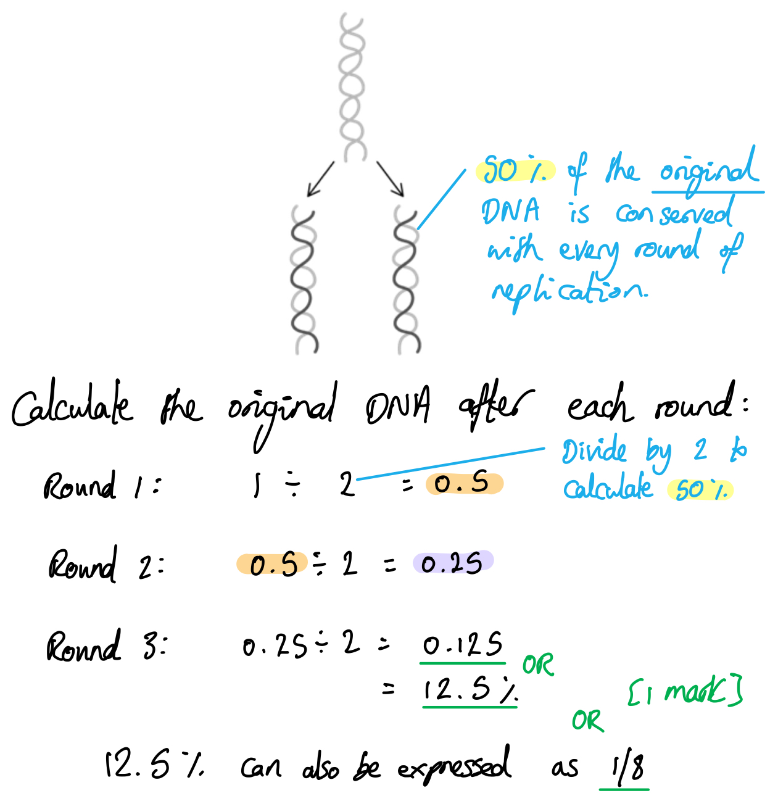

### Q7
RNA can be described as a polymer and as a macromolecule because...

*As a polymer:*

**Final answer:** **Any ****one**** of the following:**

- (RNA contains) (similar) repeating smaller molecules/subunits; **[1 mark]**
- It has repeating / many monomers / (RNA) nucleotides; **[1 mark]**
- Nucleotides joined together to form a chain; **[1 mark]**
- It is made of nucleotides to form <u>poly</u>nucleotide; **[1 mark]**

*As a macromolecule:*

**Final answer:** **Any ****one**** of the following:**

- It has large (biological) molecules / is made up of 1000 or more atoms / with a high molecular mass; **[1 mark]**
- It has a giant/huge structure; **[1 mark]**

**[Total: 2 marks]**

> *Be very careful about what the subunits are in RNA. 'Bases', 'amino acids' or 'sugars' are often given as answers by students, which are both wrong. The best word to use for this is **nucleotides**. You may understand what a polymer is but make sure you're also aware of the definition of 'macromolecule'.*
The test for reducing sugars and the observations for a positive result are...

*Test*

- Add Benedict’s (solution / reagent) <u>and</u> boil/heat to a temperature 80 °C and above; **[1 mark]**

*Observation*

- A precipitate forms / (change from clear blue to various colours) green / yellow / orange / red / brown (**NOT** black / purple / blue); **[1 mark]**

**[Total: 2 marks]**

> *The most common omission is that students fail to mention that the reaction mixture is boiled as part of the test procedure. Make sure to include this step!*
The completed Table 1 is as follows...

| **Feature** | **DNA nucleotides** | **RNA nucleotides** |
|---|---|---|
| Pentose sugar  component | **Final answer:** **Deoxyribose** | **Final answer:** **Ribose** |
| Purine bases | **Final answer:** **Adenine /A Guanine / G** | **Final answer:** **Adenine /A Guanine / G** |
| Pyrimidine bases | **Final answer:** **Cytosine / C Thymine / T** | **Final answer:** **Cytosine / C Uracil / U** |

**[1 mark] **for each correct row of the table.

**[Total: 3 marks]**

### Q8
The percentage of thymine in this DNA is...

- C-G = 34 (%) OR A-T = 66 (%);** [1 mark]**
- T = 33 (%); **[1 mark]**

*Full marks awarded for the correct answer in the absence of calculations*

**[Total: 2 marks] **

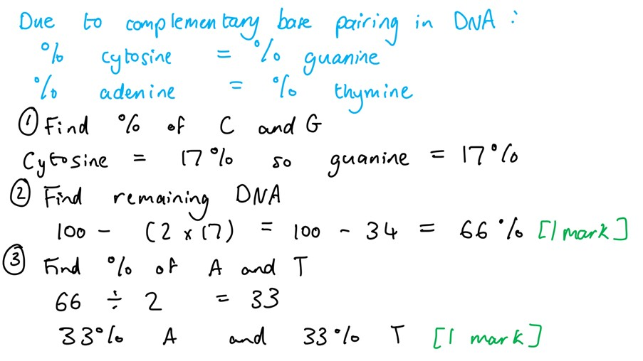
The calculation from part (a) could not be performed for a strand of RNA because…

**Final answer:** **Any ****one**** of the following:**

- RNA does not contain thymine / contains uracil (in place of thymine) / the answer would always be 0 %; **[1 mark]**
- RNA is (usually) single-stranded (so doesn’t form base pairs); **[1 mark]**

**[Total: 1 mark]**
Structures **A**, **B**, and **D** are...

- **A** = sugar-phosphate backbone / repeated (pentose) sugar and phosphate molecules; **[1 mark]**
- **B** = nucleotide; **[1 mark]**
- **D** = nitrogenous base; **[1 mark]**

**[Total: 3 marks]**
One type of bond in the structure labelled **C** is...

**Final answer:** **Any ****one**** of the following:**

- Hydrogen bond (between the bases); **[1 mark]**
- Covalent bond (between the sugar and the base/phosphate / between the nucleotides); **[1 mark]**

***Accept**** phosphodiester bond.*

**[Total: 1 mark]**

### Q9
The completed table is as follows:

|   | **Purine** | **Pyrimidine** |
|---|---|---|
| Adenine | ✓ |   |
| Thymine |   | ✓ |
| Cytosine |   | ✓ |
| Guanine | ✓ |   |
| Uracil |   | ✓ |
|   | **; [1 mark]** | ; **[1 mark]** |

**[Total: 2 marks]**
The the direction in which DNA polymerase adds new DNA nucleotides during DNA replication is...

- 5' to 3'; **[1 mark]**

**[Total: 1 mark]**

> *This is pronounced out loud as 5 "prime" to 3 "prime".*

> *DNA polymerase is an enzyme, so its active site is a specific shape and can only bind to the 3' end of a piece of DNA. This means that the DNA polymerase 'reads' the template in the 3' to 5' direction, and **builds a new DNA strand** in the antiparallel **5' to 3' direction**. Be careful not to get confused between the direction of reading and the direction of building here!*
The formation of new DNA differs between the leading and lagging strands as follows...

- On the leading strand the formation of the new DNA is continuous; **[1 mark]**
- On the lagging strand the DNA is synthesised in small segments / Okazaki fragments; **[1 mark]**

**[Total: 2 marks]**
The function of DNA ligase during DNA replication is:

- To join together the DNA fragments / Okazaki fragments / forms a continuous DNA strand (in the lagging strand); **[1 mark]**
- Catalyse the formation of phosphodiester bonds in the DNA backbone / between nucleotides;** [1 mark]**

**[Total: 2 marks]**

### Q10
A comparison of the structures of RNA and DNA nucleotides should include...

*Similarities*

- Both have a pentose sugar **AND** a phosphate **AND** a nitrogenous base; **[1 mark]**
- Both have adenine **AND** guanine **AND** cytosine; **[1 mark]**

*Differences*

A **maximum of** **two **of the following:

- RNA has uracil **WHILE** DNA has thymine; **[1 mark]**
- DNA has deoxyribose sugar **WHILE** RNA has ribose sugar; **[1 mark]**
- Ribose sugar has -OH at carbon 2 **WHILE** deoxyribose sugar has -H at carbon 2; **[1 mark]**

**[Total: 3 marks]**

> *Remember that the command word 'compare' means that you need to give similarities and/or differences, so be sure to give a balance of both types of point.*

> *Make sure to refer to both DNA and RNA together when comparing. Use link words like 'while' or 'both' to aid your comparison. *
The structures are:

- X = uracil; **[1 mark]**
- Y = hydrogen bonds; **[1 mark]**
- Z = <u>ribose</u> sugar; **[1 mark]**

**[Total: 3 marks]**

> *While the topic of transcription is not covered in detail until 6.2, topic 6.1 does cover RNA structure, so you should be able to answer this question based on this knowledge alone.*
Neighbouring nucleotides are held together in the sugar-phosphate backbone by:

- Phosphodiester (bonds); **[1 mark]**

**[Total: 1 mark]**
Examples of molecule types that contains RNA include...

**Final answer:** **Any ****one**** of the following:**

- mRNA/messenger RNA / pre-mRNA; **[1 mark]**
- tRNA/transfer RNA; **[1 mark]**
- rRNA/ribosomal RNA; **[1 mark]**

***Accept**** other correctly named examples, e.g. siRNA, miRNA, snoRNA, piRNA.*

**[Total: 1 mark]**

> *Topic 6.1 covers mRNA as an example of an RNA molecule, so you would be expected to know this here. Other types of RNA, such as tRNA and rRNA are covered in more detail in topic 6.2.*

### Q11
mRNA structure of mRNA enables it to perform its function as follows:

Any **two** of the following:

- It is single-stranded **SO** it can fit through the nuclear pores / attach to a ribosome; **[1 mark]**
- It has exposed / accessible bases **SO** can form complementary base pairs with the bases in tRNA / tRNA anticodons; **[1 mark]**
- It is complementary to the DNA template strand **SO** is an accurate copy of the DNA; **[1 mark]**
- It is unstable / degrades easily (compared to DNA) **SO** it can be broken down to switch off protein production; **[1 mark]**

**[Total: 2 marks]**

> *The structure of RNA enables it to create a reliable copy of the DNA molecule, which can then be taken to the ribosomes situated outside the nucleus. DNA is too large to fit through the nuclear pores, due to its double-stranded nature, but RNA can fit through the pores.*
The following statements apply to each of the molecules:

**Final answer:** **One**** mark per correct column:**

| **Statement** | **DNA** | **messenger RNA** | **protein** |
|---|---|---|---|
| Hydrogen bonds stabilise the molecule | √ |   | √ |
| Subunits are joined by peptide bonds |   |   | √ |
| The molecule is double stranded | √ |   |   |
| Contains phosphodiester bonds | √ | √ |   |
| Uracil is present |   | √ |   |
| **Marks allocated** | ; **[1 mark]** | ; **[1 mark]** | ; **[1 mark]** |

**[Total: 3 marks]**
The maximum number of hydrogen bonds that could be present in this section of DNA would be:

- 62 x 3; **[1 mark]**
- =<u>186</u> (hydrogen bonds); **[1 mark]**

*Full marks awarded for the correct answer only.*

**[Total: 2 marks]**

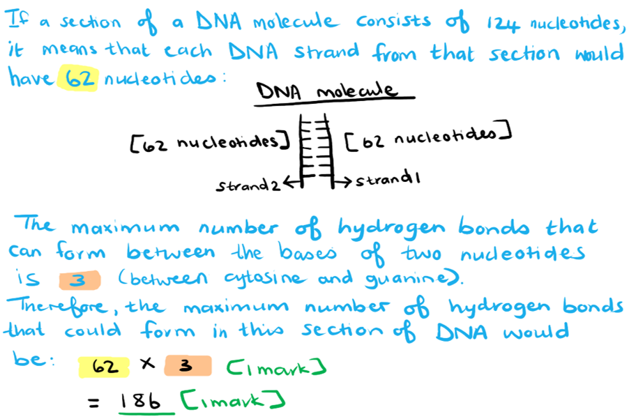
The role of covalent bonds in forming polynucleotides include:

**Final answer:** **Any ****two**** of the following:**

- These bonds are called phosphodiester bonds; **[1 mark]**
- They link the 5-carbon of deoxyribose/sugar to the phosphate group within each nucleotide; **[1 mark]**
- (This type of bond) also links the phosphate group of one nucleotide to the 3-carbon of deoxyribose/sugar of the next nucleotide; **[1 mark]**

**[Total: 2 marks]**

> *Covalent bonds occur when electron pairs are shared between atoms, which make for the formation of a strong bond between them. In the case of nucleotides, these bonds are called phosphodiester bonds and they provide stability to the sugar-phosphate backbone of DNA.*

### Q12
The term leading and lagging strand refers to the following in DNA replication:

- (The leading strand) is being copied continuously / towards the replication fork / in the 5' to 3' direction; **[1 mark]**
- (The lagging strand) is being copied in segments / fragments / Okazaki fragments / away from the replication fork; **[1 mark]**

**[Total: 2 marks]**

> *DNA polymerase can only build a new strand in the 5' to 3' direction. The leading strand allows the enzyme to do this continuously, while this is not possible on the lagging strand. The Okazaki fragments that result from the replication of the lagging strand will be joined together by DNA ligase to form a continuous strand.*
The structure of a monomer of a DNA molecule includes:

**Final answer:** **Any ****two**** from the following:**

- Deoxyribose <u>and</u> phosphate <u>and</u> a (nitrogenous) base; **[1 mark]**
- One correctly named base (e.g. adenine/A, thymine/T, cytosine/C, guanine/G); **[1 mark]**
- Description of phosphate group and base <u>attached</u>/<u>bonded</u> to deoxyribose; **[1 mark]**

**[Total: 2 marks]**

> *Make sure that you know the monomers of biological molecules very well. In the case of DNA it is a nucleotide and its basic structure is important to know. *
The bases for RNA are as follow:

Purines:

- Adenine <u>and</u> guanine (no letters accepted); **[1 mark]**

Pyrimidines:

- Cytosine <u>and</u> uracil (no letters accepted); **[1 mark]**

**[Total: 2 marks]**
DNA replicates in the following way:

**Final answer:** **Any ****five**** of the following:**

- DNA (double helix) unwinds/uncoils; **[1 mark]**
- Hydrogen bonds between (complementary) bases break; **[1 mark]**
- *Mention of* complementary base/nucleotide pairing / A-T <u>and</u> C-G; **[1 mark]**
- Both strands are used as templates **OR **both strands are copied; **[1 mark]**
- (DNA replication) produces two identical DNA molecules; **[1 mark]**
- Replication is semi-conservative / each new DNA molecule has one original and one new strand; **[1 mark]**
- *Reference to* binding of DNA polymerase to template strands; **[1 mark]**
- Leading strand is copied continuously while lagging strand is copied in fragments / Okazaki fragments; **[1 mark]**
- DNA ligase will join Okazaki fragments / new nucleotides together; **[1 mark]**
- Nucleotides are joined together with phosphodiester bonds; **[1 mark]**

**[Total: 5 marks]**

> *Make sure you understand the steps involved with DNA replication. You need to mention what happens to the original DNA molecule, the enzymes that are involved with the process and the bonds that are broken and formed. Also take note that the two strands are copied differently due to the fact that DNA polymerase can only copy in the 5' to 3' direction. The leading strand is copied continuously as a result of this, while the lagging strand is copied in fragments that must then be joined together to form a continuous strand.*

### Q13
DNA replication can be described as semi-conservative because:

- Each DNA strand acts as a template (for the synthesis of a new/complementary strand); **[1 mark]**
- The new DNA (molecule) has one old/parental/original strand **and** one new/daughter strand; **[1 mark]**

**[Total: 2 marks]**

> *During semi-conservative replication, the DNA molecule will unwind and unzip, with each strand acting as a template for the formation of a new strand of DNA. This means that every new molecule of DNA will contain the template strand from the original DNA molecule and the new strand that formed as a result of the template strand. So the original DNA molecule is only 'semi-conserved' within the new DNA molecules.*
The structure of DNA will facilitate semi-conservative replication in the following ways:

**Final answer:** **Any ****three**** of the following:**

- Base pairing occurs **OR** adenine binds to thymine / A-T <u>and</u> cytosine binds to guanine / C-G **OR** purine binds to pyrimidine; **[1 mark]**
- Reference to hydrogen bonds involved with base pairing; **[1 mark]**
- (Free) nucleotides pair with both strands / each strand/polynucleotide/side; **[1 mark]**
- Both strands act as a template (for a new strand to form); **[1 mark]**
- Two identical DNA molecules are produced; **[1 mark]**

**[Total: 3 marks]**

> *The structure of the DNA molecule enables it to unwind and unzip so that each strand acts as a template for a new strand to form, leading to two identical DNA molecules each consisting of one original and one new strand. Complementary base pairing ensures that the two new molecules will have the exact same base sequence as the original DNA molecule.*
The importance of the new DNA molecules being identical to each other is because...

**Final answer:** **Any ****two**** of the following:**

- (It ensures all cells/nuclei) are <u>genetically</u> identical / contain the same genetic information / genetic material does not vary / same genotype; **[1 mark]**
- There would be no mutations present; **[1 mark]**
- A consequence of mutations (e.g. cells not recognised, uncontrollable cell division, cancer, disease such as sickle cell anaemia, altered active sites for enzymes, different proteins with different functions); **[1 mark]**

**[Total: 2 marks]**

> *It is very important that cells contain the same genetic information in order for them to continue performing the same function. Any change to the genetic code is called a mutation and can have a very negative impact on the cells, and ultimately the organism.*
(i) The missing values in Table 4.1 would be as follow:

| **Generation** | **Percentage DNA containing ****14****N and ****15****N** | **Percentage DNA containing ****14****N only** |
|---|---|---|
| 1 | 100 | 0 |
| 2 | 50 | 50 |
| 3 | 25 | 75 |
| 4 | 12 | 88 |
| 5 | 6; **[1 mark]** | 94; **[1 mark]** |

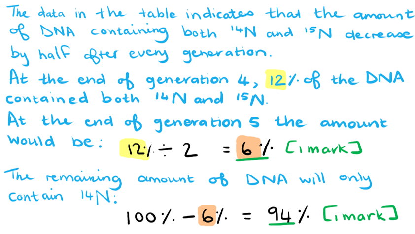

(ii) The conclusion that can be drawn from these results:

- *E. coli* DNA replicates semi-conservatively / semi-conservative DNA replication took place; **[1 mark]**

**[Total: 3 marks]**

> *The results support semi-conservative DNA replication. After each cycle of DNA replication, the amount of DNA containing both isotopes of nitrogen would halve, compared to the total amount of DNA. This is because there is only **14**N in the growth medium, so no new DNA strands containing **15**N can form.*

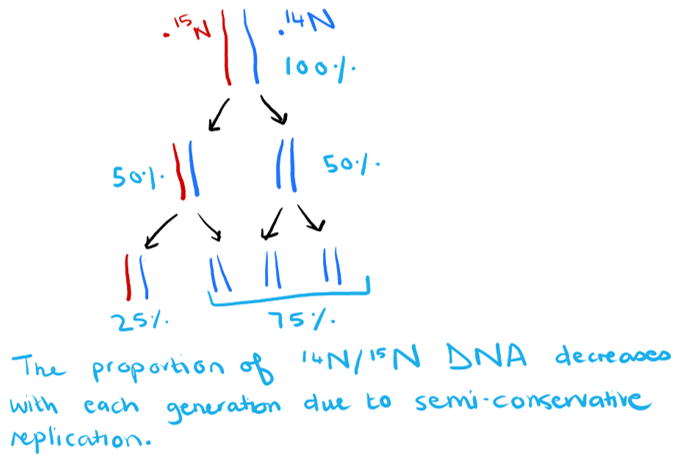

### Q14
Information that could be added to** **two of the labels to confirm that this cell is prokaryotic and not eukaryotic is...

**Final answer:** **Any ****two ****of the following:**

- Cell wall made from peptidoglycan/murein / cell wall <u>not</u> made from cellulose; **[1 mark]**
- DNA free in the cytoplasm **OR** circular / closed loop of DNA **OR** naked DNA / no histones; **[1 mark]**
- 70s ribosomes; **[1 mark]**
- No membrane around flagellum; **[1 mark]**

**[Total: 2 marks]**

> *For this question you cannot get marks for suggesting new labels, only adding to the labels that already exist, as stated in the question. *
The scientists were able to deduce that the pathogen infected the phloem tissue because...

**Final answer:** **Any ****two ****of the following:**

- Transport of sucrose/products of photosynthesis (in phloem) is prevented; **[1 mark]**
- Starch (would usually be) synthesised in the root from transported assimilates; **[1 mark]**
- Starch is not converted in leaf to sugars/sucrose (for transport, and so starch accumulates in the leaves); **[1 mark]**
- The pathogen and the phloem are present in many organs/leaves/roots; **[1 mark]**

***Accept**** correct reasons why the infected tissue cannot be the xylem, e.g. "xylem are dead cells with no cell content and so would not be able to support living pathogens".*

**[Total: 2 marks]**

> *Remember that starch is not transported in the phloem, it is **stored** in the leaves and hydrolysed to **sucrose** before it is transported.*
The completed table is as follows…

| feature | DNA nucleotide with adenine | RNA nucleotide with adenine | ATP |   |
|---|---|---|---|---|
| contains nitrogen (yes or no) | yes | yes | yes | ;** [1 mark]** |
| contains a pyrimidine base (yes or no) | no | no | no | ;** [1 mark]** |
| number of phosphate groups | 1 | 1 | 3 | **; [1 mark]** |
| name of the sugar component | deoxyribose | ribose | ribose | **DNA has deoxyribose**;** [1 mark]  **  **AND**  **RNA ****and **ATP have ribose; **[1 mark]** |

**[Total: 5 marks]**

> *If you struggle with this, try drawing some diagrams of the three nucleotides together and label the differences. *

### Q15
From the data in Table 1 the following can be confirmed:

**Final answer:** **Any ****three**** from the following:**

- A purine base will always pair with a pyrimidine base; **[1 mark]**
- (Named) base/nucleotide pairing (A - T , C - G); **[1 mark]**
- The percentage adenine/A is very similar / the same as the percentage of thymine/T; **[1 mark]**
- The percentage cytosine/C is very similar / the same as the percentage of guanine/G; **[1 mark]**
- Data quote in support of above statements; **[1 mark]**

**[Total: 3 marks]**

> *Chargaff's work indicated that the amount of adenine and thymine was similar, as well as the amount of cytosine and guanine in the DNA of different organisms. This provided a clue as to how the bases arranged themselves in a DNA molecule, with adenine binding to thymine and guanine binding to cytosine.*
The ways in the structure of DNA and RNA differ include the following:

**Final answer:** **Any ****three**** of the following:**

- DNA is made up of two polynucleotides/chains/strands while RNA is a single polynucleotide/chain/strand; **[1 mark]**
- DNA has a <u>double helix</u> structure while RNA is not a helix / is a straight chain; **[1 mark]**
- The pentose sugar in DNA is <u>deoxyribose</u> as opposed to <u>ribose</u> in RNA; **[1 mark]**
- DNA contains thymine but no uracil while RNA contains uracil but no thymine; **[1 mark]**
- Hydrogen bonding occur between all DNA bases but not between / only between some RNA bases; **[1 mark]**
- DNA is a longer molecule (than RNA); **[1 mark]**
- DNA is only one type of molecule while there are three types of RNA (mRNA, tRNA, rRNA); **[1 mark]**
- In DNA the ratio of A+G / purines to C+T / pyrimidines is 1:1, while the ratio of A+G / purines to C+U / pyrimidines varies; **[1 mark]**

**[Total: 3 marks]**

> *Make sure that you are able to contrast the main differences in the structure of DNA and RNA with one another. The pentose sugar is different (deoxyribose in DNA, ribose in RNA), as well as one of the bases (thymine in DNA, uracil in RNA).  Another main difference is the fact that DNA is a double stranded molecule with hydrogen bonds holding the two strands together, while RNA is a single stranded molecule. The double stranded structure of DNA is what leads to the ratio of 1:1 between purines and pyrimidines in the molecule, since a purine base will always bind to a pyrimidine base.*
ATP can be described as a phosphorylated nucleotide due to the following reasons:

- It contains three phosphate groups that have been added to adenosine/ribose/pentose sugar; **[1 mark]**
- (It is a nucleotide due to) the presence of a pentose sugar, nitrogenous base and a phosphate group; **[1 mark]**

**[Total: 2 marks] **

> *The chemical energy that is stored in the bonds between the phosphate groups is what makes ATP such a great energy carrier in living organisms. These bonds can be easily broken when ATP is hydrolysed to release the energy for use in biochemical reactions.*

### Q16
The bases in Fig. 1 can be identified as follows:

- **Q** - adenine; **[1 mark]**
- **R** - guanine; **[1 mark]**
- **S** - cytosine; **[1 mark]**

**[Total: 3 marks]**

> *To identify the bases correctly you must begin with the base that is given. Due to complementary base pairing we know that **Q** will be adenine as it will always bind to thymine. The next base pair has three hydrogen bonds between them, which means it must be guanine and cytosine. Guanine is a purine due to its double ring structure which is represented by **R** in Fig. 1, which means that **S** must be cytosine (due to complementary base pairing).*
The importance of hydrogen bonding includes the following:

**Final answer:** **Any ****two**** of the following:**

- Hydrogen bonds hold (two) polynucleotides / strands /  chains together **OR** hold (complementary) nucleotides / base pairs together **OR** prevents unwinding / strand separation; **[1 mark]**
- (many hydrogen bonds) give stability / stabilises DNA molecule; **[1 mark]**
- (Hydrogen bonds) can be broken for transcription / replication; **[1 mark]**
- Contributes to (double) helix structure (of DNA molecule); **[1 mark]**

**[Total: 2 marks]**

> *Hydrogen bonding is important to the structure of a DNA molecule as it holds the complementary base pairs in position and therefore the entire double helix structure. Even though the hydrogen bonds are strong enough to keep the molecule intact, it can be broken in order for the molecule to unzip during DNA replication and transcription.*
A comparison of the structure of ATP and DNA nucleotides includes the following:

**Final answer:** **Any ****three**** of the following:**

Similarities:

- Both contain a <u>pentose sugar</u>, <u>nitrogenous base</u> and a <u>phosphate</u> group; **[1 mark]**

Differences:

- For DNA the pentose sugar is deoxyribose while for ATP it is ribose; **[1 mark]**
- In DNA the nitrogenous base could be adenine, guanine, cytosine or thymine while for ATP it is (always) adenine; **[1 mark]**
- DNA nucleotides contain only one phosphate group while for ATP it is three; **[1 mark]**

**[Total: 3 marks]**

> *ATP and DNA nucleotides share some similarities in their basic structure, even though their functions are completely different. The energy that is stored in the bonds between the phosphate groups can be readily released when ATP is hydrolysed, which is what makes it such a good energy carrier in living organisms.*
The percentage nucleotides containing cytosine would be calculated as follows:

- 42 ÷ 2; **[1 mark]**
- = <u>21</u>(%); **[1 mark]**

*Full marks awarded for the correct answer only.*

**[Total: 2 marks]**

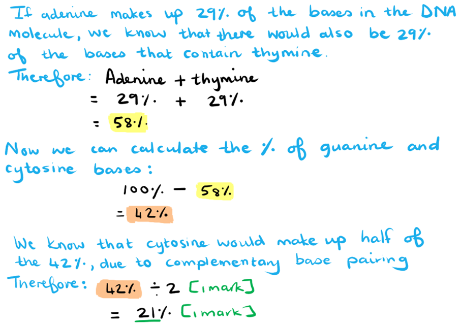
