# Exam Questions — Structure of Nucleic Acids & Replication of DNA
**6. Nucleic Acids & Protein Synthesis** · Cambridge (CIE) A-LEVEL biology (9700)
> Source: [https://www.savemyexams.com/a-level/biology/cie/25/topic-questions/](https://www.savemyexams.com/a-level/biology/cie/25/topic-questions/) · 46 questions across 2 sets

## Multiple Choice Questions (30 questions)

### Q1 — hard — 1 marks

**Q1** [1 mark]

The following events occur in the replication of DNA.

Here are the steps in their experiment in a mixed-up order

| **1** | opposite strands are separated |
|---|---|
| **2** | free DNA nucleotides pair with complementary nucleotides on each strand |
| **3** | bonds between complementary bases are formed |
| **4** | bonds between complementary bases are broken |
| **5** | phosphodiester bonds are formed |

Which is the correct order of the processes?

### Q2 — hard — 1 marks

**Q2** [1 mark]

Meselson and Stahl proved that DNA replication was semi-conservative.  Bacteria were grown for many generations in a medium containing 15N (a heavy isotope of nitrogen). They were then transferred to a medium containing 14N (a lighter isotope of nitrogen). They were given time to replicate DNA and divide once. Their DNA was extracted, spun in a centrifuge and observed using ultraviolet light. They then repeated this experiment, this time allowing the bacteria to replicate DNA and divide twice.  Again, the DNA was extracted, spun in a centrifuge and observed using ultraviolet light.

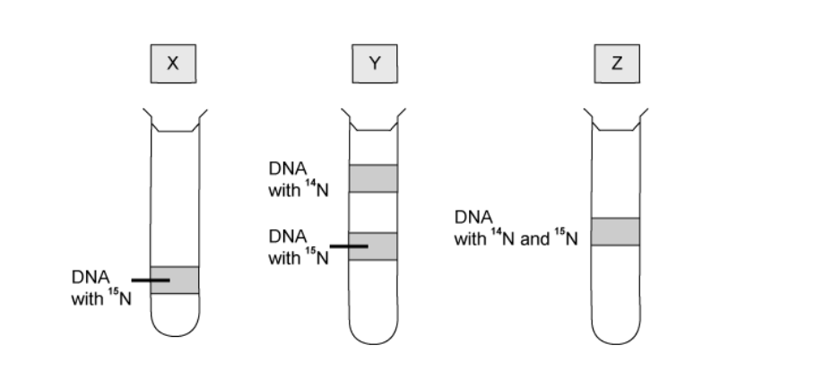

Which shows the predicted results after zero, one and two generations of replication in the medium with the light isotope?

### Q3 — hard — 1 marks

**Q3** [1 mark]

In 1957, Meselson and Stahl conducted an experiment that proved that DNA replication was semi-conservative.  They took bacteria containing only 15N in their DNA and transferred them to a medium only containing 14N.  They allowed the bacteria to divide once then centrifuged the DNA to reveal the following results

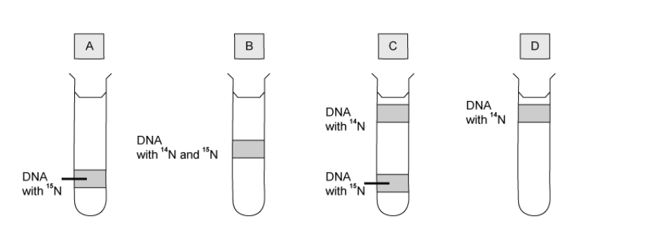

Which shows the predicted results after one generation in the medium with the light isotope?

### Q4 — hard — 1 marks

**Q4** [1 mark]

Which type of sugar and types of bonds are found in a DNA molecule?

|   | **type of sugar** | **nucleotides in strand joined by** | **adjacent strands joined by** |
|---|---|---|---|
| **A** | non-reducing | phosphodiester bonds | hydrogen bonds |
| **B** | reducing | phosphodiester bonds | hydrogen bonds |
| **C** | non-reducing | ester bonds | covalent and hydrogen |
| **D** | reducing | ester bonds | covalent and hydrogen |

### Q5 — hard — 1 marks

**Q5** [1 mark]

What would be the result of analysing a DNA molecule 14 000 base pairs in length?

### Q6 — hard — 1 marks

**Q6** [1 mark]

Which diagram shows the bond linking the individual units of a nucleic acid?

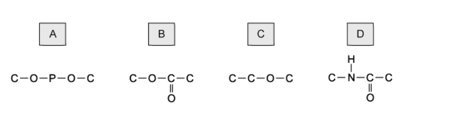

### Q7 — hard — 1 marks

**Q7** [1 mark]

The table shows the percentages of bases in DNA from various types of cell.

| **source of DNA** | **adenine** | **cytosine** | **guanine** | **thymine** |
|---|---|---|---|---|
| human hair | 30 | 20 | 21 | 29 |
| human liver | 9 | 40 | 40 | 11 |
| dog liver | 24 | 26 | 24 | 26 |
| mouse bone marrow | 23 | 26 | 27 | 24 |
| sunflower leaf | 11 | 41 | 38 | 10 |

What is a valid deduction from this data?

### Q8 — hard — 1 marks

**Q8** [1 mark]

The diagram shows DNA strands that have undergone replication. The parent DNA is shown in black and the newly synthesised DNA is shown in grey.

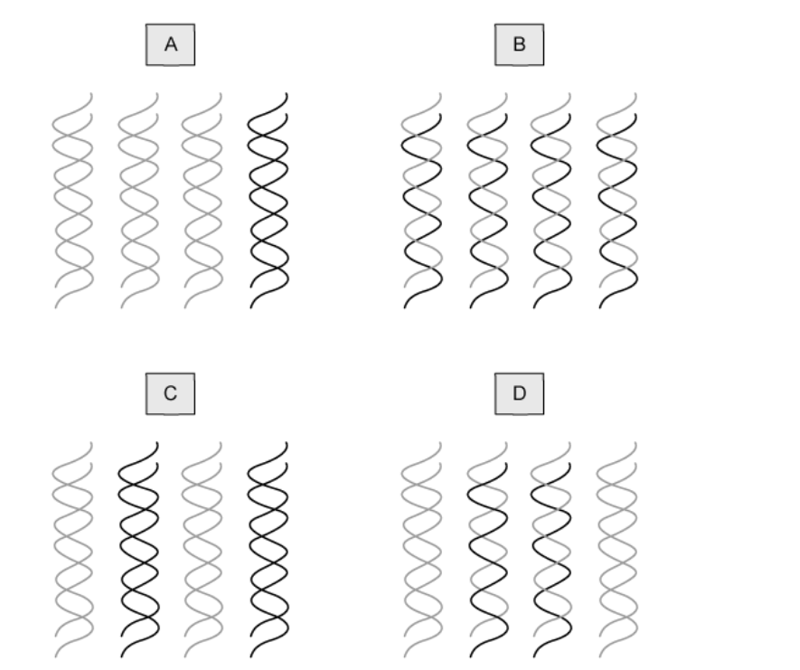

Which would be the resulting DNA strands formed after two cycles of semi-conservative replication?

### Q9 — hard — 1 marks

**Q9** [1 mark]

Which enzymes are needed for DNA replication?

| **1** | Helicase |
|---|---|
| **2** | DNA ligase |
| **3** | RNA polymerase |
| **4** | DNA polymerase |

### Q10 — hard — 1 marks

**Q10** [1 mark]

A piece of DNA 153 base pairs long was analysed to find the number of nucleotide bases in each of the polynucleotide strands.  Some of the results are shown below

|   | number of nucleotide bases |   |   |   |
|---|---|---|---|---|
| strand 1  strand 2 | A | T  31 | G  22 | C  52 |

How many nucleotides containing Thymine (T) were present in strand 2?

### Q11 — medium — 1 marks

**Q11** [1 mark]

In 1957, Meselson and Stahl conducted an experiment that provided overwhelming evidence to support the theory than DNA replication was semi-conservative.  They used *E. coli *which has a generation time of around one hour.

Here are the steps in their experiment in a mixed-up order

| **1** | Bacteria contain either all 14N DNA or hybrid DNA |
|---|---|
| **2** | Bacteria grown in a 15N medium for many generations |
| **3** | Bacteria transferred to a 14N medium and sampled every hour |
| **4** | All bacteria contain hybrid DNA (14N DNA and 15N DNA). |
| **5** | All bacteria contain 15N DNA |

### Q12 — medium — 1 marks

**Q12** [1 mark]

A short piece of DNA 19 base pairs long was analysed to find the number of nucleotide bases in each of the polynucleotide strands.  Some of the results are shown below

|   | number of nucleotide bases |   |   |   |
|---|---|---|---|---|
| strand 1  strand 2 | **A**  8  - | **T**  -  8 | **G**  -  3 | **C**  -  4 |

How many nucleotides containing adenine (A) were present in strand 2?

### Q13 — medium — 1 marks

**Q13** [1 mark]

Which nucleic acid bases are pyrimidines?

### Q14 — medium — 1 marks

**Q14** [1 mark]

Which of the following would be a result of analysing a DNA molecule?

### Q15 — medium — 1 marks

**Q15** [1 mark]

The diagram shows part of an RNA molecule.

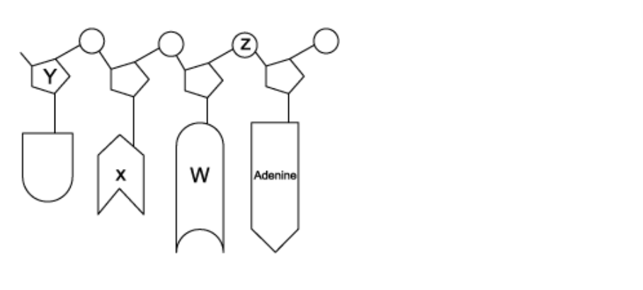

Which row of the table below is correct?

|   | **uracil** | **phosphate** | **ribose** | **guanine** |
|---|---|---|---|---|
| **A**  **B**  **C**  **D** | W  W  X  X | Z  Y  Z  Y | Y  Z  Y  Z | X  X  W  W |

### Q16 — medium — 1 marks

**Q16** [1 mark]

The diagram shows part of a DNA molecule

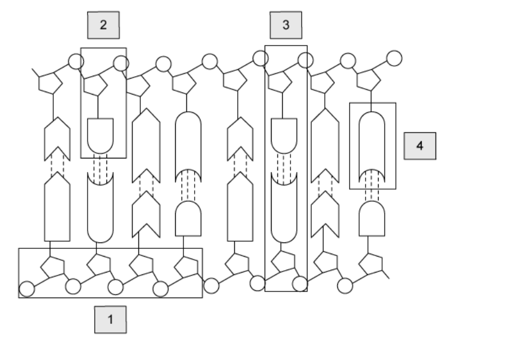

Which row correctly describes the highlighted sections of DNA?

|   | contains a base | hydrogen bonding present |
|---|---|---|
| **A** | 2, 3 and 4 | 1 only |
| **B** | 2, 3 and 4 | 3 only |
| **C** | 1 ,2, 3 and 4 | 3 and 4 only |
| **D** | 1 ,2, and 4 | 3 only |

### Q17 — medium — 1 marks

**Q17** [1 mark]

How many mistakes are there in this DNA sequence?

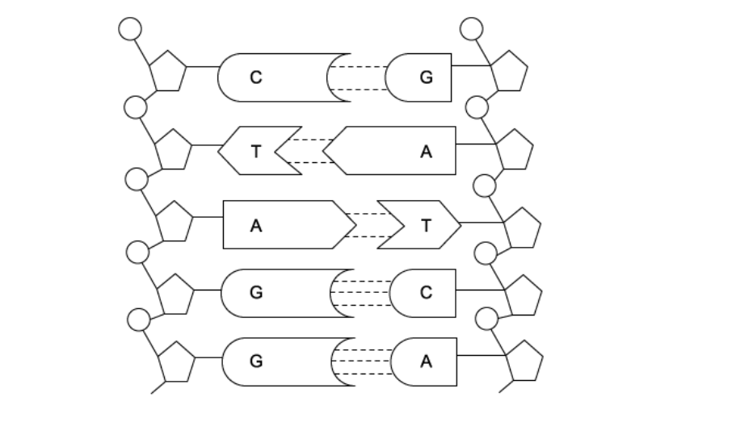

### Q18 — medium — 1 marks

**Q18** [1 mark]

The table shows the percentages of bases in DNA from various types of cell.

| **source of DNA** | **adenine** | **cytosine** | **guanine** | **thymine** |
|---|---|---|---|---|
| human hair | 30 | 20 | 21 | **Z** |
| human liver | **W** | 40 | 40 | 11 |
| dog liver | 24 | 26 | 24 | 26 |
| mouse bone marrow | 23 | **X** | 27 | 25 |
| sunflower leaf | 11 | 41 | **Y** | 10 |

What is a valid deduction from this data?

### Q19 — medium — 1 marks

**Q19** [1 mark]

Which base pair has the mistake?

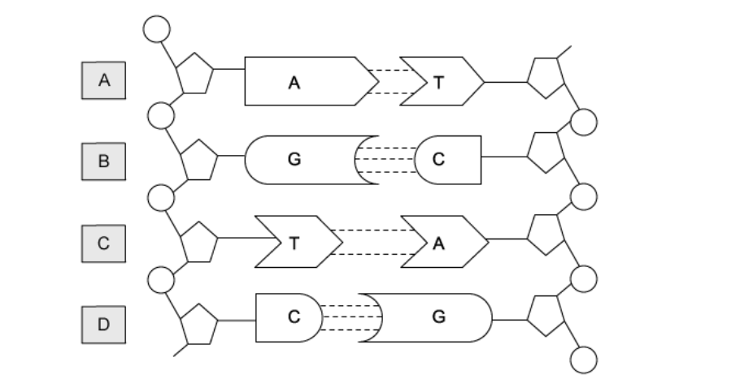

### Q20 — medium — 1 marks

**Q20** [1 mark]

During semi-conservative replication of DNA, the following processes occur:

| **1** | Free nucleotides are hydrogen bonded to those on the exposed strand. |
|---|---|
| **2** | The cell receives the signal to begin to divide. |
| **3** | Hydrogen bonds are broken between the complementary base pairs. |
| **4** | Covalent bonds form between adjacent nucleotides on the same strand. |
| **5** | The DNA double helix is unwound. |

Which is the correct order of the processes?

### Q21 — easy — 1 marks

**Q21** [1 mark]

What is the minimum number of hydrogen bonds in a length of DNA containing 900 base pairs?

### Q22 — easy — 1 marks

**Q22** [1 mark]

Which base pair has a mistake?

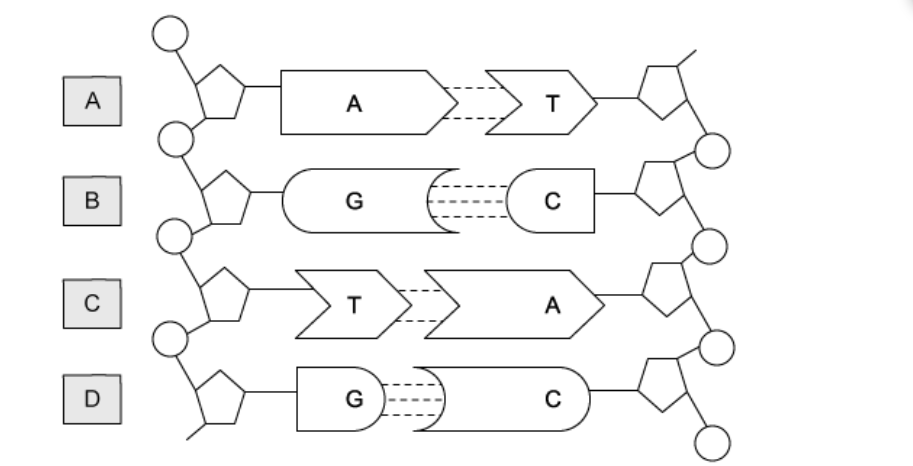

### Q23 — easy — 1 marks

**Q23** [1 mark]

DNA was extracted from the pancreas of a walrus and a human liver cell.

In which way did the DNA molecules differ?

### Q24 — easy — 1 marks

**Q24** [1 mark]

Which row correctly identifies the features of DNA and RNA molecules?

|   | DNA and RNA both contain a 5- carbon sugar | DNA and RNA contain both purine and pyrimidine bases | forms hydrogen bonds with bases in RNA molecules |
|---|---|---|---|
| **A**  **B**  **C**  **D** | ✓  ✓  ✓  X | ✓  X  ✓  ✓ | ✓  ✓  X  X |

key

✓= correct statement

X= incorrect statement

### Q25 — easy — 1 marks

**Q25** [1 mark]

This diagram shows a section of a DNA molecule.

What is part **X **on the diagram?

### Q26 — easy — 1 marks

**Q26** [1 mark]

The diagram shows the outcomes from four different models of DNA reproduction after one nuclear division. The parent DNA is shown in black and the newly synthesized DNA is shown in grey.

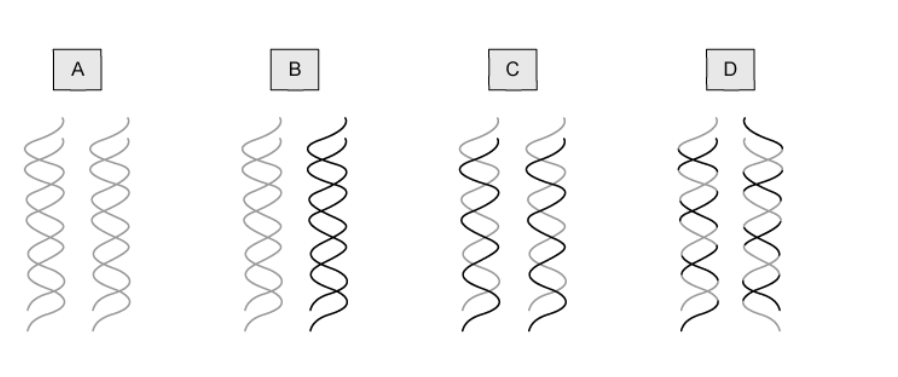

Which diagram shows conservative DNA replication?

### Q27 — easy — 1 marks

**Q27** [1 mark]

This diagram shows a section of DNA

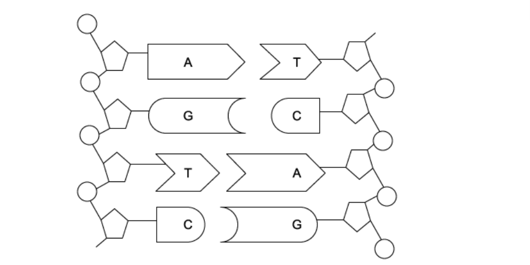

How many hydrogen bonds would be involved in holding these two strands together?

### Q28 — easy — 1 marks

**Q28** [1 mark]

Which row correctly describes guanine?

|   | **ring structure** | **component on nucleotide strand it is attached to** | **complementary base** |
|---|---|---|---|
| **A** | double | pentose sugar | cytosine |
| **B** | double | phosphate | cytosine |
| **C** | single | phosphate | cytosine |
| **D** | single | pentose sugar | thymine |

### Q29 — easy — 1 marks

**Q29** [1 mark]

Which row correctly describes adenine on a strand of **DNA**?

|   | component on nucleotide strand it is attached to | complementary base |
|---|---|---|
| **A** | deoxyribose | uracil |
| **B** | ribose | uracil |
| **C** | deoxyribose | thymine |
| **D** | ribose | thymine |

### Q30 — easy — 1 marks

**Q30** [1 mark]

The diagram shows part of a DNA molecule

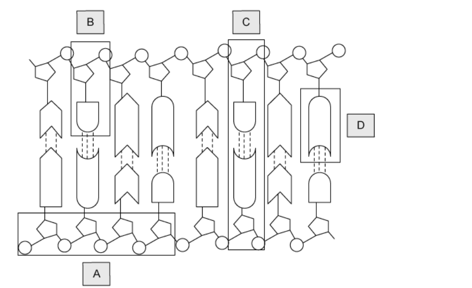

Which part is a nucleotide?

## Structured Questions (16 questions)

### Q1 — hard — 14 marks

**Q1** [2 marks]

The two strands of DNA are described as 'antiparallel'.

Explain the meaning of 'antiparallel' in this context.

**Q1** [2 marks]

The ends of a DNA strand are referred to as the 3' ('3-prime') end and the 5' ('5-prime') end.

Explain what this means by referring to the structure of a DNA strand.

**Q1** [4 marks]

Adenine / thymine and guanine / cytosine are well known to form hydrogen bonds with each other in complementary base-pairs within the DNA double helix. These bases can also form hydrogen bonds with other molecules in order to carry out specific functions.

Suggest **two **examples of how such molecules can bind to the bases and explain how this adds functionality.

**Q1** [6 marks]

Compare and contrast the structures of DNA and RNA.

### Q2 — hard — 9 marks

**Q2** [2 marks]

Table 1 shows the DNA base composition of different organisms. Note that for *E. coli*, the %C and %T has deliberately been left out.

**Table 1**

| **Organism** | **%A** | **%C** | **%T** | **%G** |
|---|---|---|---|---|
| Maize | 26.7 | 23.3 | 27.0 | 23.0 |
| Chicken | 28.0 | 21.9 | 27.8 | 22.3 |
| Octopus | 33.0 | 17.2 | 32.1 | 17.7 |
| Grasshopper | 29.8 | 20.2 | 29.2 | 20.8 |
| Sea urchin | 32.6 | 16.9 | 33.1 | 17.4 |
| Yeast | 31.5 | 18.1 | 32.1 | 18.3 |
| *E. coli* | 24.7 | - | - | **X** |

State **two** deductions that can be made from the data.

**Q2** [2 marks]

**Extract:**

Table 1 shows the DNA base composition of different organisms. Note that for *E. coli*, the %C and %T has deliberately been left out.

**Table 1**

| **Organism** | **%A** | **%C** | **%T** | **%G** |
| Maize | 26.7 | 23.3 | 27.0 | 23.0 |
| Chicken | 28.0 | 21.9 | 27.8 | 22.3 |
| Octopus | 33.0 | 17.2 | 32.1 | 17.7 |
| Grasshopper | 29.8 | 20.2 | 29.2 | 20.8 |
| Sea urchin | 32.6 | 16.9 | 33.1 | 17.4 |
| Yeast | 31.5 | 18.1 | 32.1 | 18.3 |
| *E. coli* | 24.7 | - | - | **X** |

Calculate the possible value of **X** in the table in part (a).

Show your working.

**Q2** [2 marks]

**Extract:**

Table 1 shows the DNA base composition of different organisms. Note that for *E. coli*, the %C and %T has deliberately been left out.

**Table 1**

| **Organism** | **%A** | **%C** | **%T** | **%G** |
| Maize | 26.7 | 23.3 | 27.0 | 23.0 |
| Chicken | 28.0 | 21.9 | 27.8 | 22.3 |
| Octopus | 33.0 | 17.2 | 32.1 | 17.7 |
| Grasshopper | 29.8 | 20.2 | 29.2 | 20.8 |
| Sea urchin | 32.6 | 16.9 | 33.1 | 17.4 |
| Yeast | 31.5 | 18.1 | 32.1 | 18.3 |
| *E. coli* | 24.7 | - | - | **X** |

The results from part (a) are similar to those first obtained by Erwin Chargaff in the 1950s.

Suggest how Chargaff's research may have impacted the work of Crick and Watson.

**Q2** [3 marks]

Identify the pyrimidine and purine bases in DNA and RNA and explain their base-pairing characteristics.

### Q3 — hard — 7 marks

**Q3** [2 marks]

A group of scientists studied the replication of DNA in *Escherichia coli* bacteria.

During their investigation, radioactive nucleotides were added to DNA that was actively replicating in a short pulse of about 5 seconds. This allowed the radioactive nucleotides to be incorporated into the new DNA strands.

This was followed by a "chase" period, during which an abundance of unlabelled nucleotides was added to the DNA for different amounts of time, between 7 and 120 seconds. After the isolation and centrifugation of the DNA molecules, the results were obtained.

Fig. 1 below shows the results of their investigation.

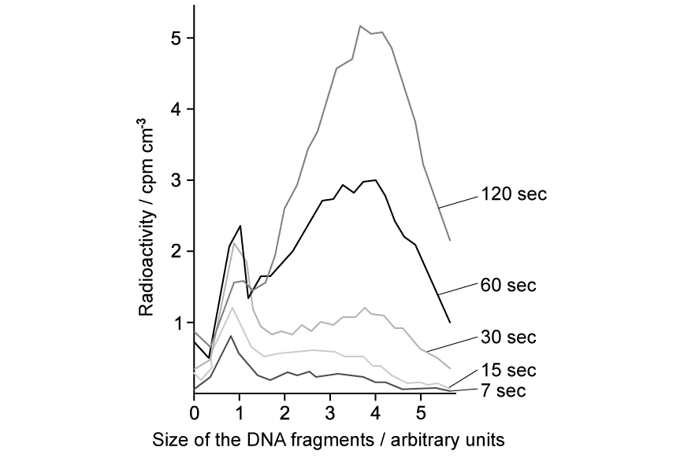

**Fig. 1**

Contrast the results obtained at a "chase" period of 7 seconds with those obtained at 120 seconds.

**Q3** [2 marks]

**Extract:**

A group of scientists studied the replication of DNA in *Escherichia coli* bacteria.

During their investigation, radioactive nucleotides were added to DNA that was actively replicating in a short pulse of about 5 seconds. This allowed the radioactive nucleotides to be incorporated into the new DNA strands. 

This was followed by a "chase" period, during which an abundance of unlabelled nucleotides was added to the DNA for different amounts of time, between 7 and 120 seconds. After the isolation and centrifugation of the DNA molecules, the results were obtained.

Fig. 1 below shows the results of their investigation.

**Fig. 1**

Explain the results obtained at a "chase" period of 60 seconds.

**Q3** [1 mark]

**Extract:**

A group of scientists studied the replication of DNA in *Escherichia coli* bacteria.

During their investigation, radioactive nucleotides were added to DNA that was actively replicating in a short pulse of about 5 seconds. This allowed the radioactive nucleotides to be incorporated into the new DNA strands.

This was followed by a "chase" period, during which an abundance of unlabelled nucleotides was added to the DNA for different amounts of time, between 7 and 120 seconds. After the isolation and centrifugation of the DNA molecules, the results were obtained.

Fig. 1 below shows the results of their investigation.

Two peaks indicate that there are both small and large / two different sized fragments present in this sample. The smaller fragments would result from (discontinuous) replication occurring on the lagging strand while the larger fragments would be due to the (continuous) replication of the leading strand.

Suggest a possible explanation for the low number of small fragments present at 120 seconds.

**Q3** [2 marks]

**Extract:**

A group of scientists studied the replication of DNA in *Escherichia coli* bacteria.

During their investigation, radioactive nucleotides were added to DNA that was actively replicating in a short pulse of about 5 seconds. This allowed the radioactive nucleotides to be incorporated into the new DNA strands. 

This was followed by a "chase" period, during which an abundance of unlabelled nucleotides was added to the DNA for different amounts of time, between 7 and 120 seconds. After the isolation and centrifugation of the DNA molecules, the results were obtained.

Fig. 1 below shows the results of their investigation.

**Fig. 1**

Sketch a line on the graph of the predicted results that could be obtained at a "chase" period of 150 seconds.

]

### Q4 — hard — 9 marks

**Q4** [2 marks]

Even the smallest DNA molecules are very long.

- A kilobase (Kb) is a unit equivalent to 1000 base pairs of a DNA molecule
- One Kb of double-stranded DNA has a length of 0.34 μm

The DNA in the nucleus of a cell from a fruit fly (*Drosophila*) is 5.6 cm long.

Calculate the number of Kb in the DNA of the fruit fly. Give your answer to the nearest whole number.

**Q4** [1 mark]

Other than for use in replication, explain **one** advantage of DNA molecules having two strands.

**Q4** [2 marks]

The image below shows a section of the skeletal formula of a DNA molecule.

Number the carbon atoms of all the pentose sugars shown in the image using the standard numbering format.

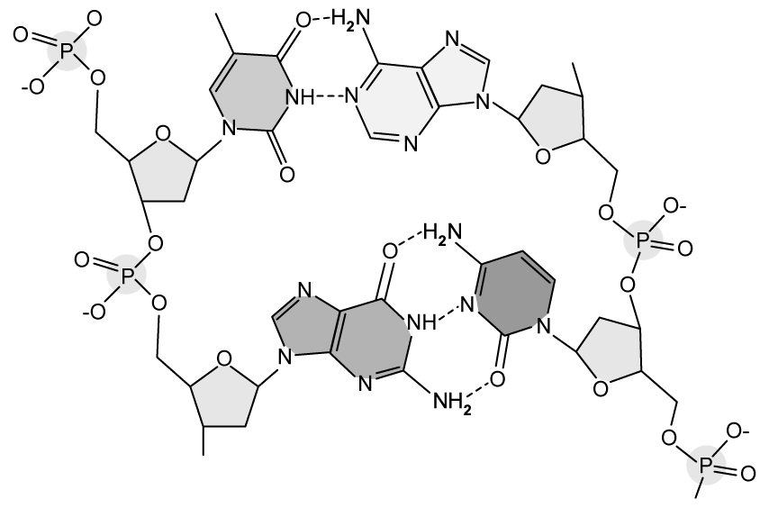

**Q4** [4 marks]

A section of DNA contains 1,200 base pairs.

- The number of guanine molecules on strand one was counted as 156.
- The number of cytosine molecules on strand one was counted as 209.
- The number of adenine molecules on strand two was counted as 264.

Complete the table below to include the total number of each base present in the section, and the % composition of each base.

|   | **Number of molecules present** | **% composition** |
|---|---|---|
| Adenine |   |   |
| Cytosine |   |   |
| Guanine |   |   |
| Thymine |   |   |

### Q5 — hard — 15 marks

**Q5** [4 marks]

Meselson and Stahl were two scientists who investigated DNA replication during the 1950s.

They grew *E. coli *bacteria in dishes containing culture media.

- Some bacteria were grown in a culture containing an isotope of nitrogen with a higher molecular weight (15N) than normal nitrogen (14N)
- Some bacteria were first grown in the (15N) culture and then transferred to the normal (14N) culture
- Some bacteria were grown in the normal (14N) culture

The bacteria started incorporating the nitrogen isotopes from the culture media into their DNA. Bacterial colonies that incorporated (15N) culture became denser than bacteria incorporating normal (14N) culture.

After letting the bacteria grow for several generations, the scientists extracted and centrifuged the DNA. During centrifugation, the heavier, denser molecules settled towards the bottom of the tube. Figure 1 shows some of their results.

**Key:**

**A** Bacteria grown in a (15N) culture

**B** Bacteria first grown in a (15N) culture and then transferred to the normal (14N) culture (contents not shown)

**C **Bacteria grown in a (14N) culture

Fig 1

Some bacteria were first grown in the (15N) culture and then transferred to the normal (14N) culture (tube** B**). They were left there with enough time to replicate once before the DNA was extracted.

(i)Suggest where a band would appear on this tube (**B**) in comparison to tubes **A** and **C**.

[2]

(ii) Suggest how the appearance of tube **B** would change if the *E. coli* bacteria were left in the (14N) culture to reproduce for one additional generation.

[2]

**Q5** [4 marks]

**Extract:**

Meselson and Stahl were two scientists who investigated DNA replication during the 1950s. 

They grew *E. coli *bacteria in dishes containing culture media. 

- Some bacteria were grown in a culture containing an isotope of nitrogen with a higher molecular weight (^15^N) than normal nitrogen (^14^N)
- Some bacteria were first grown in the (^15^N) culture and then transferred to the normal (^14^N) culture
- Some bacteria were grown in the normal (^14^N) culture

The bacteria started incorporating the nitrogen isotopes from the culture media into their DNA. Bacterial colonies that incorporated (^15^N) culture became denser than bacteria incorporating normal (^14^N) culture.

After letting the bacteria grow for several generations, the scientists extracted and centrifuged the DNA. During centrifugation, the heavier, denser molecules settled towards the bottom of the tube. Figure 1 shows some of their results.

**Key:**

**A** Bacteria grown in a (^15^N) culture 

**B** Bacteria first grown in a (^15^N) culture and then transferred to the normal (^14^N) culture (contents not shown)

**C **Bacteria grown in a (^14^N) culture

Some bacteria were first grown in the (^15^N) culture and then transferred to the normal (^14^N) culture (tube** B**). They were left there with enough time to replicate once before the DNA was extracted. 

(i)Suggest where a band would appear on this tube (**B**) in comparison to tubes **A** and **C**. 

(ii) Suggest how the appearance of tube **B** would change if the *E. coli* bacteria were left in the (^14^N) culture to reproduce for one additional generation.

Justify your answer to part (a).

**Q5** [5 marks]

**Extract:**

Meselson and Stahl were two scientists who investigated DNA replication during the 1950s. 

They grew *E. coli *bacteria in dishes containing culture media. 

- Some bacteria were grown in a culture containing an isotope of nitrogen with a higher molecular weight (^15^N) than normal nitrogen (^14^N)
- Some bacteria were first grown in the (^15^N) culture and then transferred to the normal (^14^N) culture
- Some bacteria were grown in the normal (^14^N) culture

The bacteria started incorporating the nitrogen isotopes from the culture media into their DNA. Bacterial colonies that incorporated (^15^N) culture became denser than bacteria incorporating normal (^14^N) culture.

After letting the bacteria grow for several generations, the scientists extracted and centrifuged the DNA. During centrifugation, the heavier, denser molecules settled towards the bottom of the tube. Figure 1 shows some of their results.

**Key:**

**A** Bacteria grown in a (^15^N) culture 

**B** Bacteria first grown in a (^15^N) culture and then transferred to the normal (^14^N) culture (contents not shown)

**C **Bacteria grown in a (^14^N) culture

Some bacteria were first grown in the (^15^N) culture and then transferred to the normal (^14^N) culture (tube** B**). They were left there with enough time to replicate once before the DNA was extracted.

Explain how Meselson and Stahl’s experiment demonstrated the semi-conservative replication of DNA, concerning the results shown in Figure 1.

**Q5** [2 marks]

**Extract:**

Meselson and Stahl were two scientists who investigated DNA replication during the 1950s. 

They grew *E. coli *bacteria in dishes containing culture media. 

- Some bacteria were grown in a culture containing an isotope of nitrogen with a higher molecular weight (^15^N) than normal nitrogen (^14^N)
- Some bacteria were first grown in the (^15^N) culture and then transferred to the normal (^14^N) culture
- Some bacteria were grown in the normal (^14^N) culture

The bacteria started incorporating the nitrogen isotopes from the culture media into their DNA. Bacterial colonies that incorporated (^15^N) culture became denser than bacteria incorporating normal (^14^N) culture.

After letting the bacteria grow for several generations, the scientists extracted and centrifuged the DNA. During centrifugation, the heavier, denser molecules settled towards the bottom of the tube. Figure 1 shows some of their results.

**Key:**

**A** Bacteria grown in a (^15^N) culture 

**B** Bacteria first grown in a (^15^N) culture and then transferred to the normal (^14^N) culture (contents not shown)

**C **Bacteria grown in a (^14^N) culture

Some bacteria were first grown in the (^15^N) culture and then transferred to the normal (^14^N) culture (tube** B**). They were left there with enough time to replicate once before the DNA was extracted. 

(i)Suggest where a band would appear on this tube (**B**) in comparison to tubes **A** and **C**.

Another theory for how DNA replicates is called conservative DNA replication.

Conservative replication was disproven by this experiment. The theory suggested that when DNA replicates the original DNA strand is fully conserved and the new strand is entirely made up of new DNA.

Describe how the outcome of the experiment from part (a)(i) would be different if the DNA replication were fully conservative.

### Q6 — easy — 7 marks

**Q6** [1 mark]

State the purpose of DNA replication.

**Q6** [2 marks]

The diagrams below show two models of DNA replication.

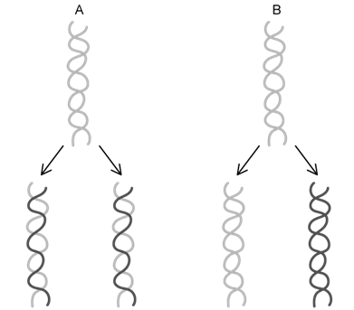

State, with a reason, which diagram, A or B, is correct.

**Q6** [2 marks]

Identify two enzymes that are involved with the process of DNA replication.

**Q6** [2 marks]

**Extract:**

The diagrams below show two models of DNA replication.

The correct diagram is A. This is because (A) shows semi-conservative replication / half of the new double helix contains original DNA while half contains new DNA.

Calculate the fraction of a cell’s original DNA that will be present after 3 full cycles of DNA replication.

### Q7 — easy — 7 marks

**Q7** [2 marks]

DNA and RNA are nucleic acids.

Explain why RNA can be described as a polymer **and** as a macromolecule.

*Source: Oct/Nov 2018  9700/22 Q5A*

**Q7** [2 marks]

The sugar component of DNA is a reducing sugar.

Outline the test for reducing sugars **and **describe the observations for a positive result.

*Source: Oct/Nov 2018  9700/22 Q5B*

**Q7** [3 marks]

Nucleotides are structural components of nucleic acids. Each nucleotide consists of a pentose sugar, a phosphate group and a nitrogenous organic base.

Complete Table 1 to compare DNA nucleotides with RNA nucleotides as structural components of nucleic acids.

**Table 1**

| **Feature** | **DNA nucleotides** | **RNA nucleotides** |
|---|---|---|
| Pentose sugar  component |   |   |
| Purine bases |   |   |
| Pyrimidine bases |   |   |

*Source: Oct/Nov 2018  9700/22 Q5C*

### Q8 — easy — 7 marks

**Q8** [2 marks]

In a section of DNA 17 % of the nucleotides were found to contain cytosine.

Calculate the percentage of thymine in this section of DNA

**Q8** [1 mark]

**Extract:**

In a section of DNA 17 % of the nucleotides were found to contain cytosine.

Calculate the percentage of thymine in this section of DNA

State one reason why the calculation from part (a) could not be performed for a piece of RNA

**Q8** [3 marks]

The diagram below shows a representation of part of a DNA molecule.

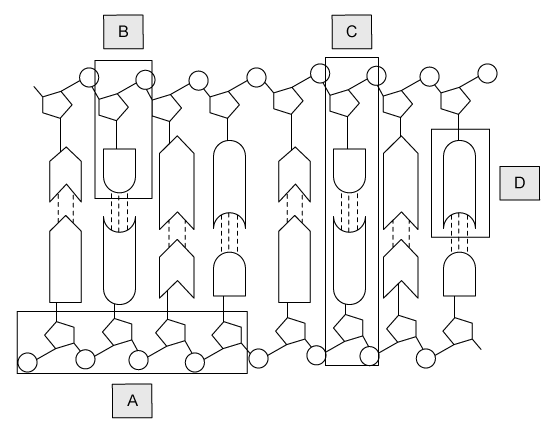

Identify the structures labelled **A, B, **and** D**.

**Q8** [1 mark]

**Extract:**

The diagram below shows a representation of part of a DNA molecule.

Identify **one** type of bond found within the structure labelled **C** in the diagram at part (c).

### Q9 — easy — 7 marks

**Q9** [2 marks]

Nucleotides can be put into two categories based on their structure; purines and pyrimidines.

Complete the table below by putting a ✓ in the correct boxes to identify each base as either a purine or a pyrimidine.

|   | **Purine** | **Pyrimidine** |
|---|---|---|
| Adenine |   |   |
| Thymine |   |   |
| Cytosine |   |   |
| Guanine |   |   |
| Uracil |   |   |

**Q9** [1 mark]

During DNA replication these DNA nucleotides join together in a process called complementary base pairing.

Once they are in position the new DNA nucleotides are joined to neighbouring nucleotides by an enzyme called DNA polymerase. This enzyme acts on both the leading and lagging strands.

State the direction in which DNA polymerase adds new DNA nucleotides during DNA replication.

**Q9** [2 marks]

**Extract:**

During DNA replication these DNA nucleotides join together in a process called complementary base pairing. 

Once they are in position the new DNA nucleotides are joined to neighbouring nucleotides by an enzyme called DNA polymerase. This enzyme acts on both the leading and lagging strands.

State the direction in which DNA polymerase adds new DNA nucleotides during DNA replication.

The the direction in which DNA polymerase adds new DNA nucleotides during DNA replication is...

- 5' to 3'; [1 mark]

State how the formation of new DNA differs between the leading and lagging strands.

**Q9** [2 marks]

**Extract:**

State how the formation of new DNA differs between the leading and lagging strands.

The formation of new DNA differs between the leading and lagging strands as follows...

- On the leading strand the formation of the new DNA is continuous; [1 mark]
- On the lagging strand the DNA is synthesised in small segments / Okazaki fragments; [1 mark]

DNA ligase is an enzyme that 'completes' the new DNA strand.

State the function of DNA ligase in this context.

### Q10 — easy — 8 marks

**Q10** [3 marks]

Compare the structures of RNA and DNA nucleotides.

**Q10** [3 marks]

**Extract:**

A comparison of the structures of RNA and DNA nucleotides should include...

Similarities
- Both have a pentose sugar AND a phosphate AND a nitrogenous base;
- Both have adenine AND guanine AND cytosine;

Differences
- RNA has uracil WHILE DNA has thymine;
- DNA has deoxyribose sugar WHILE RNA has ribose sugar;
- Ribose sugar has -OH at carbon 2 WHILE deoxyribose sugar has -H at carbon 2;

Fig. 1 shows the DNA-RNA complex during transcription.

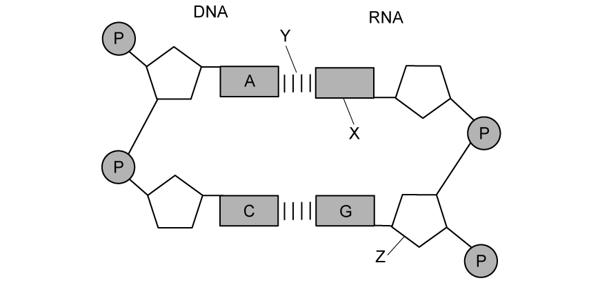

**Fig. 1**

Identify structures X, Y and Z on Fig. 1.

**Q10** [1 mark]

Within a strand of RNA the neighbouring nucleotides are joined together by a sugar-phosphate backbone.

State the name of the bond that holds neighbouring nucleotides together.

**Q10** [1 mark]

RNA is found within the structure of several different molecules.

Give **one** example of a molecule type that contains RNA.

### Q11 — medium — 9 marks

**Q11** [2 marks]

Messenger RNA (mRNA) plays an important role in protein synthesis by transcribing the genetic code and bringing it to the ribosomes for translation.

Fig.1 shows the structure of part of an mRNA molecule.

**                                                                  Fig. 1**

Explain how the structure of mRNA enables it to perform its function.

**Q11** [3 marks]

Table 1 contains a variety of statements that apply to different biological molecules.

Identify which of the statements apply to DNA, messenger RNA and proteins by placing a tick (√) in the box.

**Table 1**

| **Statement** | **DNA** | **messenger RNA** | **protein** |
|---|---|---|---|
| Hydrogen bonds stabilise the molecule |   |   |   |
| Subunits are joined by peptide bonds |   |   |   |
| The molecule is double stranded |   |   |   |
| Contains phosphodiester bonds |   |   |   |
| Uracil is present |   |   |   |

**Q11** [2 marks]

A section of a DNA molecule contains 124 nucleotides.

Calculate the maximum number of hydrogen bonds that could be present in this section of DNA.

Show your working.

**Q11** [2 marks]

Describe the role of covalent bonds in linking nucleotides together to form a polynucleotide, such as DNA.

### Q12 — medium — 11 marks

**Q12** [2 marks]

Define the term 'leading' and 'lagging' strand in DNA replication.

**Q12** [2 marks]

Describe the structure of a monomer of a DNA molecule.

**Q12** [2 marks]

State the names of two purines and two pyrimidines in RNA.

**Q12** [5 marks]

Describe how a DNA molecule replicates.

### Q13 — medium — 10 marks

**Q13** [2 marks]

DNA replication is described as being 'semi-conservative'.

Explain what this means.

**Q13** [3 marks]

Explain how the structure of DNA facilitates semi-conservative replication of the molecule.

**Q13** [2 marks]

The new DNA molecules that form during semi-conservative replication are identical to each other.

Discuss the importance of this statement.

**Q13** [3 marks]

Matthew Meselson and Franklin Stahl did an experiment in 1958 to investigate the replication of DNA in *E. coli*. They grew *E. coli* in a medium that contained only a heavy isotope of nitrogen (15N) for several generations. They extracted the DNA and placed it in a centrifuge to determine the density of the DNA based on the nitrogen that was incorporated into the DNA during replication.

They transferred *E. coli* cells that only contained 15N in their DNA to a growth medium that contained only 14N, which is a lighter isotope of nitrogen. They allowed the *E. coli* to divide for several generations, measuring the change in DNA density after each division by centrifugation.

The results of their experiment is represented in Table 1.

**Table 1**

| **Generation** | **Percentage DNA containing ****14****N and ****15****N** | **Percentage DNA containing ****14****N only** |
|---|---|---|
| 1 | 100 | 0 |
| 2 | 50 | 50 |
| 3 | 25 | 75 |
| 4 | 12 | 88 |
| 5 |   |   |

(i) Calculate the missing values that would be expected in generation 5 and complete Table 1.

**[2 marks]**

(ii) State the conclusion that can be drawn from these results.

### Q14 — medium — 9 marks

**Q14** [2 marks]

Fig. 1 shows the structure of a prokaryotic cell.

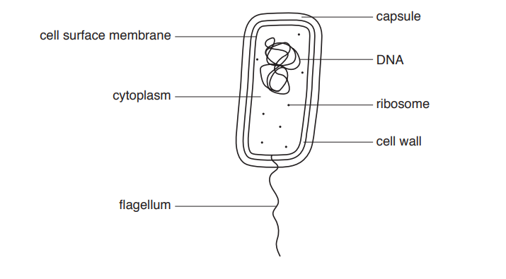

**Fig. 1**

Fig. 1 has **not** been fully labelled to confirm that the cell is prokaryotic.

State what **other** information could be added to **two** of the labels to confirm that this cell is prokaryotic and **not** eukaryotic.

*Source: Oct/Nov 2018 9700/21 Q5A*

**Q14** [2 marks]

Some prokaryotes are plant pathogens.

*Liberibacter* is a group of prokaryotic plant pathogens that causes severe damage to a variety of plant crops across the world.

Scientists made observations about plants infected with these pathogens compared to uninfected plants:

- starch accumulates in the leaves
- starch does not accumulate in roots and other storage organs
- fruits are smaller
- the pathogen is widely distributed throughout the plant and is found in a number of different organs including the root and leaf.

The scientists deduced that the pathogen infected the phloem tissue.

Suggest why the scientists were able to deduce that the pathogen infected the phloem tissue.

*Source: Oct/Nov 2018 9700/21 Q5B*

**Q14** [5 marks]

DNA and RNA both contain nucleotides with adenine.

Complete Table 1 to compare:

- - a DNA nucleotide with adenine
  - an RNA nucleotide with adenine
  - ATP

**Table 1**

| feature | DNA nucleotide with adenine | RNA nucleotide with adenine | ATP |
|---|---|---|---|
| contains nitrogen (yes or no) |   |   |   |
| contains a pyrimidine base (yes or no) |   |   |   |
| number of phosphate groups |   |   |   |
| name of the sugar component |   |   |   |

*Source: Oct/Nov 2018 9700/21 Q5C*

### Q15 — medium — 8 marks

**Q15** [3 marks]

The biochemist, Erwin Chargaff, did much of his research on the structure of DNA. From the research he conducted in the 1950s, he was able to determine the relative quantities of the four bases found in a DNA molecules of different organisms. Chargaff's work provided evidence which assisted in the development of later proposals on the structure of DNA.

Some of Chargaff's data is shown in Table 1.

**Table 1**

| **Organism** | **Percentage adenine** | **Percentage guanine** | **Percentage cytosine** | **Percentage thymine** |
|---|---|---|---|---|
| Maize | 26.5 | 22.4 | 23.6 | 27.5 |
| Octopus | 33.5 | 17.6 | 17.6 | 31.3 |
| Rat | 28.4 | 21.6 | 20.3 | 28.6 |
| Human | 29.0 | 20.5 | 20.2 | 30.3 |
| Grasshopper | 28.3 | 20.7 | 20.5 | 30.3 |
| Yeast | 31.4 | 18.5 | 17.3 | 32.8 |

Explain how the data in Table 1 helps to confirm the arrangement of bases in a DNA molecule.

**Q15** [3 marks]

Describe **three** ways in which the structure of DNA differs from the structure of RNA.

**Q15** [2 marks]

Fig. 1 shows the structure of ATP.

**Fig. 1**

Explain why ATP can be described as a 'phosphorylated nucleotide'.

### Q16 — medium — 10 marks

**Q16** [3 marks]

Fig. 1 shows the structure of a small section of DNA in a cell during transcription.

**                                                                   Fig. 1**

Identify the bases **Q**, **R** and **S** as indicated in Fig. 1

**Q16** [2 marks]

State the importance of hydrogen bonding in the structure of a DNA molecule.

**Q16** [3 marks]

ATP is the energy-carrying molecule which fuels chemical reactions within the cell.

Compare the structure of ATP with the structure of a DNA nucleotide.

**Q16** [2 marks]

Scientists analysed the nucleotide base sequence of a DNA molecule extracted from a human cheek cell. It was found that 29% of the nucleotides in this DNA molecule contained the nitrogenous base adenine.

Calculate the percentage of nucleotides that would contain the nitrogenous base cytosine.

Show your working.
