# Exam Questions — Protein Synthesis
**6. Nucleic Acids & Protein Synthesis** · Cambridge (CIE) A-LEVEL biology (9700)
> Source: [https://www.savemyexams.com/a-level/biology/cie/25/topic-questions/](https://www.savemyexams.com/a-level/biology/cie/25/topic-questions/) · 45 questions across 2 sets

## Multiple Choice Questions (30 questions)

### Q1 — hard — 1 marks

**Q1** [1 mark]

A polypeptide has the amino acid sequence:

alanine – alanine – valine – lysine – valine – serine

The table gives the DNA triplets for each amino acid.

| amino acid | DNA triplets |
|---|---|
| serine  valine  lysine  alanine  stop | TCG  GTA  AAA  GCT  TAA |

A substitution mutation in the DNA coding for this polypeptide chain caused the tenth nucleotide to swap from an A to a T

How would the amino acid sequence in the polypeptide now look?

### Q2 — hard — 1 marks

**Q2** [1 mark]

The diagram shows a section of DNA.

What would the corresponding anticodon sequence be for the third DNA triplet?

### Q3 — hard — 1 marks

**Q3** [1 mark]

Ribosomes exist as two separate subunits that join together during protein synthesis.

What do these subunits consist of?

### Q4 — hard — 1 marks

**Q4** [1 mark]

In eukaryotes, which of the following statements is true with regards to introns and exons?

### Q5 — hard — 1 marks

**Q5** [1 mark]

The diagram shows two sections of RNA.

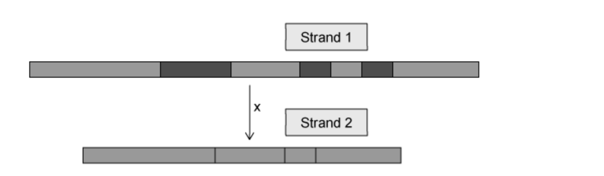

Which row of the table is correct?

|   | process **X** is needed to make a functional protein | strand **1** is mRNA | strand **2** is mRNA | process **X** removes exons | strand **1** contains introns and exons |
|---|---|---|---|---|---|
| **A** | X | ✓ | X | X | ✓ |
| **B** | ✓ | X | ✓ | X | ✓ |
| **C** | X | X | ✓ | ✓ | ✓ |
| **D** | ✓ | ✓ | ✓ | X | X |

### Q6 — hard — 1 marks

**Q6** [1 mark]

Which row in the table correctly shows situations in which both DNA and RNA are involved?

|   | replication | transcription | translation | protein synthesis |
|---|---|---|---|---|
| **A** | ✓ | ✓ | X | X |
| **B** | ✓ | X | ✓ | X |
| **C** | X | X | ✓ | X |
| **D** | X | ✓ | X | ✓ |

key

✓  involved

X not involved

### Q7 — hard — 1 marks

**Q7** [1 mark]

A gene produces a pre-RNA that is 1450 bases in length and has the following intron-exon structure:

**          Exon 1 - 250 bp**

**          Intron 1 - 150 bp**

**          Exon 2 - 50 bp**

**          Intron 2 - 250 bp**

**          Exon 3 - 750 bp**

How many bases would the mRNA created from this gene have?

### Q8 — hard — 1 marks

**Q8** [1 mark]

Which of the following statements is not a description of a gene?

### Q9 — hard — 1 marks

**Q9** [1 mark]

Some antibiotics work by preventing protein synthesis in bacteria by binding to their ribosomes.

Which statement explains why these antibiotics kill bacterial cells but not human cells?

### Q10 — hard — 1 marks

**Q10** [1 mark]

A polypeptide has the amino acid sequence:

histidine – glutamine – lysine – alanine – valine – histidine – valine

The table gives the tRNA anticodons for each amino acid.

| **amino acid** | **tRNA anticodons** |
|---|---|
| histidine  valine  lysine  alanine  glutamine | CAU  GUA  AAA  GCU  CAG |

A mutation causes the 18th base in the DNA sequence to be deleted.

What would the amino acid sequence look like following this change?

### Q11 — medium — 1 marks

**Q11** [1 mark]

DNA is composed of two strands, the transcribed strand and the non-transcribed strand.

Here is a section of DNA:

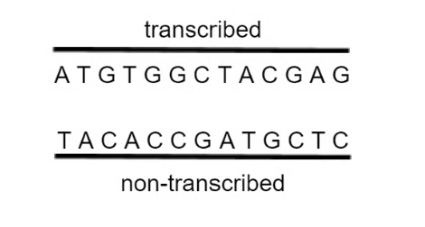

What would the corresponding mRNA sequence be for this section of DNA?

### Q12 — medium — 1 marks

**Q12** [1 mark]

Why does a silent mutation have no effect on the polypeptide chain?

### Q13 — medium — 1 marks

**Q13** [1 mark]

A piece of DNA was analysed to find the number of nucleotide bases in each of the polynucleotide strands.

Some of the results are shown below:

|   | number of nucleotide bases |   |   |   |
|---|---|---|---|---|
| A | T | G | C |   |
| Strand 1 |   | 30 | 22 |   |
| Strand 2 |   | 30 | 38 |   |

What is the maximum number of amino acids that could be coded for by this DNA?

### Q14 — medium — 1 marks

**Q14** [1 mark]

Which term best describes a section of DNA that codes for the synthesis of a polypeptide?

### Q15 — medium — 1 marks

**Q15** [1 mark]

A polypeptide has the amino acid sequence alanine–valine–lysine–serine–glycine.

The table gives some possible tRNA anticodons for each amino acid.

| amino acid | tRNA anticodons |
|---|---|
| serine  valine  lysine  alanine  glycine | UCG            UCA  GUA            GUC  AAA             AAG  GCU            GCG  GGA            GGC |

Which sequence of bases on DNA could code for the polypeptide?

### Q16 — medium — 1 marks

**Q16** [1 mark]

Which statements are correct about DNA replication, transcription and translation?

|   | DNA replication | transcription | translation |
|---|---|---|---|
| **A** | produces mRNA | occurs in the cytoplasm | tRNA involved |
| **B** | DNA polymerase involved | RNA polymerase involved | produces mRNA |
| **C** | is semi-conservative | produces mRNA | occurs at a ribosome |
| **D** | occurs in the nucleus | occurs in the nucleus | RNA polymerase involved |

### Q17 — medium — 1 marks

**Q17** [1 mark]

Which enzymes are not needed for DNA transcription?

| 1 | Helicase |
|---|---|
| 2 | DNA ligase |
| 3 | RNA polymerase |
| 4 | DNA polymerase |

### Q18 — medium — 1 marks

**Q18** [1 mark]

What terminates the formation of a polypeptide chain during protein synthesis in cells?

### Q19 — medium — 1 marks

**Q19** [1 mark]

If a polypeptide chain is comprised of 200 amino acids, it might be expected that the coding gene in the DNA would be comprised of 600 bases, however, in reality the DNA sequence is longer than this.

What is the reason for this difference?

### Q20 — medium — 1 marks

**Q20** [1 mark]

What is the correct sequence for the processes involved in the formation of a protein?

### Q21 — easy — 1 marks

**Q21** [1 mark]

The protein p53 is also known as the ‘Guardian of the Genome’.  It is produced in response to DNA damage and helps prevent the formation of tumours.

Which of these could lead to an increase in the production of p53 in the body?

| 1 | X-rays |
|---|---|
| 2 | Sunbeds |
| 3 | Smoking |

### Q22 — easy — 1 marks

**Q22** [1 mark]

Which of the following biological molecules are required for translation?

### Q23 — easy — 1 marks

**Q23** [1 mark]

In a DNA molecule, the base sequence TGT codes for the amino acid threonine.

What is the base sequence of the anti-codon on the tRNA to which threonine becomes attached?

### Q24 — easy — 1 marks

**Q24** [1 mark]

A length of double-stranded DNA contains 180 nucleotides and codes for enzyme Z.

What is the maximum number of amino acids in enzyme X?

### Q25 — easy — 1 marks

**Q25** [1 mark]

Name the molecule that is the end product of translation.

### Q26 — easy — 1 marks

**Q26** [1 mark]

Sickle cell disease is caused by a change in the DNA sequence. The haemoglobin of affected people has a valine amino acid in its $β$ chain rather than glutamic acid.

What is the minimum number of base substitutions required to change the normal haemoglobin allele to the sickle cell allele?

### Q27 — easy — 1 marks

**Q27** [1 mark]

Which statement describes a process that occurs during protein synthesis?

### Q28 — easy — 1 marks

**Q28** [1 mark]

In a genetic engineering experiment a piece of double-stranded DNA containing 18000 nucleotides coding for a specific polypeptide is transcribed and translated.

What is the maximum number of amino acids in this polypeptide?

### Q29 — easy — 1 marks

**Q29** [1 mark]

Which enzyme is required for transcription?

### Q30 — easy — 1 marks

**Q30** [1 mark]

This diagram shows two of polynucleotide strands.

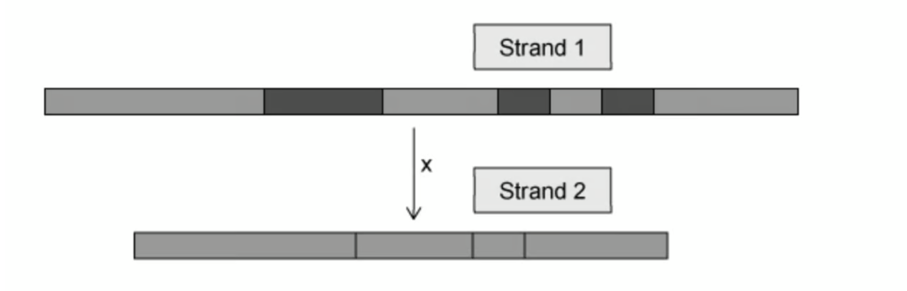

State the name of strand 2.

## Structured Questions (15 questions)

### Q1 — hard — 10 marks

**Q1** [3 marks]

Tay-Sachs disease is caused by a mutation to a gene called *HEXA *on chromosome 15. The *HEXA *gene codes for a lysosomal enzyme that breaks down toxins in the brain and spinal cord. The mutation causes this enzyme to be non-functional, resulting in a build of up toxins in the brain and spinal cord, which over time destroys the nerve cells in these areas. This disease is usually fatal in babies and young children.

There are more than 100 different mutations that can lead to this disease.

A very common form of this mutation is caused by a DNA change in the 11th exon out of 14 in the *HEXA *gene.

The template strand of the mutated DNA is as follows:

| Non Tay-Sachs sufferer | AGG ATG CCG GGA CTG |
|---|---|
| Tay-Sachs sufferer | AGA TAG GAT GCC GGG ACT |

Describe the type of mutation that has occurred.

**Q1** [3 marks]

**Extract:**

A very common form of this mutation is caused by a DNA change in the 11th exon out of 14 in the HEXA gene.

The template strand of the mutated DNA is as follows:

| Non Tay-Sachs sufferer | AGG ATG CCG GGA CTG |
| Tay-Sachs sufferer | AGA TAG GAT GCC GGG ACT |

Fig. 1 shows which mRNA codons code for each amino acid during translation.

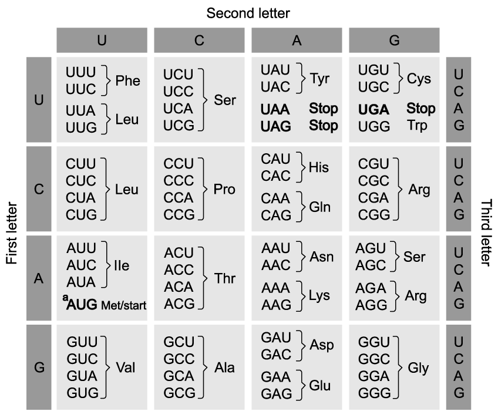

**Fig. 1**

Using the table in part (a) as well as the resource in Fig. 1, explain how the resulting protein would be changed by the mutation in the *HEXA *gene.

**Q1** [2 marks]

**Extract:**

Tay-Sachs disease is caused by a mutation to a gene called *HEXA* on chromosome 15. The *HEXA* gene codes for a lysosomal enzyme that breaks down toxins in the brain and spinal cord. The mutation causes this enzyme to be non-functional, resulting in a build of up toxins in the brain and spinal cord, which over time destroys the nerve cells in these areas. This disease is usually fatal in babies and young children.

There are more than 100 different mutations that can lead to this disease.

Tay-Sachs disease can be caused by over 100 types of mutations.

Suggest how it is possible for over 100 different changes in the DNA to result in the same disease.

**Q1** [2 marks]

**Extract:**

Tay-Sachs disease is caused by a mutation to a gene called HEXA on chromosome 15. The HEXA gene codes for a lysosomal enzyme that breaks down toxins in the brain and spinal cord. The mutation causes this enzyme to be non-functional, resulting in a build of up toxins in the brain and spinal cord, which over time destroys the nerve cells in these areas. This disease is usually fatal in babies and young children.

There are more than 100 different mutations that can lead to this disease.

Tay-Sachs is an autosomal recessive disease.

Explain whether a person with Tay-Sachs disease would need to inherit two of the same type of mutation to develop the condition, or whether it could be two different ones.

### Q2 — hard — 11 marks

**Q2** [3 marks]

Explain the role of hydrogen bonds in the process of transcription.

**Q2** [2 marks]

mRNA is a single-stranded molecule involved with the process of protein synthesis.

Explain the importance of mRNA being a single-stranded molecule.

**Q2** [2 marks]

The genome refers to the complete set of genes in a cell while the proteome is the full range of proteins that a cell can produce.

Suggest why the proteome of different cells in an organism may vary despite having the same genome.

**Q2** [4 marks]

Hereditary transthyretin (hATTR) amyloidosis is an inherited condition that causes a blood protein called transthyretin to form clumps in the cardiovascular system, digestive system and around nerve fibres. Drugs designed to bind to the mRNA molecules are used as a form of treatment for this condition.

Suggest why these drugs could be used as a treatment for hereditary transthyretin (hATTR) amyloidosis.

### Q3 — hard — 8 marks

**Q3** [1 mark]

The sequence below shows the DNA bases coding for seven amino acids in the enzyme papain. Note that the sequence shown is from the **non-template** strand.

**C  A  A  T  T  T  C  A  A  A  G  T  T  G  C  T  T  T  T  T  G**

Fig. 1** shows the genetic code and the amino acids coded for.**

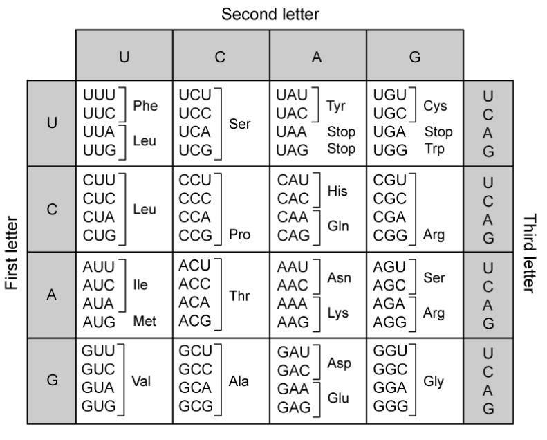

**Fig. 1**

**Use the information in Fig. 1 to identify the sequence of amino acids in this part of the enzyme.**

**Q3** [2 marks]

Table 1 below shows some mRNA codons and the amino acids for which they code.

**Table 1**

| **Codon** | **Amino Acid** |
|---|---|
| ACG | Threonine |
| UUA | Leucine |
| CCA | Proline |
| GUA | Valine |
| GCU | Alanine |
| AAU | Asparagine |

(i) Identify the DNA **non-template** strand sequence for leucine.

[1]

(ii) Identify the amino acid carried by the tRNA with the anticodon CAU.

[1]

**Q3** [3 marks]

Ricin is a protein produced by castor beans. In animal cells, ricin acts as an enzyme. This enzyme removes the adenine molecule from one of the nucleotides in the RNA that makes up the structure of ribosomes. As a result, the ribosome changes shape. Ricin causes the death of cells and is highly toxic to many animals.

Suggest how the effect of ricin on ribosomes could cause the death of cells.

**Q3** [2 marks]

**Extract:**

Ricin is a protein produced by castor beans. In animal cells, ricin acts as an enzyme. This enzyme removes the adenine molecule from one of the nucleotides in the RNA that makes up the structure of ribosomes. As a result, the ribosome changes shape. Ricin causes the death of cells and is highly toxic to many animals.

Cycloheximide is a fungicide produced by the bacterium *Streptomyces griseus*, which binds to specific sites on the eukaryotic ribosomes. This is shown in Fig. 2 below.

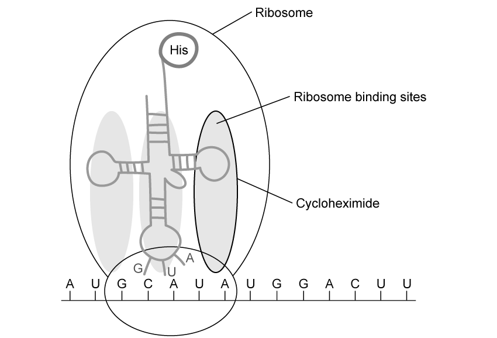

**Fig. 2**

Explain how cycloheximide stops protein synthesis.

### Q4 — hard — 12 marks

**Q4** [3 marks]

One mechanism for regulating gene expression in cells uses an enzyme, called an RNase, to break down mRNA as it travels from the nucleus to the ribosome.

Explain how this would be an effective way to regulate gene expression.

**Q4** [4 marks]

**Extract:**

One mechanism for regulating gene expression in cells uses an enzyme, called an RNase, to break down mRNA as it travels from the nucleus to the ribosome.

The RNase enzymes involved in this process must be able to target specific sequences of mRNA.

The enzymes can achieve this by binding to single stranded RNA.

(i) Explain the importance of the RNase enzymes being targeted to specific mRNA.

[2]

(ii) Explain how binding to single stranded RNA would allow the RNase to target the correct mRNA.

[2]

**Q4** [4 marks]

mRNA can also be used to produce vaccines against certain diseases, such as for Covid-19.

mRNA vaccines involve injecting mRNA stands that code for viral proteins into the blood, which are then taken in by human immune cells and expressed.

Explain what happens in the target cell after it takes in the mRNA.

**Q4** [1 mark]

**Extract:**

mRNA can also be used to produce vaccines against certain diseases, such as for Covid-19.

mRNA vaccines involve injecting mRNA stands that code for viral proteins into the blood, which are then taken in by human immune cells and expressed.

mRNA vaccines are a relatively recent scientific discovery and have been praised by the scientific community for many reasons.

One such reason is that the risk of mutation to human DNA is very low.

Suggest **one **reason why mRNA vaccines pose a very low risk to the structure of human DNA.

### Q5 — hard — 12 marks

**Q5** [1 mark]

Proteins are only synthesised when the genes that code for them are switched on.

Fig. 1 shows two processes, **R** and **S**, that occur when a gene is switched on.

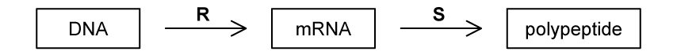

**                                                               Fig. 1**

Identify processes **R** and **S**.

**Q5** [2 marks]

DNA nucleotides form a triplet code, with some of the triplets of bases coding for start and stop signals.

Explain the importance of these signals.

**Q5** [3 marks]

Most mRNA molecules are broken down in the cytoplasm within a few hours after leaving the nucleus.

Suggest the significance of mRNA being easily broken down.

**Q5** [6 marks]

Contrast the differences between DNA replication and DNA transcription.

### Q6 — medium — 10 marks

**Q6** [4 marks]

Fig.1 is a diagram showing a stage in protein synthesis.

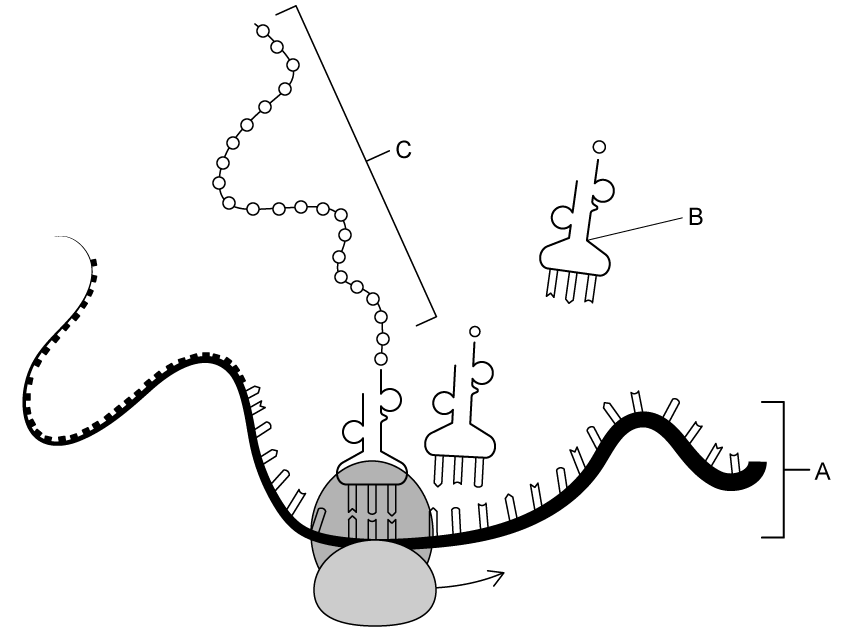

**                                                             Fig. 1**

(i) Identify the stage of protein synthesis that is shown in Fig. 1.

[1]

(ii) Identify **A**, **B** and **C** in Fig. 1.

[3]

**Q6** [3 marks]

**Extract:**

Fig.1 is a diagram showing a stage in protein synthesis.

(i) The stage of protein synthesis illustrated in Fig.1 is:
- Translation

(ii) Identifying A, B and C in Fig.1:
- A: mRNA
- B: tRNA
- C: (growing) polypeptide (chain)

Outline the importance of **B** in the stage of protein synthesis illustrated in Fig.1.

**Q6** [2 marks]

**Extract:**

Fig.1 is a diagram showing a stage in protein synthesis.

                                                             Fig. 1

(ii) Identify A, B and C in Fig. 1.

C: (growing) polypeptide (chain)

If molecule **C** consisted of 380 amino acids, calculate the number of bases in the sequence on the DNA molecule that would code for this molecule.  Show your working.

**Q6** [1 mark]

**Extract:**

Fig.1 is a diagram showing a stage in protein synthesis.

(ii) Identify **A**, **B** and **C** in Fig. 1.

**A**: mRNA
**B**: tRNA
**C**: (growing) polypeptide (chain)

If the base sequence on molecule **B** in Fig.1 was **CAU**, state the corresponding base sequence to which it would attach on molecule **A**.

### Q7 — medium — 8 marks

**Q7** [1 mark]

Fig.1 is a diagram of a section of mRNA showing the sequence of five of the codons.

The triplets of bases in a DNA molecule that codes for some of the amino acids are listed in Table 1.

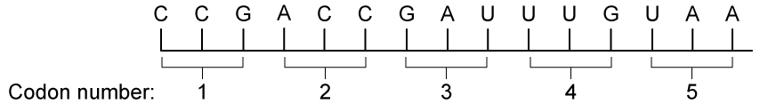

**                                                                   Fig.1**

**Table 1**

| **Amino acid** | **Abbreviation** | **DNA triplets on the coding polynucleotide** |
|---|---|---|
| Aspartic acid | Asp | CTA, CTG |
| Glycine | Gly | CCA, CCG, CCT, CCC |
| Leucine | Leu | AAC, AAT, GAA, GAC, GAG, GAT |
| Proline | Pro | GGA, GGC, GGG, GGT |
| Threonine | Thr | TGA, TGC, TGG, TGT |
| STOP | STOP | ATT, ATC, ACT |

Identify the amino acid sequence on this section of the mRNA molecule, using the information in Fig.1 and Table 1.

**Q7** [3 marks]

**Extract:**

Fig.1 is a diagram of a section of mRNA showing the sequence of five of the codons.

The triplets of bases in a DNA molecule that codes for some of the amino acids are listed in Table 1.

Fig.1

Table 1

| Amino acid | Abbreviation | DNA triplets on the coding polynucleotide |
| Aspartic acid | Asp | CTA, CTG |
| Glycine | Gly | CCA, CCG, CCT, CCC |
| Leucine | Leu | AAC, AAT, GAA, GAC, GAG, GAT |
| Proline | Pro | GGA, GGC, GGG, GGT |
| Threonine | Thr | TGA, TGC, TGG, TGT |
| STOP | STOP | ATT, ATC, ACT |

The five codons in Fig.1 are near the start of the sequence coding for a polypeptide.

Explain the consequence of a mutation which deletes one of the bases from codon 3.

**Q7** [2 marks]

**Extract:**

Fig.1 is a diagram of a section of mRNA showing the sequence of five of the codons.

The triplets of bases in a DNA molecule that codes for some of the amino acids are listed in Table 1.

Table 1

| **Amino acid** | **Abbreviation** | **DNA triplets on the coding polynucleotide** |
| Aspartic acid | Asp | CTA, CTG |
| Glycine | Gly | CCA, CCG, CCT, CCC |
| Leucine | Leu | AAC, AAT, GAA, GAC, GAG, GAT |
| Proline | Pro | GGA, GGC, GGG, GGT |
| Threonine | Thr | TGA, TGC, TGG, TGT |
| STOP | STOP | ATT, ATC, ACT |

If the guanine (G) in codon 4 changed to adenine (A), describe and explain the effect this would have on the amino acid sequence of this section of mRNA shown in Fig.1.

**Q7** [2 marks]

Explain why substitution mutations are less likely to have a dramatic effect on polypeptides than frameshift mutations.

### Q8 — medium — 11 marks

**Q8** [4 marks]

Describe the role of the ribosome in translation.

**Q8** [3 marks]

Fig. 1 shows the base sequence of a gene that codes for a short polypeptide, the RNA codons and the primary structure of this polypeptide.

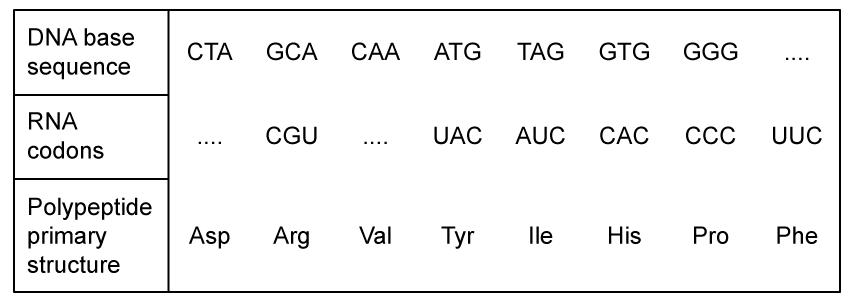

**                                                             Fig.1**

(i) Complete Fig.1 to show the missing DNA triplet and the RNA codons.

[2]

(ii) State the **full name** of the type of RNA shown in Fig.1.

[1]

**Q8** [2 marks]

**Extract:**

Fig. 1 shows the base sequence of a gene that codes for a short polypeptide, the RNA codons and the primary structure of this polypeptide.

Describe the role of DNA as indicated in Fig.1.

**Q8** [2 marks]

Fig. 2 illustrates some changes that are made to the RNA that is produced during transcription.

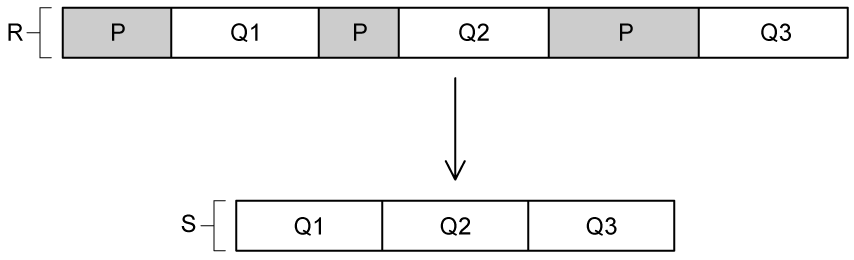

**                                                                 Fig. 2**

Contrast the main differences between **R **and **S** in Fig.2.

### Q9 — medium — 9 marks

**Q9** [1 mark]

Fig. 1 shows a section of a polypeptide synthesised during translation.

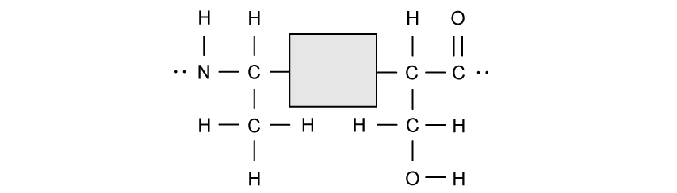

**Fig. 1**

Complete the diagram to show the missing section in the area shaded grey.

**Q9** [6 marks]

Fig.1 shows the amino acids alanine and serine.

Describe the sequence of events that lead to the correct amino acids being joined to the polypeptide strand.

**Q9** [2 marks]

When the mRNA is read by the ribosome, it is read in a 5' to 3' direction.

Explain what is meant by* *mRNA having a 5' and 3' end.

### Q10 — medium — 9 marks

**Q10** [3 marks]

The DNA in the nucleus is known as nuclear DNA.

In the cells of the grasshopper, *Chorthippus brunneus*, 20% of the nucleotides in nuclear DNA contain thymine.

Calculate the percentage of nucleotides in the nuclear DNA of *C. brunneus* that contain guanine **and **explain your answer in terms of the structure of DNA.

*Source: May/June 2019 9700/21 Q6A*

**Q10** [1 mark]

State another location, **other than **the nucleus, where DNA occurs in cells of* C. brunneus*.

*Source: May/June 2019 9700/21 Q6A*

**Q10** [5 marks]

Fig. 1 is a diagram of a molecule of tRNA.

The region labelled **R **shows detail of part of the tRNA molecule.

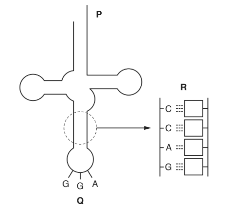

**Fig. 1**

(i) Complete Fig.1 by writing the sequence of bases in the region labelled **R**.

[1]

(ii) State the name of region** Q and** explain the role of region **Q** in translation.

[3]

(iii) State the function of region **P**.

[1]

*Source: May/June 2019 9700/21 Q6B*

### Q11 — easy — 9 marks

**Q11** [3 marks]

Describe the structure of a tRNA molecule.

**Q11** [2 marks]

Explain how tRNA is able to bind to an mRNA molecule during translation.

**Q11** [2 marks]

During translation, four mRNA codons play important roles in the creation of the polypeptide.

These are:

- AUG, which codes for the amino acid methionine
- UAA, UAG, and UGA, which do not code for any amino acids

Explain the roles of each of these codons in the creation of the polypeptide.

**Q11** [2 marks]

**Extract:**

During translation, four mRNA codons play important roles in the creation of the polypeptide. 

These are:

- AUG, which codes for the amino acid methionine
- UAA, UAG, and UGA, which do not code for any amino acids

Explain the roles of each of these codons in the creation of the polypeptide.

The roles of the codons are...

- AUG/methionine = start codon / amino acid that starts each polypeptide chain;
- UAA/UAG/UGA = stop codons / terminate the synthesis of the polypeptide strand;

A polypeptide is 52 amino acids in length.

Calculate the minimum length of mRNA that would be required to code for this polypeptide.

### Q12 — easy — 8 marks

**Q12** [1 mark]

Gene mutations occur continuously and may affect the polypeptide that the gene codes for.

Define the term *gene mutation*.

**Q12** [3 marks]

Fig. 1 shows the DNA base sequence of part of a gene, as well as the same part of the gene after a mutation occurred.

| **Original gene:** | T A T A G T C T T |
|---|---|
| **Mutated gene:** | T A T A G T C C T T |

**Fig. 1**

(i) Identify the type of mutation that occurred in Fig. 1.

[1]

(ii) Describe the possible effect this mutation may have on the polypeptide.

[2]

**Q12** [2 marks]

**Extract:**

Fig. 1 shows the DNA base sequence of part of a gene, as well as the same part of the gene after a mutation occurred.

| **Original gene:** | T A T A G T C T T |
| **Mutated gene:** | T A T A G T C C T T |
**Fig. 1**

(i) Identify the type of mutation that occurred in Fig. 1.

Other than the mutation identified at (b)(i), state **two **types of mutations.

**Q12** [2 marks]

In some cases a mutation may have no effect on the polypeptide at all.

Describe a characteristic of the genetic code that makes this possible.

### Q13 — easy — 9 marks

**Q13** [1 mark]

Identify the mRNA sequence that is coded for by the following strand of DNA.

| **Non-template strand:** | A T G G G T T C A |
|---|---|
| **Template strand:** | T A C C C A A G T |

**Q13** [4 marks]

Replication and transcription both involve DNA.

Complete Table 1 by using a tick (✓) to indicate which features apply to each of the processes. Use a cross (X) for features that do not apply.

The first row has been completed for you.

**Table 1**

| Feature | Replication | Transcription |
|---|---|---|
| A double-stranded molecule is produced | ✓ | X |
| Hydrogen bonds are broken |   |   |
| Only one strand of DNA acts as a template |   |   |
| Phosphodiester bonds are formed |   |   |
| RNA polymerase is used |   |   |

**Q13** [2 marks]

Fig. 1 shows the exposed bases (anticodons) of two tRNA molecules involved in the synthesis of a protein.

| U G C |   | A A C |
|---|---|---|
|   |   |   |

**Fig. 1**

Identify the codon sequence of bases found along the corresponding section of the mRNA strand by completing the boxes.

**Q13** [2 marks]

The structure of an mRNA molecule differs from the structure of a tRNA molecule.

Give **two** differences between these molecules.

### Q14 — easy — 9 marks

**Q14** [3 marks]

The process of transcription is illustrated in Fig. 1.

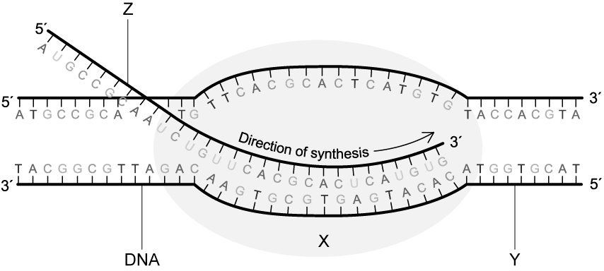

**                                                                      Fig. 1**

Identify molecule **X** in Fig. 1 **and** describe its role during transcription.

**Q14** [2 marks]

**Extract:**

The process of transcription is illustrated in Fig. 1.

                                                                      Fig. 1

From the image in Fig. 1

(i) Identify strand **Y**.

[1]

(ii) State the significance of strand **Y** in the process of transcription.

[1]

**Q14** [2 marks]

**Extract:**

The process of transcription is illustrated in Fig. 1.

Fig. 1

After the process of transcription is completed, molecule **Z** in Fig. 1 must undergo a few changes before it can move to the cytoplasm.

Describe these changes that are made to molecule **Z** before it leaves the nucleus.

**Q14** [2 marks]

The genetic code is universal across most forms of life.

Explain the importance of this statement.

### Q15 — easy — 12 marks

**Q15** [3 marks]

Complete the table to state the correct order of events during protein synthesis.

| **Stage of protein synthesis** | **Order** |
|---|---|
| Removal of introns |   |
| Synthesis of pre-mRNA |   |
| Movement of mRNA to the ribosome |   |
| Synthesis of peptide bonds |   |
| Formation of hydrogen bonds between the codons and anticodons |   |

**Q15** [3 marks]

A strand of pre-mRNA has 3000 nucleotides.

1770 of these are introns.

Calculate the number of length of amino acids in the resulting polypeptide.

**Q15** [3 marks]

Post-transcriptional modification converts pre-mRNA to mRNA in preparation for translation.

Sometimes errors can occur during this process that leads to some bases not being removed from the mRNA.

Describe how this would affect the protein created from this mRNA.

**Q15** [3 marks]

Splicing defects can be caused by gene mutations.

State** three** types of gene mutations.
