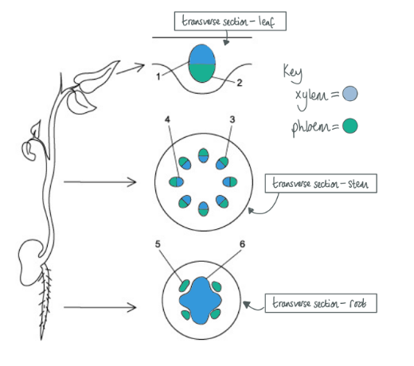
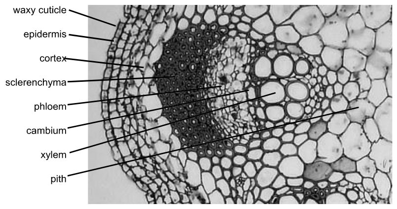
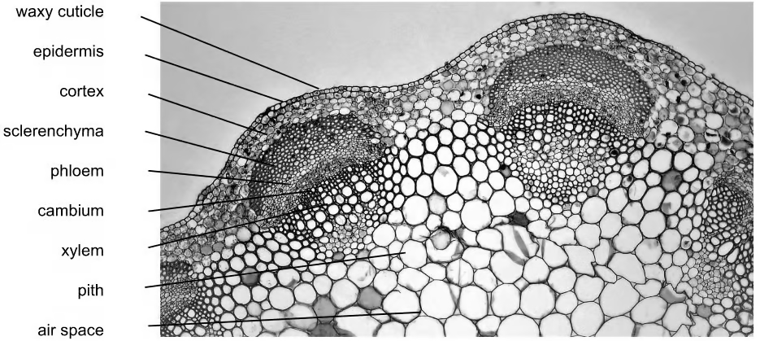

# Mark Schemes — Structure of Transport Tissues
**7. Transport in Plants** · Cambridge (CIE) A-LEVEL biology (9700)

## Multiple Choice Questions (29 questions)

### Q1
**Final answer:** **The correct answer is ****C ****because:**

**Final answer:** **Plasmodesmata provide a cytoplasmic link between companion cells and sieve tubes.**

**Final answer:** **Without this cytoplasmic contact, the loading of sucrose into the sieve tube would be much slower, the water potential of the sieve tube would be higher, and the movement of water into the sieve tube by osmosis would be reduced. This would reduce the pressure gradient and slow the rate of translocation.**

> *A** is incorrect as the companion cell does not provide much structural support.*

> *B** is incorrect as the source of sugars is the cells of the **leaves** or a **starch storage area**.*

> *D **is incorrect as this statement refers to sieve tube elements and not companion cells.*

### Q2
**Final answer:** **The correct answer is ****D**** because:**

**Final answer:** **Both companion cells and sieve tube elements have ****endoplasmic reticulum ****(ER is one of the few organelles that sieve tube elements have) while neither sieve tube elements nor xylem vessel elements have ****nuclei****. **

> *A** and **B** are incorrect as companion cells do not have lignified tissue.*

> *C** is incorrect as xylem vessel elements do not have nuclei.*

### Q3
**Final answer:** **The correct answer is ****C**** because:**

**Final answer:** **Xylem vessel elements have ****neither**** cytoplasm nor nuclei.**

**Final answer:** **Sieve tube elements have cytoplasm but ****no**** nuclei.**

**Final answer:** **Companion cells have ****both**** cytoplasm and nuclei.**

### Q4
**Final answer:** **The correct answer is ****B**** because:**

**Final answer:** **Plasmodesmata**** are narrow threads of cytoplasm that pass through the cell walls of ****adjacent**** plant cells.**

**Final answer:** **Plasmodesmata allow:**

- **Communication**** between cells**
- **Cytoplasmic ****movement of nutrients ****between cells**
- **Symplastic**** movement of ****water**

**Final answer:** **The ****communication**** between neighbouring cells via the plasmodesmata is achieved by the ****cytoplasmic movement ****of substances between cells  **

### Q5
**Final answer:** **The correct answer is ****D ****because:**

**Final answer:** **The purpose of a plan diagram is to show the distribution of the ****main tissues ****within an organ and to show the boundary lines between each tissue type; ****crucially, no individual cells should be drawn!**

**Final answer:** **1, 2, 3, and 5 are correct as they are the names of ****tissue types ****present in a leaf.**

> *4 **is incorrect as it refers to individual cells.*

> *Note that 'xylem' would be allowed, as this is a type of tissue, but 'xylem vessel element' is not, as this is a specific cell type.  Likewise, 'phloem' is allowed, but 'sieve tube element' is not.*

### Q6
**Final answer:** **The correct answer is ****C**** because:**

**Final answer:** **In a ****dicotyledonous plant**** (which is the only plant type you will be asked about) the xylem and phloem locations in the ****root****, ****stem**** and ****leaf**** always follow the same pattern:**

- **In the ****leaf ****there is a main vascular bundle in the centre with the ****phloem located on the bottom ****and ****xylem on the top**** (there may also be smaller vascular bundles shown on the leaf and they follow the same phloem on the bottom and xylem on the top pattern).**
- **In the ****stem**** there are multiple vascular bundles around the outer circumference of the stem – each vascular bundle comprises xylem and phloem tissue with the ****xylem tissue on the inside**** and the ****phloem tissue on the outside****.**
- **In the ****root ****the xylem is in the centre in an ****X**** (or sometimes star) ****shape**** with the phloem located around the outside (in the gaps between the points).**

### Q7
**Final answer:** **The correct answer is ****A**** because:**

**Final answer:** **X**** is the cortex; ****Y**** is the endodermis and ****Z ****is the epidermis **

**Final answer:** **Any option would be correct for ****X**** as storage of carbohydrates and the movement of water from the root hairs to the vascular system both occur in the ****cortex**** **

**Final answer:** **The ****endodermis**** contains the ****Casparian strip****, therefore it plays a role in regulating the ****movement of water ****into and out of the vascular system.**

**Final answer:** **As the outermost layer, the ****epidermis**** is the first line of ****defence**** against infection, providing a physical barrier to pathogens. **

**Final answer:** **Plant roots have root hairs, the main role of which is to ****absorb water ****and nutrients. Consequently there is ****no**** waxy cuticle on the root because if there were, it would be impossible for roots to absorb water and nutrients from the soil.**

### Q8
**Final answer:** **The correct answer is ****C **** because:**

**Final answer:** **2 is correct; the end walls of the sieve tubes, known as sieve plates, contain pores to allow easy movement of assimilates.**

**Final answer:** **3 is correct; the vascular bundles in the leaves have the**** xylem on the top**** and the ****phloem at the bottom****.**

**Final answer:** **4 is correct as the central bundle of vascular tissue in the roots is surrounded by a layer called the endodermis.**

> *1 is incorrect as the lignin present in cell walls is arranged in a spiral or circles, providing strength while also being flexible to reduce breakages.*

> *5 is incorrect as **pits allow the lateral movement of water **between xylem vessels; remember that xylem vessels do not contain cytoplasm. The description here could be applied to plasmodesmata in other types of plant tissue, e.g. in the phloem.*

### Q9
**Final answer:** **The correct answer is ****C**** because:**

**Final answer:** **In a ****dicotyledonous plant**** (which is the only plant type you will be asked about) the xylem and phloem locations in the ****root****, ****stem**** and ****leaf**** always follow the same pattern:**

- **In the ****stem**** there are multiple ****vascular bundles ****around the outer circumference of the stem; each vascular bundle comprises xylem and phloem tissue with the ****xylem tissue on the inside**** and the ****phloem tissue on the outside**** **
- **The next layer outside of the phloem is the ****sclerenchyma cells**** (i.e. the dark cells represented by ****B****) – these are heavily ****lignified****, ****dead**** cells that provide structural support to the plant  **
- **Between the xylem and phloem is the ****cambium**** (an area of ****undifferentiated**** ****cells**** used for growth of new tissue)**

### Q10
**Final answer:** **The correct answer is ****D**** because:**

- **1**** is the epidermis**
- **2**** is the phloem and ****3**** is the xylem as, in a ****root****,**** ****the xylem is in the centre in an X shape and the phloem is located around the outside of the xylem**
- **4 ****is the cortex**

> *Pith and cortex are commonly mixed up as they are similar tissues (composed mainly of soft, spongy parenchyma cells) with similar functions (storage and transport of water and nutrients throughout the plant). The cortex is located to the outside and/or around the vascular bundles (c**o**rtex = **o**utside), while the pith is located in the centre of the stem (p**i**th = **i**nside).*

### Q11
**Final answer:** **The correct answer is ****A**** because:**

**Final answer:** **Plasmodesmata**** are narrow threads of cytoplasm that pass through the cell walls of ****adjacent**** plant cells, allowing ****communication**** between the cells by the ****symplastic**** movement of substances.**

### Q12
**Final answer:** **The correct answer is ****C ****because:**

**Final answer:** **In a ****dicotyledonous plant**** (which is the only plant type you will be asked about) the xylem and phloem locations in the ****root****, ****stem**** and ****leaf**** always follow the same pattern: **

- **In the ****leaf ****there is a main vascular bundle in the centre with the ****phloem located on the bottom ****and ****xylem on the top****. Note that there may also be smaller vascular bundles in the leaf and they follow the same pattern with phloem on the bottom and xylem on the top.**
- **In the ****stem**** there are multiple vascular bundles around the outer circumference of the stem; each vascular bundle comprises xylem and phloem tissue with the ****xylem tissue on the inside**** and the ****phloem tissue on the outside****.**
- **In the ****root ****the xylem is in the centre in an ****X**** (or sometimes star) ****shape**** with the phloem located around the outside.**

### Q13
**Final answer:** **The correct answer is ****D**** because:**

**Final answer:** **The xylem contains ****elongated**** cells with ****no**** end walls. Xylem vessels are located in ****vascular bundles ****on the outside of the stem and in the middle of the roots.**

> *A** is incorrect as xylem vessels no **not** contain peripheral cytoplasm and are located towards the **inside** of phloem in vascular bundles.*

> *B** is incorrect as xylem vessels do not have sieve plates.*

> *C **is incorrect as xylem vessels are never associated with companion cells.*

### Q14
**Final answer:** **The correct answer is ****D ****because:**

**Final answer:** **W indicates a column-shaped cell near the top of the leaf; this is a palisade mesophyll cell.**

**Final answer:** **X indicates a gap between cells, known as an air space.**

**Final answer:** **Y indicates a cell in the spongy mesophyll layer.**

**Final answer:** **Z indicates the lower half of a vascular bundle; in leaves this is the phloem, while the xylem vessels are on the top. The xylem cells can also be identified here by their thickened cell walls, meaning that Z must indicate the phloem.**

### Q15
**Final answer:** **The correct answer is ****B**** because:**

- **X**** is in the ****xylem****; we can be sure of this because of its location towards the inside of the stem, and because of its thickened cell wall.**
- **Y**** indicates a region towards the outside of the vascular bundle, so must be the ****phloem****; this therefore must be a sieve tube element.**
- **Z**** is located in the ****pith****, but is specifically pointing at a gap between cells, therefore it must be an ****airspace**** **

** **

### Q16
**Final answer:** **The correct answer is ****B**** because:**

**Final answer:** **X**** is the cortex – the cortex is the area in the root found between the epidermis (****Z****) and the endodermis (****Y****) and is made up of parenchyma cells which play a role in storage of nutrients.**

**Final answer:** **Y ****is the endodermis**** ****- the endodermis is located between the cortex and the vascular bundle in roots and contains the ****Casparian strip**** (which forces water from the ****apoplast**** into the ****symplast**** pathway).**

**Final answer:** **Z ****is the epidermis – the epidermis is the outermost layer in the root****.**

### Q17
**Final answer:** **The correct answer is**** A**** because:**

**Final answer:** **Xylem vessel elements have heavily ****lignified**** ****walls****; this adds structural strength and helps to prevent the xylem from collapsing under negative pressure**** ****from transpiration pull.**

**Final answer:** **Companion cells contain ****many mitochondria****, which produce the ATP needed for actively loading sucrose into the sieve tube elements.**

> *B** is incorrect as xylem vessel elements do** **not** have nuclei as they are dead cells. Companion cells do have cellulose cell walls, but this is a general feature of plant cells and does not aid specific function.*

> *C** is incorrect as it is not correct to say that a cell does not contain 'living tissue'; xylem cells themselves are dead, but the cells make up xylem tissue, and not the other way around. Companion cells **do** contain a small amount of cytoplasm.*

> *D **is incorrect as xylem vessel elements do **not** have mitochondria and companion cells do **not** have lignified walls.*

### Q18
**Final answer:** **The correct answer is ****A**** because:**

**Final answer:** **Xylem vessel elements (xylem cells) have no ****nucleus****, ****cytoplasm**** or ****end**** walls. **

**Final answer:** **Sieve tube elements (phloem cells) have ****no**** nucleus, but ****do**** have cytoplasm and end walls.**

### Q19
**Final answer:** **The correct answer is ****C**** because: **

**Final answer:** **2**** and ****4 ****are**** xylem ****which transports water and dissolved mineral ions in one direction.**

**Final answer:** **1**** and ****3**** are the ****phloem ****which transports sugars produced during photosynthesis in two directions.**

### Q20
**Final answer:** **The correct answer is ****D**** because:**

**Final answer:** **Neither sieve tube elements nor xylem vessel elements have nuclei.**

> *1 is incorrect because sieve tube elements have perforated end walls.*

> *3 is incorrect because although xylem vessel elements do not have cytoplasm, sieve tube elements do contain some cytoplasm.*

> *4 is incorrect because only the sieve tube elements are dependent on companion cells.*

### Q21
**Final answer:** **The correct answer is ****B**** because:**

**Final answer:** **Sieve tube elements have vastly reduced cell contents to ****maximise space**** for the movement of sap; organelles that are missing include the cytoskeleton, ribosomes, tonoplast and the ****nucleus****. Due to their vastly reduced cell contents, sieve tube elements rely on companion cells for many metabolic processes.**

> *Mature sieve elements still contain structural phloem-specific **proteins**, **mitochondria**, ER and strands of **cytoplasm**. *

### Q22
**Final answer:** **The correct answer is ****A**** because:**

**Final answer:** **Companion cells carry out ****active loading**** of sucrose into the ****phloem****; this requires energy, so companion cells need to synthesise ****ATP****. To make all this ATP the companion cells have large numbers of ****mitochondria****  **

> *Starch grains** are found in all living plant cells (to provide a source of glucose) but are not found in an unusually high numbers in companion cells.*

> *Chloroplasts** are found in highest concentrations in the palisade mesophyll cells (and to a lesser extent in the spongy mesophyll cells) which is where photosynthesis takes place.*

> *Lysosomes** are found in all living plant cells (they are used to break down organelles, pathogens and biomolecules), but they are not found in an unusually high numbers in companion cells .*

### Q23
**Final answer:** **The correct answer is ****C**** because:**

**Final answer:** **The purpose of a plan diagram is to show the ****distribution of the main tissues ****and the boundaries between the different tissue types; ****no individual cells should be drawn****.**

**Final answer:** **Companion cells ****should not be included in a plan diagram as they are individual cells.**

> *Note that xylem cells together make up xylem tissue, so 'xylem' can be shown on a plan diagram. Individual xylem vessels could not be shown in this way.*

> *Likewise, the term 'phloem' refers collectively to sieve tube elements and companion cells, so this is also an example of a tissue.*

### Q24
**Final answer:** **The correct answer is ****B**** because:**

**Final answer:** **The ****cortex**** is the tissue of a stem or root that lies within the ****epidermis ****and outside the ****vascular tissue****.**

> *Z** is the epidermis and **Y** is the endodermis *

> *The root of a **dicotyledonous plant** has no pith (pith is only found in the stem of a dicotyledonous plant) so A is incorrect.*

> *Pith and cortex are commonly mixed up as they are similar tissues (composed mainly of soft, spongy parenchyma cells) with similar functions (storage and transport of water and nutrients throughout the plant). The cortex is located to the outside and/or around the vascular bundles (c**o**rtex = **o**utside), while the pith is located in the centre of the stem (p**i**th = **i**nside).*

### Q25
**Final answer:** **The correct answer is ****B**** because:**

**Final answer:** **Y**** = ****xylem**** and ****X**** = ****phloem****; we know this because phloem is distributed around the outside of plant stems, with xylem located towards the inside.**

**Final answer:** **2 is correct because the xylem transport water and dissolved minerals**** from the roots to the leaves****, while phloem transport assimilates**** from sources to sinks****. The**** locations of sources and sinks can vary****, so phloem transport can be either upwards or downwards.**

**Final answer:** **3 is correct because the xylem and phloem (plus the cambium located between them) comprise a ****vascular bundle****.**

**Final answer:** **4 is correct because the phloem transports products of photosynthesis.**

> *1 is incorrect because the** xylem transports water** **and minerals **while the **phloem transports assimilates **such as sucrose and amino acids.*

### Q26
**Final answer:** **The correct answer is ****C**** because:**

**Final answer:** **1 is correct because mitochondria allow the active transport of minerals from the soil into root hair cells, lowering their water potential and resulting in water moving into the cells by osmosis.**

**Final answer:** **2 is correct because root hairs have a ****large surface area**** to speed up the intake of water by osmosis.**

**Final answer:** **3 is correct because root hairs have ****thin walls**** to reduce the diffusion distance moved by water during osmosis. Note that osmosis is a type of diffusion.**

**Final answer:** **4 is correct because root hair cells maintain a ****low water potential**** by ****actively**** taking up minerals and ions from the soil against their concentration gradients. These minerals are stored in the large vacuoles in the root hair cells and ****speed up ****the absorption of water via osmosis.**

### Q27
**Final answer:** **The correct answer is ****B**** because:**

**Final answer:** **The ****xylem**** is made of ****dead tissue**** and the ****phloem**** is made of ****living tissue****. This means that xylem function will be ****unaffected**** by the addition of the poison.**

**Final answer:** **Transport in the ****phloem**** is dependent on the ****active loading of sucrose**** into the sieve tube elements; this process will no longer occur after the cells in the vascular bundle have been poisoned, so transport in the phloem will stop.**

### Q28
**Final answer:** **The correct answer is ****C**** because:**

**Final answer:** **In a ****dicotyledonous plant**** (which is the only plant type you will be asked about) the xylem and phloem locations in the ****root****, ****stem**** and ****leaf**** always follow the same pattern: **

- **In the ****root ****the xylem is in the centre in an ****X**** (or sometimes star) ****shape**** with the phloem located around the ****outside**** (in the gaps between the points) **
- **In the ****stem**** there are multiple vascular bundles around the outer circumference of the stem; each vascular bundle comprises xylem and phloem tissue with the ****xylem tissue on the inside**** and the ****phloem tissue on the outside**** **
- **In the ****leaf ****there is a main vascular bundle in the centre with the ****phloem located on the bottom ****and ****xylem on the top**** (there may also be smaller vascular bundles shown on the leaf and they follow the same phloem on the bottom and xylem on the top pattern)**

### Q29
**Final answer:** **The correct answer is ****D**** because:**

**Final answer:** **The diagram shows the cross-section of a dicotyledonous root, recognisable by the characteristic ‘X’ shape of the xylem tissue. Cell W is within this X shape, therefore must be a xylem vessel element.**

> *Note that xylem cells are also distinctive due to their thick cell walls.*
