# Exam Questions — Structure of Transport Tissues
**7. Transport in Plants** · Cambridge (CIE) A-LEVEL biology (9700)
> Source: [https://www.savemyexams.com/a-level/biology/cie/25/topic-questions/](https://www.savemyexams.com/a-level/biology/cie/25/topic-questions/) · 41 questions across 2 sets

## Multiple Choice Questions (29 questions)

### Q1 — hard — 1 marks

**Q1** [1 mark]

Which of the following statements correctly describes companion cells in mature phloem tissue?

### Q2 — hard — 1 marks

**Q2** [1 mark]

The diagram shows the relationship between some of the features of xylem vessel elements, phloem sieve tube elements and companion cells.

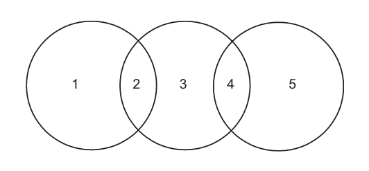

Which row is correctly represented by the diagram?

|   | **1** | **2** | **3** | **4** | **5** |
|---|---|---|---|---|---|
| **A** | xylem vessel elements | lignified tissue | companion cells | mitochondria | sieve tube elements |
| **B** | companion cells | lignified tissue | xylem vessel elements | hollow structure | sieve tube elements |
| **C** | sieve tube elements | cytoplasm | companion cells | nucleus | xylem vessel elements |
| **D** | companion cells | endoplasmic reticulum | sieve tube elements | nucleus absent | xylem vessel elements |

### Q3 — hard — 1 marks

**Q3** [1 mark]

Which row correctly identifies the structures present in xylem vessel elements, sieve tube elements and companion cells?

|   | xylem vessel element | sieve tube element | companion cell |   |   |   |
|---|---|---|---|---|---|---|
| cytoplasm | nucleus | cytoplasm | nucleus | cytoplasm | nucleus |   |
| **A** | ✓ | ✓ | X | X | X | ✓ |
| **B** | X | ✓ | ✓ | ✓ | ✓ | X |
| **C** | X | X | ✓ | X | ✓ | ✓ |
| **D** | X | X | ✓ | ✓ | ✓ | ✓ |

Key:    ✓= present        X= absent

### Q4 — hard — 1 marks

**Q4** [1 mark]

Which of the following is **not **a function of plasmodesmata in plant cells?

### Q5 — hard — 1 marks

**Q5** [1 mark]

Which labels could be correctly added to a plan diagram of a transverse section of a dicotyledonous leaf?

| 1 | palisade mesophyll |
|---|---|
| 2 | upper epidermis |
| 3 | spongy mesophyll |
| 4 | xylem vessel elements |
| 5 | phloem |

### Q6 — hard — 1 marks

**Q6** [1 mark]

The diagram shows three transverse plant sections.

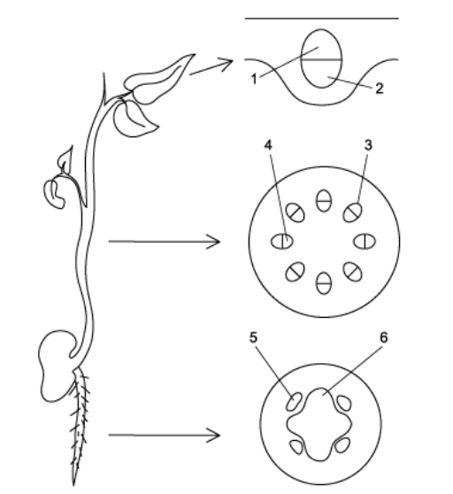

Which row correctly identifies **1 - 6**?

|   | **1** | **2** | **3** | **4** | **5** | **6** |
|---|---|---|---|---|---|---|
| **A**  **B**  **C**  **D** | phloem  xylem  xylem  phloem | xylem  phloem  phloem  xylem | xylem  xylem  phloem  phloem | phloem  phloem  xylem  xylem | phloem  xylem  phloem  xylem | xylem  phloem  xylem  phloem |

### Q7 — hard — 1 marks

**Q7** [1 mark]

The diagram shows a transverse plant section.

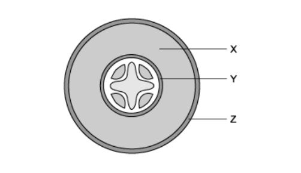

Which row correctly identifies the functions of **X**, **Y** and **Z**?

|   | **X** | **Y** | **Z** |
|---|---|---|---|
| **A** | storage of carbohydrates | regulates movement of water into and out of the vascular system | provides a physical barrier to pathogens |
| **B** | storage of carbohydrates | provides structural support for the plant | has a waxy cuticle to prevent water loss |
| **C** | allows movement of water from root hairs to vascular system | regulates movement of water into and out of the vascular system | has a waxy cuticle to prevent water loss |
| **D** | allows movement of water from root hairs to vascular system | provides structural support for the plant | provides a physical barrier to pathogens |

### Q8 — hard — 1 marks

**Q8** [1 mark]

Which of the following statements about plant transport tissues are correct?

| 1 | Xylem vessel walls are strengthened by longitudinal strips of lignin |
|---|---|
| 2 | Sieve plates contain pores |
| 3 | Phloem tissue is located on the lower side of leaf vascular bundles |
| 4 | Root vascular bundles are surrounded by the endodermis |
| 5 | Pits in xylem allow the movement of cytoplasm between cells |

### Q9 — hard — 1 marks

**Q9** [1 mark]

This image shows a transverse section of a plant stem

Which, from **A**-**D**, identifies the phloem?

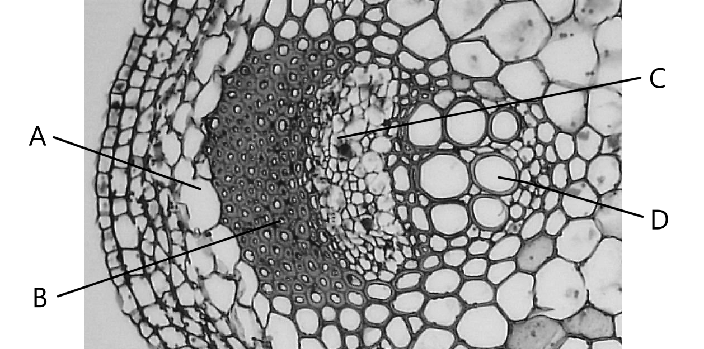

*Public domain, via *[*Flickr*](https://www.flickr.com/photos/146824358@N03/37245486610)

### Q10 — medium — 1 marks

**Q10** [1 mark]

The diagram shows a transverse section of a plant structure.

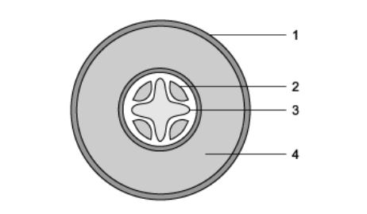

Which row correctly identifies the structures labelled **1**, **2**, **3** and **4**?

|   | **1** | **2** | **3** | **4** |
|---|---|---|---|---|
| **A** | cuticle | xylem | phloem | pith |
| **B** | cuticle | phloem | xylem | pith |
| **C** | epidermis | xylem | phloem | cortex |
| **D** | epidermis | phloem | xylem | cortex |

### Q11 — medium — 1 marks

**Q11** [1 mark]

What is the function of plasmodesmata in plant cells?

### Q12 — medium — 1 marks

**Q12** [1 mark]

The diagrams show cross sections of the stem, root and leaf of a non-woody dicotyledonous plant.

Which sequence of numbers correctly identifies the distribution of xylem and phloem in the stem, root and leaf?

|   | **xylem** | **phloem** |
|---|---|---|
| **A** | 1     3     5 | 2     4     6 |
| **B** | 2     3     5 | 1     4     6 |
| **C** | 1     4     6 | 2     3     5 |
| **D** | 2     4     6 | 1     3     5 |

### Q13 — medium — 1 marks

**Q13** [1 mark]

Which of the following correctly describes the features of xylem vessels?

### Q14 — medium — 1 marks

**Q14** [1 mark]

The diagram shows a transverse section of a leaf viewed under a light microscope.

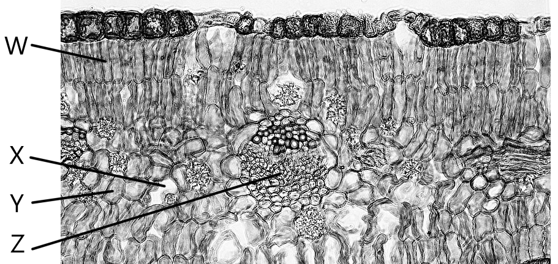

*Berkshire Community College, CC0, via **[Wikimedia Commons](https://commons.wikimedia.org/wiki/File:Angiosperm_Morphology_Idioblasts_in_the_Xerophytic_Leaf_of_Larrea_%2836619801473%29.jpg)*

Which row correctly identifies structures **W**, **X**, **Y** and **Z**?

|   | **W** | **X** | **Y** | **Z** |
|---|---|---|---|---|
| **A** | palisade mesophyll cell | air space | spongy mesophyll cell | xylem |
| **B** | guard cell | phloem | air space | xylem |
| **C** | guard cell | spongy mesophyll cell | cortex | phloem |
| **D** | palisade mesophyll cell | air space | spongy mesophyll cell | phloem |

### Q15 — medium — 1 marks

**Q15** [1 mark]

The photomicrograph shows a cross section of the stem of a plant.

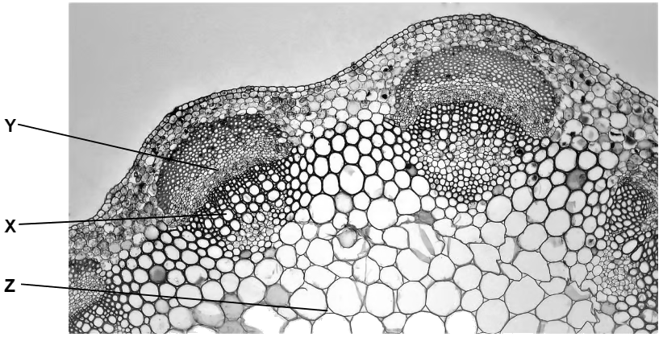

*Berkshire Community College, CC0, via **[Wikimedia Commons](https://commons.wikimedia.org/wiki/File:Herbaceous_Dicot_Stem_Cortex_and_Pith_in_Late_Season_Trifolium_%2836316874793%29.jpg)*

Which row correctly identifies **X**, **Y** and **Z**?

|   | **X** | **Y** | **Z** |
|---|---|---|---|
| **A** | xylem vessel element | cortex cell | companion cell |
| **B** | xylem vessel element | sieve tube element | airspace |
| **C** | sieve tube element | epidermal cell | pith cell |
| **D** | sieve tube element | xylem vessel element | cortex cell |

### Q16 — medium — 1 marks

**Q16** [1 mark]

The diagram shows a transverse plant section.

Which row correctly identifies the structures labelled **X**, **Y** and **Z**?

|   | **X** | **Y** | **Z** |
|---|---|---|---|
| **A** | pith | endodermis | epidermis |
| **B** | cortex | endodermis | epidermis |
| **C** | pith | cortex | cuticle |
| **D** | endodermis | cortex | cuticle |

### Q17 — medium — 1 marks

**Q17** [1 mark]

Which features of these cells make them suitable for their function?

|   | **xylem vessel elements** | **companion cells** |
|---|---|---|
| **A** | lignified walls | numerous mitochondria |
| **B** | nuclei present | cellulose wall |
| **C** | no living tissue present | absence of cytoplasm |
| **D** | numerous mitochondria | lignified walls |

### Q18 — medium — 1 marks

**Q18** [1 mark]

Which row correctly identifies the structures present within xylem vessel elements and sieve tube elements?

|   | **xylem vessel element** | **sieve tube element** |   |   |   |   |
|---|---|---|---|---|---|---|
| **nucleus** | **cytoplasm** | ** end wall** | **nucleus** | **cytoplasm** | **end wall** |   |
| **A**  **B**  **C**  **D** | X  X  X  X | X  ✓  X  X | X  ✓  X  ✓ | X  X  ✓  ✓ | ✓  ✓  X  ✓ | ✓  ✓  X  X |

Key:    ✓ = present        X = absent

### Q19 — medium — 1 marks

**Q19** [1 mark]

The diagram shows transverse sections of two plant structures.

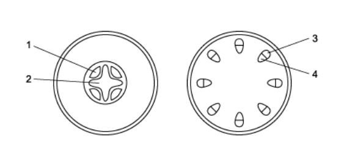

Which row correctly describe structures **1**, **2**, **3** and **4**?

|   | **1** | **2** | **3** | **4** |
|---|---|---|---|---|
| **A** | transports in two directions | transports in one direction | transports in one direction | transports ions and minerals |
| **B** | transports sugars | transports in one direction | transports in two directions | transports products of photosynthesis |
| **C** | transports sugars | transports in one direction | transports products of photosynthesis | transports ions and minerals |
| **D** | transports water | transports in two direction | transports in two directions | transports products of photosynthesis |

### Q20 — easy — 1 marks

**Q20** [1 mark]

Which features apply to both sieve tube elements and xylem vessel elements?

| 1 | no end walls |
|---|---|
| 2 | no nucleus |
| 3 | no cytoplasm |
| 4 | dependent on companion cells for certain functions |

### Q21 — easy — 1 marks

**Q21** [1 mark]

Which of the following is not found in mature sieve tube elements?

### Q22 — easy — 1 marks

**Q22** [1 mark]

Which organelles occur in large numbers in companion cells?

### Q23 — easy — 1 marks

**Q23** [1 mark]

Which feature should not be included when drawing a plan diagram of a transverse section of a dicotyledonous plant stem?

### Q24 — easy — 1 marks

**Q24** [1 mark]

The diagram shows a transverse section through part of a plant.

What is the name of tissue **X**?

### Q25 — easy — 1 marks

**Q25** [1 mark]

The diagram shows a transverse section of a plant stem.

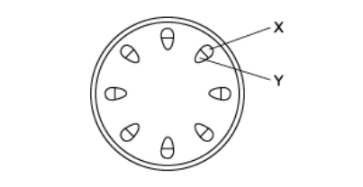

Which statements relating to the diagram are correct?

| 1 | X transports water and minerals |
|---|---|
| 2 | Y** **transports substances in only one direction |
| 3 | X and Y together are a vascular bundle |
| 4 | X transports products of photosynthesis |

### Q26 — easy — 1 marks

**Q26** [1 mark]

Which features of a root hair cell increase water uptake from the soil?

| 1 | many mitochondria |
|---|---|
| 2 | large surface area |
| 3 | thin cell wall |
| 4 | low water potential |

### Q27 — easy — 1 marks

**Q27** [1 mark]

A poison is applied to the stem of a plant, killing living cells.

How will this treatment affect transport in the vascular tissue?

### Q28 — easy — 1 marks

**Q28** [1 mark]

The diagram shows transverse sections of two plant structures.

Which labels correctly identify structures **1**, **2**, **3** and **4**?

|   | **1** | **2** | **3** | **4** |
|---|---|---|---|---|
| **A** | phloem | xylem | xylem | phloem |
| **B** | xylem | phloem | xylem | phloem |
| **C** | phloem | xylem | phloem | xylem |
| **D** | xylem | phloem | phloem | xylem |

### Q29 — easy — 1 marks

**Q29** [1 mark]

This is an image of a plant taken with a light microscope

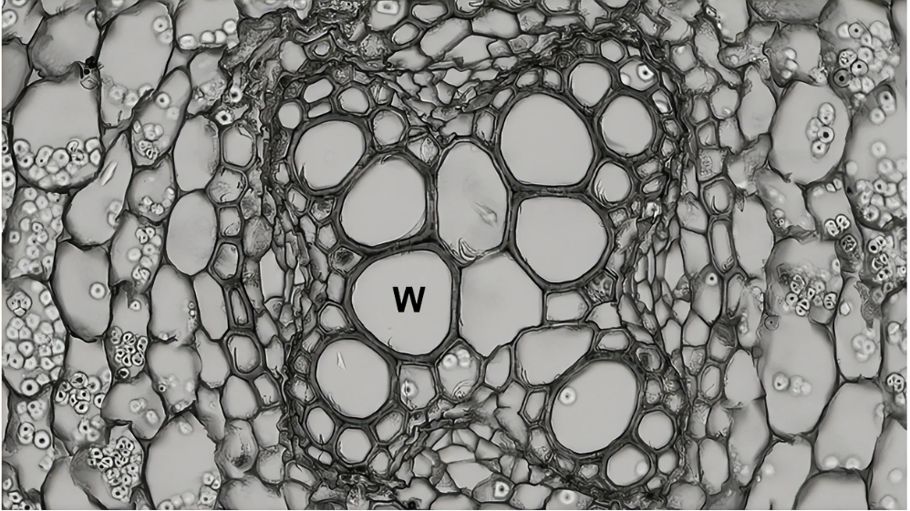

*Public domain, via **[Flickr](https://www.flickr.com/photos/146824358@N03/34758989431)*

What is the cell type labelled **W**?

## Structured Questions (12 questions)

### Q1 — hard — 10 marks

**Q1** [6 marks]

The vascular system of plants has been likened to the circulatory system in animals such as humans.

Discuss the idea that the plant vascular system and the human circulatory system are comparable.

**Q1** [2 marks]

**Extract:**

Xylem cells are strengthened with lignin

Cellulose is the most abundant organic polymer on Earth.

(i) Use your knowledge of plant structure to suggest which compound ranks second in the list of abundant organic polymers.

[1]

(ii) Explain your answer to part (i).

[1]

**Q1** [2 marks]

**Extract:**

Cellulose is the most abundant organic polymer on Earth.

(i) Use your knowledge of plant structure to suggest which compound ranks second in the list of abundant organic polymers.

[1]

(ii) Explain your answer to part (i).

[1]

Mark scheme:
(i) The compound that ranks number 2 in the list of abundant organic polymers is:

- Lignin; [1 mark]

(ii) This is because:

- It is present in xylem tissue / forms wood in woody plants; [1 mark]

The compound referred to in part (b) is highly hydrophobic in nature.

Suggest how this helps it to carry out its role.

### Q2 — hard — 10 marks

**Q2** [2 marks]

Fig. 1 shows the structure of plasmodesmata; these are channels that exist between some types of plant cell that allow the transport of substances.

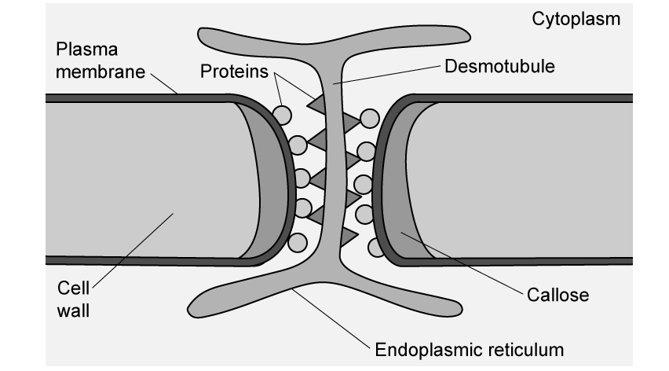

**Fig. 1**

Suggest why plant cells need plasmodesmata while animal cells do not.

**Q2** [3 marks]

**Extract:**

Fig. 1 shows the structure of plasmodesmata; these are channels that exist between some types of plant cell that allow the transport of substances.

Within the cytoplasm of the plasmodesmata is a structure known as the desmotubule; a column of specialised endoplasmic reticulum that connects to the cell surface membrane via a series of actin and myosin proteins. Actin and myosin proteins are the contractile elements of animal muscle cells.

Suggest a possible function of the desmotubule.

**Q2** [2 marks]

(i) State the location of plasmodesmata in the vascular tissue of plants

[1]

(ii) Describe the role of plasmodesmata in the location identified in part (i).

[1]

**Q2** [3 marks]

**Extract:**

(i) State the location of plasmodesmata in the vascular tissue of plants

(ii) Describe the role of plasmodesmata in the location identified in part (i).

The location of plasmodesmata in the vascular tissue of plants is between the sieve tube elements and the companion cells of the phloem. Its role there is to allow the passage of sucrose / amino acids / assimilates.

**Other than** the role of plasmodesmata described in part (c), give **three** substances that might move from one cell to another via plasmodesmata.

### Q3 — hard — 11 marks

**Q3** [4 marks]

Lignin is an organic polymer found within the cell walls of plants. Fig. 1 shows several arrangements that can be formed by lignin within xylem cell walls.

Note that the lignin is represented by dark grey areas, while non-lignified regions are shown in light grey.

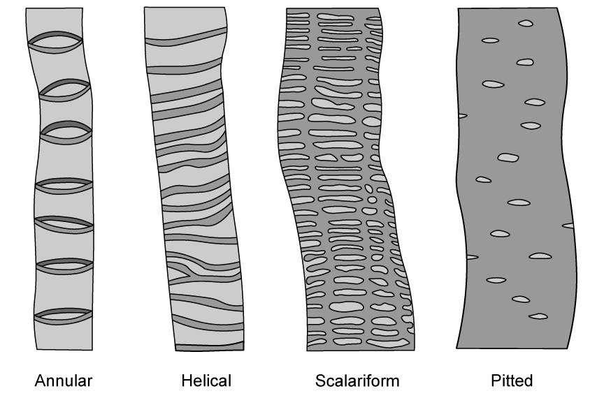

**Fig. 1**

Suggest possible advantages of the different lignin arrangements found in plants.

**Q3** [4 marks]

Fig. 2 below shows a section of vascular tissue in a woody plant stem.

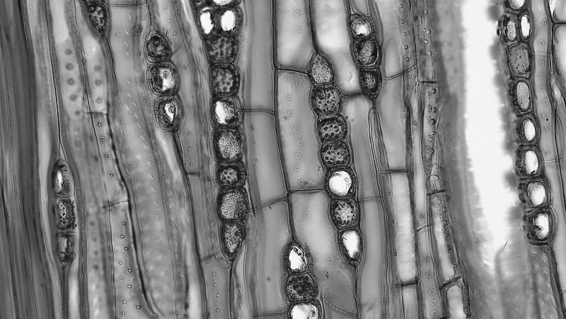

*Public domain, via **[Flickr](https://www.flickr.com/photos/146824358@N03/35412590170/in/photostream/)*

**Fig. 2**

Fig. 2 shows the following features:

- Tracheids
- Xylem vessels
- Bordered pits
- Parenchyma cells

Note that tracheids are tapered vessels with closed ends that transport water.

Use the information provided and your own knowledge to add labels to Fig. 2 that show the locations of the four features listed above.

**Q3** [3 marks]

**Extract:**

Fig. 2 below shows a section of vascular tissue in a woody plant stem.

Fig. 2 shows the following features:

- Tracheids
- Xylem vessels
- Bordered pits
- Parenchyma cells

Note that tracheids are tapered vessels with closed ends that transport water.

Use Fig. 2 to produce a biological drawing that shows **at least three** different structures within the vascular tissue.

### Q4 — hard — 12 marks

**Q4** [2 marks]

Fig. 1 shows a cross-section through a leaf viewed at a magnification of x250.

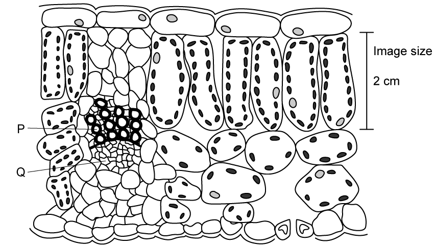

**Fig. 1**

Calculate the actual size of a palisade mesophyll cell shown in Fig. 1.

Show your working and include appropriate units.

**Q4** [4 marks]

**Extract:**

Fig. 1 shows a cross-section through a leaf viewed at a magnification of x250.

Contrast the structures of the tissues labelled **P** and **Q** in Fig. 1.

**Q4** [6 marks]

A student viewed a section of plant tissue under a light microscope. The tissue viewed is shown in Fig. 2.

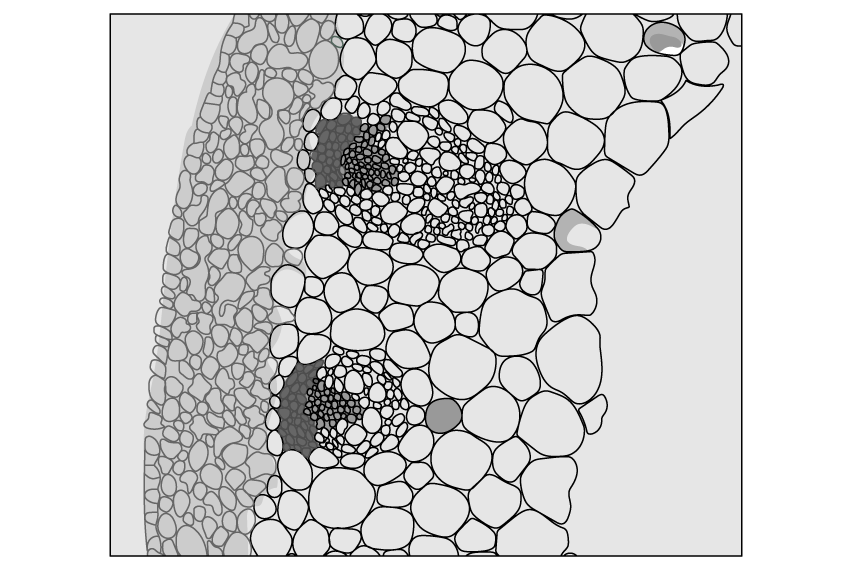

**Fig. 2**

Draw a **low-power plan** diagram of the plant tissue shown in Fig. 2.

### Q5 — medium — 9 marks

**Q5** [3 marks]

Fig. 1 shows a cross-section through the vascular tissue in a mature buttercup root taken using a light microscope under high power.

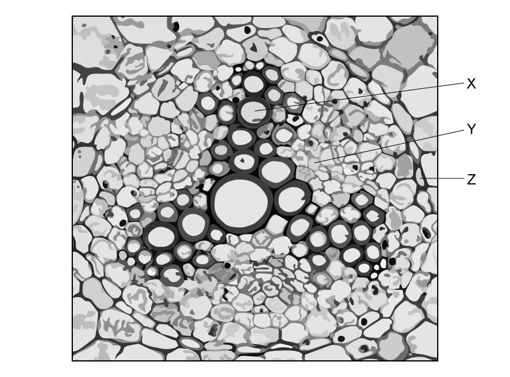

**Fig. 1**

Identify** X, Y, **and **Z.**

**Q5** [4 marks]

**Extract:**

Fig. 1 shows a cross-section through the vascular tissue in a mature buttercup root taken using a light microscope under high power.

X = xylem (vessels)

Explain how the structure of tissue **X** is related to its function.

**Q5** [2 marks]

Water moves through vascular tissue in a continuous column.

Explain how the structure of water molecules enables this.

### Q6 — medium — 10 marks

**Q6** [2 marks]

Fig. 1 below shows a micrograph of part of a leaf.

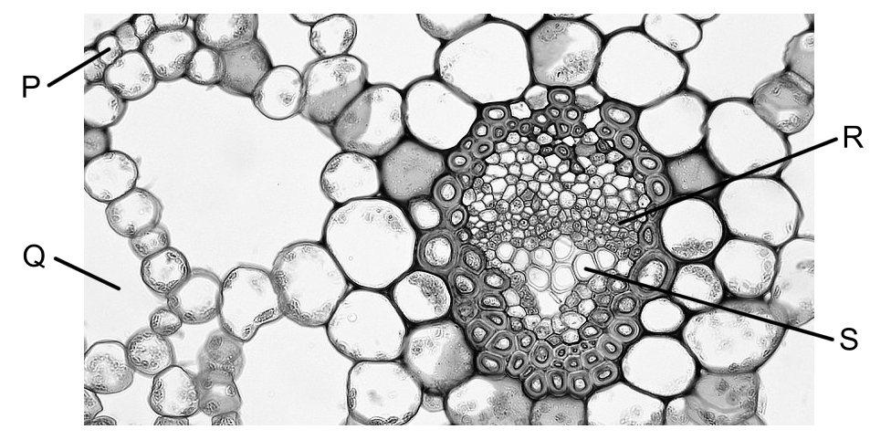

*Berkshire Community College, CC0, via **[Wikimedia Commons](https://commons.wikimedia.org/wiki/File:Angiosperm_Leaf_Midrib_Vascular_Bundle_in_The_Hydrophyte_Potamogeton_%2836716448871%29.jpg)*

**Fig. 1**

The leaf shown in Fig. 1 is upside down.

Explain how we can see from the image that this is the case.

[2]

**Q6** [2 marks]

**Extract:**

Fig. 1 below shows a micrograph of part of a leaf.

Fig. 1

Structures **R** and **S** in Fig. 1 make up a single vascular bundle.

Describe the distribution of vascular bundles in a leaf.

**Q6** [2 marks]

**Extract:**

Fig. 1 below shows a micrograph of part of a leaf.

The leaf shown in Fig. 1 is upside down.

We know that the leaf is upside-down because:
- P/the lower epidermis / Q/the air spaces are at the top of the image; [1 mark]
- S/the xylem is shown below R/the phloem; [1 mark]

Structures R and S in Fig. 1 make up a single vascular bundle.

Explain why structures **R** and **S** are present in the leaves of plants.

**Q6** [4 marks]

**Extract:**

Fig. 1 below shows a micrograph of part of a leaf.

The leaf shown in Fig. 1 is upside down.

A student produced a low-power plan diagram of Fig. 1.

State the leaf features that would be visible on the student's diagram.

### Q7 — medium — 11 marks

**Q7** [3 marks]

Fig. 1 shows a transverse section of xylem tissue viewed under a light microscope.

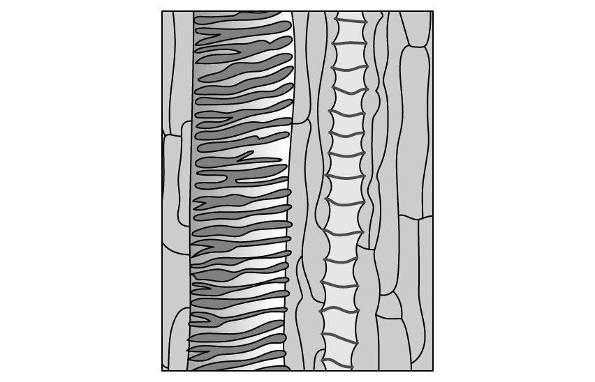

**Fig. 1**

(i) Identify an adaptation of xylem vessels that is **visible in Fig. 1**.

[1]

(ii) Explain how the feature identified in part (i) aids xylem vessel function.

[2]

**Q7** [3 marks]

Fig. 1 was generated using a light microscope.

Explain why light microscopes have a lower maximum magnification than electron microscopes.

**Q7** [5 marks]

Xylem vessels are distributed differently in different parts of plants.

Describe the distribution of xylem tissue in the stems, roots, and leaves of dicotyledonous plants.

### Q8 — medium — 10 marks

**Q8** [1 mark]

Meristematic tissue is found in the growing regions of plants, such as shoot tips. Meristematic cells have a similar role to stem cells in animals.

Fig. 1 shows some of the stages in the formation of a mature phloem sieve tube element and companion cells from a meristematic cell.

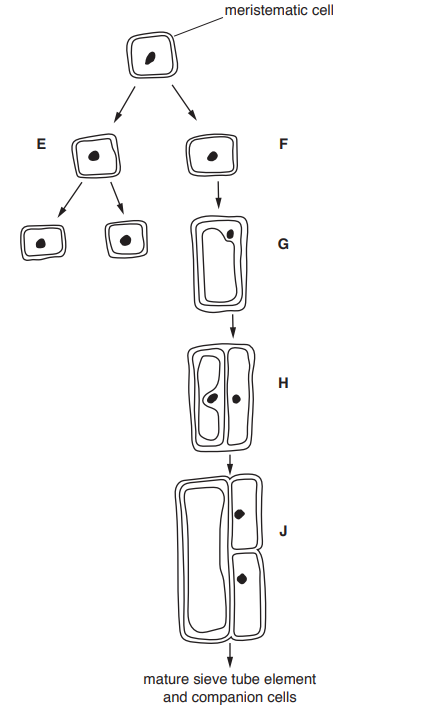

**Fig. 1**

Cells **E** and **F **in Fig. 1 are daughter cells produced when the meristematic cell divides in the shoot tip.

Suggest why it is important that one of the daughter cells (cell **E**) is another meristematic cell.

*Source: May/June 2019 9700/21 Q4A*

**Q8** [3 marks]

**Extract:**

Meristematic tissue is found in the growing regions of plants, such as shoot tips. Meristematic cells have a similar role to stem cells in animals.

Fig. 1 shows some of the stages in the formation of a mature phloem sieve tube element and companion cells from a meristematic cell.

Cells E and F in Fig. 1 are daughter cells produced when the meristematic cell divides in the shoot tip.

Complete Table 1 to describe the changes that are shown in Fig. 1 between stages:

• **F** and **G** • **G **and **H** • **H **and **J**.

**Table 1**

| **stages** | **description** |
|---|---|
| **F** and **G** |   |
| **G **and **H** |   |
| **H **and **J** |   |

*Source: May/June 2019 9700/21 Q4B*

**Q8** [4 marks]

Explain how the structure of a mature sieve tube element is related to its function.

*Source: May/June 2019 9700/21 Q4C*

**Q8** [2 marks]

Describe the functions of companion cells in transport in the phloem.

*Source: May/June 2019 9700/21 Q4D*

### Q9 — easy — 10 marks

**Q9** [3 marks]

Fig. 1 below shows a leaf cross-section tissue map.

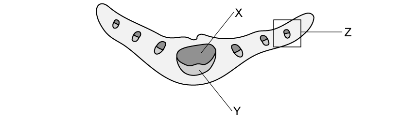

**Fig. 1**

Identify the structures labelled **X**, **Y **and **Z**.

**Q9** [2 marks]

**Extract:**

Fig. 1 below shows a leaf cross-section tissue map.

Fig. 1

Identify the structures labelled X, Y and Z.

Structures X, Y and Z are...
- X = xylem;
- Y = phloem;
- Z = vascular bundle/tissue;

Give the roles of structures **X** and **Y**.

**Q9** [4 marks]

**Extract:**

X = xylem

X/xylem = transport of water AND (dissolved) minerals

Explain **two** ways in which structure **X** is adapted to carry out its function.

**Q9** [1 mark]

**Extract:**

Fig. 1 below shows a leaf cross-section tissue map.

Fig. 1 is an example of a low-power plan.

State how the appearance of a high-power plan would differ from Fig. 1.

### Q10 — easy — 10 marks

**Q10** [2 marks]

Fig. 1 below shows the distribution of vascular tissue in two different parts of a plant.

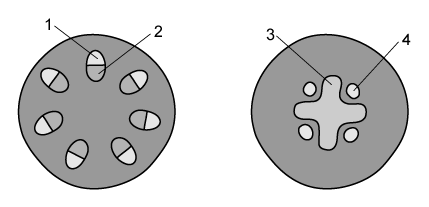

**Fig. 1**

Name the tissues present in each of the regions labelled **1**-**4**.

**Q10** [2 marks]

**Extract:**

Fig. 1 below shows the distribution of vascular tissue in two different parts of a plant.

**Fig. 1**

Name the tissues present in each of the regions labelled **1**-**4**.

The distribution of tissues shown by the regions labelled **1** and **2** is different to that shown by the regions labelled **3** and **4** in Fig. 1.

Identify the part of a plant in which the distribution of vascular tissue is correctly represented by:

(i) Regions **1** and **2**.

[1]

(ii) Regions **3** and **4**.

[1]

**Q10** [4 marks]

Fig. 2 below shows a student's attempt at a low-power drawing made from a microscope slide.

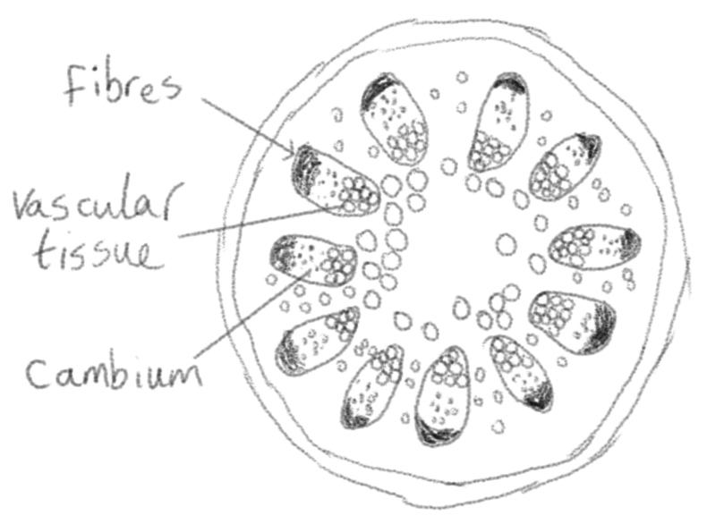

**Fig. 2**

Identify **four** errors in the student's **low-power** drawing in Fig. 2

**Q10** [2 marks]

The cambium, labelled on Fig. 2, is a region that contains plant stem cells.

Define the term **stem cell**.

### Q11 — easy — 9 marks

**Q11** [3 marks]

Fig. 1 shows a representation of two different vascular structures found in plants.

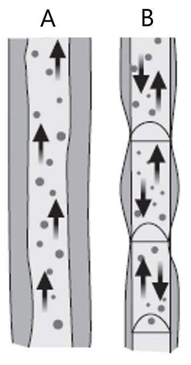

**Fig. 1**

(i) Identify structure **A** in Fig. 1.

[1]

(ii) Give **two** reasons for your answer to part (i)

[2]

**Q11** [2 marks]

**Extract:**

Fig. 1 shows a representation of two different vascular structures found in plants.

(i) Identify structure A in Fig. 1.

Structure A is a: Xylem vessel (element) / xylem cell;

Identify **two** features of structure** A** in Fig. 1 that are **not** visible in the diagram.

**Q11** [2 marks]

**Extract:**

Fig. 1 shows a representation of two different vascular structures found in plants.

Structure **B** in Fig. 1 does not accurately reflect the tissue type that it represents.

Explain why this is the case.

**Q11** [2 marks]

**Extract:**

Fig. 1 shows a representation of two different vascular structures found in plants.

Structure **B** in Fig. 1 does not accurately reflect the tissue type that it represents because:
- It does not include companion cells
- It does not show the pores in the sieve plates/end walls
- It does not show the presence of cell contents / cytoplasm / other cellular structure found in sieve tubes

Explain how **two** features of structure **B** in Fig. 1 aid its function.

Note that in this case, the features do not have to be visible in the diagram for credit to be awarded.

### Q12 — easy — 10 marks

**Q12** [4 marks]

Fig. 1 shows a high-power drawing of a section of a plant when viewed under a microscope.

**Fig. 1**

(i) Identify the part of a plant from which the drawing is taken.

[1]

(ii) Identify the structures labelled **P**, **Q** and **R**.

[3]

**Q12** [2 marks]

As stated in part (a), Fig. 1 is a high-power drawing.

(i) State **one** feature that is **visible** in Fig. 1 that indicates that this is a high-power drawing.

[1]

(ii) State **one** feature that is **absent** from Fig. 1 that we might expect to see in a high-power drawing.

[1]

**Q12** [2 marks]

**Extract:**

Fig. 1 shows a high-power drawing of a section of a plant when viewed under a microscope.

The drawing is taken from a leaf (cross-section).

Structures identified:
- P = palisade mesophyll/cell
- Q = vascular bundle/tissue / xylem and phloem
- R = nucleus

Chloroplasts are not visible in Fig. 1.

Suggest why this might be the case.

**Q12** [2 marks]

Phloem is a type of transport tissue found in plants.

Explain why plants need transport tissues.
