# Exam Questions — Transport Mechanisms
**7. Transport in Plants** · Cambridge (CIE) A-LEVEL biology (9700)
> Source: [https://www.savemyexams.com/a-level/biology/cie/25/topic-questions/](https://www.savemyexams.com/a-level/biology/cie/25/topic-questions/) · 43 questions across 2 sets

## Multiple Choice Questions (30 questions)

### Q1 — hard — 1 marks

**Q1** [1 mark]

Which feature of xylem vessel elements allows them to stay open as transpiration rate increases?

### Q2 — hard — 1 marks

**Q2** [1 mark]

Which of the following correctly explain how root pressure in a plant be affected by waterlogged soil?

### Q3 — hard — 1 marks

**Q3** [1 mark]

Which of the following affect the rate at which water moves up the xylem?

### Q4 — hard — 1 marks

**Q4** [1 mark]

Cadmium (Cd) is a heavy metal that can have negative effects on the growth of plants. A group of scientists researched Cd uptake in plants by treating plants with different concentrations of Cd (0 mg, 20 mg and 40 mg). The graph shows the presence of Cd in different pathways in the plant roots after treatment. Note that the error bars show standard deviation.

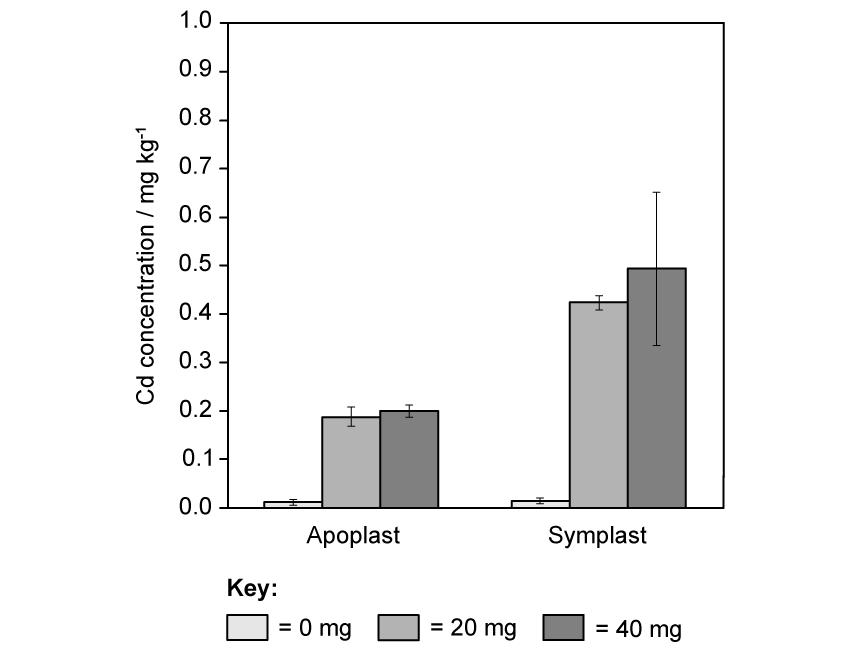

Which of the following statements about the results of the study are correct?

| 1 | The size of the Cd dose does not significantly influence its concentration in plant root pathways |
|---|---|
| 2 | Cd in the symplast pathway is less likely to enter the xylem |
| 3 | After a 40 mg dose of Cd, the heavy metal is approximately 2.5x more likely to be present in the symplast pathway than the apoplast pathway |
| 4 | The soil in which the plants were grow contained Cd in a very low dose |

### Q5 — hard — 1 marks

**Q5** [1 mark]

Which of the following statements indicates that the mass flow of sap in the phloem is an active process?

### Q6 — hard — 1 marks

**Q6** [1 mark]

Which processes occur in the phloem and xylem of plants?

|   | xylem | phloem |   |   |   |   |
|---|---|---|---|---|---|---|
|   | diffusion | mass flow | osmosis | diffusion | mass flow | osmosis |
| **A** | ✓ | ✓ | X | X | ✓ | ✓ |
| **B** | X | ✓ | ✓ | ✓ | ✓ | X |
| **C** | ✓ | ✓ | ✓ | ✓ | ✓ | ✓ |
| **D** | X | X | ✓ | ✓ | ✓ | ✓ |

### Q7 — hard — 1 marks

**Q7** [1 mark]

Which of these statements provides the best evidence that translocation occurs due to pressure-driven mass flow?

### Q8 — hard — 1 marks

**Q8** [1 mark]

All of the scenarios in the table involve the movement of water by either the symplast pathway or the apoplast pathway.

Which pathway is being used in each instance?

|   | water moves between cells via plasmodesmata | water crosses the endodermis in the root | water passes through cell membrane into cytoplasm | water enters cell wall but not the cytoplasm |
|---|---|---|---|---|
| **A** | apoplast | symplast | apoplast | symplast |
| **B** | apoplast | apoplast | symplast | symplast |
| **C** | symplast | symplast | symplast | apoplast |
| **D** | symplast | apoplast | apoplast | apoplast |

### Q9 — hard — 1 marks

**Q9** [1 mark]

This diagram represents part of the phloem in a plant.

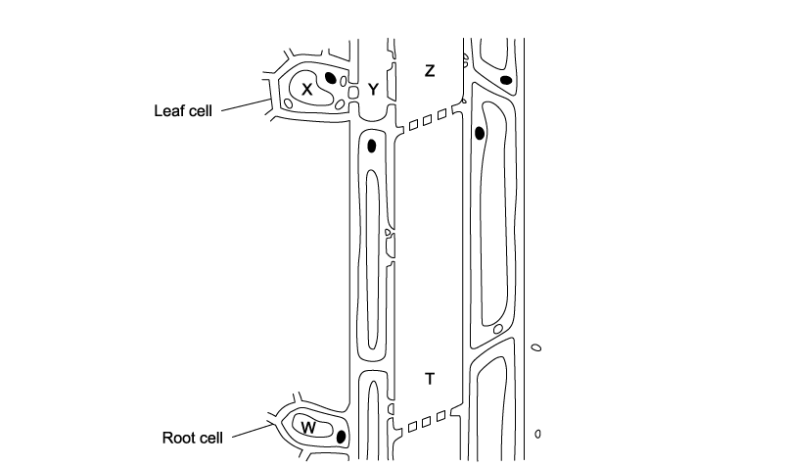

Assuming that the leaf cells are carrying out photosynthesis, which process is occurring at each stage?

|   | between **X **and **Y** | water potential at **Z** | hydrostatic pressure at **T** |
|---|---|---|---|
| **A** | active transport of sucrose | decreases | decreases |
| **B** | active transport of sucrose | increases | increases |
| **C** | passive transport of sucrose | decreases | increases |
| **D** | passive transport of sucrose | increases | decreases |

### Q10 — hard — 1 marks

**Q10** [1 mark]

Which statement best explains why the glucose produced by photosynthesis is converted into sucrose before it is transported in the phloem?

### Q11 — medium — 1 marks

**Q11** [1 mark]

The rate at which water flows through xylem vessels is influenced by numerous external factors.

An increase in which factor would reduce the flow of water in the xylem?

### Q12 — medium — 1 marks

**Q12** [1 mark]

Which statements about the uptake and transport of water in plants are correct?

| 1 | Water is transported in xylem via the symplast and apoplast pathways to reach the leaves |
|---|---|
| 2 | Water transported by the symplast pathway enters root hair cells down a water potential gradient |
| 3 | Water absorbed in the root must always pass through the symplast pathway on its way to the xylem |
| 4 | Water transported by the apoplast pathway through plasmodesmata must pass through cell surface membranes of endodermal cells |

### Q13 — medium — 1 marks

**Q13** [1 mark]

Water absorbed by a root hair cell can travel via different pathways to reach the xylem.

Which of the following best describes the route taken by water as it crosses the root?

|   | **apoplast pathway** | **symplast pathway** |
|---|---|---|
| **A** | always | sometimes |
| **B** | always | always |
| **C** | sometimes | always |
| **D** | sometimes | sometimes |

### Q14 — medium — 1 marks

**Q14** [1 mark]

Which of the following correctly explains why the circumference of a tree trunk is larger at night than in the middle of the day?

### Q15 — medium — 1 marks

**Q15** [1 mark]

Sucrose and other products of photosynthesis can move both up and down the plant stem at the same time.

Which statement is the most likely description of how this occurs?

### Q16 — medium — 1 marks

**Q16** [1 mark]

Which of the following properties of water does **not** directly explain the movement of water in the xylem vessels?

### Q17 — medium — 1 marks

**Q17** [1 mark]

This diagram represents part of the phloem in a plant.

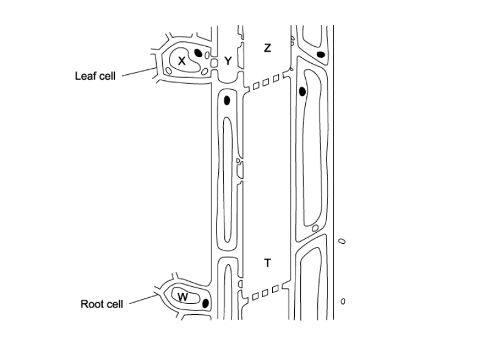

Which statement about phloem transport** **is correct?

### Q18 — medium — 1 marks

**Q18** [1 mark]

Which of the following statements about water uptake in plant roots are correct?

| 1 | Water moves down its water potential gradient into root hair cells |
|---|---|
| 2 | Inhibiting respiration in root hair cells can impair the uptake of water |
| 3 | Water uptake is the main driving force for the transpiration stream |

### Q19 — medium — 1 marks

**Q19** [1 mark]

This diagram shows a transverse section of *Ammophila arenaria*, also known as marram grass.

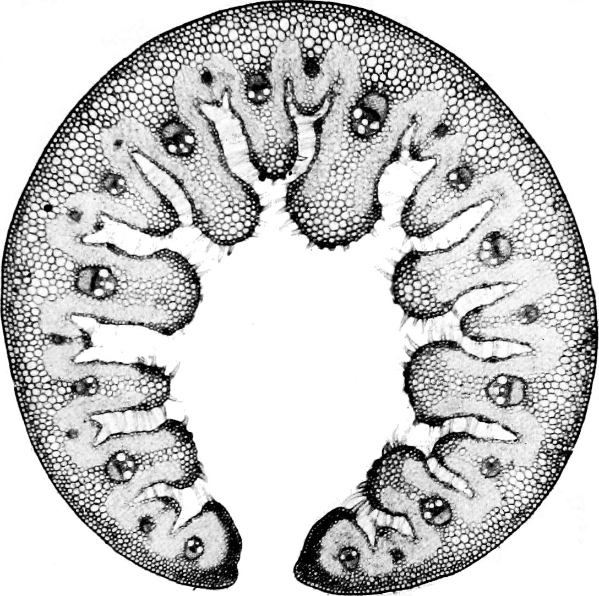

*Public domain, via **[Flickr](https://www.flickr.com/photos/internetarchivebookimages/20786617601)*

Which of the following statements correctly describes xerophytic adaptations of marram grass that are visible in the image?

| 1 | Hairs reduce the water vapour concentration gradient |
|---|---|
| 2 | Stomata in pits allow water vapour to be trapped |
| 3 | Dense spongy mesophyll reduces evaporation into the air spaces |
| 4 | Water loss by evaporation is reduced by the rolled leaf shape |

### Q20 — medium — 1 marks

**Q20** [1 mark]

Which of the statements about water transport in plants is correct?

### Q21 — easy — 1 marks

**Q21** [1 mark]

The diagram shows several pathways that could be taken by water.

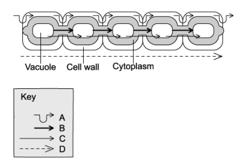

Which of pathways **A**-**D** shows the apoplast pathway?

### Q22 — easy — 1 marks

**Q22** [1 mark]

During high tides and stormy weather, some areas of coastal land may become flooded by sea water.

Why might land flooded in this way not be suitable for growing plants even after the floods have receded?

### Q23 — easy — 1 marks

**Q23** [1 mark]

Which of the following describes the location from which most water evaporates during transpiration?

### Q24 — easy — 1 marks

**Q24** [1 mark]

Which of the following does **not** correctly explain the movement of water in the xylem of plants?

### Q25 — easy — 1 marks

**Q25** [1 mark]

The diagram represents part of the phloem.

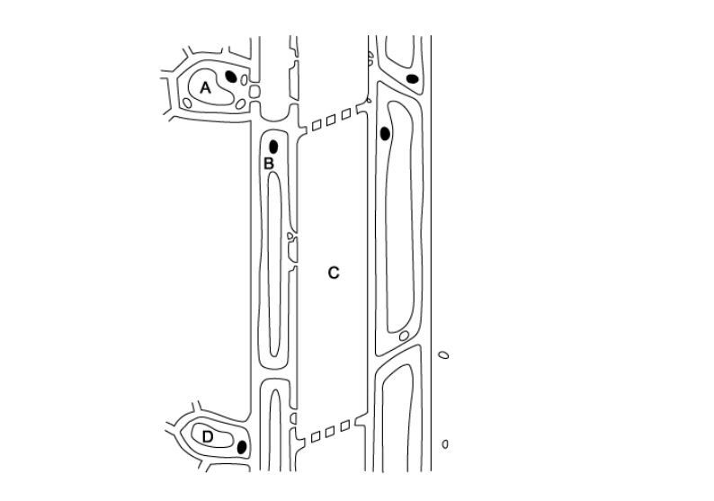

Which of the cells labelled **A**-**D** is a companion cell?

### Q26 — easy — 1 marks

**Q26** [1 mark]

Which statements about the Casparian strip are correct?

| 1 | it is a band of waxy material that is located in the root cortex |
|---|---|
| 2 | it blocks the apoplast pathway |
| 3 | it allows control over the substances entering the xylem |

### Q27 — easy — 1 marks

**Q27** [1 mark]

Which of the following plant transport processes requires ATP?

### Q28 — easy — 1 marks

**Q28** [1 mark]

Which of the following statements about phloem transport are correct?

| 1 | phloem transport involves carbohydrates in the form of sucrose |
|---|---|
| 2 | locations of sources and sinks change at different times of year |
| 3 | phloem loading is a passive process |
| 4 | phloem assimilates include amino acids from photosynthesis and nitrates from the soil |

### Q29 — easy — 1 marks

**Q29** [1 mark]

Which xerophytic adaptation does **not** directly reduce water loss?

### Q30 — easy — 1 marks

**Q30** [1 mark]

Which row correctly identifies the changes in water potential and hydrostatic pressure that occur in the phloem** **after sucrose loading?

|   | **water potential** | **hydrostatic pressure** |
|---|---|---|
| **A** | increases | decreases |
| **B** | increases | increases |
| **C** | decreases | increases |
| **D** | decreases | decreases |

## Structured Questions (13 questions)

### Q1 — hard — 19 marks

**Q1** [8 marks]

Fig. 1 shows apparatus that can be used to measure the loss of water vapour from leaves.

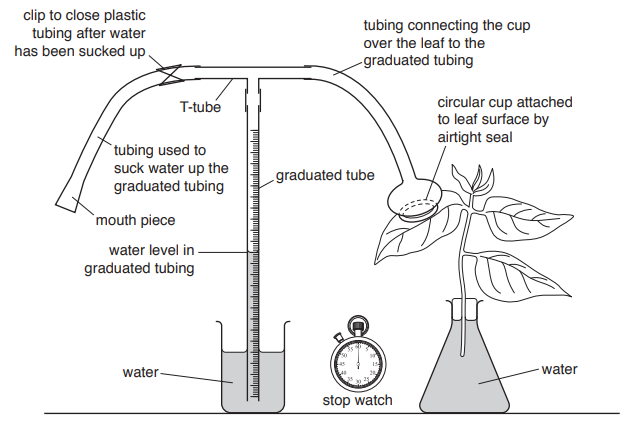

**Fig. 1**

The water vapour given out by the area of leaf under the cup increases the pressure inside the tubing, causing the water level in the graduated tube to go down.

Some students used the apparatus in Fig. 1 to test the hypothesis:

The loss of water vapour from the lower surface of the leaves of a plant is greater per unit time than the loss of water vapour from the upper surface of the leaves of the same plant.

(i) State the independent variable **and** the dependent variable in this investigation.

[2]

(ii) Describe a method by which the students could use the apparatus shown in Fig. 1 to measure loss of water vapour in order to test the hypothesis.

Your method should be set out in a logical order and be detailed enough to let another person follow it.

[6]

*Source: Oct/Nov 2018 Series 2 9700/52 Q1AI, AII*

**Q1** [8 marks]

**Extract:**

Fig. 1 shows apparatus that can be used to measure the loss of water vapour from leaves.

Fig. 1

The water vapour given out by the area of leaf under the cup increases the pressure inside the tubing, causing the water level in the graduated tube to go down.

Some students used the apparatus in Fig. 1 to test the hypothesis:

The loss of water vapour from the lower surface of the leaves of a plant is greater per unit time than the loss of water vapour from the upper surface of the leaves of the same plant.

The hypothesis that the students tested was:

The loss of water vapour from the lower surface of the leaves of a plant is greater per unit time than the loss of water vapour from the upper surface of the leaves of the same plant.

The students decided that, to make a valid comparison, they needed to work out the water loss per unit time per unit area of leaf.

(i) Describe how the students obtained the measurement needed to work out the results as **per unit area** of leaf.

[2]

(ii) Describe how the students could use this measurement and their results for the loss of water vapour to find out if their results support the hypothesis.

[3]

(iii) Sketch a bar chart on Fig. 2 to show the results if the hypothesis was supported. You should include the axis labels and the units.

[3]

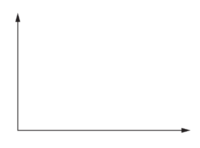

**                                                 Fig. 2**

*Source: Oct/Nov 2018 Series 2 9700/52 Q1B(I,II,III)*

**Q1** [3 marks]

The apparatus shown in Fig. 1 was used in another series of experiments to measure water vapour loss from the same leaf in different experimental conditions for the same period of time.

Table 1 shows the results.

**Table 1**

| **experimental condition** | **distance moved by water column** **/ cm per unit time** |   |   |   |   |
|---|---|---|---|---|---|
| **trial 1** | **trial 2** | **trial 3** | **trial 4** | **trial 5** |   |
| high light intensity | 7.3 | 7.5 | 7.8 | 6.2 | 7.0 |
| no light | 0.0 | 0.0 | 1.5 | 0.2 | 0.0 |
| high temperature | 4.4 | 2.8 | 3.2 | 4.8 | 3.1 |
| strong air current | 1.5 | 2.4 | 1.1 | 0.9 | 1.0 |

(i) **On Table 1**, draw circles around **two** of the values that may be anomalous.

[2]

(ii) The aperture of stomata affects the loss of water vapour.

State** one** conclusion that can be made about the effect of experimental conditions on the aperture of stomata in this plant.

[1]

*Source: Oct/Nov 2018 Series 2 9700/52 Q1CI, CII*

### Q2 — hard — 14 marks

**Q2** [4 marks]

Fig. 1 shows a cross-section through a needle taken from a pine tree.

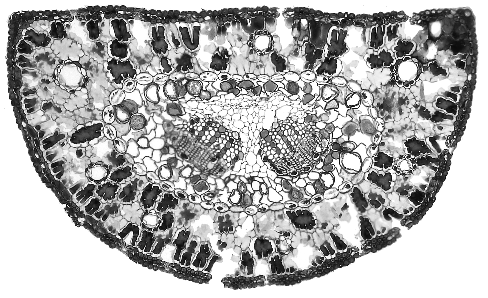

*Public domain, via **[Flickr](https://www.flickr.com/photos/146824358@N03/36363882171/in/photostream/)*

**Fig. 1**

Explain **two** features that indicate that pine trees are xerophytic plants.

**Q2** [4 marks]

**Extract:**

Fig. 1 shows a cross-section through a needle taken from a pine tree.

Fig. 2 shows an enlarged section taken from Fig. 1.

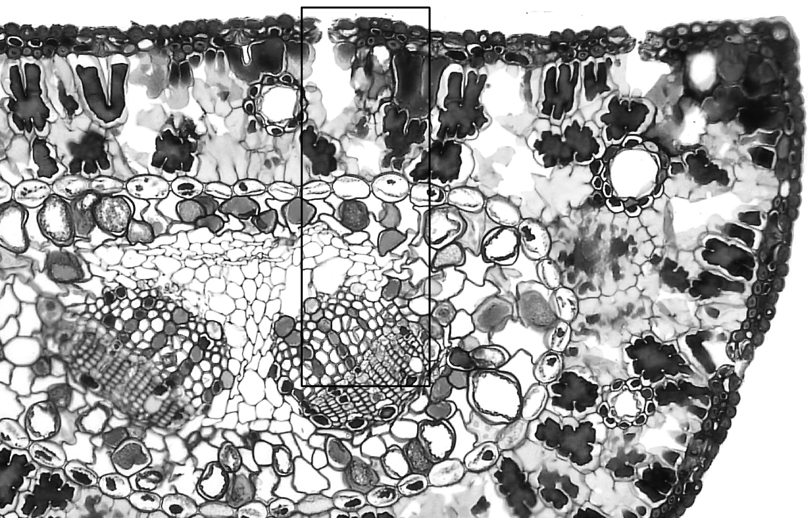

*Public domain, via**[ Flickr](https://www.flickr.com/photos/146824358@N03/36363882171/in/photostream/)*

**Fig. 2**

Make an annotated biological drawing of the area indicated by the black box

**Q2** [6 marks]

'Translocation in the phloem can be regarded as the plant equivalent of mammalian circulation'

Evaluate this statement.

### Q3 — hard — 12 marks

**Q3** [2 marks]

A study investigated the sucrose levels in a courgette leaf during leaf development. The results of the study can be seen in Fig. 1.

**Fig. 1**

(i) State the days during which the courgette leaf functions as a sink.

[1]

(ii) State the days during which the courgette leaf could function as a source.

[1]

**Q3** [2 marks]

**Extract:**

A study investigated the sucrose levels in a courgette leaf during leaf development. The results of the study can be seen in Fig. 1.

Fig. 1

(i) State the days during which the courgette leaf functions as a sink.

(ii) State the days during which the courgette leaf could function as a source.

Use the information in Fig. 1 to explain why the leaf is able to transition from being a sink to a source.

**Q3** [5 marks]

Sucrose is transported from sources to sinks in specialised vascular tissue. Fig. 2 shows the vascular tissue used for the transport of sucrose in plants.

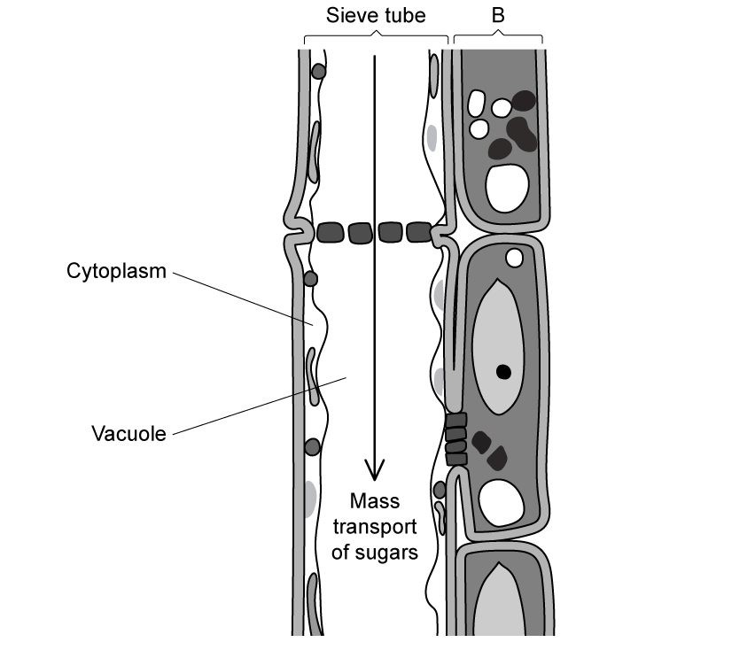

**Fig. 2**

Tissue **B** in Fig. 2 contains many mitochondria.

Explain how this assists in the loading of sucrose into the sieve tube.

**Q3** [3 marks]

**Extract:**

Sucrose is transported from sources to sinks in specialised vascular tissue. Fig. 2 shows the vascular tissue used for the transport of sucrose in plants.

Tissue **B** in Fig. 2 contains many mitochondria.

Explain how this assists in the loading of sucrose into the sieve tube.

Mitochondria aid the loading of sucrose into the sieve tube as follows:

- (Mitochondria are) the site of ATP production (during aerobic respiration);
- ATP powers H^+^/proton pumps in the walls of the sieve tube;
- H^+^ ions are pumped from the companion cell/**B** into the cell walls (creating a H^+^ ion diffusion gradient);
- The H^+^ ions diffuse back into the companion cell via cotransporter proteins;
- Cotransporter proteins transport sucrose molecules into the companion cell against the (sucrose) concentration gradient;
- Sucrose moves into the sieve tube by diffusion / down the (sucrose) concentration gradient;

Explain how the process in part (c) enables mass flow of sucrose in the sieve tube.

### Q4 — hard — 11 marks

**Q4** [3 marks]

Fig. 1 shows a cross-section across the root of a dicotyledonous plant.

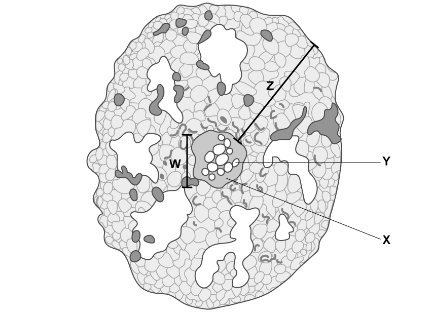

**Fig. 1**

Identify the tissues marked **W, X,** and **Y **in Fig. 1.

**Q4** [2 marks]

Structure **Z** in Fig. 1 is known as the root cortex. Water travels across the cortex from the outside of the root to the central structure by several different routes, one of which involves the passage of water through plasmodesmata.

One factor that influences the permeability of plasmodesmata is the quantity of a carbohydrate called callose that accumulates in the cell walls surrounding plasmodesmata.

The location of callose in plasmodesmata can be seen in Fig. 2.

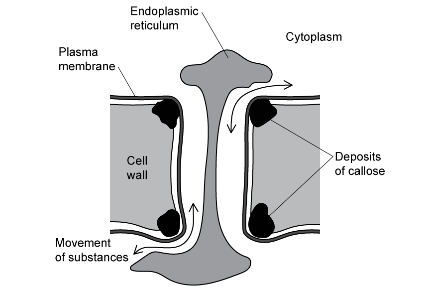

**Fig. 2**

Suggest how increasing the deposition of callose might influence the permeability of plasmodesmata.

**Q4** [3 marks]

**Extract:**

Structure Z in Fig. 1 is known as the root cortex. Water travels across the cortex from the outside of the root to the central structure by several different routes, one of which involves the passage of water through plasmodesmata.

One factor that influences the permeability of plasmodesmata is the quantity of a carbohydrate called callose that accumulates in the cell walls surrounding plasmodesmata.

The location of callose in plasmodesmata can be seen in Fig. 2.

Research suggests that the presence of heavy metals such as lead in the soil influences the activity of an enzyme called callose synthase, the role of which is to produce callose. For some plants, the presence of heavy metals in the soil reduces their ability to take up water from the soil.

Suggest how the presence of lead in soil might reduce the ability of a plant to take up water from the soil by the route described in part (b).

**Q4** [3 marks]

**Extract:**

Structure Z in Fig. 1 is known as the root cortex. Water travels across the cortex from the outside of the root to the central structure by several different routes, one of which involves the passage of water through plasmodesmata.

Parts (b) and (c) above refer to the movement of water across the cortex via the plasmodesmata.

Describe another pathway by which water can move across the root cortex from the outside of the root towards the centre.

### Q5 — medium — 15 marks

**Q5** [5 marks]

Transpiration in plants can be investigated using a potometer, which measures water uptake by plants. Fig. 1 shows a potometer that was used by a student.

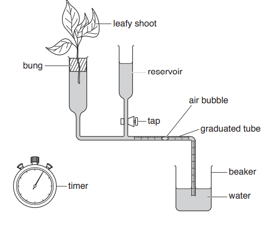

**Fig. 1**

As water is lost by the leaves through transpiration, the air bubble moves along the graduated tube.

The student used this apparatus to investigate the effect of light intensity on the rate of transpiration in plants.

(i) State the independent variable **and** the dependent variable in this investigation.

[2]

(ii) List **three** variables that should be controlled in this investigation **and** describe how the student could standardise **two** of these variables.

[3]

*Source: Oct/Nov 2018 9700/51 Q1A*

**Q5** [6 marks]

**Extract:**

Transpiration in plants can be investigated using a potometer, which measures water uptake by plants. Fig. 1 shows a potometer that was used by a student.

**Fig. 1**

As water is lost by the leaves through transpiration, the air bubble moves along the graduated tube.

The student used this apparatus to investigate the effect of light intensity on the rate of transpiration in plants.

Describe how the student could set up and use the potometer shown in Fig. 1 to investigate the rate of transpiration at different light intensities.

Your method should be set out in a logical way and be detailed enough to let another person follow it.

*Source: Oct/Nov 2018 9700/51 Q1B*

**Q5** [4 marks]

The student carried out further experiments, using the same apparatus, to investigate the effect of two different environmental carbon dioxide concentrations on the rate of transpiration.

These experiments were carried out at a high light intensity and at a low light intensity.

The leafy shoots used in the experiments were taken from the same plant and each shoot had five leaves.

The student calculated the percentage reduction in the transpiration rate from 50 ppm to 730 ppm of carbon dioxide at low light intensities.

The results are shown in Table 1.

ppm = parts per million

**Table 1**

| **concentration of** **carbon dioxide** **/ppm** | **light intensity** | **transpiration rate / g dm****-3**** hr****-1** | **percentage reduction in** **transpiration rate from 50 ppm** **to 730 ppm of carbon dioxide** |
|---|---|---|---|
| 50 | low | 1.28 | 36.7 |
| 730 | low | 0.81 |   |
| 50 | high | 3.03 |   |
| 730 | high | 2.12 |   |

(i) Complete Table 1 by calculating the percentage reduction in transpiration rate from 50 ppm to 730 ppm of carbon dioxide at the **high light intensity.**

Show your working.

[2]

(ii) The student concluded that, as carbon dioxide concentration increased, the transpiration rate in plants decreased at all light intensities.

Explain why this conclusion may not be valid.

[2]

*Source: Oct/Nov 2018 9700/51 Q1C*

### Q6 — medium — 11 marks

**Q6** [2 marks]

Fig. 1 shows the movement of water through part of a leaf.

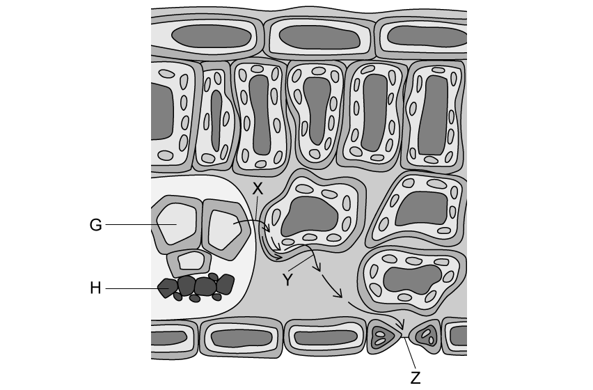

**Fig. 1**

Identify the processes labelled **X **and **Y** in Fig. 1.

**Q6** [4 marks]

**Extract:**

Fig. 1 shows the movement of water through part of a leaf.

The process labelled **Z** in Fig. 1 is transpiration.

Explain how the process of transpiration enables water to be drawn up the stem from the roots.

**Q6** [3 marks]

**Extract:**

Fig. 1 shows the movement of water through part of a leaf.

The process labelled Z in Fig. 1 is transpiration.

(i) Identify which of cell types, **G** or **H**, in Fig. 1 is involved in the process of transpiration.

[1]

(ii) State **and** explain one structural feature of the cell type given in part (i) that aids transpiration.

[2]

**Q6** [2 marks]

The process of transpiration causes water loss in plants, yet it is an unavoidable plant process.

Explain why this is the case.

### Q7 — medium — 6 marks

**Q7** [4 marks]

Fig. 1 is a diagram of a section through part of a young root.

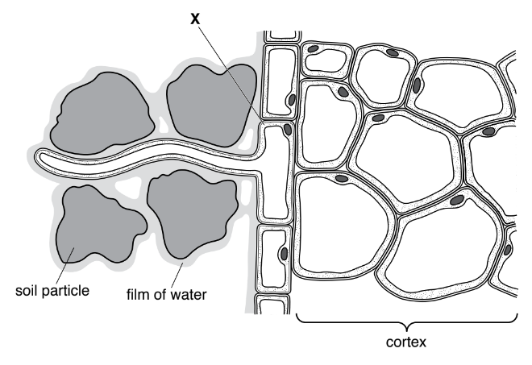

**Fig. 1**

Describe the pathways by which water passes from the soil to the cells of the cortex shown in Fig. 1.

*Source: Specimen 2022 9700/02 Q4A*

**Q7** [2 marks]

**Extract:**

Fig. 1 is a diagram of a section through part of a young root.

Fig. 1 shows the location where mineral ions in the soil enter the plant.

There is a greater density of mitochondria in cell **X** than in a cell of the root cortex.

With reference to the uptake and transport of mineral ions, suggest why there is a greater density of mitochondria in cell **X** than in a cell of the root cortex.

*Source: Specimen 2022 9700/02 Q4B*

### Q8 — medium — 12 marks

**Q8** [2 marks]

An investigation was carried out into mass change in two sets of leaves over a 3-hour period. The two sets of leaves, set **X** and set **Y, **were removed from two different species of plant and were suspended from a wire throughout the investigation. The mass of the leaves was measured every 30 minutes.

The results of the investigation are shown in Fig. 1 below.

**Fig. 1**

The starting mean mass of the leaves in set **X** in Fig. 1 was 0.1 g. After 90 minutes the mean mass was 0.096 g.

Calculate the percentage change in mass.

**Q8** [3 marks]

**Extract:**

An investigation was carried out into mass change in two sets of leaves over a 3-hour period. The two sets of leaves, set **X** and set **Y**, were removed from two different species of plant and were suspended from a wire throughout the investigation. The mass of the leaves was measured every 30 minutes.

The results of the investigation are shown in Fig. 1 below.

**Fig. 1**

Explain the change in mass of the leaves in set **X**.

**Q8** [3 marks]

**Extract:**

An investigation was carried out into mass change in two sets of leaves over a 3-hour period. The two sets of leaves, set X and set Y, were removed from two different species of plant and were suspended from a wire throughout the investigation. The mass of the leaves was measured every 30 minutes.

The results of the investigation are shown in Fig. 1 below.

Fig. 1

Fig. 2 shows images of light micrographs of a leaf from set **X** and a leaf from set **Y.**

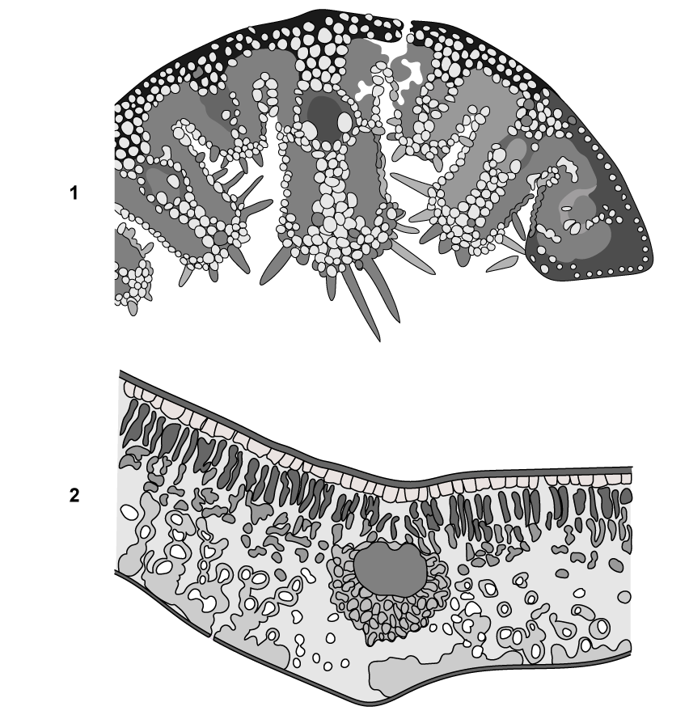

**Fig. 2**

(i) Identify the leaf that comes from set **Y**.

[1]

(ii) Explain your choice from part (i).

[2]

**Q8** [4 marks]

**Extract:**

Fig. 2 shows images of light micrographs of a leaf from set X and a leaf from set Y.

(i) Identify the leaf that comes from set Y.

(ii) Explain your choice from part (i).

Mark scheme:
(i) The leaf that comes from set Y is:
- (Leaf) 1; [1 mark]

(ii) The reason for this is that:
- (Leaf 1 has) sunken stomata / hairs (around stomata) / curled leaf shape; [1 mark]
- Water vapour is trapped in the pit / area around stomata / within the leaf SO reducing the concentration gradient / water vapour gradient / rate of diffusion of water vapour; [1 mark]

Xerophytic plants have adaptations to reduce water loss.

**Other than** those relevant to part (c), state and explain **two** structural leaf adaptations that reduce water loss.

### Q9 — medium — 12 marks

**Q9** [4 marks]

Fig. 1 shows a micrograph image of the lower epidermis of a leaf.

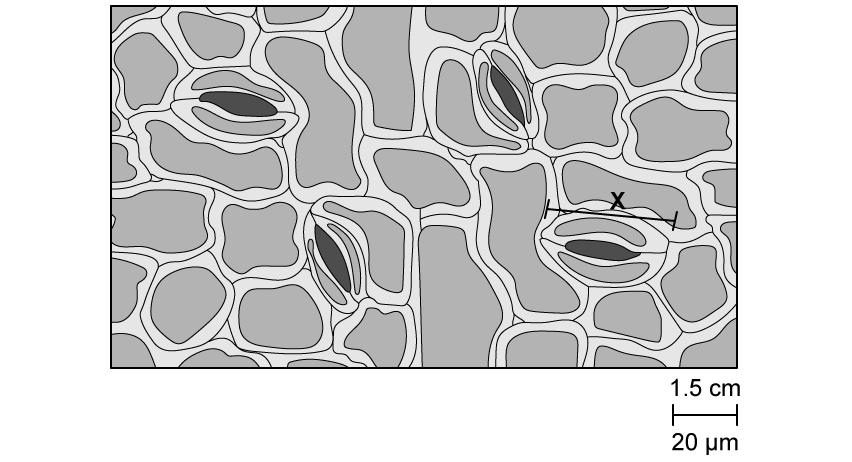

**Fig. 1**

(i) Use the scale bar in Fig. 1 to calculate the magnification of the micrograph image.

[2]

(ii) Use the answer to part (i) to calculate the actual length of a guard cell, represented by the line marked **X**. The length of the line marked **X** in the image is 4.2 cm.

[2]

**Q9** [2 marks]

The guard cell marked **X** in Fig. 1 surrounds a single stoma, plural stomata.

Describe the process of water loss that occurs at the stomata.

**Q9** [4 marks]

**Extract:**

The guard cell marked X in Fig. 1 surrounds a single stoma, plural stomata.

Describe the process of water loss that occurs at the stomata.

One way of measuring the rate at which the process described in part (b) is taking place in a tree is to observe the diameter of the tree trunk.

Fig. 2 below shows the results of an experiment in which tree trunk diameter was measured, along with light intensity and temperature, during the course of a 24 hour period.

**Fig. 2**

Explain the changes in trunk diameter shown in Fig. 2 throughout the 24 hour period.

**Q9** [2 marks]

**Extract:**

The guard cell marked X in Fig. 1 surrounds a single stoma, plural stomata.

Describe the process of water loss that occurs at the stomata.

The process of water loss that occurs at the stomata is:
- The movement / loss of water vapour from the inside to the outside of the leaf
- Water vapour moves by diffusion / from a high to low concentration / down its concentration gradient / down a water (vapour) potential gradient
- Known as transpiration

The concentration of water vapour in the air, known as humidity, can also influence the rate at which the process described in part (b) can occur.

State **and** explain the impact that increased humidity would have on the process described in part (b).

### Q10 — easy — 10 marks

**Q10** [1 mark]

Fig. 1 shows a cross section through a leaf.

**Fig. 1**

Identify the substance which is represented by the arrows in Fig. 1.

**Q10** [3 marks]

**Extract:**

Fig. 1 shows a cross section through a leaf.

**Fig. 1**

Identify the substance which is represented by the arrows in Fig. 1.

The substance represented by the arrows in Fig. 1 is:

- Water / H~2~O;

Draw three lines to correctly identify the methods of movement shown in Fig. 1.

**Q10** [3 marks]

**Extract:**

Fig. 1 shows a cross section through a leaf.

(i) Identify the letter from Fig. 1 that represents the xylem.

[1]

(ii) State **two** structural features of the xylem which makes it suitable for its function.

[2]

**Q10** [3 marks]

Fig. 2 below shows a cactus plant, an example of a xerophyte.

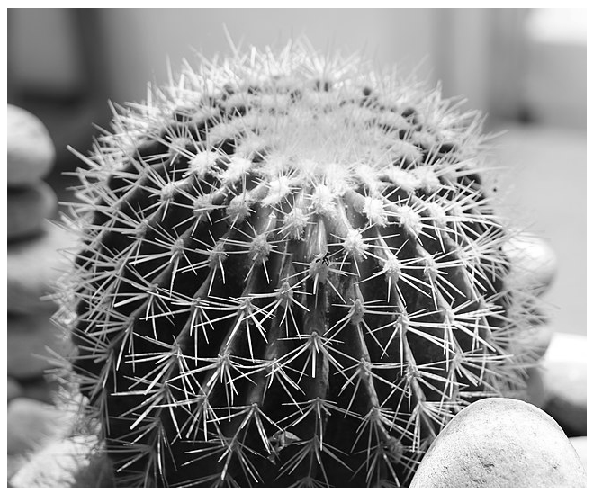

*Nabin K. Sapkota, CC BY-SA 4.0, via **[Wikimedia Commons](https://commons.wikimedia.org/wiki/File:Cactus_%282019%29_25.jpg)*

**Fig. 2**

(i) Define the term **xerophyte**.

[1]

(ii) Explain one feature, **visible in Fig. 2**, that enables the cactus to be a xerophyte.

[2]

### Q11 — easy — 8 marks

**Q11** [3 marks]

Fig. 1 shows the movement of water through the cells in the root.

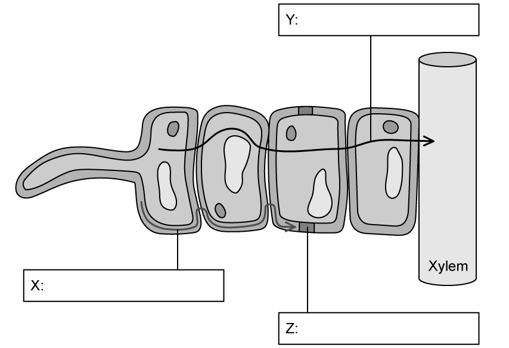

**Fig. 1**

Identify **X**, **Y** and **Z** in Fig. 1 above.

**Q11** [2 marks]

**Extract:**

Fig. 1 shows the movement of water through the cells in the root.

Identify X, Y and Z in Fig. 1 above.

X = apoplast pathway
Y = symplast pathway
Z = Casparian strip

Explain the effect that **Z** in Fig. 1 has on the movement of water through the root.

**Q11** [1 mark]

Movement of water into the root occurs by osmosis.

State how plant roots ensure that there is a water potential gradient between the surrounding soil and the cells of the root.

**Q11** [2 marks]

The movement of water across a plant root, as shown in Fig. 1, generates root pressure. Root pressure plays a role in establishing and maintaining the transpiration stream of a plant.

**Other than root pressure**, explain how the transpiration stream of a plant is maintained.

### Q12 — easy — 11 marks

**Q12** [3 marks]

The statements below each describe a xerophytic adaptation found in some plants.

Explain each of the adaptations given.

(i) Marram grass leaves roll up when water supply becomes limited

[1]

(ii) Sedum plants have stomata that are closed during the day and open at night

[1]

(iii) Holly leaves have thick waxy cuticles

[1]

**Q12** [4 marks]

Fig. 1 contains microscope images of transverse sections though a xerophyte leaf (**A**) and a non-xerophyte leaf (**B**).

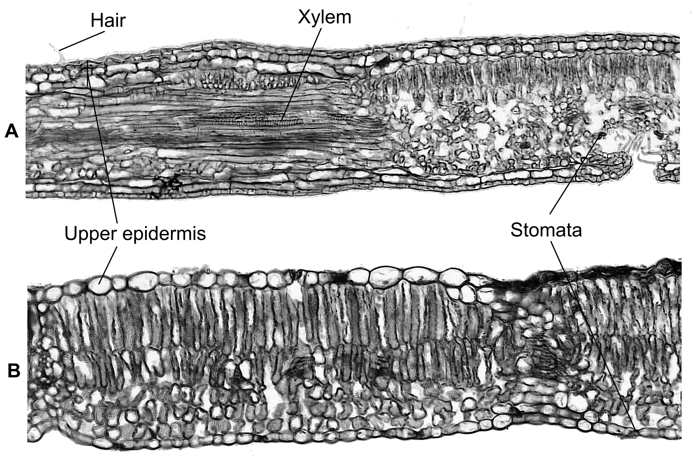

*Public domain, via **[Flickr](https://www.flickr.com/photos/146824358@N03/34381760970)*

**Fig. 1**

(i) State how the stomata in leaf **A** differ from the stomata in leaf **B**.

[1]

(ii) Explain how the difference observed in part (i) functions as a xerophytic adaptation in leaf **A**.

[1]

(iii) Identify **two** other structural differences between leaf **A** and leaf **B**.

[2]

**Q12** [1 mark]

**Extract:**

Fig. 1 contains microscope images of transverse sections though a xerophyte leaf (A) and a non-xerophyte leaf (B).

Xylem vessels are clearly visible in leaf **A** in Fig. 1.

Identify a feature visible in Fig. 1 that allows the xylem to be identified.

**Q12** [3 marks]

**Extract:**

Fig. 1 contains microscope images of transverse sections though a xerophyte leaf (A) and a non-xerophyte leaf (B).

Fig. 2 shows an enlarged section from part of Fig. 1.

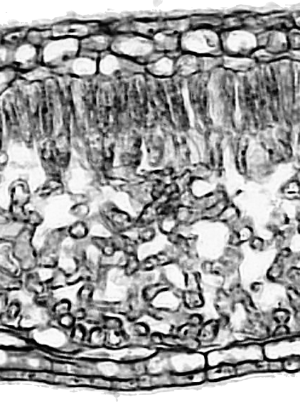

*Public domain, via **[Flickr](https://www.flickr.com/photos/146824358@N03/34381760970)*

**Fig. 2**

State the leaf features that would be visible on a tissue plan drawing of Fig. 2.

[3]

### Q13 — easy — 11 marks

**Q13** [4 marks]

The following sentences relate to the mechanism of sugar transport in plants.

Identify the words that should be used to complete the sentences.

............... is actively transported into the phloem by a group of specialised cells.

The increased solute concentration causes the water potential of the phloem to ..............., causing water to enter by ............... .

The movement of water into the phloem increases the ............... pressure at the source, resulting in a ............... gradient in the phloem between the source and the sink.

Sugars move by mass flow towards the sink, where they are ............... .

**Q13** [1 mark]

Fig. 1 shows a cross section of phloem tissue in a plant.

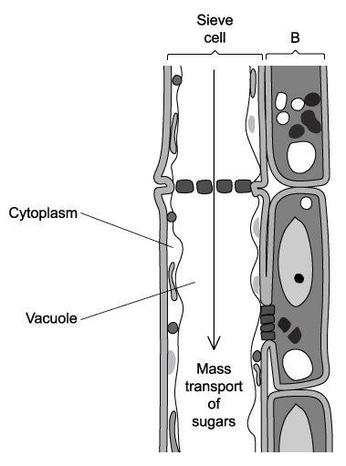

**Fig. 1**

Identify the structure labelled **B** in Fig. 1.

**Q13** [4 marks]

**Extract:**

Fig. 1 shows a cross section of phloem tissue in a plant.

Identify the structure labelled B in Fig. 1.

Structure B is a:
- Companion cell

Structure **B** in Fig. 1 is involved with the loading of sugars into the phloem sieve tubes.

Describe the role of the following membrane proteins in the loading of sugars into the sieve tubes.

(i) Proton pumps

[2]

(ii) Cotransporter proteins

[2]

**Q13** [2 marks]

**Extract:**

Sucrose is actively transported into the phloem by a group of specialised cells.

The increased solute concentration causes the water potential of the phloem to decrease, causing water to enter by osmosis.

The movement of water into the phloem increases the turgor/hydrostatic pressure at the source, resulting in a pressure gradient in the phloem between the source and the sink.

Sugars move by mass flow towards the sink, where they are unloaded / stored / used in respiration.

The locations of sources and sinks for sugar transport do not remain constant throughout the year in a growing plant.

Suggest a possible location for the following during early spring while a plant is producing new leaf buds.

(i) Source

[1]

(ii) Sink

[1]
