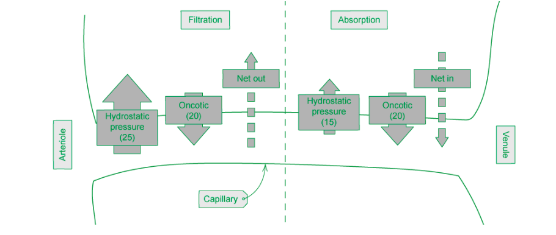
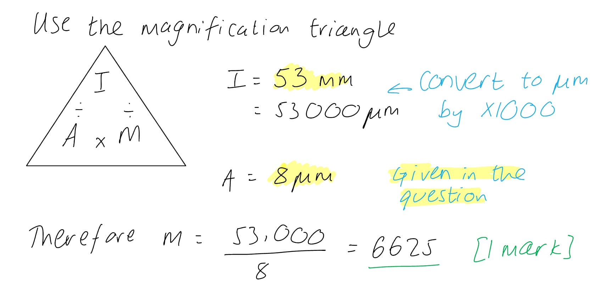
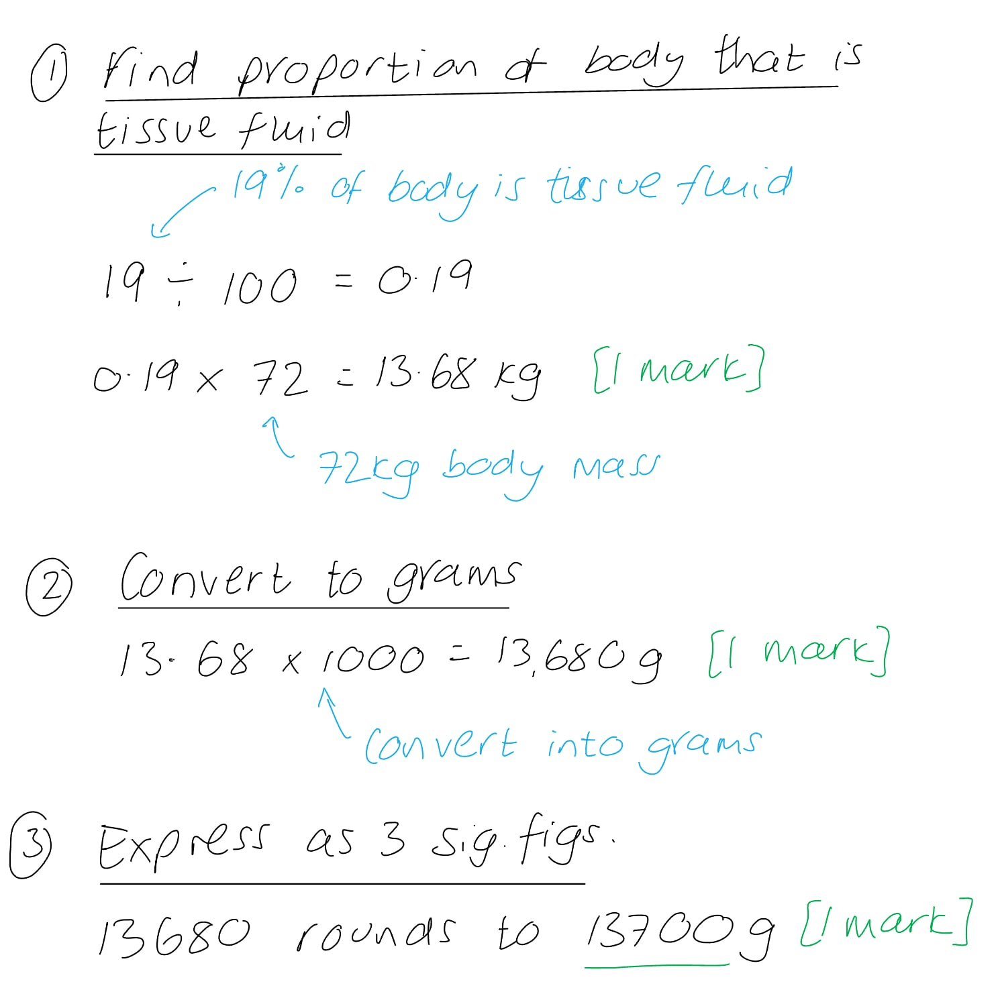
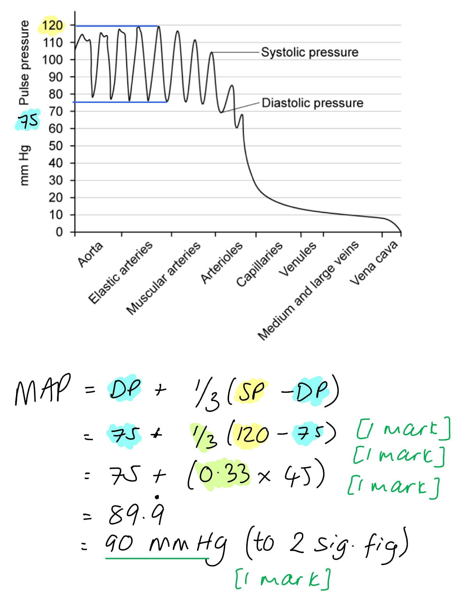
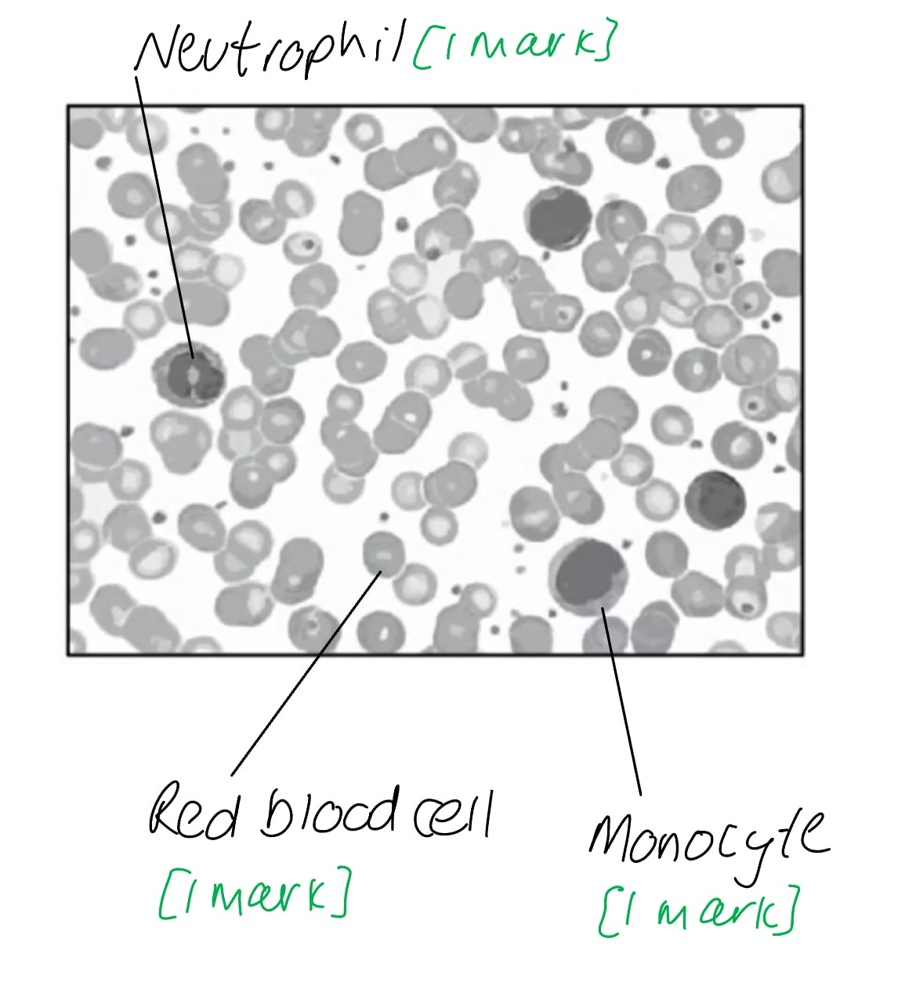
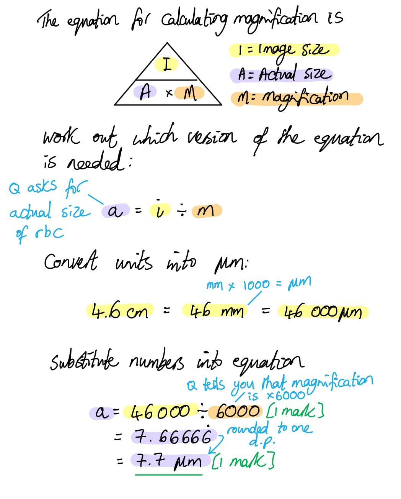
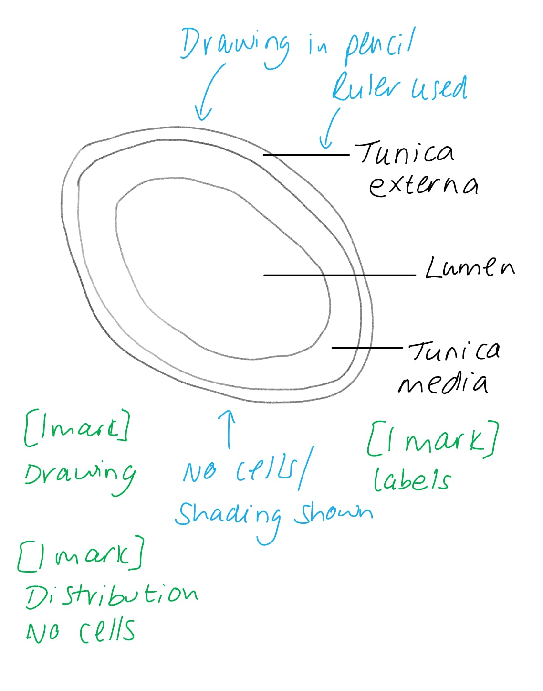
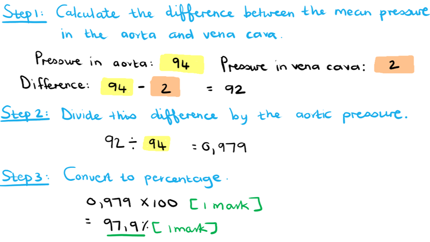

# Mark Schemes — The Circulatory System
**8. Transport in Mammals** · Cambridge (CIE) A-LEVEL biology (9700)

## Multiple Choice Questions (30 questions)

### Q1
**Final answer:** **The correct answer is ****A**** because:**

- **As water has a high specific heat capacity large amounts of energy are required to change its temperature, making it ****thermally stable ****and able to absorb large amounts of heat energy from respiring tissues without huge fluctuations in temperature (the blood is vital in distributing heat around the body)**
- **Water is a ****polar**** molecule meaning that many substances will ****dissolve ****in it, this is why it is known as the ‘universal-solvent’**

> *B, C **&** D** are incorrect as specific latent heat capacity relates to the energy required to freeze or boil water. *

### Q2
**Final answer:** **The correct answer is ****D**** because:**

- **The ****vena cava**** carries ****deoxygenated blood**** from the body into the heart’s ****right atrium**
- **The heart pumps this blood into the ****pulmonary artery**** towards the ****lungs**** where gas exchange takes place**
- **Newly ****oxygenated blood**** is then transported by the ****pulmonary vein**** into the ****left atrium**** of the heart**
- **The heart pumps this blood through the ****aorta**** at ****high pressure**** across the body to provide cells with oxygenated blood**
- **V****e****i****n****s carry to ****in****to the heart, ****a****rteries carry blood ****a****way from the heart**

### Q3
**Final answer:** **The correct answer is ****C**** because:**

- **Differentiation from a myeloblast to a neutrophil refers to changes in the cell that allow it to perform its function: **

  - **The nucleus becomes smaller and lobed, it produces membrane proteins and secretes plasma proteins **
- **Mutation refers to changes to the base sequence of DNA which can lead to incorrect protein production and loss of function/uncontrolled cell division. This does not occur in healthy neutrophils.**

> *A** is incorrect because during maturation, red blood cells selectively destroy organelles such as the nucleus, endoplasmic reticulum or mitochondria to allow more haemoglobin to be stored for oxygen transport. *

> *B** is incorrect as erythrocytes develop large numbers of ribosomes early in their differentiation to produce large amounts of haemoglobin before the nucleus is destroyed.*

> *D** is incorrect as erythrocytes and neutrophils are both derived from hemocytoblasts, multipotent stem cells that produce all blood cells.*

> * *

### Q4
**Final answer:** **The correct answer is ****B**** because:**

- **Hydrostatic**** ****pressure**** refers to the amount of pressure that a fluid (blood) exerts in a confined space (blood vessel) whereas oncotic pressure is related to water potential and is a form of pressure exerted by plasma proteins**
- **Capillary walls are formed from a single layer of endothelial cells which have pores inbetween them that allow fluid to move out of the circulatory system**
- **At the ****arterial**** ****end**** of capillaries ****hydrostatic**** ****pressure**** of the blood is ****greater**** ****than**** the ****oncotic**** ****pressure**** so fluid is pushed out of the blood into the surrounding tissue to form tissue fluid**

> *A** is incorrect as solute potential in the capillary is negative because there are many solutes in the blood. Osmotic pressure is the pressure applied by a solution to stop the flow of water across a membrane.*

> *C** is incorrect as if the oncotic pressure was higher than the hydrostatic pressure, fluid from the tissue would be absorbed into the blood.*

> *D** is incorrect as osmosis refers to the overall movement of water and is not a pressure.*

### Q5
**Final answer:** **The correct answer is ****B**** because:**

- **Daphnia magna**** has one heart which will contain a single ventricle and atrium and therefore is a single circulatory system**
- **The blood is pumped around the body cavity rather than through blood vessels so is an open system**

> *A** is incorrect as the **Daphnia magna** do not have blood vessels and therefore is not a closed system*

> *C** is incorrect as the **Daphnia magna** do not have blood vessels and therefore their circulatory system is not a closed system. The blood only circulates once around the body cavity per pump.*

> *D** is incorrect as the blood only circulates once around the body cavity per pump and there is not a closed system to feed into two separate sides of the heart. *

### Q6
**Final answer:** **The correct answer is ****B**** because:**

- **Hydrostatic pressure**** at the venule end of the capillary is low because fluid has been moved out of the capillary therefore water is not being pushed out of the capillary**
- **Oncotic pressure**** remains the same in the blood, higher than in the tissue fluid, due to the presence of ****plasma proteins**** in the blood such as albumin which are too big to leave**
- **Due to low hydrostatic pressure, net water movement is from a low to high osmotic pressure into the blood **

> *A **&** D** are incorrect as **hydrostatic pressure** at the venule end of the capillary is **lower **than the **oncotic pressure.*

> *C is incorrect as water moves into the capillary at the venule end.*

### Q7
**Final answer:** **The correct answer is ****D**** because: **

- **Oncotic**** ****pressure**** is a form of osmotic pressure exerted by blood plasma proteins (e.g. albumin) that are too big to leave the capillary blood vessel – it is the force ****opposing**** ****hydrostatic**** ****pressure**** **

  - **Oncotic pressure tends to pull water into the circulatory system (or prevents fluid from leaving)**
- **The ****oncotic pressure**** of the blood ****does not change**** between the arterial and venous end of the capillary (****blood**** ****plasma proteins**** that are ****too big**** to leave)**
- **Hydrostatic pressure**** at the arterial end is much higher than at the venous end (having come from the arteries). Blood loses pressure in the capillaries when fluid is pushed into the surrounding tissue, so hydrostatic pressure drops**
- **The ****difference**** between hydrostatic and oncotic pressure determines if there is a net movement of fluid in or out of the circulatory system" **

> *A** & **B** are incorrect as **hydrostatic pressure** at the **arterial** end is much **higher **than at the **venous** end. Arterial pressure is usually over 20 mmHg and venous pressure is between 10-20 mmHg.*

> *C** is incorrect as the **oncotic pressure** does not change due to the presence of **plasma proteins **which** **are too** **big to leave** **the capillary*

### Q8
**Final answer:** **The correct answer is ****A**** because:**

**Final answer:** **Total cross-sectional area **

- **This is the area of the vessel’s lumen **
- **An artery splits off into multiple arterioles which lead into many capillaries**
- **The increase in total cross-sectional area allows the blood to be supplied to nearly all the cells in the body.**
- **The area the decreases as many capillaries lead into venules that lead into a vein **

**Final answer:** **Velocity of blood**

**Final answer:** **This relates inversely to the total cross-sectional area:**

$velocity=\frac{bloodflow}{crosssectionalarea}$

**Final answer:** **Wall thickness **

- **Arteries have the thickest walls due to the thick layer of smooth muscle and elastic fibres required to withstand high blood pressure **
- **Capillaries have the thinnest walls (only one cell thick) to reduce the diffusion distance of oxygen from red blood cells and aid the formation of tissue fluid to supply cells with essential nutrients**
- **Veins have thicker walls than capillaries but have less smooth muscle and elastic fibres than arteries**

**Final answer:** **Pressure**

- **Arteries contain blood at high pressure due to a large volume of blood being pumped from the heart through a narrow lumen. This is essential to get oxygenated blood to all the cells in the body efficiently**
- **The pressure reduces when fluid is lost in capillaries beds (producing tissue fluid)**
- **Veins have a wider lumen and blood under lower pressure. They contain unidirectional valves to ensure the blood moves one way towards the heart and rely on skeletal muscle push to force the blood through the vessel up to the heart**

### Q9
**Final answer:** **The correct answer is ****D**** because:**

- **All blood vessels have a ****smooth**** layer of ****endothelial**** ****cells**** surrounding the lumen  **
- **Arteries and veins have a layer of smooth muscle and an outer layer of collagen fibres but only arteries have a thick layer of smooth muscle and elastic fibres to withstand high blood pressure **

> *A** is incorrect as veins don’t have a thick layer of smooth muscle and few elastic fibres*

> *B** is incorrect as capillary walls are made only from a layer of endothelial cells*

> *C** is incorrect as venules don’t have a thick layer of smooth muscle and few elastic fibres*

### Q10
**Final answer:** **The correct answer is ****D**** because:**

- **Hydrostatic pressure**** of blood coming into the capillaries from the arteries forces fluid out of the blood vessel into the surrounding tissue, forming ****tissue fluid**
- **In a healthy person ****plasma proteins**** cannot pass through the vessel walls into tissue fluid, this results in the ****water potential**** of the blood ****plasma**** being lower than in the tissue fluid, so fluid is ****reabsorbed**** into the blood at the venous end down a water potential gradient (from tissue fluid into blood)**
- **If there is a lower concentration of plasma proteins than normal, the water potential in the fluid and plasma is more likely to be equal. Fluid that has been pushed out by hydrostatic pressure will ****not**** be reabsorbed as no pressure gradient exists, leaving fluid to accumulate in the tissue causing ****swelling**** (oedema)**

> *A is incorrect as healthy people have a high concentration of plasma proteins in their blood relative to tissue fluid to ensure water is reabsorbed out from the tissue fluid and back into the blood so that no swelling occurs. Fluid reabsorption is important to maintain blood volume.*

> *B is incorrect as the water potential at the venous end of a capillary bed is likely to be higher than in the blood plasma, this draws water back into the blood plasma by osmosis.*

> *C is incorrect as the polar characteristics of water allow proteins and other molecules to dissolve into the plasma and be carried by the blood. This does not affect reabsorption from tissue fluid. *

### Q11
**Final answer:** **The correct answer is ****A**** because ****white blood cells,**** such as phagocytes, are autonomous and can ****migrate**** from blood plasma into tissue fluid; this is particularly important if body tissue becomes infected with pathogens. Phagocytes can squeeze out through the pores of capillaries because they have lobed nuclei and they can form pseudopodia (cytoplasmic extensions).**

> *B **is incorrect as blood plasma pressure changes with location: it is higher in arteries than in veins. Tissue fluid pressure is always the same, 3.3kPa. These differences are essential for fluid movement down a pressure gradient: from arterial blood into the tissue fluid then from tissue fluid into venous blood.*

> *C **is incorrect as there are more proteins in the blood plasma such as **albumin**, which sustains the water potential in blood to **maintain blood volume and pressure**, globulins that carry lipids and fibrinogen that clots blood if vessels are torn. These remain in the blood as they are too large to pass out through the capillary pores.*

> *D **is incorrect as the water potential of blood plasma is constantly lower than that of tissue fluid due to the presence of **plasma proteins**.*

### Q12
**Final answer:** **The correct answer is ****C**** because:**

- **This is a closed system because the blood is contained within vessels**
- **This is a single circulatory system as blood only passes through the heart once in a complete circulation of the system (and the heart only has one atrium and ventricle)**

> *A **is incorrect because in open systems the blood is not contained within vessels but instead flows through large open spaces. The tissues in open systems are in direct contact with blood.*

> *B **&** D **are incorrect as double circulatory systems have a pulmonary and systemic circulatory system (with hearts separated into two halves to prevent the mixing of oxygenated and deoxygenated blood).*

### Q13
**Final answer:** **The correct answer is ****D**** because:**

- **X**** has a thick muscular and elastic wall with a relatively small lumen, so this must be an artery**
- **Y**** has a thinner wall and larger lumen so this must be a vein**
- **Y**** will carry deoxygenated blood back to the heart**

> *A** is incorrect as the atrium is one of the top chambers in the heart*

> *B** is incorrect as the trachea is the main windpipe down to the lungs*

> *C** is incorrect as the bronchioles are in the lungs and end in the alveoli for gas exchange*

### Q14
**Final answer:** **The correct answer is ****B**** because:**

- **The ****tunica externa**** (outer wall) is made mostly of ****collagen**** and is present around both ****arteries**** and ****veins**** **
- **In arteries the tunica externa is supported by a thick layer of ****elastic fibres**** and ****smooth muscle cells**
- **A single layer of ****squamous endothelium**** cells is found inside arteries, veins and capillaries. In ****capillaries**** this is all the wall is formed from, in order to decrease diffusion and osmosis distance**

> *A **is incorrect as collagen fibres are present in the tunica externa of both arteries and veins. Veins **do not** have a thick **tunica media**; their layer of smooth muscle cells is thin, and they have few elastic fibres.*

> *C **is incorrect as arterial vessel walls also contain **squamous endothelium**.*

> *D **is incorrect as collagen fibres are present in the tunica externa of both arteries and veins, only arteries contain a thick tunica media and all blood vessels have squamous endothelial cells present, lining the lumen.*

### Q15
**Final answer:** **The correct answer is ****C**** because:**

- **The ****tunica**** ****externa**** is the ****outer**** most layer of the vessel wall. ‘Tunica’ meaning ‘coat’ and ‘externa’ meaning external or outer. This layer of the blood vessel wall is made mostly of collagen fibres.**
- **The ****tunica**** ****media**** is the middle layer and consists of elastic fibres and smooth muscle**
- **The ****tunica**** ****intima**** (“inner coat”) is the inner most layer that lines the lumen and therefore surrounds the blood. It is made of a ****single**** ****layer**** of squamous endothelial cells.**

### Q16
**Final answer:** **The correct answer is ****B**** because:**

- **Veins**** have a thin layer of ****smooth**** ****muscle**** and very little elastic fibre as they don’t have to withstand high blood pressure. This gives veins wide lumens to maximize blood flow back to the heart**
- **Arteries**** have a thick layer of ****muscle**** and ****elastic**** fibres to ****withstand**** the ****high**** pressure of blood flowing through a narrow lumen and is key to ensuring the heart can pump blood large distances around the body efficiently**
- **Capillaries**** have ****thin**** outer walls consisting of one layer of endothelial cells and therefore no layer of muscle or elastic fibre to create the shortest possible diffusion distance for oxygen out of the red blood cells and into respiring tissue (and for carbon dioxide to diffuse into the blood)**

### Q17
**Final answer:** **The correct answer is ****A**** because:**

- **Tissue fluid doesn’t contain plasma proteins or red blood cells, unlike blood plasma. It has ****a higher water potential**** than ****lymph**** as it contains some proteins such as hormones and secreted proteins from the surrounding cells, whereas lymph has relatively low numbers of proteins**
- **Blood**** ****pressure**** entering the capillary from arterioles is higher than the blood leaving the capillary at the venous end. This is because the high ****hydrostatic**** pressure at the ****arterial**** end forces fluid and dissolved substances out of the blood vessel and into the space around surrounding cells. Some (but not all) of this fluid is reabsorbed so there is an overall decrease in blood pressure between blood entering the capillary network and blood leaving**
- **Blood plasma contains red blood cells and large plasma proteins**
- **Lymph**** contains white blood cells called ****lymphocytes**** but no red blood cells**

### Q18
**Final answer:** **The correct answer is ****C**** because:**

- **As the blood enters the capillaries from the ****arterioles,**** it is under relatively high pressure (referred to as ****hydrostatic pressure)**
- **This ****hydrostatic pressure**** forces fluid out of the capillaries and into the space between the surrounding cells forming ****tissue fluid****. The reduction of fluid ****lowers the blood pressure**** in the capillary**
- **Some fluid moves back into the capillary at the venous end but not as much as what is left, meaning there is a ****net loss of fluid**** from the blood and an overall reduction in blood pressure. Around 20% of tissue fluid is drained into the ****lymphatic system ****rather than back into the blood in the capillary network**
- **Blood pressure decreases further from the heart it is due to the ****resistance**** caused by blood passing through these blood vessels**

> *A, B **& **D **are incorrect as **veins** do have **fewer** **elastic** and **muscle** **fibres** but this does not describe the reduction in pressure through the capillaries. Veins don’t need as thick of an outer wall as arteries because the blood pressure isn’t as high.*

### Q19
**Final answer:** **The correct answer is ****D**** because:**

- **Arteries**** have a ****thick outer wall**** and a relatively ****small lumen**
- **The outer wall of the artery consists of layers of ****muscle**** and ****elastic fibres****,.When it is thicker, the layer of muscles and elastic fibres will be thicker**
- **This thick layer helps the artery to withstand the ****high pressure**** of blood flowing through a narrow lumen and is key to ensuring the heart can pump blood efficiently across relatively large distances around the body **

> *A **is incorrect as **veins** have much thinner walls than arteries because their blood pressure is very low (~ <5 mmHg) and so consequently the layer of muscle is much thinner, and they have very little elastic fibre. Therefore, the lumen is much wider, allowing as much blood as possible to be returned to the heart.*

> *B **is incorrect as **capillaries** have extremely **thin walls** which consist of **one layer of endothelial cells so **no muscle or elastic fibre is present. A narrow lumen (roughly the diameter of a red blood cell) reduces diffusion distances for gas exchange as much as possible.*

> *C **is incorrect as this is untrue of any blood vessel - a thick outer wall corresponds to a thicker layer of muscle and elastic fibre. *

### Q20
**Final answer:** **The correct answer is A, the cell has been magnified x 6625 **

### Q21
**Final answer:** **The correct answer is ****C**** because:**

- **The arterioles have muscle fibres, allowing them to ****contract**** (narrowing the lumen) and ****relax**** (dilating/widening the lumen) to control the flow of blood into the capillary bed**
- **This enables a degree of control over the flow. For example, during ****exercise**** the ****arterioles**** of the skin relax meaning the ****lumen**** dilates, allowing more blood to flow through to the capillaries close to the surface of the skin so that more heat can radiate away from the body (to reduce increase in body temperature)**

> *A, B **& **D **are incorrect as** **these options contain elastic and collagen, neither of which has a role in determining blood flow. *

- *Elastic fibres function primary to allow elastic recoil when pressure drops as the heart is in diastole, and expand when it contracts, this maintains blood pressure. *
- *Collagen has a structural role.*

### Q22
**Final answer:** **The correct answer is ****C**** because:**

- **The arteries have thick elastic fibres when they are closer to the heart because they have to cope directly with the effect of the contracting heart on blood pressure **
- **The elastic fibres enable the blood flow to be ‘evened out’ as the artery can ****expand**** and ****recoil**** easily in response to pressure rising when the heart ****contracts**** (during ventricular systole) and falling when it is ****relaxed**** (during diastole)**
- **The elasticity stops the artery from bursting from the very high pressure generated as blood leaves the heart**

> *A **&** B **are incorrect as the smooth endothelial layer lining the lumen of the artery reduces friction between the wall of the artery and the blood.*

> *D **is incorrect as the elastic layer also helps to even out blood flow from the heart.*

### Q23
**Final answer:** **The correct answer is ****B**** because:**

- **The double circulatory system involves two ‘loops’ of circulation connected to the heart:**

  - **One loop is through the ****pulmonary circulation**** to oxygenate the blood at the lungs (and remove carbon dioxide)  **
  - **The second loop is known as ****systemic circulation, ****which delivers the oxygenated blood to all the cells and tissues of the body and returns blood higher in carbon dioxide to the heart to pass through the pulmonary circulatory system.**

> *A **is incorrect as the heart does have two of each chamber, but this is not a description of the double-circulatory system.*

> *C **is incorrect as whilst the heart is separated by the septum, this doesn’t explain the two circulations that the blood flows through.*

> *D **is incorrect as this explains the ‘lub-dub’ sound of the heartbeat, not the double circulatory system.*

### Q24
**Final answer:** **The correct answer is ****C****.**

**Final answer:** **The separation of the blood flow to the body (systemic) and to the lungs (pulmonary) does not influence the one-directional flow of blood. The diameter of the blood vessels is also not a factor that leads to blood flowing in one direction.**

> *A**, **B **and **D **are all incorrect as they include answers regarding the structure of veins and the presence of valves, which does directly influence the one-way flow of blood. *

### Q25
**Final answer:** **The correct answer is ****B**** because:**

- **The thick layer of muscle allows the walls of the artery to ****expand and relax****, the amount of muscle in the artery walls ****increases**** as you get further away from the heart**
- **The elastic walls in the arteries allow the vessels to ****recoil**** and reduce their chances of ****bursting****. It also ****stretches**** when there is high blood pressure thus reducing the pressure a little, they then ****recoil**** inwards as the pressure drops**

> *A, C and D **are incorrect as all include the **smooth endothelium**. This is made up of a layer of fat cells, which is very smooth to provide little resistance to the blood flow. This is a feature of all blood vessels in the body, not just the arteries.*

### Q26
**Final answer:** **The correct answer is ****B**** because:**

- **The endothelial layer is the lining of all blood vessels**
- **The endothelial layer is made up of ****squamous epithelium****, it is very smooth to reduce friction as the blood flows through (resisting an increase in blood pressure and damage to the walls of the blood vessels**

> *A, C **& **D **are incorrect as capillaries do not have muscle or elastic fibres like arteries and veins, but all blood vessels will have the endothelial lining (essentially that is all a capillary wall has!)*

### Q27
**Final answer:** **The correct answer is ****D**** because:**

- **Phagocytes ****will**** ****be**** ****present**** in tissue fluid as they are capable of autonomous movement and are able to squeeze through the tiny holes in the capillary wall (thanks to their lobed-nuclei) – even though they are larger than red blood cells **
- **Platelets will stay in the plasma of the blood – they are too large to fit through the capillary pores**
- **Only some proteins will fit through the holes in the capillary wall so their concentration will be lower in the tissue fluid (whether they move or not is dependent on how big they are)**

### Q28
**Final answer:** **The correct answer is ****B**** because the only two substances that would be found in all three fluids are ****fatty**** ****acids, white blood cells**** and ****carbon**** ****dioxide. ****Tissue fluid and lymph fluid are formed from plasma (and small, dissolved substances found in it) that is forced out of the blood through the ‘leaky’ walls of the capillaries, bathing the cells. Remember fatty acids are hydrophobic and so are insoluble in blood plasma (which is largely water) – they are often found in small protein complexes small enough to leave the blood.**

> *A, C **& **D **are incorrect as tissue fluid will not contain large plasma proteins found in blood.*

### Q29
**Final answer:** **The correct answer is ****D**** because:**

- **The cell labelled ****W**** is a red blood cell or ****erythrocyte****. The cell has the characteristic biconcave shape and no nucleus**
- **The cell labelled ****X ****is a ****lymphocyte****, shown by the large round nucleus taking up nearly all the cell volume**
- **The cell labelled ****Y**** is a type of phagocyte, a ****neutrophil****, shown by the lobed nucleus**
- **The cell labelled ****Z ****is another ****neutrophil****, larger than the other cells with a large lobed nucleus**

### Q30
**Final answer:** **The correct answer is ****B**** because:**

- **The walls of the ****arteries**** are thicker to withstand ****higher**** ****pressures**** generated by the contracting heart. ****Veins**** can be ****thinner**** and the ****capillary**** ****wall**** is only ****one****-****cell**** thick to reduce diffusion of oxygen and carbon dioxide**
- **The blood pressure in arteries is high as it leaves the heart. The pressure in the capillaries is much lower (it has to be, otherwise the walls would burst!)**
- **The blood pressure in the veins is much lower than elsewhere in the circulatory system (being furthest from the heart and collecting blood from the low pressure capillary beds)**

> *A, C **& **D **are incorrect as the lumen of an artery is much narrower compared to the lumen of a vein.*

## Structured Questions (14 questions)

### Q1
The percentage change in tissue fluid pressure between tumour and healthy tissue is...

- (15-1.5) / 15 = 0.9; **[1 mark]**
- 0.9 x 100 = 90%; **[1 mark]**

**[Total: 2 marks]**
The results shown in the graph can be explained by...

- High permeability of blood vessels **therefore** more fluid will leave/leak out of capillaries; **[1 mark]**
- Low lymphatic drainage **therefore **less fluid will be moved into lymph vessels so will accumulate as tissue fluid / excess fluid will remain in the tissue fluid; **[1 mark]**
- High blood pressure **therefore** (blood pressure/hydrostatic pressure along the capillaries will be higher) leading to more fluid being forced out of the <u>capillaries</u>; **[1 mark]**

**[Total: 3 marks]**
The mechanisms of normal tissue fluid pressure are...

**Final answer:** **Any**** five**** of the following:**

- Arterial/arteriole end of the capillary has a larger hydrostatic pressure than oncotic/osmotic pressure; **[1 mark]**
- Therefore there is a net movement of fluid out of the capillary; **[1 mark]**
- Proteins remain in the capillaries so lower the water potential (of the blood); **[1 mark]**
- Venule/venous end of the capillary has larger oncotic/osmotic pressure than hydrostatic pressure; **[1 mark]**
- Therefore there is a net movement of fluid into the capillary; **[1 mark]**
- Excess fluid drains into the lymphatic system (so the tissue fluid pressure is reduced/maintained); **[1 mark]**

**[Total: 5 marks]**

> *The pressure exerted onto the blood by the contraction of the left ventricle means the hydrostatic pressure (pressure created by water in a closed system) of the blood is higher at the arterial end compared to the venous end. This pressure is also higher than the pressure within the tissue fluid, so fluid is forced out of the capillary. *

> *The oncotic pressure also plays a part. This is the tendency of water to move from tissue fluid into capillaries. So when this is higher, water can move back into the capillary. This happens at the venule end as hydrostatic pressure has now lowered because it is further from the heart and the contents of the capillary is reduced due to the fluid being forced out at the arterial end of the capillary.*
The mass of tissue fluid in a person with a total body mass of 72kg is...

- 19 / 100 x 72 = 13.68 kg; **[1 mark]**
- 13.68 x 1000 = 13680 g; **[1 mark]**
- 13700 g; **[1 mark]**

**[Total: 3 marks]**

### Q2
Differences between the composition of the blood at the arteriole end and venule end of the capillary include...

**Final answer:** **Any ****three**** of the following:**

- (The blood at the arteriole end) has a high<u>er</u> oxygen concentration / contains <u>more</u> oxygen; **[1 mark]**
- (The blood at the arteriole end) has a high<u>er</u> glucose concentration / contains <u>more</u> glucose; **[1 mark]**
- (The blood at the arteriole end) has a low<u>er</u> carbon dioxide concentration / contains <u>less</u> carbon dioxide; **[1 mark]**
- (The blood at the arteriole end) contains <u>more</u> water / has a high<u>er</u> water potential / low<u>er</u> concentration of solutes / is <u>less</u> concentrated / exerts <u>less</u> osmotic pressure; **[1 mark]**
- (The blood at the arteriole end) has a low<u>er</u> concentration of urea / contains <u>less</u> urea; **[1 mark]**

***Accept**** reverse answers*

**[Total: 3 marks]**

> *Note that the question refers to the composition of blood so answers relating to blood pressure will not be credited.*

> *Ensure that your answers contain comparative statements such as higher/lower or more/less.*
Tissue fluid formation occurs because...

- The (outward) hydrostatic pressure in the capillary at the arteriole end (4.2 kPa) is higher than the (inward) hydrostatic pressure in the tissue fluid (1 kPa); **[1 mark]**
- Small molecules / water / oxygen / glucose / amino acids are forced out of the capillary (into the surrounding tissues); **[1 mark]**

Tissue fluid returns to the capillary because...

**Final answer:** **Any ****two**** of the following:**

- Large molecules / proteins that remain in the blood (due to their large size) lower the water potential (inside the capillary); **[1 mark]**
- The (outward) hydrostatic pressure in the capillary drops/decreases (to 1.5 kPa); **[1 mark]**
- Fluid is drawn back into the capillary by osmosis; **[1 mark]**

**[Total: 4 marks]**

> *At the arteriole end of the capillary bed, the hydrostatic pressure (pressure of a liquid) is 4.2 kPa and the pressure within the tissue fluid is 1.0 kPa. The pressure difference (3.2 kPa) forces fluid out of the capillaries and into the surrounding tissue fluid.*

> *At the venule end of the capillary, the water potential is lower due to the loss of water and the retention of large proteins. The hydrostatic pressure has dropped (due to increased distance from the heart and friction between the blood and the capillary walls) so the influence of the water potential gradient between the tissue fluid and the capillary becomes more significant than the outward-pushing hydrostatic pressure and the fluid is drawn back into the capillary.*
A tissue fluid-related symptom of dietary protein deficiency could be...

- Oedema / fluid retention in the tissues / swelling; **[1 mark]**

This occurs because...

- The water potential at the venule end is increased / does not decrease as much **SO** less fluid is drawn back into the capillary (by osmosis); **[1 mark]**

**[Total: 2 marks]**

> *In a healthy individual fluid is drawn back into the capillaries due to the increased water potential gradient between the tissue fluid and the capillaries. This gradient is generated by the retention of large proteins in the blood which lowers its water potential.*

> *In a protein-deficient individual there are fewer proteins in the blood, so fewer proteins are retained and the water potential in the capillary at the venule end will not decrease as much as it would in a healthy individual. This means that the water potential gradient between the tissues and the capillary is less steep and less fluid will be drawn back into the blood. The result of this is that fluid remains in the tissues, causing swelling known as oedema.*
One property of water that makes it an ideal transport medium is...

- Water acts as a solvent; **[1 mark]**
- Water can transport dissolved substances in the blood such as glucose / urea; **[1 mark]**

**OR**

- Water has a high specific heat capacity; **[1 mark]**
- The temperature of the blood remains relatively constant for chemical reactions / enzyme-controlled reactions **OR **blood is able to absorb heat energy (for the regulation of body temperature) while remaining at a constant temperature; **[1 mark]**

**[Total: 2 marks]**

> *While it is also correct to say that water has a high latent heat of vaporisation and that this is essential in maintaining water in its liquid state within living organisms, this is a more general point and is not specific to its role as a transport medium so it is not credited here.*

### Q3
Arterioles help control blood flow into a capillary because...

- Arterioles contain muscle fibres; **[1 mark]**
- Contraction of muscle fibres narrows the lumen **OR** relaxation of the muscle fibres widens/dilates the lumen; **[1 mark]**
- <u>Vasoconstriction</u> (is contraction of muscles) **OR** <u>vasodilation</u> (is relaxation of muscles); **[1 mark]**
- (If contraction) blood flow (into capillary) is reduced **OR** (if relaxation) blood flow (into the capillary) is increased; **[1 mark]**

**[Total: 3 marks]**

> *Although you are not expected to know the specific structure of arterioles, you are expected to know the structure of arteries and so should be able to apply your knowledge of this and that of capillaries to this question context. The concept of vasoconstriction and vasodilation is usually covered at GCSE level and so has been included in the mark scheme as relevant knowledge.*
Arterioles play a large role in regulating blood pressure because...

- Steepest drop in blood pressure is from arteries to arterioles / the largest decrease in blood pressure is from arteries to arterioles; **[1 mark]**
- Vasoconstriction of arterioles / contraction of arteriole muscle increases resistance to blood flow; **[1 mark]**
- This causes a decrease in blood flow to capillaries and a further decrease in blood pressure; **[1 mark]**

**[Total: 3 marks]**
The mean arterial pressure is...

- Systolic pressure reading taken from either elastic arteries or muscular arteries;** [1 mark]**
- Diastolic pressure reading taken from either elastic arteries or muscular arteries;** [1 mark]**
- Correct substitution into equation;** [1 mark]**
- MAP calculated between 84 and 91 (mmHg) **and** determined to be in healthy range;** [1 mark]**

**[Total: 4 marks]**

> *The readings should be taken from the arteries (aorta, elastic arteries or muscular arteries) as we are calculating mean **arterial** pressure. You are not expected to know specifically about MAP or how it is calculated but you do need to use all information provided to you in the question. *

### Q4
A colorimeter could be used to measure the percentage of red blood cell haemolysis because...

- (When red blood cells burst) they release haemoglobin/red pigment; **[1 mark]**
- The colorimeter can measure the absorbance of / transmission through the solution (giving a measure of pigment concentration); **[1 mark]**

**[Total: 2 marks]**
Contrasting points between the results for the goat and the rat include...

**Final answer:** **Any ****three ****of the following:**

- As the sodium chloride concentration increases the percentage of haemolysed red blood cells initially decreases quickly for the rat **WHILE** it decreases slowly for the goat; **[1 mark]**
- The percentage of haemolysed red blood cells for the goat falls rapidly from a sodium chloride concentration of (around) 0.5 % **WHILE** the percentage in the rat falls rapidly from 0 %; **[1 mark]**
- For any concentration of sodium chloride the percentage of haemolysed red blood cells is low<u>er</u> in the rat **OR** high<u>er</u> in the goat; **[1 mark]**
- The percentage of haemolysed red blood cells for the rat reaches 0 % at a low<u>er</u> sodium chloride concentration than for the goat **OR ** the percentage of haemolysed red blood cells for the goat reaches 0 % at a high<u>er</u> sodium chloride concentration than for the rat** OR **the percentage of haemolysed red blood cells for the rat reaches 0 % at 0.41 %** **compared to 0.84 % for the goat; **[1 mark]**

**[Total: 3 marks]**

> *The question asks you to **contrast** the results for two species, so you must ensure that each statement contains information about** both** species, e.g. it is not enough to say that the initial decrease of haemolysed red blood cells in the goat is slow, you must compare this to the initial decrease in the rat, which is fast.*
(i) The results for the cat in Fig. 1 at 0 % sodium chloride are due to...

- The (sodium chloride) solution has a higher water potential than the red blood cells; **[1 mark]**
- Therefore water moves into the red blood cells by osmosis (causing all the cells to burst); **[1 mark]**

(ii) The results for the cat in Fig. 1 at 0.38 % sodium chloride are due to...

- The (sodium chloride) solution and the red blood cells have equal water potential / are at equilibrium; **[1 mark]**
- So there is no overall movement of water (so no cells are caused to burst); **[1 mark]**

**[Total: 4 marks]**

> *When the cells are placed into pure water, water molecules move into the red blood cells by osmosis down a water potential gradient; the cells take on water and every cell bursts. This means that at a 0 % sodium chloride concentration there is 100 % red blood cell haemolysis.*

> *When the cells are placed into a solution with a water potential equal to their contents there is no overall movement of water molecules, meaning that at a 0.38 % sodium chloride concentration there is 0 % haemolysis.*

> *If the cells were placed in a solution still more concentrated than 0.38 % we would expect them to start to lose water, leading to cell shrinking.*

> *Remember where you are asked to "explain" something it is important to include words such as **therefore **or **so **to show your full explanation.*
(i) The cell types **X** and **Y** in Fig. 2 are...

- **X** = Monocyte **AND Y** = Neutrophil; **[1 mark]**

(ii) This is because...

- **X** is the largest cell type / has a kidney/bean shaped nucleus; **[1 mark]**
- **Y** has a multi-lobed nucleus; **[1 mark]**

**[Total: 3 marks]**

### Q5
Large multicellular organisms need a specialised transport system because:

**Final answer:** **Any ****two**** of the following:**

- The rate of diffusion would be too slow to transport substances to all cells.cells deep within the organism; **[1 mark]**
- Diffusion distances are much longer/larger in large, multicellular organisms (compared to small, single-celled organisms); **[1 mark]**
- Larger, multicellular organisms have a higher metabolic demand/need **OR** higher energy requirements which would not be met by diffusion alone; **[1 mark]**

**[Total: 2 marks]**

> *The process of diffusion is only efficient as a transport mechanism over short distances, which therefore limits the size of cells and ultimately organisms that rely on diffusion alone. The many cells that make up a large multicellular organism will have high demands for substances such as oxygen and glucose and therefore need a transport system to bring these substances closer to the cells.*
(i) The organs **is**...

- An artery; **[1 mark]**

(ii) The evidence that determines the answer to part (i) is..

- It has a small lumen; **[1 mark]**
- It** **has thick <u>muscle</u> walls; **[1 mark]**

**[Total: 3 marks]**

> *Don't be put off by the use of the word organ in this question. An organ is a collection of tissues connected in the structural unit to serve a common function. Arteries (and veins) are made up of several tissues; which is why they are described as organs.*
The errors seen in Fig. 2 are...

**Final answer:** **Any ****four ****of the following:**

- Sketch lines have been used **OR** solid lines have not been used; **[1 mark]**
- There is shading; **[1 mark]**
- Label lines are not to one side **and** are not** **horizontal; **[1 mark]**
- Proportions are not similar to Fig. 1 **OR **organ **A** is a different shape to that seen in Fig. 1; **[1 mark]**
- Structures that are not visible have been included **OR**  elastin labelled; **[1 mark]**

**[Total: 4 marks]**

> *There are specific rules for drawing biological drawings so make sure you are confident, as being asked to make a plan diagrams of specific structures or images is a common exam question. *
(i) The name of these two blood vessels are...

- <u>Pulmonary</u> artery **and **<u>pulmonary</u> vein; **[1 mark]**

*Answers can be given in any order*

(ii) The movement of blood between the heart and the lungs can be explained by...

**Final answer:** **Any ****four ****of the following:**

- Pulmonary artery receives <u>deoxygenated</u> blood from the <u>right ventricle</u> (from systemic circulation); **[1 mark]**
- Pulmonary artery transports deoxygenated blood into the pulmonary <u>arterioles</u> then the <u>capillaries</u> of the alveoli; **[1 mark]**
- Capillaries transport oxygenated blood to the pulmonary venules; **[1 mark]**
- Venules transport oxygenated blood to the pulmonary vein; **[1 mark]**
- <u>Left atrium</u> receives <u>oxygenated</u> blood from from the pulmonary vein; **[1 mark]**

**[Total: 5 marks]**

> *Part (ii) is asking you to apply your knowledge of pulmonary and systemic circulation to the structure of the heart as well as describe the route taken by blood to and from the lungs. There are lots of steps here so be sure to take your time and read through your answer carefully!*

### Q6
The three blood cells shown in Figure 1 are...

Cells correctly labelled on the diagram:

- Red blood cell (any red blood cell can be labelled); **[1 mark]**
- Neutrophil;** [1 mark]**
- Monocyte;** [1 mark]**

> *Monocytes are recognisable as they are much larger in size than other cells of the blood. They also do not have a lobed nucleus, unlike the neutrophil which is identified because of their lobed nucleus. *

**[Total: 3 marks]**

The structure of a vein compared with the structure of an elastic artery is...

**Final answer:** **Any ****four**** of the following:**

- Veins have a wider diameter lumen **whereas** elastic arteries have a narrow diameter lumen
- Veins have valves **whereas** elastic arteries do not have valves
- Veins have less elastin **whereas **elastic arteries have greater elastin/are mostly elastin (in their tunica media)
- **Both** have less smooth muscle (in their tunica media)
- **Both **have collagen (in their tunica media)

**[Total: 4 marks]**

> *It is important with compare questions that you directly give a comparison to both ideas within each marking point; the use of the terms "whereas" or "both" are an effective way to do this. *
The structure of capillaries relates to their function because...

- Capillary wall is only one cell thick **so **there is a short diffusion pathway/distance (of gases/substances) between blood and cells; **[1 mark]**
- Capillaries branch between cells **so** that substances can diffuse quickly between the cells and blood; **[1 mark]**
- Small/narrow diameter of lumen **so** that blood travels slowly giving enough time for diffusion of gases/substances to occur; **[1 mark]**

***Reject ****reference to cell wall for marking point 1*

**[Total: 3 marks]**
The completed table is...

**Final answer:** **One ****mark for each correct blood vessel:**

| Property | Pulmonary artery | Pulmonary vein | Aorta | Vena cava |
|---|---|---|---|---|
| Transports oxygenated blood |   | **✓** | **✓** |   |
| Transports deoxygenated blood | **✓** |   |   | **✓** |
| Transports blood to the heart |   | **✓** |   | **✓** |
| Transports blood to the lungs | **✓** |   |   |   |
| Transports blood to the body |   |   | **✓** |   |

**[Total: 4 marks]**

### Q7
The actual diameter of the red blood cell marked X in Fig. 1 is...

- 46 000$\div$6000; **[1 mark]**
- 7.7 µm; **[1 mark]**

*Full marks can be awarded for the correct answer of 7.7 µm in the absence of other calculations.*

**[Total: 2 marks]**

One feature of capillaries visible in Figure 1 that helps with their function is...

- Narrow diameter / diameter narrower than the diameter of a red blood cell; **[1 mark]**
- Slows the passage of red blood cells **and** allows more diffusion (of gases) to occur; **[1 mark]**

**OR**

- Thin walls / walls one cell thick; **[1 mark]**
- Provides a short diffusion distance/pathway (for gases) to reach body cells (in the tissues); **[1 mark]**

***Reject ****any reference to cell walls*

**[Total: 2 marks]**

> *Note that the question tells you that the feature must be **visible** in Fig. 1; reference to a feature that is not visible will not be credited, e.g. capillaries forming a capillary bed in the tissues or branching between cells in the tissues.*

> *Avoid references to cell walls when describing the walls of blood vessels; animal cells don't have cell walls!*
The possible symptoms that this might cause in diabetic patients include...

- Pain / cell/tissue death / reduction in cell/tissue function / fatigue; **[1 mark]**

This is because...

- Red blood cells would not be able to fit/squeeze through narrow capillaries (due to being rigid / unable to deform); **[1 mark]**
- Oxygen/glucose supply to tissues would be reduced **and** rate of aerobic respiration would decrease (leading to the symptoms listed above); **[1 mark]**

**[Total: 3 marks]**
Multicellular organisms need a circulatory system while single-celled organisms do not because...

- Multicellular organisms are made up of many layers of cells; **[1 mark]**
- The diffusion distance/pathway to cells deep in the body would be too great/far / would take too long; **[1 mark]**

**[Total: 2 marks]**

### Q8
The formation of tissue fluid is...

- High hydrostatic pressure / blood pressure forces water out; **[1 mark]**
- <u>More</u> fluid leaves the capillary at the arterial end due to higher hydrostatic pressure **OR** At the venous end <u>less</u> fluid leaves the capillary due to less hydrostatic pressure; **[1 mark]**
- (Large) proteins remain in the blood; **[1 mark]**
- Which creates a water potential between the capillary and the tissue fluid / lowers the water potential of the blood; **[1 mark]**
- Water moves by <u>osmosis</u> into the capillary at the venous end; **[1 mark]**

**[Total: 5 marks]**

> *When hydrostatic pressure is high, it can overcome the osmotic pressure. Make sure you are clear which is the driving force of the water movement. Hydrostatic pressure forces the water out of the capillaries at the arterial end of the capillary network, and osmosis drives the movement of the water back into the capillaries at the venous end of the capillary network when the pressure is much lower.*

> *You may also have written about the removal of excess water and waste products via the lymphatic system. However, this is not directly related to the formation of the tissue fluid.*
The differences between blood plasma and tissue fluid occur because...

- Proteins are too large to move out of the capillaries (blood plasma); **[1 mark]**
- Oxygen has diffused out of the tissue fluid into the surrounding cells (for respiration); **[1 mark]**

**[Total: 2 marks]**
The properties of water that enable its role in transport in mammals are...

- Water is a solvent **therefore **it can transport dissolved substances (accept named substances such as glucose); **[1 mark]**
- Water has a high specific heat capacity **therefore **it maintains a constant (internal) temperature; **[1 mark]**

**[Total: 2 marks]**

> *Water has other properties but these two are specifically mentioned in your syllabus so it is important you learn these properties of water. This is an **explain** question so you need to use terms such as "therefore" or "because" or "so" in your answer.*
Someone with lymphoedema would have swelling in their arms or legs because...

- <u>Hydrostatic</u> pressure in the blood vessels is higher than in the tissue fluid **OR** <u>hydrostatic</u> pressure is higher than osmotic/oncotic pressure in the capillaries; **[1 mark]**
- Therefore fluid is forced out of the capillaries into the tissue fluid
- Fluid/liquid is not drained into the lymphatic system/lymph capillaries (and causes swelling in the limbs); **[1 mark]**

**[Total: 3 marks]**

### Q9
The type of blood vessel shown in Figure 1 is...

- (An) artery; **[1 mark]**

**[Total: 1 mark]**

> *This is identifiable by its thick tunica media and narrow lumen. *
The blood vessel shown in Figure 1 is adapted to carry out its function because...

**Final answer:** **Any ****four**** of the following:**

- Thick wall **SO** can withstand high blood pressure; **[1 mark]**
- Many elastic fibres **SO** can stretch to accommodate larger volumes of blood / recoil after a large volume of blood has passed; **[1 mark]**
- Many muscle fibres **SO** muscle contraction can alter/constrict the diameter (of the artery); **[1 mark]**
- Narrow lumen **SO** high blood pressure can be maintained; **[1 mark]**
- Smooth inner layer / endothelium **SO **friction between blood and (artery) wall is reduced; **[1 mark]**

***Reject**** any reference to cell walls, muscle constriction, or elastic contraction*

**[Total: 4 marks]**

> *Where you are given the command word "explain" it is important to fully develop each point by using phrases such as **so**, **therefore**, or **because**.*

> *Remember to be careful with your language when discussing the features of arteries. Muscle fibres **contract**, causing the artery to **constrict**. Elastic fibres stretch and **recoil**. The wall of an artery is lined with cells, and does **not** have cell walls.*
The need for a separate systemic and pulmonary circulation is because...

- Blood can be pumped around the body / systemic circulatory system at high(er) pressure; **[1 mark]**
- (The high pressure in the systemic circulatory system) ensures that blood reaches every part of the body quickly enough / efficiently; **[1 mark]**

**OR**

- Blood can be pumped around the lungs / pulmonary circulatory system at low(er) pressure; **[1 mark]**
- (The low pressure in the pulmonary circulatory system) avoids damage to the delicate capillaries in the lungs; **[1 mark]**

**[Total: 2 marks]**
(i) The pressure in the arteries can be explained by...

**Final answer:** **A maximum of ****three**** of the following:**

- (The pressure is high(er) because) contractions of the heart force the blood into the arteries at high pressure; **[1 mark]**
- (The pressure remains relatively high because) the narrow lumen maintains high blood pressure; **[1 mark]**
- (The pressure fluctuates / there is a pulse because) pressure increases when the heart contracts and decreases when the heart relaxes; **[1 mark]**
- (The pressure is higher in the systemic than in the pulmonary circulation because) the muscle in the left ventricle wall produces stronger contractions than the muscle in the right ventricle wall; **[1 mark]**
- (There is an overall decrease in blood pressure as it passes from the larger arteries to the smaller arteries because) distance from the heart increases / friction between the blood and the artery/arteriole walls slows blood flow; **[1 mark]**

(ii) The pressure in the capillaries can be explained by...

**Final answer:** **A minimum of ****one**** of the following:**

- (The pressure in the capillaries decreases because) the capillaries are very narrow (in diameter) / friction increases between the capillary walls and the blood / there is increased contact between the blood and the capillary walls; **[1 mark]**

(iii) The pressure in the venules and veins can be explained by...

**Final answer:** **A minimum of ****one**** of the following:**

- (The blood pressure decreases / is low because) there is a greater distance between the veins and the heart / the lumen of the veins is large / the blood has already passed through the capillaries; **[1 mark]**
- (The blood pressure shows no fluctuation because) the contractions of the heart no longer affect the blood pressure in the veins; **[1 mark]**

**[Total: 5 marks]**

*For full marks to be awarded for part d) at least one mark must be awarded from each section of the mark scheme.*

> *Full marks can be awarded in this question in the following combinations:*

> *d)(i) 2 marks, d)(ii) 1 mark, d)(iii) 2 marks*

> *OR*

> *d)(i) 3 marks, d)(ii) 1 mark, d(iii) 1 mark*

> *This means that you must address every part of the question to gain full marks but provides some flexibility to allow greater explanation where there are more points to be made.*

### Q10
The cells can be identified as follows:

- X is a red blood cell** because **it has a biconcave shape; **[1 mark]**
- Y is a neutrophil **because **it has a (multi-) lobed nucleus;** [1 mark]**

**[Total: 2 marks]**

> *It is not enough to say white blood cell here, you must identify each cell using the nucleus to distinguish between other types of white blood cells.*
**Three** ways that cell X is different from cell Y include:

**Final answer:** **Any**** three ****from the following:**

**Red blood cells (cell X):**

- Have no nucleus** whereas** neutrophils do; **[1 mark]**
- Are small<u>er</u>** **(than neutrophils); **[1 mark]**
- Contain haemoglobin/Hb** whereas** neutrophils do not; **[1 mark]**
- Have a (bi)concave disc shape / *(accept a description here) ***whereas** neutrophils do not; **[1 mark]**
- Carry oxygen** whereas **neutrophils do not; **[1 mark]**
- Do not carry out phagocytosis **whereas** neutrophils do; **[1 mark]**

***Accept**** any other valid points such as transports carbon dioxide / there are more RBC’s than WBC's, for a maximum of ***[2 marks] **
***Accept**** the converse for each point in relation to neutrophils *
***Allow ****white blood cell instead of neutrophil *
***Ignore**** references to antibody production*

**[Total: 3 marks]**

> *A common misconception is that red blood cells do not contain cytoplasm however they do have cytoplasm, and this is where haemoglobin can be found. All comparisons must refer to the neutrophil shown and not other types of white blood cells.*
(i) **Two** properties of water which make it the ideal component of blood include...

- Water has a high specific heat capacity; **[1 mark]**
- Water is an good solvent;** [1 mark]**

(ii) **Three** substances that are transported in the blood plasma are:

**Final answer:** **Any ****three ****from the following:**

- Glucose;** [1 mark]**
- Amino acids; **[1 mark]**
- (Plasma) proteins;** [1 mark]**
- Fats / glycerol / fatty acids; **[1 mark]**
- Vitamins / one named vitamin;** [1 mark]**
- Mineral (ions) / one named mineral ion; **[1 mark]**
- Hormones; **[1 mark]**
- Urea; **[1 mark]**
- Carbon dioxide;** [1 mark]**
- Water; **[1 mark]**

**[Total: 5 marks]**

> *It is common to think you would get separate marks for "mineral" and "ion" but minerals are in fact elements (such as phosphorus or calcium or sodium) found in their ionic state within the body. You may also misread the question here and want to give three types of blood cells rather than three substances. so be sure to read the question carefully. *
The evidence seen in Fig.1 which shows that the vessel is a capillary could include:

- The walls of the capillary are one cell thick; **[1 mark]**
- The lumen is large compared to the size of the vessel;** [1 mark]**
- There is no layer of elastic tissue / smooth muscle; ** [1 mark]**
- (The idea that) blood cells are moving through one cell at a time;** [1 mark]**

**[Total: 2 marks]**

### Q11
(i) Blood vessel **A** is:

- **A** = artery; **[1 mark]**

(ii) This is because....

**Final answer:** **Any ****one**** of the following:**

- It has a narrow lumen (compared to **B**);** [1 mark]**
- Presence of a thick tunica media/layer of muscle and elastic fibres; **[1 mark]**

**[Total: 2 marks]**

> *It is important to be able to distinguish between the main types of blood vessels. **Arteries** have a relatively **narrow lumen** which helps to maintain a** high blood pressure** and a** thick tunica media** to withstand this high pressure.*
(i) Blood vessel **B** is a....

- **B** = vein;** [1 mark]**

(ii) The presence of the lumen in blood vessel **B** can be explained by....

**Final answer:** **Any ****two**** of the following:**

- It is larger (than in arteries);** [1 mark]**
- This ensures that the blood returns to the heart at an adequate speed;** [1 mark]**
- It reduces friction between the blood and the endothelial layer of the vein;** [1 mark]**
- It can carry a large volume of blood (to compensate for the slow flow rate);** [1 mark]**

**[Total: 3 marks]**
The structures that assist with the flow of blood in veins are....

- Valves; **[1 mark]**
- (Contraction of) skeletal muscles;** [1 mark]**

**[Total: 2 marks]**

> *Valves will prevent the backflow of blood and ensure that it returns to the heart, while the contraction of skeletal muscles will push blood through the veins. Collectively, these structures enable the movement of blood against the pull of gravity when flowing to the heart from the lower body parts.*
The type of circulation that **T** and **S** form part of is....

- Systemic (circulation);** [1 mark]**

**[Total: 1 mark]**

> *The systemic circulation involves the blood vessels that transport oxygenated blood from the heart to the body tissues and organs, as well as those that transport deoxygenated blood from these tissues and organs back to the heart.*

### Q12
A closed double circulatory system is...

- Blood passes through the heart twice for every complete circuit of the body; **[1 mark]**
- Blood is always contained within vessels;** [1 mark]**

**[Total: 2 marks]**
The components that make up the mammalian circulatory system are...

- Heart; **[1 mark]**
- Blood; **[1 mark]**
- Arteries **AND **arterioles; **[1 mark]**
- Veins **AND** venules; **[1 mark]**

**[Total: 4 marks]**
The structure that is responsible for carrying deoxygenated blood to the lungs is...

- Pulmonary artery; **[1 mark]**

**[Total: 1 mark]**

> *You must know the names and functions of the major blood vessels of the circulatory system. A tip here is that any vessel associated with the lungs will be a **pulmonary** blood vessel. The **pulmonary artery** is the only artery that carries deoxygenated blood; likewise, the pulmonary vein which connects the lungs with the heart is the only vein to carry oxygenated blood. *
(i) A plan diagram of the blood vessel X shown in Figure 1 should have the following features...

- No sketching / solid continuous lines only **AND **no shading **AND** label lines drawn with a ruler; **[1 mark]**
- Distribution and proportion of tissue is similar to that shown in the image **AND** no individual cells are shown; **[1 mark]**
- Lumen **AND** blood vessel wall / tunica media / elastic and muscle tissue are labelled; **[1 mark]**

(ii) The blood vessels shown are...

- X = artery; **[1 mark]**
- Y = vein; **[1 mark]**

(iii) Evidence shown in the image to justify answer (ii) is...

**Final answer:** **Any ****one ****of the following:**

- X has a thick<u>er</u> wall/tunica media / has <u>more</u> elastic and muscle tissue in its lining; **[1 mark]**
- X has a small<u>er</u> lumen; **[1 mark]**

*Accept converse statements about structure Y.*

*Do not accept answers that include structures that are not visible in Figure 1.*

**[Total: 6 marks]**

### Q13
(i) Two differences between functions of muscular arteries and elastic arteries are...

- Muscular arteries can perform vasoconstriction / vasodilation / can change diameter **WHILE **elastic arteries cannot; **[1 mark]**
- Elastic arteries can stretch and recoil **WHILE** muscular arteries cannot; **[1 mark]**

> *It is important when answering questions looking at differences that you describe **both structures** to gain the marking point, rather than just describing either the muscular artery or elastic artery. *

(ii) The structures that enables these functions are...

- (Muscular arteries can change diameter because) muscular artery walls contain many smooth muscle fibres which can contract or relax; **[1 mark]**
- (Elastic arteries can stretch and recoil because) elastic arteries contain many elastin fibres which can stretch and recoil / collagen fibres which provide strength/structure; **[1 mark]**

**[Total: 4 marks]**
The advantage of red blood cells travelling slowly through capillaries is...

- Allows time for diffusion (of oxygen/carbon dioxide/glucose) to occur; **[1 mark]**

**[Total: 1 mark]**
(i) The cells labelled A-D are...

- A - lymphocyte; **[1 mark]**
- B - monocyte; **[1 mark]**
- C - neutrophyll; **[1 mark]**
- D - red blood cell; **[1 mark]**

(ii) The feature that distinguishes cell C is...

- Lobed nucleus; **[1 mark]**

**[Total 5 marks]**
(i) The high specific heat capacity of water aids living organisms in maintaining the temperature of the blood and surrounding tissues as follows...

- Water/blood can absorb a large amount of heat energy before its temperature increases / a lot of energy is needed to raise the temperature of water/blood; **[1 mark]**

(ii) Blood temperature needs to be maintained within narrow limits because...

- This ensures that the temperature is optimum for enzyme function (within blood/cells) / that enzymes (within blood/cells) are not denatured; **[1 mark]**

**[Total: 2 marks]**

### Q14
The conditions at A and B are as follows:

|   | **High hydrostatic pressure** | **Low hydrostatic pressure** | **Water moves out** | ** Water moves in** |
|---|---|---|---|---|
| **A** | **✓** |   | **✓** |   |
| **B** |   | **✓** |   | **✓** |

***Award***** ****[1 mark] ***for each correct row*

**[2 marks]**

> *When hydrostatic pressure is higher than osmotic pressure, water moves out of the capillary. When the hydrostatic pressure drops, water is able to move into the capillary again by osmosis.*
(i) Vessel C is...

- The lymphatic capillary / lymph system / lymph capillaries; **[1 mark]**

(ii) Two substances that enter vessel C include:

- Plasma proteins; **[1 mark]**
- Lipids; **[1 mark]**
- Excess water; **[1 mark]**
- Waste materials; **[1 mark]**

**[Total: 3 marks]**

> *Sometimes plasma proteins escape the capillaries and need to be removed from the tissue fluid otherwise it lowers the water potential and leads to water retention. Excess water and waste products are removed into the lymphatic system and returned to the veins closer to the heart.*
The percentage difference between the mean blood pressure of the aorta and vena cava can be calculated as follows:

- (92 ÷ 94) x 100; **[1 mark]**
- = 97.9(%); **[1 mark]**

*Full marks awarded for the correct answer in the absence of calculations*

**[Total: 2 marks]**

One way flow is maintained due to the following:

**Final answer:** **Any ****two ****from the following:**

- Heart / ventricles / atrium pump/contract (to push blood into the circulatory system at high pressure); **[1 mark]**
- Valves are found in the heart / veins; **[1 mark]**
- Valves prevent backflow (of blood) / valves maintain the one-way flow of blood; **[1 mark]**

**[Total: 2 marks]**

> *A key phrase in the question is 'one-way'. This means that your answer should focus on how a one-way flow is maintained. You may well know all the details of a double circulatory system and may wish to share your knowledge, but a detailed account of the circulatory is not required in this question. *
