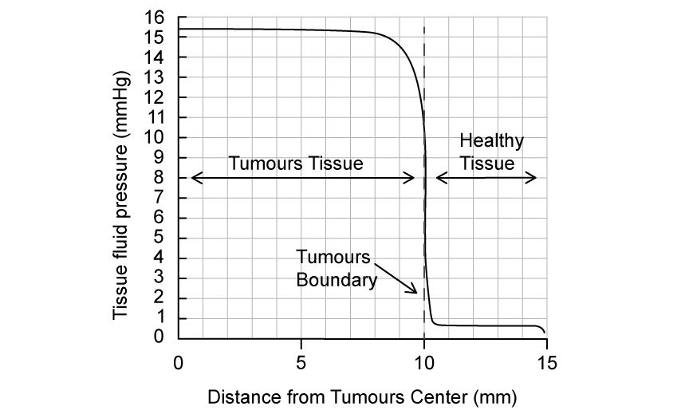
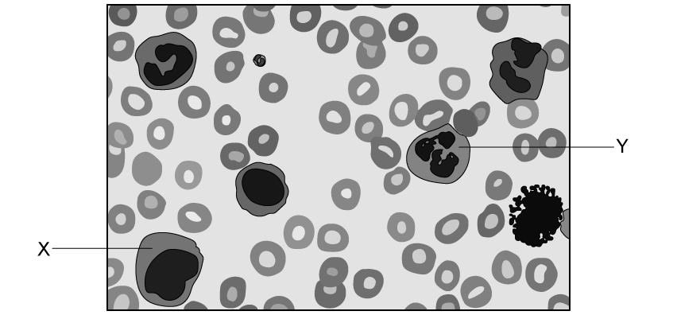
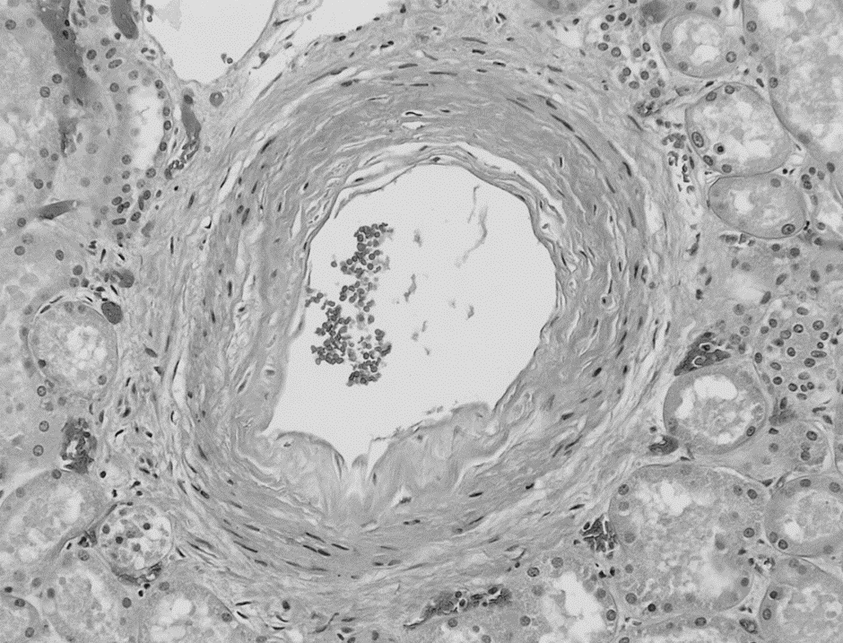
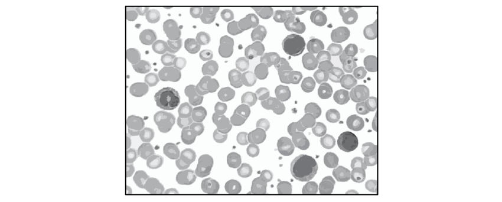
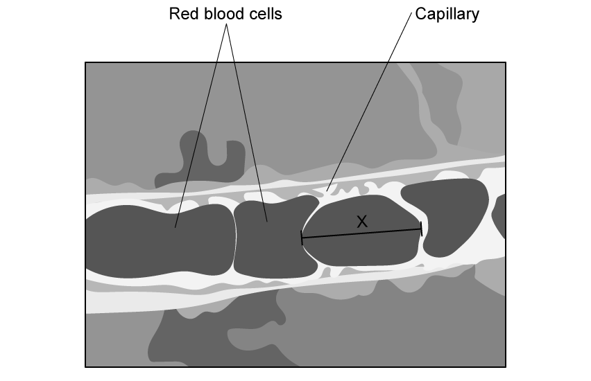
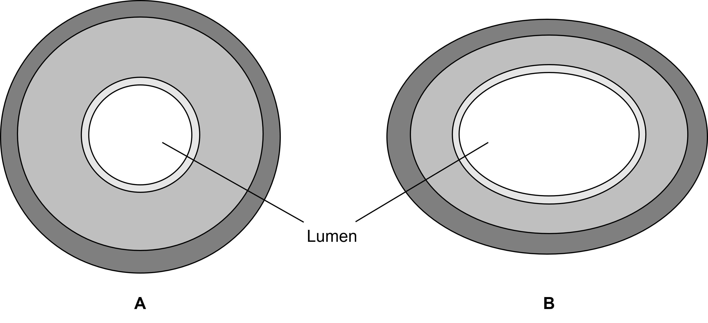
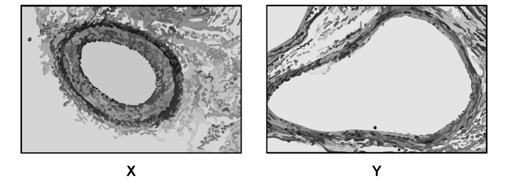
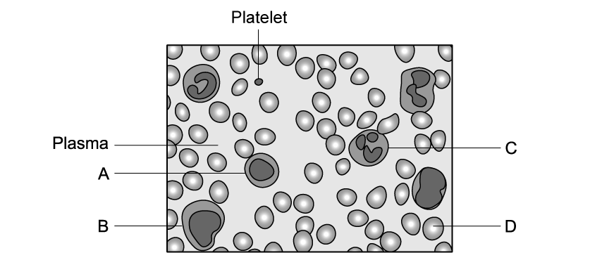
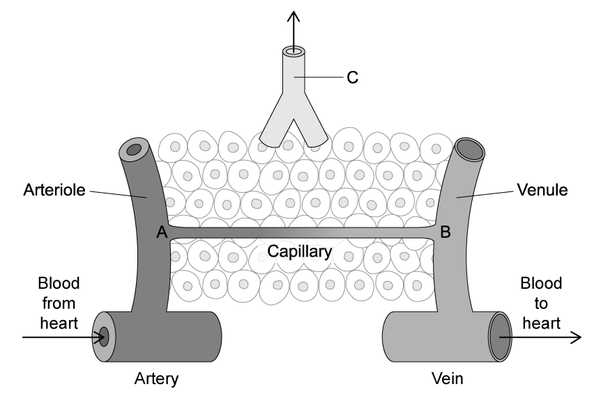

# Exam Questions — The Circulatory System
**8. Transport in Mammals** · Cambridge (CIE) A-LEVEL biology (9700)
> Source: [https://www.savemyexams.com/a-level/biology/cie/25/topic-questions/](https://www.savemyexams.com/a-level/biology/cie/25/topic-questions/) · 44 questions across 2 sets

## Multiple Choice Questions (30 questions)

### Q1 — hard — 1 marks

**Q1** [1 mark]

Water is the basis of blood, tissue fluid and lymph.

Which of the following statements describes properties of water that makes it useful as the fluid of the circulatory system?

| 1 | specific latent heat of fusion |
|---|---|
| 2 | specific heat capacity |
| 3 | polar molecule |

### Q2 — hard — 1 marks

**Q2** [1 mark]

Blood travels in several major blood vessels.

Which row in the table shows the correct sequence for the flow of the blood vessels after blood has passed through the vena cava?

|   | **pulmonary artery** | **pulmonary vein** | **aorta ** |
|---|---|---|---|
| **A** | 3 | 2 | 1 |
| **B** | 1 | 3 | 2 |
| **C** | 2 | 3 | 1 |
| **D** | 1 | 2 | 3 |

### Q3 — hard — 1 marks

**Q3** [1 mark]

Blood is made up of several different cells.

Which of the following statements about blood cells is incorrect?

### Q4 — hard — 1 marks

**Q4** [1 mark]

Tissue fluid is formed from blood plasma in the capillaries.

Which statement below correctly identifies why?

### Q5 — hard — 1 marks

**Q5** [1 mark]

The aquatic crustacean *Daphnia magna* has a heart that pumps blood-like liquid called hemolymph around the body cavity

Which of the following statements about the circulatory system is correct?

### Q6 — hard — 1 marks

**Q6** [1 mark]

Water moves between the plasma and the tissue fluid at the venule end of the capillary.

Which of the following statements correctly describes the mechanism behind this movement?

### Q7 — hard — 1 marks

**Q7** [1 mark]

Dissolved materials change the oncotic pressure of a fluid, which is related to water potential, ψ.

The following table shows some changes in the oncotic pressure and hydrostatic pressure in a capillary.

Which row shows the correct changes?

|   | **pressure (mmHg)** |   |   |   |
|---|---|---|---|---|
| **arterial end of capillary** | **venous end of capillary** |   |   |   |
| **oncotic** | **hydrostatic** | **oncotic** | **Hydrostatic** |   |
| **A**  **B**  **C**  **D** | −20  −20  20  −20 | 13  $-$13  33  33 | −20  −20  −20  −20 | 33  13  13  13 |

### Q8 — hard — 1 marks

**Q8** [1 mark]

The graphs below show how different conditions change through blood vessels in the following sequence:

artery (art) → arterioles (a) → capillaries (c) → venules (v) → veins (vein)

Which set of graphs are correct in relation to the sequence above?

### Q9 — hard — 1 marks

**Q9** [1 mark]

A student studied the structure of a blood vessel and found:

| 1 | an innermost layer of endothelial cells |
|---|---|
| 2 | a thick middle layer of smooth muscle and elastic tissue |
| 3 | an outer layer of collagen fibres |

Which vessel were they studying?

### Q10 — hard — 1 marks

**Q10** [1 mark]

Kwashiorkor is a disease caused by a lack of protein. The concentration of plasma protein is much lower in a sufferer than in a healthy individual. One symptom of kwashiorkor is oedema.

Which statement below correctly describes Kwashiorkor patients?

### Q11 — medium — 1 marks

**Q11** [1 mark]

Which statement correctly identifies similarities between blood plasma and tissue fluid?

### Q12 — medium — 1 marks

**Q12** [1 mark]

Most mammals have a closed double circulatory system.

The diagram shows a circulatory system. The arrows indicate the direction of flow of the blood.

Which of the following is the correct description for this type of circulation?

### Q13 — medium — 1 marks

**Q13** [1 mark]

The image below shows two structures commonly found in mammals. A light microscope was used to view the sample.

|   | **X** | **Y** | **Feature** |
|---|---|---|---|
| **A** | vein | atrium | **Y** contains deoxygenated blood |
| **B** | trachea | artery | the lumen of **X** allows air to pass through |
| **C** | bronchiole | vein | **Y** contains cells with oxyhaemoglobin |
| **D** | artery | vein | **Y **contains deoxygenated blood |

### Q14 — medium — 1 marks

**Q14** [1 mark]

Which row of the table below correctly identifies the blood vessels?

|   | **collagen fibres present in tunica externa (adventitia)** | **thick tunica media present** | **squamous endothelium present** |
|---|---|---|---|
| **A** | veins | veins | arteries veins and capillaries |
| **B** | arteries and veins | arteries | arteries veins and capillaries |
| **C** | arteries and veins | arteries | veins and capillaries |
| **D** | veins | arteries and veins | arteries and capillaries |

### Q15 — medium — 1 marks

**Q15** [1 mark]

Which of the following is the correct sequence of layers in the vessel wall from outside to inside?

|   | **tunica media** | **tunica intima** | **tunica externa** |
|---|---|---|---|
| **A** | 3 | 2 | 1 |
| **B** | 1 | 3 | 2 |
| **C** | 2 | 3 | 1 |
| **D** | 1 | 2 | 3 |

### Q16 — medium — 1 marks

**Q16** [1 mark]

The table shows the features of three blood vessels in the mammalian circulatory system.

| **vessel 1** | **vessel 2** | **vessel 3** |
|---|---|---|
| thin layer of smooth muscle with few elastic fibres | thick layer of elastic fibres and smooth muscle | no elastic fibres or smooth muscle |

What are vessels 1, 2 and 3?

|   | **vein** | **capillary** | **Artery** |
|---|---|---|---|
| **A** | 3 | 2 | 1 |
| **B** | 1 | 3 | 2 |
| **C** | 2 | 3 | 1 |
| **D** | 1 | 2 | 3 |

### Q17 — medium — 1 marks

**Q17** [1 mark]

The following statements compare blood tissue fluid and lymph

| 1 | **W** lacks large plasma proteins and red blood cells and has a higher water potential than **Z** |
|---|---|
| 2 | **X** is at a lower pressure than **Y** and contains red blood cells and large plasma proteins |
| 3 | **Y** is at a higher pressure than **W** and contains red blood cells and large plasma proteins |
| 4 | **Z** is at a lower pressure than **Y** and lacks red blood cells |

Which row identifies correctly **W**, **X**, **Y**, and** Z**?

|   | **W** | **X** | **Y** | **Z** |
|---|---|---|---|---|
| **A** | tissue fluid | blood leaving the capillary | blood entering the capillary | lymph |
| **B** | lymph | blood entering the capillary | tissue fluid | blood leaving the capillary |
| **C** | blood leaving the capillary | lymph | tissue fluid | blood entering the capillary |
| **D** | blood entering the capillary | lymph | blood leaving the capillary | tissue fluid |

### Q18 — medium — 1 marks

**Q18** [1 mark]

The pressure of the blood leaving the capillaries is about seven times smaller than that of blood entering the capillaries.

Which of the following statements describe this observation?

| 1 | Veins have fewer elastic and muscle fibres in their walls than arteries. |
|---|---|
| 2 | Tissue fluid formation is due to a net loss of plasma from capillaries. |
| 3 | Blood pressure decreases with distance from the heart. |

### Q19 — medium — 1 marks

**Q19** [1 mark]

When a transverse section of different blood vessels was viewed under a light microscope the following observations were made.

Which row is correct?

|   | outer wall of artery | layer of muscles and elastic fibres | diameter of the lumen |
|---|---|---|---|
| **A** | thinner | thinner | wider |
| **B** | thinner | thicker | narrower |
| **C** | thicker | thinner | wider |
| **D** | thicker | thicker | narrower |

### Q20 — medium — 1 marks

**Q20** [1 mark]

Figure 1 below shows a red blood cell with an actual size of 8 µm.

Each small division on the ruler is 1 mm.

How many times has the cell been magnified?

### Q21 — easy — 1 marks

**Q21** [1 mark]

An arteriole is a small blood vessel found leading to the capillary bed in tissues. One function of an arteriole is to increase or decrease the flow of blood to the tissues.

Which of the following tissues allows the arteriole to carry out this function?

| **1** | Muscle |
|---|---|
| **2** | Collagen |
| **3** | Elastic |

### Q22 — easy — 1 marks

**Q22** [1 mark]

Arteries have thick elastic layers in their walls; those closest to the heart have thicker layers than the rest.

Which of the following statements about this layer is correct?

| 1 | It reduces friction within the blood vessels. |
|---|---|
| 2 | It maintains even blood flow from the heart. |
| 3 | It prevents too high a pressure bursting the artery wall. |

### Q23 — easy — 1 marks

**Q23** [1 mark]

The majority of mammals (including humans) have a double circulatory system.

What does the term double circulatory system mean?

### Q24 — easy — 1 marks

**Q24** [1 mark]

The following lists some features of the circulatory system.

Which is **not **a factor that enables one-way flow of blood?

1. The separate of the systemic and pulmonary circulatory systems
2. The structure of the veins
3. The valves of the heart
4. The diameter of the blood vessels

### Q25 — easy — 1 marks

**Q25** [1 mark]

Arteries will resist any changes of blood pressure flowing through it.

Which feature of an artery allows it to do this?

| 1 | Thick layer of muscle in the artery wall |
|---|---|
| 2 | Thick elastic layer in the artery wall |
| 3 | Smooth endothelium |

### Q26 — easy — 1 marks

**Q26** [1 mark]

All blood vessels are made up of different tissues.

Which of the following is present in all of them?

### Q27 — easy — 1 marks

**Q27** [1 mark]

Which row shows correctly identifies the composition of tissue fluid?

|   | phagocytes | platelets | protein concentration compared to plasma |
|---|---|---|---|
| **A**  **B**  **C**  **D** | X  ✓  X  ✓ | X  ✓  ✓  X | higher  higher  lower  lower |

Key ✓ = present, X = absent

### Q28 — easy — 1 marks

**Q28** [1 mark]

The following lists some features of blood, tissue fluid and lymph.

| 1 | Fatty acids |
|---|---|
| 2 | White blood cells |
| 3 | Proteins |
| 4 | Carbon dioxide |

Which of the above components are found in all three substances?

### Q29 — easy — 1 marks

**Q29** [1 mark]

The micrograph below shows human blood. There are four cells labelled.

Which row of the table below labels the cells correctly?

| ** ** | **W** | **X** | **Y** | **Z** |
|---|---|---|---|---|
| **A**  **B**  **C**  **D** | lymphocyte  erythrocyte  neutrophil  erythrocyte | erythrocyte  neutrophil  monocyte  lymphocyte | monocyte  phagocyte  lymphocyte  neutrophil | neutrophil  lymphocyte  erythrocyte  neutrophil |

### Q30 — easy — 1 marks

**Q30** [1 mark]

The table below shows some features of arteries, veins and capillaries:

|   | **feature** | **arteries** | **veins** | **capillaries** |
|---|---|---|---|---|
| 1  2  3 | wall  lumen  blood pressure | thick  wide  high | thin  narrow  low | single cell  narrow  low |

Which row in the table is correct?

## Structured Questions (14 questions)

### Q1 — hard — 13 marks

**Q1** [2 marks]

Elevated tissue fluid pressure is a characteristic of body tissues containing cancerous tumour cells.

This is, in part, due to the high permeability of blood vessels, low lymphatic drainage, hypertension (high blood pressure) and high cell density around the blood vessels.

Figure 1 shows the change in tissue fluid pressure (mmHg) within tumour tissue and healthy tissue.

**Fig. 1**

Calculate the percentage change in tissue fluid pressure between the tumour tissue and healthy tissue.

**Q1** [3 marks]

**Extract:**

Elevated tissue fluid pressure is a characteristic of body tissues containing cancerous tumour cells.

This is, in part, due to the high permeability of blood vessels, low lymphatic drainage, hypertension (high blood pressure) and high cell density around the blood vessels.

Figure 1 shows the change in tissue fluid pressure (mmHg) within tumour tissue and healthy tissue.

Use the information provided in part (a) and your own knowledge of tissue fluid formation to explain the results of the graph of the tumour tissue.

**Q1** [5 marks]

Explain the mechanisms that maintain normal tissue fluid pressure in healthy tissue.

**Q1** [3 marks]

Tissue fluid makes up around 19% of our body mass.

Calculate the mass of tissue fluid in a person with a total body mass of 72kg. Give your answer in grams to 3 significant figures.

### Q2 — hard — 11 marks

**Q2** [3 marks]

Fig. 1 represents a capillary as it passes through the tissues of the body along with the surrounding tissue fluid.

**                                                               Fig. 1**

Give **three** differences between the composition of the blood at the arteriole end of the capillary and the venule end.

**Q2** [4 marks]

**Extract:**

Fig. 1 represents a capillary as it passes through the tissues of the body along with the surrounding tissue fluid.

Use Fig. 1 to explain the formation of tissue fluid and its return to the capillary.

**Q2** [2 marks]

**Extract:**

Use Fig. 1 to explain the formation of tissue fluid and its return to the capillary.

Tissue fluid returns to the capillary because...

- Large molecules / proteins that remain in the blood (due to their large size) lower the water potential (inside the capillary);
- The (outward) hydrostatic pressure in the capillary drops/decreases (to 1.5 kPa);
- Fluid is drawn back into the capillary by osmosis;

At the venule end of the capillary, the water potential is lower due to the loss of water and the retention of large proteins. The hydrostatic pressure has dropped (due to increased distance from the heart and friction between the blood and the capillary walls) so the influence of the water potential gradient between the tissue fluid and the capillary becomes more significant than the outward-pushing hydrostatic pressure and the fluid is drawn back into the capillary.

Protein deficiency in an individual's diet can influence the return of tissue fluid to the capillaries.

Suggest and explain one tissue fluid-related symptom of dietary protein deficiency.

**Q2** [2 marks]

The main component of both blood and tissue fluid is water.

Explain how **one** property of water makes it an ideal transport medium for organisms with a transport system.

### Q3 — hard — 10 marks

**Q3** [3 marks]

Arterioles are blood vessels that help control blood flow into a capillary.

Explain how.

**Q3** [3 marks]

Fig. 1 shows the blood pressure through different blood vessels of the human circulatory system.

**Fig. 1**

Use the data shown in Fig. 1 to explain why arterioles play a large role in regulating blood pressure.

**Q3** [4 marks]

The mean arterial pressure (MAP) is used to determine overall blood flow and is a good indicator of perfusion pressure (how much pressure it takes to push blood through all the blood vessels in a specific area). In a healthy individual MAP is 70-100 mmHg.

MAP can be calculated by the following formula:

**MAP= DP + 1/3(SP − DP)**

Where

- DP is diastolic pressure
- SP is systolic pressure

Fig. 2 shows pulse pressure (mmHg) within different blood vessels.

**Fig. 2**

Use the graph to calculate the mean arterial pressure and determine whether it is within a healthy range. Give your answer to 2 significant figures.

### Q4 — hard — 12 marks

**Q4** [2 marks]

Scientists collected red blood cell samples from four different mammals; cats, rats, hares and goats. The samples were placed in different concentrations of sodium chloride solution for a set amount of time and the percentage of haemolysed (burst) red blood cells was measured at each sodium chloride concentration. Fig. 1 shows the results of the above experiment.

**                                                         Fig. 1**

The scientists used a colorimeter to measure the percentage of haemolysed red blood cells.

Suggest why a colorimeter could be used to measure this.

**Q4** [3 marks]

**Extract:**

Scientists collected red blood cell samples from four different mammals; cats, rats, hares and goats. The samples were placed in different concentrations of sodium chloride solution for a set amount of time and the percentage of haemolysed (burst) red blood cells was measured at each sodium chloride concentration. Fig. 1 shows the results of the above experiment.

Contrast the results for the red blood cells of the goat and the rat.

**Q4** [4 marks]

**Extract:**

Scientists collected red blood cell samples from four different mammals; cats, rats, hares and goats. The samples were placed in different concentrations of sodium chloride solution for a set amount of time and the percentage of haemolysed (burst) red blood cells was measured at each sodium chloride concentration. Fig. 1 shows the results of the above experiment.

Explain the results shown for the cat in Fig. 1 at the following sodium chloride concentrations:

(i) 0 %

[2]

(ii) 0.38 %

[2]

**Q4** [3 marks]

Fig. 2 shows a microscope image of a mammalian blood sample.

**                                                           Fig. 2**

(i) Identify the cell types represented by cells **X** and **Y** in Fig. 2.

[1]

(ii) Explain your answer to part (i).

[2]

### Q5 — medium — 11 marks

**Q5** [2 marks]

Based on your knowledge of diffusion, explain why multicellular organisms need a specialised transport system.

**Q5** [3 marks]

Figure 1 shows an organ of the mammalian circulatory system.

*Image courtesy of Wiki Commons copyright free*

**Fig. 1**

(i) Identify the organ in Fig. 1.

[1]

(ii) Explain the evidence shown in Fig. 1 that determined your answer to part (i).

[2]

**Q5** [1 mark]

**Extract:**

Figure 1 shows an organ of the mammalian circulatory system.

(i) The organ is an artery.

(ii) The evidence that determines the answer is: It has a small lumen and thick muscle walls.

Figure 2 shows a biological drawing of Organ **A**

**Fig. 2**

Describe the errors contained within this drawing.

**Q5** [5 marks]

The heart, contains two blood vessels that transport blood via the lungs.

(i) Give the name of these **two **blood vessels.

[1]

(ii) Explain the movement of blood between the heart and the lungs. Do not include details of the cardiac cycle as part of your answer.

[4]

### Q6 — medium — 14 marks

**Q6** [3 marks]

Blood is comprised of different cells. Figure 1 shows an electron micrograph of a blood sample.

Identify on the diagram the **three **types of blood cells shown.

**Fig. 1**

**Q6** [4 marks]

Blood is found within blood vessels.

Compare the structure of a vein with the structure of an elastic artery.

**Q6** [3 marks]

Capillaries are the site of diffusion of substances required by cells, such as glucose and oxygen.

Explain how the structure of capillaries relates to their function.

**Q6** [4 marks]

Complete the table to show the properties of the blood vessels.

| Property | Pulmonary artery | Pulmonary vein | Aorta | Vena cava |
|---|---|---|---|---|
| Transports oxygenated blood |   |   |   |   |
| Transports deoxygenated blood |   |   |   |   |
| Transports blood to the heart |   |   |   |   |
| Transports blood to the lungs |   |   |   |   |
| Transports blood to the body |   |   |   |   |

### Q7 — medium — 9 marks

**Q7** [2 marks]

Figure 1 shows a series of red blood cells passing through a capillary in the tissues. The magnification factor of Figure 1 is x6000.

**                                                    Fig. 1**

The length of the line marked **X** in the image shown in Figure 1 is 4.6 cm.

Calculate the actual diameter of the red blood cell marked **X** in Figure 1. Show your working out and give your answer in µm to one decimal place.

**Q7** [2 marks]

**Extract:**

Figure 1 shows a series of red blood cells passing through a capillary in the tissues. The magnification factor of Figure 1 is x6000.

State **and** explain **one** feature of capillaries visible in Fig. 1 that helps them to carry out their function.

**Q7** [3 marks]

Research suggests that in patients with diabetes mellitus red blood cell membranes can harden, reducing the ability of red blood cells to deform their shape and flex.

Suggest **and** explain the possible symptoms that this could cause in diabetic patients.

**Q7** [2 marks]

Red blood cells and capillaries form part of the circulatory system of some organisms.

Explain why multicellular organisms, such as humans, require a circulatory system while single-celled organisms, such as bacteria, do not.

### Q8 — medium — 12 marks

**Q8** [5 marks]

Tissue fluid bathes almost all cells outside of the circulatory system.

Describe the formation of tissue fluid.

**Q8** [2 marks]

The table below shows the differences between blood plasma and tissue fluid.

Explain the differences shown in the table.

**Table 1**

| **Blood plasma** | **Tissue fluid** |
|---|---|
| Has a high protein content | Has a low protein content |
| Contains more dissolved oxygen | Contains less dissolved oxygen |

**Q8** [2 marks]

Water is a major component of tissue fluid.

Explain the properties of water that enable its role of transport in mammals.

**Q8** [3 marks]

Lymphoedema is a condition that causes swelling in the legs or arms due to a build up of tissue fluid.

With reference to pressure, explain why someone with lymphoedema would have swelling in their arms or legs.

### Q9 — medium — 12 marks

**Q9** [1 mark]

Figure 1 shows an image of a micrograph of a cross-section through a mammalian blood vessel.

**                                                             Fig. 1**

Identify the type of blood vessel shown in Figure 1.

**Q9** [4 marks]

**Extract:**

Figure 1 shows an image of a micrograph of a cross-section through a mammalian blood vessel.

The type of blood vessel shown in Figure 1 is an artery.

Explain how the blood vessel shown in Figure1 is adapted to carry out its function.

**Q9** [2 marks]

Figure 2 shows pressure changes in the blood vessels as the blood passes through different sections of the mammalian circulatory system.

**                                                Fig. 2**

Explain the need for a separate systemic and pulmonary circulation in mammals.

**Q9** [5 marks]

**Extract:**

Figure 2 shows pressure changes in the blood vessels as the blood passes through different sections of the mammalian circulatory system.

                                               Fig. 2

Explain the blood pressure in the following sections of Fig. 2

(i) The arteries and arterioles

[3]

(ii) The capillaries

[1]

(iii) The venules and veins

[1]

### Q10 — easy — 12 marks

**Q10** [2 marks]

Fig. 1 shows a blood vessel with two types of blood cell moving through.

**Fig. 1**

Name the cells labelled **X** and **Y** in Fig. 1. Justify your answer.

**Q10** [3 marks]

**Extract:**

Fig. 1 shows a blood vessel with two types of blood cell moving through.

Name the cells labelled X and Y in Fig. 1.

X is a red blood cell because it has a biconcave shape;
Y is a neutrophil because it has a (multi-) lobed nucleus;

With reference to Fig.1, state **three** ways in which cell **X** is different to cell **Y**.

**Q10** [5 marks]

Blood has many components. Plasma is a straw coloured liquid which gives blood its fluidity and is made up primarily of water.

(i) Identify **two **properties of water which make it ideal as a main component of blood.

[2]

(ii) State **three** substances that are transported in blood plasma.

[3]

**Q10** [2 marks]

Give the evidence seen in Fig.1 which identifies the blood vessel as a capillary.

### Q11 — easy — 8 marks

**Q11** [2 marks]

Fig.1 compares the structure of two main human blood vessels.

**Fig.1**

(i) Identify blood vessel **A**.

[1]

(ii) State a reason for your answer in part (i).

[1]

**Q11** [3 marks]

**Extract:**

Fig.1 compares the structure of two main human blood vessels.

Blood vessel **B** has a very large lumen.

(i) Identify blood vessel **B**.

[1]

(ii) Explain the presence of the lumen in blood vessel **B**.

[2]

**Q11** [2 marks]

The flow of blood in veins is not assisted by the pressure generated by the beating of the heart.

List** two** structures that assist with the flow of blood in veins.

**Q11** [1 mark]

The diagram represents a mammalian circulatory system. Mammals have two separate circulations that supply blood to different organs.

State the name of the circulation that blood vessels **T** and **S** form part of.

### Q12 — easy — 13 marks

**Q12** [2 marks]

State what is meant by the phrase **closed**, **double circulatory system**.

**Q12** [4 marks]

Identify the components of the mammalian circulatory system.

**Q12** [1 mark]

Name the part of the mammalian circulatory system that is responsible for carrying deoxygenated blood to the lungs.

**Q12** [6 marks]

Figure 1 shows an electron micrograph of a cross-section of two blood vessels.

**Fig. 1**

(i) Produce a tissue plan diagram of structure **X** shown in Figure 1.

[3]

(ii) Identify the types of blood vessel represented by **X** and **Y** in Figure 1.

[2]

(iii) State **one** piece of evidence that supports your answers to part (ii).

[1]

### Q13 — easy — 12 marks

**Q13** [4 marks]

Muscular arteries are different from elastic arteries.

(i) Give **two** differences between the functional abilities of muscular arteries and elastic arteries.

[2]

(ii) Explain how the structures of muscular and elastic arteries aid their function.

[2]

**Q13** [1 mark]

The lumen of capillaries has a small diameter, slowing down the passage of red blood cells.

Explain the advantage of this to the organism.

**Q13** [5 marks]

Figure 1 shows an electron micrograph shows a blood smear.

**Fig. 1**

(i) Identify the cells labelled **A **-** D**

[4]

(ii) Describe the feature that allows cell **C** to be identified clearly.

[1]

**Q13** [2 marks]

Water is another important component of the blood.

(i) Explain how the high specific heat capacity of water aids living organisms in maintaining the temperature of the blood and surrounding tissues.

[1]

(ii) State the importance of maintaining blood temperature within narrow limits.

[1]

### Q14 — easy — 9 marks

**Q14** [2 marks]

Exchange of substances between cells and blood occurs via the tissue fluid, shown in Fig.1.

**Fig. 1**

Tick the boxes which correctly describe the conditions inside the capillary at positions** A** and **B** in Fig.1.

|   | **High hydrostatic pressure** | **Low hydrostatic pressure** | **Water moves out** | ** Water moves in** |
|---|---|---|---|---|
| **A** |   |   |   |   |
| **B** |   |   |   |   |

**Q14** [3 marks]

**Extract:**

Exchange of substances between cells and blood occurs via the tissue fluid, shown in Fig.1.

Fig. 1

Fig.1 shows another vessel labelled **C**.

(i) Give the name of vessel **C**. [1]

(ii) Name **two** substances which enter vessel C from the surrounding tissues.

[2]

**Q14** [2 marks]

The following table shows the mean pressure (in mmHg) measured in different blood vessels of the body.

| **Blood vessel** | **Mean blood pressure / mmHg** |
|---|---|
| Aorta | 94 |
| Arteries | 90 |
| Arterioles | 68 |
| Capillaries | 24 |
| Venules | 10 |
| Veins | 3 |
| Vena Cava | 2 |

Calculate the percentage difference between the mean blood pressure of the aorta and vena cava.

Show your working and give your answer to three significant figures.

**Q14** [2 marks]

Describe how the circulatory system maintains one-way flow around the body
