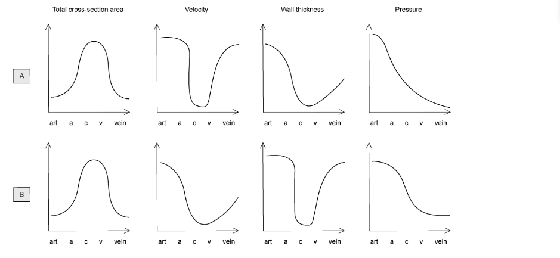
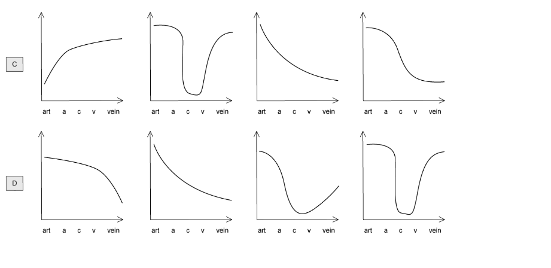
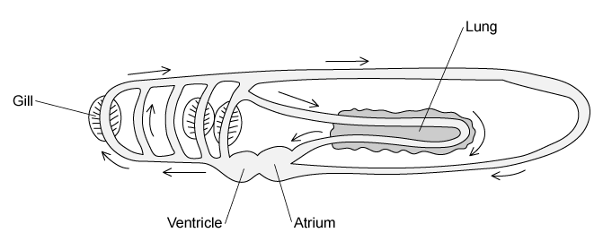
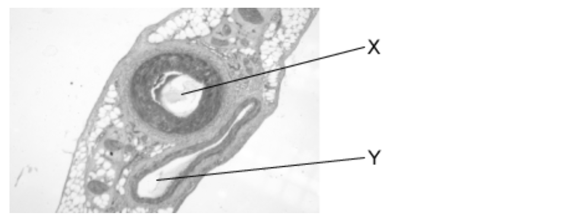
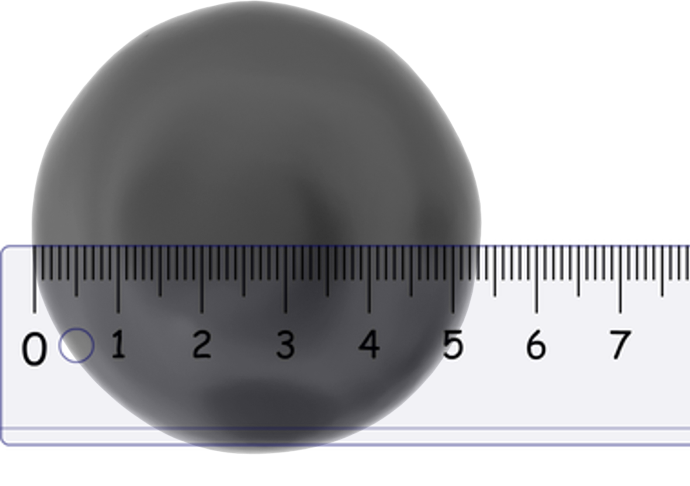
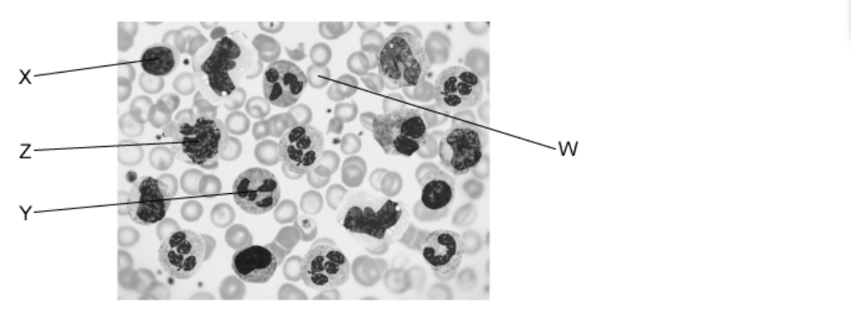

# Exam Questions — The Circulatory System
**8. Transport in Mammals** · Cambridge (CIE) A-LEVEL biology (9700)
> Source: [https://www.savemyexams.com/a-level/biology/cie/25/topic-questions/](https://www.savemyexams.com/a-level/biology/cie/25/topic-questions/) · 30 questions across 1 sets

## Multiple Choice Questions (30 questions)

### Q1 — hard — 1 marks

**Q1** [1 mark]

Water is the basis of blood, tissue fluid and lymph.

Which of the following statements describes properties of water that makes it useful as the fluid of the circulatory system?

| 1 | specific latent heat of fusion |
|---|---|
| 2 | specific heat capacity |
| 3 | polar molecule |

### Q2 — hard — 1 marks

**Q2** [1 mark]

Blood travels in several major blood vessels.

Which row in the table shows the correct sequence for the flow of the blood vessels after blood has passed through the vena cava?

|   | **pulmonary artery** | **pulmonary vein** | **aorta ** |
|---|---|---|---|
| **A** | 3 | 2 | 1 |
| **B** | 1 | 3 | 2 |
| **C** | 2 | 3 | 1 |
| **D** | 1 | 2 | 3 |

### Q3 — hard — 1 marks

**Q3** [1 mark]

Blood is made up of several different cells.

Which of the following statements about blood cells is incorrect?

### Q4 — hard — 1 marks

**Q4** [1 mark]

Tissue fluid is formed from blood plasma in the capillaries.

Which statement below correctly identifies why?

### Q5 — hard — 1 marks

**Q5** [1 mark]

The aquatic crustacean *Daphnia magna* has a heart that pumps blood-like liquid called hemolymph around the body cavity

Which of the following statements about the circulatory system is correct?

### Q6 — hard — 1 marks

**Q6** [1 mark]

Water moves between the plasma and the tissue fluid at the venule end of the capillary.

Which of the following statements correctly describes the mechanism behind this movement?

### Q7 — hard — 1 marks

**Q7** [1 mark]

Dissolved materials change the oncotic pressure of a fluid, which is related to water potential, ψ.

The following table shows some changes in the oncotic pressure and hydrostatic pressure in a capillary.

Which row shows the correct changes?

|   | **pressure (mmHg)** |   |   |   |
|---|---|---|---|---|
| **arterial end of capillary** | **venous end of capillary** |   |   |   |
| **oncotic** | **hydrostatic** | **oncotic** | **Hydrostatic** |   |
| **A**  **B**  **C**  **D** | −20  −20  20  −20 | 13  $-$13  33  33 | −20  −20  −20  −20 | 33  13  13  13 |

### Q8 — hard — 1 marks

**Q8** [1 mark]

The graphs below show how different conditions change through blood vessels in the following sequence:

artery (art) → arterioles (a) → capillaries (c) → venules (v) → veins (vein)

Which set of graphs are correct in relation to the sequence above?

### Q9 — hard — 1 marks

**Q9** [1 mark]

A student studied the structure of a blood vessel and found:

| 1 | an innermost layer of endothelial cells |
|---|---|
| 2 | a thick middle layer of smooth muscle and elastic tissue |
| 3 | an outer layer of collagen fibres |

Which vessel were they studying?

### Q10 — hard — 1 marks

**Q10** [1 mark]

Kwashiorkor is a disease caused by a lack of protein. The concentration of plasma protein is much lower in a sufferer than in a healthy individual. One symptom of kwashiorkor is oedema.

Which statement below correctly describes Kwashiorkor patients?

### Q11 — medium — 1 marks

**Q11** [1 mark]

Which statement correctly identifies similarities between blood plasma and tissue fluid?

### Q12 — medium — 1 marks

**Q12** [1 mark]

Most mammals have a closed double circulatory system.

The diagram shows a circulatory system. The arrows indicate the direction of flow of the blood.

Which of the following is the correct description for this type of circulation?

### Q13 — medium — 1 marks

**Q13** [1 mark]

The image below shows two structures commonly found in mammals. A light microscope was used to view the sample.

|   | **X** | **Y** | **Feature** |
|---|---|---|---|
| **A** | vein | atrium | **Y** contains deoxygenated blood |
| **B** | trachea | artery | the lumen of **X** allows air to pass through |
| **C** | bronchiole | vein | **Y** contains cells with oxyhaemoglobin |
| **D** | artery | vein | **Y **contains deoxygenated blood |

### Q14 — medium — 1 marks

**Q14** [1 mark]

Which row of the table below correctly identifies the blood vessels?

|   | **collagen fibres present in tunica externa (adventitia)** | **thick tunica media present** | **squamous endothelium present** |
|---|---|---|---|
| **A** | veins | veins | arteries veins and capillaries |
| **B** | arteries and veins | arteries | arteries veins and capillaries |
| **C** | arteries and veins | arteries | veins and capillaries |
| **D** | veins | arteries and veins | arteries and capillaries |

### Q15 — medium — 1 marks

**Q15** [1 mark]

Which of the following is the correct sequence of layers in the vessel wall from outside to inside?

|   | **tunica media** | **tunica intima** | **tunica externa** |
|---|---|---|---|
| **A** | 3 | 2 | 1 |
| **B** | 1 | 3 | 2 |
| **C** | 2 | 3 | 1 |
| **D** | 1 | 2 | 3 |

### Q16 — medium — 1 marks

**Q16** [1 mark]

The table shows the features of three blood vessels in the mammalian circulatory system.

| **vessel 1** | **vessel 2** | **vessel 3** |
|---|---|---|
| thin layer of smooth muscle with few elastic fibres | thick layer of elastic fibres and smooth muscle | no elastic fibres or smooth muscle |

What are vessels 1, 2 and 3?

|   | **vein** | **capillary** | **Artery** |
|---|---|---|---|
| **A** | 3 | 2 | 1 |
| **B** | 1 | 3 | 2 |
| **C** | 2 | 3 | 1 |
| **D** | 1 | 2 | 3 |

### Q17 — medium — 1 marks

**Q17** [1 mark]

The following statements compare blood tissue fluid and lymph

| 1 | **W** lacks large plasma proteins and red blood cells and has a higher water potential than **Z** |
|---|---|
| 2 | **X** is at a lower pressure than **Y** and contains red blood cells and large plasma proteins |
| 3 | **Y** is at a higher pressure than **W** and contains red blood cells and large plasma proteins |
| 4 | **Z** is at a lower pressure than **Y** and lacks red blood cells |

Which row identifies correctly **W**, **X**, **Y**, and** Z**?

|   | **W** | **X** | **Y** | **Z** |
|---|---|---|---|---|
| **A** | tissue fluid | blood leaving the capillary | blood entering the capillary | lymph |
| **B** | lymph | blood entering the capillary | tissue fluid | blood leaving the capillary |
| **C** | blood leaving the capillary | lymph | tissue fluid | blood entering the capillary |
| **D** | blood entering the capillary | lymph | blood leaving the capillary | tissue fluid |

### Q18 — medium — 1 marks

**Q18** [1 mark]

The pressure of the blood leaving the capillaries is about seven times smaller than that of blood entering the capillaries.

Which of the following statements describe this observation?

| 1 | Veins have fewer elastic and muscle fibres in their walls than arteries. |
|---|---|
| 2 | Tissue fluid formation is due to a net loss of plasma from capillaries. |
| 3 | Blood pressure decreases with distance from the heart. |

### Q19 — medium — 1 marks

**Q19** [1 mark]

When a transverse section of different blood vessels was viewed under a light microscope the following observations were made.

Which row is correct?

|   | outer wall of artery | layer of muscles and elastic fibres | diameter of the lumen |
|---|---|---|---|
| **A** | thinner | thinner | wider |
| **B** | thinner | thicker | narrower |
| **C** | thicker | thinner | wider |
| **D** | thicker | thicker | narrower |

### Q20 — medium — 1 marks

**Q20** [1 mark]

Figure 1 below shows a red blood cell with an actual size of 8 µm.

Each small division on the ruler is 1 mm.

How many times has the cell been magnified?

### Q21 — easy — 1 marks

**Q21** [1 mark]

An arteriole is a small blood vessel found leading to the capillary bed in tissues. One function of an arteriole is to increase or decrease the flow of blood to the tissues.

Which of the following tissues allows the arteriole to carry out this function?

| **1** | Muscle |
|---|---|
| **2** | Collagen |
| **3** | Elastic |

### Q22 — easy — 1 marks

**Q22** [1 mark]

Arteries have thick elastic layers in their walls; those closest to the heart have thicker layers than the rest.

Which of the following statements about this layer is correct?

| 1 | It reduces friction within the blood vessels. |
|---|---|
| 2 | It maintains even blood flow from the heart. |
| 3 | It prevents too high a pressure bursting the artery wall. |

### Q23 — easy — 1 marks

**Q23** [1 mark]

The majority of mammals (including humans) have a double circulatory system.

What does the term double circulatory system mean?

### Q24 — easy — 1 marks

**Q24** [1 mark]

The following lists some features of the circulatory system.

Which is **not **a factor that enables one-way flow of blood?

1. The separate of the systemic and pulmonary circulatory systems
2. The structure of the veins
3. The valves of the heart
4. The diameter of the blood vessels

### Q25 — easy — 1 marks

**Q25** [1 mark]

Arteries will resist any changes of blood pressure flowing through it.

Which feature of an artery allows it to do this?

| 1 | Thick layer of muscle in the artery wall |
|---|---|
| 2 | Thick elastic layer in the artery wall |
| 3 | Smooth endothelium |

### Q26 — easy — 1 marks

**Q26** [1 mark]

All blood vessels are made up of different tissues.

Which of the following is present in all of them?

### Q27 — easy — 1 marks

**Q27** [1 mark]

Which row shows correctly identifies the composition of tissue fluid?

|   | phagocytes | platelets | protein concentration compared to plasma |
|---|---|---|---|
| **A**  **B**  **C**  **D** | X  ✓  X  ✓ | X  ✓  ✓  X | higher  higher  lower  lower |

Key ✓ = present, X = absent

### Q28 — easy — 1 marks

**Q28** [1 mark]

The following lists some features of blood, tissue fluid and lymph.

| 1 | Fatty acids |
|---|---|
| 2 | White blood cells |
| 3 | Proteins |
| 4 | Carbon dioxide |

Which of the above components are found in all three substances?

### Q29 — easy — 1 marks

**Q29** [1 mark]

The micrograph below shows human blood. There are four cells labelled.

Which row of the table below labels the cells correctly?

| ** ** | **W** | **X** | **Y** | **Z** |
|---|---|---|---|---|
| **A**  **B**  **C**  **D** | lymphocyte  erythrocyte  neutrophil  erythrocyte | erythrocyte  neutrophil  monocyte  lymphocyte | monocyte  phagocyte  lymphocyte  neutrophil | neutrophil  lymphocyte  erythrocyte  neutrophil |

### Q30 — easy — 1 marks

**Q30** [1 mark]

The table below shows some features of arteries, veins and capillaries:

|   | **feature** | **arteries** | **veins** | **capillaries** |
|---|---|---|---|---|
| 1  2  3 | wall  lumen  blood pressure | thick  wide  high | thin  narrow  low | single cell  narrow  low |

Which row in the table is correct?
