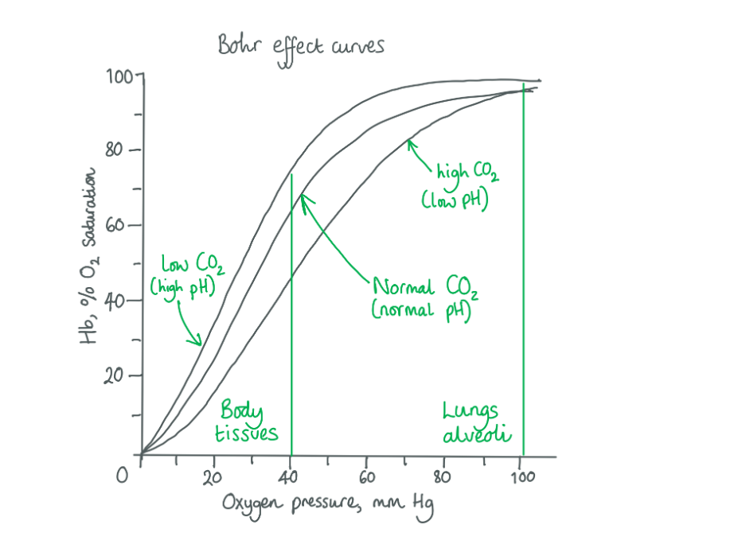

# Mark Schemes — Transport of Oxygen & Carbon Dioxide
**8. Transport in Mammals** · Cambridge (CIE) A-LEVEL biology (9700)

## Multiple Choice Questions (30 questions)

### Q1
**Final answer:** **The correct answer is ****B**** because:**

- **(3)**** When carbon dioxide is present in the blood around respiring tissues, it diffuses into red blood cells and is reacted with water in a reaction catalysed by ****carbonic anhydrase**** to form ****carbonic acid:**

**Final answer:** **                                                   CO****2****         +    H****2****O        ⇌         ****H****2****CO****3**

**Final answer:** **                                            carbon dioxide    +   water    ⇌     ****carbonic acid****  **

- **(2)**** Carbonic acid ****rapidly dissociates**** into ****hydrogen ions**** and ****hydrogen carbonate ions:**

**Final answer:** **                                         H****2****CO****3          ****⇌         HCO****3****- ****                  +               ****H****+**

**Final answer:** **                                   carbonic acid     ⇌    hydrogen carbonate     +       ****hydrogen ions**

- **(1)**** ****Hydrogen carbonate ions**** diffuse out of the ****erythrocyte**** (red blood cell) into the blood plasma where it is dissolved and carried towards the lungs**
- **(4) ****As ****hydrogen ions**** are produced from the dissociation of ****carbonic acid****, and hydrogen carbonate diffuses out of the cells, the ****electrochemical**** environment in the red blood cell must be maintained. ****Chloride ion shift**** is the movement of chloride ions from the plasma into the red blood cell to stop the cell from becoming positively charged due to the increase in hydrogen ion (H****+****) concentration**

### Q2
**Final answer:** **The correct answer is ****D**** because:**

- **Active transport**** is the movement of solutes ****against**** their concentration gradient (from low concentration to high concentration) using energy in the form of ATP**
- **Active transport of ****ions**** in this example is used to establish and maintain a ****concentration gradient**** so that sodium ions (Na****+****) can be used in the ****co-transport**** of glucose, a form of ****facilitated diffusion****.**
- **Therefore, sodium ions (Na****+****) are being actively transported ****out**** of the cell from 15 mmol dm****-3**** to 144 mmol dm****-3.**
- **Potassium ions (K****+****) are being actively transported ****into**** the cell from 5 mmol dm****-3**** to 150 mmol dm****-3**
- **This active transport is being done by a ****Na****+****/ K****+**** ATPase pump**

> *Chloride ions** will be **diffusing down** their concentration gradient into the cell.*

### Q3
**Final answer:** **The correct answer is ****A**** because:**

- **The difference between curve 1 and curve 2 is known as ****Bohr shift**
- **This occurs when the concentration of ****carbon dioxide**** is increased, for example when muscle cells are active and therefore undergoing a high rate of ****respiration**** – producing lots of carbon dioxide**
- **Carbon dioxide diffuses into red blood cells where ****carbonic anhydrase**** reacts with water to form carbonic acid:**

**Final answer:** **                              CO****2 ****          +    H****2****O      ⇌         ****H****2****CO****3**

**Final answer:** **                       carbon dioxide    +   water    ⇌     ****carbonic acid****  **

- **Carbonic acid ****rapidly dissociates**** into hydrogen carbonate ions and ****hydrogen ions****:**

**Final answer:** **                    H****2****CO****3****        ⇌         HCO****3****- ****                      +         ****H****+**

**Final answer:** **               carbonic acid     ⇌    hydrogen carbonate           ****hydrogen ions**

- **The more hydrogen ions in a solution the ****lower**** and ****more acidic**** the pH is**
- **Hydrogen ions bind with haemoglobin to form ****haemoglobinic acid**** which has a different ****tertiary structure**** to haemoglobin, one which has a ****lower affinity**** for oxygen**
- **This means that the binding of hydrogen ions causes ****oxygen to dissociate**** from haemoglobin and hence a higher partial pressure of oxygen is required to achieve the same % saturation as in neutral pH conditions**

> *The curve is active, rather than resting muscle because of the big difference between curve 1 and curve 2.*

### Q4
**Final answer:** **The correct answer is ****D**** because:**

- **The majority of haemoglobin arriving at the muscle is fully saturated with oxygen (****four oxygen molecules**** are bound)**
- **At respiring tissue, such as muscle, the concentration of ****carbon dioxide**** is high. Carbon dioxide diffuses into red blood cells and through a series of reactions starting with one catalysed by carbonic anhydrase, ****hydrogen ions**** are formed**
- **Hydrogen ions bind with ****oxyhaemoglobin**** (at point W) to form ****haemoglobinic acid**** (at point ****Y****) which has a ****lower affinity**** for oxygen than haemoglobin and therefore ****releases ****oxygen**
- **Oxygen then diffuses out of the red blood cell and into respiring muscle**
- **Therefore, the difference between ****W**** and ****Y**** shows the amount of ****oxygen deposited****.**

### Q5
**Final answer:** **The correct answer is ****C**** because:**

- **A certain partial pressure of oxygen is required to fully saturate haemoglobin, due to the ****affinity**** of haemoglobin for oxygen, and at altitude, this cannot be achieved**
- **As human haemoglobin’s affinity for oxygen cannot be changed, the body responds by producing more ****red blood cells**** so that the same amount of oxygen can be delivered to respiring tissues, by more cells at a lower % saturation.**

> *A **is incorrect as red blood cells do not have a **nucleus** and therefore **cannot **synthesise more proteins.*

> *B **is incorrect as the oxygen dissociation curve shifts to the right due to carbon dioxide and a **low pH** affecting oxygen affinity. At altitude, the affinity for oxygen is the same but the **supply **of oxygen is reduced.*

> *D **is incorrect as haemoglobin does **not** break down more rapidly at low partial pressures of oxygen.*

### Q6
**Final answer:** **The correct answer is ****A**** because:**

- **When carbon dioxide is present in the blood around ****respiring tissues****, it diffuses into red blood cells and is reacted with water in a reaction catalysed by ****carbonic anhydrase**** to form ****carbonic acid:**

**Final answer:** **                                                    CO****2 ****        +      H****2****O      ⇌         ****H****2****CO****3**

**Final answer:** **                                             carbon dioxide    +   water    ⇌     ****carbonic acid****  **

- **Carbonic acid ****rapidly dissociates**** into ****hydrogen ions**** and ****hydrogen carbonate ions:**

**Final answer:** **                                                  H****2****CO****3****       ⇌         HCO****3****- ****              +                      ****H****+**

**Final answer:** **                                           carbonic acid     ⇌    hydrogen carbonate     +     ****hydrogen ions**

- **An increase in hydrogen ions ****decreases**** the pH **
- **Hydrogen ions bind with haemoglobin to form ****haemoglobinic acid**** which has a different ****tertiary structure**** to haemoglobin, one which has a ****lower affinity**** for oxygen and therefore requires a higher partial pressure of oxygen to achieve the same % saturation**

### Q7
**Final answer:** **The correct answer is ****D**** because:**

- **In red blood cells, a reaction between carbon dioxide and water is catalysed by ****carbonic anhydrase (1)**** which reacts with water to form ****carbonic acid (2)****:**

**Final answer:** **                                                      CO****2****          +    H****2****O     ⇌         ****H****2****CO****3**

**Final answer:** **                                             carbon dioxide    +   water    ⇌     ****carbonic acid****  **

- **Carbonic acid ****rapidly dissociates**** into ****hydrogen ions (3)**** and ****hydrogen carbonate ions (4):**

**Final answer:** **                                                 H****2****CO****3****     ⇌         HCO****3****-  ****          +                 ****H****+****   **

**Final answer:** **                                        carbonic acid     ⇌    hydrogen carbonate           ****hydrogen ions**

- **Hydrogen ions (3) bind with haemoglobin to form ****haemoglobinic acid**** which has a different ****tertiary structure**** to haemoglobin, one which has a ****lower affinity**** for oxygen**
- **This pathway causes the increased likelihood of ****oxygen dissociation**** from oxyhaemoglobin and represents what occurs in respiring tissues**
- **The majority of carbon dioxide is carried by the plasma as hydrogen carbonate ions and this enables the blood to take it from respiring tissues to the lungs for release into the air**

### Q8
**Final answer:** **The correct answer is ****A**** because:**

- **Haemoglobin**** requires a higher partial pressure of oxygen to reach the same % saturation as ****myoglobin****. For example: myoglobin is ****~85%**** saturated at 2 kPa whereas haemoglobin is ****~20%**** saturated at 2 kPa**
- **Being less saturated at the same partial pressure of oxygen means that haemoglobin has a ****lower affinity**** for oxygen and is therefore less likely to bind oxygen than myoglobin**

> *B **is incorrect as **myoglobin** only binds **one oxygen molecule** whereas haemoglobin binds four. At 2 kPa the majority of myoglobin proteins have one oxygen molecule bound and at 2 kPa the majority of haemoglobin is at 25% saturation, which is also one molecule of oxygen.*

> *C **is incorrect as myoglobin becomes fully saturated at **~4 kPa**. At 2 kPa oxygen myoglobin is about 80% saturated.*

> *D **is incorrect as at 2 kPa it is more likely for **haemoglobin** to release oxygen than **myoglobin** because the % saturation of haemoglobin is much lower and therefore haemoglobin has a much **lower affinity** for **oxygen**.*

### Q9
**Final answer:** **The correct answer is ****C**** because:**

1. **S**** is the middle graph of haemoglobin and therefore the most likely to be an adult human which does ****not**** live in extreme conditions.**
2. **If there are very low oxygen concentrations the fish haemoglobin needs to fully saturate at a ****lower partial pressure of oxygen**** to enable it to still supply oxygen to the respiring tissues. Therefore, the fish haemoglobin is ****R****.**
3. **A very active mammal will require oxygen to be deposited readily at respiring tissues and will also be producing lots of CO****2****. An increase in CO****2**** decreases the affinity of haemoglobin for oxygen and therefore will require high partial pressure of oxygen to saturate haemoglobin.**

### Q10
**Final answer:** **The correct answer is ****C**** because:**

- **The saturation of haemoglobin at a partial pressure of oxygen of 6 kPa and partial pressure of carbon dioxide of 1.0 kPa is ****70%**
- **The saturation of haemoglobin at a partial pressure of oxygen of 6 kPa and partial pressure of carbon dioxide of 1.5 kPa is ****50%**
- **70% - 50% = ****20%**
- **This 20% is from 70% down to 50% and is therefore a decrease of 20%. For this reason, the answer is ****-20%**** rather than 20%**

### Q11
**Final answer:** **The correct answer is ****A**** because:**

- **The curve with ****A**** and ****B**** labels is in resting muscle (normal levels of CO****2****)**
- **The curve with ****C ****and ****D ****labels represents an increased CO****2****, likely to be exercising muscle. The shift of the curve to the right is due to the ****Bohr effect;**** where the increase in CO****2 ****(from respiring cells) ****reduces the pH**** of red blood cells which causes haemoglobin’s affinity for oxygen to reduce**
- **A ****represents the blood ****leaving**** resting muscle as it shows a ****low saturation**** of haemoglobin with oxygen (25%) after oxygen has ****dissociated**** from oxyhaemoglobin and diffused into ****respiring muscle cells**** **

> *B **is incorrect as it represents the oxygen concentration of the blood at the **beginning of/during** the delivery process at the muscle rather than after (some oxygen has been given to the muscle cells but not the required total).*

> *C **is incorrect as this point represents the oxygen concentration as it leaves exercising muscle as higher CO**2** concentrations present will result in haemoglobin having a lower affinity for oxygen (and therefore releasing more than in resting muscle).*

> *D **is incorrect as with **C** this point represents the oxygen concentration of blood when CO2 concentrations are increased (at exercising muscle rather than resting muscle) in haemoglobin having a lower affinity for oxygen (and therefore releasing more than in resting muscle).*

### Q12
**Final answer:** **The correct answer is ****C**** because:**

- **To calculate this, you first find the difference in % saturation:**

**Final answer:** **          % saturation at the end of the section ****–**** % saturation at the start of the section**

**Final answer:** **           = 70% – 40% = ****a change of 30%**** **

- **You then find the difference in oxygen unit tension:**

**Final answer:** **          oxygen unit tension at the end of the section ****–**** ****oxygen unit tension at the start of the section**

**           ****= 8.5 kPa – 5.5 kPa = 3 kPa**

- **Then calculate the change of % saturation per oxygen unit tension:**

**Final answer:** **          = 30% ÷ 3 kPa = ****10 % per kPa**

- **This section of the graph shows the greatest change in percentage saturation of haemoglobin per oxygen unit tension **

> *A **is incorrect as 96% – 96% = 0% *

> *                          18 kPa – 12.5 kPa = 5.5 kPa   *

> *                           0% ÷ 5.5 kPa = **0 % per kPa*

> *B is incorrect as  **96% – 70% = 26%*

> *                            12.5 kPa – 8.5 kPa = 4 kPa*

> *                             26% ÷ 4 kPa =** 6.5 % per kPa*

> *D is incorrect as **40% – 0% = 40%*

> *                           5.5 kPa – 0 kPa = 5.5 kPa*

> *                           40% ÷ 5.5 kPa = **7.27 % per kPa*

### Q13
**Final answer:** **The correct answer is ****B**** because:**

1. **Hydrogen ions**** bind with haemoglobin to form ****haemoglobinic**** ****acid**** which changes the tertiary structure of the molecule into one with low affinity for oxygen.**

- **Oxygen**** is released from ****haemoglobinic acid****. **

  - **This occurs naturally at ****respiring tissues**** where the concentration of CO****2**** is high (and therefore the concentration of ****H****+**** ions**** is high due to the ****carbonic anhydrase**** enzyme reaction). **
  - **Respiring tissues need oxygen to be released so they can use it for respiration.**

**Final answer:** **      2. ****Carbon monoxide****, like oxygen, binds to the ****haem group**** of haemoglobin.**

- ** Carbon monoxide binds to haemoglobin with a ****higher affinity**** (forms a stronger bond) than oxygen and therefore displaces it**.

> *A **&** C **are incorrect as hydrogen carbonate ions do not affect haemoglobin and its affinity for oxygen.*

> *D **is incorrect as 85% of the carbon dioxide produced is converted to bicarbonate ions and hydrogen ions, carbon dioxide is carried on the haemoglobin but only about 10% is carried this way as carbaminohaemoglobin. Carbon dioxide will not displace oxygen from oxyhaemoglobin.*

### Q14
**Final answer:** **The correct answer is ****D**** because:**

- **As ****carbon dioxide**** partial pressure increases, a higher partial pressure of oxygen is required to achieve the same % saturation of haemoglobin**
- **For example, to achieve 50% saturation of haemoglobin with oxygen:**

  - **2**** kPa O****2**** is required at ****3**** kPa of CO****2**
  - **3**** kPa O****2**** is required at ****5**** kPa of CO****2**
  - **4 ****kPa O****2**** is required at ****7**** kPa of CO****2**** **

- **If ****more oxygen**** is needed to saturate haemoglobin it means the ****affinity**** for oxygen ****is reduced****, and therefore haemoglobin is less efficient at taking up oxygen and ****more efficient at releasing it**
- **The graph shows the ****Bohr effect**** which describes how an increase in CO****2**** will decrease haemoglobin’s affinity for oxygen due to the relationship between increasing CO****2**** and decreasing pH (more ****acidity****)**
- **H****+**** ions bind with haemoglobin to form ****haemoglobinic acid**** which has a different ****conformation**** (shape) to haemoglobin, one which does not bind oxygen as well**

### Q15
**Final answer:** **The correct answer is ****C**** because**

- **The graph of ****vertebrate Y**** shows that a ****higher partial pressure**** of oxygen is required to saturate haemoglobin to the ****same % saturation**** achieved in humans at a lower partial pressure.**
- **For example, for 50% saturation of haemoglobin the partial pressure of oxygen needed in humans is only ****4kPa**** whereas in vertebrate Y a partial pressure of ****8kPa**** is required.**
- **Requiring a larger amount of oxygen to achieve the same saturation means that the haemoglobin in vertebrate Y has a ****lower affinity**** for oxygen than humans**

  - **Having a lower affinity means oxygen is more ****easily released**
  - **This may be because the muscles in vertebrate Y are ****respiring**** at a faster rate, as they are using their muscles more than humans, and therefore benefit from oxygen being more readily released from haemoglobin for use in respiration.**

> *A **is incorrect as the **haemoglobin** of both humans and vertebrate Y reaches 100% saturation.*

> *B **is incorrect as the partial pressure of carbon dioxide is kept **constant **and therefore **neither** the haemoglobin of humans nor vertebrate Y is affected by the **Bohr effect**. The Bohr effect is when an increase in CO**2** causes an increase in **hydrogen ions**, which in turn bind to haemoglobin to form **haemoglobinic acid** which has a **lower affinity** for oxygen and requires a higher partial pressure of oxygen for the same % saturation of haemoglobin. *

> *D **is incorrect as the temperature of 25°C has been chosen as it enables the haemoglobin of humans and vertebrate Y to be compared.*

### Q16
**Final answer:** **The correct answer is ****A**** because:**

- **Respiring tissues**** are producing ****CO****2**** ****and therefore the concentration of carbon dioxide increases.**
- **When CO****2**** concentration increases, the pH decreases (becomes more ****acidic****) because:**

  - **the cytoplasm of ****red blood cells**** contains the enzyme ****carbonic anhydrase****, which catalyses the following reaction:**

**Final answer:** **                            CO****2****           +   H****2****O     ⇌         ****H****2****CO****3**

**Final answer:** **                   carbon dioxide    +   water    ⇌     ****carbonic acid****  **

- **Carbonic acid ****rapidly dissociates**** into hydrogen carbonate ions and ****hydrogen ions****:**

**Final answer:** **                    H****2****CO****3****          ⇌         HCO****3****- ****                     +           ****H****+**

**Final answer:** **               carbonic acid     ⇌    hydrogen carbonate      +     ****hydrogen ions**

- **Hydrogen ions bind with haemoglobin to form ****haemoglobinic acid**** which has a different tertiary structure to haemoglobin, one which has a lower affinity for oxygen.**
- **This means that the binding of hydrogen ions causes oxygen to dissociate from haemoglobin. **

> *B **is incorrect as increased CO**2** concentration causes haemoglobin’s affinity for oxygen (its likelihood of binding oxygen) to decrease. It is also not favourable for the affinity for oxygen to be increased near respiring tissues as this is where oxygen needs to be released in order to diffuse into cells and take part in respiration.  *

> *C **is incorrect as CO**2** is one of the reactants for the carbonic anhydrase enzyme reaction. Increasing the concentration of CO**2** will increase the rate of reaction by carbonic anhydrase.*

> *D **is incorrect as increasing CO**2 **concentration causes an increase in the formation of haemoglobinic acid inside red blood cells.*

### Q17
**Final answer:** **The correct answer is**** B**** because:**

- **When the ****oxyhaemoglobin**** dissociation curve shifts to the right it means that a higher partial pressure of O****2**** is required to get the same level of haemoglobin saturation**
- **When CO****2**** concentration increases, the pH decreases (the blood gets more ****acidic****) because:**
- **The cytoplasm of ****red blood cells**** contains the enzyme ****carbonic anhydrase****, which catalyses the following reaction:**

**Final answer:** **                             CO****2****          +    H****2****O     ⇌          ****H****2****CO****3**

**Final answer:** **                    carbon dioxide    +   water    ⇌     ****carbonic acid****  **

- **Carbonic acid ****rapidly dissociates**** into hydrogen carbonate ions and ****hydrogen ions****:**

**Final answer:** **                     H****2****CO****3****         ⇌         HCO****3****- ****                    +         ****H****+**

**Final answer:** **               carbonic acid     ⇌    hydrogen carbonate           ****hydrogen ions**

- **Hydrogen ions bind with haemoglobin to form haemoglobinic acid which has a different tertiary structure to haemoglobin, one which has a lower affinity for oxygen.**
- **This means that the binding of hydrogen ions causes oxygen to dissociate from haemoglobin.**
- **This is important as it causes oxygen to be released where CO****2**** concentrations are high (e.g. at respiring tissues that use O****2**** in respiration and produce CO****2****).**

> *A **is incorrect as the dissociation of oxygen from oxyhaemoglobin does not affect the speed of CO**2** diffusion between the alveoli and blood (or anywhere else).*

> *C **is incorrect as carbon dioxide is more soluble than oxygen, but this does not cause it to displace oxygen in haemoglobin.*

> *D **is incorrect as an increase in CO**2** does increase the ventilation rate however this does not cause oxygen to dissociate from oxyhaemoglobin.*

### Q18
**Final answer:** **The correct answer is ****D**** because:**

- **Active tissues are ****respiring****. They are taking ****oxygen**** from the blood and using it in respiration to produce ****energy**** and the waste product ****carbon dioxide**** (CO****2****)**
- **Reaction ****1**** shows the dissociation of ****oxyhaemoglobin**** into haemoglobin and oxygen which is required to give oxygen to respiring tissues**
- **Reaction ****2**** shows the reaction between oxyhaemoglobin and ****hydrogen ions**** to form ****haemoglobinic acid**** and the dissociation of oxygen**

  - **This occurs when CO****2**** levels are high (in active tissues) as CO****2**** is converted to H****2****CO****3**** which subsequently dissociates to produce hydrogen ions**
  - **Haemoglobinic acid has a different conformation to haemoglobin and does ****not**** bind oxygen well**

- **Reaction ****4**** shows the formation of carbonic acid (H****2****CO****3****) from CO****2**** and H****2****O in red blood cells near active tissues by the enzyme carbonic anhydrase**

> *A, B **&** C **are incorrect as reaction **3 **shows the **reversible** reaction of hydrogen carbonate (HCO**3**-**) and hydrogen ions (H**+**) forming carbonic acid (H**2**CO**3**). At **respiring tissues** when lots of CO**2** is being converted into **lots of H**2**CO**3** by carbonic anhydrase, the reaction would favour the **dissociation direction** – forming HCO**3**-** and H**+**.*

### Q19
**Final answer:** **The correct answer is ****B**** because:**

- **The ****pulmonary artery**** is the blood vessel that transports deoxygenated blood away from the heart ****to the lungs****, it therefore has the same partial pressure of oxygen as respiring tissues and ****veins**
- **The haemoglobin in the pulmonary artery is not highly saturated with oxygen, however it has also not lost all of its oxygen**
- **Therefore, the partial pressure of oxygen will be in the range of 2 to 6 kPa, a percentage saturation of haemoglobin of 20-80% (1 to 3 molecules of oxygen bound to each haemoglobin) **

> *Key Points: *

- *A**rteries carry blood **a**way from the heart, and ve**in**s carry blood **in**to the heart*
- *Students often read ‘artery’ and immediately think ‘oxygenated blood’ however the **pulmonary **artery is an exception as this carries the deoxygenated blood from the heart to the lungs after it has been around the body*
- *The pulmonary vein carries newly oxygenated blood from the lungs into the heart for it to be pumped around the body*

> *A** is incorrect as 0-2 kPa O**2** is only seen at active muscles that require lots of O**2**.*

> *C **is incorrect as 6-8 kPa of O**2** suggests that little O**2** has been dropped off at the respiring tissues on the way around the rest of the body.*

> *D **is incorrect as 8-12 kPa of oxygen is characteristic of blood that is saturated with oxygen, and is the partial pressure of the pulmonary **vein** and arteries carrying blood **towards** respiring tissues.*

### Q20
**Final answer:** **The correct answer is ****A**** because:**

- **Water travels across cell membranes via ****osmosis**** (a water specific version of diffusion).**
- **Oxygen**** must be able to ****diffuses**** into and out of red blood cells across the phospholipid bilayer in order for it to bind to haemoglobin in the lungs and then be carried to and deposited at ****respiring tissues**

> *B, C and D are incorrect as sodium ions (Na**+**) do not diffuse through the phospholipid bilayer because they are charged, and the middle of the phospholipid bilayer is hydrophobic. Sodium ions are actively transported by a sodium/potassium pump out of the red blood cell to create a concentration gradient (high concentration outside and low concentration inside). This gradient allows sodium ions to move down a concentration gradient and co-transport glucose into the cell via facilitated diffusion, through a protein channel. *

### Q21
**Final answer:** **The correct answer is ****B**** because:**

- **When ****haemoglobin ****has a lower affinity for oxygen it means that it does not bind to oxygen as well due to haemoglobin being in a different ****conformation ****(shape) than when it has a high affinity for oxygen**
- **When haemoglobin has a lower affinity for oxygen and therefore does not bind to oxygen as well, oxygen molecules are more ****readily dissociated**** (released)**
- **Haemoglobin’s affinity for oxygen decreases as a result of the Bohr effect**

### Q22
**Final answer:** **The correct answer is ****B**** because each haemoglobin molecule has four haem groups, each of which can bind to one oxygen molecule (O****2****). Remember that an ****oxygen molecule**** is made from ****two oxygen atoms****. Therefore, each haemoglobin molecule can carry a maximum of ****eight**** ****oxygen**** ****atoms****, forming ****HbO****8****. **

> *Reaction 1 is the reaction that occurs in the **cytoplasm** of the red blood cells. *

### Q23
**Final answer:** **The correct answer is ****A**** because:**

- **At ****high partial pressures**** there are ****more molecules**** of the gas than at low partial pressure.**
- **As more ****oxygen**** molecules bind to haemoglobin the ****affinity**** for oxygen increases, therefore at low oxygen partial pressure the affinity for oxygen is low.**
- **At high partial pressure of carbon dioxide, the pH decreases (gets more ****acidic****) because one of the end products of the reaction by ****carbonic anhydrase**** with carbon dioxide and water is ****hydrogen ions**** (H****+****).**
- **Higher concentration of hydrogen ions means a lower, more acidic pH.**
- **This relationship is called the ****Bohr effect**** and can be shown by this graph:**

### Q24
**Final answer:** **The correct answer is ****D**** because:**

- **Statements ****2**** and ****3**** are correct.**
- **In the cytoplasm of red blood cells is the enzyme carbonic anhydrase, which catalyses the following reaction:**

**Final answer:** **                                                   CO****2 ****         +    H****2****O     ⇌         H****2****CO****3**

**Final answer:** **                                           carbon dioxide     +     water   ⇌       carbonic acid  **

> *Statement 1 is incorrect as some (~10%) carbon dioxide binds to the terminal **amine group** of some haemoglobin molecules forming **carbaminoglobin**. Carbonic acid (formed by the reaction of carbon dioxide with water) dissociates to form hydrogen ions that combine with haemoglobin to form **haemoglobinic acid** (HHb).*

### Q25
**Final answer:** **The correct answer is ****B**** because:**

- **Both ****oxygen**** and ****carbon monoxide**** bind to the four haem groups in haemoglobin molecules**
- **This is why carbon monoxide is so dangerous as it binds to the same site as oxygen but with a**** stronger affinity**** (carbon monoxide binding is irreversible) so can cause suffocation due to the lack of oxygen being transported by haemoglobin to cells in the body**
- **Carbon dioxide**** molecules form a molecule called a ****carbamate**** with the four terminal-amine groups of the four protein chains in the deoxy form of haemoglobin:**

### Q26
**Final answer:** **The correct answer is ****D**** because:**

- **The cytoplasm of ****red blood cells**** contains the enzyme ****carbonic anhydrase****, which catalyses the following reaction:**

**Final answer:** **                                                               CO****2****          +    H****2****O     ⇌         ****H****2****CO****3**

**Final answer:** **                                                       carbon dioxide    +   water    ⇌     ****carbonic acid****  **

- **Carbonic acid ****rapidly dissociates**** into hydrogen carbonate ions and hydrogen ions:**

**Final answer:** **                                                            H****2****CO****3****    ⇌            ****HCO****3****-**** ****              +          H****+**

**Final answer:** **                                                 carbonic acid     ⇌    ****hydrogen carbonate****        hydrogen ions**

> *A **is incorrect as **oxyhaemoglobin** is formed from **haemoglobin** and **oxygen** in red blood cells in the lungs and does **not** rely on carbonic anhydrase for its formation*

> *B **is incorrect as **carbaminohaemoglobin** is formed from **haemoglobin** and **carbon dioxide** in red blood cells around respiring tissues and does **not** rely on carbonic anhydrase for its formation*

> *C **is incorrect as **haemoglobinic acid** is formed from **haemoglobin** and **hydrogen ions** and does **not directly rely** on carbonic anhydrase for its formation.*

### Q27
**Final answer:** **The correct answer is ****C**** because:**

- **Each haemoglobin molecule has four ****haem groups**** containing ****iron****, and an oxygen molecule (O****2****) can bind to ****each ****haem group**
- **The binding of the first O****2**** molecule to a haem group ****distorts the shape**** of the haemoglobin molecule, which makes it ****easier**** for another O****2**** molecule to combine with a second haem group**
- **This causes further distortion, so it is successively easier for two more O****2**** molecules to bind to the third and fourth haem group**
- **In this way, oxyhaemoglobin formation ****increases**** the capacity of red blood cells to transport oxygen around the body**

> *A **is incorrect as **carboxyhaemoglobin** forms when **carbon monoxide** (CO) binds to haemoglobin – this is **almost irreversible** as carboxyhaemoglobin is very stable, so CO does not dissociate readily from haem groups.*

> *B **is incorrect as the binding of the first oxygen molecule **increases **the affinity of haemoglobin for oxygen.*

> *D **is incorrect as each haemoglobin can temporarily bind to **8 oxygen atoms** (or 4 oxygen molecules – O**2**).*

### Q28
**Final answer:** **The correct answer is ****D**** because:**

- **The cell membrane of red blood cells contains ****Na****+****/K****+**** pumps**** which use ****ATP**** (energy) to move 3 Na****+**** ions out of the cell and 2K****+**** ions into the cell.**
- **The movement of ions occurs ****against their concentration gradient****, therefore enforcing a high concentration of Na****+**** outside the red blood cell and a low concentration of Na****+**** inside the red blood cell (and the opposite for K****+****).**
- **Glucose**** is ****co-transported**** with ****Na****+**** ions, using the diffusion of Na+ down its concentration gradient (from a high concentration outside the cell to a low concentration inside the cell) to pull the glucose into the red blood cell.**
- **Bringing glucose into the red blood cell is important for enabling ****anaerobic**** ****respiration**** and the production of ****ATP.**

  - **Red blood cells do not have mitochondria so aerobic respiration cannot take place in red blood cells**

> *A **is incorrect as mature red blood cells do **not** contain a **nucleus** and therefore cannot carry out **protein synthesis.*

> *B** is incorrect as all red blood cells are derived from stem cells called **hemocytoblasts** in red bone marrow. They** cannot** perform cell division as they do **not** contain any DNA.*

> *C** is incorrect as red blood cells **cannot **perform **phagocytosis**. A specific type of white blood cell called a phagocyte performs phagocytosis (engulfing large particles).*

### Q29
**Final answer:** **The correct answer is ****C**** because:**

- **Carbonic anhydrase**** is an enzyme found in high quantities in the cytoplasm of ****red blood cells**** and in lower quantities in blood plasma**
- **Carbonic anhydrase converts molecules of ****carbon dioxide**** (CO****2****) and water (H****2****O) into ****carbonic acid**** (H****2****CO****3****)**
- **Carbonic acid (H****2****CO****3****)**** ****then dissociates to hydrogen carbonate (HCO****3****-****) and ****hydrogen (H****+****) ions**
- **Haemoglobin readily reacts with H****+**** ions to form ****haemoglobinic acid**** (HHb), in doing so ****dissociates**** from oxygen**
- **H****+**** ions cause more ****ionic bonds**** to form in haemoglobin and therefore change its tertiary structure, so oxygen no longer binds**

> *A **is incorrect as **carbonic anhydrase** catalyses the production of carbonic acid from carbon dioxide.*

> *B **is incorrect as the production of H**+** ions from the carbonic anhydrase reaction changes the **tertiary structure** of haemoglobin so oxygen can’t bind as easily.*

> *D **is incorrect as carbaminohaemoglobin is a compound of haemoglobin and carbon dioxide, not oxygen.*

### Q30
**Final answer:** **The correct answer is ****A**** because:**

- **Reduced concentrations of the enzyme ****carbonic anhydrase**** results in the formation of less carbonic acid from carbon dioxide and water, which means less dissociation of carbonic acid:**

**                                                    ****       H****2****CO****3****     ⇌     HCO****3****-    ****  +         H +**

- **H****+**** ions are taken in by haemoglobin, which releases the oxygen it’s carrying, allowing ****haemoglobinic acid**** (HHb) to form**
- **With less H****+**** forming from the dissociation of reduced amounts of carbonic acid, less oxygen is released in respiring tissue**

> *B **is incorrect as the pH of the blood would not be lowered if less **carbonic acid** forms and less H+ ions are released by dissociation.*

> *C **is incorrect as **carbaminohaemoglobin **concentrations are not affected by the activity of carbonic anhydrase, as carbaminohaemoglobin forms between the **terminal amine** groups of haemoglobin molecules and carbon dioxide.*

> *D **is incorrect as the rate of dissociation of carbonic acid is not dependent on the activity of carbonic anhydrase.*
