# Exam Questions — Transport of Oxygen & Carbon Dioxide
**8. Transport in Mammals** · Cambridge (CIE) A-LEVEL biology (9700)
> Source: [https://www.savemyexams.com/a-level/biology/cie/25/topic-questions/](https://www.savemyexams.com/a-level/biology/cie/25/topic-questions/) · 44 questions across 2 sets

## Multiple Choice Questions (30 questions)

### Q1 — hard — 1 marks

**Q1** [1 mark]

The following events happen when carbon dioxide enters an erythrocyte in a capillary.

| 1 | Hydrogen carbonate ions diffuse into the plasma from the erythrocyte. |
|---|---|
| 2 | Dissociation of carbonic acid. |
| 3 | Carbon dioxide reacts with water forming carbonic acid. |
| 4 | Chloride ions diffuse into erythrocytes from plasma. |

Which row in the table below shows the correct sequence of events?

|   | first step              →                   →                 last step |   |   |   |
|---|---|---|---|---|
| **A** | 2 | 4 | 1 | 3 |
| **B** | 3 | 2 | 1 | 4 |
| **C** | 3 | 1 | 4 | 2 |
| **D** | 2 | 3 | 4 | 1 |

### Q2 — hard — 1 marks

**Q2** [1 mark]

The diagram shows a red blood cell with the concentration of ions, in mmol dm-3, inside and outside the cell.

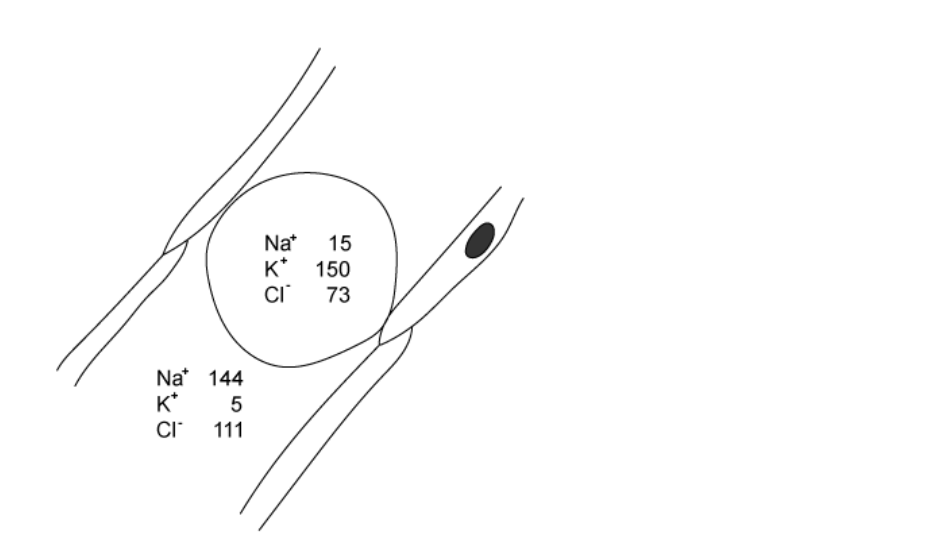

Which row shows the correct direction of active transport?

|   | **into cell** | **out of cell** |
|---|---|---|
| **A** | C*l*- | K+ |
| **B** | Na+ | C*l*- |
| **C** | Na+ | K+ |
| **D** | K+ | Na+ |

### Q3 — hard — 1 marks

**Q3** [1 mark]

The graph shows the oxygen dissociation curves for human haemoglobin at two different pHs.

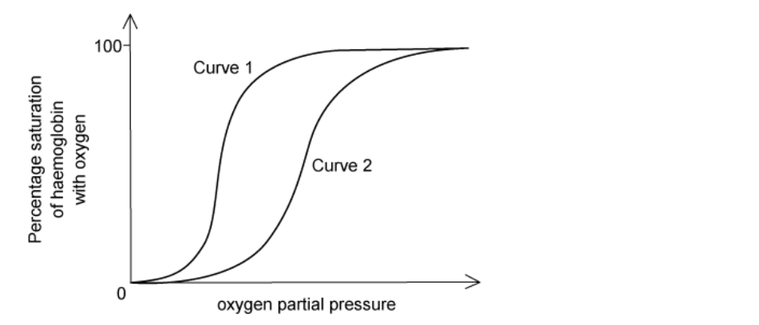

Which curve shows the lowest pH and in which tissue might have this data been collected?

|   | **lower pH** | **Tissue** |
|---|---|---|
| **A** | curve 2 | active muscle |
| **B** | curve 2 | resting muscle |
| **C** | curve 1 | active muscle |
| **D** | curve 1 | resting muscle |

### Q4 — hard — 1 marks

**Q4** [1 mark]

Active muscles have a higher respiration rate than resting muscles. The graph below shows the oxygen dissociation curves for haemoglobin for resting muscle and active muscle.

- **W **and **X **are at the partial pressures of oxygen found in the lungs
- **Y** and **Z** are at the partial pressures of oxygen found in either a resting muscle or an active muscle

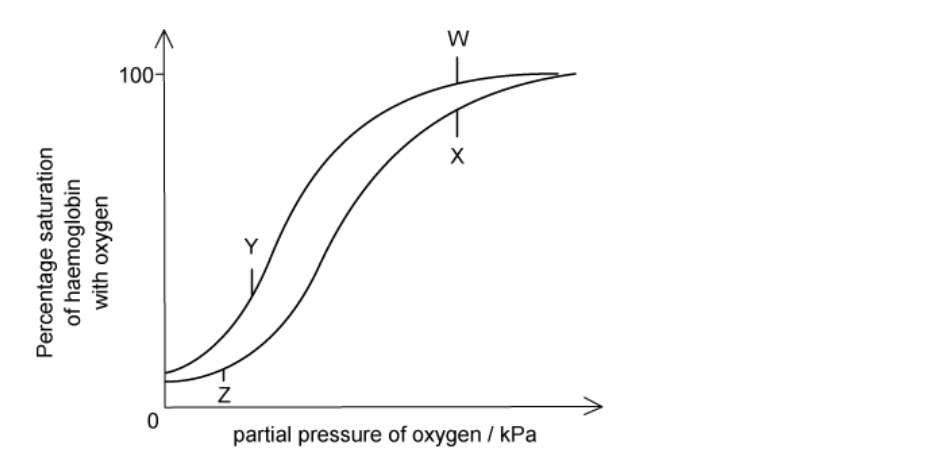

Which of the following statements are correct?

| 1 | The % saturation at **X** minus the % saturation at **Y** represents the amount of oxygen delivered to a resting muscle. |
|---|---|
| 2 | The % saturation at **W** minus the % saturation at **X **represents the amount of oxygen delivered to an active muscle. |
| 3 | The % saturation at **X **represents the amount of oxygen carried to an active muscle. |
| 4 | The % saturation at **Z** represents the amount of oxygen required by a resting muscle. |
| 5 | The % saturation at **W** minus the % saturation at **Y** represents the amount oxygen delivered to a resting muscle |

### Q5 — hard — 1 marks

**Q5** [1 mark]

The partial pressure of oxygen decreases as altitude increases from sea level.

Which row of the table below correctly describes the reason for the response of the body at high altitude?

|   | **description** | **reason** |
|---|---|---|
| **A** | red blood cells have genes switched on | so red blood cells produce more haemoglobin |
| **B** | oxygen dissociation curve shifts to the right | to compensate for an increase in oxygen unloading in tissues |
| **C** | percentage saturation of haemoglobin with oxygen in lungs decreases | so more red blood cells are produced to carry more haemoglobin |
| **D** | more red blood cells | because haemoglobin breaks down more rapidly |

### Q6 — hard — 1 marks

**Q6** [1 mark]

The graph shows the Bohr effect

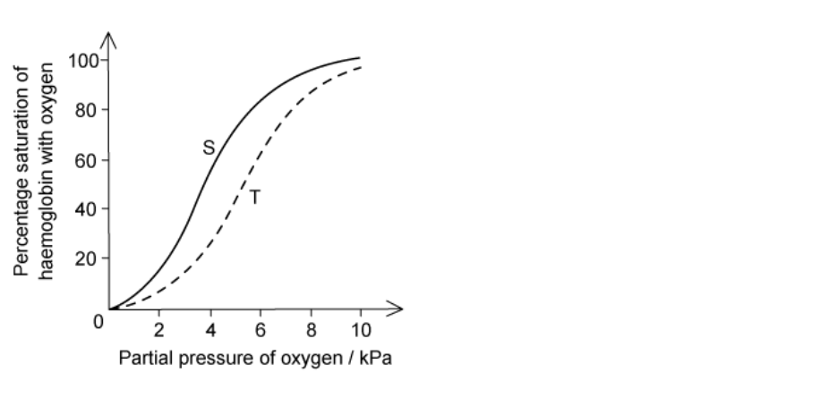

Which of the following explains the shift from **S** to **T**?

### Q7 — hard — 1 marks

**Q7** [1 mark]

The diagram shows the transportation of carbon dioxide by red blood cells.

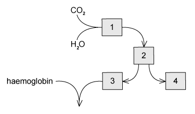

Which row shows the correct compounds at each stage?

|   | **1** | **2** | **3** | **4** |
|---|---|---|---|---|
| **A** | carbamino-haemoglobin | haemoglobic acid | hydrogen ions | hydrogen carbonate ions |
| **B** | carbonic anhydrase | carbonic acid | hydrogen carbonate ions | hydrogen ions |
| **C** | carbamino-haemoglobin | carbonic anhydrase | carbonic acid | carbon dioxide |
| **D** | carbonic anhydrase | carbonic acid | hydrogen ions | hydrogen carbonate ions |

### Q8 — hard — 1 marks

**Q8** [1 mark]

The graph below shows the oxygen dissociation curves for human haemoglobin and myoglobin.

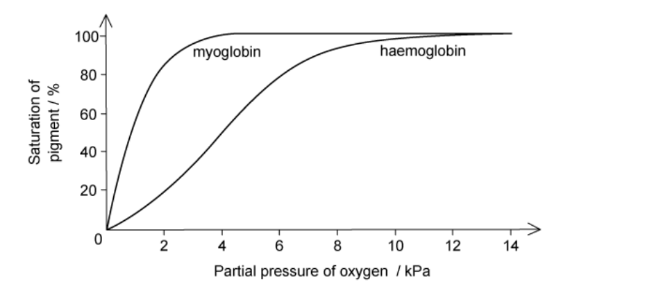

Which statement correctly compares myoglobin and haemoglobin at a partial pressure of oxygen of 2 kPa?

### Q9 — hard — 1 marks

**Q9** [1 mark]

The graph below shows the oxygen dissociation curves for haemoglobin in three different animals.

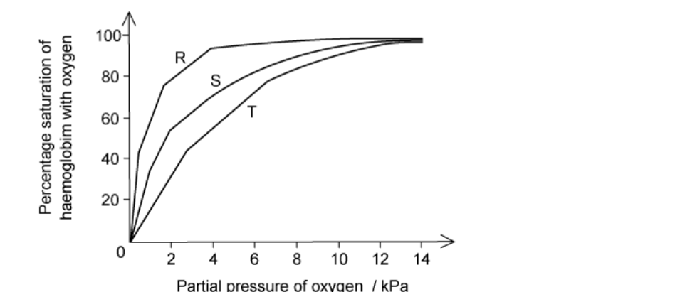

Which of the haemoglobins **R**, **S** or **T **would be present in each of the animals shown in the list below?

| 1 | An adult human. |
|---|---|
| 2 | A fish living in water that has a very low oxygen concentration. |
| 3 | A very active mammal whose tissues have a much higher rate of respiration than an adult human. |

|   | **1** | **2** | **3** |
|---|---|---|---|
| **A** | T | S | R |
| **B** | S | T | R |
| **C** | S | R | T |
| **D** | R | S | T |

### Q10 — hard — 1 marks

**Q10** [1 mark]

The graph below shows the oxygen dissociation curves for haemoglobin at different partial pressures of carbon dioxide.

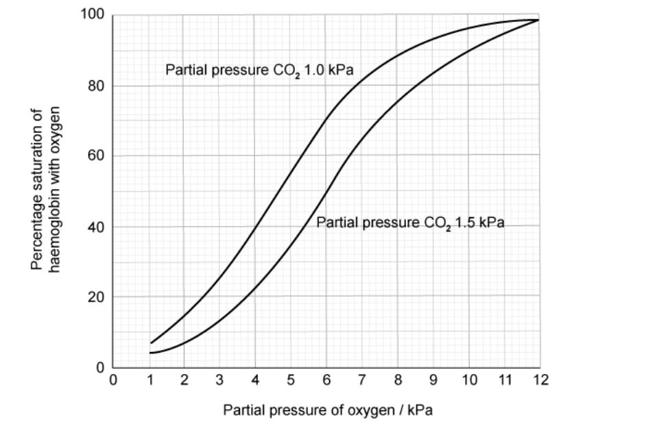

Which of the following shows the correct percentage change in percentage saturation of haemoglobin at a partial pressure of 6 kPa between the partial pressures of carbon dioxide from 1.0 kPa and 1.5 kPa?

### Q11 — medium — 1 marks

**Q11** [1 mark]

The graph below is the oxygen dissociation curve for human haemoglobin in different concentrations of carbon dioxide.

Which letter represents the oxygen concentration of red blood cells as they leave a resting muscle?

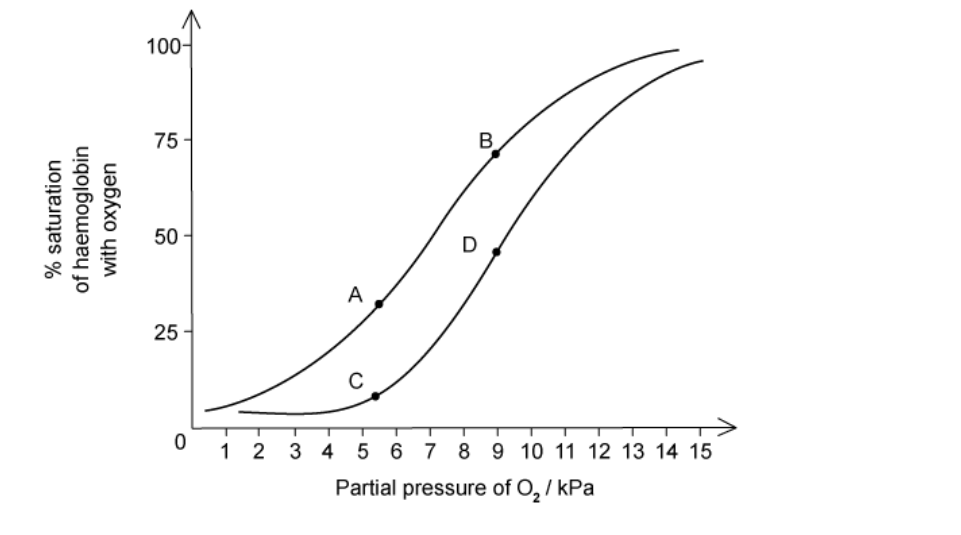

### Q12 — medium — 1 marks

**Q12** [1 mark]

The graph below shows the oxygen dissociation curve for human haemoglobin.

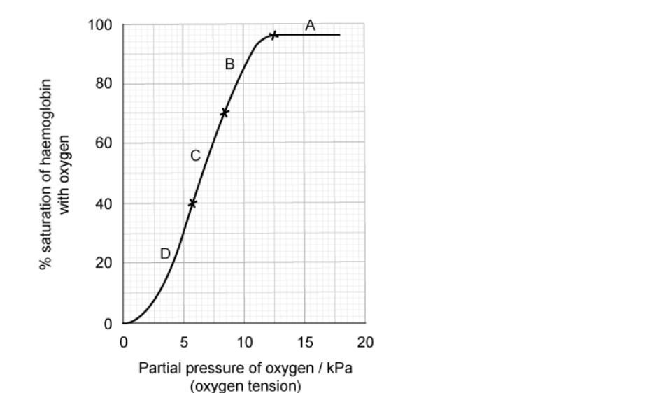

Which letter shows the range of partial pressures that produce the greatest change of percentage saturation of haemoglobin per oxygen unit tension?

### Q13 — medium — 1 marks

**Q13** [1 mark]

Oxygen is displaced from oxyhaemoglobin.

Which of the following substances will encourage this displacement?

| 1 | hydrogen ions |
|---|---|
| 2 | hydrogen carbonate ions |
| 3 | carbon monoxide |
| 4 | carbon dioxide |

### Q14 — medium — 1 marks

**Q14** [1 mark]

The graph shows the oxygen dissociation curves for human haemoglobin in three different concentrations of carbon dioxide.

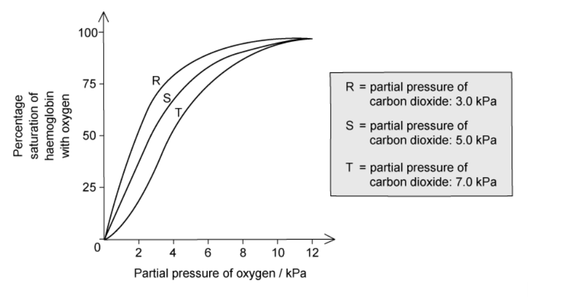

What is the effect of carbon dioxide on haemoglobin?

### Q15 — medium — 1 marks

**Q15** [1 mark]

Different animals have differing percentage saturation of haemoglobin at the same partial pressures.

The graph below shows this difference between a human and vertebrate Y. The partial pressure of CO2 remains constant at 1.0 kPa and the temperature constant at 25 ˚C.

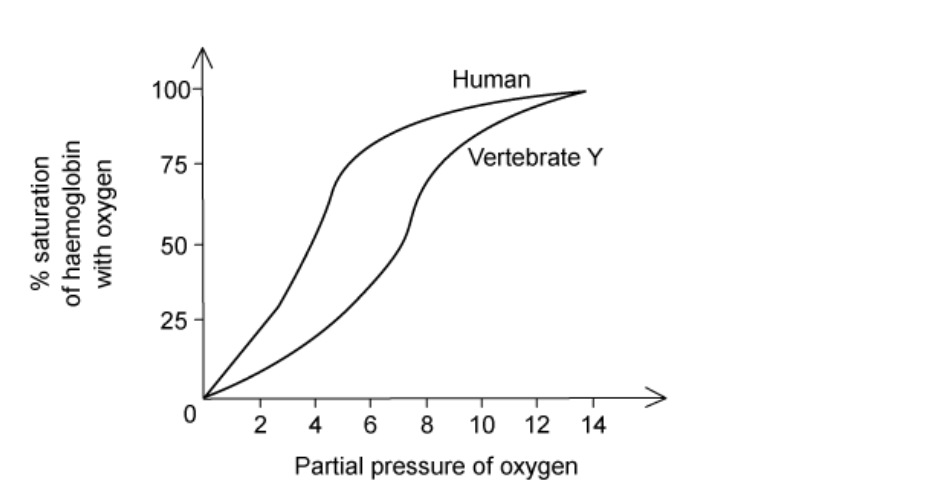

Which of the following conclusions is supported by the data in the graph?

### Q16 — medium — 1 marks

**Q16** [1 mark]

The percentage saturation of haemoglobin with oxygen changes at different partial pressures of oxygen.

The graph below shows this change in two different concentrations of carbon dioxide.

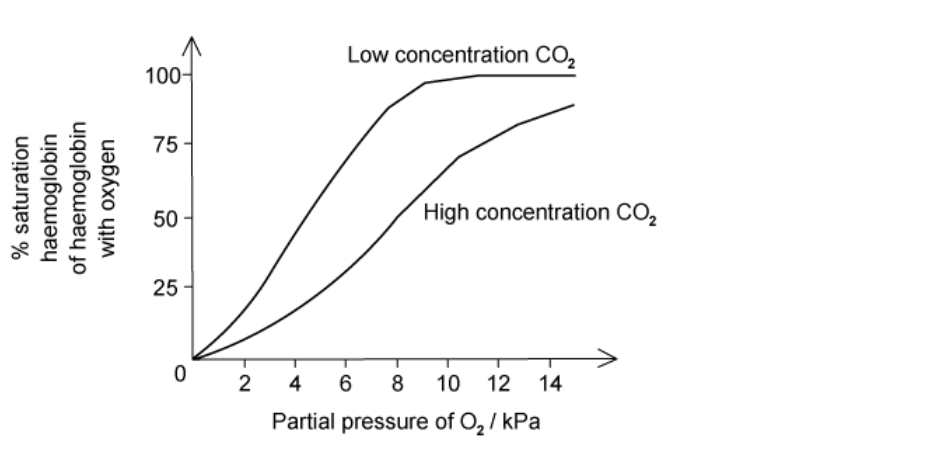

What of the following would be a correct effect of increasing the carbon dioxide concentration?

### Q17 — medium — 1 marks

**Q17** [1 mark]

When carbon dioxide levels increase in human blood, the oxyhaemoglobin dissociation curve shifts to the right.

Which of the following statements explains this effect?

### Q18 — medium — 1 marks

**Q18** [1 mark]

The following are reactions that take place in blood.

| 1 | HbO8 → Hb + 4O2 |
|---|---|
| 2 | HbO8 + H+ → HHb + 4O2   |
| 3 | HCO3- + H+ → H2CO3 |
| 4 | H2O + CO2 → H2CO3 |

Which of these will take place in blood passing through active tissues?

### Q19 — medium — 1 marks

**Q19** [1 mark]

The graph below shows the oxygen dissociation curve for human haemoglobin.

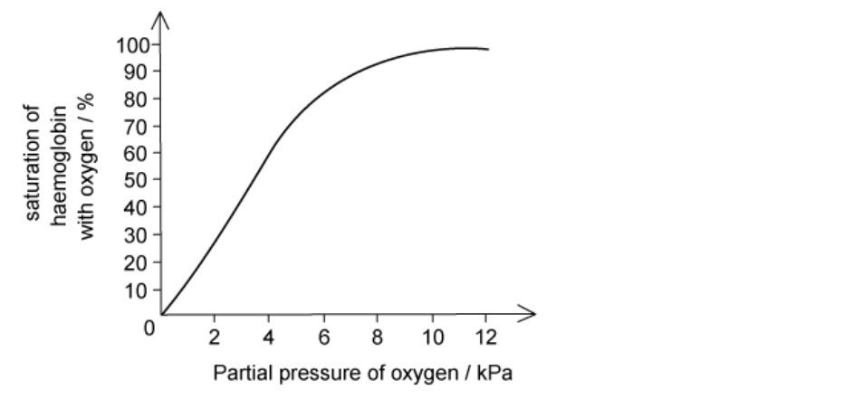

What range of partial pressures of oxygen would be found in pulmonary arteries?

### Q20 — medium — 1 marks

**Q20** [1 mark]

The photograph below shows a type of blood cell.

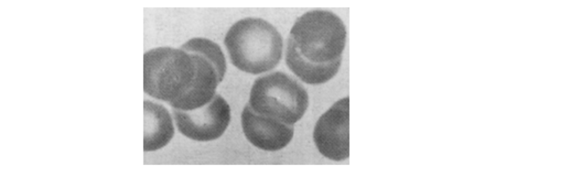

Which of the following statements about these cells are correct?

1      Water passes in and out of these cells by osmosis.

2      Oxygen diffuses through the phospholipid bilayer.

3     Sodium ions diffuse through the phospholipid bilayer.

### Q21 — easy — 1 marks

**Q21** [1 mark]

The properties of haemoglobin change as a result of the Bohr effect.

Which row of the table below correctly describes these changes?

|   | **affinity for oxygen by haemoglobin** | **oxygen dissociates from haemoglobin** |
|---|---|---|
| **A** | lower | less readily |
| **B** | lower | more readily |
| **C** | higher | less readily |
| **D** | higher | more readily |

### Q22 — easy — 1 marks

**Q22** [1 mark]

Which of the following reactions will take place in the blood of a capillary next to an alveolus in the lungs?

| 1 | H2O + CO2 → H2CO3 |
|---|---|
| 2 | Hb + 4O2 → HbO8 |
| 3 | HHb + 4O2 → HbO8 + H+ |

### Q23 — easy — 1 marks

**Q23** [1 mark]

The Bohr effect describes a relationship between haemoglobin, oxygen and carbon dioxide.

Which statement best describes this effect?

### Q24 — easy — 1 marks

**Q24** [1 mark]

Which of the following is a correct statement about the transport of carbon dioxide by blood?

| 1 | Carbon dioxide dissociates forming hydrogen ions that combine with haemoglobin to form carbaminoglobin. |
|---|---|
| 2 | Carbon dioxide diffuses from respiring cells to red blood cells and reacts with water. |
| 3 | The enzyme carbonic anhydrase catalyses the formation of carbonic acid in red blood cells. |

### Q25 — easy — 1 marks

**Q25** [1 mark]

Haemoglobin can bind to carbon dioxide, oxygen and carbon monoxide.

Which of the following statements about the binding sites on a haemoglobin molecule is correct?

### Q26 — easy — 1 marks

**Q26** [1 mark]

Carbonic anhydrase is an enzyme.

What is produced as a result of the action of carbonic anhydrase?

### Q27 — easy — 1 marks

**Q27** [1 mark]

As blood passes through the capillaries of the lungs the uptake of oxygen is maximised.

Which of the statements below explain how this happens?

### Q28 — easy — 1 marks

**Q28** [1 mark]

Which of the following can be carried out by a mature red blood cell?

### Q29 — easy — 1 marks

**Q29** [1 mark]

Carbonic anhydrase catalyses a reaction involved in the transport of carbon dioxide.

What happens after this reaction has taken place?

### Q30 — easy — 1 marks

**Q30** [1 mark]

Which of the following could be a result of lower concentrations of carbonic anhydrase?

## Structured Questions (14 questions)

### Q1 — hard — 9 marks

**Q1** [3 marks]

The dissociation and binding of oxygen to and from haemoglobin in red blood cells produces a sigmoid curve.

Explain the property of haemoglobin that causes this shaped curve.

**Q1** [1 mark]

Fig. 1 below shows oxygen dissociation curves of haemoglobin at two different carbon dioxide concentrations.

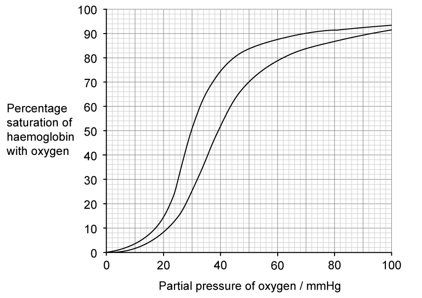

**Fig. 1**

The partial pressure of oxygen in the lungs is 100 mmHg and the partial pressure in metabolically active tissue is 40 mmHg.

Identify the percentage saturation of haemoglobin with oxygen in the lungs and in metabolically active tissue.

**Q1** [4 marks]

Figure 2 shows how changes in the partial pressure of oxygen (PO2) influence oxygen (O2) binding to, and dissociation from, haemoglobin alongside the oxygen content of whole blood.

The human body contains approximately 5 litres of blood. The concentration of haemoglobin is 15 g per 100 ml of blood, when fully saturated there is 1.34 cm3 oxygen per gram of haemoglobin.

100 mmHg partial pressure of oxygen in found in arterial blood and 40 mmHg partial pressure of oxygen is found in venous blood.

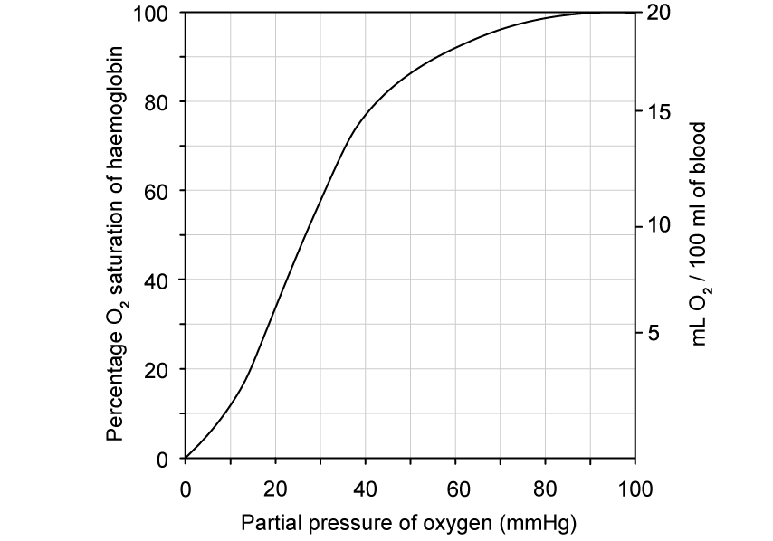

**Fig. 2**

(i) Calculate the percentage change in ml of oxygen in blood from arterial to venous blood in a human body.

[2]

(ii) Calculate how much oxygen is carried in venous blood in a human body.

[2]

**Q1** [1 mark]

**Extract:**

Fig. 1 below shows oxygen dissociation curves of haemoglobin at two different carbon dioxide concentrations. The partial pressure of oxygen in the lungs is 100 mmHg and the partial pressure in metabolically active tissue is 40 mmHg.

Figure 2 shows how changes in the partial pressure of oxygen (PO2) influence oxygen (O2) binding to, and dissociation from, haemoglobin alongside the oxygen content of whole blood. The human body contains approximately 5 litres of blood. The concentration of haemoglobin is 15 g per 100 ml of blood, when fully saturated there is 1.34 cm^3^ oxygen per gram of haemoglobin. 100 mmHg partial pressure of oxygen in found in arterial blood and 40 mmHg partial pressure of oxygen is found in venous blood.

A scientist comments that "venous blood is not deoxygenated".

Use the information and your answers in part (b) to explain this.

### Q2 — hard — 9 marks

**Q2** [2 marks]

Red blood cells are a type of specialised cell with a limited life span of around 120 days; at this point, their function has declined and they are destroyed by white blood cells. During their lifespan, red blood cells are exposed to high levels of physical stress, as well as undergoing the loss of structure of proteins both within the cell and within their cell surface membranes.

Use this information and your knowledge of red blood cells to suggest and explain **one** special feature of red blood cells that contributes to their short-lived nature.

**Q2** [3 marks]

Figure 1 shows some of the events taking place in and around a red blood cell as it travels through actively respiring tissues.

**                                               Fig. 1**

(i) Write a word equation to show the process taking place at **P**.

[1]

(ii) Explain what is happening at points **Q** and **S**.

[2]

**Q2** [2 marks]

**Extract:**

Figure 1 shows some of the events taking place in and around a red blood cell as it travels through actively respiring tissues.

The process marked **R** in Fig. 1 is involved in generating the Bohr shift. The Bohr shift occurs when carbon dioxide levels are increased from low to high, as shown in Fig. 2.

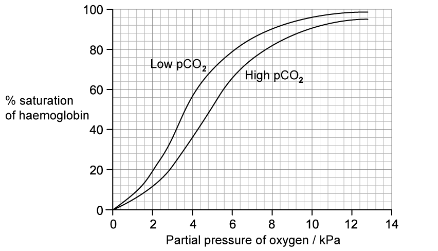

**                                                     Fig. 2**

Explain the connection between process **R** in Fig. 1 and the Bohr shift shown in Fig. 2.

**Q2** [2 marks]

**Extract:**

Figure 1 shows some of the events taking place in and around a red blood cell as it travels through actively respiring tissues.

The process marked R in Fig. 1 is involved in generating the Bohr shift. The Bohr shift occurs when carbon dioxide levels are increased from low to high, as shown in Fig. 2.

The connection between process R and the Bohr shift is that H+/hydrogen ions (produced from the dissociation of carbonic acid) bind with haemoglobin, causing oxygen to be released; The affinity of haemoglobin for oxygen is reduced.

Explain the importance of the Bohr shift to metabolically active tissues.

### Q3 — hard — 14 marks

**Q3** [6 marks]

Figure 1 below shows an oxyhaemoglobin dissociation curve.

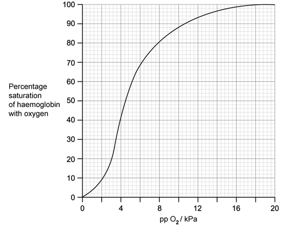

Fig. 1

Using Figure 1 and your own knowledge describe the structure of haemoglobin and explain how it transports oxygen around the body.

**Q3** [4 marks]

Figure 2 shows the oxygen dissociation curves for myoglobin, **M**, and haemoglobin,** H**.

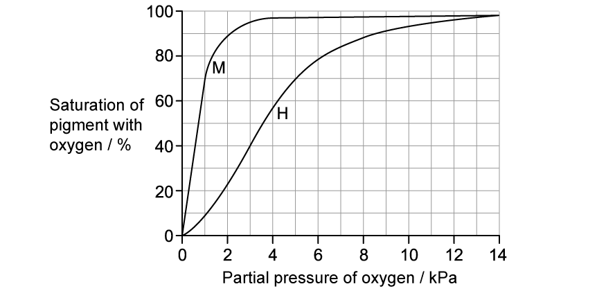

Fig. 2

Using Figure 2

(i) State the percentage saturation of myoglobin and haemoglobin when the partial pressure of oxygen is 1 kPa.

[1]

(ii) Explain the significance of the difference in percentage saturation that you have identified in part (i).

[3]

**Q3** [4 marks]

**Extract:**

From part a:
Haemoglobin description:
- Haemoglobin is a protein with a quaternary structure
- Haemoglobin is made up of 4 polypeptides
- Haemoglobin contains 4 Haem groups
- Each haem groups contain iron ions / Fe^2+^

From part b:
Figure 2 shows the oxygen dissociation curves for myoglobin, M, and haemoglobin, H.

The structure of myoglobin is shown in Figure 3.

**Fig. 3**

(i) Compare the structure of myoglobin with the structure of haemoglobin.

[2]

(ii) Using Figure 3, explain the shape of the oxygen dissociation curve for myoglobin in Figure 2.

[2]

### Q4 — hard — 11 marks

**Q4** [5 marks]

Figure 1 shows the oxygen dissociation curve for the haemoglobin of adults (HbA), as well as for a special type of haemoglobin produced by the cells of foetuses prior to birth; this second type of haemoglobin is known as foetal haemoglobin (HbF).

**Fig. 1**

Describe **and** explain the shape of the curve for HbA shown in Figure 1.

**Q4** [1 mark]

**Extract:**

Figure 1 shows the oxygen dissociation curve for the haemoglobin of adults (HbA), as well as for a special type of haemoglobin produced by the cells of foetuses prior to birth; this second type of haemoglobin is known as foetal haemoglobin (HbF).

Use Figure 1 to determine the percentage saturation of the following with oxygen at a partial pressure of oxygen of 4 kPa:

- HbA
- HbF

**Q4** [3 marks]

**Extract:**

Figure 1 shows the oxygen dissociation curve for the haemoglobin of adults (HbA), as well as for a special type of haemoglobin produced by the cells of foetuses prior to birth; this second type of haemoglobin is known as foetal haemoglobin (HbF).

Sickle cell disease is a genetic condition in which a mutation in the gene coding for part of the haemoglobin molecule causes red blood cells to take on a sickled, or crescent, shape. This influences the ability of the red blood cells to pass easily through the capillaries.

An experimental treatment for sickle cell disease involves gene therapy to increase the expression of the gene that codes for HbF, a gene that is normally switched off in adults.

(i) Suggest how an increase in the expression of HbF could help to treat sickle cell disease.

[1]

(ii) Suggest why HbF may not be a perfect replacement for HbA.

[2]

**Q4** [2 marks]

**Extract:**

Figure 1 shows the oxygen dissociation curve for the haemoglobin of adults (HbA), as well as for a special type of haemoglobin produced by the cells of foetuses prior to birth; this second type of haemoglobin is known as foetal haemoglobin (HbF).

**Fig. 1**

Another form of oxygen-binding protein that exists in the tissues of humans is myoglobin. Myoglobin is present in the muscles where it functions as an oxygen store. It has a higher affinity for oxygen than both HbA and HbF.

Sketch a suggested dissociation curve for myoglobin on Figure 1.

### Q5 — medium — 10 marks

**Q5** [3 marks]

Table 1 shows the partial pressure of oxygen at different saturations of haemoglobin.

**Table 1**

| Animal | Partial pressure of oxygen at 25% haemoglobin saturation (mmHg) | Partial pressure of oxygen at 50% haemoglobin saturation (mmHg) | Partial pressure of oxygen at 90% haemoglobin saturation (mmHg) |
|---|---|---|---|
| Elephant | 12 | 22 | 44 |
| Mouse | 38 | 52 | 98 |

Plot the haemoglobin saturation data from Table 1 and use these points to sketch the full oxyhaemoglobin dissociation curves for an elephant and a mouse.

**Q5** [3 marks]

**Extract:**

Table 1 shows the partial pressure of oxygen at different saturations of haemoglobin.

**Table 1**

| Animal | Partial pressure of oxygen at 25% haemoglobin saturation (mmHg) | Partial pressure of oxygen at 50% haemoglobin saturation (mmHg) | Partial pressure of oxygen at 90% haemoglobin saturation (mmHg) |
| Elephant | 12 | 22 | 44 |
| Mouse | 38 | 52 | 98 |

Explain why the dissociation curve for the mouse is different to the dissociation curve for the elephant.

**Q5** [4 marks]

Haemoglobin in the respiring tissues has a lower affinity for oxygen.

Explain why.

### Q6 — medium — 11 marks

**Q6** [3 marks]

Transportation of hydrogen carbonate ions out of red blood cells results in a positive charge within the cell.

Describe the** **mechanism of red blood cells to prevent this electrical imbalance.

**Q6** [3 marks]

**Extract:**

Chloride shift; Chloride ions/Cl⁻ are transported into the red blood cells; To replace hydrogen carbonate ions/HCO₃⁻ (formed from the dissociation of carbonic acid) which are transported out of red blood cells; This prevents red blood cells from becoming positively charged;

Fig. 1 shows a red blood cell at a respiring tissue.

Identify labels **A** -**C** on the diagram.

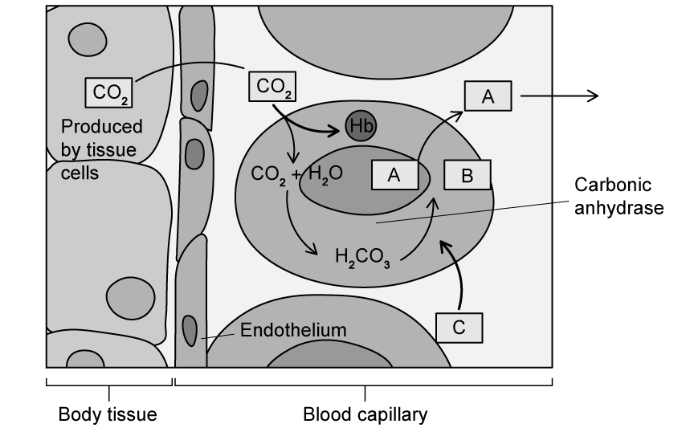

**Fig. 1**

**Q6** [4 marks]

**Extract:**

Transportation of hydrogen carbonate ions out of red blood cells results in a positive charge within the cell.

The mechanism of red blood cells to prevent electrical imbalance is as follows...

Chloride shift;
Chloride ions/Cl^-^ are transported into the red blood cells;
To replace hydrogen carbonate ions/HCO~3~^-^ (formed from the dissociation of carbonic acid) which are transported out of red blood cells;
This prevents red blood cells from becoming positively charged;

Table 1 shows the difference in ion concentrations in arterial and venous blood.

**Table 1**

| Venous blood (mmol) | Arterial blood (mmol) |   |   |
|---|---|---|---|
| Na+ | 137.0 | Na+ | 137.0 |
| K+ | 4.0 | K+ | 4.0 |
| Cl- | 101.2 | Cl- | 104.8 |
| HCO3- | 25.2 | HCO3- | 22.7 |

Calculate the percentage change in chloride ions and suggest a reason for this difference.

Give your answer to 3 significant figures.

**Q6** [1 mark]

Red blood cells transport ions through a carrier protein.

Give the method of transport that this is this an example of.

### Q7 — medium — 9 marks

**Q7** [5 marks]

Haemoglobin is a globular protein which is able to transport oxygen and is soluble in water.

(i) Explain how the structure of a haemoglobin molecule makes it able to transport oxygen efficiently.

[3]

(ii) Explain how the structure of a haemoglobin molecule allows it to be soluble in water.

[2]

*Source: Oct/Nov 2018 9700/21 Q6A*

**Q7** [3 marks]

Llamas are mammals that are adapted to live at high altitudes.

Figure 1 shows oxygen dissociation curves for haemoglobin of llamas and humans.

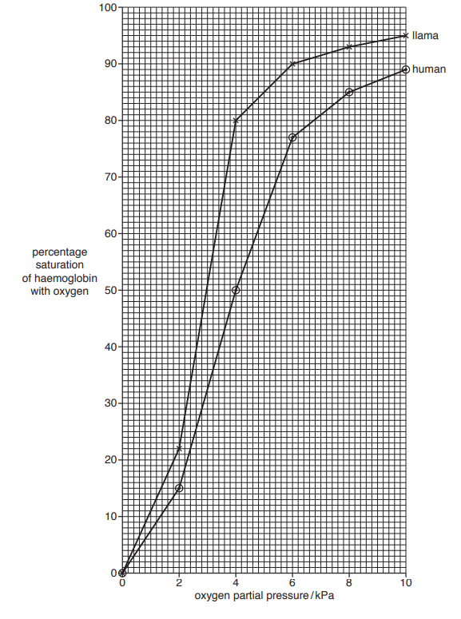

**Fig. 1**

(i)The partial pressure of oxygen in the lungs of mammals at 3500 m is 6.4 kPa.

Use Figure 1 to state the percentage saturation of haemoglobin of llamas **and **humans at an oxygen partial pressure of 6.4 kPa.

[1]

(ii)With reference to Figure 1, explain the advantage to llamas of having an oxygen dissociation curve positioned to the left of the curve for humans.

[2]

*Source: Oct/Nov 2018 9700/21 Q6B*

**Q7** [1 mark]

**Extract:**

Llamas are mammals that are adapted to live at high altitudes.

Figure 1 shows oxygen dissociation curves for haemoglobin of llamas and humans.

Fig. 1

Fetal haemoglobin in mammals causes a shift in the oxygen dissociation curve to the left.

Suggest the percentage saturation of haemoglobin for fetal llama haemoglobin at an oxygen partial pressure of 4 kPa.

### Q8 — medium — 11 marks

**Q8** [3 marks]

Figure 1 shows the oxygen dissociation curve for haemoglobin.

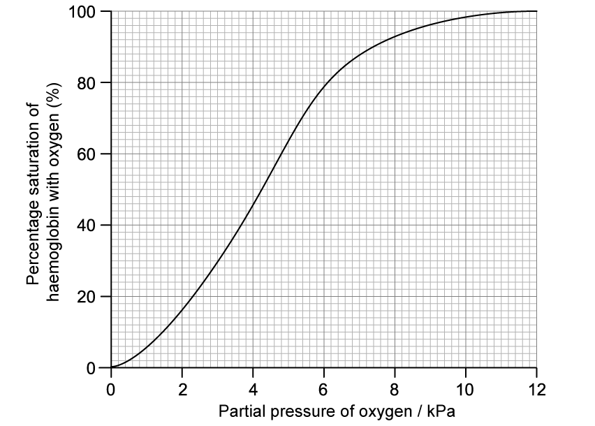

**                                                         Fig. 1**

Use Figure 1 to complete the table below

| **Location** | **Partial pressure of oxygen / kPa** | **Percentage saturation of haemoglobin / %** | **Rate of oxyhaemoglobin dissociation**  **(slow / fast) ** |
|---|---|---|---|
| Capillaries branching from pulmonary artery | 0.6 |   |   |
| Capillaries in respiring tissue |   | 45 |   |
| Capillaries leading to pulmonary vein |   | 98 |   |

**Q8** [4 marks]

**Extract:**

Figure 1 shows the oxygen dissociation curve for haemoglobin.

                                                         Fig. 1

During exercise, oxygen is released from haemoglobin more readily than is shown in Figure 1.

Explain why this is the case.

**Q8** [2 marks]

Figgure 2 shows the oxygen dissociation curves for the haemoglobin of three different mammal species; **X**, **Y**, and **Z**.

**                                                        Fig. 2**

Species **Z** lives at sea level while species **X **lives at high altitude where the atmospheric partial pressure of oxygen is lower.

Suggest how the haemoglobin of species **X **enables it to survive at high altitudes.

**Q8** [2 marks]

**Extract:**

Figure 2 shows the oxygen dissociation curves for the haemoglobin of three different mammal species; X, Y, and Z.

Fig. 2

Species Z lives at sea level while species X lives at high altitude where the atmospheric partial pressure of oxygen is lower.

Species **Y** lives at the same altitude as species **X **but is more metabolically active.

Suggest how the haemoglobin of species **Y** enables it to be more metabolically active.

### Q9 — medium — 11 marks

**Q9** [3 marks]

Figure 1 shows the structure of haemoglobin.

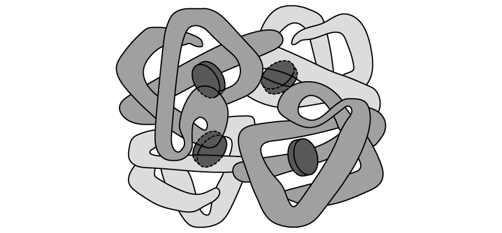

**                                                           Fig. 1**

Explain how the structure of haemoglobin relates to its function.

**Q9** [3 marks]

Figure 2 shows the oxygen dissociation curve for haemoglobin.

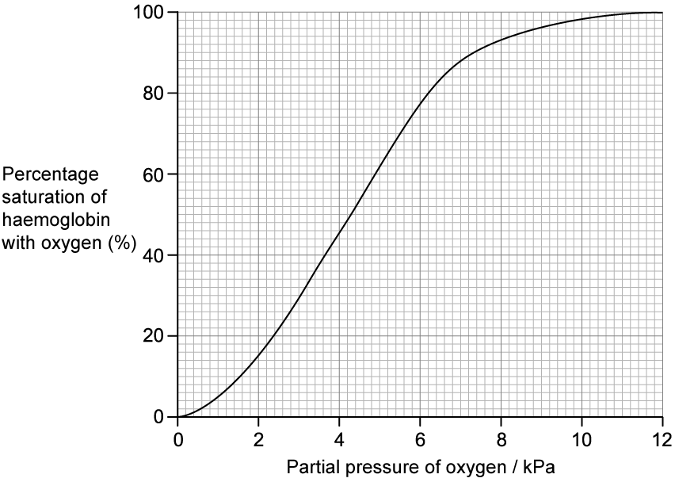

**                                                           Fig. 2**

Explain what Figure 2 shows about the relationship between the partial pressure of oxygen (pO2) and the affinity of haemoglobin for oxygen.

**Q9** [2 marks]

**Extract:**

Figure 2 shows the oxygen dissociation curve for haemoglobin.

Fig. 2

Calculate the difference in percentage saturation of haemoglobin with oxygen between a pO2 of 2 kPa and a pO2 of 8 kPa in Fig. 2.

**Q9** [3 marks]

**Extract:**

Figure 2 shows the oxygen dissociation curve for haemoglobin.

Fig. 2 shows the following about the relationship between pO~2~ and the affinity of haemoglobin for oxygen...

- At low pO~2~ the affinity of haemoglobin for oxygen is low;
- Haemoglobin binds slowly to oxygen at low pO~2~ / oxygen saturation is low at low pO~2~;
- At high pO~2~ the affinity of haemoglobin for oxygen is high;
- Saturation of haemoglobin with oxygen is high at high pO~2~;

Anaemia is a condition in which an individual's blood contains less haemoglobin than usual. Individuals with anaemia can produce chemicals in their blood which influence the haemoglobin dissociation curve, as shown in Figure 3.

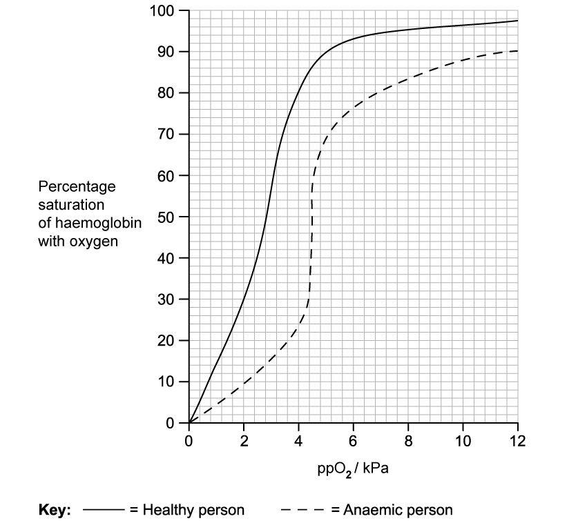

**Fig. 3**

Suggest the advantage to an anaemic individual of producing chemicals that have the effect shown in Figure 3.

### Q10 — easy — 10 marks

**Q10** [4 marks]

Carbon dioxide produced during respiration diffuses from cells into the blood.

Describe the role of plasma and red blood cells in the transport of carbon dioxide.

**Q10** [2 marks]

Red blood cells contain an enzyme that catalyses a reaction to aid the transport of carbon dioxide in blood plasma.

(i) State the name of this enzyme.

[1]

(ii) Describe the role of the enzyme.

[1]

**Q10** [2 marks]

**Extract:**

Carbon dioxide produced during respiration diffuses from cells into the blood.

The role of plasma and red blood cells in the transport of carbon dioxide is...

- Carbon dioxide diffuses into the cytoplasm of red blood cells;
- Carbon dioxide combines with water;
- to form carbonic acid/H2CO3;
- Carbonic acid dissociates into hydrogen ions/H+ AND hydrogen carbonate ions/HCO3-;

Haemoglobinic acid is an important by-product in the transport of carbon dioxide.

Describe how** **haemoglobinic acid is formed.

**Q10** [2 marks]

**Extract:**

Haemoglobinic acid is an important by-product in the transport of carbon dioxide.

Haemoglobinic acid is formed by hydrogen ions reacting with/combining with haemoglobin.

Hydrogen ions are formed when carbon dioxide is transformed into carbonic acid inside the red blood cells. This dissociates into hydrogen ions (and hydrogen carbonate ions). The hydrogen ions would lower the pH of red blood cells and possibly denature associated enzymes, so hydrogen ions combine with haemoglobin to form the product haemogobinic acid, which acts as a pH buffer in this situation.

Explain the importance of the haemoglobinic acid.

### Q11 — easy — 8 marks

**Q11** [3 marks]

With reference to the different partial pressures of oxygen (*pp*O2) throughout the body explain how haemoglobin supplies oxygen to different areas of the human body.

**Q11** [2 marks]

The oxyhaemoglobin dissociation curves for adult haemoglobin (HbA) and foetal haemoglobin (HbF) are shown in Fig. 1 below.

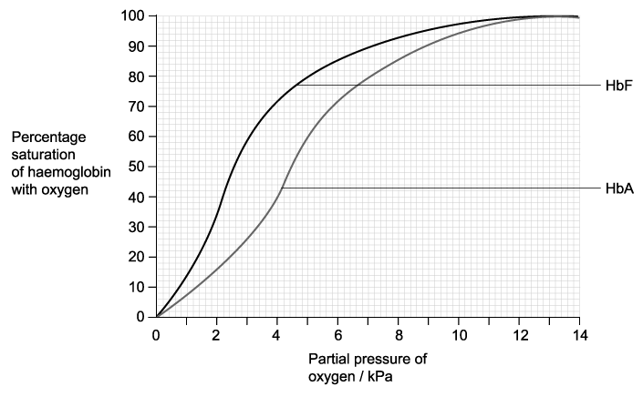

**Fig. 1**

Explain the steep gradient seen in the curve seen for HbA in** **Fig. 1

**Q11** [1 mark]

**Extract:**

The oxyhaemoglobin dissociation curves for adult haemoglobin (HbA) and foetal haemoglobin (HbF) are shown in Fig. 1 below.

**Fig. 1**

State what can be concluded from Figure 1 about the difference between HbF and HbA.

**Q11** [2 marks]

Haemoglobin is a quaternary protein that is broken down in the liver.

Predict what haemoglobin will be broken down into and suggest one function of this breakdown product in the body.

### Q12 — easy — 9 marks

**Q12** [2 marks]

Describe what is meant by the chloride shift.

**Q12** [3 marks]

Hydrogen carbonate ions are formed in a two step process

(i) Give the two equations that represent this two step process.

[2]

(ii) Identify the name of the enzyme involved in these reactions.

[1]

**Q12** [1 mark]

**Extract:**

The chloride shift is the movement of chloride ions into red blood cells. This occurs when hydrogen carbonate ions are formed.

Describe the importance of the chloride shift for red blood cells.

**Q12** [3 marks]

**Extract:**

Describe what is meant by the chloride shift.

The chloride shift is...
- The movement of chloride ions into red blood cells; [1 mark]
- This occurs when hydrogen carbonate ions are formed; [1 mark]

The chloride shift is not the same as the Bohr shift, so be sure to understand the difference. The Bohr shift occurs when a high partial pressure of carbon dioxide causes haemoglobin to release oxygen into respiring tissues, while the chloride shift refers to the movement of chloride ions into red blood cells.

The chloride shift can be compared to the Bohr shift.

Use a tick (**✓**) or cross (**X**) to assign the statements to either the chloride shift or the Bohr shift. You may choose more than one statement for each shift.

|   | Bohr Shift | Chloride Shift |
|---|---|---|
| Transport of oxygen out of red blood cells |   |   |
| Transport of hydrogen carbonate ions out of red blood cells |   |   |
| Transport of chloride ions into red blood cells |   |   |

### Q13 — easy — 9 marks

**Q13** [4 marks]

Describe and explain **two **ways in which red blood cells are adapted to oxygen transport.

**Q13** [2 marks]

Haemoglobin is a globular protein made of two alpha polypeptides and two beta polypeptides. Each alpha polypeptide consists of 141 amino acids and each beta polypeptide consists of 146 amino acids.

Calculate the difference in the number of amino acids and DNA bases required for a single alpha polypeptide vs a single beta polypeptide.

**Q13** [2 marks]

A scientist is looking at a red blood cell under an electron microscope and takes an electron micrograph. The actual diameter of the red blood cell is 7µm but in the micrograph image it measures 5cm. This is shown in Fig. 1.

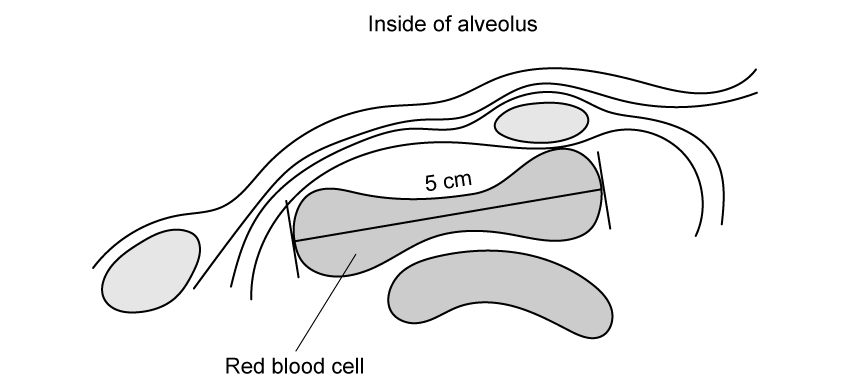

**Fig. 1**

Calculate the magnification used by the scientist in Fig 1. Give your answer to the nearest 100.

**Q13** [1 mark]

Mammals that live at different altitudes often have different haemoglobin.

Suggest how a mammal's haemoglobin might be adapted to live at higher altitudes.

### Q14 — easy — 8 marks

**Q14** [3 marks]

Fig. 1 shows an oxygen dissociation curve at different partial pressures of oxygen (mmHg).

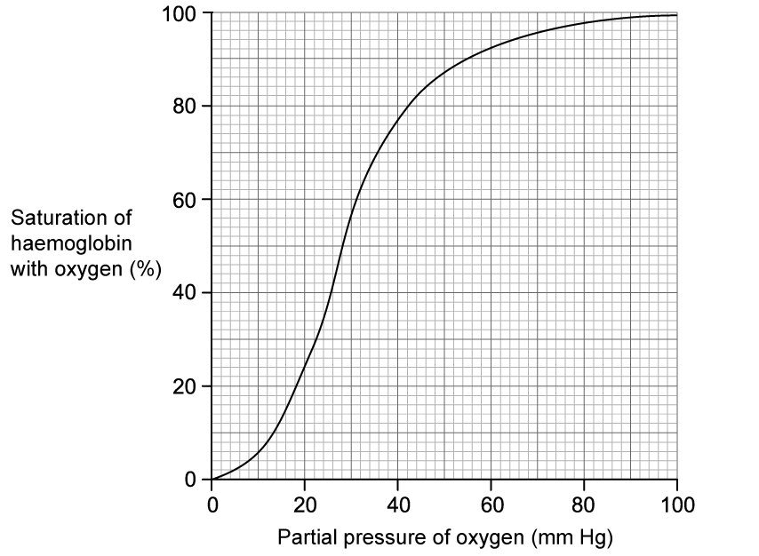

**Fig. 1**

Explain the importance of the oxygen dissociation curve at the partial pressures of oxygen found in the lungs.

**Q14** [3 marks]

**Extract:**

Fig. 1 shows an oxygen dissociation curve at different partial pressures of oxygen (mmHg).

Explain the effect of partial pressure of 20 mmHg on the oxygen saturation of haemoglobin.

**Q14** [1 mark]

**Extract:**

Fig. 1 shows an oxygen dissociation curve at different partial pressures of oxygen (mmHg).

Explain the importance of the oxygen dissociation curve at the partial pressures of oxygen found in the lungs.

The lungs have a high partial pressure/concentration of oxygen;

Explain the effect of partial pressure of 20 mmHg on the oxygen saturation of haemoglobin.

Suggest where in the body a partial pressure of 20 mmHg might be found.

**Q14** [1 mark]

**Extract:**

Fig. 1 shows an oxygen dissociation curve at different partial pressures of oxygen (mmHg).

**Fig. 1**

Identify the % saturation of haemoglobin at 50 mmHg.
